# UBC《机器学习和数据挖掘｜CPSC 340 Machine Learning and Data Mining 2012》中英字幕 p18 -18-undergraduate machine learning 17_ Linear prediction.zh_en -BV1pJ2ABFEFg_p18-

Any data that we can put in the form of a matrix， whether it's an Excel spreadsheet。

 whether it's a bunch of text documents， whether it's a collection of images of songs of whatever。

 if you can write it in terms of a matrix， you can apply PCA to it。

 and you can use that as a tool for visualization。Everything we've done up to。

 And then we saw that PCA。So very briefly， and without proof that what it's actually doing is it's trying to find。

A low rank approximation that is， by that， I mean an approximation with as few eigenvalues as possible and only the largest eigenvalues。

Of the actuallyery true data matrix。Okay， so you're trying to find。

A compressed representation of the data。That is actually as close as possible when you measure it in a patritic distance in the L2 distance。

And so you could think of PC A as an unsupervised technique。And the way the technique。

 the way you train。啊。The way you learn from data when you don't have labels is you look at the data and you try to reproduce the data。

You try to come up with a model that is small so that you can store it in your head。

But at the same time， it has to be able to reproduce the date。

So the brain is much smaller than the world， but if I close my eyes， I can imagine this classroom。

I don imagine it perfectly， but I imagine it well enough that I can survive。

 and I can do my job and so on。And that's essentially the setting of unsupervised。Learning。

Supervised learning， as an MSAs requires some supervision。

 So here the idea is that you have some data。But you also have labels for the data。Okay。

 so you might have。Some data， like I。I could like look at his height and weight and his height and weight and his height and weight。

 and that's the data essentially the height and weight of everyone in this class。

 but in addition I'm going to put a label I'm going to say male， male。

 male with a females female and as we go。Yeah， the ratios't super hot and machine learning。

 It's a lot better here than it is。 It's one of the big problems with our field， actually。😊，嗯。

But once I have labels， then when I get a new person， I measure his height， I measure his weight。

And then using the data that I've gathered from before， I can now predict his sex， male or female。

 Okay so that's the idea。

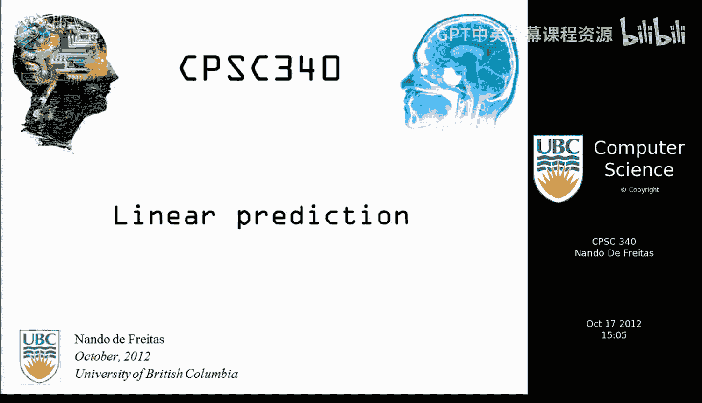

Okay。The lecture will describe this setting and give two examples。

I'm going to introduce supervised learning using linear models。

And simply because these are very easy to explain and because they connect to a technique called least squares。

 to get a better idea of where we are， how many of you have seen least squares before？

They're about half of the class， okay。So we're going to go over that again， least squares。

 and then we're actually going to show in the next class least squares is a maximum likelihood estimate。

 and then we will move on to actually come up with beta estimates and least squares so that you'll never again in your life do least squares。

嗯。And the reason why I stuck here is because this one half of you have seen。

 and this is the easiestvised supervised learning。

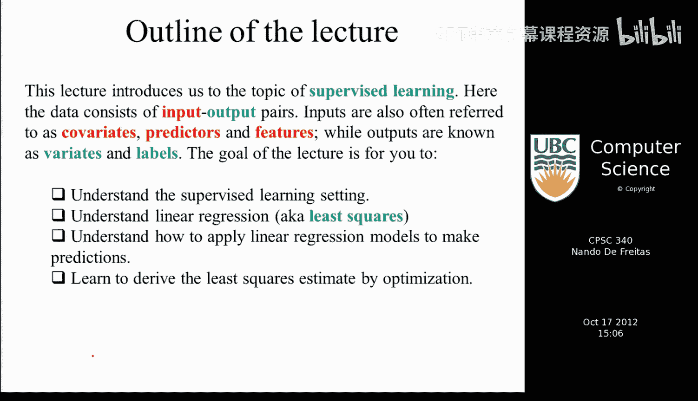

Sort of formulation。Okay， there's reasons to care about linear models。

 so linear models are very simple as the essence of a linear model is that the world might look like this and you're approximating the world by a line。

Okay， that's essentially where the linear comes in。嗯。

But many problems out there can be relatively well approximated with lines。

The other reason is that often if something is not approximated by a line。

 it might be approximated well by two lines。So if you look at modular。

Implementations that use many linear models and linear models that work well in different regimes。

 you're able to actually build some sophisticated systems。In fact。

 aircraft systems which we put out real life for survival when we fly often use these tricks。

Sort of like linear， piece wise control and so on。These are easy because we can do all the math by hand。

 we don't need any computers to do the math。They're good for teaching purposes。

But through linear models， I will able to describe all the important things， model complexity。

 maximum likelihood， facing in learning， cross validation， you know evidence maximization and so on。

 so linear models。Already present all the problems。

That I will have to address when I introduce linear models。

 of course we're going to move on to nonlinear models because they're more fun and we're going to do neural networks and random forests and all the cool stuff that allows us to do the real applications out there。

 But the principles are how you train them。I still the same as the principles on how we train linear models。

 so if you figure out everything with the simpler models， when we dot need linear models。

 it would be fairly easy to understand how to do。The more complex ones。Okay， this is the setup。嗯。

We will be given some data， the data will consist of pairs， the data and the labels。

And so think of for each X， I'm given a y， and during training I will observe n x's and nY's。

So I get the pairs。Each x。Is going to be a vector of several attributes。 for example。

 when I was talking about height and weight， I was talking about two attributes， height and weight。

 so D would be equal to2。So there are two real numbers。And the inputs are also known by many names。

 predictors， they're called features， sometimes， they're call covariates。

 depending on which field or where you learn to stuff， you often refer to these。Interesting。

With different thanks。As long as it's one the projectors。Okay。

 and the output are often the outputs are known as the targets， the labels or the variants。

Mostly I will use features， input outputs， or I'll talk about features and labels。

And here I'm going to assume that the labels are just real numbers。Later。

 we will deal with the case with the binary things like， for example， sex， male， female。

But if we learn how to do this case first， that next case will be easy。

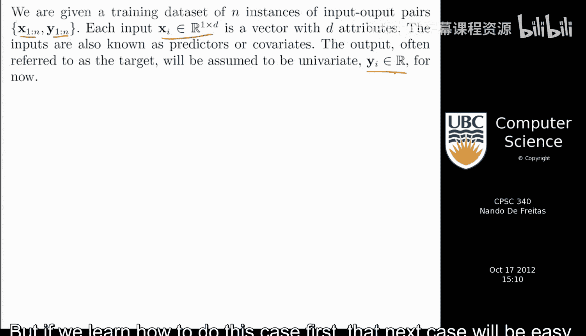

Okay， here's an example that's sort of very trendy right now。

 which is you want to predict energy consumption because if you can predict how much energy if you can predict the temperature at which you need to set a thermostat so that everyone is at the comfortable temperature in this room。

Then one can actually save a lot of money because quite often the thermostat is set up too high。

 there's a lot of people in the room， it gets really hot。

 we're wasting actual energy and when we all leave that thermostat still stays on even though there's no one here if the wind is blowing outside then that thermostat should be adjusted a bit higher because it's colder as a result。

 so if we could also make that thermostat， we would make much better use of energy。

 and if we can reduce the energy spending of Canada by 10% within a huge contribution towards saving the polar bears and whatnot。

Okay， so this is the setup。Just like the height and weight， one， the first data point x1。

In my example might be the wind speed， which is 100。

And the number of people inside the building right now assuming that there were two people。

And essentially what I do is on the first day， so day one。On the first day。

 I collect the wind speed outside， or I just use my iPhone app that gives me the wind speed for Vancouver。

嗯。I check how many people are inside the room。And then I adjust the thermostat。

To some setting and our thermostat setting。Is what I'm going to call y1， which is5。

And this is the setting at which everyone is those two people will be happy。

 the temperature is comfortable。Okay it's nice， I don't know， 20 degrees water。On the second day。

 I do the same thing。 I measure the wind outside。 It's 50 knots。

I count that there are 42 people inside。They're building。

And then I adjust a thermostat to be by hand until it is 25。

 and because it's comfortable at that temperature the temperature do one thing。

That's what you're comfortable in。Well。It might be that。

The setting of the thermostat will depend on how many people there are in the room。

 So this number here is the thermostat setting。If there are many people in the room producing heat。

 I probably can use a lower number。The thermost。Okay， so that's the setup。 I repeat this。

As I show here， n equal four times。And in this case， it are， again， d equal to after。Now。

 on the first day。I could come back here， use my iPhone app， measure the wind speed。Come back here。

 count the number of people and adjust a set。But it turns out that the fifth day is Friday。

 and I want to get out of here early， and I want to go out to the pub and have a beer or whatever。

And so I don't want to work。This is what I can do。I connect my iPhone to that thermostat directly。

It gets the wind speed。From the web。I put a camera with a wire connected to that thermostat。

And that camera every time someone， because it has a face detector。

 which is a standard app with your iPhone。Every time someone walks in it counts that person as being in the room。

 so now of acade in my system， my little iPhone knows how many people are in this room and it knows the wind speed。

If if an addition had a model。That tells me how can I adjust the energy requirement y as a function of x？

If it had a model， which is what should y be as a function of x， it could automatically set y。

So it would measure what the first x is， what the second x is， and then it would predict what y is。

That's what we're after。We're after that automation that you provide labels for four days。

 and on the fifth day， you want a model to predict what y should be for the new X。

 You get to observe the X and you predict what y is。

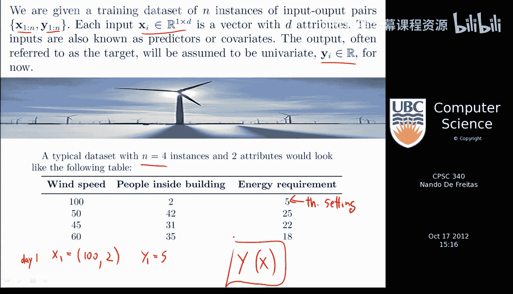

And that's pretty much what I'm saying here。 So after you've collected any observations for training。

We are going to get a new value on the n plus one day。

 and we're going to make a prediction on that n plus one day。

 so we talk about two phases in this process。The first phase。Is what I call training。And in training。

You are given。Pairs of data， x1 to n， y1 to n。That goes into your。Learning machine。

And what your learning machine will give you is a model。

And that model is described by a set of parameters。Thank you。So we get some parameters for the model。

Now， once we've estimated these parameters， and I will describe what kind of models we have and what parameters we have。

 and in particular the models that we'll start using are linear models。

And once I have those parameters。I'm going to enter the second stage， which is the validation stage。

 which is validation or prediction。In this second stage， I'm given a new X。Or two。

And I also have my theta that I learned。I will plug this into my。Predict machine。

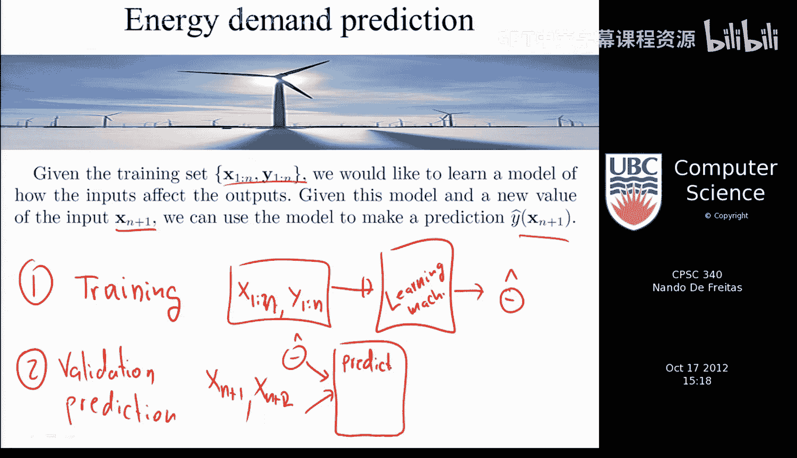

And I will produce。Predictions of what why should be。

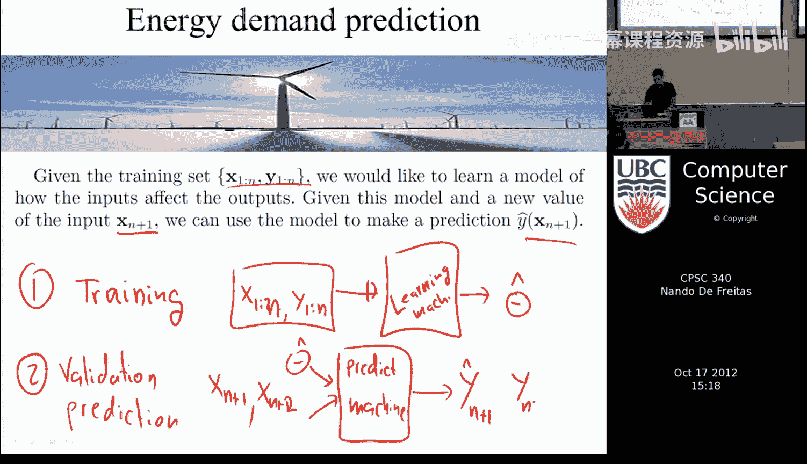

So that's this first we learn， given impairs， once we have Theta， which is our captures our model。

 we use that theta with new inputs， new access to predict new Ys and that's essentially the setup for learning that's the same setup when we do neural nets or where we do random forests or boosting or any other technique。

 all the supervised learning basically uses the setup。In linearar。By almost all of it。

 there are some techniques that actually avoid the use of parameters altogether。

 but we're not going to encounter those in this course。

The way you do this with a linear model is as follows。actually， before I do the linear model。

 I'm going to do one more example。So energy predictions an example to which you could apply these models。

 another one is medical informatics， where often you have many measurements from a patient。

 like for example， in prostate cancer， there's a famous data set which comes from this book which is available on the course website。

For free。And it describes this data set， which is， you know a bunch of medical variables that describe a patient。

 the age， some measurements about the prostate， cancer volume and so on on。

And then you're trying to predict some。Some antigen to see how well the patient will deal with the treatment。

Again， we have many variables， many attributes， and you're trying to predict something。

A variable for for treatment。 And quite often， it might be the case that you don't want to actually。

Every time going for some patients， you might actually want to just make some measurements and predict how well they will react to a treatment。

So there's also this question that when you have many inputs。How to select inputs。

 and that's another question that we will address with linear models and we'll continue addressing it with nonlinear models。

 it's not just about predicting how well the patient will recover。

 it's also about identifying which are the variables that are useful for predicting。

How will the patient will wake up？Because if it's not necessary to measure the prostate weight in order to make a good prediction。

 then a lot of men would find that quite comforting。

Because they don't have to go through very invasive tests。

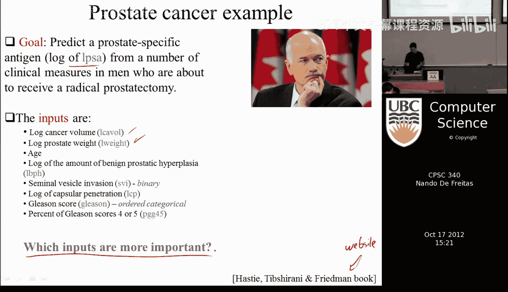

This is a linear model。That's the equation of a line and has it a linear model。

 So this is just your Mx plus B。Tta1 is the intercept。Theta 2 is the slope。Okay， so。

OkaySo we're basically going back to very basic stuff from。Our days。In early high school。Where。

 if you're in a fit line。A line has a slope。The slope is theta2。It has an intercept， which is theto1。

And the question of the line。This line here is why。Which is a function of x。

 a line is a function of x。And that's equal to theta 1 plus x theta。确。Now， typically。In learning。

 what happens is we are given many data points。And we're trying to get a line。

That goes through these data points。 Okay， a line that describes the data points。

 each of these data points。Is a particular instance of an input。And。I love。

And there'll be many of these input outputs， and then what I'm trying to do is just to get a line that goes through these points。

I' throw a few more there。In order to fit this line。

 in order to get a line that goes through the points。

 what I'm going to require is that the quadratic distances between the points。And。

The evaluation of the line at the point。Which is Y hat evaluated at Xi。I want that gap to be small。

So I want this height。Which is Y I minus y of X。And I'm going to square it because some of them will be positive。

 some above the line， some will be below the line， so I want them to be all positive。

 so I just square them。And so I want just instance Y I minus for short。

 I'm just going to write y hat I instead of y of Xi。And I want this to be small for the I point。

So I want to you can think of this as a spring here， and I want that spring。

To be as compressed as possible。And each of these points will have one such spring。And so。

 we're trying to find。So you could imagine that if you had a line with a bunch of springs and those points were nails。

 and if you'd let that line go， it would sort of go and stabilize and it will stabilize at the point of least energy。

Do you search for the springs， Okay， so this。And so， so we want to minimize。

The amount of purple in this image， basically， the amount of sp。Okay， so that's the setup。

 So I want to minimize。啊。The sums of all the distances。

 so I look at all the distances from the points to the line， the vertical distance。

 and I want to minimize the sum of those vertical systems， the sum of the squared distances。

 This is called least squares because you're trying to find the least。Of minimizing the squares。

 the square distances。Now。Because。Because Yi is theta 1 plus X， so theta 1 plusxi Theta 2。

 if I plug this， Im into the equation。If I use the expression for Y hat。

 then that gives me now a function。Y I minus theta1 minus X Theta 2。

 And my goal is to be able to solve。For Theta1 and Theta 2。So， the goal。Is to solve。4。Theta 1， and。

非ち two。That's what learning is in the context of a linear model。 It's just finding the intercept。

And the s of the light。So that this line goes through the points， Okay。

 so it's a very simple concept。嗯。And then。Where we're going to move on to do things a bit more interesting is that quite often here we're assuming that X only has one attribute。

But of course， often， as we've seen， like in the case or example， in the cancer example。

 there X often has many attributes。 So we're going to have to go to high dimensions。In 1 D。

 we use a line。In 2D， we use a plane。In 3D and 4D and ND， we will use something called a hyper play。

 which we can't visualize， but we can just label it。 we can write the equation for it。

 and it's essentially a line。And higher dimension emissions。 Okay， so this is the setup。

 This is how we're going to do learning。Once we do so。

So this essentially will be learning and once we have learned， we can make predictions， right。

 because why hat？It's just equal。To Theta1。Let's assume we've learned。Two parameters。

 theta 1 and theta 2， I'm putting a hat indicator we've learned， and then when I get a new point。

 Xn plus1。The prediction is just the evaluation of the line at that point。So。In the picture。

This would be。This here is x n plus one。It's a point for which I don't know what y is。

 I don't know it's labeled。But even though I don't know its label， I can just evaluate its height。

And this height is Yn plus 1。Heres the line evaluated at that point。 and that's my prediction。

So we've done both the learning and the prediction and the rest of the class is just how to do this。

With matrices so that we can do high dimensions。And how do we solve for theta 1， Theta2。

 How do we come up with a way of solving this efficiently？Okay。This is called an objective function。

Go ahead。So the things are all horizontal example。There would also be a way to minimize the。

Thered be also a way to minimize the horizontal spring distance or just the distance of them。

I you think shortest。Yes， so that would work better。Not the horizontal。

 but perpendicular would work better。 Were， I'm going to come back to that late。Not in this class。

 but in two class。Yeah， guess for now we're going to use the standard thing that half of you have learned before。

 which is the vertical distances， but obviously that's not the best you can do。All right。

Now I'm going to try to generalize this， so here I was using d equal1。For this example。

 so only one attribute。

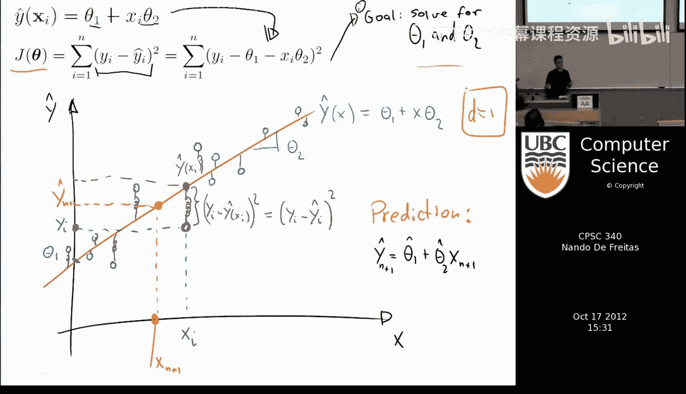

But now I want to。Talk about D attributes， many more attributes。And end points。 So typically。

 the way we're going to do this is we're going to write this。With the following expression。Which is。

We're going to take for each point I。And I here is the index of the data points。 So like I equal 1。

 I equal 2， I equal3，4，5，6， you know， so the different cases。And D is an index over the features。

Height and weight。And so if I have more features， I would have to， for each feature。

 have one particular parameter， so have X 1 times theta 1 plus X I 2 times theta 2。Pluss， etc cea。X。

 I D times D to D。So now I have the equation of a plane in D dimensions。But it's still a line。

 really， still a X times theta， we' just gone to a higher dimension where we can't visualize。

 but it's still the same equation。Each of the axis that I measured。For times。呃，对。

So in the case what I had height。So Xi1 would be the height。And X I2 would be the weight。

And then my model would be。Why。一個。One， and now I'm going to use a trick。

 and'm going to make one of the xs be1。Times theta1 plus。X I1 times theta 2 plus x。系。

Two times Theta 3。And if I wanted to be on the same scale， I probably would want to this two。

 label this three。So that。It's a bit more consistent with what I have people。

The reason why I introduced this one。It's because if I make that one be an x。All the time。

 then instead of having to write。Instead of having to write an equation in the form y equals theta n plus theta 1 x。

 I can just write it as y equals sum from I equal 1 to2 of theta。Hi， Theta J， sorry。X J。

 provided that x1 is equal to1。So instead of writing y is equal to theta n plus theta 1 x。

 I just want to write it as with when I introduce vectors， let me introduce vectors first。

I want to write it as a single。X times theta。 I don't want to have plus theta n。All the time。

 and so the way to do that is I just make that first vector of x all be equal to1。

And if that first column is all once。And so I'm just basically。

 I've created an extra input that is always set to one， and that allows me to write it。嗯。

It's just y equal equals times theta。Okay， so that's how。

That's the reason for basically setting X1 equal to one so that I can now equivalently write。嗯。

The linear equation for D dimensions。Either using this question or dis a question。

They are the same equation， one is matrix， matrix back to notation。

 one is just a component wise equation。And then if we want to expand it。

 that equation by writing all the terms。That is。The equation of a plane in heightened D dimensions。

And so I'm always allowing for the first column to be once so that because I need a constant term。

Can I borrow a sheet of paper。Because say that we're in 2D with the height and the weight。

 so one theta controls my slope in this direction。The other theta controls the slope in this direction。

 but I need the bias term， the free term theta no to change the height。

So I can change the height and tilt it。So I need three parameters。To control this。

To control this and to control this。Once I have those three parameters。

 I have full control of the plane in higher dimensions。We can't visualize it， but it's the same idea。

Okay， that's the linear model。 Y equals x times t。And typically。

 what we do is we plug all the N observations。嗯。In the vector y， which is n by1。The matrix is n by D。

With the matrix x and by D with ones in the first column。

 and then there are deep parameters which are unknown。

 and the goal of learning is to solve for these deep parameters。The D。 Okay， so that's the linear。

Get the。And the matrix notation， simply we introduce it because。

It's a lot easier to write this than to write this。

When we do the we will have to introduce some extra tools of math to deal with matrices and matrix derivatives。

 but if we learn to use matrices， it's a lot easier to code with matrices and it's a lot easier to come up with estimates and so on。

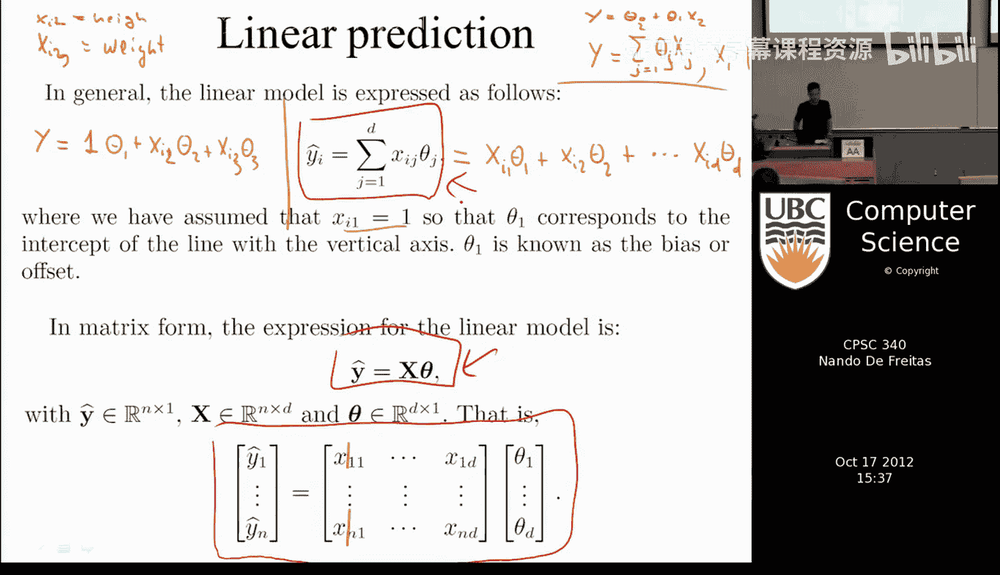

They're a good obstruction。Okay， so here's an example。Let's go back to our wind speed， where we had。

Our example of energy production， where we had oops。We had the number of people in the building。

 the wind speed， and then the energy requirement， and so here why would just be the vector of labels。

 the setting of the thermostat。To the matrix x， I've added a column of ones。

 and then I put into two attributes， and so now I need to estimate three parameters， theta1。

 the two and theta3。Sometimes I call the first theta theta not， sometimes I call the theta one。

 it's just a name， so it doesn't matter。Now， let's assume that we have already learned a good theta。

 so let's assume that we knew that the theta was the learned theta was equal to 100。5。If I knew that。

Of course we don't know because we still haven't learned theta。

 but let's assume we have learned it already， then if I wanted to make predictions。

 just I' make predictions by multiplying x times theta hat。

 so in particular I just this is my x this is my theta hat and that gives me Y hat and those are my predictions。

And here I'm doing four predictions at the same time。 Now， I'm predicting on the training set。

And the reason why I'm predicting in the training set， it kind of doesn't make sense。

 Why would I want to predict on training set or in the training set， I already know what Y is。

But the reason why I predict it is because then I can compare it to the true why and I know whether I'm doing well or not。

so。

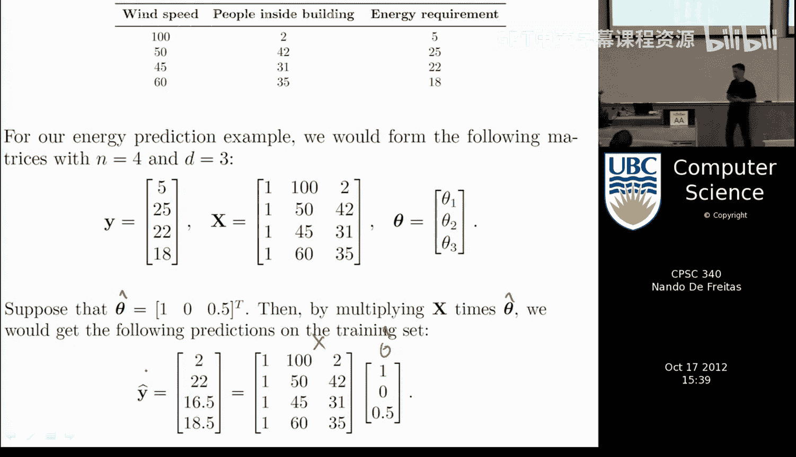

Of course， I also want to predict on the test set。 So on the fifth day， on the Friday。

My iPhone counts 20 people in the building and 50 knots outside。

 and then my iPhone multiplies the vector XN plus one。Times。Theater heart。

And my iPhone computes the setting of the thermostat， sets a thermotat to 11， and it's done。

It might sound gimmicky， but recently I saw a company in the Bay Area that was doing exactly that and they were so far。

 I don't know how many millions of dollars。

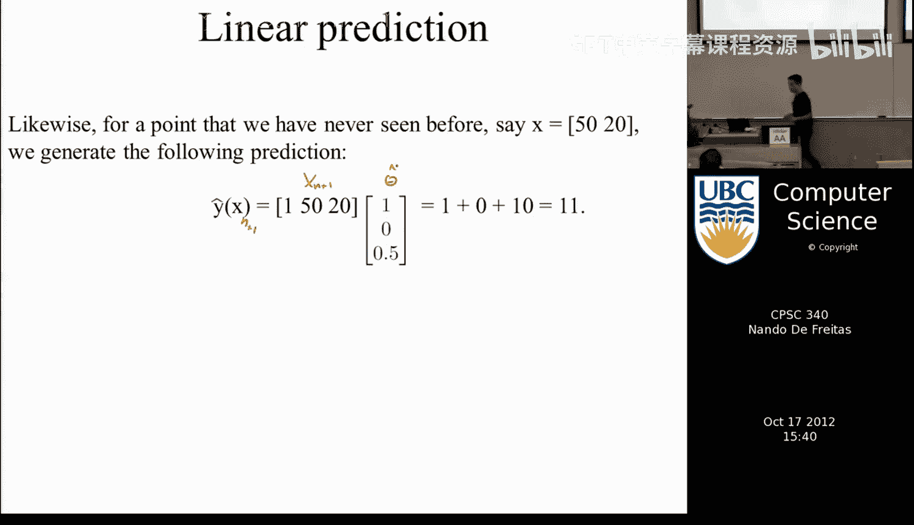

They just automated this process。It is a little bit more than that。Okay， so。

Let's go back to the objective function。I'm going to argue that。The sum。

So we already saw that what I' trying to do is minimize the sum of squares。Okay， so。In matrix form。

 I can write a sum of squares。As this product here， y minus x theta times y minus x theta。

To convince yourself that this is true， just take a simple example。Well you have y1， y2。Mine knows。

X 1，1， x 1，2。X21， x22。Times， so this would be J of，Times theta1 times theta 2。Transpose。嗯 응。Times y1。

Why2。That's the left hand side。And then I can。Creray writers this as。And now。X1， vector。Trans。

The X1 vector is just。Make sure I get the right columns。Will be just equal to nothing。

X1 vector will be just equal to x1，1 and x1，2。And the vector x2 is equal to。X21， x22。And so。

 this is equal to。Y one。Why2。Minus。X1。Teacher。And then， x 2。Times theta。So I'm just multiplying。

I'm multiplying the vector x1 times theta 1 times theta 2， and that's just x1 times theta。

And then I do the same for x2。Transpose， and then I do the same with the other guys， Y，1， y2。

Minus x1 eer。Next to。你ature。And I do know that。Why。I do know that Y1 hat is just x1。Transpose the。

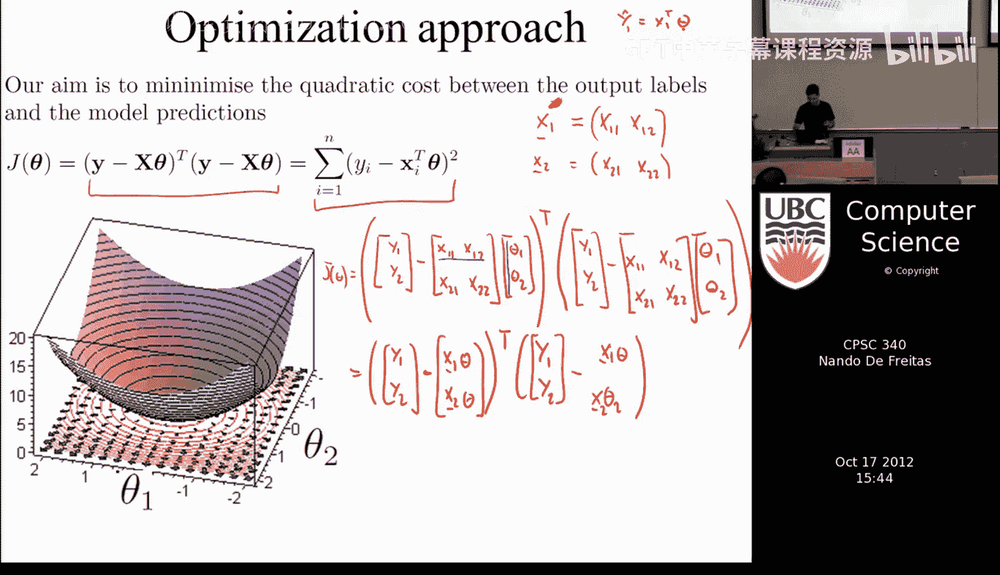

Let me just check one quick thing for you guys。 because I think I used。

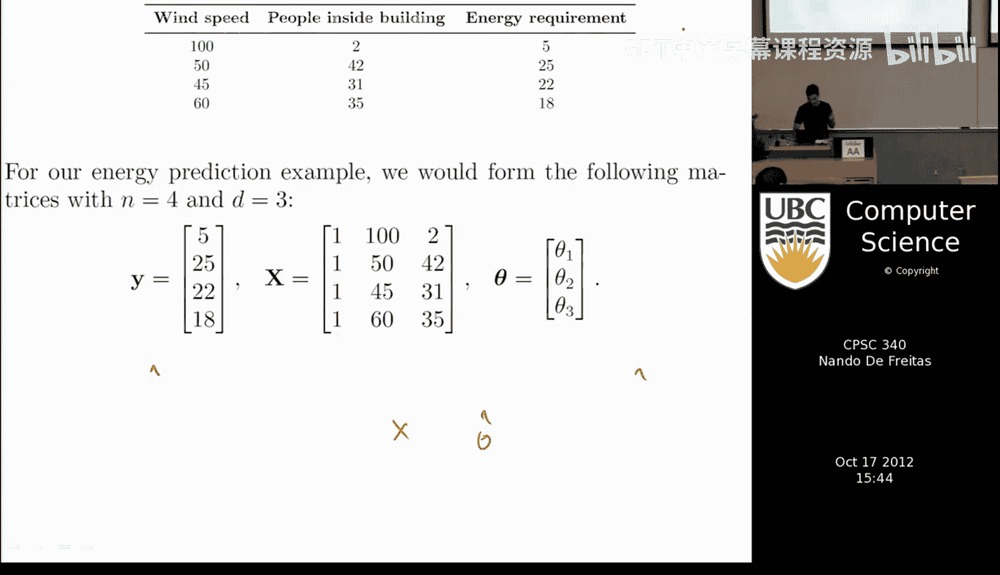

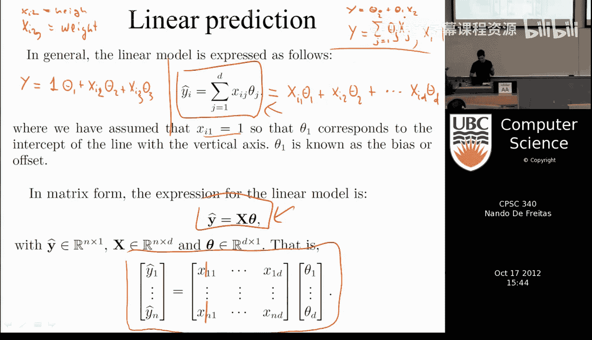

All right， let me define it like that。Okay。And that's just equal to。Y1， y 2。Minus。Why one hat。

 why2 hat。Transpose times。

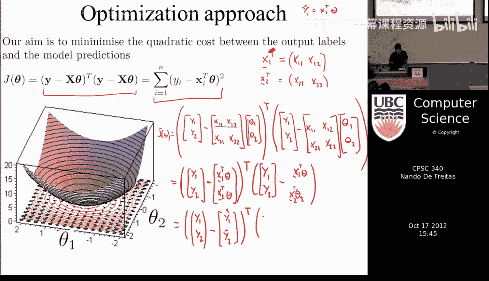

Yhy1， why2。Minus y1 and y2 hat。And that's just equal to。In fact。With entries y1 minus y1 hat。

And then y2 minus y2。Ha。Times， the fact。That has entries y1 minus y1 hat。

Time is the vectorta y2 minus y2。Hat， and that's just equal to。Y1 minus y1 of Ronad of space。看一下。

Y1 y 1 hat。Square plus y 2。I knows why2 had。Squared。Okay， so I did it for2D case。

 but the point being that。If you have something that's the sum of squares。

 you can write it in matrix form as just y minus x theta times y minus xt。

But you need to use the trans。Another form in which this is written。Its because y is a vector n by y。

YHY is one dimensional。And so when I write y minus x theta times y minus x theta。

 I'm just essentially taking the dot product of two vectors and by the definition of the norm。

 the dot product is just the norm of y minus x theta。Squared。

 that's another way in which we will write it。Once I have everything in matrix notation， however。

 it's a lot easier to manipulate and in fact I will never go again through the tedious exercise of trying to go from the sum notation to the matrix notation。

 I will just simply use matrix notation because it's a lot easier to manipulate。

And it's a lot easier to code because sums involve four loops in the code and they're inefficient。

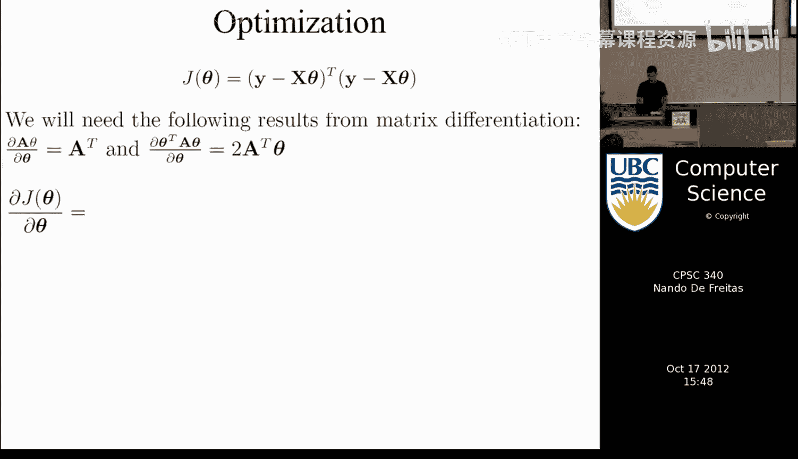

Okay， this equation。If I have only two thes， as is an example that I would have done the differentiation。

what I've had the equivalence relation， if I have two thes because it's quadratic in theta it's the equation of a parabo with two thes with one theta。

 it's a parabola， with two thes， it's essentially a paraboable in 2D。

So J of theta is this function here。That's my j of feet。When I have only two theaters。

 Theta 1 I theater 2。Now the nice thing about a parabola。Is that I？If， if I。Anywhere in the parabola。

And I go downhill， I will always reach the same point。It has a unique solution。So， learning。

And in this case， it's very easy， but learning is about starting at some point。

In some objective function。And going downhill。That's learning。You formulate。

The problem as a cost function that you need to optimize， solve for。

And then you saw for theta by going downhill。When the function is as simple as this quadratic function。

By going downhill， you always get a solution。 and in fact， we will show you only need to take。

 you can go downhill in a single step and get to the optimum because we can do things analytically later on。

 when we do neural networks， there's not going to be just one minimum。

But there's going to be the functions are going have， you know are going to be very jaggedy。

 They're going to have factorial number of minima， and the way to get there will still be by following the gradients。

 But in those cases， it will not be possible to do it by hand anymore， as we will do today。

 but we will have to follow derivatives。Now。Let me just one more point and I'll take your question。

 when we slice a function in 2D， like I've done here with these lines， these black lines。

These are called contour plots。And if you slice them， they basically tell you the height。

They basically give you curves where the height is the same， So this is what I'm showing here in red。

 these are the contours。There is one fact that I'm not going to derive it in this class。

 but it's learned in calculus2。And that fact is that the gradient or the derivative。

Of J of theta with respect to theta is a vector。And that vector is evaluated at any point。

Is perpendicular to the contours。 Okay， so how many of you have seen that fact before。

Not as calculus to these days。 Anyway， the derivatives are always perpendicular to the contourt plots。

 Just take that as a fact。The relevance of that is that if you go in the opposite direction as these arrows。

 you're going in the steepest descent。 So if you're snowboarding。

That place where is the steepest to go down。That's the way you're gonna go。

Because that's where you learn the most。TheThe steepest， the more you learn。Okay， so。

What I'm going to do in the next class is I'm going to do exactly that I'm going to compute a derivative of this function。

And I'm gonna solve for theta。Because when the derivative becomes zero， that is at the bottom。

 that's where the solution lies。 And when I solve for it， I will get the least core solution。

And then I will show how I can do the same thing， but instead of using a cost function。

 instead of minimizing a cost function， I will maximize the likelihood of the data given theta。

And I'm going to use Gaussians for that。And when I do that， I will get the same answer。

 maximum likelihood least squares is a particular case of maximum likelihood estimation。

And that's the next class。So this is。I。系先。Yeah。Yeah。Yeah。Yeah。Okay。Yeah。Yeah。It。Let me to the next。

Yeah。Yeah。Yeah。角色的下面。