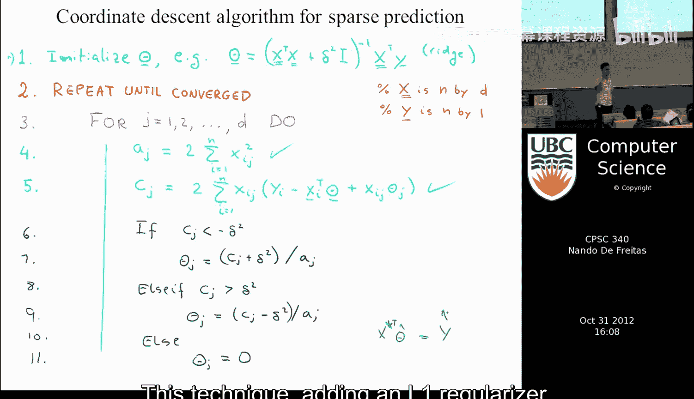
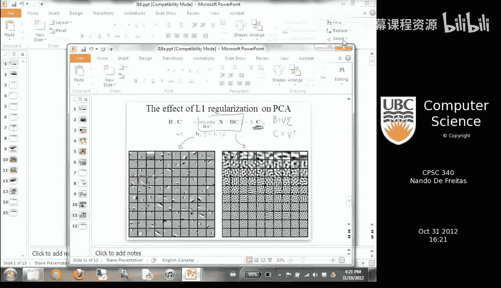

# 稀疏模型与变量选择：第22讲：稀疏模型与变量选择

在本节课中，我们将要学习一种特殊的线性模型——稀疏模型。这种模型不仅用于预测，还致力于使用尽可能少的变量来生成预测。我们将探讨其动机、数学原理以及一个核心的求解算法。

## 概述

线性模型是预测的基础工具。然而，在许多实际应用中，我们不仅希望模型预测准确，还希望它尽可能简洁，即使用最少的输入变量。这被称为**稀疏性**。本节课我们将学习如何构建这种稀疏线性模型，理解其背后的数学原理，并掌握一个名为**坐标下降法**的求解算法。

## 为什么需要稀疏性？

我们希望使用尽可能少变量的原因在于，某些变量可能获取成本高昂，或者难以实际测量。这在许多领域都是如此。

例如，在房地产领域，预测房屋价格时，你可能需要考虑许多变量：社区环境、房间数量等。但你可能还会考虑加拿大的GDP、美国的经济状况，甚至中国的经济状况等宏观因素。虽然这些变量可能有助于预测，但其中一些数据的获取成本非常高，有些甚至无法获得。因此，我们的目标是找出那些真正对价格有预测作用的重要变量。

这里需要明确一点：我们寻找的是变量与结果之间的**相关性**，而非**因果关系**。例如，观察到吸烟与癌症相关，但我们无法仅凭此数据断定吸烟导致癌症，还是患癌的人更喜欢吸烟。确定因果关系通常需要实验或更复杂的分析（如工具变量法）。

## 稀疏模型的目标函数

我们的目标是在线性模型框架下，构建一个同时考虑预测精度和模型简洁性的目标函数。

我们从一个标准的线性回归模型开始，其预测值为：
`y_hat = X * theta`
其中，`y_hat`是预测值，`X`是特征数据矩阵（N行D列，代表N个样本和D个特征），`theta`是模型参数。

通常，我们通过最小化预测误差（如平方误差）来拟合模型。为了引入稀疏性，我们在目标函数中添加一个额外的惩罚项。这个新的目标函数 `J(theta)` 如下：

`J(theta) = Σ (y_i - x_i^T * theta)^2 + δ^2 * Σ |theta_j|`

让我们分解这个公式：
*   **第一部分** `Σ (y_i - x_i^T * theta)^2`：这是标准的**平方误差损失**，衡量模型的预测精度。我们希望它越小越好。
*   **第二部分** `δ^2 * Σ |theta_j|`：这是**L1正则化项**（或Lasso惩罚项）。它对模型参数 `theta` 的绝对值之和进行惩罚。`δ` 是一个超参数，用于控制惩罚的强度。
*   **超参数 `δ`**：它平衡了预测精度和模型简洁性。当 `δ` 很大时，惩罚项占主导，模型会倾向于让更多 `theta_j` 变为0，从而更稀疏。当 `δ = 0` 时，惩罚项消失，模型退化为普通的线性回归。

这个目标函数的核心思想是：为了最小化总成本 `J(theta)`，我们不仅需要让预测误差小，还需要让参数 `theta` 的绝对值和小。如果一个参数 `theta_j` 变为0，就意味着对应的特征 `x_j` 对预测没有贡献，我们可以将其从模型中移除。

## 求解挑战与次梯度

为了找到最优的 `theta`，标准做法是对目标函数 `J(theta)` 求导并令其为零。然而，这里存在一个技术难题：绝对值函数 `|theta_j|` 在 `theta_j = 0` 处是**不可导**的。

为了解决这个问题，我们引入一个数学概念：**次梯度**。对于绝对值函数，在 `theta_j > 0` 时，导数为+1；在 `theta_j < 0` 时，导数为-1；在 `theta_j = 0` 时，导数不是单一值，而是一个集合 `[-1, 1]` 内的任何数。这个集合就是该点处的次梯度。

利用次梯度的概念，我们可以处理目标函数的导数问题，并推导出参数 `theta_j` 的更新规则。

## 坐标下降法

由于直接求解整个 `theta` 向量很困难，我们采用一种迭代算法——**坐标下降法**。其思想是：每次只优化一个参数 `theta_j`，而固定其他所有参数不变。如此循环往复，直至所有参数收敛。

以下是算法的具体步骤：

1.  **初始化**：随机初始化参数向量 `theta`，或使用岭回归等方法的解作为起点。
2.  **循环迭代**：重复以下步骤直至 `theta` 不再变化（收敛）：
    *   对 `j = 1` 到 `D`（遍历每一个特征）：
        *   计算两个辅助量 `A_j` 和 `C_j`：
            *   `A_j = 2 * Σ (x_ij)^2` （与 `theta` 无关，可预先计算）
            *   `C_j = 2 * Σ [ x_ij * (y_i - Σ_{k≠j} x_ik * theta_k) ]` （依赖于当前其他所有 `theta`）
        *   根据 `C_j` 的值更新 `theta_j`：
            *   如果 `C_j < -δ^2`，则 `theta_j = (C_j + δ^2) / A_j`
            *   如果 `C_j > δ^2`，则 `theta_j = (C_j - δ^2) / A_j`
            *   如果 `-δ^2 ≤ C_j ≤ δ^2`，则 `theta_j = 0`
3.  **输出**：得到稀疏的参数估计 `theta`。其中许多 `theta_j` 将为0，实现了变量选择。

这个算法易于实现，并且在目标函数是凸函数的情况下能保证收敛到全局最优解。

## 应用与意义

稀疏模型和L1正则化有广泛的应用：
*   **成本降低**：识别出关键变量后，在后续数据收集中可以忽略不重要的变量，节省成本。
*   **科学发现**：例如在遗传学中，通过分析成千上万个基因与疾病的关系，Lasso可以帮助找出少数几个真正相关的基因，极大缩小后续实验验证的范围。
*   **特征学习**：在图像处理等领域，对类似PCA的目标函数加入L1惩罚，可以学习到局部的、稀疏的基函数（如边缘检测器），这与人类视觉皮层神经元的感受野特性相似。

## 总结

本节课我们一起学习了稀疏线性模型的核心思想。我们了解到，通过在标准线性回归的目标函数中加入L1正则化惩罚项，可以迫使模型参数变得稀疏，从而实现**变量选择**。我们探讨了求解该模型时遇到的绝对值函数求导难题，并引入了**次梯度**的概念来克服它。最后，我们详细介绍了**坐标下降法**这一迭代算法来求解稀疏模型参数。这种方法不仅预测性能好，还能提供模型可解释性，是机器学习中一个非常强大且常用的工具。