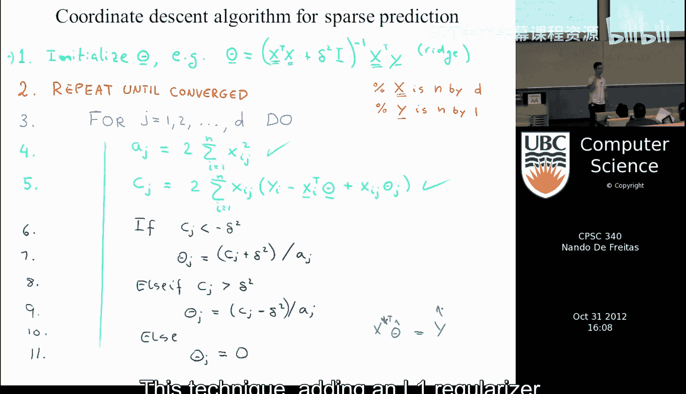
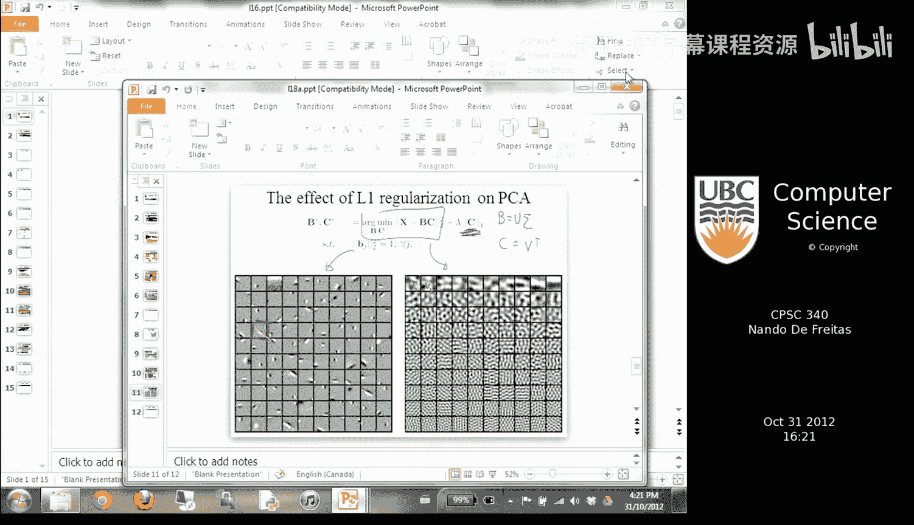

# UBC《机器学习和数据挖掘｜CPSC 340 Machine Learning and Data Mining 2012》中英字幕 p22 -22-undergraduate machine learning  22_ Sparse models and variable selection.zh_ -BV1pJ2ABFEFg_p22-

A linear model， but we also want to use as few variables as possible in order to generate our prediction。

And the reason why we want to use as few variables as possible is because some of those variables might be expensive。

Or you know， hard to actually have access to。And this is true of。This is true of many。

Many applications。In real estate， if you're trying to predict the cost of housing。

 how much a house is likely to cost， which again is very a very lucrative thing to do if you can predict the price of houses every house in Vancouver over the next two years。

 you'd be doing pretty well financially。There there's many variables that you need to consider neighborhood。

 number of rooms， et cetera， et cetera， but you might also look at what is the GDP of Canada。

 how is the US doing， importantly， how is the economy of China doing and so on。

 and if you take all those variables， you're able to then make a prediction about the real estate。

 look at population growth and so on。However， some of those variables are very expensive to get。

And some you might just not have access to。And so you want to try to figure out exactly what are the important variables that are predictive of the price。

What you're finding there is correlations。 you're not finding causation。 okay。

 we've already argued this with the bears。If you observe cancer and smoking。

 you have no idea of knowing that you know that they're correlated。

 but you don't know if smoking causes cancer or if it is the case that people who have cancer like to smoke。

So that's the only way you can do that is through an experiment or through some more involved analysis。

 like using instrumental variables， which will be the topic of。Next Thursday， next week， Ju Pearl。

 the Turing Award winner this year， one of the top people in AI and machine learning。

 will actually be giving a talk on that topic， so Thursday 330。

 I'm sure it's announced all over the department。Tomorrow。

 there is a talk right here at 330 on L1 and L2 regularization。

But that's the invite to talk tomorrow， so I'm sure all of you would appreciate。

That talk will give you good revision。If you still don't have this business clear。Okay。

 but what we're interested in doing here is identify variables that are variables X that are correlated with an outcome Y。

And。And I argued， and I will come back to this picture。 so if you don't get it now。

 I will come back to it and I will give an introduction in the context of bridge for those of you that got it。

 I argued that if I plot the contours， the cost function has two components。

 it has a light blue component in my slides， and that's the likelihood that the sum of squared errors。

 that's the usually squared criteria。And now to the cost function， I've added another term。

 which is the sum of absolute values of each theta。

The reason why I do that is because I'm saying the cost will be high。

Whenever the sum of chorais is high。Or if the sum of thetaus is also high。

So in order to reduce the cost， I have to do two things。I have to make my theta small。

And I have to make my errors small， not enough to make the errors small。

 it's also important to make the theta small。 I'm not only worried about making good predictions。

 I'm also worried about making the theta small so that I can identify which are the x's that are relevant because if one of the thetas goes to zero。

 I know I don't need that x right because。If say theta 1 is going to zero。

Then I know I don't need x1， right， because x1 times 0 will be 0。

 So there's no reason for me to even go and observe x1 or measure x1。Sure， thank you。

Regardless about that。Okay， that should be better。And so I will formulate as this cost。

I argued that if I plot the contour plots of y minus x theta times1 minus x theta。

 those are ellipses。And I know the minimum。Is at the centerer。

And I also argued that if you look at the absolute value in 2D of two parameters。

 I basically have four lines， if I plot those four lines。

 essentially I have that square in the diamond in the middle， those are the contour plots。So in 2D。

 if you will， like， I can't plot this in 2D。 But what's really happening is。I have my J of theta。

 which is my cost function， I have one component that is like this。And then if I cut it。

There's ellipses， and then at the origin， there is this thing that I have no idea how to draw this。

 but it will be， I guess， something like this。They're more or less。

 that's like a pyramid coming out of the origin。And then when those two curves intersect。

 that's what the solutions will be。 Now， there isn't a single solution。

 There is a whole path of solutions。This red pass here。

And each point in that red curve corresponds to a different value of delta。

I'm not going to spend more time in this picture。But I will come back to it after I do the ridge because in the ridge it's easier for me to explain why this red path makes sense and once I've explained the ridge。

 I will come back to this patient in detail。I will argue。

 and I hope you take my leap of faith on this， that if you have a pyramid and an ellipse where they intersect。

And I will argue why it is intersections that we need to worry about and no other points later。

 but for now， assume that the solutions are what is to。Object these two surfaces intersect。

 then they will with great probability intersect at the corners。

The coordinates coincide with the axis。And if the coincide with axis means that at the axis。

 one of the variables is zero， so right now what it's intersecting is with the theta1 axis。

And at the theta 1 axis， the height of theta 2 is0。

 so in this picture that I'm illustrating using to illustrate this here。

The value of theta2 for many values of delta will be equal to0。And when delta is equal to zero。

That theta2 will be equal to the maximum likelihood theta 2。And when Delta goes to infinity。

When deelta becomes very large， all the theus will be0。

 and that makes sense if you look at the cost function， because in the cost function。

 if Dlta is like。I don't know， a quadrillion。Then the only way you can minimize J of theta is by making theta very tiny。

Okay， so the second term dominates and you have this trade off。

And a big question is how we choose Delta， and I think Matt mentioned press validation。

 today I'm going to go over that again， but let's assume for now。

That we're happy that this is the objective function that we want optimized。

 And let's make the leap of faith that this objective function will guarantee that when you do。😊。

When you look at the derivative this objective function equ to zero。

 many of the thes will be equal to zero automatic。So the only thing that remains for us to do。

For learning is to derive the estimate of theta。Now。

 how do we derive an estimate of theta if we have an objective function？证据规定。

Take the derivative if an  to zero。So there's our objective function， we need to take the derivative。

Now， before we take the derivative， I'm going to rewrite this in a few different ways。

So that's our objective function。But I can also rewrite this。

And I'm going to assume that the matrix x is N by D。Okay， so I have N observations。

With the attributes。So， end students。And then for each student。

 I have measured the height and the weight， so d is equal to 2 in that case。And then。

I can rewrite this instead of vector notation， I can write this as the sum from I equal 1 to n。

 overall the data points of Yi minus Xi transpose theta。Square。Okay， because Yi is just a scalar。

 so I can just square it。Plus， deelta squared。S over a j equals1 to D the sum of the absolute lattice。

so this is just， again， y minus x theta transpose time to y minus x theta。

 that's just our way the matrix notation of saying the sum of squared differences between y。

And the prediction of y， which is X feet。Okay so this is our prediction for y。

 and the hat on top of the y is very important。 It means it is a completely different object。

 It's the prediction as opposed to the y。So we're still dealing with linear models where we have data。

We have access。This thatか。We have。This is why is the height of the point？Well， and then。

This height here is y hat， so y hat is the value of y at the line。With the model at x。

And why is just the point， the actual date， So why hat is the prediction。

 which is in this case given by a line。And then why is the point in linear regression。

I'm going to rewrite this， also。In the following form。I'm going to take the derivative。

 My intent is to find a derivative with respect to just one single theat。

I'm going to call that theta theta J。The reason why I don't do it with respect to all the thes is because in this case。

That I can't actually- that will not lead me to having an exact algorithm。

 I will not be able to just like it did with rage and maximum likelihood。

 there we were able to the computer Earth to respect to theta quite to zero and then I would be able to solve for the。

In this case， it's impossible to do that and also students see why the difficulty and it has to do with the absolute value。

Since I'm going to take the derivative with respect to the J term。

 I'm going to rewrite this slightly in the following form。As Y， I minus。X I J。Times theta J。Okay。

 so I'm going to extract the J component。And recall that these are vectors。The matrix X。

Has vectors x1 transpose？All the way up to X n。I suppose。Okay， so each x transpo is1 by d。

 and then theta is d by1。There are D parameters， one for each input x。Each dimension of x。

And then I'm going to introduce this。Nation， Xi。Minus J。By that， I mean all the X。

 but excluding the J。Times theta minus J。Square plus deelta squared。Some of a J equal1 to D。你j。Okay。

 so let me just write that。Make that more clear。 So if if I have theta is equal to theta 1。

Theta 2 and Theta 3。So the vector theta。Then the。Min-2 is equal to theta 1 and theta。Okay。

So theta minus J just means I removed theta J and I removed it。

I removed it from this and I put it here。Okay， so I still have the same thing。Now。

I'm going to do a bit of grouping of these terms。这实。Okay， so。Let me do that with an example。

 consider it's not the 1，0，I can do an example。 Let me you have。 So it's fine。Are you happy。

Let's to an example。Let's use that thinkta。Theta equal to theta 1， Theta 2， and theta 3。

And let's say that theta J is equal to theta 2。So J is equal to2。

And so D is equal to three in this case， because there are three features。Right， and I have X transs。

ATheta， so I have X I1。X I trans feature。It's equal to X1， X2。X， I 3。Times theta1， theta2。Teacher 3。

Which is equal to X1 theta 1。Plus X I2， Theta 2。Was X， I3， teacher 3。

And I can rewrite that as X I1 theta sorry X2。Per  two plus。

And now I'm going to group the other guys， X1， feetta 1。Plus X， I3， theta 3。好的。A个。对。被证据。

So I'm just regrouping it so。Because I'm interested in J equal 2。So I've taken it。哦。I see。No。Go。嗯。

And then this is just equal to X I2 theta 2。P。X， I minus。2。Which I don't mean I minus2。

 but I mean getting rid of the second component times theta minus2。So basically。

 I'm just taking one term。 I have an expansion in terms of d terms。

 and I'm going to take one term out。 and the remaining expansion。

 that's what I'm calling X I minus J times theta minus J。ち。这次明是呢都想跟。know位。The second term。つみに。Oh。

 that one is separate because if you think about it。That's。Let's put brackets here。

The order there doesn't matter。Because there is no index I。 There is no index I inside of。

That second sum。 Yeah， there's N X J in the first sum。 The J different Js。 Oh， yes。

 they're different。じ。We can fix that。Call this Jake Priry。好的。Okay， so let's go to the first line。

Jake Prime， in the first line is just the dummy variable。It's an index from one to D。

In the second line， that term is still separate。That term， that term is still whoops。

That term is still， it still on its own， separate from the first term。

 and it will continue being separate from the first term。It involves the variable J prime。

 it doesn't touch the first term at all because I'm only playing with the first term。是谁。

So the J in the first term is an index from one to d as well。

And that index from one to d basically tells me。Which component of theater I'm choosing。

So let's look at an example， let's assume that Theta has three components。In that case。

 D is equal to3， so there are three inputs to the problem。In other words。Why hat？

Its equal to theta 1 x1 plus theta 2 x2 plus theta 3， x3。Okay， so it has three components。

And of course， there is a time index as well of。Different subjects。 And so we。

The x's and the Y's have that in。P。The data。Why I。Is assumed to come from a model which has parameters Theta 1。

 which are the true parameters， X1 plus Theta 2， X I 2 plus Theta 3 X I 3 plus noise。Okay。

 so that's the difference between why hat and why。Why is the noisy version of why hat？

If we have a line， that line has slope theta。For a particular value x。I。There is a height Yi。

And then the height of the line， that's why hat。Because y hat is just theta times x。

you just randomly choose what used Oh， this is an example so E G。E G J equal2。 If J is 2。

 it would be this。 If I used J equal3， then I would have grouped these two guys and then taken this out。

 So I have not。No， I'm just saying， let J be any J。 It is true for all J。 Okay。

 So then in this So this is true for all J。 has a domain of like1，2，1，2。

I guess I was just confused because you just have a J there and I just didn't really know what number。

Yeah。So it's a variable that goes from one to D， and it just indicates which variable I'm choosing。

So because I'm keeping it arbitrary， I don't want to say that it's1 or two or3 or d。

 because I want to be able to compute the derivative of with respect to theta when J is 1 and theta when j is 2。

 in other words， theta 1 and theta 2 all the way to theta D。So like this where Jay is。Yeah。Okay。

That clear now？How many people are happy to continue？Yeah majority good。

 so that's the sum of squares。And now what I'm going to do is I'm going to take the derivative tip of J of feet。

Now， when I take the derivative and I'm going to erase this。So that I can take to robot tip。Okay。

 so let's take the derivative now。So I'm going to take the derivative of J of theta。

And recall thes of vector here only with respect to the J component。

So I'm only going to find out what is the objective with respect to the to J where J is one or two or three？

And I'm going to do it for each of the theaters。And the type of algorithm that we're going to do is an interactiveerative algorithm of the following form。

 I'm going to come up with the best answer for theta1 once I know the best answer for theta1，First。

 I take a guess of all features， just a random guess would do。

Then I picked theta1 and I was solve for the best theta1。

 given all the other thetas and given the data， of course。Once I have found the best Theta1。

 I set it to that value and I move on to learn Theta2。

 and I find the best Theta2 for all the other thetas。Once I have found that Theta2。

 I freeze it and now I update Theta3。Once I found the best Theta3， I freeze it and update Theta four。

Let's say that D is equal to4。 In that case， after I finish updating Theta 4。

 I'm going to go back and I'm going to do theta 1 again。And then The two， and then feature three。

 The four， and I'm going to iterate many times like this。好。In this case it converges。

 I will not give you the proof of convergence。啊。没有。我去他班。Oh。

 because you found the best Theta one given。The random choices of theta 2。

 Theta 3 and theta 4 and theta 4。But now， but if you had been given a different theta 2。

 you would have come up with a different Theta 1。Theta1 is a function of the other thetas。

It will be clear when I write down the algorithm， but we are going to update one theta at a time。

And that particular theta， I'm just going to call theta J。对定个。And then updating them at once。

Because there's a problem there。Absolute values。Have you ever competed a derivative of an absolute value？

That's。That's a technical。 We can do this for maximum like。De regression when you don't have that。

 though。Yeah， if we didn't have the absolute value。

 it wouldn't be a problem because we know how to compute derivatives if we had there like a quadratic。

 like rid， no problem。But the absolute value is what's giving us trouble and we're going to come up with a different way of doing this and we want to use derivatives。

 We will use a generalization of derivatives called subtive derivatives。Which I will define soon。

I'm not going to define convergence， how fast does it converge， though？Rocky speaking。

There must be a result of there that says what the rate of convergence is for that algorithm。

 actually I don't know very really quickly though。It's fairly quickly。

I can do better than just tell you that it's fairly quickly。

 I can give you an actual convergence rate， not off the top of my head， sorry。嗯。

It would be one of the number of iterations， one of a T or one of a square root T。

The function is convex， so you should be able to actually get get a very fast convergence rate。

I don't know what the best convergence rates are， but the model。

Conjecture one of a two or something like that。Ojective functions that we keep writing with some different value that we keep adding to the end they're just different ways of coming to a That's correct。

 exactly is best。AGood question， so we've seen maximum likelihood， which is the same as b squares。

 which means just use the first term， don't add anything。😊。

Then we so rich when you add something and that I argue it's better because sometimes you might not be able to even invert the x transpose x matrix。

And so Rich。Provided that you have the right deelta can do better。

Next week you will get to code all these methods and you will have a first hands on experience as how they compare against each other。

This last su also adds a term， its advantage is it will make theta 0。

The ridge will make the feta small。But the last will make them precisely zero， and when they're zero。

 it has the extra benefit that we can actually get rid of those variabless。

Because we know those variables are not useful。And coming up with good regular rises。

 that's the second term。It's a not。 And， you know， there are people who devote their lives to this。

 I mean， in fact， everyone modeling。Cognitive processes and many models in science。

Social science and so on it's coming up with regularizer。It's part of modeling。It's the whole term。

 deelta squared times the sum of absolute fact。The delta is the trade of parameter。

And Delta we're going to choose。 Delta is a scalar。 if Delta is very large。

Then the second term has more importance。If Delta is very tiny。

 then the second term has less important。In fact， when Dta is equal to 0， the second term disappears。

 And so we're back to maximum light。Alright， so let's compute the derivative。With respect to theta J。

 and now you'll see why I separated this， because if our compute derivative it's the sum from i1 to n。

Of two times yi。Minus X I J， theta J。M nose。X I minus j transpo。Pta minus J。

Time is the derivative off with respect to theta J of the guy inside。Which is minus X I J。Plus。

 delta squared times the derivative with respect to theta J。哦。Theta one。Plus。

All the way up to theta D。I'm just rewriting it in that。So I took the derivative of the first term。

I did not take the derivative was the second term， but I just expanded it。

And this is going to be equal to。The sum。Over right， equal go one to n。2。

And now I'm going to group terms。I'm going to， first。But fact， let me use different colorss。

 I'm going to group。This term here。な。This term with this storm here。

And so I can write that as X I J squared times theta J。And I'm going to take the next term。

And that's gonna be whatever is left， which is。It's different color。Anyone colorbld。

Demail me if you are。No， because I often use written。So。Why are minus。X， I minus J transpose theta。

Minus J。Times X， I J。So in other words， this this and this。Plus。

The Delta square derivative took with respect to Theta J。Only of Theta J。Right。

 because I would have the absolute value of theta1 and theta 2 and theta3。But it is only the theta J。

 the derivative for any of the other thetas with respect to theta J will be0。Right。

 so if I have the derivative with respect to theta 2。哦。Theta 1 plus。Theer 2。Plus， Ti three。

That's equal to the derivative with respect to theta 2 of theta 2。Plus 0， plus 0。goes the derivative。

These guys don't depend on theta1， so the derivativeive is here。

So we managed to get rid of a lot of the other features。 I'm now going to introduce some names。

I'm going to call this guy here。I'm going to give it the name of AJ。And then this whole guy here。

 I'm also going to give it a name。I'm gonna call it C， J。

And the only reason why I'm giving them names is so that I don't write them over and over again。Okay。

 if we do that， our equation of the derivative says it's H J times theta J。Minus。

CJ plus the derivative of the absolute v。So in other words， going ahead a bit。

This is what I've been able to get。I have H J times x J minus C J times the absolute value。

So that would be easier to write than to write this whole monstrosity of sumals， etctera。Okay。

 so we have an explanation for the derivative。We've done the derivativeive of the first term。

There's a catch。 We have to do derivative for an absolute value。And that's problematic because。

The absolute value is not differentiable。Over here， the derivative is positive。

This is the absolute value function。it's basically you have y equal x on this side。

 and so the slope is plus 1。On the other side， the slope is  -1。

 So we know what the slope is when x is less than -1 and we know what the slope is when x is greater than。

Sorry， when x is less than zero， and we also know what the slope is when x is。Greater than zero。

 the problem is what happens at x equals 0， we have a nondeiable function。That function。There is。

And if the number of possible slopes。At the point， at the corner。Okay， so if you have a corner。

A perfect corner。You can't get the panther thing。If I had a parabola。

 I would be able to get to penice Day。Spartdon。ま。Okay， so you're getting ahead。

 So here is what we're gonna do。We're going to introduce a new mathematical concept。

 one that none of you have likely seen before。 It's called a subdi。

And we will only need this concept。 it has many properties。

 but we don't need to concern ourselves with that。 We just need that concept in order to be able to do the derivative of an absolute value。

Why I introduce this concept is because this is a very important mathematical concept。

Most of the current trend in how we are going to acquire data。Is based on the principle that we。

 instead of acquiring data in high resolution and compressing it。We are going to。

Get it straight from the world to a compressed version。

And the data will always live in compressed form， and if we want to view the data。

 we can uncompress it and see it in its full splendor of hybridol。

In order to get very high compression rates， people often use these L1 regularizers。

 there's a whole theory now called compressed sensing and compressed sensing essentially is the label。

 I don't know if we have engineers here， how many of you have heard of compressed sensing？Go 1，2，3。

 If you Google it， it's pretty hot in blogs and so on。 top mathematicians in the world。

The few geniuses we have in the world， a few of them are all working in this area。

 it's a pretty hot area， and it's an area that is impacting our world and so I feel it's my duty to make sure you actually understand。

The concepts behind， so we're going to learn sub different。ItTurns out that it's actually very easy。

 It's just like the concept of derivative。But in addition， at a point where of non differentiability。

We're going to consider all the possible slopes。Starting from。-1。

You could think of this as all the possible。Has all the possible lines that you could entertain。

All the possible lines that you could entertain putting it a corner at the corner of the house。

 so starting from here all the way to here， there's a whole set of lines could have this line or this line or this line or this line。

 this line this line。So there isn't one derivative， there's a whole set of derivatives。

 that's the subdi， that's all there is to it。It's just we're just going to say that there isn't one derivative。

 but there's a set。And the set could be anything that goes from -1。All the way from minus1。

 all the way to plus1。And so that's why I'm saying that at x equals0， the derivative is not just one。

But it's a whole set。Any number between 1 and1。That's a subdi， that's all we need to know about it。

We go back to our objective function and we're going to now differentiate it using the rule of the sub differential ratio。

So。Let's look at the first case， theta is negative。

So we're in this case here when the slope is negative。When theta is less than zero。

Then the derivative。Of Theta J。With respect to Theta J。It's just equal to minus1。

And so all I'm going to do here is replace the derivative by a minus1。And I'm done with that case。

Then I need to consider the case when it's greater than zero。This case here。So in this case。

 the derivativeative。Of theta j with respect to theta j is equal to plus1。

 and so I have a plus one times del display squared。When theta is equal to0。

Then I need to write here this something that goes from minus1 to plus1。 it's a set。

And the reason why I didn't write aj times theta j is because theta j is equal to 0。

 so H times theta j is 0。And that said， that's a derivative。How do we get now the theta hat。

 we are equal to0。How do we equate to zero In the first example， I have H。Times theta J。Minus Cj。

Minus deelta squared is equal to 0。I meant to say， hey。And now I solve。 so in other words， AJ。

Theta J。Its equal to Cj plus deelta squared。Okay， one important fact I forgot to say about A is that A。

Is guaranteed to be。Positive。Because it's the sum of squared terms。If you square anything。

 it's positive or zero。So and then I can just solve for theta， so then theta the estimate theta J。

 then it's just equal to Cj plus delta squared over AJ， and that is what I have here。

So I just took the equation one。In order to produce this equation。

If I proceed exactly in the same way。Lets pick this color。

I can take this equation and that will give me this answer。And then finally。

 I take the one in the middle to give me the answer in the middle。Now， the reason why I changed this。

It's because when theta J is less than0。If we look at it here， if theta J is less than0 and because。

A is positive and delta square is positive because if you square any number is positive。So。

This term will be negative on the left。 So for this to be negative， it must be that。

Cj has to be less than minus delta squared， in other words， C has to be greater than deelta squared。

Yeah。And so that's why I change this one here。 So if Cj is less than minus delta squared。

Like if Delta squared is 10。And if C is minus 100， then it will be negative。For example。

And that's how I come up with my theater。J， that's the estimate。That's the sparse estimate of theta。

 and as you can see， there is one situation in which the theta will be precisely zero。

Whenever that term C， which is the difference between y and the prediction for all the other variables。

 except the J variable。Whenever times the input， whenever that term C is between minus delta and delta。

 that particular theta will be zero。But now this is the answer for theta J。For just one theta。

 but then I need to compute this answer for all thetas for all J。

 and that's what the algorithm will do The algorithm actually turns out to be easy to implement。

 you can implement this in 10 minutes in Python or MatLb。You initialize theta first。

 so that's what we would do first initialize。And you may want to initialize just using Rige。

 but if you just pick a random theta， that's also good。 Just pick any random the。

If you wanted to con faster， you might start from a good solution like the ra。

 the maximum likelihood。And then you keep repeating until converge and we know that we've converged when the theta stop us changing when there are always after many durations they stop changing。

 we know that。Deb converged。And so we do this for all D。 We repeat this for all D。

We first compute AJ using the formula of AJ。 We compute CJ using the formula for CJ。

And then we just do the check if CJ is less than minus delta squared used the first formula。

 if it's greater than delta squared used the last formula， and if it's none of those cases。

 then theta 0， which is what we had from our derivativerivation。都系。strangerers to make sure that。

I have no constraint to make sure that thetaj is positive。 It may or may not be positive。

If Cj is suppose delta squared is 100。If CJ， which is this difference between the predictions。

Due to the other terms。If CJ is less than that100， then I set theto to be equal to。

Cj plus delta squared divided by Aj。 in fact， let's assume that delta squared is。10。

And let's assume that C is minus100。Okay， so minus100 in that case is less than minus- 10。

And so theta in that case will be negative。Because it will be minus 100 plus 10 divided by something that's positive。

From-90 divided by a。So theaters can be positive or negative。And many times there will be zero。

And that's why I will。We'll get it to work。That's it， that's the algorithm。

It requires the introduction of this the subdi thing。But beyond that。

 it's just equating a derivative， you just need to keep track of the three cases。The positive side。

 the negative side， and where you don't have a slope。So we are using the。Updated values of A and C J。

For all those data which has already been updated that's correct。So as you can see here。

 we're looping from J equal1 to D， and each the is using。The previous values。I didn't understand。

One value of agent CJM update all of them at once。Or because CJ is a function of theta。

 of all the thes。So I can't precomp it。 Oh， but you， you're， however。

Have hit on something very smart， which is AJ does not depend on theta， so I can pre computeute AJ。

 I can take AJ outside。 So if you're a good programmer。

 you would first compute AJ before you go into the repeat loop。But you can't escape。

You can't escape the and then you'll be able to precompute x times y。

 but you would not be able to escape computing C at every direction。 The C keeps changing。便 뉴스。

To make his forward。明天就开始。Don't we do the same thing， calculate the fashion derivatives。And then go。

Do it's that。Yes， we're going to look at it soon， but here what what I'm doing is I'm doing。

 I'm actually following gradients。Even though I haven't put it that way。

 but what I'm doing is I'm trying to first update theta1 given the other thetas。

 and then I update theta2， given the other thes， So I'm。 one at a time。

 So a good way to think about it is you're on top of graphouse。And you can either go east。

 west or north south。 And so what you do is you start going down。

Until until you actually get to a place where that doesn't go down anymore。In that case， your turn。

And you look for。 it goes down and you keep going down。 And when you can't go down anymore。

 you go back to north south。And you check and you keep going down。

 That's essentially what the algorithm is doing。 It's going this way， then this way， this way。

 this way， it's cutting。And in this case， I haven't proved that to you， but this is actually complex。

 so it's actually this algorithm Mexican purchase。It doesn't always converge if we change。

The objective function。So I'm trying to understand the reasons for eliminating some。 So， I mean。

 one of them is。That some the， some parameter could be expensive to measure。 or is it。

Invation is it also the case then some of the parameters can just add noise to the estimate。

Prediction。And so we just want to get rid of them。Yeah。

 you might also want to get rid of parameters that are actually just describing noise when I talk about no nonlinear regression in like two hours。

 I will discuss。That。All this。Depending on this state does Dlta squared。

How to get Delta squared is coming up soon。Converge means converge means that you reach a point。

Where whether you're looking this way or this way or this way or that way， you can't go downhill。

But in your so。As time goes by， you're always stuck at the same place because you can't go so theaters stop changing。

So in this algorithm you go through it again and with a service。s。And the theaters wouldn't change。

When the D theaters don't change after one iteration， means you're stuck。And just stop。

If theater is no longer changing， that means there's no point and keep running the algorithm。

 you've reached the point where you can't go down anymore。In this case， it is。

I haven't proved that yet。Oh， it's called coordinate descent because I'm sort of going north。

 south coordinate， and then I'm going east west coordinate。

And I'm always trying to find the best theatre along those coordinates。

If you're looking for homework for， it's there。So this algorithm finds a multiple maximum of the objective function J。

 the value the。When we do optimization later in the course。

 I'm going to have to do optimization to teach you how to do neural networks。

 and then I will keep it as an exercise for you to prove that this is convex。And hence。

 youre guaranteed to。How fit a different data rich？好的，那。The the rich we start with the initial guess。

 that's not the global max。No。Theta rich is the solution to a different problem here I'm starting with theta rich because I'm assuming that theta rich might be good。

 but sometimes you might want to start with theta equal random。And when you implement this。

 actually try different initializations。Just big s equal a random bunch of random numbers。

It will work。Of course。If， if the minimum is here and you start。By that door。

You'll get quicker to it than if you start in Burnaby。

Because the algorithm is going to come to go down all the way to here。

What point of this is so that we can eliminate something deep。Yeah。

 and at the end of the day you get theaters and if you want to do predictions。

 it's the same game as before。If you have a new X。Then for that U x。

 you just multiply that times theta， and that gives you your prediction。

So we also have a way of making predictions。It's still a linear model。

But the added benefit now is that many of the thetas will be zero。

 and so we've been able to identify relevant variables。

So an example where this is applied a lot is in genetic。

 if you want to try to forecast how well a patient will survive and you're just looking at 20 genes。

In that case， these genes。You're measuring 20 genes and you identify which of these genes is actually responsible for recovery。

So you want all the thetas to go to zero and then you might have three thettas that survive。

 and then you know those three thes， they' are the three thetas that are correlated with prostate cancer。

So you've identified the three genes correlated with prostate cancer。

You still don't know which ones calls it for that， you need to then go into experiments。

 But instead of tampering with 20000 genes， you now only need to tamper with3。

So you'll be able to design drugs much quicker。Re。我面证在。That's correct。

 This picks the variables that matter。And it's useful for reducing cost。

 it's also useful because it's discovery， you actually identify which are the relevant variables。

Be very equal but but that part no longer。这れ guysはい。

So basically this algorithm runs the hardware as CJ equals。はどな。

So I told out the stuff on the right of a CA email。Wait， and which line are you in CJ？

So we're running a theta conversion。Yeah， that's correct。So。So digitaliteration。

You're going to repeat as many times。As many times as until theta stops changing。

And every time you have to visit each of the theaters。So you visit the first one。Your computer CJ。

And then you compute， and then you do， you check that if statement。

 and then you do the appropriate update， and then you move on to the next。不告。The next。

 that's correct。So all the gas we have seen like these square regression and the rich expression。

 so all of them give a global outcome。For the perspective， yeah， so for each maximum likelihood。

 it's obvious because when we differentiate anequ to 0。We get it。 and the reason why it's global。

It should be obvious why it's global because this is the objective function。There's only one minimum。

With neural networks。With neural networks， we're going to have this situation。

So it's going to get hairy。But it's okay， we'll be able to deal with it。

 but they can use the same method that's correct。This technique， adding a L1 regular isa。

 is also important to neural networks。

And it' was just prim for the next part。On the right hand side， if you took a collection of images。

Okay， and each image you。You code it as a vector， just like you did in your homework。

So just the same matrix， same thing as you did in your homework when if you took a collection of images and compute the SD。

Each vector of V， you get u times sigma times v transpose。

 each vector v transpose is in itself an image。Because it's a vector and you can unwrap it back to being an image。

Each of those v vectors is one of these little images in the big image。

The one that's just like two waves。That's V1 transpose。 The second one is V2 transpose V3。

 So recall that the clown， if I took the first eigenve expansion， it was sort of。

The broad brush strokes， and then the smaller eigenvalues then would give the sort of tiny brush strokes sort of big oscillations。

 so wave and then more wavy and so on。That's what PCI gives us。 PCI gives us。These filters。PCA。

 I also mentioned in a section that I put in as advanced， and this is is advanced。

 I'm not going to examine you on this， but I think this is for those of you interested in cognitive science and what's going on in the world in neural networks。

This is useful what to know。嗯。With PCA， I'm only minimizing。PCA， I argued， was the solution to this。

Where B。Will turn out， we can prove， I haven't done it in this class， I'll do it in P40。

 and we can prove that B is equal to u sigma and that C is equal to V transport。

That's if I didn't have that。Plus， lambda， the L1 norm C。 If I didn't have that penalty。

If I didn't have this。And I， I decide to optimize。And ask for the components to be orthogonal。

 I get PCA。 PCA is the optimal solution to that optimization problem。

 That's one theorem that we've proven 5，40。We also in P40 give us an exercise to generate this plot。

Which are the basis B trans。 So this is B1 transpose， B2 transpose， and so on。However。

 if I are the regularizer。This is what I get。If I add that L1 norm， I get sparse spaces。

And I get them to be local。And what this image is， what this image here。Let's look， for example。

 this image。This is just one of the receptors。What this is saying is that there is a region that is black on one side。

 that is dark on one side， and that is light on the other side。

 What's dark on one side and light on another side， an edge。Okay， it's dark here， light here。

It's always dark on one side and light another side。So。

You can think of each of these Vs as being a detector for the line in the world。So in fact。

 in neural networks， each of these guys is essentially the receptive field of a neuro and it sort of matches the measurements that we've made in the visual cortex and D1。

 where each neuron is basically one of these。Guys。So you can think of C as the level of activation of the neuron and the principal components as all the synaptic。

Nerves coinciding to that neuro。C is whether fires are not。

 And then the amount of intensity of this now， I'm going to get more into the neural networks later。

 But the key to be able to get these results was to add。That L1 norm。

So the L1 norm is not just for linear regression， but we use it a lot in all sorts of problems。

And tomorrow in the talk in the distinguished lecture series is here。

There'll be lots of examples on L1 and L2 norm。That's basically this lecture。

 so I'm going to start revision soon。So whoever needs a break， I think we all could take a break now。

 How about we do take。10 minute break。And be back here in 10 minutes。Yeah。It up。た。Yeah。そです。I about。

Where is it。And。There are ways any looking。外。没有。This reservation is city。Like。なて。Yeah。Yeah。I。So。

Because just perfect you have。我。And you thought you want to。请帮我玩小藏。一度。This。

It is really tricky and expensive food can understand。 have a the。他。Yeah。I。你。Then。

 we had your catalog。The Mexico。I to as much。그。So。Yeah。If you are going send it。I。And sick there。I。

上好。Yeah big。I。그。系。Okay。Yeah。Yeah。我机系。一分小去。や so。北きですべに。对。い状で、すね。当年。讲。佢。It。Okay。No。

 I you can imagine not the light。You can。 And that's how we。Yes，I will give an example what God。

Should think。On。Yeah then you gave a。From order it is much more gentle。

when you talking the probability of the data given the around。Thats the line。give few of give。

I went from。It's a this matter of debate。算没。The department tries the traditional。you say。系啊，发教关。我开。I。

嗯然。Pwa Ruoli aam k。Okay。原为都唔。I did three before。冇得使。I to know。Yeah。Yeah。Oh。I。Let's stop。老。系边度。我镇动。아。

咩。买。I like the order and sure。Like this。 Its nice to see all is。Thanks。Yeah。Pizz pretzels。You。아。

So no， I can continue to do。And I'm going to compare today what。Second opportunity。

The range good natural。Yeah。Okay， and that's how I know， But there is。it's the second million always。

So much。Of course， if going， it's so slow， even if it's get theres I think that's the right one over two。

Okay。No I know never know what you know this。뭘。Actually get asked for didn't depend on sorry。you。

Even attitude just like。I。This guy started to。up quick so we can Yeah I little。Okay。It。

But here that's like。Yeah， you。In fact want。Okay。Yeah。業？

sometimes and you hope that you're sort close to。You can check for。I I know want。Did take。I。这就。

这标准断到往下。60个。We。我灯位。Basically， the we that well。And。Yeah。So do the same or something。这。通了。그 그 not。

We forgive。Yeah so。

我。