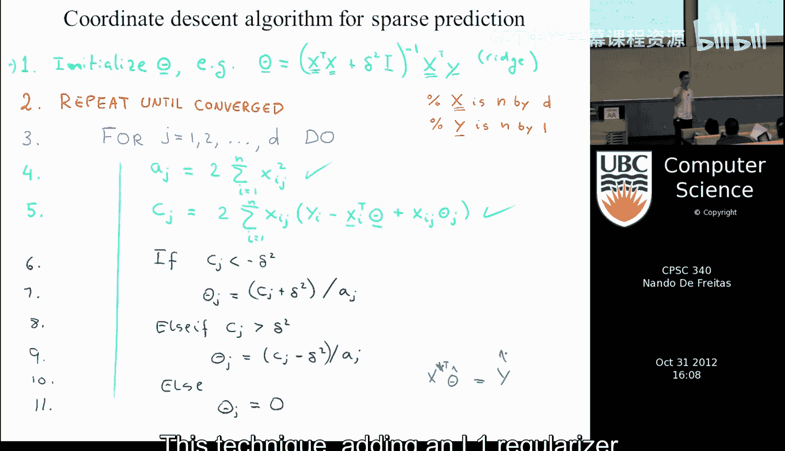
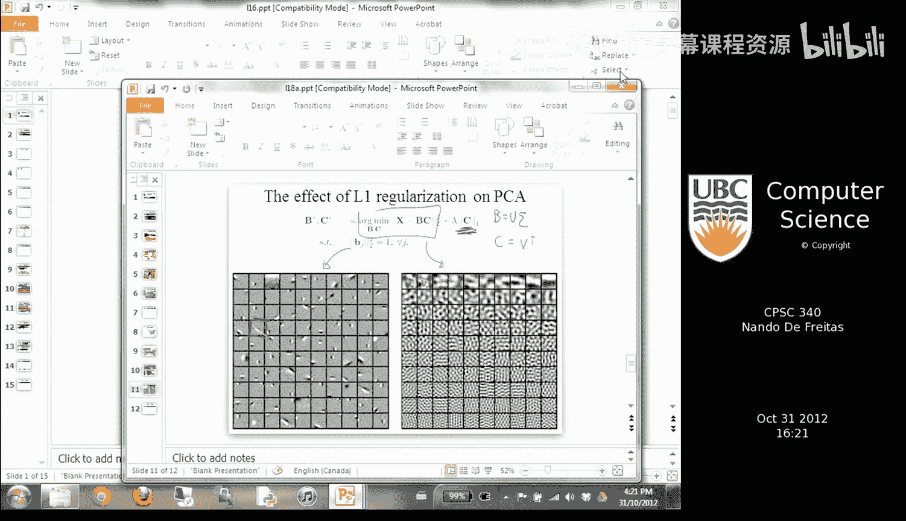

# 稀疏模型与变量选择：第22讲：稀疏模型与变量选择

## 概述
在本节课中，我们将要学习稀疏模型和变量选择。我们将探讨如何在构建线性模型时，不仅追求预测的准确性，还希望使用尽可能少的变量。我们将了解这样做的原因，学习如何通过数学方法实现变量选择，并最终掌握一个名为“坐标下降”的实用算法。

## 为什么需要稀疏模型？
上一节我们介绍了线性模型的基础。本节中我们来看看为什么有时我们希望模型是“稀疏”的，即只使用少数几个变量。

我们希望使用尽可能少的变量来生成预测，原因在于某些变量可能获取成本高昂，或者难以实际获得。这在许多实际应用中都是成立的。

例如，在房地产领域，如果你试图预测房屋成本（例如预测温哥华未来两年每栋房屋的价格），你需要考虑许多变量，如社区、房间数量等。但你可能还会考虑加拿大的GDP、美国的经济状况，以及中国的经济状况等宏观因素。虽然使用所有这些变量可以做出预测，但其中一些变量的获取成本非常高，有些甚至无法获取。因此，你需要找出那些真正对价格有预测作用的重要变量。

这里找到的是变量与结果之间的**相关性**，而非**因果关系**。例如，观察到癌症与吸烟相关，但你无法确定是吸烟导致癌症，还是患癌症的人更喜欢吸烟。确定因果关系通常需要通过实验或更深入的分析（如使用工具变量）。

我们的目标是识别出与结果Y**相关**的变量X。

## 稀疏模型的成本函数
为了同时实现预测准确性和变量稀疏性，我们需要设计一个新的成本函数。

我们熟悉的成本函数包含一个部分：残差平方和，即**∑(yᵢ - xᵢθ)²**，这衡量了预测的误差。

现在，我们向成本函数中添加另一个项：**δ² ∑|θⱼ|**，即所有参数θⱼ的绝对值之和，乘以一个权衡参数δ²。

这样做的原因是：当残差平方和很大，或者θ的绝对值之和很大时，成本都会很高。为了降低成本，我们必须同时做两件事：减小预测误差，并且减小参数θ的值。

减小参数θ的值之所以重要，是因为如果某个θⱼ变为0，就意味着我们不需要对应的变量xⱼ（因为xⱼ * 0 = 0）。这样，我们就能识别出哪些变量是相关的。

因此，我们的总成本函数J(θ)为：
**J(θ) = ∑(yᵢ - xᵢθ)² + δ² ∑|θⱼ|**

参数δ是一个权衡标量。如果δ非常大，第二项（正则化项）就占主导地位，会迫使所有θ趋近于0。如果δ为0，第二项消失，我们就回到了普通的线性回归（最大似然估计）。δ的选择至关重要，我们稍后会讨论如何通过交叉验证等方法选择它。

## 求解稀疏模型：挑战与思路
我们的目标是找到最小化成本函数J(θ)的参数θ估计值。通常的方法是求导数并令其等于零。

然而，这里遇到了一个难题：绝对值函数**|θ|**在θ=0处不可导。其导数在θ<0时为-1，在θ>0时为+1，但在θ=0处没有唯一的导数。

为了克服这个难题，我们需要引入一个新的数学概念：**次梯度**。对于绝对值函数在θ=0处，其**次梯度**是所有介于-1和+1之间的实数集合。这可以理解为在原点处所有可能的“支撑线”的斜率。

利用次梯度的概念，我们就可以处理成本函数的导数问题了。

## 坐标下降算法
由于直接对所有θ求导并求解方程组很困难，我们将采用一种迭代算法：**坐标下降法**。

以下是算法的基本思路：
1.  首先初始化所有参数θ（可以随机初始化，或使用岭回归的结果作为起点）。
2.  然后，我们一次只优化一个参数θⱼ，而固定其他所有参数。
3.  对每个θⱼ，我们计算在给定其他参数时能最小化成本函数的最佳值。
4.  更新完一个θⱼ后，我们转向下一个参数，重复此过程。
5.  在所有参数上循环多次，直到参数值不再变化（收敛）。

这个算法之所以有效，是因为我们的成本函数是凸函数，保证能收敛到全局最优解。

## 参数θⱼ的更新规则
当我们固定其他参数，只对θⱼ求导时，成本函数可以重新整理。我们定义两个中间量以简化表达式：
*   **Aⱼ = ∑ xᵢⱼ²** （总是非负）
*   **Cⱼ = ∑ [ (yᵢ - xᵢ₋ⱼθ₋ⱼ) * xᵢⱼ ]** （这依赖于其他所有参数的当前值）

这里，`xᵢ₋ⱼθ₋ⱼ` 表示使用除第j个变量外所有其他变量和其对应参数所做的预测。

考虑绝对值函数的次梯度，我们得到关于θⱼ的导数方程。根据θⱼ的符号，我们分三种情况求解：

1.  **如果 Cⱼ < -δ²**：
    则最优的 θⱼ < 0。
    更新公式为：**θⱼ = (Cⱼ + δ²) / Aⱼ**

2.  **如果 Cⱼ > δ²**：
    则最优的 θⱼ > 0。
    更新公式为：**θⱼ = (Cⱼ - δ²) / Aⱼ**

3.  **如果 -δ² ≤ Cⱼ ≤ δ²**：
    则最优的 **θⱼ = 0**

这个更新规则是算法的核心。它清楚地展示了稀疏性是如何产生的：当Cⱼ的绝对值小于阈值δ²时，对应的参数θⱼ就会被精确地设置为零。

## 算法步骤总结
以下是完整的坐标下降算法步骤：

1.  **初始化**：为所有参数θ选择一个初始值（例如，全零、随机值或岭回归估计值）。
2.  **预计算**：计算所有Aⱼ = ∑ xᵢⱼ²，因为它们在迭代中不变。
3.  **迭代直至收敛**：
    *   对 j = 1 到 D（D为变量总数）：
        *   使用当前所有θ值计算 Cⱼ = ∑ [ (yᵢ - xᵢ₋ⱼθ₋ⱼ) * xᵢⱼ ]
        *   根据上述三条规则更新θⱼ。
    *   检查所有θ是否不再发生显著变化。如果是，则算法收敛；否则，进行下一轮迭代。
4.  **输出**：得到稀疏的参数向量θ，其中许多元素为零。
5.  **预测**：对于新样本x_new，预测值为 **ŷ = x_new * θ**。

## 应用与意义
稀疏模型（L1正则化）的应用非常广泛：
*   **特征选择**：自动识别出最重要的变量，帮助理解数据。
*   **降低成本**：在医疗、金融等领域，避免测量昂贵或不必要的特征。
*   **压缩感知**：这是现代信号处理中的一个热门领域，它利用信号的稀疏性，以远低于传统要求的采样率重建信号。
*   **神经科学**：在图像处理中，类似的稀疏编码模型可以产生类似人眼初级视觉皮层中神经元的“感受野”，即对特定边缘或纹理敏感的局部滤波器。

与岭回归（L2正则化）使参数变小但非零不同，L1正则化能产生精确的零值，从而实现真正的变量选择。

## 总结
本节课中我们一起学习了稀疏模型与变量选择。我们了解到，通过在标准线性回归的成本函数中添加参数的L1范数（绝对值之和）作为正则化项，可以迫使模型在保持预测能力的同时，使用尽可能少的变量。我们引入了**次梯度**的概念来处理绝对值函数求导的难题，并详细阐述了**坐标下降算法**来高效求解这个优化问题。该算法通过逐个更新参数，并根据简洁的规则判断参数是否应为零，最终得到一个稀疏的、易于解释的模型。这种方法在特征选择、成本控制和许多科学发现中都具有重要价值。