# UBC《机器学习和数据挖掘｜CPSC 340 Machine Learning and Data Mining 2012》中英字幕 p23 -23-undergraduate machine learning 23_ Dirichlet and categorical distributions.z -BV1pJ2ABFEFg_p23-

Ts are important。

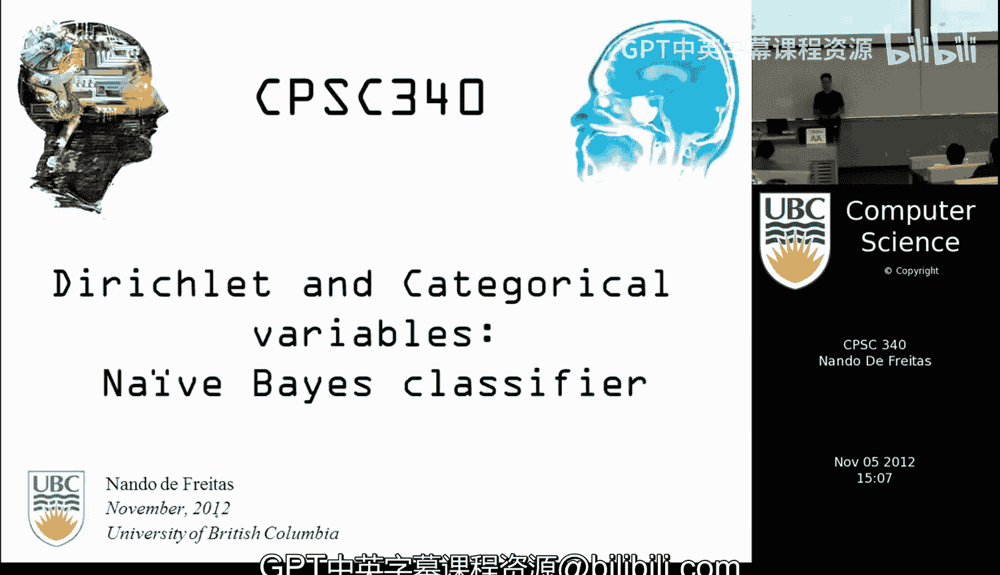

Okay， so。Today， besides outlining what the project will be， I will talk about。

I will so we talked about these coin flips and I said that generalizing coin flips to variables that have more than one value is easy。

 and that's what we're going to do in a couple of slides and you'll see that all the theory。

 everything we learn applies to it。And just by using this concept of。That we've talked about before。

 Bernoulli and beta distributions， are in this case the extensions to more than two values。

The multivariate extensions， which are the Bernoulli and。Excuse me， in the categorical distribution。

 you'll see that we can already build classifiers and in fact， we can go and build applications。

And we can build some really cool applications out there。

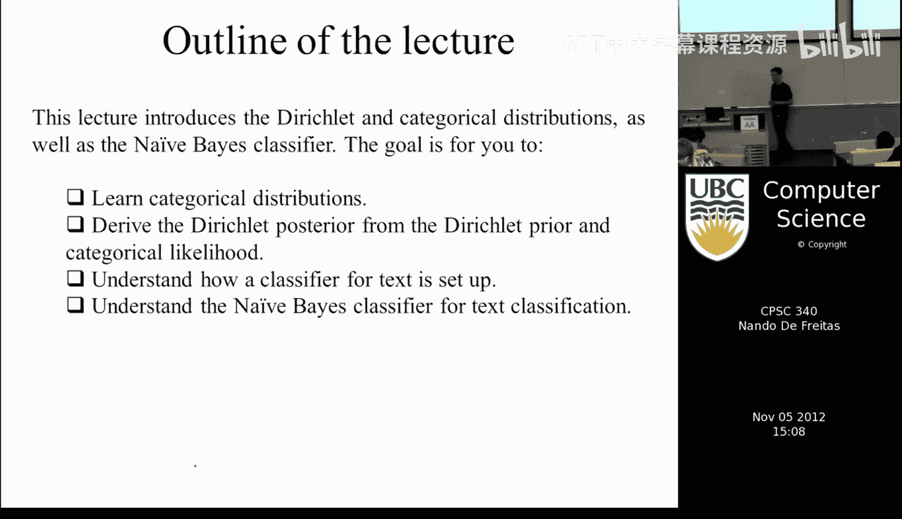

Revision， you probably don't need this revision because you've all studied it。

 there's plenty of this last week if we have a variable that's binary。

The likelihood can be represented in terms of Bernoulli distribution。Where n1 is the number of times。

 say the coin was 1， and n0， the number of times that the variable took the value of 0。

And that's just simply。This Bernoulli distribution that we have here。 I'm using this curly D。

To basically represent x1。In this case， to end all the date。

So sometimes I will write x1 to n and sometimes it's easier to just put a D there and say that's the date to the probability of the date to given the parameters。

 it's just a bernoully distribution。We also learned that the natural p for the Bernoulli distribution was the beta distribution。

So the beta distribution allows us to encode our beliefs。About what the value of theta will be。

And theta is between0 and1。So we know that。Theats of probability。

And so theta in fact just in this case， the probability of x being equal to1。At one minus theta。

 the probability of x be equal to 0。 So in a probabilistic setting beliefs。

 our personal beliefs are described by probabilityba the distributions。

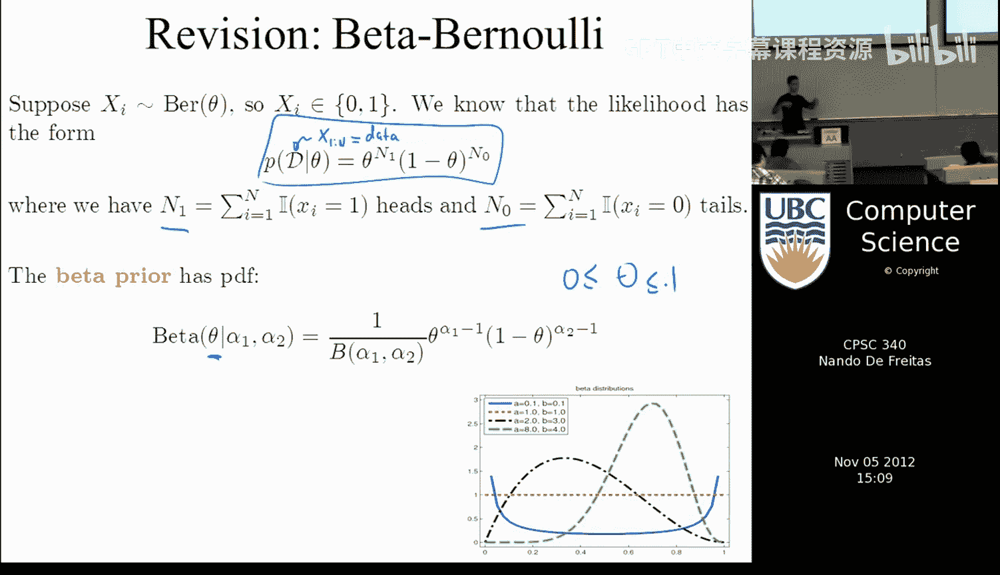

And we learned that in order to do baes inference。One doesn't do optimization。

And one doesn't believe that there is one only value of theta。

 one uses this notion that there is a subjective prior that encodes the beliefs P of theta。

And then one multiplies the prior times the likelihood。And normalizes。

To get the posterior distribution， which in this case is also beta distribution。

When the p and the posterior have the same。Form， like in this case， the prior is beta。

 the Paserus beta。We say that。The prior is conjugate to the likelihood。

So the word conjugate is often used in books。And that just means that if you start with a prior of type X。

You multiply it by a likelihood， your posterior is also of type X。Okay。

 so we've seen two cases of this already， this case where the prior is beta， the posterior beta。

And what was the other case？The gas in case。So if you have a Gasian prior in theta and linear regression。

 the posterior is also Gaussian。Butster the is also go。We didn't do the variance。

 but for the variance， there is a similar result。 if the variance is for the variance。

 we use a distribution called the inverse gamite that is just like a Gaussian。

 but it only allows for positive values because variances can only be positive。

And so this is something that it would be a short exercise for you guys to actually do this。

 you use the inverse gamma prior， you multiply and then the posterior is inverse gam。

The one that I want to talk about today is the extension of the beta distribution。

And the extension of the pernoli distribution。

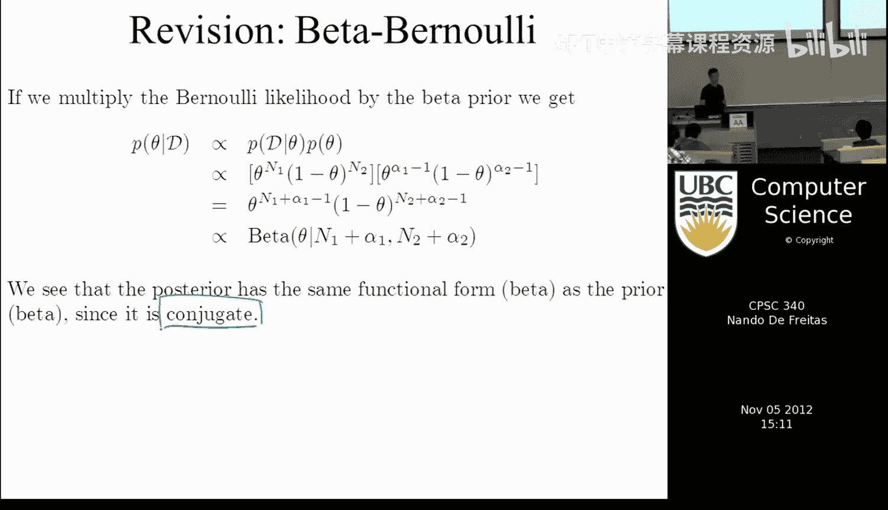

Let's start with the extension of the B distribution。

 so this is going to be called a categorical distribution。

And I use the word categorical instead of whats the generalization of it。

 which is the multinoial because I think it's more natural。

 it's just basically saying something is either of this of category X or category Y or category that。

So we're categorizing data。How do we do this？ Now， let's assume we have n data points。

 Let's try to get the formal setting。 We have n data points。Okay， so x12 n is our entire data set。

Anitche X I。We'll take K values。In particular， if， or I should have said here， if k equals3。

Then the possible x's that you could have are 100， so class1 or 010 or 1 or 001。

Let me write this actually here， so X is equal to either。One， two， or three。

 one basically gets represented as class 100，2 as 010， and3 as 001。

So we're just using a binary encoding。To represent each nu。And the one appears in the position。

The one will appear in the position where the variable is on。Yes。

 this make sense because the rest of the lecture I'm going to use this encoding。

Why is it called multivari， There's only one variable。Partard oh， in this case。

Ex so I can take several bodies。 That's why I'm actually using。And I'm going to have more than one X。

So in which case， I could think of the distribution of our x1 to n。It's a single multinmal。

 which I'll come back and I'll show you a very specific example of why that is the case。

Why are you using3。We can store three in like two bit data。

you can store number three numbers in a 2 B data， right You can have 01。1，0 and one，1。What也 doingで。

I'm writing it like this， not for storage consideration， but for explanation， how we store it。

 we will be able to store it efficiently without having to represent all these zeros。

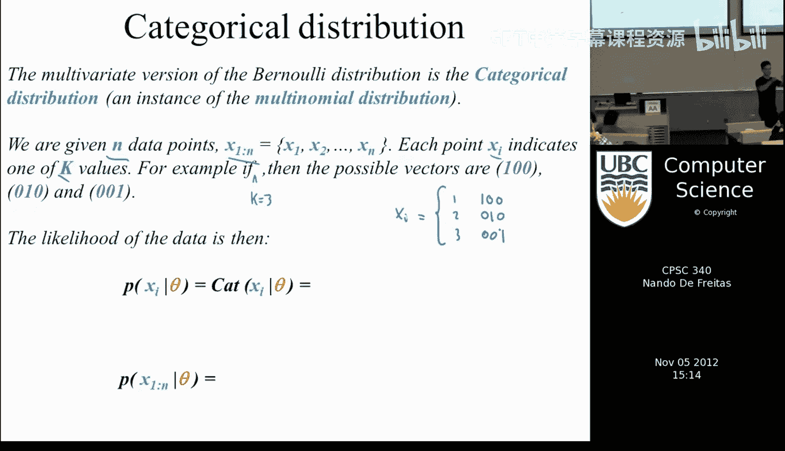

So it went from one to。Or if theres in。Vues that it would be。V would be in the one million position。

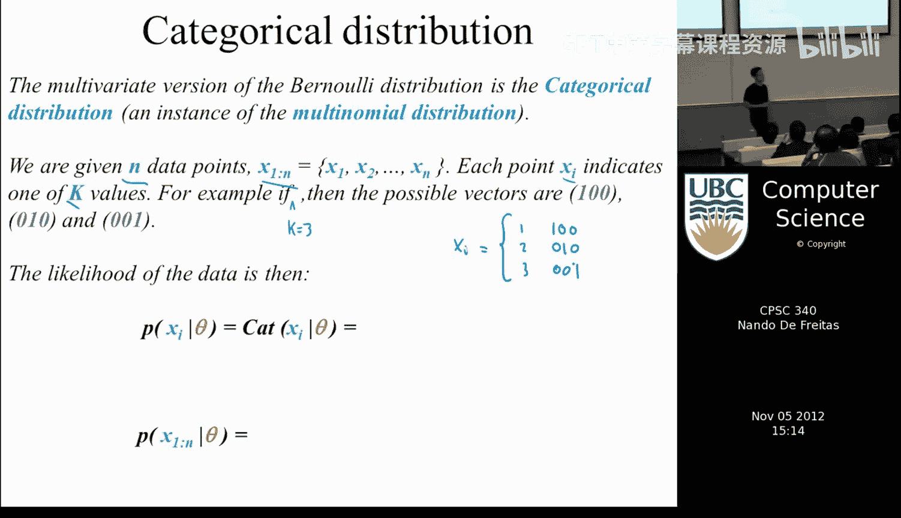

That's correct。If you have， but let's leave n to indicate number of data points and let's use k to indicate the number of values that the variable could take。

 So if k is a million。

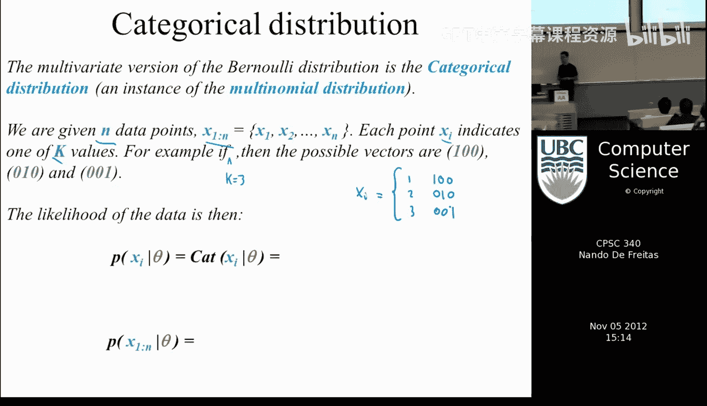

And x happens to be 999， you basically have a vector of a million zeros with a one imposition。

 what did I say？999。Okay， so， of course， when we implement this。

 we're not going to be storing vectors with millions of zeros and a1 at a position we'll just store the location of the one。

But in order to explain。This to you at write the math。

 let's assume that we have a vector of zeros and a1 in the position that's on。

So our space here is partition， we don't allow， for example， a 。5。5。

 it's either that's correct to one of K different That's correct。 There's no soft。

You can't belong to two， you were either one or the other。

That's gonna be how I'm gonna construct this。 And so then I'm gonna say that the categorical distribution。

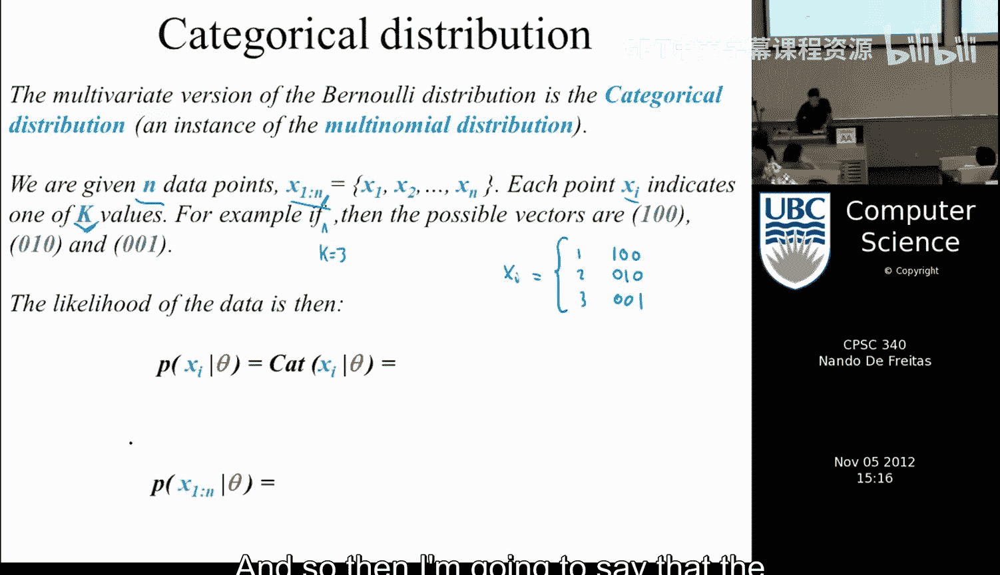

For variable Xi。Will be the product。From j equal 1 to Bk。Of theta J。To the indicator variable of。X。

 I J。

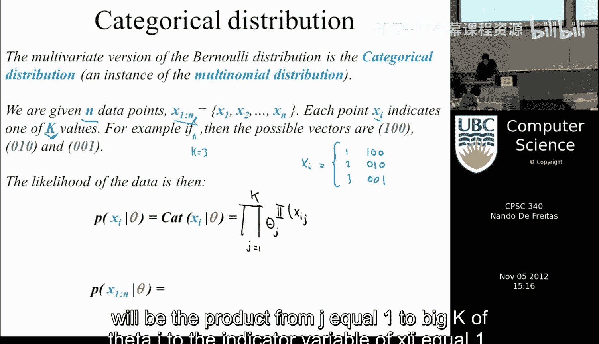

汝个完。Now， let's see why this is the case。Why does definition make sense？If I have a vector。

 let's say that I have X equal。0，0，1 in this example。So in this case。

Probability of X I given the vector theta。Would be equal to。Theta 1。To the power。0， because X I。

X i1 is0。X I3 is equal to1。So that's just teacher three。

So this is exactly what we did with how when we introduced the Bernoulli distribution。

This is just a simple compact way using the product of saying that the probability of Xi being equal to1 is t to1。

The probability of X being equal to 2 is theta 2， and the probability of X being equal to 3 is theta 3。

And then we'll add one more condition。Which is theta 1 plus theta 2 plus theta 3。

They must be equal to what。So the last theta should always be one minus the sum of the previous thetas。

So in other words， theta k is always equal to 1 minus the sum from j equal 1 to k minus1。Of Theta J。

Now， if you choose K equal 2。You see that this is the Bnoli distribution。Because theta2。

In this case would be1 minus t to 1。So it's just one minus8。You you choose theta1 equal theta。

 and then theta just just1 minus theta。Okay and so this is the categorical distribution。

 so it basically says what is the probability that you belong to each of the categories？

What is the probability that you belong to each of the boxes？Okay。So what is the probability that？

You're a Republican or a demo say。When we have several data points。

 if we assume that the data are IID， that they all come from the same distribution， in this case。

 categorical distribution。And if you assume that they're independent， then we can just multiply them。

So there's whole probability， which is be a probability from Michael1 to n。Times。

The probability from J equals 1 to k。Of Theta J。H。Indicator of the variable。b one。

So that's how I write my life。Once I have a likelihood， you know how to compute feet。Take the log。

 differentiate equal to 0。We're going to do this in the next class。

 I'm not going to do the maximum likelihood estimate or today。 Instead。

 I'm going to move on to an application of this。 Allright， so the probability。Oh。

 I should have said here of X equal3， sorry about that。So for the example。

 the probability of Xi equal 1 given theta。It's just equal to theta 1。

 the probability of X equal2 given theta is just equal to theta 2 and so on。

 so the probabilityrb of Xi being any class is just theta， it's just that theta。

And so when we're given data， we're going to try to estimate the。

So think of like let's go beyond the coin， now let's think of a die。Yeah。

You toss it many times and it can be k is equal to6 is one of those six values。

 and so if you want to know the probability of6， you just count how many times6 came up and you're defined by the number of time you actually threw the dice。

Okay so。

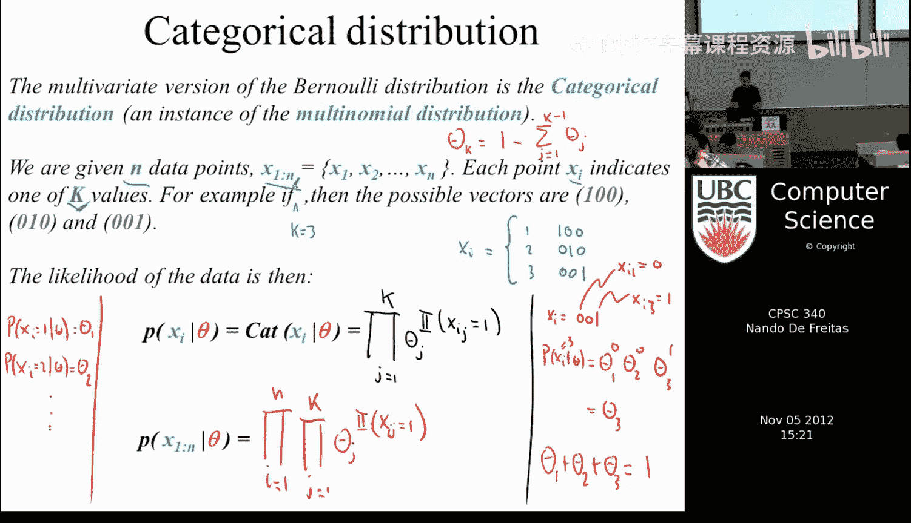

Just like we had a beta distribution， we're going to have a generalization of the beta distribution。

 which is， as you would have expected， it will just look like the beta distribution。

So recall that the beta was theta times 1 minus theta and two these parameters often deta。

In this case， we're just going to assume that there's K possible values。That the variable could take。

And then we're just going to take theta to a variable， and instead of having alpha， beat and gamma。

 all of these variables， we're just going to call them all alpha and introduce an index k。Okay， so。

Recall that the beta。The beater was。嗯。Proportal to theta to the alpha 1 minus1 and 1 minus theta to the alpha 2 minus1。

 so that was a beta distribution a delet distribution looks just like the beta distribution except that now instead of going on up to two values。

 we're going to go up to k values， so we're going to multiply k thes。I'm seeing some faces。

 I see people sleeping， I see people with faces of horror， I see people laughing。

 and I see people on the laptops。😊，This is the time to ask questions。The rest of the lecture。

 as well as in order to understand neural networks。

 we're going to be using this notation at nauseium。This is the beginning of the second part。

 and this is very key。ス？几十几。呃对。Theres。ての。That's correct。Okay， so for。嗯。Let's look at an example。

For the beta。K is the number of variables。 The number of possible outcomes， sorry。So for a coin。

 K is2。Your heads or your tails。For the die， k is6。One， two， three， four， five， or six。

So K indicates all the possible values the variable could take。Okay， so for a coin。

 we use a beta distribution。Beta prior， and the beta prior is essentially it's this。

 there's only one theta。And the reason why there's only one feus because。

I know that I could also write this。Let me actually write it。Alpha 1 minus1 times theta 2。

Alpha 2 minus-2。 so I could write it like this， but then it must be understood that theta1 is the probability of heads and theta2 is the probability of tails。

 And so we know that they have to add up to1 with the coin either heads or tails。So in a way。

 if I write Theta 1 and Theta two， I'm over parametermetizing them。

And so that's why when I explain beta， I actually just use one single value of theta。

Because whilst I know the probability of heads， I know that the probability of tails is just one minus theta。

Now。So that's the beta。 Let's look at the deish layer for the。For the die。

 so there I would have theta 1 to alpha 1 minus1。Theta 2 to the alpha 2 minus2。Theta 3。

 alphapha 3 minus-3。Pta 4 to the alpha of 4 minus4。So， minus-1， sorry。Okay。

 glad to hear you guys following it。N5 to the alpha 5 minus1。And then， the last one。

I don't need actually to write， I could just write theta 6 or the alpha 6。-1 to make it easier。

 But I know that they all have to sum to1。 So this last one is1 minus theta 1 minus the to 2。

Minus theta 3， minus theta 4， minus theta 5。So the alpha 6 -1。

Because we know that the last one is the one that guarantees that everything sums to what。

And of course， each theta is between zero and 1， each theta is a probability。Okay so。

Now that also has a normalizing constant， which is this ratio of gamma distributions。

 just like the beta distribution， we don't need to worry about it because we can do all our analysis without knowing it。

someone once worked out this for us， we don't need to bother with it。

 someone actually in class went and did this by actually someone actually did this derivation。

 proved that the integral of this。Its this gamma function and it's actually a simple integration by parts exercise。

 but this is not a catalyst course， I'm not going to ask you to do that。Okay， so that's the setup。

You can be one of K values。And then you can also put a be prior on that。

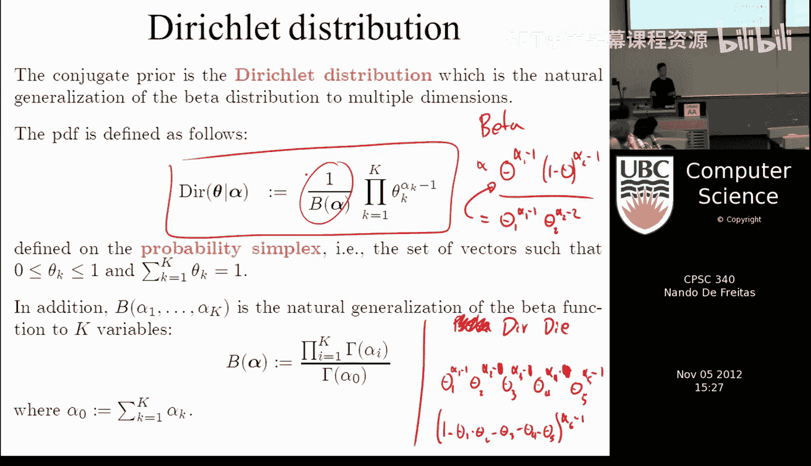

So now just like we had done before。

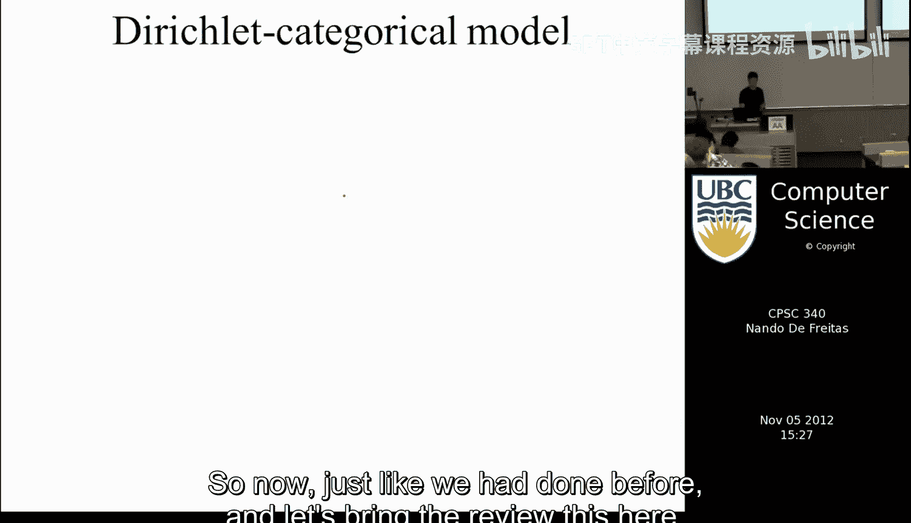

And let's bring the revision here。

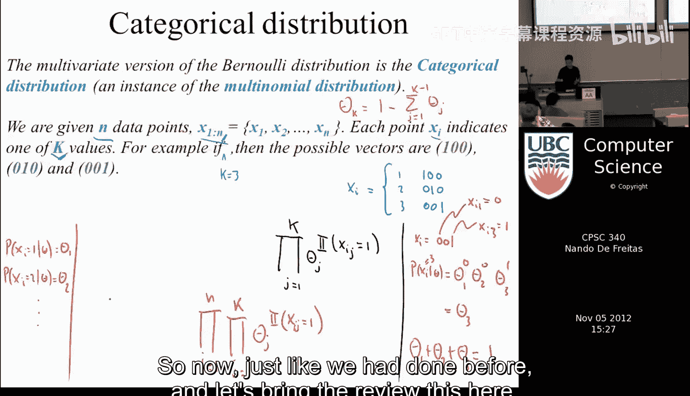

So before I had a beastta prior。And I had。P newly likelihood。

And then what I did is I multiplied the beta prior times the Bnoulli likelihood。

 and I arrived a beta posteri。

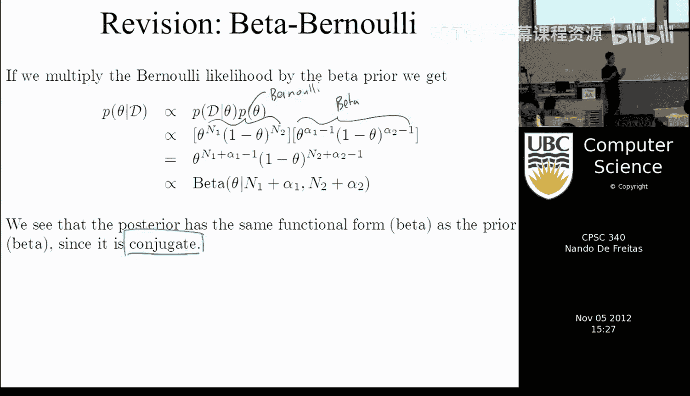

。

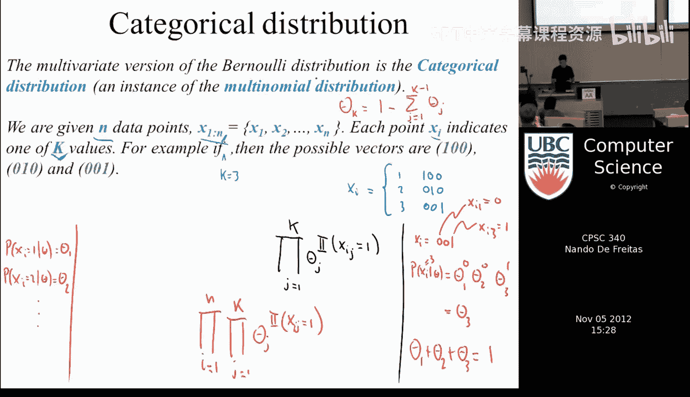

Right now I'm going to do the same analysis， but instead of using a beta and Bernoulli distribution。

 I'm going to use a categorical distribution and a deish lead distribution。Okay。

 so we're going from coin to dice。And a larger， Or if you can do dice。

 you can actually do a lot of applications on the web。 Certainly， all of text analysis opens to you。

 The idea of doing text analysis on the web。嗯。Becom。Very accessible once you know this。

So the posterior。Of theta， given all the data， x12 n。Is proportional to the data。X12 n given theta。

Times the prior。And that's going to be proportional。And now the data seem to be independent。

 so it's the product from IQ1 to n。And then the product from J equals 1 to k。Of theta J。

Indicator of X I J being equal got to work。that's just the likelihood。Times。The product。

From J equal 1 to k。Of theta J to the alpha J。Minus1。And I don't want to make the notation too heavy。

 so I'm not going to be saying all the time that the theta Js have to be between 0 and1 and that the thetas have to add up to one。

Okay so。I will assume that we all are on the same page。

 Thes are each theta is the probability of one of the K classes。And you， you can only be。

When you add up over all， the cake classes， you have to get why。And so this is equal to。

The probability from J equal 1。2。

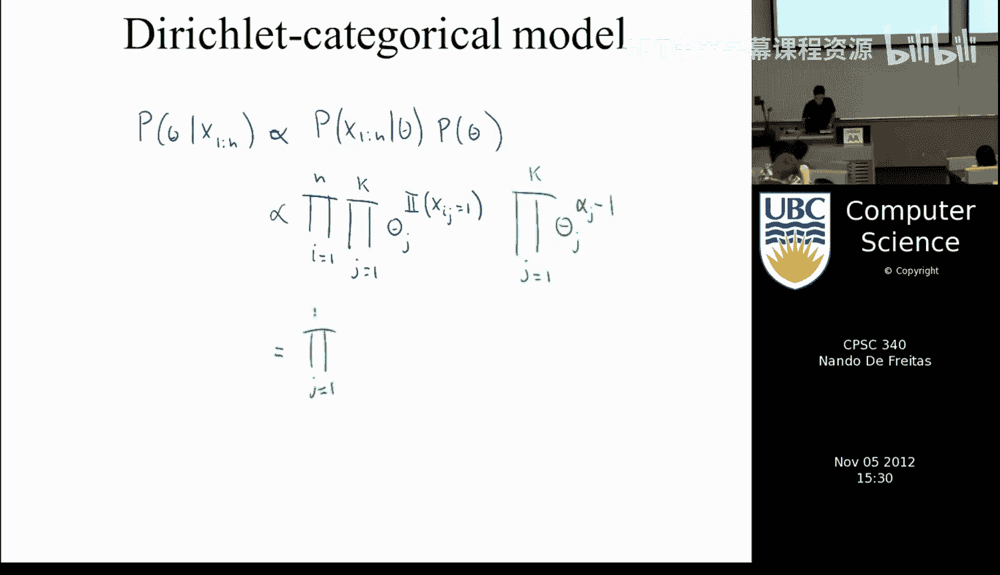

Of theta J。And now I'm going to write this as an。Jy。

Times the probability from j equal 1 to k of theta J to the alpha。J minus1。

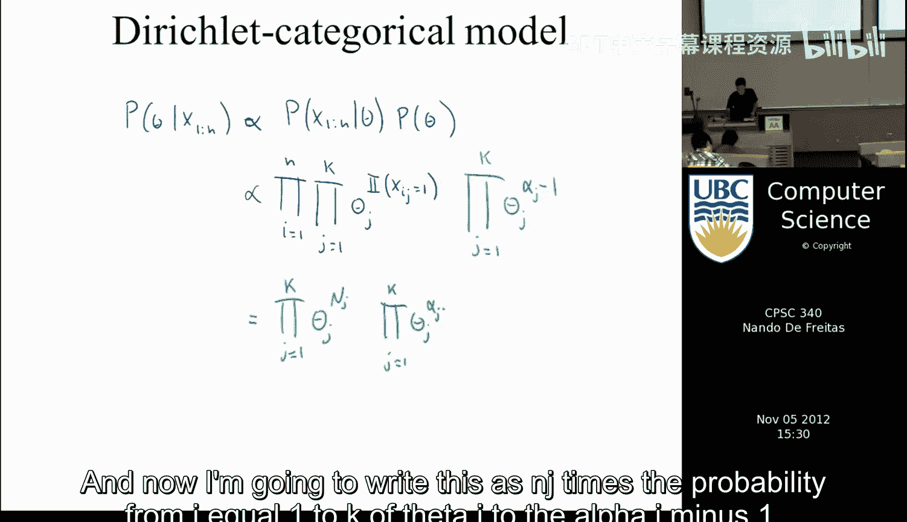

Where NJ。Is the sum from I equal1 to n？系。X， I。J equal one。

So basically it's the number of times you had a one in position J。So capital for the dice。

 for example。I always get dis confused， a die is one， right？

Or is it the other way around dice is one， No， die is one。For to die。And five。Is。Number of times。有。

So。A5。And so for the dice， you would have n1 and2 and3 and4 and5 and N6， and that's it。

And so you just keep throwing the dye and then you just count after say 1000 tosses， you count。

 how many times was it one， how many times was it two， how many times was it three and so on？

Once we know that。And you can see that the property that I've also used here is that8 to the2 times a to the three is just8 to the2 plus3。

 which is a to the5， so when you multiply quantities。

 you just add the exponent if they have a common base。And so。

We can now use that same property and rewrite this as the provot from j equal 1 to k。

Of theta J to the N J。Plus alpha J minus-1。And so the posterior has the shape of a。

Theres slow distribution as well。Where now we have this new alpha prime。Which is just。AndJ。Plus。

 alpha J。The posterior。His。Dishly。So there's one more third example for your sort of bag of examples。

 if the prior is deishcheula and the likelihood is sical， then the posterior will also be deishchele。

So we know how to compute a posterors。

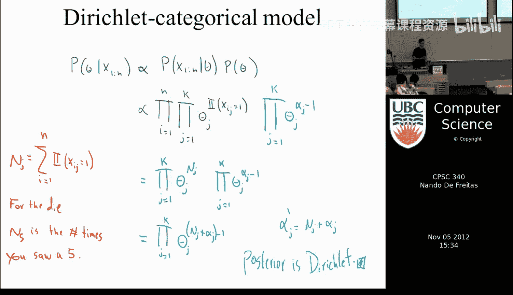

Let's look at an example， a practical example that's sort of timely as well。

Suppose you wanted to assess the popularity of。The president in this country south of the border。嗯。

I just did a query a few minutes ago。 if if you type Obama in one of these sentiment prediction apps。

 you might want to know。How popular is Obama。Just by looking at tweets because now everyone' is tweeting Obama is Obama that Romney does Romney that。

lah， blah， blah， blah， so here is what you can do。You can take。

 can search for a large collection of tweets。That have a happy face。Happy face。

 And then you say that every tweet that has a happy face is a positive tweet。

You then look for a collection of tweets that have a negative asad face。

And you say that those tweets that have a side face， theyre negative tweets。There will be exceptions。

But on the whole， that assumption might not be a bad one。And then maybe I， you know。

 the colon and a straight bar， you call those tweets neutral。Or whatever。

So now we have three classes， either either positive， negative or neutral。Okay， so。

What we're going to do。Is because ultimately what we want to do is for any quantity。

 for anything that is talked about。On on Twitter， we want to say how positive are people about that quantity or how negative。

 For example， if the quantity that people are talking about is the word Obama。Then you can look at。

 say here there's three examples of tweets and from those three tweets。

 you would like to classify those tweets as being positive， negative or neutral。

And then you just count how many positive， how many negative， how many neutral。

And you're able to show a plot like those green and red bars that are being shown there。

In this case there's no neutral， they didn't add neutral to the UI。

 they just have positive and negative， so they only have two classes。

 and it's basically saying most based on the tweets。

 the popularity of Obama seems to be on the safe side， he's looking green right now。So， to speak。

All right， so we're going to introduce a variable y。

And that variable y is going to indicate whether a tweet is positive， negative or neutral。

That's going to be the role of y。 so y again will be encoded as 10，0，0，1，0 or 0。

0 y So those are the three class and why， as you can see just from saying that will be a categorical error。

We also need to have a way of describing the tweets。And。You know， we see words。

 but how do we encode words？

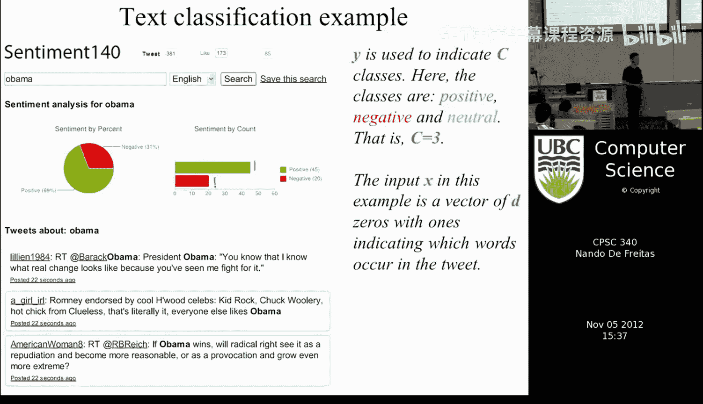

So to encode words， we'll use a vector x。That vector x will have zeros everywhere and will accept where the words occur。

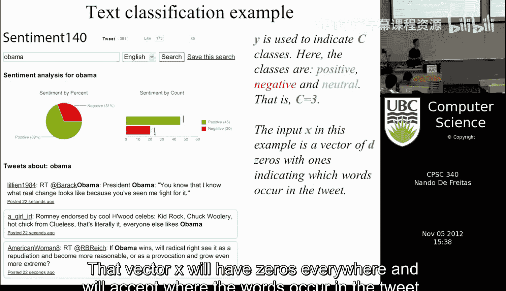

In the tweet， in which case there will be one。So， for example。Suppose that X。

Suppose that we have a vocabulary of just a few words like。Ct。Rt。St。系。o m g。Okay。Thats a common。

Twitter terms。嗯。And then let's assume that the tweet is。Let's use my Twitter。N the F says。OMG。

The cat。S。It's good Mar maybe。Now in my feature vector。

And this is actually how you actually do it it does sound funny。

 but certainly not this is how one blue this sentiment 140。

 you can actually go home now and you can run this and you can check how it does for different things and the way it's implemented is precisely the way I'm going to describe here and it's precisely the project you will all get to code this。

😊，嗯。So what I would do here then is I would say， oh， the words OMG and cat and sat appear。

 so I go Cat sat and OMG， and I put a one there。If a word does not appear in my dictionary。

 so the set of allowed variables is what I'm going to call my dictionary。Or my set of tokens。

And you can imagine that there' will be many words that I'm not going to include there because we're not just talking about the words in English。

 we're talking about people tweeting in all sorts of languages and using all sorts of slang。

And all sorts of misspellings。So you can just imagine how huge。That is。

So we're just going to pick the most popular words。 We're also not going to pick words like that。

Right， because of the word there obviously will not help me decide whether a tweet is positive or negative。

Because the president suck， so the president is awesome， the word would not help me。

 so you probably don't want to consider these words。

The exclamation mark I would consider an exclamation mark I see as a symbol that is indicative of positiveness or not。

 but lets us say I didn't think about my problem carefully so I didn't include the exclamation mark。

And so I only had those five words， cat， rat， sad， high， OMG。

And then because I didn't see in this tweet。R and high。Those will get to zero。

And that's the I feature。That's my input。 That's my x。

 I now want to say whether that x is of class y equal1 or y equal 2 or y equal 3。 That's the problem。

If you know the categorical distribution。You can do this。Because we can， as I'll show next。

 we can rewrite this problem just as a problem of learning theta for a categorical distribution。

And then we will solve as using。Maxim likelihood by differentiating the log likelihood equating to zero the same staff。

It's just giving me a slight twist， which I'm going to have to add a constraint to ensure that the theta sum to one。

So that's going to be a new trick that I'm going to teach you from optimization。

And then we're going to do the baescing analysis， which is going to be just like what I did in the previous slide。

 which is you have a categorical likelihood， you multiply it times a deishle prior and we will obtain a deishle posterior。

 and that's going to be our answer。And once we have theta。

We will see that it's possible then to compute the probabilityity of a new x given theta and x。

 sorry the probability of a new y given theta x， that is when we see a new tweet。

We will able to predict it as being happy or sad。In fact。

 the way this was trained this web service is they took， I think one。Wait。

I'm not going to reveal the total number。I know I'm a good。I want to keep it as a project。

 so I don't want to reveal what the solution is。That's already saying too much。

But I'm going to give you a million tweets。Those million tweets。

 half a million will have happy faces。And how familiar will the have side faces？So in that case。

 I will know the labels， what's positive， what's negative， that's what you're going to use to train。

 in other words， to estimate theta either by base or maximum like。Once you know Theta。

 I'm going to give you more tweets， or you can just take any tweets off the web。

And you can classify it。At that stage， you're done。They've built a classifier for sentence。

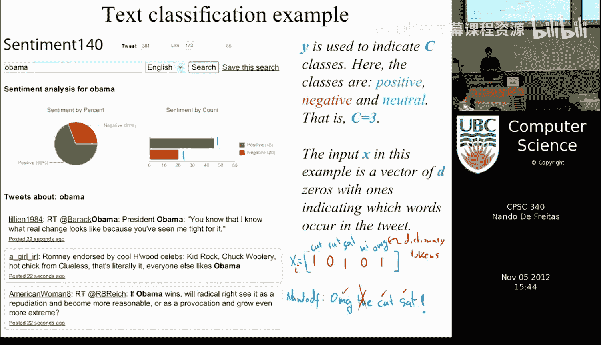

Okay。How are we going do this？ We're gonna to use base rule。So we're going to。

Have two multinoials in this case， one for y and one for x。

 So now we're going to model the distribution of the day of the input。 Unlike linear regression。

 here we are going to model a probability of x。

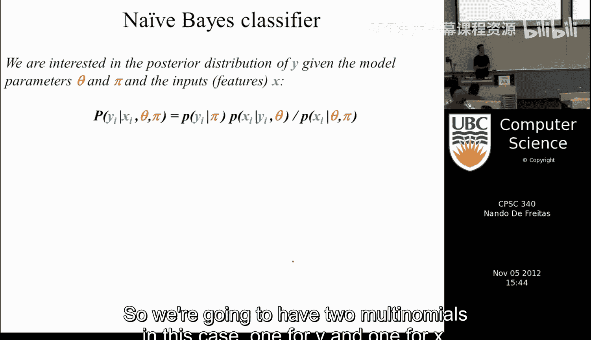

And there's going to be two parameters， one for the probability of x， which is theta。

 and the parameter for the probability of y， I don't want to call it theta2。

 so let's just call it pi。In particular。And then of course。

 I'm going to use base rule to compute the probability of y。

 given an input x and given the two parameters that we will learn by maximum likelihood or Bayesian inferenceverse。

And。Then normalizing， I could also write this as P of YI。Given pi。

Time is the probability of X given one I。And Theta。Divided by。

 and this is not just application what we've been learning of base rule， this is the sum of OYI。

Of P of Y I。So why I being of class C。Let's just say that why is。Belongs to classes1， two。

All the way up to capital C。The normalizing constant is just a quantity that ensures that you have a probability of a y that sums to y。

唔该系。B workss can reflect that。No sorry。我 there。And。Let me show you an example soon in the next slide。

Let me first talk about y， and then I will talk about the distribution of x。Okay。

 so coming back to why。The distribution。Provolity of Y I。Given pi。It's going to be a multinomial。

From。Small C equal1 to big C。Of pi C。Indicator of Y I。Equs4。

So we're just going to use a categorical distribution to indicate。

The prior probability for the classes。What's the probability at a priority。

 something is positive or negative？There are some candidates for which the sentiment tends to be more positive if you type save or think of a combination of words about my economy then。

The number of negatives seems to outdo the positives。

 and so you would expect that pi C is not the same。 should not be a half a half。

We're going to allow for different probabilities for each of the classes。So that's the prior。

In other words。The probability that Yi is of value small C。Given pi is just equal to pi。See。

And the sum of the pi C's overall C's sums to1。 So it's just a categorical distribution。For the axis。

 I'm also going to use a categorical distribution， but I'm going to make the following assumption。

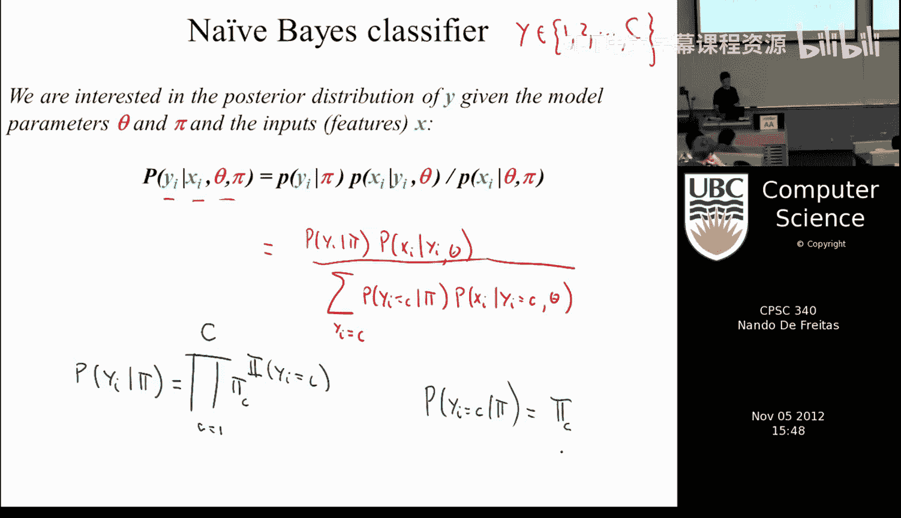

I'm going to assume， oh by the way， one thing I didn't emphasize is I'm going to assume like in this case。

 D is equal to5， so D is the size of the number of x variables， binary variables。

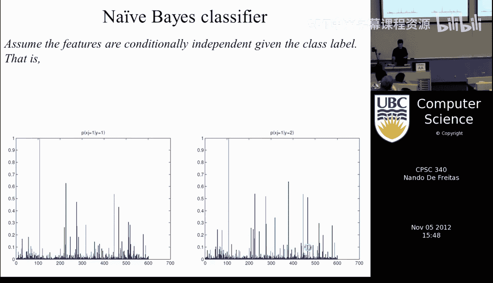

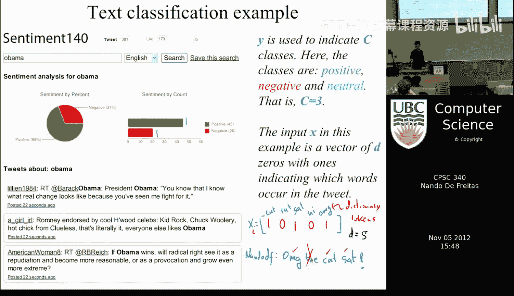

The number of distinct words that I use。And so for P of Xi。

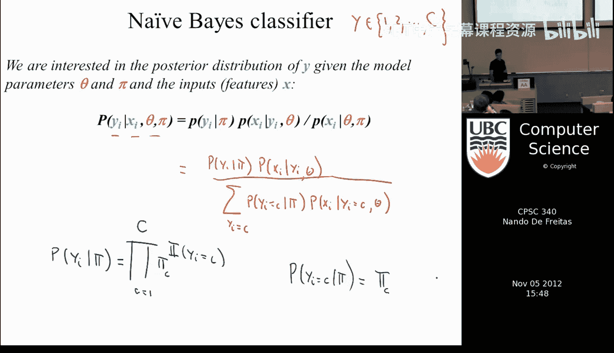

Given theta。And given that I am of a particular class。Within a class。

I'm going to make the assumption。

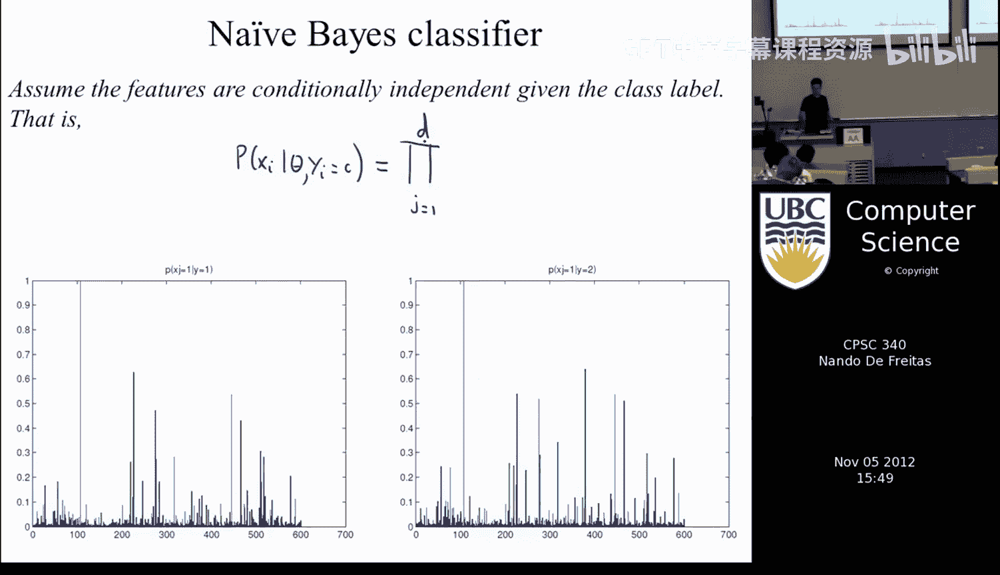

Let me take it back here， I'm going to make the assumption that from J equal 1。

 j equal 2 all the way up to J equal D。I have D binary variables。

 so this is how I'm going to model x。 I'm going to model x as D binary variables。

Each brings zero or one。So and these binary variables basically in the text means is the word present or absent in the tweet？

And I'm going to assume that theyre either present or absent independently from each other。

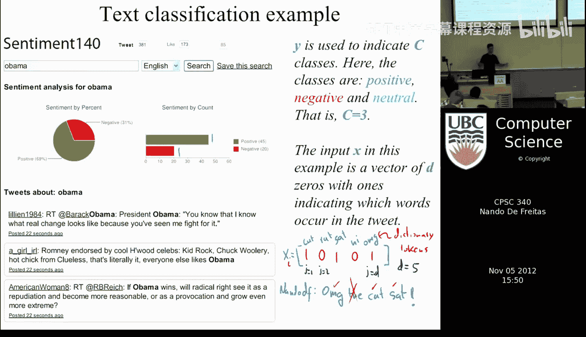

So。I'm going to assume that each of the words are independent of each other。

That's a very big assumption because you would think that the words Barack Obama not independent。

Some words some words tend to chmo with other words。We are， however， going to relax that assumption。

 We're going to assume essentially that。As we split the data into classes。

Essentially what I'm showing here in one class， you will have。Words that tend to look like this。

 In another class， you might have words that tend to have a slightly different shape。

So those two figures there are on the X axis， I'm showing you 600 words。And on the y axis。

 the frequency of those words end does for class2 and class1。

And so the idea is that in different classes you would see different kind of words， for example。

 in the class that is positive about Obama， you might see things like healthcare and you know New hope or whatever。

 liberal on the negative class， you might find things like socialist。

I am assuming you can guess the rest。So are my so you'll see different words tend to appear more with the happy faces and with the sad faces。

And I'm going to make this assumption， which is a very coarse assumption。

That these things should be independent。 It turns out that even if you make this assumption。

You get a classifier that actually works remarkably well。Of course， you could do better。

 but let's for now use the simplest possible thing。 We can assume that all the words are separate。

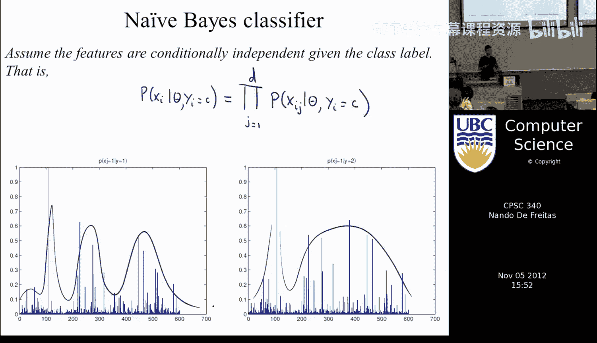

And then。What I'm going to show you。In the next to you in the next class is that the joint distribution of why。

 given the new input and the parameters can be written in this form where you will have。

This is just a prior of a sea。And this will be a binomial。They're in there for each word， for each J。

 and they will。Depend on whether what class you're at， which data point you're at。

 and then know where this on or off。 So I'm going to par this expression for you in the next class。

What each of these terms are and how I arrive at this。 But essentially。

 I get a single multinomial at the end of today day。 That's just a multinomial。

 I can group all these terms。Intering a multinoial。 And then once we have the model。

 the rest is mechanical log likelihood， differentiateequ to 0。

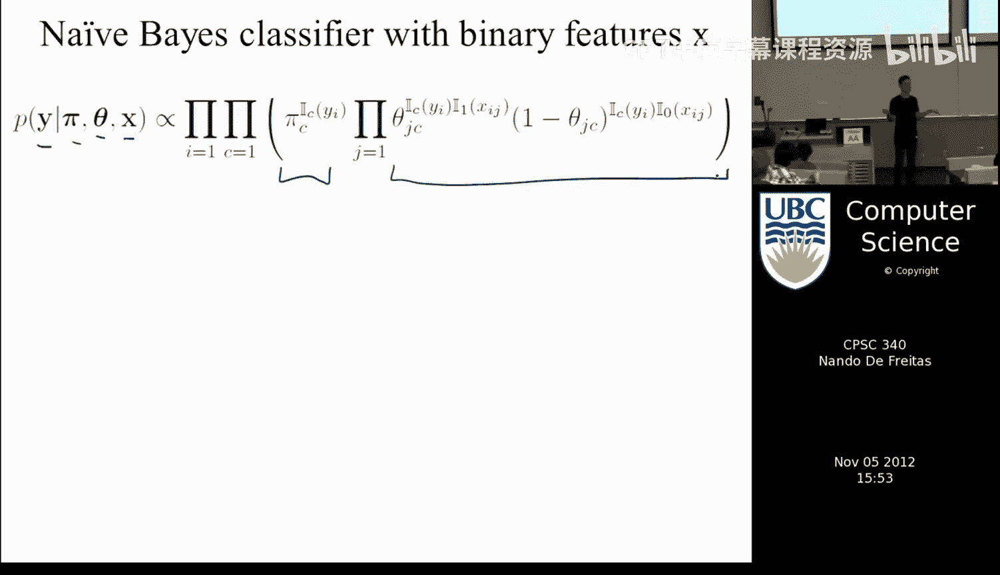

And when I do that。

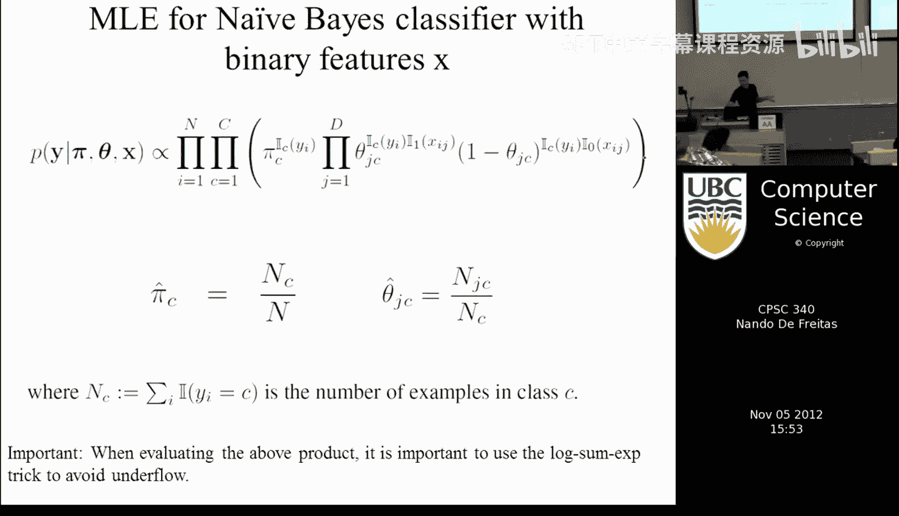

I'm going to arrive at an algorithm that is extremely simple。

The code to build an engine that predicts the sentiment about the quantity in Twitter is this big。

It's。It just counts。And it's completely parallel， and it's completely streamed。 So it's online。

 Every tweet comes in， you can learn。 You don't need to storele。

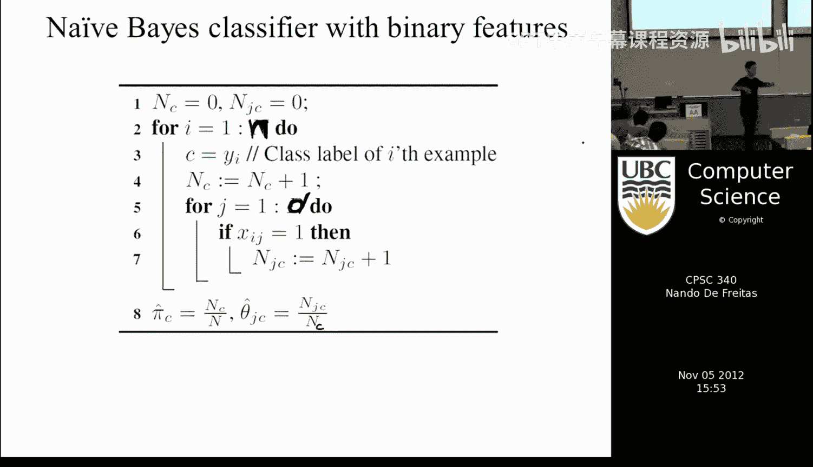