# UBC《机器学习和数据挖掘｜CPSC 340 Machine Learning and Data Mining 2012》中英字幕 p25 -25-undergraduate machine learning 25_ Twitter sentiment prediction with Naive B -BV1pJ2ABFEFg_p25-

what you will get out of it， you'll get one of these tools。

 you'll have a way of classifying text into multiple classes and this particular example will be about classifying tweets。

 but the same code that you will develop， you could use it to classify blogs。

You could use it for to classify emails automatically to different folders that you can defy。

You could class strands of RNA， you know discrete strands and so on。

 so you could do a lot with that code， you essentially now have a classifier for multiple classes and inputs。

I have focused on inputs that are benoully。And I'm going to continue explaining finish everything with Bernoli input。

 The one thing I should go tell you is that you could quite easily define a E by classifier when the inputs are Gaussian。

Because。The maximum likelihood estimates and so on will be exactly what we did for regression。

 you will still have discrete classes。But you're just basically saying my inputs are distributed according to Gaussians as opposed to them being distributed according to Bernoulles。

So the book of Kevin Murphy actually treats that case and actually once you know how to do it for Bulli。

 and given that you know how to do basian linear regression with Gaussians。

 you can just Google nave base with Gaussian variables and you'll see that you will be able to follow the equations。

Because that's what this course is about， this course is about giving enough tools that you could actually Google and understand what you find and be able to easily implement it。

Clify images。And so for images are now continuous， you would treat images probably continuous vectors。

 and so in that case you need to define the variable of our x x is continuous so you would use a Gaussian to describe it instead of using a product of berulus。

 you would use a single multivariate Gaussian。That's the only difference。farな。Right。

 so PCA is not a classifier。我去。PCA is an unsupervised learning， that's a good question。

 PCA is an unsupervised learning technique， What PCA did is it took images and it projected them to a low dimensional space。

But we did not address the issue of classifying them。

It was clear that we could visualize it and then I argued that now it becomes easy to put a classifier。

 so what you do often in practice is you use PCA to project images to say 10D or 5D to a low dimension so to get rid of the noise。

And then you fit the classifier to it。but instead of me spending more lectures teaching about how to do the na based classifier when the inputs are Gaussian。

 which I think you will all be able to do it if you just read's say Kevin's book or any if you just Google any paper online I'm rather going to focus in talking about how to goify images using other tools。

 logistic regression and neural networks and random forests those are the three other techniques I will cover in this course。

 I did mention K means at the end of the course， I'm not sure if I will get to it。

 I would rather focus on make sure you understand the content。Of neural nets and random forests。

 because they really are very popular right now。 And there are techniques that are winning the competition。

 So I want you to learn those。 Is this better for text and neural networks。

Images or are you just teaching them as different？There are different classifiers。

 this one is just extremely so。We're kind of getting ahead of ourselves because I haven't taught your neural nets。

 so I'm comparing against something I haven't taught yet。

 but it will turn out that the neural nets will be a lot harder to optimize。

This is extremely simple the code。We saw what the code was。

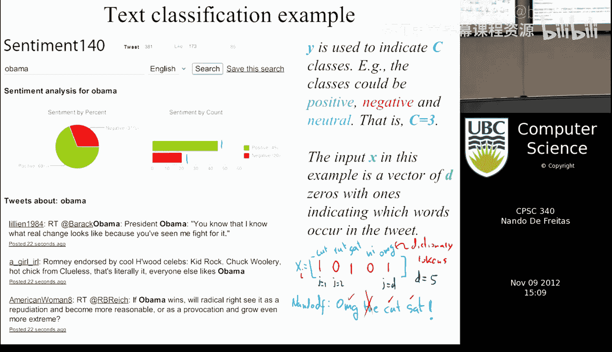

We just need to compute。

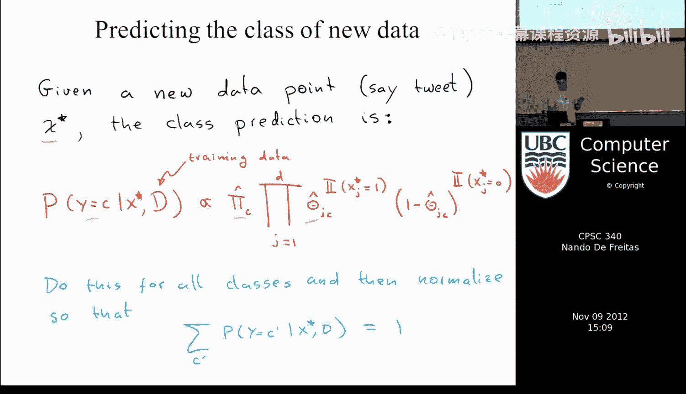

Pi， which is what's the probability of class C， the pi probability of class C。

 and we need to compute theta， which is what's the probability that the word J is on in class C。

So if the word is Viagra， what's the probability that Viagra appears in the class spm。

 and then you also learn what's the probability that the word Viaggrara appears in the class。

Respectable work。And so just by learning these two probabilities that this essentially is the coin probability。

Except now instead of having one coin， we actually have dcos。One for each work。

And we also then have decoins per class。So we have a total of。C times D coins。

 but that's what the model is。 It's just flipping many coins。And the advantage of this is this。

This is what work that I use to describe stupidly parallel。Because you could， when you need to count。

 you can just basically have machines counting。 You know， if I need to count bunch of numbers。

 I can just。Give you some， give him some， give him some。

 you each count and then just give me your counts and I just add your three counts。

 so it's an extremely parallel algorithm。Moreover， every time I get a new training data set。

I don't need to load all the data in batchge， I can do this online because every time I get a new one。

 I just need to update my count so I could do this online or what's common now what people call the streaming model of learning。

You have streaming data and Twitter is indeed indeed stream， Twitter is not a static data set。

 but this would allow us to learn from data that's always coming in， streaming。

So there is this sort of forever learning。And that's very important for when you design web applications because you have customers interacting with your app and you have to assume that these customers will always be interacting with your app。

 so learning in a stream version is useful。The only catch there I should put there's a warning there。

If you're learning always from your customers， make sure you don't have malicious customers so often people and indeed。

 often people don't learn continuously from some customers because they know that theres some customers that will maliciously attack them so they actually。

Control， you the updates might not happen。In the mill seconds。

 but the updates might happen every few days or so。

So there's other variables that like malicious attacks are important。 Okay， so that's the algorithm。

 and I argued that the maximum likelihood estimate is just you know basically。

Just like the coins is the number of heads divided by the number of coin flips。

 And that's what we have there as the estimates of the probabilities。

So the only thing left now is for me to show you that this is indeed the case。

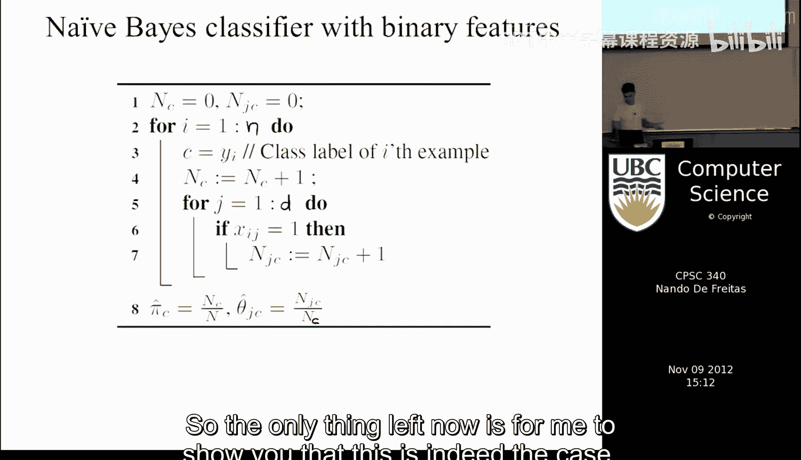

And so， and we had made good progress because we had already written an expression for the log likelihood。

So once you have the log likelihood， the only thing that is left for us to do is。

Differentiated and equator to 0 in order to get the estimates， right， And so in particular here。

 for each。For each class。And for each word， I have a Bernoulli model， because I have theta。

 which is the probabilityative of the word being on， of the jath word in class C being on。

And one minus theta J C， which is the probability of it being off。So this is normalized。

 so I know the theta plus 1 minus theta gives me one。And so let's do that one first。

 because the first one is going to be a bit tricky。

 but the second one is very easy because it's just a coin except that now。In this model。

 we actually don't have a single coin， but we happen to have capital C times small D coins。Okay。

 so let's do the ML for theta。The log likelihood that we had before， oops。Let me bring my pen first。

So the log likelihood involving theater。So the log likelihood has two terms。

 it has a term that involves pi， and it has a term that involves theta and they separate。

 So when I take the derivatives，嗯。When if Im focused on theta。

 the derivative of the first term will be0， and if I focus on pi。

 the derivative of the second term will be0。So let's focus on theta。 and let's just look at the term。

Let's use a different L， this is just a term for theta。Which is the sum from J equal 1 to d。

And the sum from small C equal1 to capital C。And for the tweets。

 positive negative capital C is equal to 2。AWhereas small D is as many words as we have， maybe 10。

000 words。And so the expression I had in the previous slide was NJC log Theta， JC。

 so I'm just copying verbatim what I had before plus N C minus NJC。

Times the log of the failure probability， which is1 minus theta JC。So that was the term for theta。

 now let's take the derivative。And I'm going to learn each coin separately。

So I'm going to take the derivative for coin JC。And if I do that。Then。

I will have NJC times the derivative of the log of over sorry log of theta JC。

 which is just one over theta JC。I have many more terms in the sum。

 but all those terms are for different Js and different Cs。

 so the derivative will be zero for those guys。For example， if C is2。

Then the derivative with respect to theta。When CS2 will be captured by the term that I've written down。

 but the derivative with respect to theta， whatever J1， where class is 1 will be0。

because it's a different variable， it's not a variable with respect to which it's constant with respect to theta JC。

Plus。NC minus NJ C。And then using the same argument， this would be -1 over。Y minus theta Jc。

 which is the derivative of this log。And so， this is equal。To N J， C times 1 minus theta J C。Plus。

And let's actually， yeah， let's do glass glass。N J C， minus pan C。Time's Theta J。

Divided by theta J times 1 minus theta Jc。Okay。And then when I equ to zero。I get NJC。Minus MJ C。

Peter J C。呃。Plus， NJc。Peter J C。Minus N theta Jc。い、 equalこ0。All。

 so now this term cancels with this because they subtract。And I get the estimate theta JC。

Will just be equal to NJC。If I did by Anne C。Which is what intuition would have told us is the right thing。

 so it's a number of coin tosses in class C。

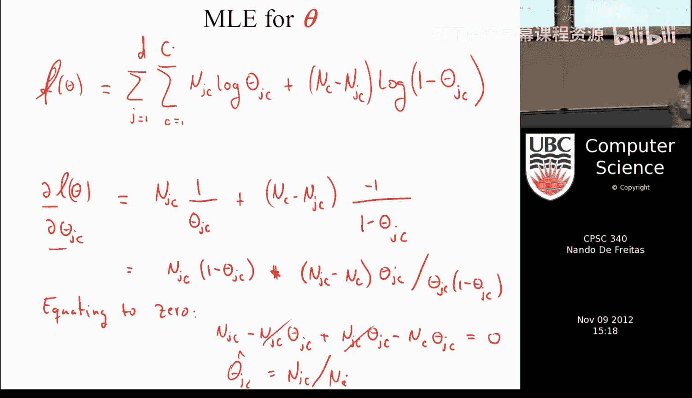

For word J。 and then the number of times you saw word J and class C divided by the number of times you。

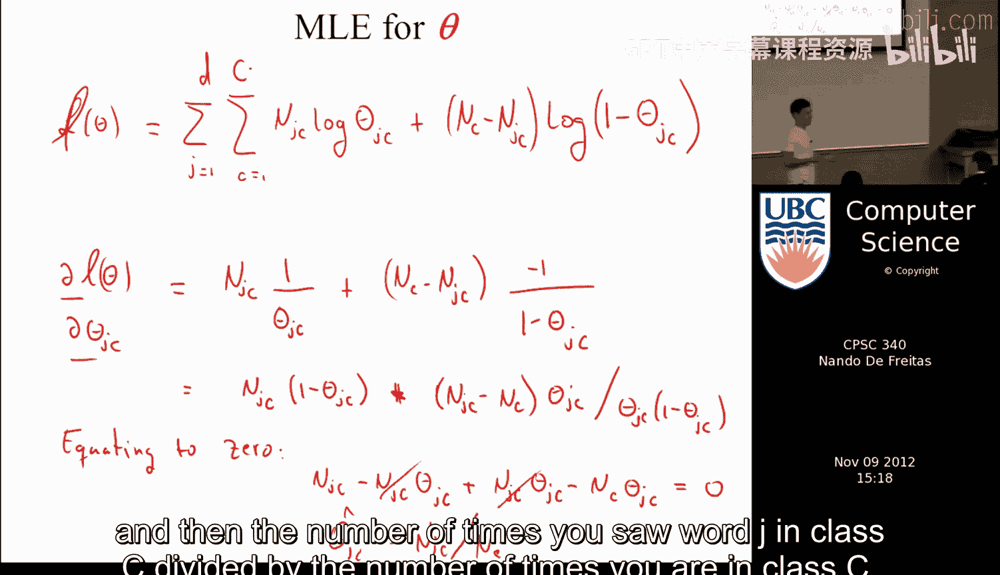

You are in class C。嗯。Let me try to draw that seed properly。All right。

 so when we do maximum likelihood， we recover what intuition tells us we're just doing coin flips。

 You had a question。

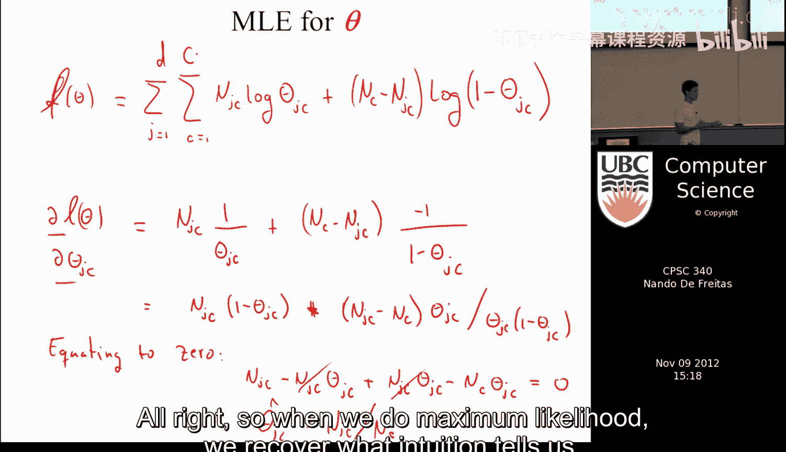

。W you're dividing because。Oh yes， I was assuming this implicitly。But you're right。

 to make this more clear， I could put a bracket。But that's just。Eassy algebra。

 we're just normalizing everything equating to0。Okay， so we get the right answer。

 there's no surprise here， if it's what I told you a couple months ago， if you can do coins。

 you can actually do a lot of machine learning， so that's why we spend so much time doing the silly coin model。

Alright， pi is a bit more interesting。 So pi is this first term。So L Phi。It it一 있고。To the sum。

Actually， so I don't have to page back。The sum of a C of N C log by C from small C equal1 to big C。

And see。Log of pi C， where Pi C is the probability of class C。The prior probopolate。And we learn piC。

 we learn the prime probability， and that in the end allows us to compute a posterior probability。

 which is what we care about， the posterior is what you use to decide whether the tweet is positive or negative。

Okay， now here we have a problem。And our problem has to do with how I define the categorical distribution。

 So let's look at the categorical distribution quickly。

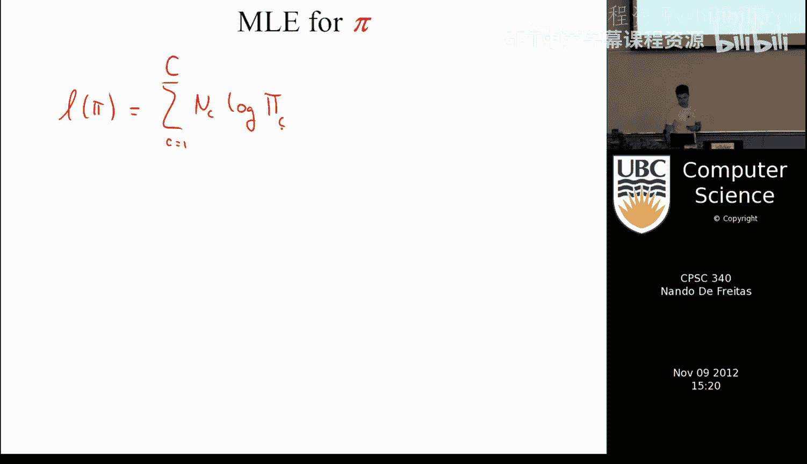

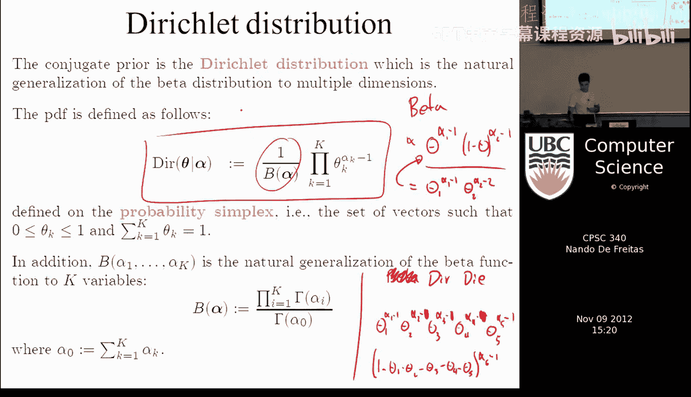

When I wrote down the categorical distribution。Like for say， X I。

I said that all the theaters have to sum to one， like in this example that I did here where I had three possible。

 so you essentially think of a coin with three phrases， three things can happen。

And so you have the probability that the first thing will happen。

 the probability that the second thing will happen and the probability that the third thing will happen。

 all thenot by theta 1， theta 2 and theta 3。So of course， only one of those three things will happen。

 so theta1 plus theta 2 plus theta 3。You know those things are all the things that could happen。

 so the sum of the probability should be one。 so when we sum the theus， we should get one。

When I write the model like that as a product of a the。

I have not put down the fact that I want my thes to sum to three。

And I was just being easy with the notation， I didn't want to emphasize all the time that these features have to sum to one。

 and I asked you to please just remember that the featuresus have to sum to one。

So if you can be of K classes， your K T does have to sum to1。Alternatively， in the binomial model。

 what I did is in the Bernoulli model instead of me telling you that。You had theta 1 and Theta 2。

 I actually already wrote it as one I wrote the instead of writing Theta 2， I wrote1 minus theta 1。

So there was only one parameter theta and one minus theta， so we avoided this problem。

 but here we do have a problem。We still need to somehow tell the algorithm that all the theater should sum to one。

 and that's going to be an issue。 The parameterization is not telling us that。

So we need to add an extra thing to ensure that these sleep sum to one。

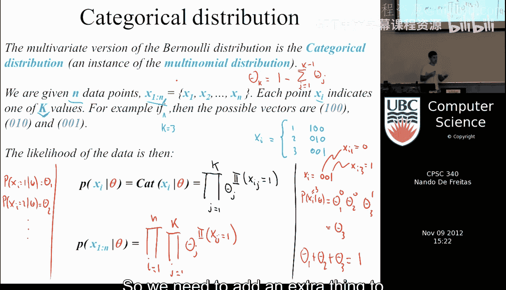

And so in the cost function。This is sort of similar how the last also gets implemented。

 how we are the constraints In the loss function， I'm going to add plus。

So I have this term and I'm going to add another term with a weight lambda。

We will learn what this weight is， at this stage， I don't know what Lada is。

But we will figure out what Lada is， We're going to derive it。

But I do somehow want to add this constraint。That。1 minus。

The sum of that the sum of the picess has to be what。

My cost function should penalize me if the pi seized on sum to one。

Okay because I want all the pies to some to。models my model the first term。Is basically saying。

That my observations are of capital C classes。But it's not telling me that the sum of the piscess has to be one。

 That's why I need to add a second term。 The second term is forcing the sum of the picess to be one。

他们。I'm giving you sort of a sketchy version of this if I actually go back and I start drawing contour plots and so on。

 I can actually derive this just like I derived the equations for Laso。

 but we're going to skip that for now because that gets a bit messy。

Do we need to ensure that the second term is positive？

We need to ensure that the second term vanishes， we need to ensure that the pi that sum of the pices will indeed P1 if the sum of the pis is not one。

We haven't solved this properly。 If it's approximately one， it's not correct。

 but I will show you now。So in optimization， often it will be case we will have variables。

And we will allow- there is this big topic of optimization with constraints and sometimes you will not satisfy the constraint exactly。

 and things are still fine， you're able to do some sort of solution and like if you do it like an nonlinear version of Laso。

 that's often the case。But in this case， it will turn out that the prices will sum to one。

When I do this the next the derivation that I'm going to do next。So this is a parttuitious case。

 that's why I'm not going to bring in the heavy theory of constrain optimization。

 We don't need it in this case， I'm just requesting that the cost make sure that my Pi C is sum to one。

If it doesn't give me that， I will have to do more work， but if it does give me that， we are done。

We have an algorithm that guarantees that the Pisces are one finds the maximum and that maximizes the first term。

 which is the likelihood， so it satisfies both things， it maximizes the likelihood's subject to。嗯。

The parameters being correctly specified， in other words that they add up one。Okay。

 let's take the derivative。The derivative of L。And now actually I'm going to add a parameter lambda because I've essentially introduced another parameter。

And if I introduce another parameter， I need to compute it。 So how do I compute it。

 I take the derivative of respect to Lambda and I equal to0。If I do that。

The first term doesn't depend on lambda， so the derivative is0。And so the second term。

 I will just get。1 minus the sum of a small C to capital C of pi C。When I equ to0。I get。

Some of a small sea to capital sea。Of pi C is equal to one。Okay， that's good。

When my optimalim land is attain tat。When I achieve the optimal， I have the result that I want。

 the pi see some to。But， we are not done。Okay， we're now gonna do this。So， we're going to get N C。

Times one of a pi C。When we take the derivative of respect to the C term in the P sum。

And we're going to have plus。呃。Lada。Times minus pi c。Oh， sorry， -1。Okay。

 so I'm taking the derivative of the second term， which has one pi C times lambda。 So I get。

Minus lambda。Okay， and from this， I get the equation when I equ to0。So this would be equating to0。

That NC over pi C。Is equal to land。Okay， in other words。And c is equal to pi C。Times land。

And just moving pisC to the other side。Now comes the trick。

I'm going to sum I have an equation on equality so I can sum both sides over sea。

I let me do this in a different color so that when you study this next time。

It's clear what the steps were。I'm going to sum both sides of a。If I sum all。

The number of times you fell in class C， I will get the total number， which is n。一個。

Lambda can come out。So I get lambmbda。Times the sum。Over。C。Equal 1 to capital c of pi C。

So I'm summing both sides over C， the sum of all the number so NC is the number of times you belong to class C。

N is the total number of observations， so the number of positive plus the number of negative observations gives you the total number of observations which is more n。

 that's the left hand side on the right hand side I've just taken lambda out of the sum。

And then I have the sum of the pi Cs。But。From result1， which is this1。

 I now know that this is just equal to lambda。Times1。In other words。

 I have learned that lambda must be equal to n。What's left now is to put it all together。So， I have。

Lambda is equal to n。So this is my final result， I have that lambda equal to n。

And I also have the fact that Nc is equal to lambda times pi C。Therefore。I see。

It shows equal to Nc over small n。The probability that you're positive is。

The number of times you are positive divided by the number of times you are positive plus the number of times you are negative。

Which is what you would expect in intuition。Go ahead。On the second line。Oh， yes。Thank you。

forgotSo why is it the second step， I mean， differentiate with respect to。And 그래서 obvious that。

Some of Piy needs to be one。Oh， we wanted the sum of the pisces to be one by doing what we're going to do is we going to optimize that exp。

 so this is the trick。 I don't know that my Picess Pisces at this stage is just a parameter。

And then I'm going to introduce a cost function。That requires that the pi see is sum to one。

It might be that they will not sum to one。You know， beforehand。

 I don't know cost function based on the fact that they should sum the one。Yes。

 that they shoot some to one， not that I know for sure already that they sum to one。

So I'm forcing them to sum to one。So I introduce my cost function to ensure that the sum of my systems to one。

But in doing that， I have introduced this lambda parameter。

 which is the sort of tradeoff between that regularizer。

 which in this case is actually a constraint on the probabilities。And and the likelihood。

I still now need to find what lambmbda is， and so that's why I take the derivative of respect to Lambda and that tells me that the picess are equal to what。

This ensures that my reasoning is consistent。The sum with respect to lambda gives me that the pisces are equal to 1。

 that's a result that I get without me having forced the pisces to be equal to1。

 I just force them by the cost。I force them in the cost function， but then the rest has to confirm。

Did I get？The cost function is a desire。That the price is equal to one。Fortunately。

 when I do the derivatives， I do get my desire satisfied and satisfied perfectly。

That they indeed do sum to one perfectly， they're not 0。999， no they what perfectly。So， I'm fine。

If you had expressed this in the product before you took a law like。I'm not even going to go there。

It。You can do it， It gets messy， there's a reason why we take logs。

 you're welcome to try this without logs， we can do it in office hours， but it's messy。

 take I mean to leave the last classes one minus some of the other classes without introducing a lambda。

You can do it that way， actually。It's a bit more messy to do it that way as well。

I know in previous courses， I've actually taught it the other way and it's a bit more tricky。

This is clean。I mean this is as good as derivations get， four lines and bound， you have the result。

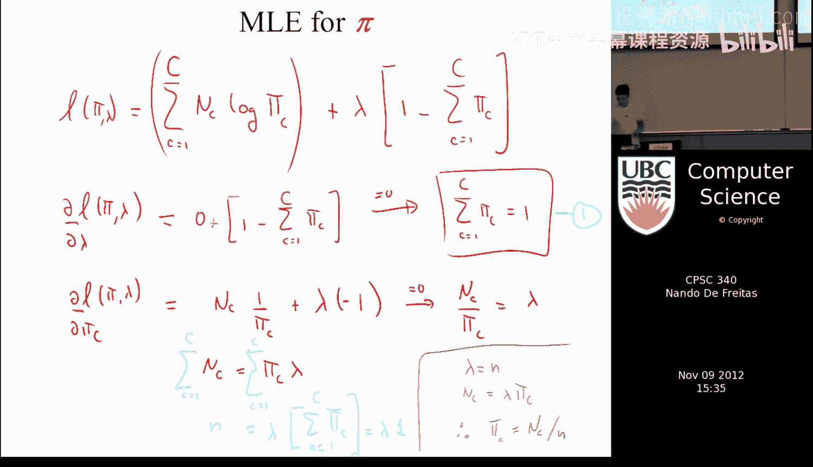

I didn't even need my extra page。I'll upload these slides today， by the way。

 and I fixed the issue with the video， so the two videos are now uploaded。

One of the problems was before the midterm， all of you were downloading these videos。

 and many of you actually hit multiple downloads and somehow you actually managed to bring the web server down。

There were thousands of requests。Which couldn't have been just as class。嗯。

That's part of the reason why I'm。Trying expediently to move everything to YouTube。Okay， so。

That's the maximum likelihood way of doing it。 How do we do the basin way。

And the basin way will allow us to deal with like the black Swwaan paradox thing。

 we will allow us to deal with the fact that sometimes some words never appear。Okay。

 you might not have。Or you did polls like very So the recent thing if you've heard of Nate Sil in New York Times。

 she was doing Bayesian modeling for the polls and so on to predict what the election would go。

 you could imagine that in some。Sections of the United States the probability of either rep or Decra would be zero。

 so if you don't do the basin analysis properly that could give you and you would have the p paradox would affect you wouldn't get the right estimate。

You would have zero probability events。Which is what happened with some of the Fox presenters。

 they just had zero probability events in their heads。嗯。Okay。

 so we need the basin analysis to deal with the fact that sometimes。

You might not have observed the word， but that doesn't mean that you shouldn't assign some probability to it。

You might not have seen the black sn ever for thousands of years。

 but that doesn't mean it doesn't exist。All right， so。In order to do basin inference。

 we do it's just like the coin model， just like we did before， we have this likelihood。

 we will construct a prior。We multiply the prior times the likelihood。

 and that gives us the posterior。And in this case， the likelihood is the product of。

 so it's starting to get a bit more complex。 Now， the likelihood is a product of D times C。

Bernoi coins plus a product of， or should I say times。

Thereish led distribution over the class probabilities， the Pisces。But sorry。

 a categorical distribution of the Pisces， the natural prior for the categorical distribution is the deishle。

 and the natural prior for the Bernoulli variables will be beta distribution。

If we want to construct a prior。Actually， let me do one more step here。

 So this we agreed and the last class could be rewritten。As the sum of a sL 1 to big C。Of pi C。To NC。

Times the product from J equal 1 to D。Of theta N J C times 1 minus theta。j c。And c minus N Jc。

Okay so that's it。Clean a way of writing it。 when we just sum。

We just summed the number of times you belong， the tweet was of class C and then sum the number of times war J appeared in class C and call it NJC。

All right， so。For pi， pi is a categorical distribution so it makes sense to use。A prior。

That is theishlet。So my prior for pi for the vector pi。Will be proportional。

 I don't want to write this gamma function。 So I'm just going to write the proportional。

It will be proportional to the product from small seed to。Big C， I C。H in my dearish lip。

Very hyperparameter alpha c minus1。Okay so we just used a deish lab prior。Likewise。My prior for。

Theta JC。And I did forget one PM。One index。My prior for Theta JC？Theta JC is a Bernoulli variable。

 so my prioror should be a prior。Because I know that Peter Pri is conjugate to the benoli likelihood already。

 So it's just going to be。Theta J C to the beta。And I'm just going to call it the beta。你 don't want。

Minus1， and then theta。1 minus theta J C。To beta 2 minus1。

 so beta 1 and beta2 are my hyperparameters， and I have chosen those hyperparameters to be the same for all words。

It's possible to make them different， but it turns out that if you make them the same。嗯。

That's good enough。 So we basically are saying we have the same prior beliefs of each word of being on or off。

This you have some freedom to change， you could change。

You might want to say that you want to put more prior belief on the words Viagra being on if you're worried about that。

But if you just pick。Beta 1 and beta 2。Two comma  two， two and two， you'll be fine。

We saw that that's a pride that already tends to work better than。The maximum likelihood estimate。

And you'll get to try this in your homework。And you'll verify you could play with these parameters and see what works best。

 So that in other words， I have D times C。Petter Pris。One for each wordd in each class。No。

Now that I have。These D times C beta priors， and I have my capital C sorry I have my one there isla prior。

 I just multiplly the prior to give me the sort of the joint prior。A prior。

 I believe everything is independent， so I just multiply it and that gives me a single independent prior。

 and so my prior。Over pi and theta。Will be equal to the product。From s equal 1 to big c of pi c。

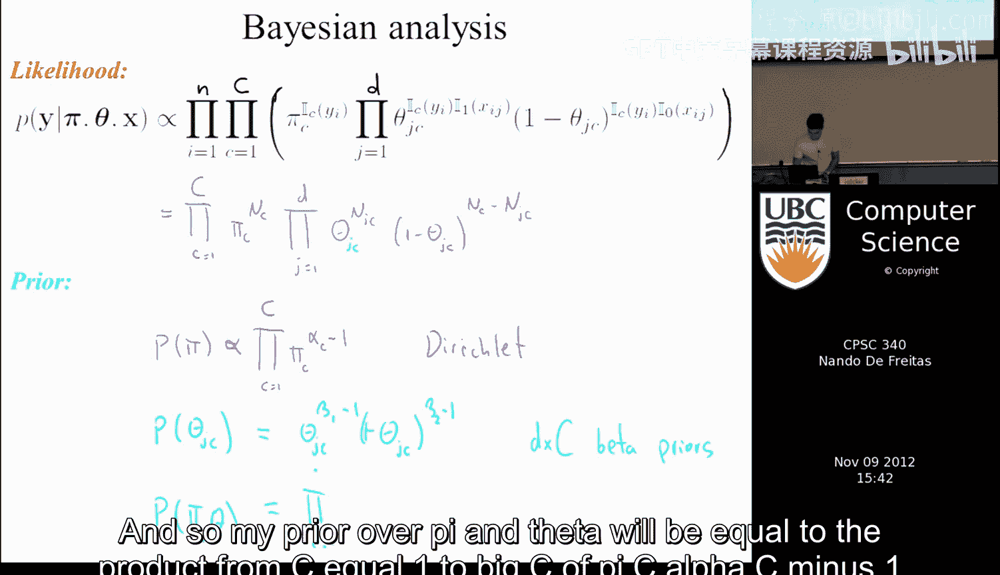

Alpha c， -1。Times the product from J equal 1 to d。Of theta J C to the beta 1 minus1。

Time is 1 minus theta Jc。Gta beta 2 minus1。

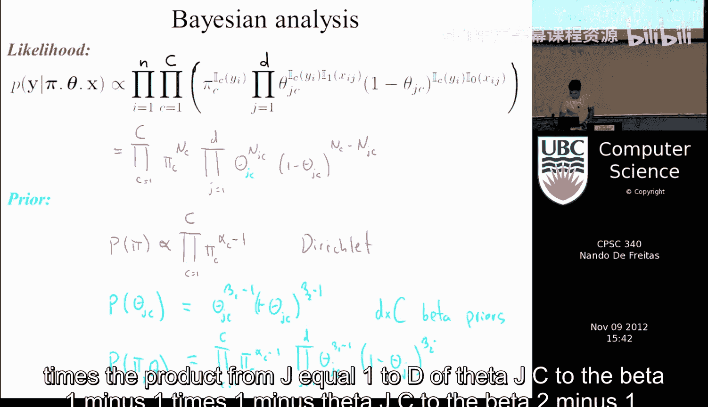

And just to make something a bit more clear。Everything here is inside some the product of a see。

And as you can see。My likelihood and my prayer have the same shape。The product of a C。

 and then I have a pi C， and then I have a product of a D， and then I have my seat at times1 minus C。

 So when I multiply them because they have the same shape， I just need to sum the exponents。

And that's my posterio。Just like put the coin on。So。That I'm going to do in the next page。

So my posterior over a theta and pi。Even the data， which is x and y。Its proportional。

The product from sQal1 to big C。And then I multiply the pi C， so one exponent is alpha c minus1。

 the other exponent is N， so I just add those two。So it's five。To N plus alpha C。M-1。

Thats a product from J equal 1 to D。And then I do the same thing， I have my theta JC。

 and then I have my1 minus theta JC。And I just need now to add the exponent。

 so the exponent is Bta 1 plus and c minus and Jc。Sorry。This guy。

 and then this guy goes with that guy。So Peterta 1 plus NJC。-1。And this one here is Peter 2 plus。

Mc minus N J C。-1。And we' done。The posteria is a third light distribution。

And then basically it's a de layer which has a new alpha。 this is the alpha of the posterior。

And this is sort of the new beta prime， and this is the new beta2 prime。Just like for the coin model。

It's the same we multiplied the two reality exponents。And we're done the posteriis deishla。

 and we know the expression of the mean of the derila。 So if I ask you。What might I ask you？Yeah。

 the means。So， the mean。Of pie。The mean of pi will then be just reading it off Wikipedia and C plus alpha C divided by n。

And plus the sum of the normalization constant。And likewise。The mean， the posterior mean。So。

The posteriium mean estimate of theta J C。It's just equal to NJC。Plus。Beta 1。Divided by。And see。Plus。

 beta1 plus beta2。是。C prime or C is a dummy variable because it's in a sum。

 I just made a prime to make it not be the same C as the top。it doesn't matter if that confuses you。

 just forget that there is a prime there。 it's。 Yeah， so it doesn't that's what that sum means。こ協力して。

Oh， good question。I don't have a plot for you。 I could describe this with words。

 but let me instead of describing it with words。Because we're done。

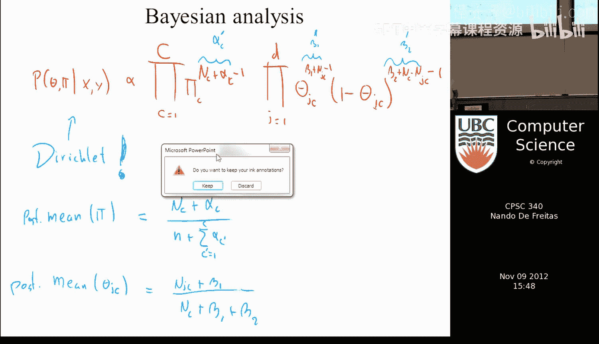

Before I describe it for you， just a consequence here。Is。

It won be basically like think of it as like the beta but think of the beta in 2D。

 so it could also be a bell， It could also be spiky， and it could also be the uniform distribution。

So if I choose in particular， if I choose my parameters， beta1 beta。beta 1 and beta2 to be equal to0。

 I recovered the maximum likelihood estimates。In this case， so we're。

 we're back to getting exactly the same things that we were getting before。

I asked because were using mean as an estimate of the distribution， so is that an appropriate choice？

It is in this case， but it shouldn't， but it's a very good question because sometimes you might want to use the mode。

And the mode， you would just subtract -1 from it。

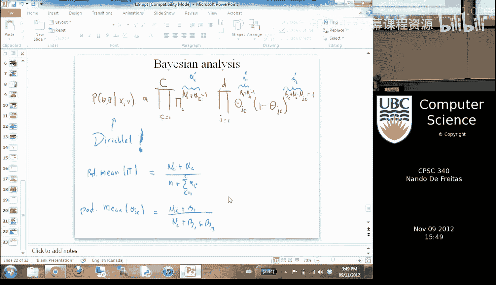

Instead of。Let's。Thereish LED distribution。

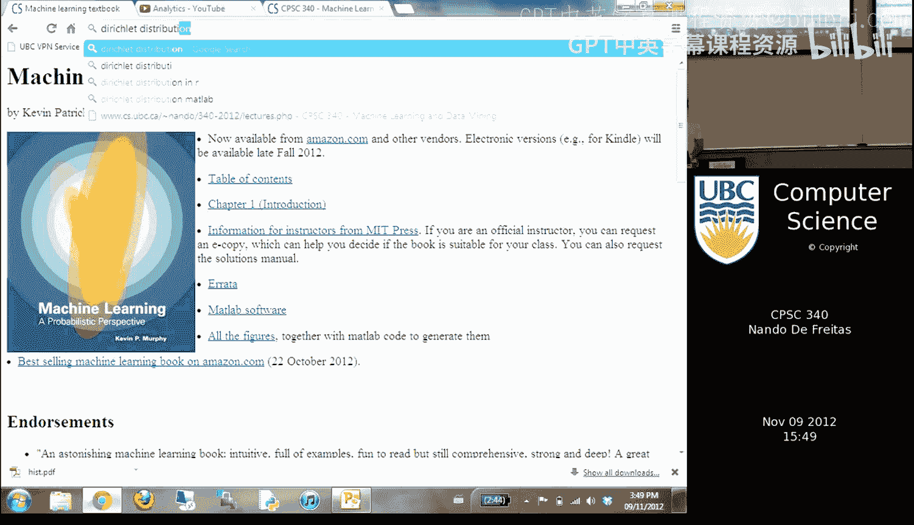

Images。There you are。 That's what it looks like。嗯。这是。A few pictures of the deish led distribution。

 So think of it as like the beta distribution， but in this case， the beta distribution。Is into the。

Sometimes， so it's uni model basically， that's part of the reason why。The mean makes sense。

But even with a beta distribution， the mean doesn't make sense all the time。

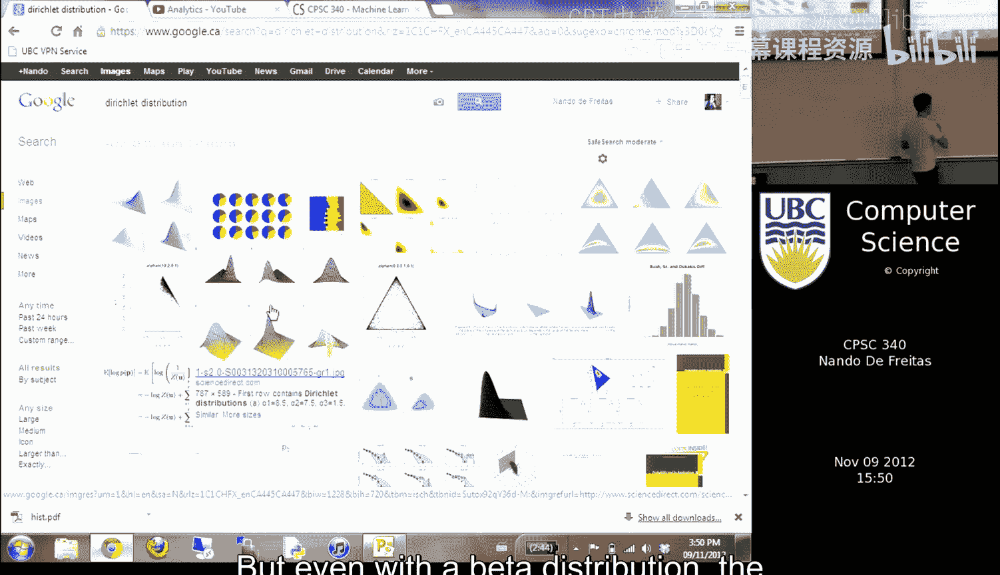

I mean， even the beta distribution。The beta distribution might look like this。

 the there islet' kind of like this， but in 2D， and so you might not want the mean。

 This is kind of like the histogram of your marks。 the mean might not be informative。

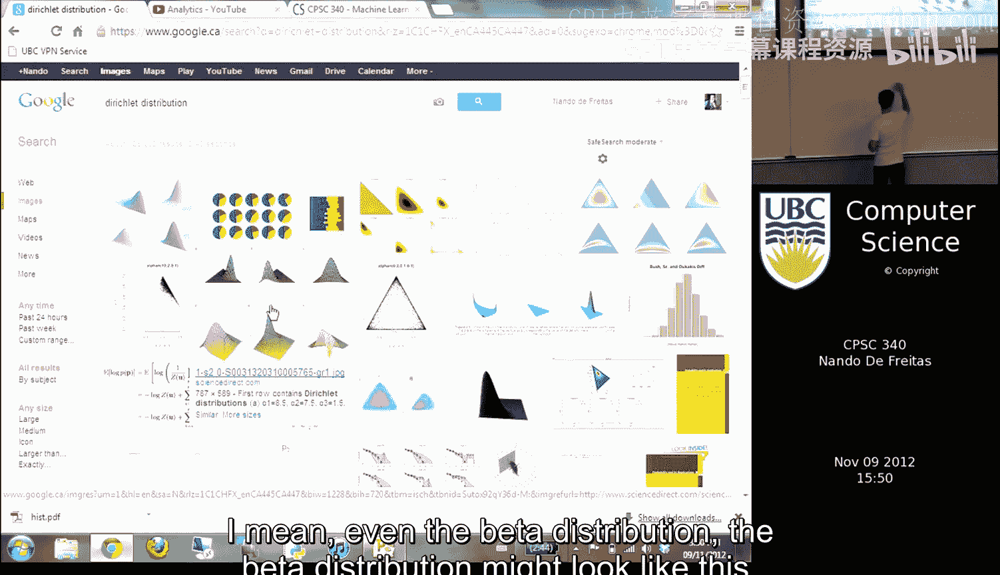

You might want to believe better。On the mode， which is the peak。And this now is your choice。

Which estimate you want for the patientss， the full posterior is the solution。

And then if you want to compute a particular estimator， I can give you many estimates。

 I can give you it a mean， I can give you a mode， I can give you a median and so on。

 and I can also give it a We've actually done a lot more than just computing one of these values。

 we computed a full thing， we compute a distribution。

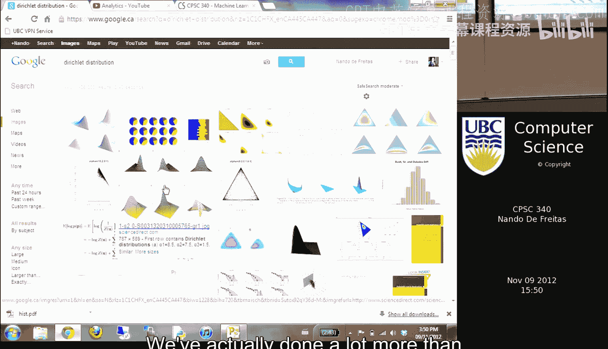

Another way of representing these。嗯。Here's， here's a good plot when。

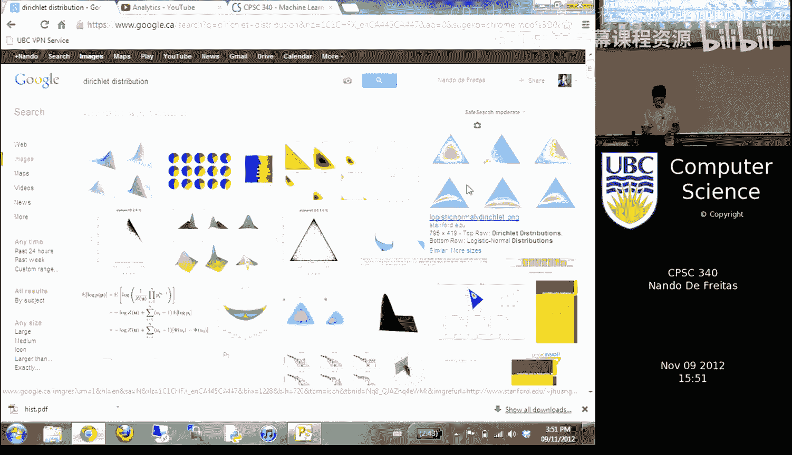

Actually this is a very good one， so this one shows you three situations when it's very informative when beta 1。

 sorry when for the deish layer distribution， when all the alphas are positive。

 say all the alphas are equal to two， you get the guy on the right hand side or in fact the label tells you that's actually when all the alphas are say10。

 you get the guy on the right hand side， when all the alphas are one。

 you get the uniform distribution。

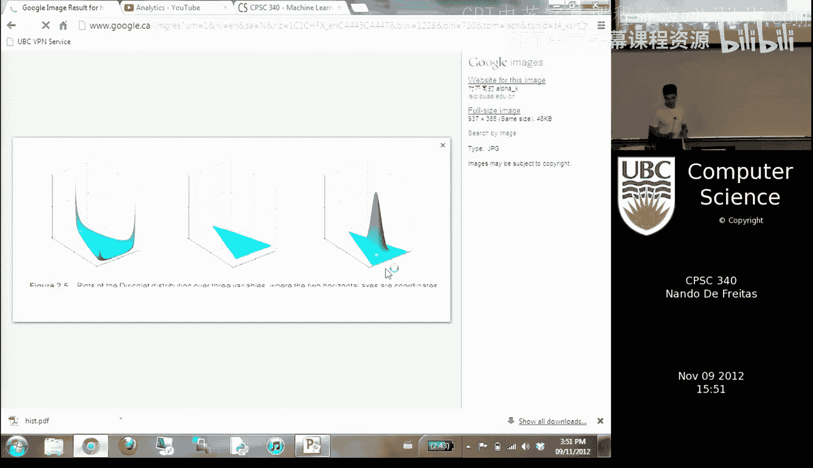

And when you alpha is smaller， just like for the beta distribution， when we get this。

 So this was when。When we went about 0。5 and 0。5。We would。

 we would get these tailing off at the boundaries at 0 and1 as and startinging at 01。

 So it's exactly the same as the plot we had for the be distribution， except that it's in 2D。

The reason why it's a triangle is because。It's enforcing that you have a probabilistic simplex that the three parameter sum to one。

So any point inside that triangle is such that。It can be triangulated。But， you know。

 by the three quarter of something to1。And that's essentially that there is a。

 it's pretty much the beat。ButLike in that situation。The mean starts making less sense。

But but typically， we will be in this regime on the right hand side。 than or somebody。

Statistics depends on the choice of alphabet。It depends on the choice two have。

That's correct and depending on that， I should go with a different。Approximate like comm million。

Not an approximationation， it's an estimate。So there's no approximation there。No。

 the estimate just you can use the posterior mean if you want to make predictions。

 you actually need to integrate over the entire posterior。

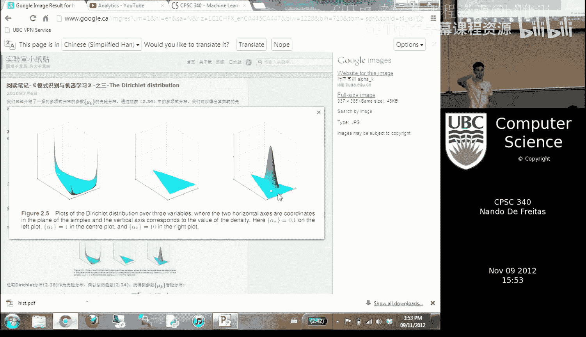

When you do that integration， it turns out that you get the posterior me。

 but that's a topic that I didn't touch into。

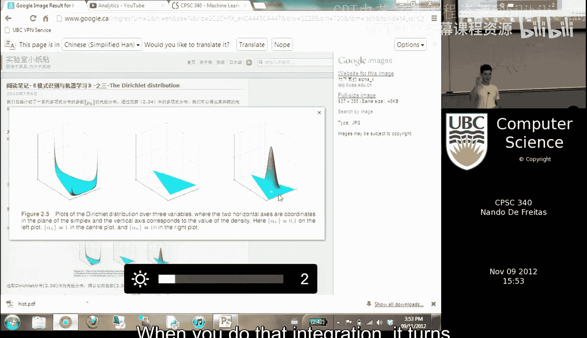

Sort of future work。I had to promised so we're done with it so you can now basically go implemented。

You got the estimates， the two estimates。The homework will beat you in like in two weeks。

 I'm going to give you enough time because I don't want to affect your。 By the way。

 there'll be two more。

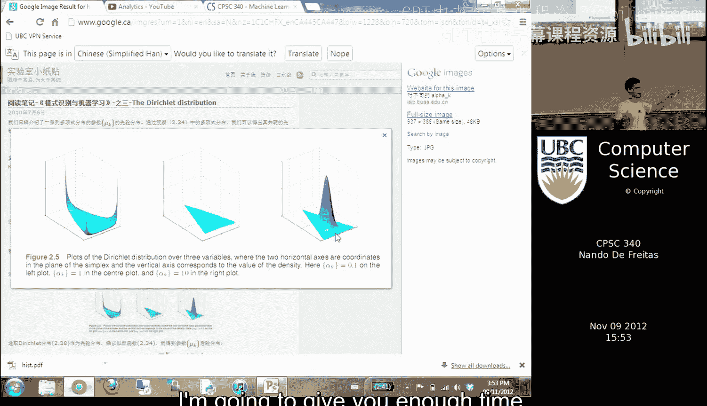