# UBC《机器学习和数据挖掘｜CPSC 340 Machine Learning and Data Mining 2012》中英字幕 p26 -26-undergraduate machine learning 26_ Optimization.zh_en -BV1pJ2ABFEFg_p26-

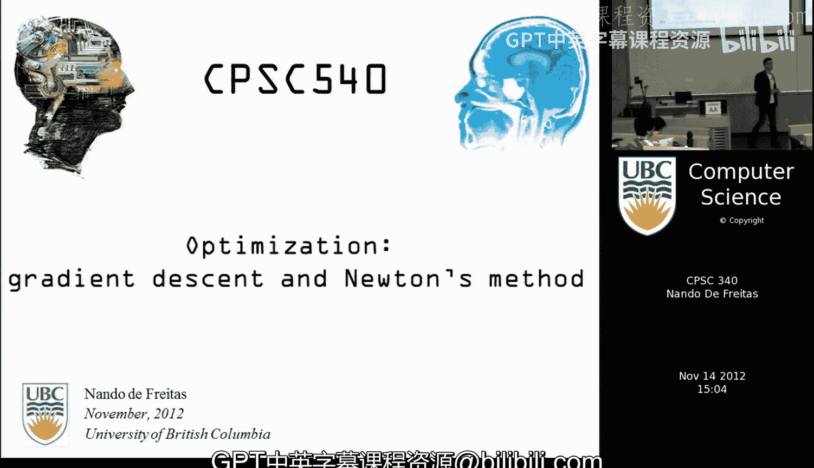

So this week， and next week we're going to learn how to do neural networks for function approximation。

 for regression， for classification， and even for other tasks time permitting。嗯。

In order to understand neural networks。You need to understand a few things first。

 you need to understand optimization。I think the microphone is in word to you just。

So you need to understand optimization， and then the other thing that you need to know is logistic regression。

 which is essentially a neural network with one neuron， one node。

 if you understand one node and you understand optimization。

Then the rest is just putting those two ingredients together。And our knowledge of probability。

 and we will be able to deal with any type of data whenever we're doing classification or regression。

So today we're going to look at optimization Friday we're going to look at one neuron logistic regression。

 which by the way is a very popular classifier， in fact I read an article where K's Academy。

 when they try to learn from students in order to provide feedback。

 they actually are using logistic regression， which is a neural network of one neuro。

And I believe most companies out there， companies like Twitter and so on。

 also use logistic regression as one of their basic olives。

And then when we combine many logistics regressions together。

 we will get something called a multi layerer perceptrum。

 or as often it's called these days for particular applications or encoders。

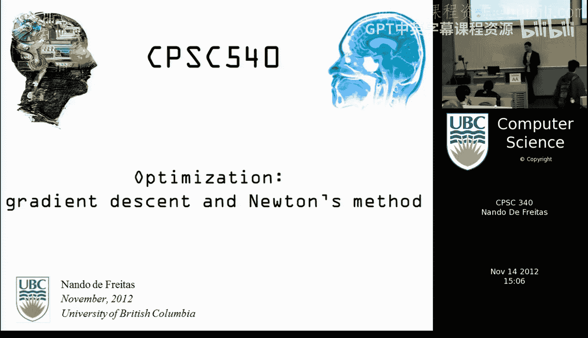

Okay， so let's start with optimization。Optimization builds on calcus。

The basic idea is the following when we take the frequentist approach to learning。

 we do maximum likelihood。We often take an objective function， the log likelihood。

 we differentiate it and equate it to zero。And that gives us the estimates。Now。

 in everything we've done up to now， except for the last S， when we equator to0 and sul for theta。

 we were able to get a nonun for theta like Ra was x trans plus x plus delta square I x trans+ y。

 so we were always able to get a close form solution。

We saw with the last suit that it was not possible anymore to get a closeform solution。

 and in fact for most problems， it's not possible to get closeform solutions just by differentiating in equs here。

 so we need to rely on in order to find a place where the derivative becomes flat。

 that is in order to find the minimum of the error function。For the maximum of the probability。

 the two problems are equivalent。In order to find a place where the derivative becomes flat。

 we're going to follow the derivatives。Just like if you happen to be on top of Grouse Mountain and you want to get to the point where it's flat。

You basically start dissenting。And you keep descending until。

Until you get to a point where if you were to go in any possible direction。

 you would not be able to descend anymore。 At that stage， you found the minimum。Okay。

 so that's the basic idea of how all the learning algorithms based on optimization work。

On the other hand， the Bayes algorithms are based on conjugate analysis。

And we saw how to do that for the Gaussian model。 We just did it last week for the Deish and multinomal model。

But baing analysis， when we try to do it for more complex models。

 turns out to require us to solve integral， high dimensional integrals。

 and that turns out to be an extremely， extremely hard problem。

We even have a complexity class for this class of heart problems sharply。With。

With the bayant methods we have to develop ways of solving integrals in high dimensions and so there are different things out there。

 there's things called variational methods， there's techniques called Monte Carlo those will not be part of this course because unfortunately we do not have。

Enough days and so on to cover that。 But those techniques are part of 540。

 So those of you wanting to carry on encountering those techniques well。Meet me here in January。

 where will continue。For now we will focus on the frequentist techniques。

 the optimization techniques， they're the techniques that places like Google for example。

 is working with right now because they have possibly millions of parameters and so they need to be frequentist for pragmatic reasons。

Okay， so today I'm going to define， we've already sort of been introduced to this， but I'm going to。

Make the definition very precise of what I mean by a gradient。What I mean by a Hasian。

 a Hasian is just going to be the second derivatives。When you have more variables。

 and then we're going to discuss three algorithms， gradient descent。Following the。Immediately。

 also known as steepest descent。Newton's method， which not only uses the gradient。

 but also looks at the curvature。Of the error function that we're minimizing。

We will look at stochastic gradient descent， which is what you need when the data。

 when you don't get to see all the data or when the data comes to you one at a time。

Online learning is very useful for applications such as Twitter， for example。

 because the data keeps coming at two one at a time and you're in a streaming environment。And。

 finally。All these techniques will be applicable to neural nets。 But today。

 we will apply them to the linear model， because if they fail in the linear model， we。

We need to question the value， their value。 But as we will see。

 when we apply these techniques to the linear model， they will still be able to find。

Essentially the least square solution。

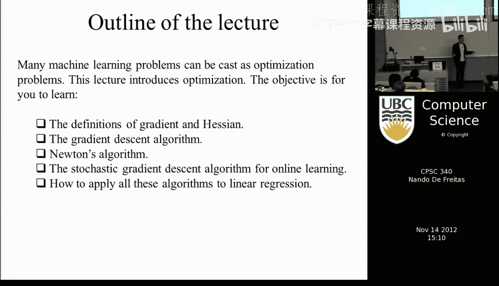

Okay， the gradient。As we've seen up to now， we always talk about an objective function or a log likelihood。

 which is an objective function as well。 And the objective is to find a set of thes。

A multivariate vector of the that allow us to find a solution。 For example。

 when we deal with quadratic problems。Scratch teeth。When we deal with quadratic problems。

 we have an intercept。And a slope。And what we're trying to do is trying to find the minimum of a function or。

 in this case， if you take minus the function， finding the max。If we have a function。

 a quadratic function here。F。Of theta n and theta 1， a function of two variables like this ball。

Then the gradient。In this case， these arrows here。These blue arrows。

The gradient evaluated at a particular theta。Say theta star is just a derivative of f of theta。

With respect to theta not。And then derivative derivative F of theta。With respect to Theta 1。

So we take we have a function of two variables， for example， we might have that F of theta n。

And theta1 is equal to。Minus。Some。From I equal1 to n。Of Yi minus X I theta。Squared。Where theta。

Is a vector？With components， Theta0 and Theta1。So if we're fitting a line to point。

 we have two parameters， a slope。Theta1 and the intercept theta n。

 and our objective then is to find the theta n and the theta1 that goes through the points。

In that case， we know we're dealing with e quadratic。

And our essentially the place where the slope becomes zero， which is here at the top。

Is the optimal solution that we're looking for。 Okay， so this still。

 we're still dealing here with the regression problem。 The gradient is just a derivative。

All with respect of each of the parameters。对。And evaluated at theta equal theta0。

The purpose why the reason why I'm spending time here is to try to say that the gradient is a vector。

 it has two components， and also that the gradient is a functional theta。

 that you get a blue vector everywhere。So you can evaluate a gradient at any point。

The gradient is a function of theta n and theta 1。Okay， so。嗯。As we go to more variables。

 we just defined a gradient as being the derivative with respect to each of the variables。

Looking at blank faces， Let me get a show of hands。 How many people feel comfortable with this。

How many people would like an example now in more detail？I'm going to come to the board。 Bob。

 would you mind zooming in when I write on the board， Thank you。

So let's look at an example where we have F of theta。So let's go back to linear regression。

This is a problem we all understand well， now， we have several points。

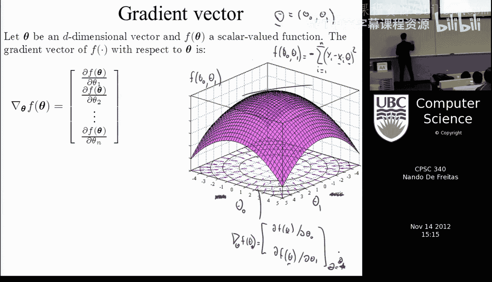

And our goal is to fit a line to those points。 This line has a slope， and it has an intercept。ち日。

Sure。Okay， by now I expect everyone to know this。Right。The equation of the line。

The objective function that we're solving there。Yes。The sum over all the data。

Of Yi minus X transpo theta。 That's a question of the line， or in this case。

 if I'm going to write it。Component wise would be theta n and theta 1 Xi。Okay， square。

That's the objective that I minimize in the least squares。Now。

This is very important to know if I have a function F of theta。Like this。

Then the function minus F of theta is just a mirror image of that function。

Negigating a function just flips it。

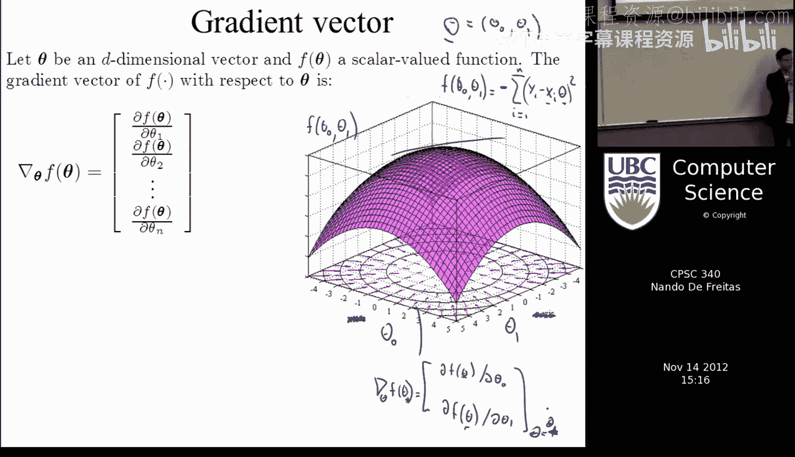

So maximizing a positive function is the same as minimizing a negative function。

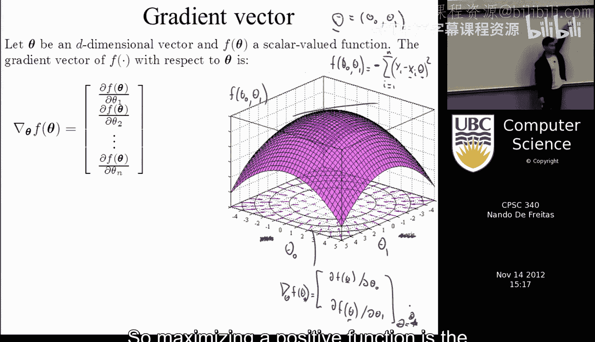

If you flip the sign， we change optimization for maximization for minimization。And in fact。

 I often don't even talk about maximization and minimization。

 and I just talk about optimizationization because it doesn't matter。

The way of finding where the slope is zero and where the slope is0 in both of these plots is the same。

Okay。So that is my F。 that's what I mean by an F of theta。

 There is an objective that I'm trying to minimize。In this case， only because I gave you a drawing。

 the only drawing I could find was one where the function was， in fact， like this as opposed to。

Like this。

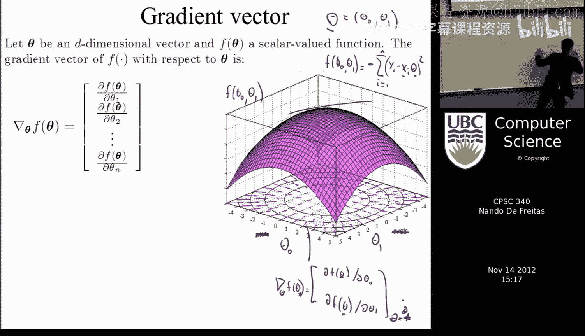

We're maximizing instead of minimizing， so I'm going to put a negative here。

To indicate that we'm maximizing。 That's why I put a negative。Up there。And so if this is my E theta。

 and here by theta， I mean a vector theta， which has two components， theta not。And teacher one。

And then my gradient。So this is F of theta n and theta1， if you will， component wise。And so。

 my gradient。Of F of theta n。And C to1。

It's just a vector that has the derivative。Of F of theta n and theta 1。W respect to theta not？

And then the derivative of F of theta n and theta1。With respect to theta1。

 so is the derivatives with respect to each of the parameters of the model。

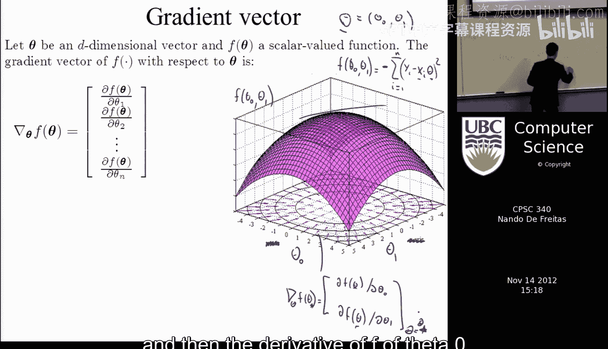

If I had more parameters then I would have had more derivatives migrate in。and then the rest is。

 well you know how to compute derivatives we'll do these later throughout the class。

 but you essentially you just need to compute the derivative of this function with respect to theta n。

 you plug it in here as the first component， another derivative with respect to theta1 and you plug it in here and that's the gradient it's a vector of course the gradient is a vector of theta n and theta is a function of theta n and theta1 if I try different values of theta n and theta1 I'm going to get a different vector。

So because you have to evaluate it。You get evaluatevalu these derivatives at each value of theta or theta 1。

Or to make it more precise。We might as well just finish this exercise。

 and this would be minus the sum from I equal1 to n。

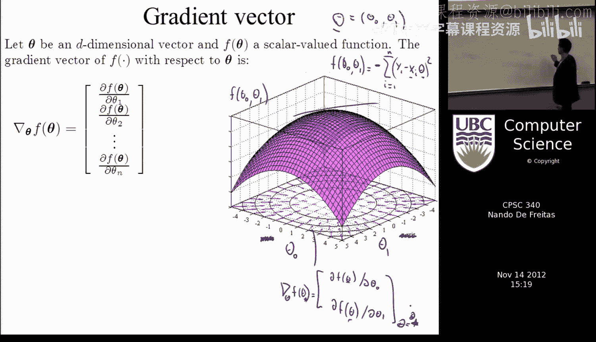

Of two， Y I。Minus theta n minus theta1 X。Times minus1。

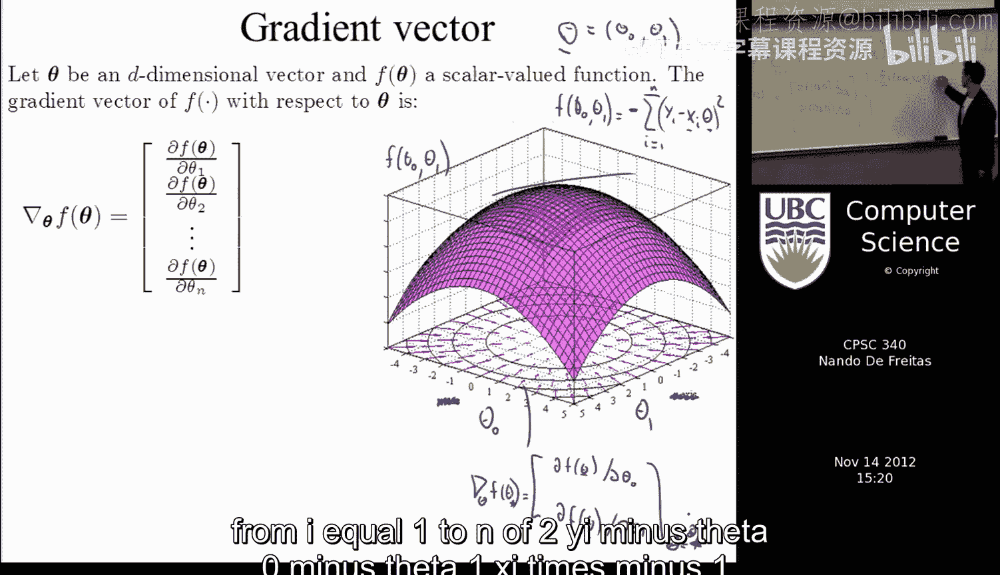

And then the next one would be minus the sum from micro 1 to n。So if one takes the derivatives。

Plying the chain rule。One gets the expression of the gradient。

And now this gradient is a function of theta n and theta1。

 so depending on the values of theta n and theta 1。I will get a different vector。

And what this figure does for you is it shows you the vectors evaluated at different values of theta n and theta1。

 and it shows you that the gradients are always perpendicular to the contour plots。

 this is a theorem that's usually proven in multivariable calculus in second year。

And it also shows that， if you。All the arrows are pointing toward the maximum。

If we had a ball instead of having it like a mountain， if we had it as a valley。

 if we flit it upside down， then the gradients would be pointing away from the minimum。

So if we go here， if we go in the direction of the gradient to find a maximum。

 if we want to find the minimum， we just go in the opposite direction as the gradient。So。

 that's basically。All of optimization。

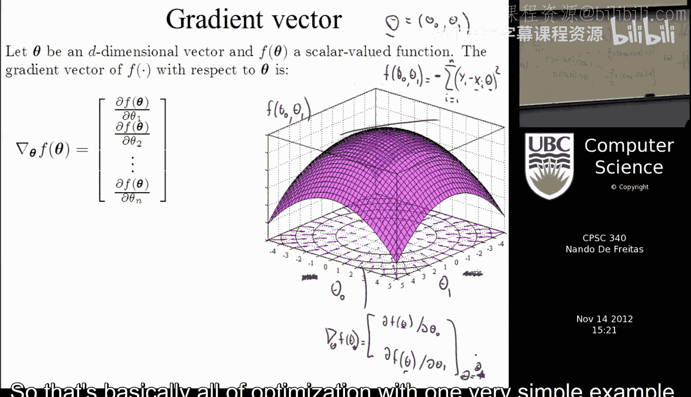

And with one very simple example。

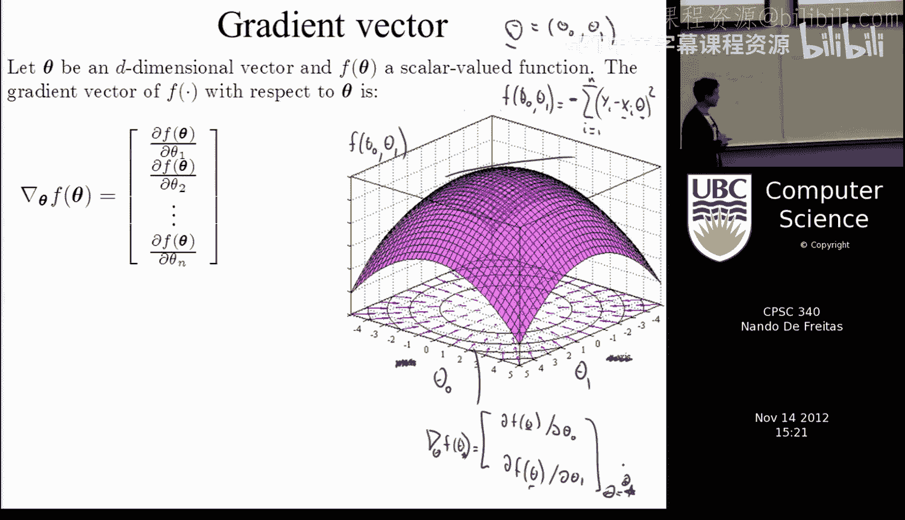

Of course， as we move on later， we're not going to have any more quadratic functions where it's guaranteed that you will find the optimal。

 but we will have functions where if you start going down from a to。

Points that are just a little bit apart。 You might end up at different minima。

 And this will be the case with neural networks。Where we're not longer going to have this property of having a single optimum。

 but we will have many optima， but still。If we follow the gradients。

 we will get to a place that has lower cost。And learning is just about going to a place that has lower cost。

 we're not guaranteed always to find the optimal one， the best one。

 but the hope is that we will find one value of theta of the theta vector。

 which will allow us to make reasonable predictions。

 and then we can test them with cross validation and all the other techniques we've learned in the course。

Okay。So。That's essentially。What we're after。And I'm just going to introduce here a definition。

The hesian is going to be a is a generalization of the gradient。

 and it's defined essentially as the matrix of second derivatives。

 So if you can think of all the possible second derivatives you could take。

And you were to place them inside a matrix。 You would get this quantity， which we call the He。

So it's the derivative of a function with respect to。Each of the parameters twice in the diagonal。

 And then you get the cross derivatives of the diagonal。Okay， so that's just a definition。

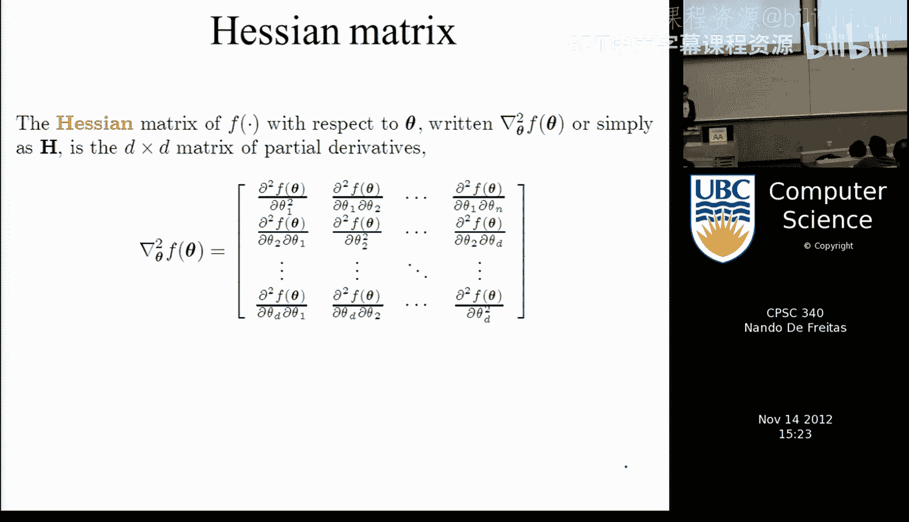

And。As I just pointed out， if we're doing。Offline learning， if we have a set of data。

 a batch of data。 So we've seen end data。Then in machine learning。

 typically the objective is to minimize an f of theta， which is the sum of objective。Functions。

 and as an example of this。In least squares， we typically minimize this。

 So in least squares f of theta X I。It's just quadratic differences。Now， the gradient is just。

The derivative of。Of the function， and so an important properties is that gradients like derivatives because they are derivatives in fact。

 they're still linear operators。 So if you have a gradient of a sum is the sum of the gradients。

And so we can just take the gradient inside。The P sum when we take the gradient of f of the。Okay， so。

If we have now linear regression。Yi minus X theta， which is just。

A generalization of this when feet is a larger vector Go ahead。Why there was the one over M Oh， okay。

It seems like at the bottom there was。Thank you。 I forgot to mention that。 Qui often。

 we just have a one over end here to normalize。Now that one over n， it turns out。

 as you'll see soon when I introduced algorithm， it's really not important because the algorithm will have a scale factor that will subsume the one over n。

But I could quite easily put one over end here。And that would not affect the answers we would find。

 That's just a scaling fact。When I discussed the algorithm， I'll bring this back。Okay， so。

So we know that when we do lead squares， we are solving the summer squared errors。

So we know what the objective function is。The gradient。Of air for teacher。We can compute it。

 if we wish。One by one， like I did here。One one term at a time。

 a faster way of doing it is just to computefuse the rules of matrix differentiation。

 so in fact we already did this， the derivative of this with respect to the vector many times。

Throughout the courts， and we already know that this is just two x transpose x theta。

Minus 2 x transpa y。Okay， we've done this many times。And alternatively。You could。Get this。From here。

Where you could just write the derivative。Cd。Theer of F of Theta。Is equal to the sum over I。Of two。

Times the quadratic。X系。Uly， we have a trans post here。C车。And at times the internal derivative。

 which is minus Xi。And I think that to be correct， I would have now that of transpose。

 I need to move the X elsewhere。Let's put the minus here。 and let's put the x。X， I transpose here。

And the mind who somehow does doesns you。Okay， so this is just the same expression。

 one is in matrix notation， one is in component wise notation。

 but it's essentially these two expressions are the same。

So there' is a way of checking that basically we're doing the right thing。

 we can either use sum so we can use matrix differentiation。But now we can also compute the Hesian。

Which is the second derivatives century。 And we use this great symbol。

Now blooded are not the gradient。And if we differentiate the gradient。

 we get this thing called a hessie。So if we differentiate this again， we just get。2 x transpose。X。

So up to now we've not built an algorithm all we've done is let's get what is the gradient and what is the hessian for linear regression I will then throughout this class we'll show you an algorithm that only uses the gradient in order to find theta and then we will discuss an algorithm that uses both the hessian and the gradient to find theta and that algorithm is called Newton's method。

We'll see that Newton method is so good that it only needs one step one iteration to find the best solution。

Whereas the gradient descent might require many steps。

And it's quite tricky to decide how many steps it will need。Oh yeah， thanks。All right。

 so the first algorithm is what we call the steepest decent。 So you're on top of ground。

 you're snowboarding。Turn around 360 degrees， you find a place where the slope is the steepest and you go in that direction。

That's essentially the algorithm。Always follow the quickest way to get down to the minimum。

And consequence of that is that if we always following the steepest direction。If we have a function。

 say again with two variables the or not。And。

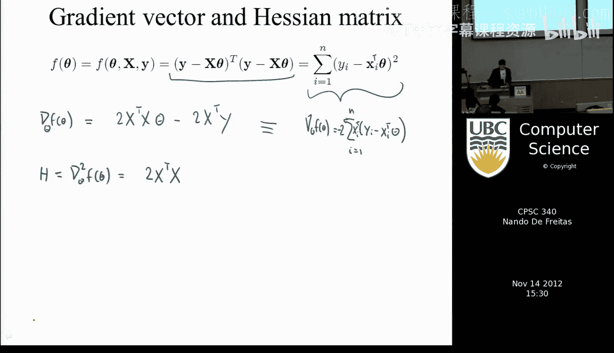

Teacher one。Then if we're going down， so we start somewhere in the function at the bottom。

 I'm plotting the contour plots。And what we do is we just travel perpendicular to the contour plots。

 and if we go in a direction that's perpendicular to the contour plots。

 we will get to the center of this quadranttic function。So。In the function。

 what's happening is that we're going to the minimum。So we're just descending to find a minimum。

 and when you descends to find a minimum， you're just going perpendicularly to the contour plots。

In 2D is the same story， you can have a variable， a function that has two variables。

 theta n and theta 1。And what we do again is we start at some point and we go down to the minimum。

And what we're doing there is we're just going perpendicularly to the contour。Ploots。Oh wait。

 That's not what I started。So we're starting here， we're going perpendicular to the control plots。

And we get to the middle。Now， if I， on the other hand， start at a different location。Let's say that。

 I start at。Let's say that I start at this location。Then as I go down。

I will get to a different minimum。And then the way I go down again is I follow the gradient that is I go perpendicularly to the curve。

So we start at any point， we follow the gradient and we go to a minimum。In the quadratic case。

 which is least squares， theres only one minimum， and that's why there was only one single theta。

 there is only one theta that's the solution， which is x transpose x。Inverse times x trans plus y。

 so there's only one solution and we find it。But if we do neural networks。

 that will be the right hand side。 there will be many solutions。

 and all we'll be able to do is find one solution。And in order to know whether that it's a good solution。

 we'll have to do press validation。And many other tricks。 But that's sort of the basic idea。Now。

 in math。What we're saying is that the new theta at iteration K plus1。Will be equal to the all theta。

And because we're minimizing we going in the opposite direction as the gradients。

 the gradients point toward a maximum so minus。And we're going to decide a step size。This step size。

 also known as the learning rate。 Think of it as how fast you're going。

 how much you trust the gradient。 so if you're snowboarding。

 you can find the direction that is the steepest， and then you can still choose whether you're going to like go with both feet and just drag a snow down or whether you're just going to put weight in your front foot and go for it。

So you still choose the speed at which you go。And so。You choose a scalar amount of speed。

 E is a scalar。 We choose Eta by hand。And there are algorithms for using theta， but for now。

 let's assume the Eta is a number that we will choose by hand。Like I don't know two or 0。1 or so。

And then G is just a vector。Now it's important to do dimension matching here。

This is a D by one vector。This is also d by one vector， and the gradient is a d by one vector。Right。

 just like here， you have a vector with two components。 So D equal2。 The gradient has two components。

 D equal 2。 So the dimensions match。And each， so essentially what we have is。

D equations and it makes sense that we have D questionss because we need to update Theta n and then we need to update theta1 all the way up to theta d minus1。

 so we update all the thetas。Go ahead for human， is this going to converge for all values of Eta or just like it's not obvious that this will necessarily converge for all values of data？

That's correct。 It's not obvious that it will converge at all， in fact， In fact。

 So we're going to go。We're going to come to that issue。

So how you choose the convergence of this algorithm will depend on the choice of eat。

As we will say see， but first， I kind of want you just to understand what the algorithm is。

 you're at the single， you start at any random point。So when you code this。

 you just pick a random initial theta。And then you just keep updating Theta using just that one single equation。

So the algorithm requires that you compute the gradient and also requires that then you take a step in the direction of the gradient。

 evaluate the gradients there， and so on。For the linear model。We， we already know that the gradient。

Of E theta。Is equal to x transpa x theta。Plus。Sorry， minus。Two x transpose y。And so。

The algorithm that you would construct would be theta K plus1。Its equal to c to k。Minus Eta。

Times the derivative x transpose x-2 x。Transpose why。Now， there is a two and that two disappeared。

 The reason why the two disappeared is because I can subsume the two in the Eta。

 Eta is an arbitrary number so I can put the two inside。There's no need to write a to。

 and that is precisely also the same argument as why I don't write the N。

Because I also subsume the an Eta。And that's the algorithm。

That would be how you would apply this for linear regression， and so what is this actually doing？

You can think of this as a nuerative algorithm。Well， if you have several points。

What it is doing is it fits a line to the points。At random， so you start with a guess。

And then when you do an iteration。You find another line。And then you find another line。

And another line， until you find a line that goes through the point。Okay。

 so in each update you're finding a new value of theta node and a new value of theta1 and theta node and theta 1 is all you need in order to get the line right because the line is given by。

Once you know it's slope and once you know it's intercept。

And so what the algorithm is doing is just updating the lines as you go。Now， how fast。

 how big are the steps， the size of the steps will depend on this parameter eat， as was pointed out。

 this parameter can determine convergence or not。

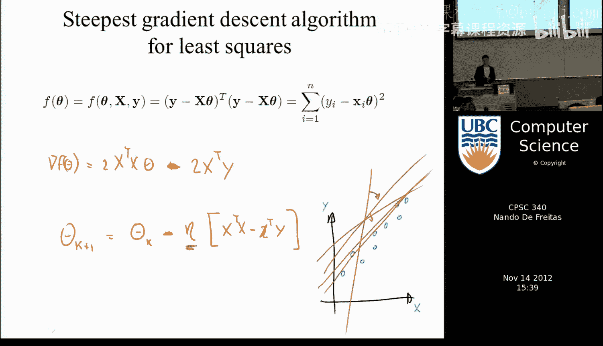

If let's look at two examples。If you choose an Eta， that is too small。

When you get to a region of the cost function that is fairly flat。You essentially， will be moving。

 but you'll be moving very， very slowly。 And it could take you， you know， you'll get to the minimum。

 but it will take you an infinite number of steps。 So for any practical reasons。

 we will never attain the minimum。 You would get stuck。Before you get to minute。

That's because our equation。Is theta k plus 1 is equal to theta k minus 0。1 times the gradient。

Evaluated a fee ticket。Now， if。If this guy。If this guy is small。

And where the derivative becomes almost flat。You might be going down to a function。

You can have a function that is still minimizing。But there is a big region where the derivative is not flat。

 but it looks almost flat。 so it's almost zero。 and if it's almost zero。

 if you multip by a small number， you might get something here， something that is approximately0。

And if it's approximately 0 means that theta K plus one will be equal to theta K。

 You won't see any updates。 So you observe what's in that plot。

 You observe that your theta updates are very tiny。And it's almost like the， in fact。

 once they get to underflow， you will not see any progress。 The algorithms stop。On the other hand。

 if， if you take。Something that's too large。So this would be too small。

If you get something that's too large。It might o selectate。Okay， so if you have a ball。

And you go too fast with your snowboard。 You might overshoot the minimum。

 and then you're going to be doing this。You're going to be like a pendulum up and down， up and down。

 up and down， and eventually you're going to get to the minimum。

 but it's going to take you quite a while， you'll be oscillating。Okay。

So there is a choice of theta for which a choice of theta that will give you just the right speed to get there。

Now ET is a tuning parameter， there are techniques for choosing ETA。

 there's things called line search。 I'm not going to go into that in this course that's sort of outside dis course 540 or any course in optimization covered line search。

 which is just a way of testing the function to see how and readjusting your EA。So basically。

 you take a few steps。 If you don't see much of a change in the function height。

 you choose a bigger theta to take bigger steps。 If you see huge changes。

 then that means you probably are oscillating。 So you reduce the step size。

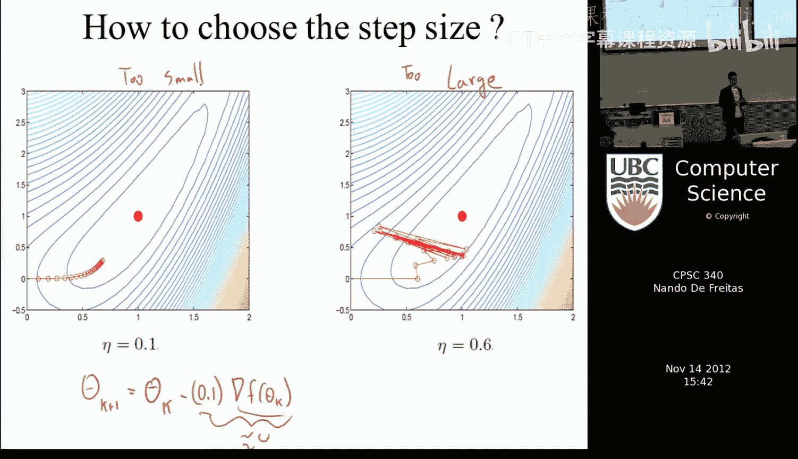

What a lot of people do in practice with neural networks is they just choose those by hand and sometimes they choose an eta that's of the form one over n。

 so we bring back this one over n because that basically means that you do big updates in the beginning and then as time goes by。

 your updates become smaller and smaller。Whi。So in the last slide where mentioned this algorithm。

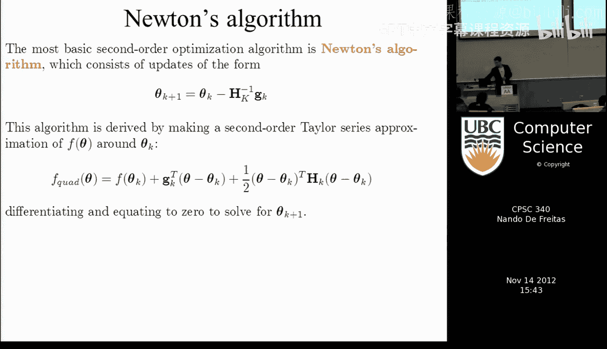

He used to be。use Kentucky。

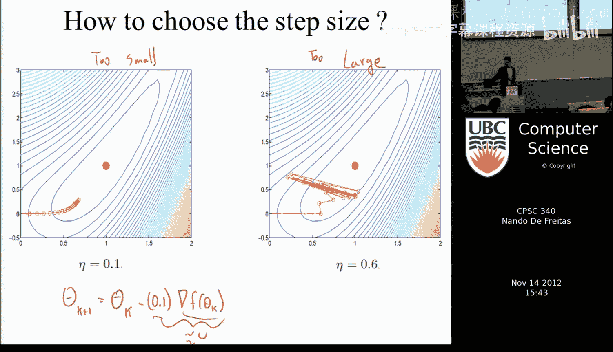

I'm wondering if there is a constant of sorry， which slide the one this slide。

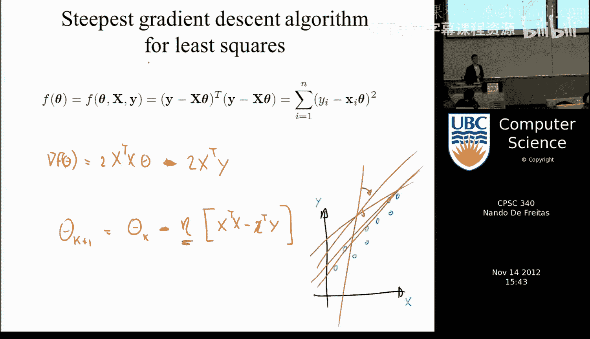

そう。いた。I mean。It's not a constant。It may be a constant like two。 You can choose it。

 Or as I said just now， you can also choose one over。The number of steps。

 so you could choose one over k。So this is going to be a so yes， that's correct。

 so if you do this technique called line search which we're not going to cover in this course。

 but which I just give you the intuition that if there's no much change in the height。

 you increase EA and if there's big change in the height you decrease E。If you do that。

 then you can see that E is a function of time of K。But in this course。

Let's assume that Eta is a constant， say， a number like 0。1 or 0。6。

And then it's up to you to choose the right value of that E。I know you're all smart。

 you can all go and implement line search because it's actually a smart way of doing it。

But I will leave that to you。 I'm not going to cover it。Okay so。Newton's method。诶。Will， however。

 address this problem， which will will give us a way of basically automatically choose the learning rate。

But it's not just going to choose the learning rate as a scalar。

 but it will choose it as a matrix because there's going to be learning rates along all possible directions。

If you will。The catch of Newton's method is that it requires a matrix of derivatives。

If you happen to have two parameters， your vector gradient has two entries。

And your Haitian has four entries。Because the hasian then requires the derivatives with respect to theta0 theta 1 and theta1 theta0。

 and then theta 2 squared and theta1 squared and then theta1 squared。

So you have four terms for the H。Now， if you have many。Prameterters， like for example。

 in the Twitter classification example that you guys have to implement。

 if you were to try linear regression there you have， I don't know。

 a thousand parameters or a million parameters often。

Then your gradient factor with a million parameters would be of size a million。

 your hessian would be of size a million by a million， so that would be a lot of storage。

So Newton's method will turn up to be much faster。And it gets rid of this issue of having to choose the step size。

But you pay for it and you pay for it in storage。So there's a trade off， there is no free lunch here。

Okay， so Newton's method chooses as the step size。The inverse of the Hessian a deterration K。

And we can derive this algorithm if we think of a Taylor series of approximation。Now。

 Taylor's series approximation just means expand the function。

In terms of how many of you have seen Taylor serious approximations let's see。Okay， most of you。

A tail service approximation is where it's on the screen。

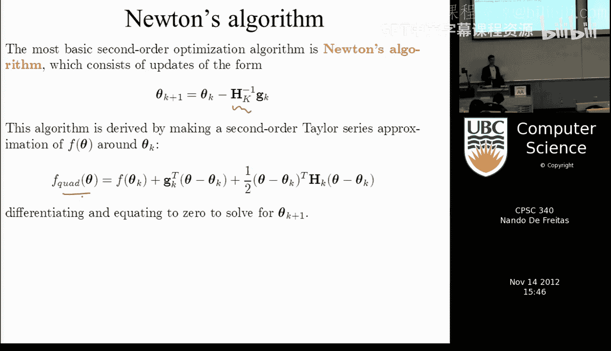

A tailor of approximation about。

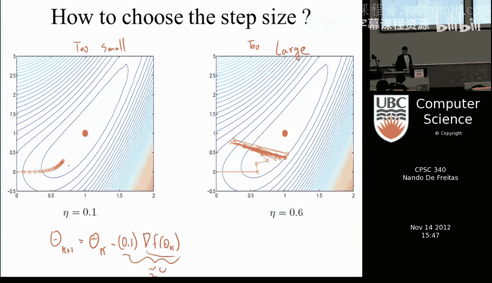

Oop， sorry about that。A Taylor series approximation of F of theta is an approximation。

Up to some degree， in this case， we're going to go to degree2。Of the function evaluated at the point。

Times the derivative and then they interval theta minus theta k。

And then the quadraranttic term involving the secondary derivative derivatives。Okay。

 so it's just an expansion of a function in terms of its derivative。

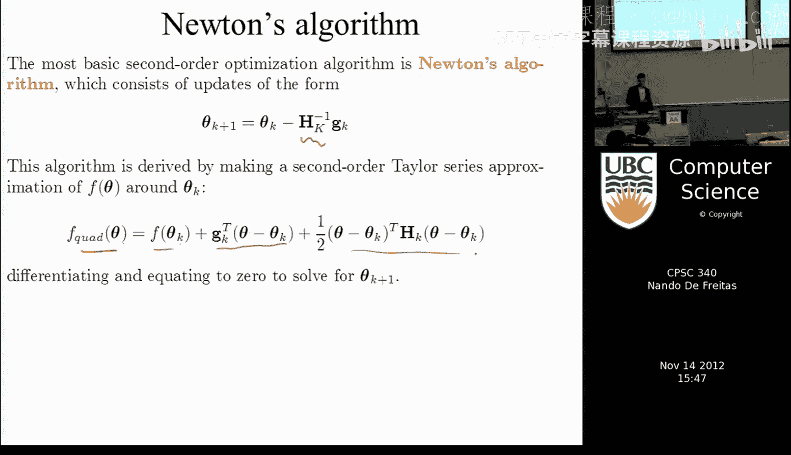

One way to think of it is。Think of this as the opposite should be seat。そればね。

Think of this case here where we have the function f of theta。

Then the quadratic Tayloror series approximation。It's just a quadratic function。

That near the value of theta K provides a very good fit。And away from it， the fit deteriorates。

But at theta K， the two functions are tangent to each other。In particular， at theta K。

You ensure that these functions have the same slope and the same curvature。

 That's basically what a second order expansion is。

And so we created this quadratic function to have the same slope and the same surface。

If we differentiate it。With respect to theta。We will get zero because theta k is a specific value of theta。

And then we will at。The gradient。And then we will get。嗯。H。Okay。F。Now， if we knoweququaus。

H K The hangmy expanders H K，Mus D。And essentially， this term here。Is theta if we transpose age。

Teacher k。us2。Let me be careful here。Take my steps。

So what I've done is I just expanded this term here， which is just this guy here。

 which is just a half， and then I would have had Theta HK。Pta。

 and then I would have had minus2 theta transpose HK。Ter K。And then I would have had plus theta K。

 HK。In take。And if I take the derivative of all these terms， the derivative of this guy。

Will be 0 with respect to theta。 I just get。The expression that I have at the bottom。

And so if I equate this to0， I get say GK。Minus GK is equal to HK。Theer， minusrs。HK。呢只嘅。And then。

 minus。HK minus1 times Gk。这是一个。To t minus c k。From where the you an algorithm step above comes。

 here so was' essentially how you would derive it。

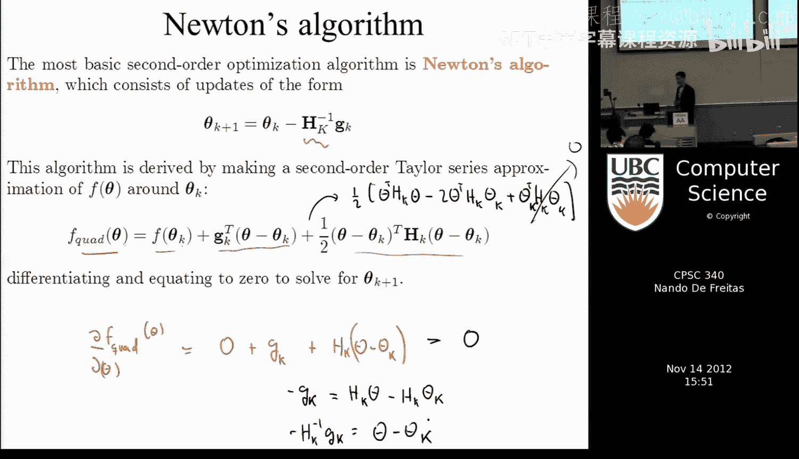

So the Newton algorithm。What it's doing is it's finding the next theta K as the minimum of the quadratic function。

We don't know how to minimize the function， so what we do is we approximate it at theta K。

 we approximate it with a quadratic function， the blue line。

 that quadratic function has the same slope and the same curvature at that point。

We go down that quadratic function all the way to find its minimal。

 and that's then our value of theta k plus one。And then we repeat it。 We again fit a quadratic。

 and we follow it to a minute。And so now we're trying。

 we're essentially using an idea which is since we can't optimize the original function。

 we optimize the function that we know how to optimize， which is a qua right。

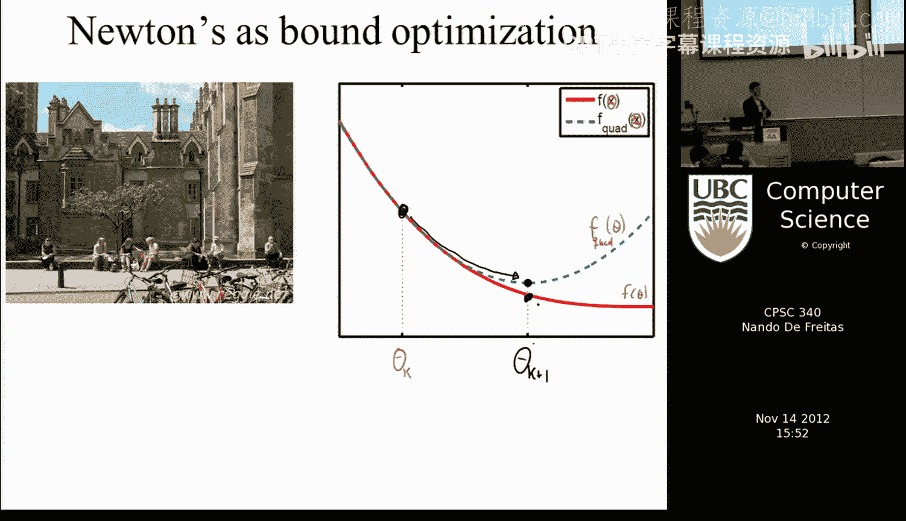

So very quickly， I started the class late， so I'm just going to take a couple more minutes to finish。

嗯。The gradient is2 x transpose x。Theta minus x transpose y。The hesia。And that's what I'm calling G。

The Hasian is just equal to 2 x transpose x。Now， if we do the update for linear regression。

We would have theta K plus 1。It's equal to the to k。

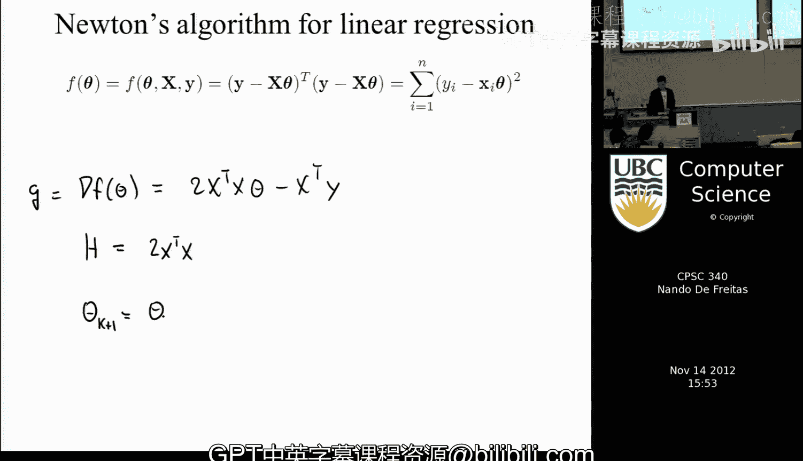