# 机器学习与数据挖掘：第26讲：优化 🧠

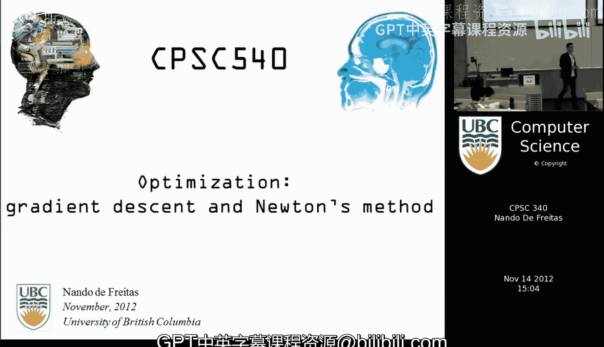

在本节课中，我们将学习优化的基本概念和方法。优化是机器学习中求解模型参数的核心技术，特别是在无法获得解析解时。我们将从梯度和海森矩阵的定义开始，然后介绍三种重要的优化算法：梯度下降法、牛顿法和随机梯度下降法。理解这些内容是为后续学习神经网络和逻辑回归奠定基础。

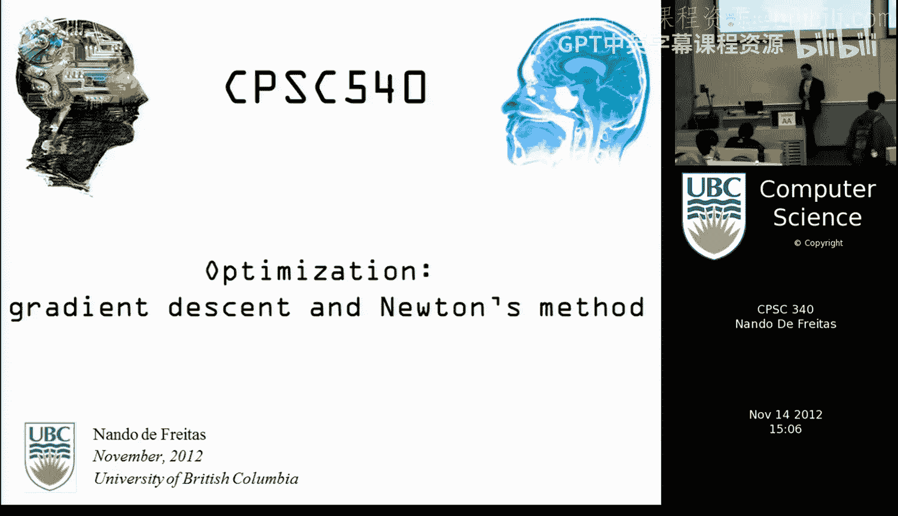

---

## 梯度和海森矩阵 📈

上一节我们提到了优化在机器学习中的重要性。本节中，我们来看看优化的两个核心数学概念：梯度和海森矩阵。

当我们采用频率学派的机器学习方法时，通常会进行最大似然估计。我们定义一个目标函数（如对数似然），对其求导并令导数为零，从而得到参数的估计值。然而，对于大多数问题，我们无法通过简单的求导和求解方程来获得参数的解析解（即闭式解）。这时，我们就需要依赖优化算法来寻找使目标函数（如误差函数）最小化或概率最大化的参数值。这两个问题本质上是等价的。

为了找到导数变为零（即函数平坦）的点，我们需要“跟随导数”的方向。这就像如果你在格劳斯山顶，想要下到平坦的山谷，你会选择最陡峭的路径下降，直到无论朝哪个方向都无法继续下降为止。此时，你就找到了一个最小值点。这就是基于优化的学习算法的基本思想。

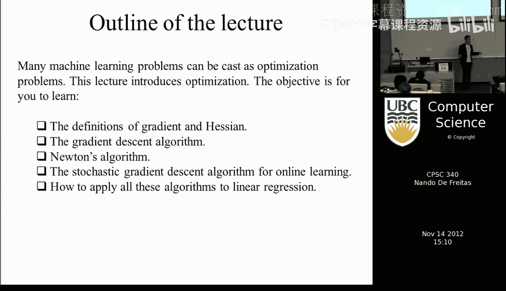

### 梯度

梯度是一个向量，其分量是目标函数关于每个参数的偏导数。对于一个包含多个参数的函数，梯度指向函数值增长最快的方向。

**公式**：
对于一个函数 \( f(\theta) \)，其中 \( \theta \) 是一个参数向量 \( [\theta_0, \theta_1, ..., \theta_{d-1}]^T \)，其梯度 \( \nabla f(\theta) \) 定义为：
\[
\nabla f(\theta) = \left[ \frac{\partial f}{\partial \theta_0}, \frac{\partial f}{\partial \theta_1}, ..., \frac{\partial f}{\partial \theta_{d-1}} \right]^T
\]

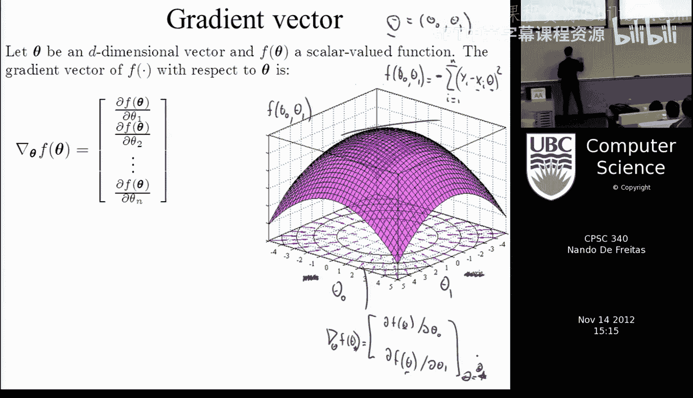

在线性回归的例子中，我们的目标函数（负的误差平方和）是：
\[
f(\theta) = -\sum_{i=1}^{n} (y_i - (\theta_0 + \theta_1 x_i))^2
\]
其梯度（经过求导计算）为：
\[
\nabla f(\theta) = \begin{bmatrix}
\sum_{i=1}^{n} 2(y_i - \theta_0 - \theta_1 x_i) \\
\sum_{i=1}^{n} 2(y_i - \theta_0 - \theta_1 x_i) x_i
\end{bmatrix}
\]
梯度是一个关于 \( \theta \) 的函数，在不同的 \( \theta \) 值处，梯度向量的方向和大小也不同。在等高线图中，梯度方向总是垂直于等高线。

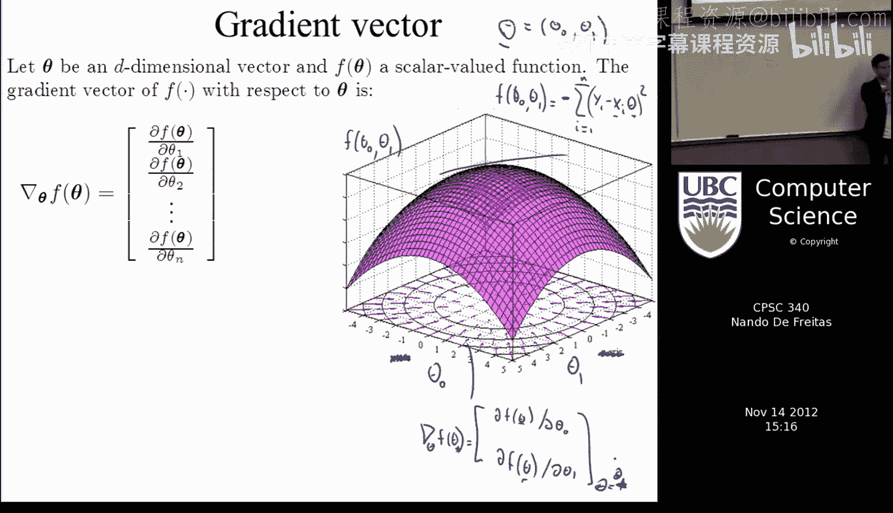

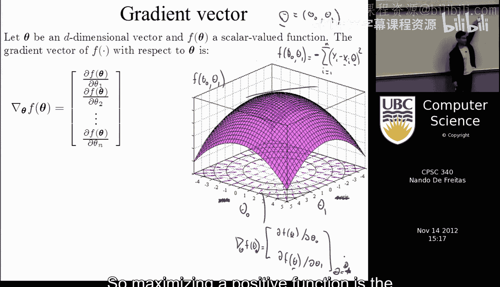

### 海森矩阵

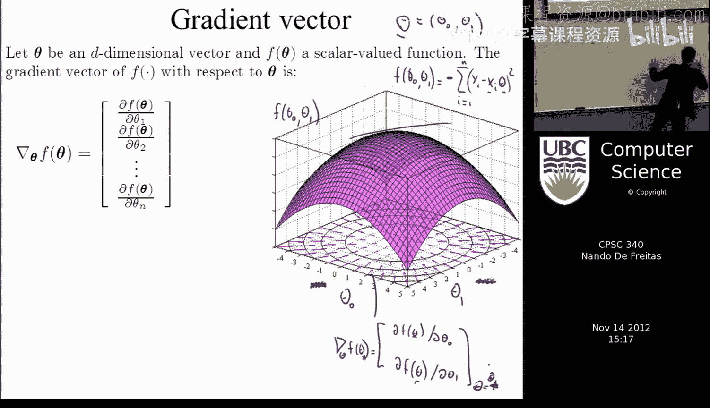

海森矩阵是梯度的推广，它包含了目标函数的所有二阶偏导数，描述了函数在某个点的曲率。

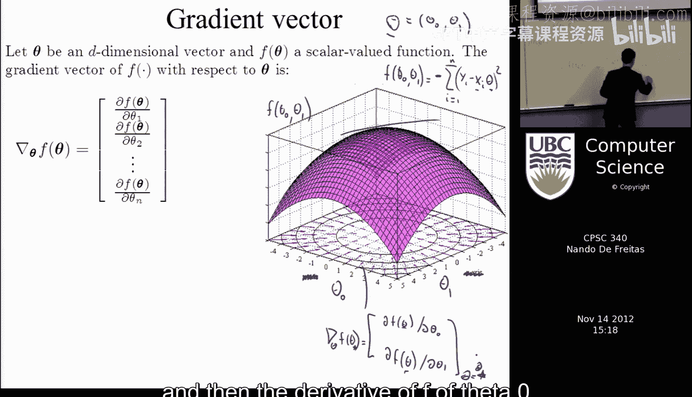

**公式**：
函数 \( f(\theta) \) 的海森矩阵 \( H(f(\theta)) \) 是一个 \( d \times d \) 的矩阵，其第 \( i \) 行第 \( j \) 列的元素为：
\[
H_{ij} = \frac{\partial^2 f}{\partial \theta_i \partial \theta_j}
\]
对于线性回归问题，其海森矩阵是一个常数矩阵：
\[
H = 2X^TX
\]
其中 \( X \) 是设计矩阵。

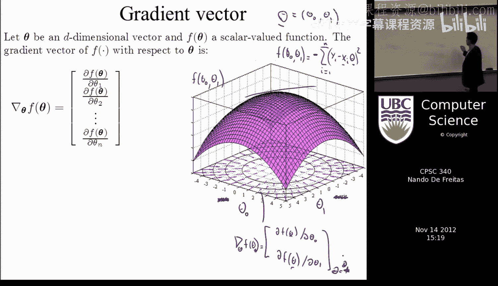

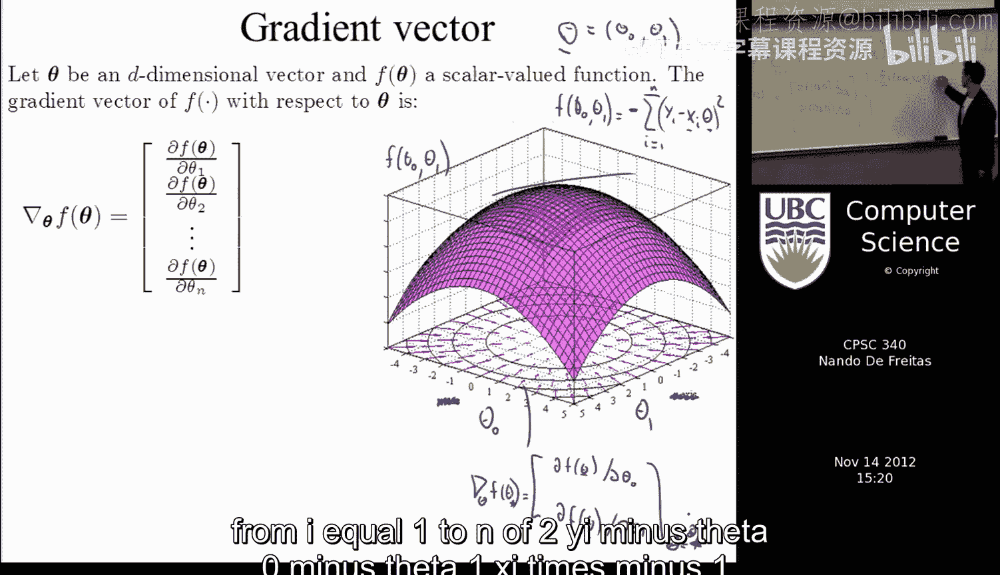

---

## 梯度下降法（最速下降法） ⬇️

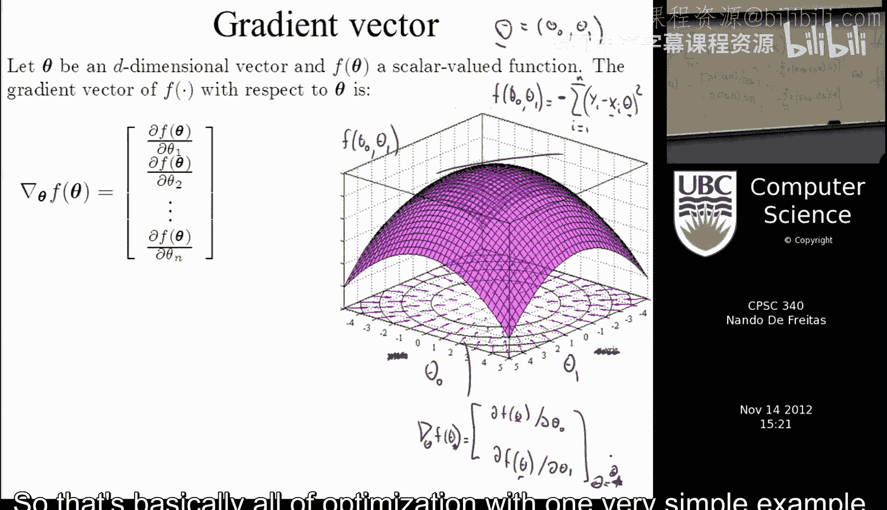

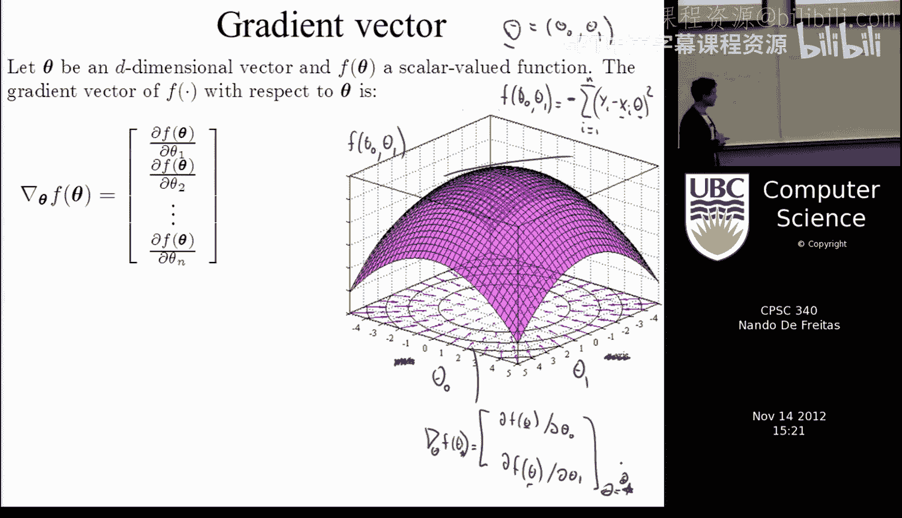

理解了梯度的概念后，我们来看第一个优化算法：梯度下降法，也称为最速下降法。其核心思想是：在当前位置，沿着梯度相反的方向（因为梯度指向函数增长最快的方向，而我们要最小化函数）前进一小步，逐步逼近函数的最小值。

**算法描述**：
参数更新公式为：
\[
\theta^{(k+1)} = \theta^{(k)} - \eta \cdot \nabla f(\theta^{(k)})
\]
其中：
*   \( \theta^{(k)} \) 是第 \( k \) 次迭代的参数值。
*   \( \eta \) 是学习率（步长），是一个需要手动设定的正标量。
*   \( \nabla f(\theta^{(k)}) \) 是目标函数在 \( \theta^{(k)} \) 处的梯度。

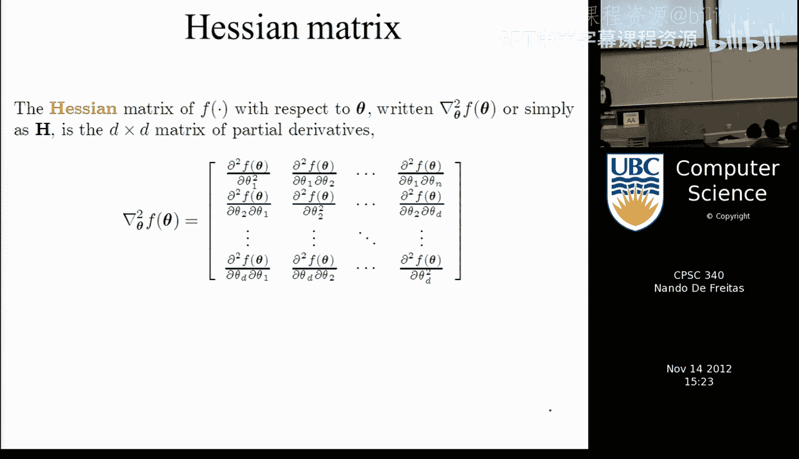

对于线性回归，梯度为 \( \nabla f(\theta) = 2X^TX\theta - 2X^Ty \)，因此更新公式为：
\[
\theta^{(k+1)} = \theta^{(k)} - \eta \cdot (2X^TX\theta^{(k)} - 2X^Ty)
\]
常数因子 \( 2 \) 可以被吸收到学习率 \( \eta \) 中。

### 学习率的选择

学习率 \( \eta \) 的选择至关重要：
*   **如果 \( \eta \) 太小**：算法收敛速度极慢，在平坦区域可能几乎停滞不前，需要大量迭代才能接近最小值。
*   **如果 \( \eta \) 太大**：参数更新可能会在最小值附近震荡，甚至发散，无法收敛。

在实践中，有自适应调整学习率的方法（如线搜索），但本课程中我们通常将其视为一个需要手动调整的超参数。一种常见的策略是使用随时间衰减的学习率，例如 \( \eta_k = 1/k \)，这样在初期更新幅度大，后期更新幅度小。

---

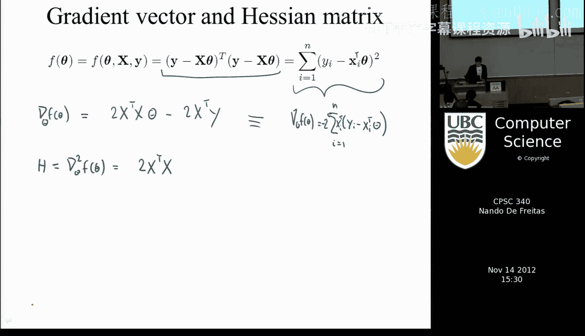

## 牛顿法 🍎

梯度下降法需要谨慎选择学习率。牛顿法则通过利用目标函数的二阶信息（曲率）来自动确定每一步的“最佳”步长和方向，通常收敛速度更快。

牛顿法的思想是：在当前点 \( \theta^{(k)} \) 处，用目标函数的二阶泰勒展开式（一个二次函数）来局部近似原函数。然后，直接求解这个二次函数的最小值点，并将其作为下一次迭代的参数值 \( \theta^{(k+1)} \)。

**算法描述**：
参数更新公式为：
\[
\theta^{(k+1)} = \theta^{(k)} - H^{-1}(f(\theta^{(k)})) \cdot \nabla f(\theta^{(k)})
\]
其中：
*   \( H(f(\theta^{(k)})) \) 是目标函数在 \( \theta^{(k)} \) 处的海森矩阵。
*   \( H^{-1} \) 是海森矩阵的逆。

对于线性回归，海森矩阵 \( H = 2X^TX \) 是常数矩阵。可以证明，牛顿法在线性回归问题上只需一次迭代就能达到最优解（即最小二乘解），因为其局部二次近似本身就是精确的全局模型。

### 优缺点

*   **优点**：收敛速度快，无需手动选择学习率。
*   **缺点**：需要计算并存储海森矩阵及其逆矩阵。当参数数量 \( d \) 很大时，海森矩阵的大小是 \( d \times d \)，计算和存储开销巨大，甚至不可行。

因此，牛顿法适用于参数规模不大的问题，而梯度下降法则更适用于大规模问题。

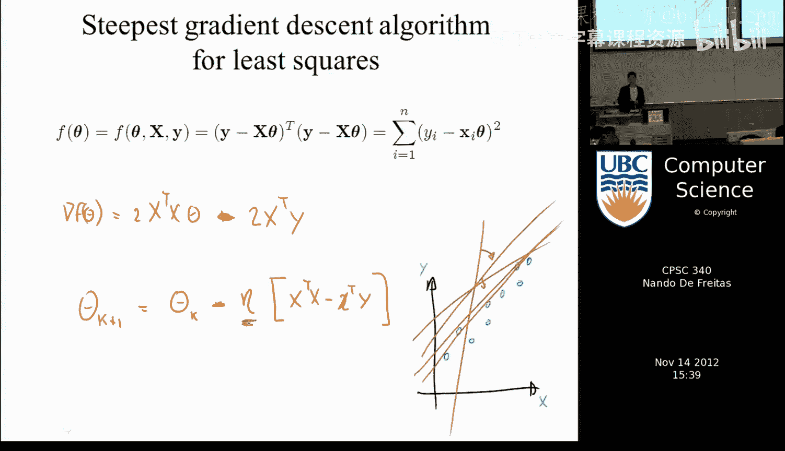

---

## 随机梯度下降法 🔄

在实际的机器学习应用中，尤其是在线学习或大数据场景下，数据可能无法一次性全部获得，或者数据量太大导致计算完整梯度代价高昂。随机梯度下降法应运而生。

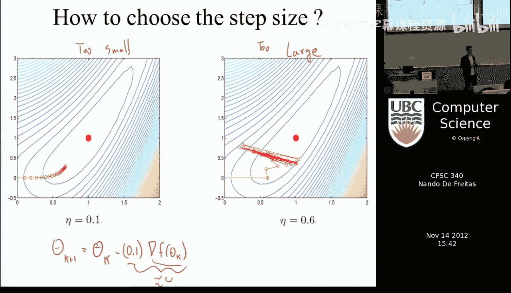

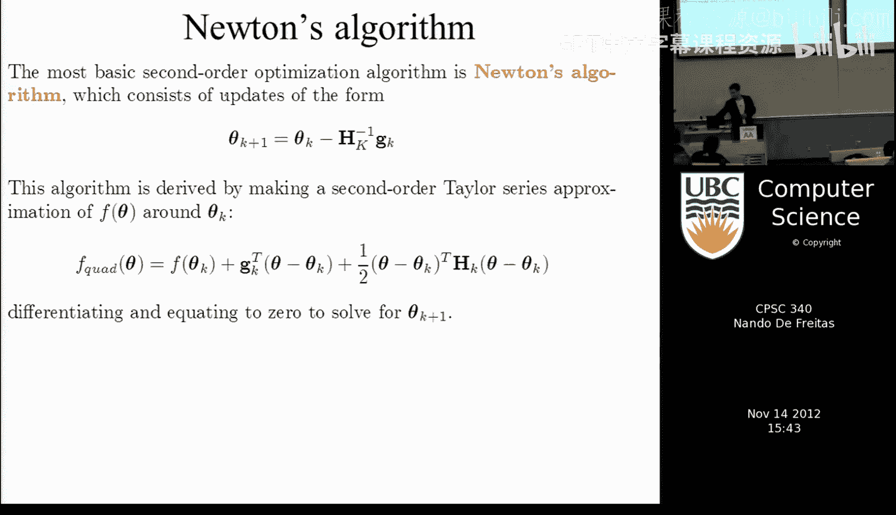

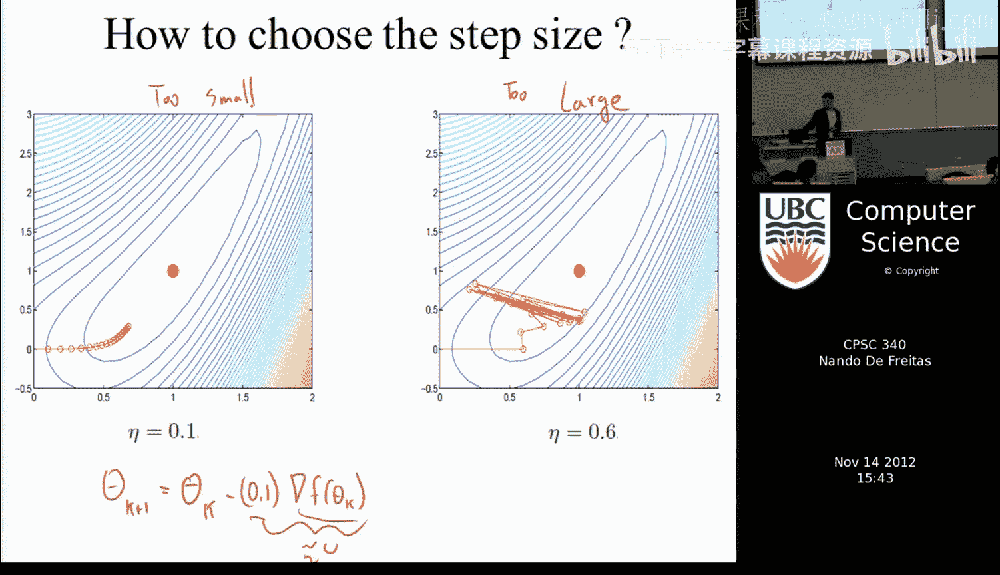

它与标准梯度下降法（有时称为“批量梯度下降”）的关键区别在于：**每次迭代时，它只使用一个随机样本（或一小批样本）来计算梯度估计值，并据此更新参数**。

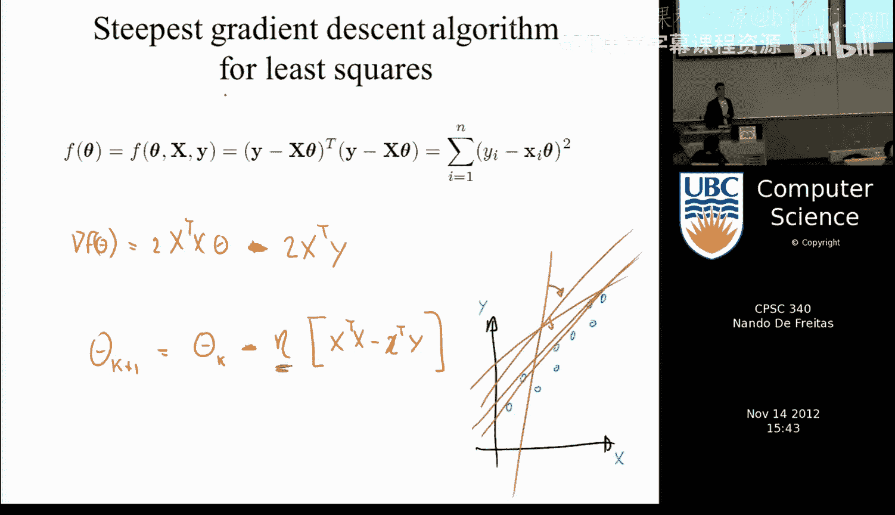

**算法描述（单样本版本）**：
\[
\theta^{(k+1)} = \theta^{(k)} - \eta \cdot \nabla f_i(\theta^{(k)})
\]
其中 \( \nabla f_i(\theta) \) 是仅基于第 \( i \) 个数据点计算的目标函数梯度（或子梯度）。

### 特点

*   **高效**：每次迭代计算量小，更新速度快。
*   **在线学习**：非常适合数据流式到达的场景（如Twitter的推文流），可以实时更新模型。
*   **随机性**：由于使用估计的梯度，其更新路径是嘈杂的，但平均来看仍会朝向最小值区域前进。这种随机性有时有助于跳出局部极小值。
*   **学习率**：通常需要更精细地设计学习率衰减策略，以确保最终收敛。

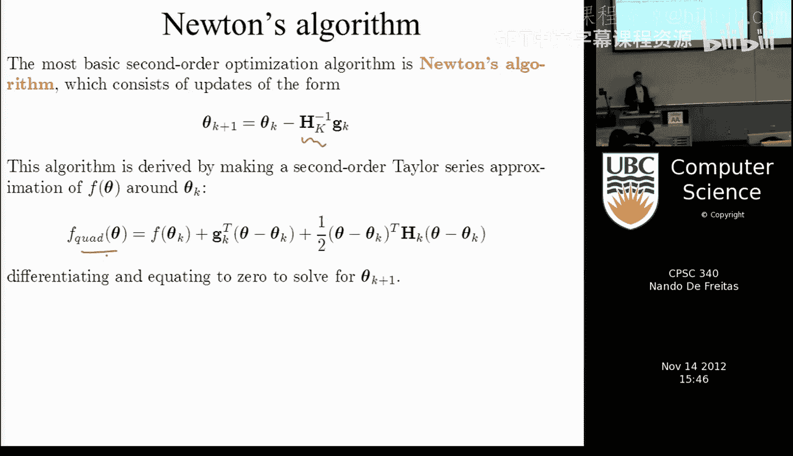

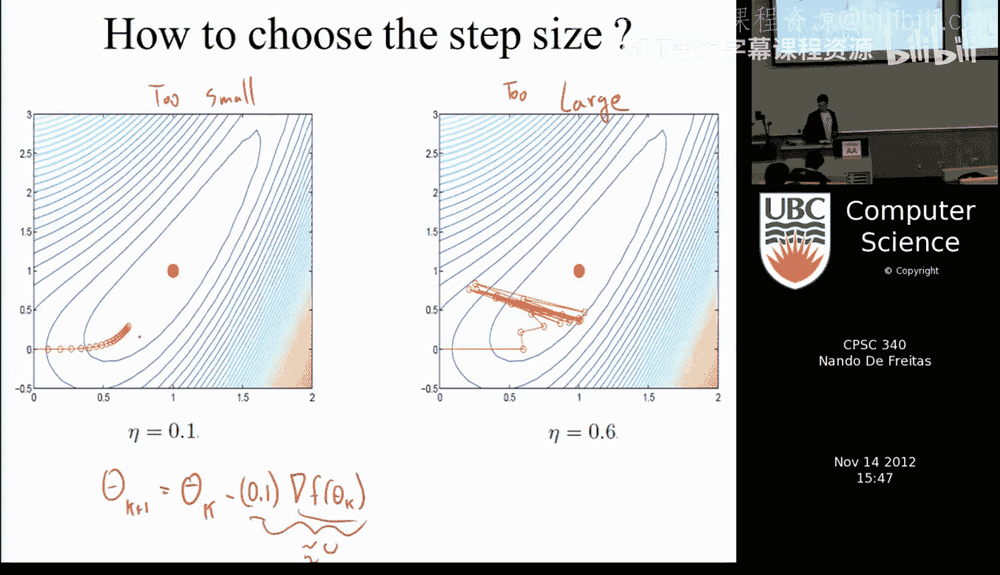

---

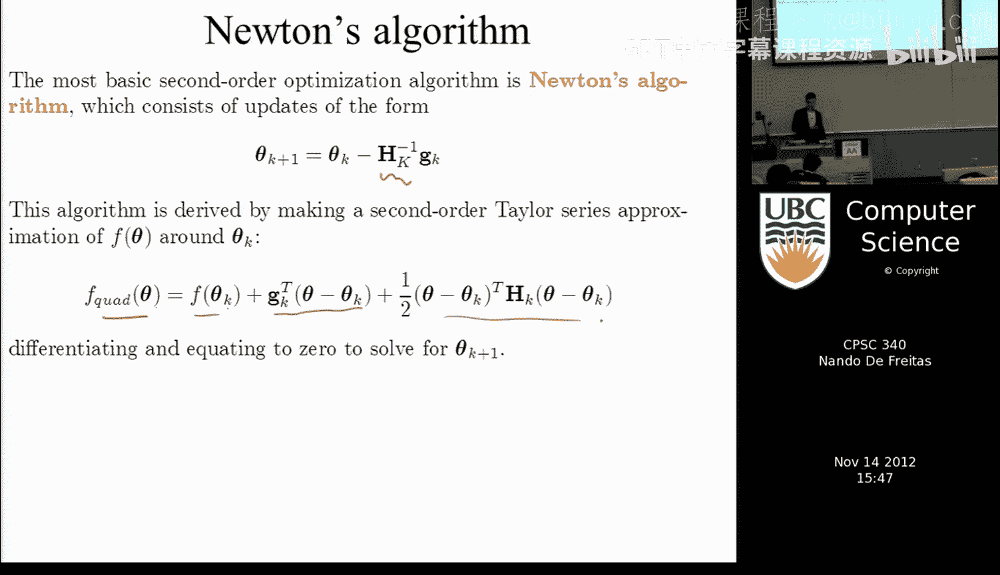

## 总结 📝

本节课中我们一起学习了机器学习的核心数学工具——优化。

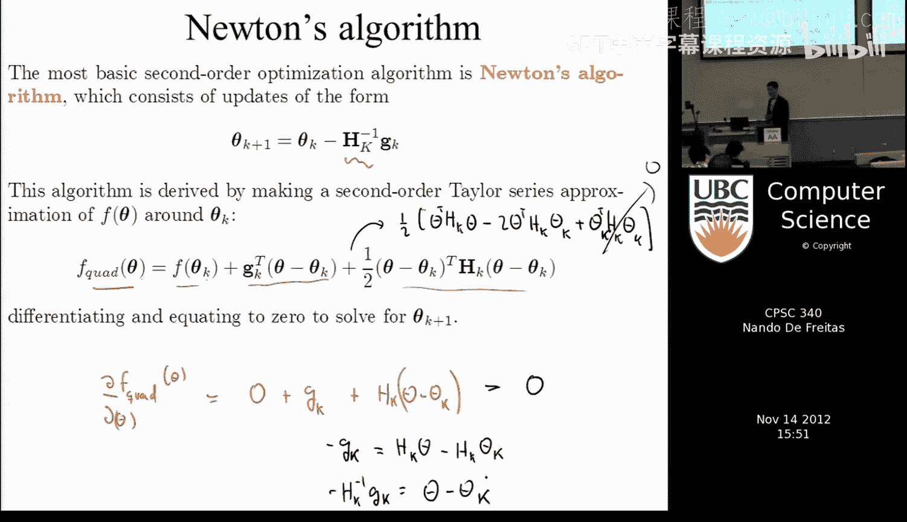

*   我们首先定义了**梯度**和**海森矩阵**，它们分别描述了函数的一阶变化（斜率）和二阶变化（曲率）。
*   接着，我们深入探讨了三种基本优化算法：
    1.  **梯度下降法**：通过沿负梯度方向迭代更新参数来寻找最小值。简单有效，但需要仔细选择学习率，且收敛速度可能较慢。
    2.  **牛顿法**：利用梯度和海森矩阵信息，通过局部二次近似更快地收敛。但它需要计算和存储二阶导数矩阵，对于高维参数空间计算代价高。
    3.  **随机梯度下降法**：每次迭代仅使用一个或一小批样本估计梯度，大大降低了计算成本，特别适用于大规模数据集和在线学习场景。

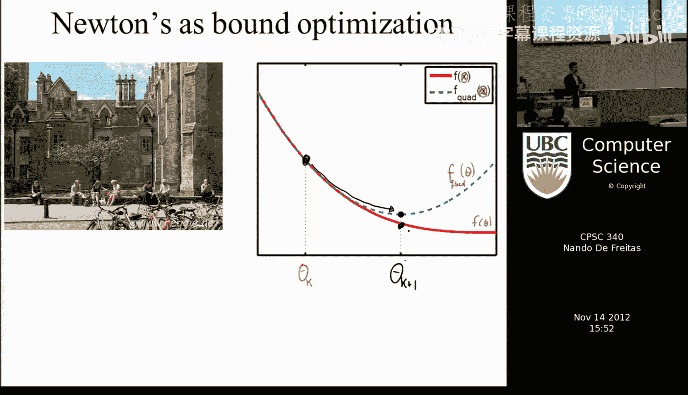

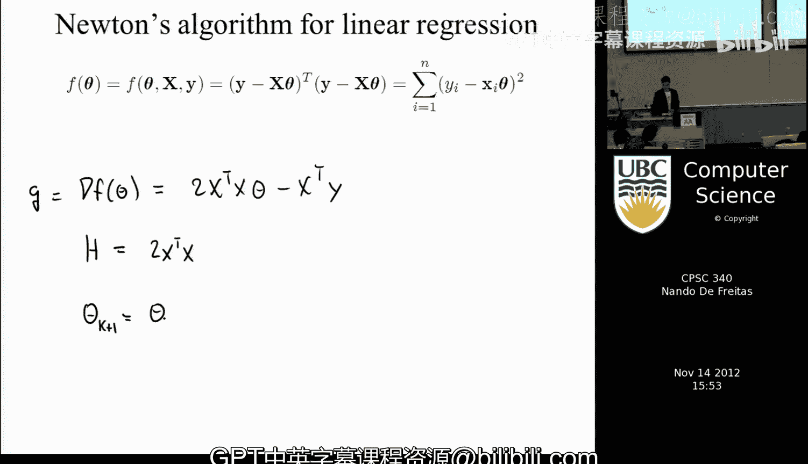

这些优化方法是训练复杂模型（如我们即将学习的神经网络）的基础。在线性回归模型上，它们都能（以不同效率）找到最小二乘解。在后续课程中，我们将把这些技术应用于逻辑回归（单神经元神经网络）以及更复杂的多层神经网络中。