# UBC《机器学习和数据挖掘｜CPSC 340 Machine Learning and Data Mining 2012》中英字幕 p27 -27-undergraduate machine learning 27_ Logistic regression.zh_en -BV1pJ2ABFEFg_p27-

The gradients are perpendicular to the contour levels。

 Now the contours are the points of equal height。 So if something is perpendicular to the points of equal height。

 that means that something is the direction of the greatest descent。

 Or if you going into another the direction， it would be the direction of greatest descent。

 That's why the gradient algorithms that follow the gradient are also called steepest descent or steepest descent。

 and the same algorithm that you used to go up is the same algorithm that you used to go down。

 You just need to change the direction of travel。And so we saw that the gradient is the vector of derivatives。

 most of the functions that we deal with have many free parameters， many free variables。

 and so we need to compute the derivative with respect to each of the parameters that we want to learn。

 so we end up with a vector， which is all the derivatives。

You can skip having vectors and you can skip having matrices if you want to treat each term one by one。

 but then your code will be very messy and involve many four loops and your math will also be messy。

With many sums and so on。 So that's why it's important to always try to use abstraction and introduce matrices and vectors。

But so we learned that the basic idea then is if you start anywhere。

 learning is just in a maximum likelihood sense， will be just a process of going down an error function to the minimum。

Okay。And then we also。So， the general algorithm is。If you earn a descent。

 the gradient points in the direction of the greatest descent。

 So if you go in the negative direction。So that's why there is a minus here because we're going in the opposite direction of the gradient。

So we're at the location。Maybe a different color。White， so we are at the location theta。Okay。

And if you want to go down， we follow the gradientd at each point。In order to get to theta K plus1。

And by following the gradient is， we go in the opposite direction of the gradient because the gradient points to the maximum。

 So if we go in the opposite direction， we're going。Toward the minimum。

And if we have a quadratic function， we will get to the minimum provided we have the right step size。

 And so I mentioned to you that if your step size is just a number， a constant。

 then if it's too small， you might just get stuck going down。

 It's the same is think of the step size as how much strength you're putting on。To go down。 So you。

 you might be snowboarding and you might pick the， the place that is the steep。

 How many people here snowboard， by the way， because I am wondering if this is or not many， so。嗯。好き。

😀Yeah。G guessss should'd get up and play。the homework Council or system。

I'll skip the snowboarding analogies。It determines how fast you're going down。Okay。

 and then we looked at an example， the linear model。

 So doing ingredient descent in the linear model is just a process of moving from one line。To。嗯。

Moving from one line to another line。 So you start with a particular slope on the point。

 and then you keep updating that slope until it fits。Until it goes through the point。

Maybe this was clears everything else where it's an F of thing thing one。Mmhmm。😊。

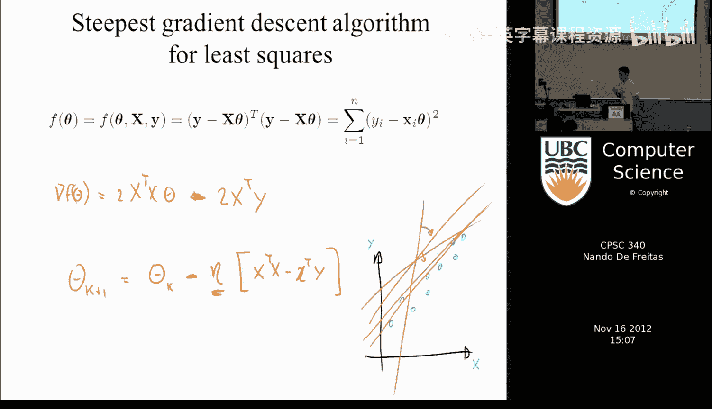

Like the commercial。

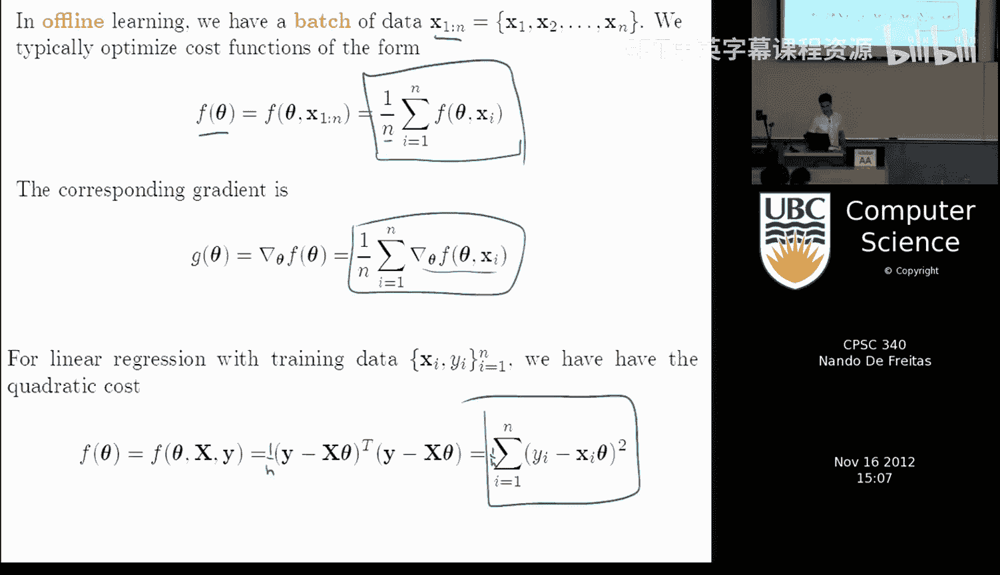

诶 no no。そ。Very which one Oh yeah。So in this case， there's two parameters。 It's 2 D。

 So there's theta n and theta 1， yeah。The function is the surface， yes。That's correct。

 So in particular， this function here。It's a quadratic。 So this particular function could be。

Something like。It could be something like what you have when you do least squares。

 which is y minus x theta。Transpose y minus x theta。Which is basically the sum of square errors。

And so essentially the ideas the。Instead of trying to solve one particular problem， like。

 let's do spam classification and let's classify DNA microrays。 And so rather we're can abstract。

And what。And this will be useful because we will learn a recipe that will allow us to solve any problem that we encounter。

Provided that it's a regression or classification problem。And the abstraction is。

 we always write the likelihood。We differentiate， we take the log。If we ne the log。

 we get an error function。Because remember the Gaussian， for example。

 E to the minus that will essentially give you a multivariate Gaussian。

 which is the likelihood for linear regression。 So if we have a probability， a likelihood。

And we take the log and we negate， we get a narrow function。

Some people even skip this likelihood step， some people go straight to the error function。

If you write a error function。You differentiate it equal to0， you get an expression。

Sometimes you can solve a theta that's in the linear model。

 most of the time you can't solve a theta especially if you have multiple modes and so on。

 it will be very hard for you to solve to get an exact equation for theta。

 Linear regression is one of those very rare cases。Where you can solve for feet。

Most of the things we do in practice。Are not things that you can do by hand。

 So this is not the sort of calculus world and linear your algebra world where you could do things by hand。

 that goes away。Instead， you need to learn to。Do math with computers。Basically， compute。嗯。呃。

Understand these ideas of optimization on how to actually come up with solutions using computers。

And so as soon as we have a cost function or the negative log likelihood。We just differentiated。

 and we get the gradientd。And then that immediately gives us an algorithm。 The algorithm is。

The new theta is the all theta minus or step size in the direction of the grid。

So provided that you have an expression for the gradient， provided you're able to give an an F。

This that's actually the better tax effort。 because for a particular problem。

 you're gonna have to come up with a good F。 and F that makes sense。

But once you have the objective function， equivalently the likelihood。

 because if you have the objective function。Like if I have an error function。Some sort of objective。

 actually， let's call it F。But if I have some objective function， F of theta。

Then I can just take e to the minus F of feature。 and that essentially gives me。A likelihood。

Because this guy goes down like in a pratic， this guy would be a gus。So， there is this nice sort of。

This is basically the same thing。The cost function is just the negative log likelihood。

The reason why we prefer to use likelihoods instead of just error functions is because when you have likelihoods。

 then you can also see how you could add the priors to it。

And if you have probabilities and you want to build bigger models。

 then we know the rules on how to assemble components。Conditioning and marginalization。

 So if we're in this framework， this framework basically gives us a good way of us constructing large models。

But some folks like to just work with error functions。

And these error functions are called error functions， they're call cost functions as well。

You're trying to minimize an error or a cost。 and even some people call these energies。

 you're trying to minimize an energy。Because actually there is a link in 540 I go over this in 540 I show the connections between entropy and energy and computation and information and neural networks and all that。

 so we actually do all these reductions， so they're all connected。And。And so。In a sense。

 when you're trying to learn what you're trying to do is find a minimum energy configuration。

 So you could think of in your brain， you're trying to find a stable。As said， your stuff go crazy。

 but they're all happy and stable with each other。And that's essentially a memory。

 that's how you store your memories。Now， at least one way。So and that's a general recipe。

 you have once you have this F， you're done。There's one more step。

 which is you need to know how to compute derivatives。 The truth is you don't even need that step。

 I mean， I'm teaching it that step because I want you guys to learn a bit of calculus and it might be useful。

 But right now， we have tools for automatic differentiation， the compute derivatives automatically。

So most software out there， you just need to know this function F of theta。

 provided that you give the algorithm F of theta， everything else will be done for you。

The thinking will be in coming up with Flit。 There is a form of There is a particular package called Fio。

It's a a Python package for machine learning。I don't think there is a Windows version。

 that's why I usually don't use it in this course because many of you are in Windows。嗯。

That package has automatic differentiation。 So if you give a function like a for theta。

 the package will symbolically。Get you to derivative， degrade。 So you don't even need to worry about。

How to compute the gradientd。嗯。We won't be using automatic differentiation。

 So we're going to do the exercise of getting the gradient。 once we have the gradient。As a function。

 we can just call this gradient decent algorithm。 In other words。

 just keep looping over the gradient and we'll get to the middle。That's all it takes。

And now if you want to go and now if you don't want to deal with the issue of certain the learning rate by hand。

 then you use the hesian。And as the learning rate。And the hescin is nice because it's also going to give you a very fast algorithm。

It's going to be way faster than gradientd in decent。Like for this problem， linear regression。

 it could take you millions of steps to get to the bottom if you're following the gradient。

 mainly because it becomes very slow at the bottom。But if you're using Newton's method。

 as I hope you all went over the exercise I gave you the last exercise I gave you in class on Wednesday。

 how many steps do you need to take in order to get to the bottom with Newton's method？完。One or two。

How many people think one step。Two people， three people， two steps。Okay。

 I'm not going to give it a solution。 I'm going make work。 I'm going to make you work on it in a bit。

嗯。But that's great Incent。And for the linear model。

It's kind of brute force to do gradient descent because we can actually solve exactly。Okay。

 but nonetheless， if I teach you how to do it for the linear model。

 it will be obvious how you could do it for the nonlinear model。

 The only difference with linear models is you're gonna to have multiple minimum。So you know。

 you might not converse to the lowest of them all。 Many machine learning problems actually don't have this。

 but the techniques we're going to be using next week， which is neural networks and the week after。

 which is random forest， two of the most popular techniques for and certainly the techniques that are ahead in the game of object recognition and on right now。

They do rely on finding good local minima。And so we talk about the global minimum as the best minimum。

 and we talk about local minimums any minima。 And so the game is ready to find any minimum that's a good。

You know， that's a good minimum。 We'll never hope to get to the global one， because that's NP hard。

But fortunately， in the the。These techniques are always applied to data。And if you use data。

For practical applications， many of the Minma are good enough solutions。

 and we essentially rely on that。 I had several questions。 I missed one here。你说这把。

So let me come back to Newton's method in a second。 Am I you gonna revise it。

 what heuristic is used to determine if a local minimum is reasonable given。

What technique would you use， You've estimated a model on neural own network。

 say you found a local minimum。 Now you want to I randomly sample for while。

 like randomly sample a bunch of local minima and then。You pick a bunch。

 and now which one is the best？You have10 local minimum，10 values of your parameters。

 you have a training set and you have a test set。cross foundation， exactlyact。 You cross that。

 you pick whatever a model gives you better predictions。Okay， before coming to Newton's method。

 the gradient descent for the linear model is fairly easy。 Here we have a linear model。

 So what we do。Is we compute the gradient？And you can either go this way。

Or you can differentiate this guy， and it basically gives you the same expression。

So this would be I equal 1 to n， this will be X transpo。And then you get Yi minus Xi。嗯。Per。

And then you get a minus1 because it's times minus X。Okay， so。

And once you have an expression for the gradient， then the algorithm is just。Theater。

 the new theater。Is the old theta。By going in the opposite direction of the gradient pi。

An amount eta which you can choose to be 0。2 or 0。8 or1。And then times the gradient。In this case。

 this becomes a plus。무。P。And if you define the exercise as transpoes， or that's fine。

In the top sum aren you？Like in the bar， you can put into data。

In the bottom in the theta k plus1 equal plus theta k plus 8， you can put the two in there。

 but in the top one I note you needed two there。So the graph I don't the second line reading F of the theta is equal to two x trans blah blah blah bh bla is equal to the sum of I equals1 to n of x transs。

 Is there not a factor of two in there。 Oh， yes， there could be a factor of two I took it inside。

 Yeah The reason is because。Eater。Or8 is a constant。 So two times a constant is still a constant。

 So I usually don't bother with the constants。Since you choosing Ata doesn't matter because you can always have ata。

 So What is the data missing from the。Red equation， second from the bottom。

The second from the bottom， if it's missing， it' because I probably made a mistake。Yes， indeed。

 you're right。Because essentially is， I'm just copying the gradient。

 the exact expression of the gradient， and I'm plugging it there。

Does you use your current data correct。That's important。So is the gradient evaluated at theta K。

You asked us to show you how many steps it would take we。

Like apply this equation Oh to ask you I asked you about Newton's method。

 how many steps it could take this one we've actually agreed that it all depends on the value of EA。

If each is 0， then of course it will take you， it will never converge and if h is01 times 10 to the minus 60。

 it probably eventually when the gradient becomes tiny。

Underflow will kick in and you will actually never converge either。Because of underflow。

If it is very large， like 2，10。What's going to happen is it's going to oscillate。

Because you're going too fast and so you just go up and down。

 up and down and you actually never converge。你减筑。Find out。How many steps it would take， I mean。

 you wouldn't do it here too many， but。Example were one or two。

 or you might take an infinite amount of steps and still not converge。 That's the point。

Unless you have the right eater。You may not converge at all with this algorithm。

And so there are some guidelines on how to choose8 in order to ensure convergence。

 I'm going to come back to it。After going of a Newton's method。

 I'm going to touch on the issue of how to get convergence for gradients。

But the gradient Ne algorithm may not converge。Unless you have the right page。Newton's methan。

 on the other hand， will converge。

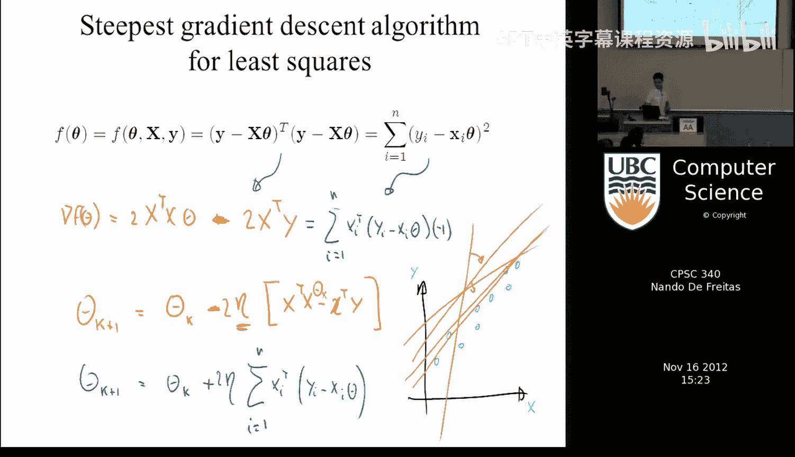

But this essentially the picture that illustrates it。 In this case， there's only one minimum。

 so you should get there。 but if your eat is too small on the left hand side。

 your step sizes are too tiny。For those who snowboard。

 it's like you might be on the steepest double black diamond， whatever slope。

 But if you're just like stopping yourself with your board， you're not gonna go down。Okay。

 so if you eat just too small， you won't go down。On the other hand。

 if you eat us too far as too large， then you're going to just basically be swinging wildly。

And again， convergence will be impaired as a result。a case where it is too small。This regard。

 we're using a vehicle。Yes he。No， and in fact。What do you mean by a real computer。

 a digital computer？That laptop that you have in front of you or your iPhone。

The number one is really solvable。When the number is very small， it will become zero。

Because your computer has a lowest- Yeah， that's why I think this。

And so the problem is that number gets multiplied by the gradient。And now。

 when you're near the minimum。When you're in this region near the minimum。

 the gradient becomes almost flat。So that is the problem that you're multiplying a number that's almost zero。

By a tiny number。And so the whole thing is going to be very small。

 When you multiply to very small numbers， youll get something that's very small。And in fact。

Below numerical precision， you'll get precisely zero。Even though you haven't reached the minimum。

But we disregard that。其实个。Now， you should not disregard the limitations of your computer。 In fact。

 like the naive based example in your homework， you cannot disregard the limitations of computer because if you do。

 you will not get the right answer， So it's important to know that how computers。

Compute and the issues with small numbers。呃。Even with that。

 even if you do this in log space to deal with， I saw you。

 even if you do this in log space to deal with small numbers。

 it's still the case that if your step size is too small， you're going very slowly。

If your step size is too large， you start just selecting。 So there is a sweet spot， obviously。

 that would give you the right convergence。😊，当。It typically is one thing then in the theory。

 we know that if we make it one over n。We can get it to converge。

So there is theory to get us to converge。But instead of going into。In practice。

 if you pick a small number 0。1 went and you saw that it was too slow and you changed the number。

 you will very soon come up with a way of getting a good alpha。

So it takes you a couple of tries running simulations。And if you want to be smarter about it。

 you do this thing that I'm not covering that I call line search。

 which I'll leave it to you to read about。 Let me take him first。 one。

 It's not obviously even if we had infinite numerical precision that this would still emergege。

 like it's actually。I thinkThat is correct。 That is correct。 That is correct。

Shouldn't it be a function of the gradient， I mean， if the gradient becomes too small。

 the increase step sign。There， you can come up with a rule like that。

 So there are are rules like that， momentum rules and so on that into consideration the great。

There's many。 So welcome to the field of optimization。

 Books have been written on how to set that step size。

If you take the optimization course in fourth year。

 you will learn all about how to step that step size。We are you going to move on？Because for now。

But be aware that there's these things called line search and so on that will make will set this Eta automatically for you。

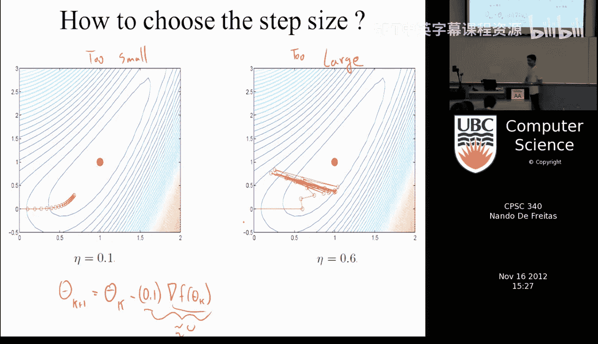

We're not going to cover that in this course。What we will cover is one method that sets it automatically for you。

 Then instead of having eat。 So remember the gradient is sent out。This is Newton's algorithm。

And contrasted with gradient tocent， gradient decent says theta k plus1 is equal to theta k。

Minus Eta Gk， where Gk is the grade。So gradient de usesis。

Just that eta or steepest percentcent users just that eer。

 Newton's method replaces Eta by a whole matrix。 This matrix essentially tells you how fast you should go in each of the theta directions。

 Your theta， you have a multivariate function。 So if you're into D。

 It's telling you how fast to go in the x direction。

 how fast to go in the perpendicular direction in the Y direction。So。So in a sense。

 Newton's method is the solution to all your questions and how to set。嗯。非der。The catch， however。

 that I want you to be aware of is that the hessian requires now that you go and compute second derivatives。

 So it's more work。More of it requires that you store this matrix and that you invert this matrix。

Inverting a matrix is one of the most expensive steps that computers have to deal with。

To a large extent。The progress in science has depended on a number called。On a polynomial N cube。

 N cube is what it costs you to invert a matrix。 N cube is what it costs you to solve linear system。

 N cube is what it solves， what it costs you to compute eigenvalues and eigenfunctions。

All these problems have this fundamental bottleneck N tube。And when N is 20。

000 genes or 2 million n gras for like Wikipedia say titles。

Inverting a 2 million by 2 million matrix is not an easy task。Your computers can。Very sleeping。

You know， stop doing what you expect them to do。It is。You pay a lot in computation。However。

 for small problems， nutrients methods， the right method， because it converges very fast。

 you don't need to choose the alpha。 So you have this matrix H。

And then I mentioned that you could also think of Newton's method as a quadratic approximation to a cost function。

 So there is a cost function F。So， let's assume that we have。An F that looks like this。

This is my F of theta。And what Newton's method does。Is it fits a quadratic。To F。We call it F quad。

It will fit it at the point。😡，Theta K。And then what you do is you find the minimum of the quadratic。

 Now， we know how to find the minimum of a quadratic。Okay， because the quadratic is just。

Ha only one minimum， and essentially the whole of these squares。

 everything we've been done in this course is finding the minimum。Qudratic。

 so what we do is we differentiate a quadratic。We are to zero， and that gives us that equation。

 which is the equation of the minimal。So it's saying the optimal theta， if you saw here。

 it's saying the optimal theta is theta k minus h minus1 gk。So the optimal theta。

 which will be theta K plus1。Is this guy here。So。And that's how we get the next theta。

And so what do we do next？We fit。Again， a quadratic。Good， let me use the different cutr。

We fit quadratic at the next the。And the way we feel us quadratic with the Taylor series expansion is we essentially the Taylor series by matching the first and secondary derivative of the Taylor expansion。

 we're just saying that at this point，Luckiocly， the slope and the curvature of both the green and the blue curve。

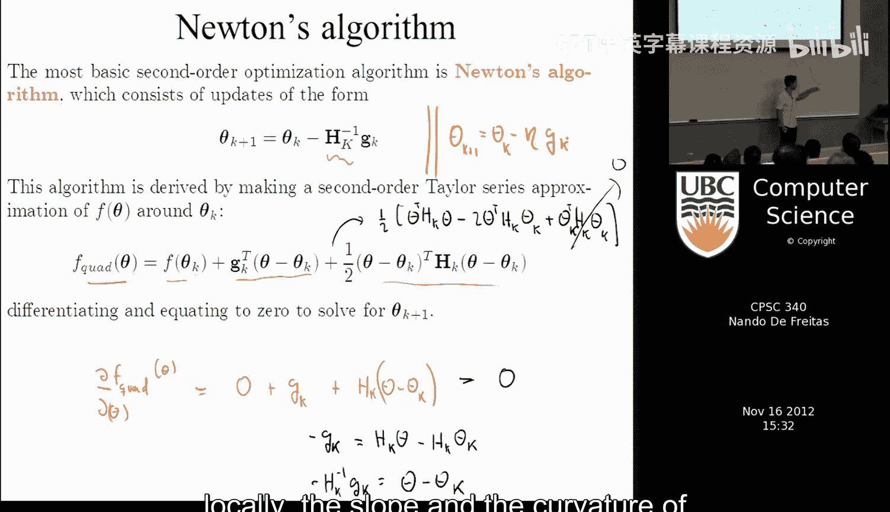

Or the red and the blue curve here are the same。 Okay。

 so we're just making them sort of tangential there。And then we do the same thing again。 We。

 we follow the direction to the minimum here。

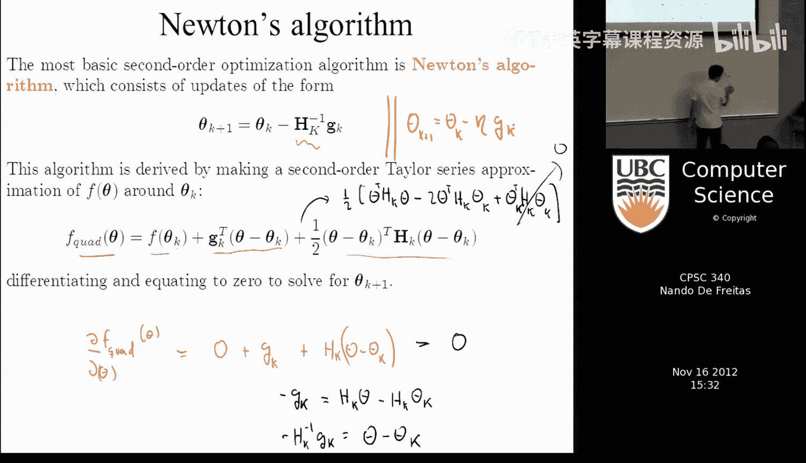

And that's theta K plus2。And then we keep repeating this process。 So were always fitting this ball。

 Find a minimum， fit the ball。 find a minimum。But of course， this is just for you to understand。

 we don't code it like this。However， this thinking is useful for designing other algorithms。

 and there's many people in optimization that use this notion of upper bound minimization to come up with good sort of scalable parallel algorithms。

To deal with big data。

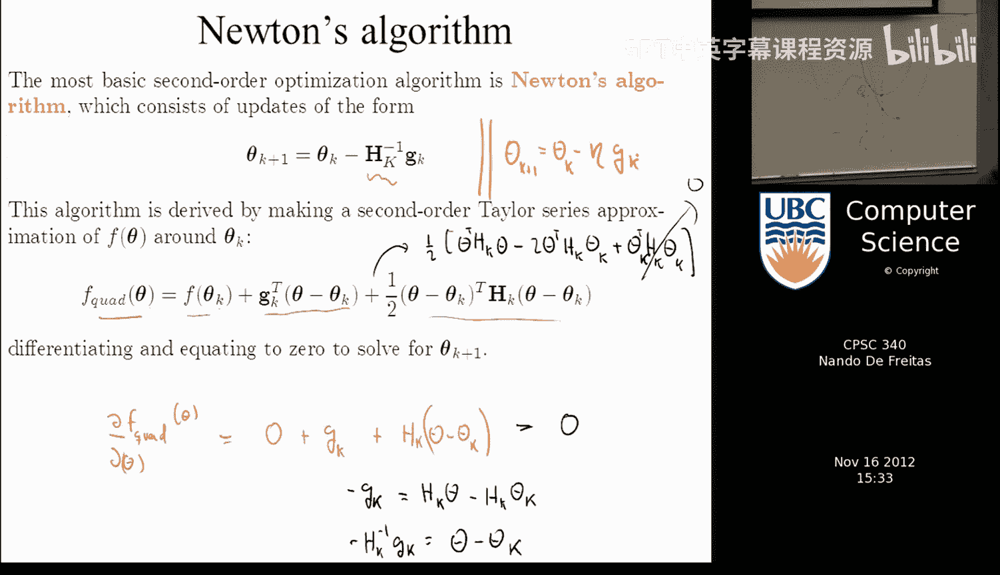

嗯。And if， but here it's quickly， we see that the。

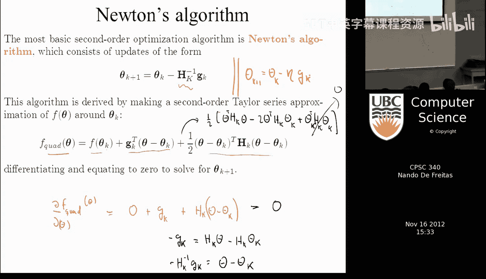

Nton's algorithm comes from just minimizing this quadra。

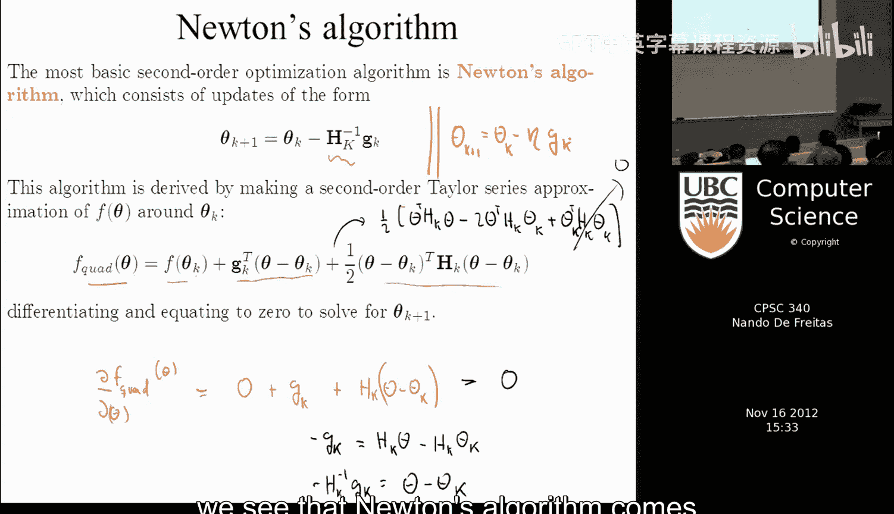

Upper bound。And the main advantage is we get rid of E instead of having to choose Eta by hand。

We just need a matrix of second derivatives， H， and then we're done。Now。Let me ask you again。

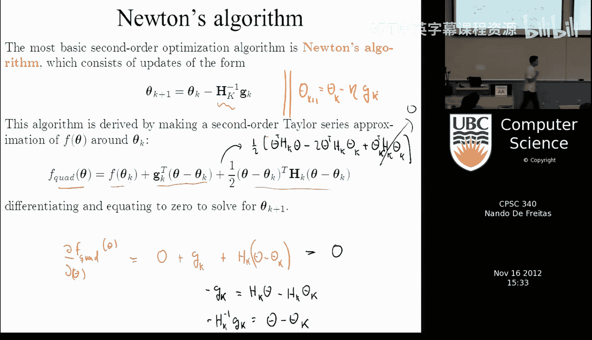

If now my error function is quadratic。Which is the case of linear regression。

How many steps do you think Newton Me needs in order to find a minimum1。

 So once you understand the method。It becomes obvious because your error function is this。

This is Theta Kay。You fit a quadratic。 Oh， but what happens when you fit a quadratic to a quadratic。

If you know how to fit a quadratic to quadratic， you'll get the same quadratic。

And so the next step is the minimum。Okay， so with Newton method， one step should give to the minimum。

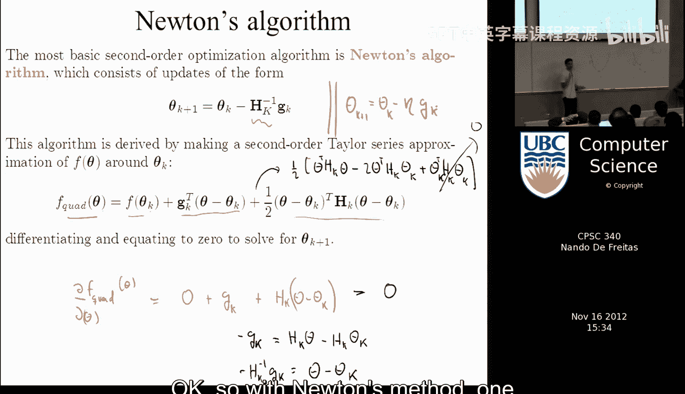

Let's check our math。 Let's make sure that our math agrees with our intuition。

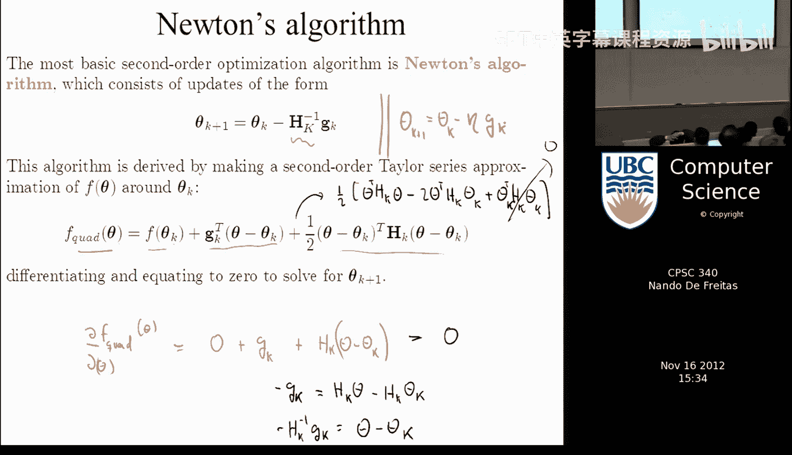

That was the exercise I left for you last time。I wrote down the expression of the gradient。

 I wrote the expression for the second derivative。

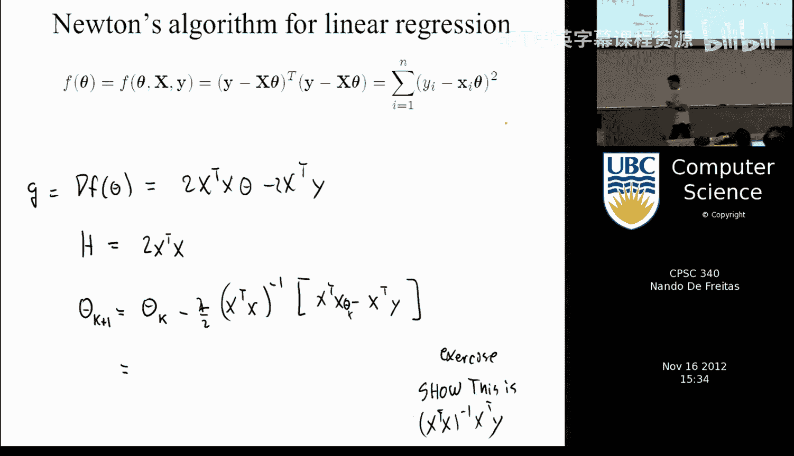

And now the only thing that was left to do。Was to cancel the two with the two and then multiply these terms。

So I would get the first1， which is theta K。Minus。X， transpo x。inus1。

 and now I'm going to multiply that common factor times the two terms inside a square bracket。

And this is just equal to something that should be very familiar now。Right， because。

X transpose x inverse times x transpose x is just the identity。This times this is the identity。

 and then you just have theta k minus theta k， which is 0。So， this cancels。With what's left here。

And then you're just left with x transpose x。That shouldn't be a surprise because we know that the solution of least squares is x transpose x inverse times x transpa y。

 So we've just shown in math what the intuition tells us that in one step we can get to the minimum。

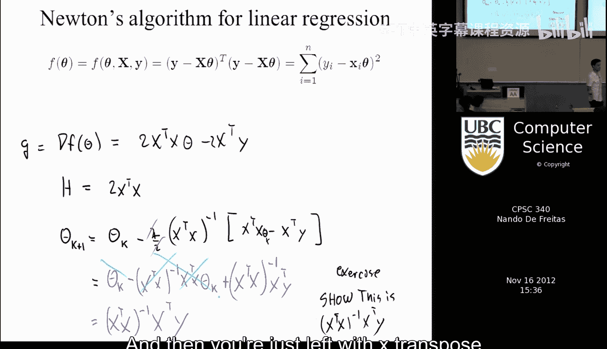

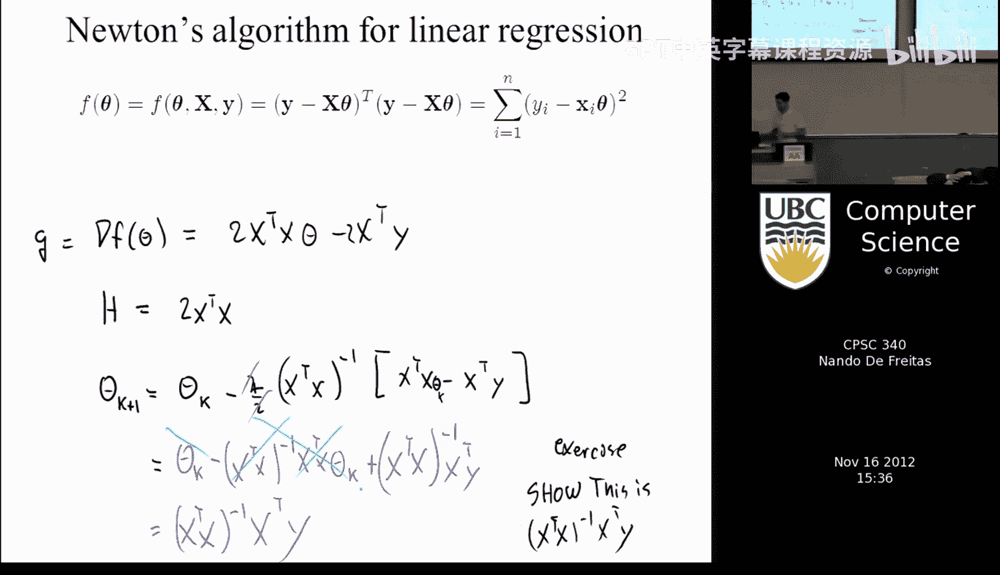

That's basically how we do Newton's method， there's the pseudocode。

 I will let you to look at the pseudocode at home， in fact for your second for your last homework you get to implement it。

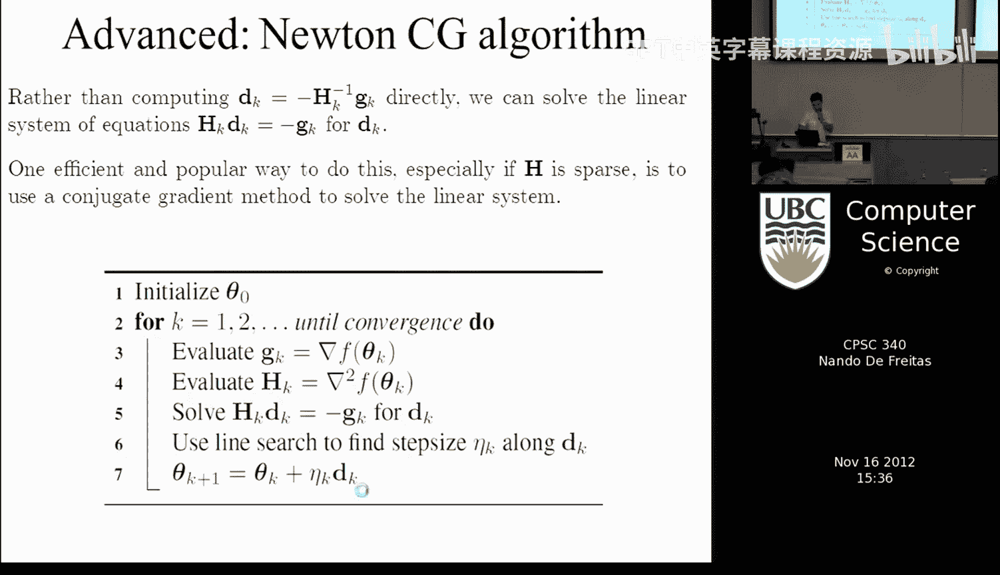

Instead。I'm going to tell you about one more algorithm。When you do。When you do。

 say linear regression。I told you that the optimal way of choosing the new the。Sorry。

 let me backtrack， not the optimal way， but the gradientcent way of computing theta is to go in the opposite direction of the gradient。

And then you had this expression some from my equal 1 to n， in fact， this becomes positive。

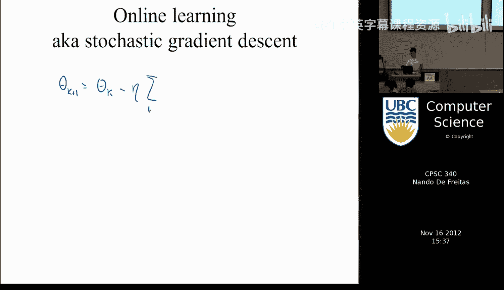

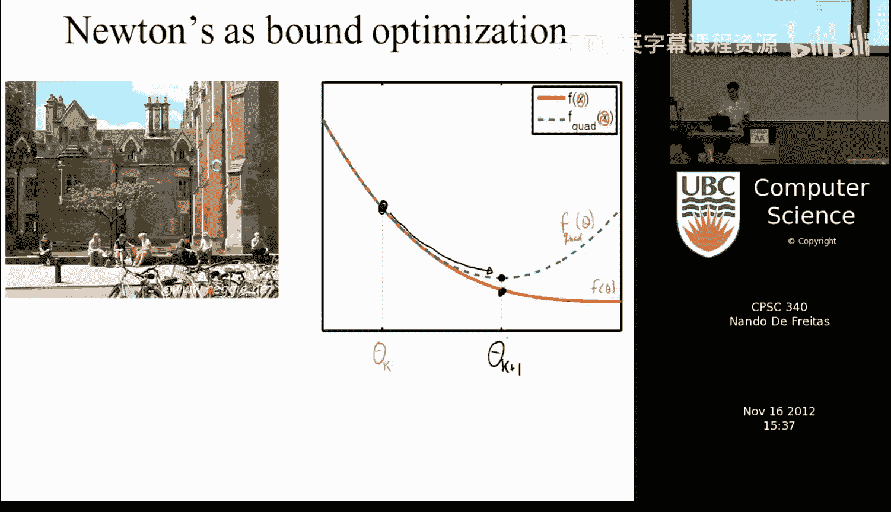

So I'm basically going back to this expression here。

I'm going to rewrite the expression of the gradient for linear regression。

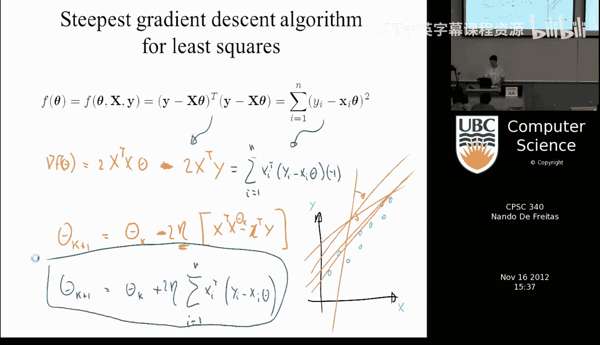

And then there's the two there， but let's assume the two has been subsumed inside it。

So that's our expression for the gradient when we have n data points。

This is what we call batch learning。We take the whole batch of data and we update a grade。

There is a different way of doing gradients called the online Way。In the online way， your theater。

K plus 1 will be equal to theta k。Plus， eater。Xk transpose。Oh。

 and this is evaluated at the previous step。In other words， every time you get the one data point。

You do the gradient with one data point。It's called stochastic gradient。

 and stochastic is basically a word for。It's going to say allleotatoric probabilistic because to stochastic in the sense that there's uncertainty。

 you've only seen one data point， you don't know what other data points you're going to see。

 So there is uncertainty because you haven't seen the whole data。

But you just see one data point and you update a grade。 Why is this useful if you're learning？

The linear regression from tweets。If you're trying to take the words of a tweet and you're trying to predict a all。

Then you know， like know the galllop poles or whatever。 And that you can do actually reasonably well。

 or you're trying to predict the price of a stock from tweets。

So what you do is you take that input vector x， which is basically the sort of all your1。

 if the word is present0 if it's not， it's a very large vector， so your theta will be very large 10。

000 dimensional or so。And then you're just trying to predict。

 I don't know what the stock value will be the next day。And each day， you get once one update。

 you get one。1 x。So you get set of or a set of actually at each knowledge day， each tweet。

 you get one update。 So as soon as you get a tweet， you get a new prediction and。

And because tweets keep coming at us and never stop， you're always learning。And in fact。

 because you're always learning， you will also adapt。Because if the statistics of the problem change。

 your theta will also change， theta might never conversege to a particular theta。

 but the theta might just be always tracking the solution。嗯。Now， under some conditions。

 So what we can also do， if we do have a batch of data。

 So one reason is what we call streaming machine learning， streaming problems like Twitter。

 where the data is always coming at you。 But if you're doing environmental monitoring。

 It's the same situation。 The data arrives at you every day。

 and you need to update your model and you cannot assume that you could collect all the data because there is no computer Earth that will allow you to collect all the data。

 You essentially， you have to learn。And then throw away the data。 And you only keep fit。

 Our brain is like that。 We don't store everything we see。Because that would be problematic。

Prob got crazy or something。 There's actually some recorded disorders that have to do with that。

 Some people have this sort of perfect memory。For some periods， and then because of that。

 I can't memorize any new things， So every morning is a new morning。

Just like the movie Grandundhog Day。嗯。The other application where this is useful is even if you have an amount of data that you can load into memory。

Sometimes it's useful to actually process the later one at a time。

 so you go from one to n and then you go back to the beginning and you go from one to n again。

 or you keep randomizing the data， so you do several passes over the date and that's very common in the training of neural networks and you might want to do that simply because and what you're trading off there is computation passes over the data versus forming all the matrices that you need to form in order to compute the batch gradient so it's often you're trading of computation and storage that depends on。

The resources that you have。Okay， so you have those two。

 and then there is something in between what's called a mini batch approach。

Which is super popular in machine learning， and if you probably read the latest neural network papers。

 you'll hear about people doing this。So theta K plus1 is theta K plus。Eta， and then you have a sum。

And then you go from J equal 1 to 20。X， J。Transpose。Y J minus X J theta K。So in other words。

 you collect 20 tweets and then you do an update， so every 20 tweets you update your product。

And then how big should your mini batch be？That's another parameter that one optimizes。

There are exist automatic ways of choosing。These parameters。

 that's a lot of us here at TPC do research on that。

 And we have techniques called ba optimization and so on in public is。

They're writing a PhD on the topic， and we teach that in 540。But for now。

 you would just say pick a small number and you'll see how fast your algorithm is doing and you would cross validate in order to get that number。

 right， Okay， so these are probably the most important。Ideas towards actually getting。

Getting you to actually learn。With complex models， neural networks use exactly the same working。

 The only thing that's going to change is the error function。

But it's always going to be the same thing。 We compute the derivative of the gradient。

 We compute the derivative。 We have the gradient， and then we have these three choices。

 We either do batches or online or mini batches。

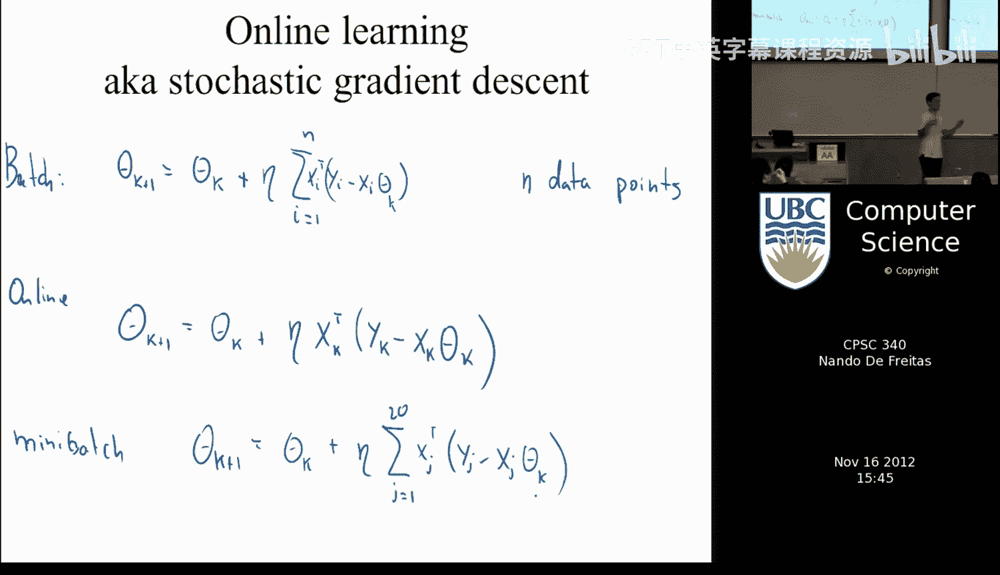

And this is what happens when you do， so this is thearrow function here。And this will be Theta2。

Theta 1。And so what's happening is that when you do online learning。

 you don't go straight because you only see one data point， so you don't go straight to the bottom。

And in fact， sometimes your error gets worse， sometimes you go back up。

That's not necessarily a bad thing。 And in fact， when we get to neural networks。

 we'll see that often it's actually good to go back。

Because sometimes you find this suboptimal solution。 but if you go back。

 that gives you the chance to jump over it。And try something else。

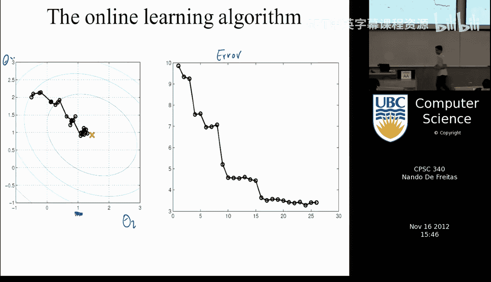

And everything I've said is sort of written here and it will be available to you。

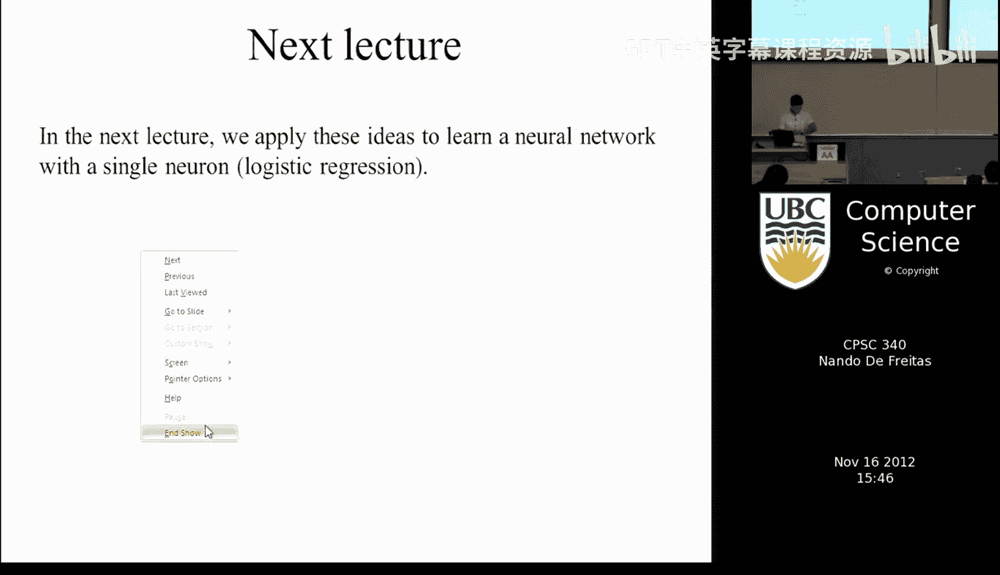

O。

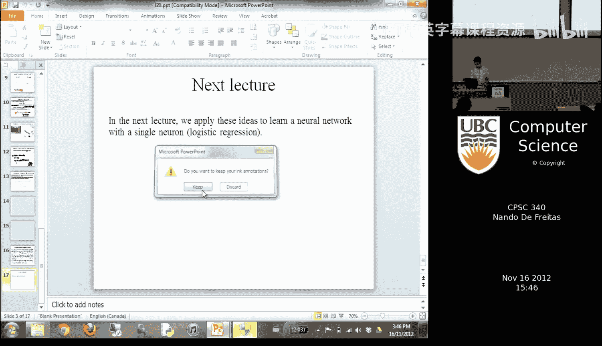

So we still have time， so I'm going to introduce。

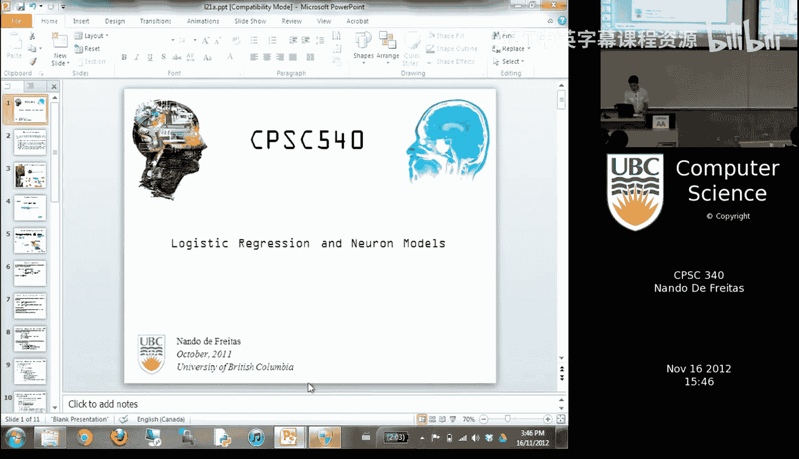

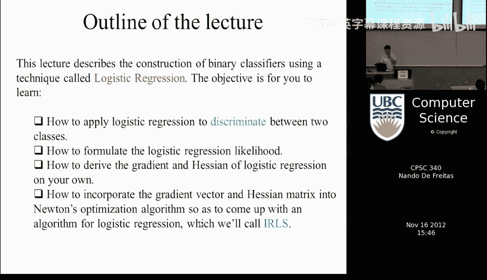

Logistic regression。So I've shown you how to apply gradients in Newton's method to linear models。

 Now I'm going to tell you how to do that for a neural network with one neuro， only in one neuro。

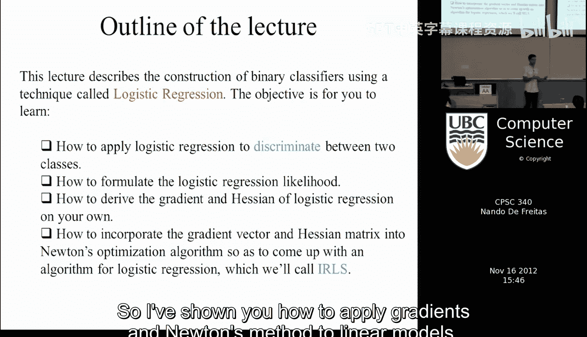

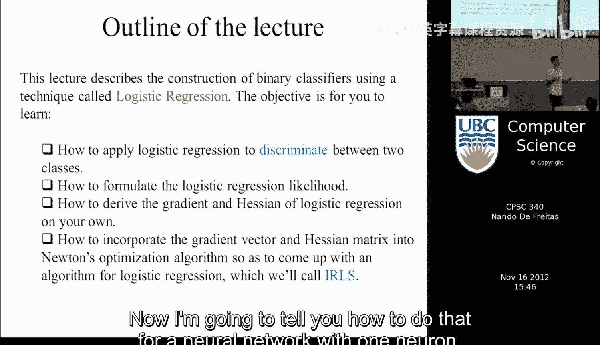

Imagine there's this creature with one urine， a creature with one urine is quite powerful。

 by the way， in what it can do。

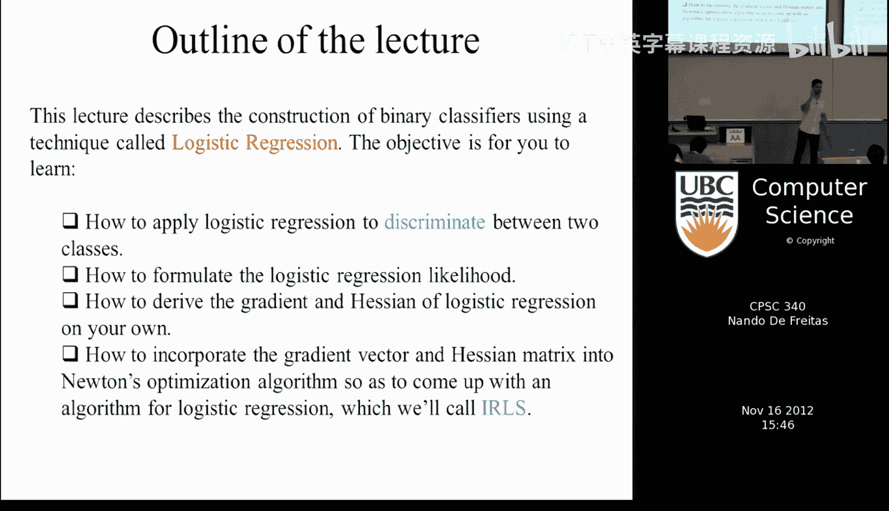

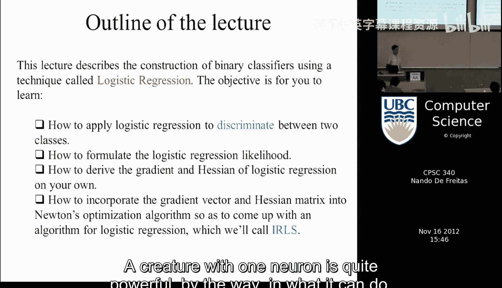

And we're going to use a very idealized model of a neuron。

 It's essentially what neuroscience called the Maccallo pits model of a neuron。

This guy there is item Mc callhar pits or。Not sure about the cat。

 but the idea is we use the sort of caricature of a pyraidal neuron from your cortex。

 and the neuron has synapses。 sorry has dendrites。 The dendrites make a synapse。

 which is a connection It electrochemical connection without the neurons。 your。

Their neurons communicate by electrochemical pulse。And there's spikes， and in fact。

 it the rate of spikes， it determines whether the message gets propagated or not。There is substances。

 chemicals between those connections that determine how fast the current propagates when you take drugs。

 you destroy you unbalance those connections and that's why you have crazy hallucinations and so on。

 and you're tampering with something very delicate， by the way， when you do that。

And when you transmit a signal， it goes through， say a axon， there can be a meter long。

 I think longer even， and then the next neuron picks it up and so on。And usually it's slow。

 The brain is a very slow computer， but it's massively parallelable。

And it competes in a different way， doesn't compete the way。Our laptops。So a model of this。

 the Maccals model is as follows。 You take all the inputs。X1 to x D， and then I set one input to a1。

 just like linear regression so I can have a bias。That gives me and then that sum just means you take a weighted combination。

 so theta n times 1 plus theta 1 times Xi 1 all the way to theta d times X I。

 and that's basically in vector rotation， just the vector Xi times the vector theta。

And then that vector， So if we were doing linear regression， we would be done。

 but now we're going to do one more thing。We're going to put that。

Linear regression output through an activation function。Which is like an S。 looks like an S。

 It's called a sigmoid function because it looks like an S。

And what the shape of the sigmoid function is basically the expression is given by that。

And the shape is that green curve。 it always asymptoats at one。And at 0。

And the output essentially of evaluating that sigmoid。It's what I call pi。

 It will always be between 0 and 1。So we will be able to interpret pi as a probability。

So these neurons， they firing probabilities。We're using。the rate of firing is essentially pi。

 It tells us how active， whether the neuron sends a message or not。 Now。

 because you have a sigmoid with which is kind of like a gateit， It's a smooth gate。

 If youre way to the left， your neuron doesn't fire。 So your input， which is Xine times theta。

 has to go beyond a certain threshold for the neuron to fire for the neuron to become active。Okay。

 so they will be off。But when they recognize， when they see a next that combine with the features。

Make them。Gives a very high x times theta。 They will fire。

So given an x and that X could be the picture of a cat or the picture of a dog if the neuron has the right theetus。

It will be able to tell what therell be a neuron for a dog and a neuron for a cat and so on。

 And that's how we'll be able to do recognition。That's a sigmoid function again。

 a bit in more detail。 So the input is Xite damage theta， the output of linear regression。

 And then you just pass it through the sigmoid function to get the S。

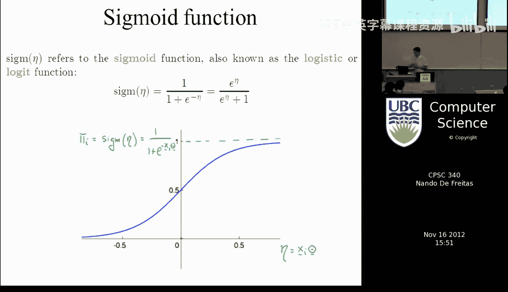

Now， the sig function， if we evaluate it when the input is 0， we would just get。One over。hoops。

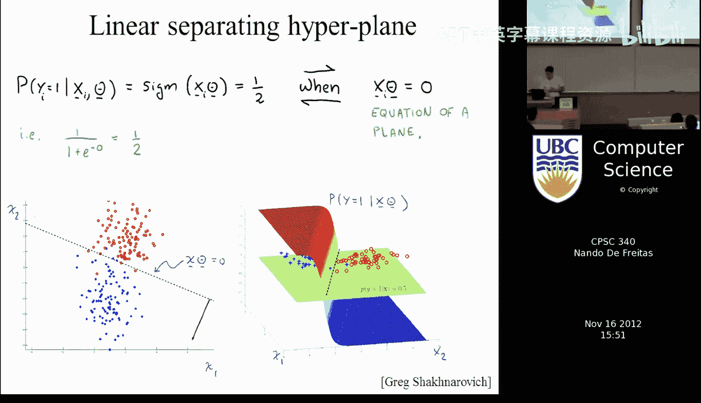

If evaluated when the input is 0。We get one over1 plus e to the minus0， e to the0 is just one。

 so we get a half。

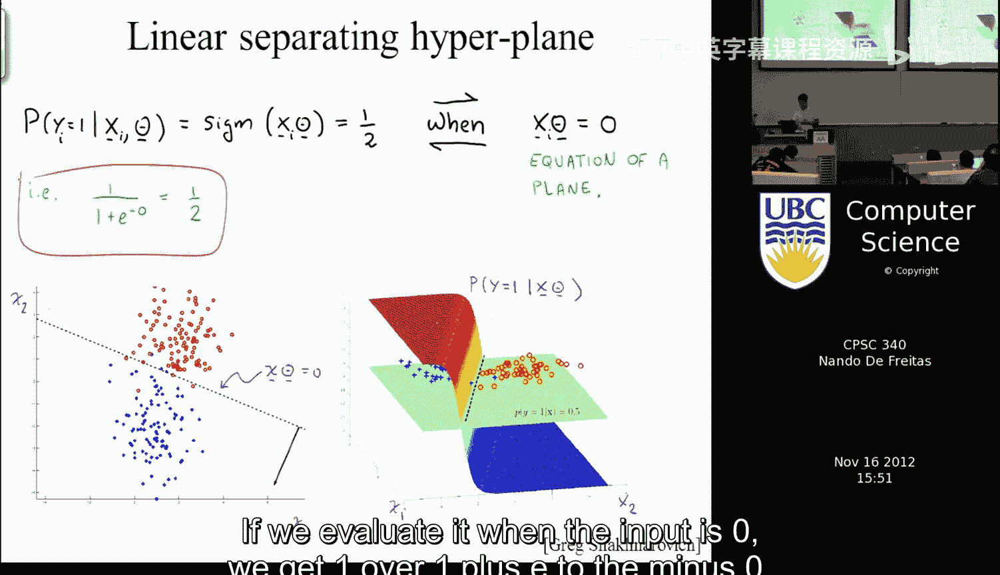

So we're going to interpret the output of a sigmoid。

output as the likelihood as the probability of y given x st。

 so we have linear regression and now we're going to pass it through this function and we're going to be interested in predicting whether y is on or off。

We're now changing the model so that we can do classification。

 binary classification like is it spam or is it not spam？When。The input is0， we get a half。

In other words， when X theta。Is 0。The sigmoid， which I will define as the probability of y equal1。

 given an X theta will be a hub。And so when the probability is a half。

 So then the pictures kind of tell you the whole story， when the probability is a half。Above a half。

 I'm going to classify a data point as being cancer say below lower half。

 I'm going to classify it as being non cancer as the patient being healthy。 Each point here。

 blue and red， Think of it as a patient。 and there's two features about the patient。

That we measure you could think of x1 is height， x2 is weight。

And if I put my or every person there by height and weight。

 or I might be trying to classify males from females。Then。

The probability curve is this sigmoid in 2D。When the height of the sigmoid is a half。

The intersection of that with the horizontal plane is just a line。

And that makes sense because that's the line X times theta equals 0。

And that's the line that I'm showing you there。So。Of course。

 this was looking beautiful because I happened to have the right sigmoid。

 I happened to have the right theta。 So this is a sigmoid。

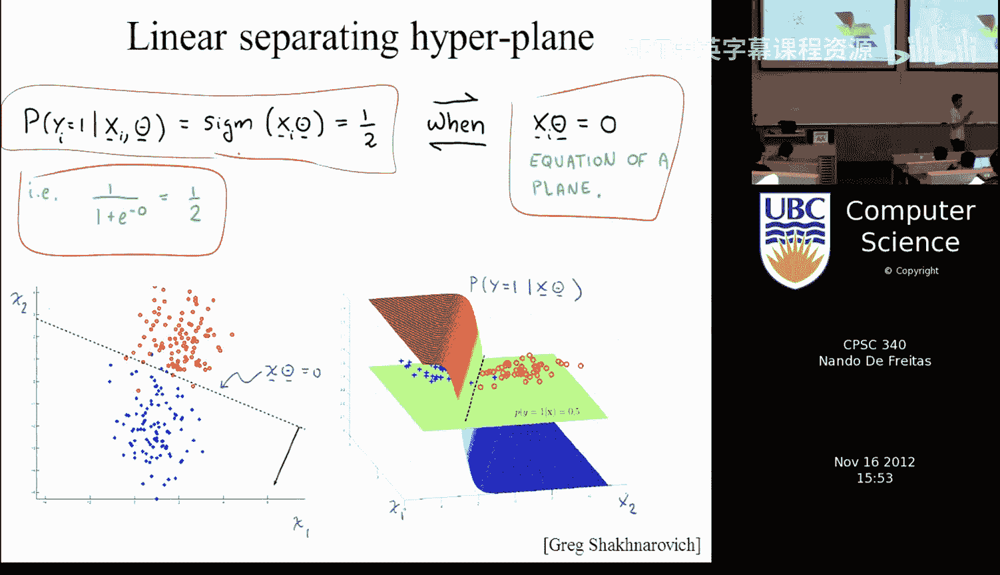