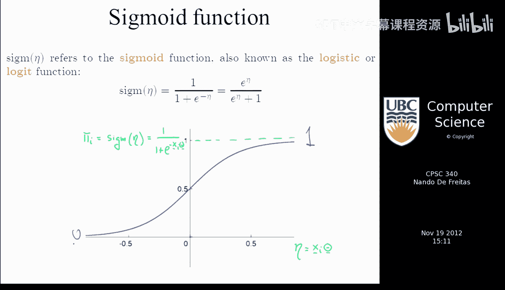
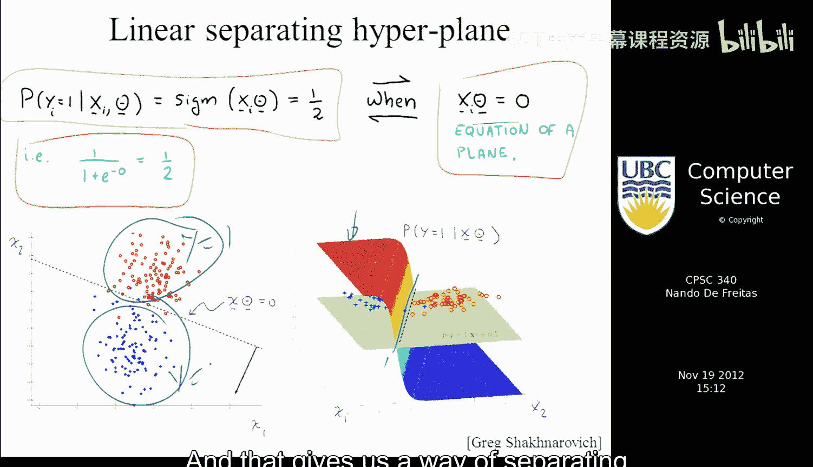
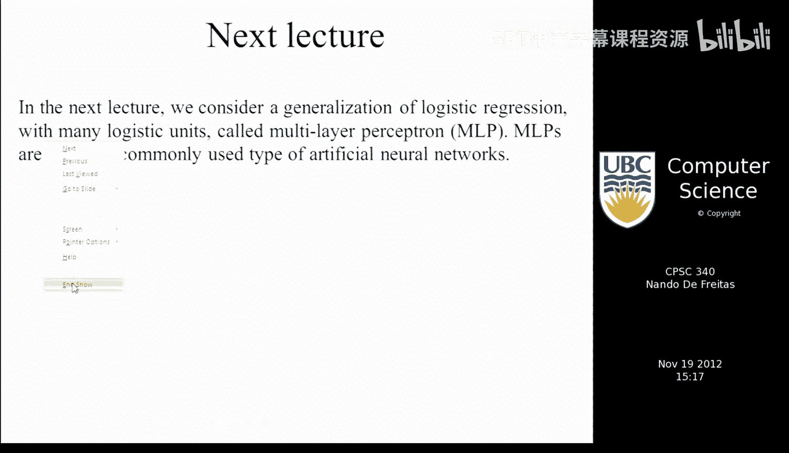
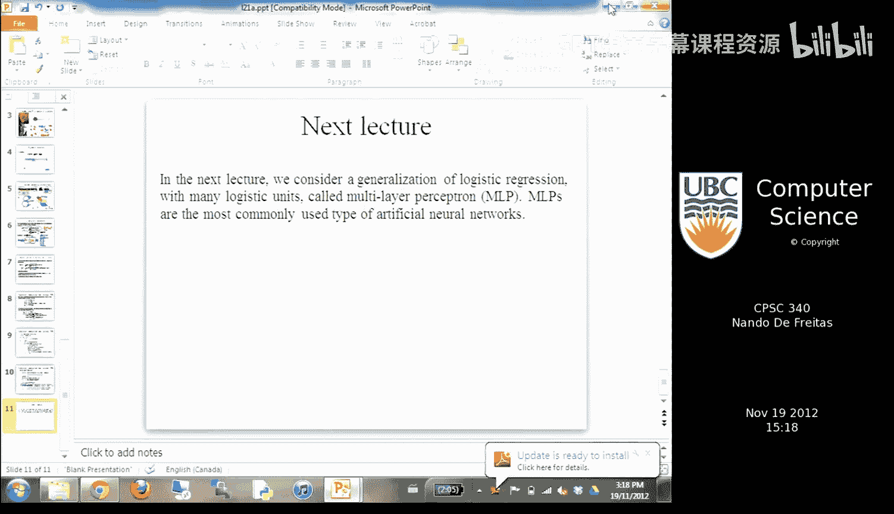
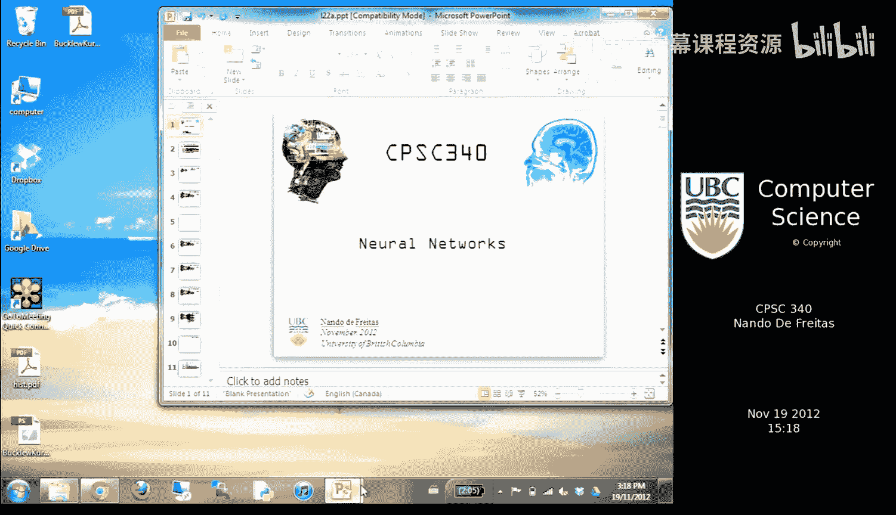
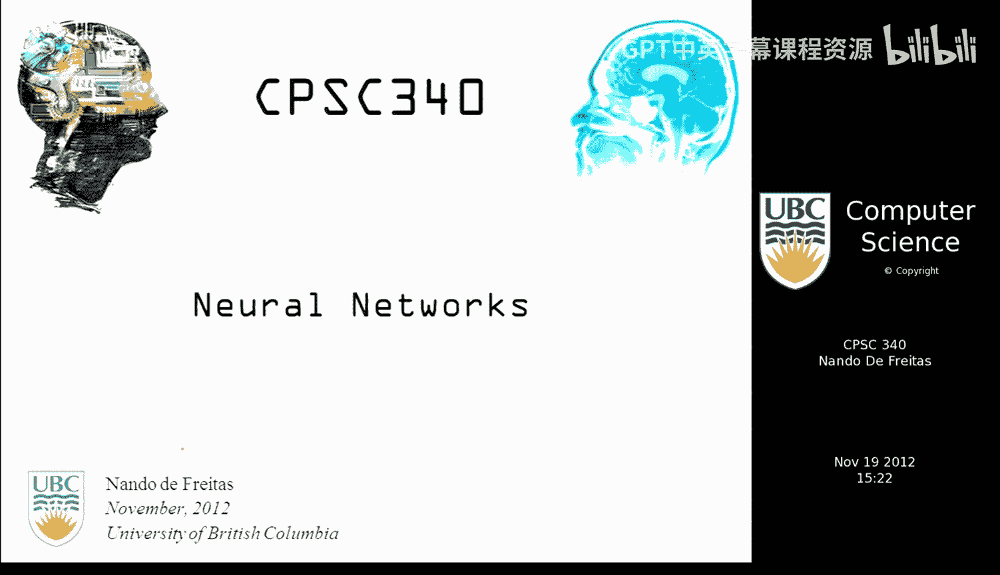
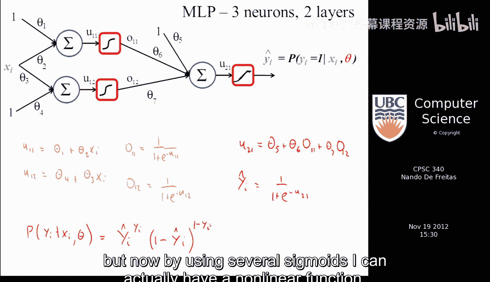

# UBC《机器学习和数据挖掘｜CPSC 340 Machine Learning and Data Mining 2012》中英字幕 p28 -28-undergraduate machine learning 28_ Neural networks.zh_en -BV1pJ2ABFEFg_p28-

We will be given data。In this case。Imagine that we're given X Y data points。Like， I know。3。21。2。60。6。

8。one。- 2。31。And instead of being like linear regression with the y's are real numbers。

 the x is are real numbers， not the y is are binary，01， they might indicate the number on the left。

 the input x might be a person's。Height minus something else。

 and then the y is whether that person will pass the test or not。Oh， some other。So X。

There's no uncertainty in X access given。Why is the variable over which we will have a distribution。

 why is the variable that is stochastic here？😔，Why hat， the hat means it's important。

 why hat there will be the prediction of why？嗯。Now。If we have。Data that looks like the wise。

0ero1 data， that's essentially the same as the date of tossing a coin and seeing whether it's heads or tails。

 so the right distribution to model01 data is the perulli distribution。

But now the success probability of the coin depends on the axis。And this is where it gets interested。

So if I want to model my whys。I assume that all the coin flips are independent。

 so I take a product from one to n。And each y is just a benoli distribution。

Voice success probability pi I。So after there we haven't done anything new。

 which it's just coinflows。But now what we're saying is that pie eye。Is itself。Parliament Christ。

And essentially what we're doing is we're doing a linear regression， we start with x。

With fit line x times theta， that's essentially a question。That we have here。

 that's the equation of a plane。And then we squash it through a sigmoid function。😔。

And the reason why we squash it through a sigmoid function is because we know。

That this function here is between zero and1。So we get a probability。

 so it's a trick that allows us to get a be able to interpret bias about probability。

It's a number between0 and y。And then one minus pi is the number between0 and 1。

So there's two things here， one is you define probability on the Y， the distribution is over the Y。

And then compositionality where the success probability of the Y by I is the function of the input。

And that's how we start introducing probabilistic models for more complex。嗯。

But more complex settings。As we go into neural networks， I'm going to repeat the same treatment here。

 but just for different cases， when you have binary data when the ys are Gaussian and then when the Ys have multiple categories。

 so each of those cases are things that we've seen before in the linear model we saw the Gaussian case。

We also saw a multicatego case in the treatment of na base。

 but now we will do all those different noise。Distributions for models of this form where you have an input and an output and to get from the input to the output。

 there is some sort of。compositionality。Okay， so pi I is a success probability。

 and so pi I is indeed a probability of y being equal to1。When you observe X I。

 assuming that you have parameter feet。And we will learn the The nice thing about this is that theta is a continuous variable between minus infinity and infinity。

 it's completely unconstrained， but pi I will naturally be constrained to be between zero and1。

So we don't need to introduce funky constraints that require that the piI is sum to1 and so on。

 We simply use this parametermetization that will ensure that we get probabilities。

Now once we have a likelihood， how do we find what theta is？What would be a procedure？

For finding theater。没。Like。maximumaxim likelihood here anything think。

Because probablybarsses too easy question， the usual procedure。

 you will likely take the log differentiate equal to zero。And so only one difficulty in this case。

 when you differentiate anequ to zero， you're not going to be able to solve a close form for theem。

If you do， let me know。They'll make a good pay。Before I tell you what gradients we actually get。

 and the other thing is remember from last class that this function here。

 one of a1 plus e to the minus Xi theta is a sigmoid function。

And the sigmoid function had those important properties between0 and1。

 so you can interpret it as a probability distribution。嗯。

It also has nice properties in terms of its derivatives， which you will find out about ER。

And then of course， that's in 1D， in 2D， the sigmoid function will look like the surface that I'm showing here on the right hand side。

And then。What we're going to do is we're going to threshold。So we thresholdfold this function。

At' say a half when the height is a half， and then everything to one side of half greater than a half is considered to be of the class one and everything to the other side is considered a big class zero。

 so effectively we now have a classifier。Whenever you have a new X。Your compute。

What's the probability that x？That y is equal to one for that x， if that's greater than 0。5。

 you assign it to one class， and if it's less than 0。5， you assign it to the other class。Okay。

 so once we estimate。Once we can estimate this curve here。We just threshold at 0。5。

Which is the same as straightholding the planet at zero， and that gives us a way of separating。

The y equal one。From the y equals 0 data。

But we do more than just saying that it's one or the other。

 we actually estimate the probability of it being one， so we're actually doing a little bit more。

Okay， so when we differentiate this andequ to zero。

 we get the following expressions for the gradient of the Hessian。

 now I'm not going to do these here in class I'm going to ask you to do these in your next homework because I think at this stage what's more valuable is for you to practice how to do this。

嗯。What we find out is that the gradient。Is given by this expression here in the box。

And it sort of makes sense because it's basically comparing why。And again， the Ys are the。

These are between zero and 1， so id does 0 and1， sorry。

 and then the pi is a variable between0 and1 datata predictions。

And so what we're doing is we're comparing the prediction against the actual。Data。

 if your predictions are different than the actual data。Your gradient update is big， right。

 because basically if your predictions don't match。The data you should learn。And learn in big steps。

Whereas if your predictions agree with the data， then your your update is small。

 There's no reason to。Because you can actually understand what the date is。

We could implement gradient descent， but it's also possible to then go and compute hesian。

In this case， for logistic regression， it's very easy to get to Hasian。

You will get this as an exercise as well， and once you have the hesian。

Which looks at the curvature to second derivative， and as you can see。

 also somewhat related to the entropy。嗯。To the variance of the predictions。

Then you'll be able to implement Newton's math。Okay。

 so essentially nutrienttons met would are required。The he and G。 and once you have those。

 then it's very easy to apply Newton's method。 And that's how we usually solve logistic regression。

 We just try Newton's。嗯。One can show this is something that I didn't do in the linear algebra revision。

 so just take it as an advanced topic if you've done enough linear algebra。

 you understand what this means， but the hassian is positive definite which in the multivariate case can be just interpreted as it has positive courage。

That major having a as definite Hassian with all positive eigenvalues means that you have a ball。

That you have a convex function。And that ball is not symmetric， unlike the gossipsian。

 there will be a ball that will be maybe like this。But still， it has a unique minimal。

And we can compete。If we follow the if you've used Newton's method。

 we can attain the optimalum in this problem， so logistic regression is still considered a fairly easy problem to solve。

嗯。In the particular case， when we implement Newton's method。啊。Which is what I'm showing you here。

 So that was the expression of the hascin in gradient from the previous。Slide。

 and if you substitute those in the estimate for theta。

And do some simplifications to get something that's a bit more computational efficient。

 you get an algorithm that actually has a name。People also call this the higher RLS or iteratively reweighted least squares。

Because the expression looks like a least squares expression。

 except that it has this weight given by that matrix S。But it's essentially Newton's matter。

 where it is in Newton's matter。And I've already uploaded the slides for you on the course website and I've included the actual code which tells you how to get the logistic function and how to run ILs and as you can see implementing this is actually。

Fairly easy。 That's Newton's method。For doing logistic regression。

And then the main function is just load the data。Estimate。

 and then you just need to call Newton's method to give you a new theta。

 and then you evaluate the training error rate and the test error rate。Okay， so it turns out to be。嗯。

It turns out to be fairly easy to implement logistic regression。Okay， so。

 but now that we know logistic regression， let's move on to。

A more interesting problem。Not go ahead。To go。So there's the competition for the course right。

 so the question is how does this compare to naive phase and there's the competition。

Beautiful place to test it。

Go ahead。So do we just use this to split。Da into two classes。

 we can excuse arbitrary number of thresholds to。Okay。

 so I've described to you binary logistic regression。

 but indeed you can do multiple linear regression so more than one classes。

 so you can do K classes as well just like NABase， I will explain it in the context of neural networks。

In a few minutes。But yes， that's a question。Its there to go away。海边。て。不right好。

You could choose other function， so the same weight function sort of comes in。

it comes in from different reasons so one is from the neural network perspective it's historical。

 there was this idea of having an activation function that what the neuron is not active and after a certain threshold the neuron becomes active at one and then when they tried to code those models and this was Jeff Hinton told me this once over dinner so' know they couldn't differentiate a step so what they did was they just fit a curve so the sigmoid。

But then there's also if you do technique and machine learning。

 which I didn't cover a linear discment。Partarddon， is it because of exponential family？That is true。

 all these distributions we're looking at are part of the exponential family。But I mean， that's just。

A general factor statement。the mall to the point answer would be that if you have two Gaus points are distributed according to two multivariate Gaussians。

 and you should try to discriminate between the two。

 then you will find that the optimal boundary is given by the logistic branch。

So that's a one version that I often do in。快过。I've done it in three4， but I'm not doing it this year。

So this a statistical reason， it optimally operates two thousandus questions。其实系。不应该是。What is。应该边看到。

That。Oh， sorry。 I didn't hear it。就是。Can we just give you the parameters and then you load them？

Do get the predictions or do you also see how long it takes。

How are you for the competition Oh how long does it take we've been very leient on that provided that it doesn't take longer than whatever the T said is the minimum time。

This year， I think we made it half an hour last year， anything that runs for longer than that is out。

Because we don't want crazy。Or anything that brings crashes the computer is also out。

Logistic regression words for that data set。Another thing that I didn't mention is。

 I'll mention this in the context of neuronirous because neuro net's essentially of generalizational logistic regression that。

Just like we added regular rises for linear regression， all those arguments still apply here。

 we can put regular rises on theta。And we can put an L2 regular rise and an L1 regular rise。

And logistic regression with an L1 regular rise is one of the most。Widely used techniques for。

Binary classification out there。Okay， so it's used like in places like competitions like Haggle all the time。

No， no， All right。 for binary data， though， is the L1 norm and the L2 norm equivalent。

 like the opposite the value of one is one and the square of one。For you。

Let me come back to I'm going to go over one slide in regularization。

 but the regularization is on the parameter that's not on the wise。

I don't know if I understood your question。嗯。那个。呢个别到呢嘅大致。Okay，I do have a slide covering。Okay， yeah。

Okay，Thank you。Neural networks， this is your first neural network。It's logistic regressionre。

 it's one year。You have an input， X I。It gets weighted by Theta2。You add to it feetta1。

 and that gives you u。So in other words， your u is going to be equal to theta 1。Plus X times theta 2。

And then we put it through a sigmoid function。And we get Yi。Equal1 over1 plus e to the minus Ui。

Which is one of a1 plus E。To the minus。F to1。It'sX I。2。Now。The data here is just as before。

So we have excess。And then we have y， 0。6， I don't know one。Okay。And then importantly。

 the wines are binary。I'm using only in onex， but obviously this could work if I had more x's。

If I have more X， I would just have another X pointing。So I would have Xi1， and I could have Xi 2。

 and then I would have had another parameter here。I'm not using this。

 but it's clear that I couldn't have many inputs going in。😔，And so I could have more x columns。嗯。And。

And this is the probability of why。Being equal to one。

 given the input Xi and the current setting of the parameter theta。So the probability of Yi。

Being equal to one， given X， I and theta。Is then just a benodi distribution。

 with success probability。Why I。What the hat？Which is， essentially。As we know， it's just saying。

That the probability will be Yi。When。Y I equal to1。And it will be equal to1 minus y I hat。When。

Y I is equal to zero。 So just a quick way of summarizing those two facts。

And now if we have N independent observations。And Bulli observations。The probability。Of y 1，2 n。

 given an x 12 n comma theta。Which choose the probability of the vector Y， given the matrix back。

The vector theta。It shows equal to the product。I equal1 to n。别 y eye。X I。Okay， so。一。

Variable is distributed according to perly distribution。 So it's one single coin。

 And then if you have n coins， you just multiply the probaities。So that's a single mirror。

And as we move to。Moern neurons。So now we've start getting an interesting。

A more interesting recursive architecture。Where。We will have。An X I。

So we will have intermediate inputs， u1 is going to be equal to theta 1。Plus theta 2 X I。

And then we will have u12， which is equal to。嗯。Thehita 4。Plus theta 3 X。And then we will also have。

ToSquaash them through sigmoids。 So think of this now as。3 neurons。And we have two。Two neurons。

 so you have a signal x， it splits into two neurons。

 and then it converges to one neuron again at the output。

And so the first output of the first neuro is just equal to1 over one plus key to the minus u11。

 which is。Given on the expression on the left。Oh， somehow I understood through that。

Then for the next nearer os。But the next neuron， we have u to1。Is it equal to。Beter5。

Plus theta 6 times011。And then。这着。7 times 0，1，2。And finally。

 we squash it in order to make the prediction。So in order to get a prediction。

 were applying a bunch of operations to the input。And so。啲。Probability。Of why I。

Given Xi and theta is still modeled with a benoulli distribution so nothing has changed in that respect because we saw have binary data。

The only thing that has changed is that。The success probability why I had is now given by a much more complex function。

Now the question to you is， why do I bother？Making the function more complex。咗。Exactly。

Because initially， my boundary was linear。But now by using several sigmoids。

 I can actually have a nonlinear function。

Right， because。