# UBC《机器学习和数据挖掘｜CPSC 340 Machine Learning and Data Mining 2012》中英字幕 p29 -29-undergraduate machine learning 29_ Neural nets and backpropagation.zh_en -BV1pJ2ABFEFg_p29-

Works。

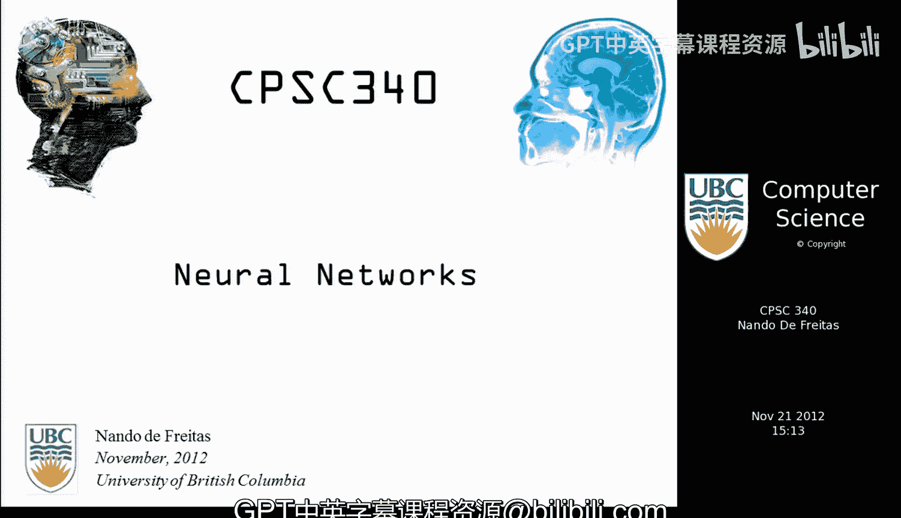

And I'm going to go through。All of some of the material we started covering in the last class and then wrap up this lecture so my intent is that this Friday I want to use Friday to if I don't get to finish this today I'll finish it in a few first minutes of Friday but Friday I wanted to be about showing you what's the latest state of the art in the world of neural networks there's a lot of cool things happening you know like Microsoft state of the art and speech recognition now uses a neural network I want to tell you about that I want to tell you about the best object you know the number one neural networks now for object recognition which are actually the number one techniques in general for object recognition neuralNes are winning a lot of the competition so I'm going to tell you what are what's the sort of latest and what is being done in Google X Las and what is being done in Canada because right now we're actually going through a stage with。

There's been a lot of cool things happening in this world。So。

Friday is not going to be your usual undergrad lecture of two and this is how we do it。

 Friday is going to be about what's happening out there and what are the open questions so。

More focusing on the problems other than and not the answers。Okay。

But let's go back to what we understand well， logistic regression， again， we revised this。

 let's assume we have two inputs into a logistic unit。

And so our data would be of what's shown there on the left， if you have two inputs。

 you would have two columns of inputs。I is the index over de datata。

And then your labels are zero or one。Okay， so that's the data that you're given just like the tweet data。

 and your task is then to separate the positive tweets from the negative tweets。Spam from nonpanm。

From non spam only your patient is going。Allright， so。I will have to。All right。嗯。

Or any other thing you might want to classify okay so we come up with a boundary that for the two features allows us as in this case。

 in 2D allows us to come up with a division， the boundary for logistic regression is a line and we saw that before the picture is the logistic function you can think of as an S and so if you cut it in half you get a line。

In general， in high dimensions， you got a plane and a hyperplane and so on。

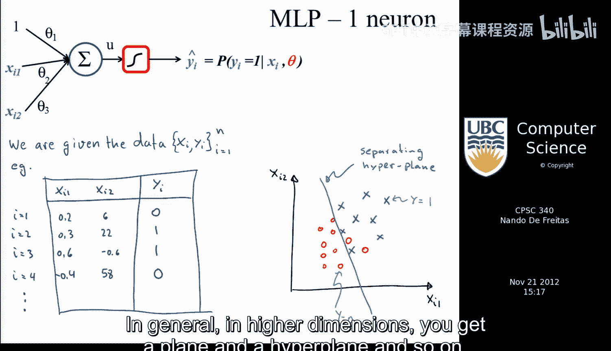

For logistic regression， we also saw that。We can write the its likelihood。

 so in this particular case。嗯。The output of this neuron is just a number between 0 and1。Yhy I。

 because it's the output of a sigmoid。So。Yhy I is between0 and1。

 and that's why we use a sigmoid so we can interpret the output as a probability。

 And then we said in the last class that we。We could model the Y as a Bernoulli distribution with success probability Y I had。

Okay， so the probability of Y I being one is why I had the probability of Y。

I being 0 is 1 minus Y I hat。And then if you have N observations and they're independent。

 then as always， we just multiply the probabilities。 so。That's a neural network with one neuro。

Which is essentially logistic regression。

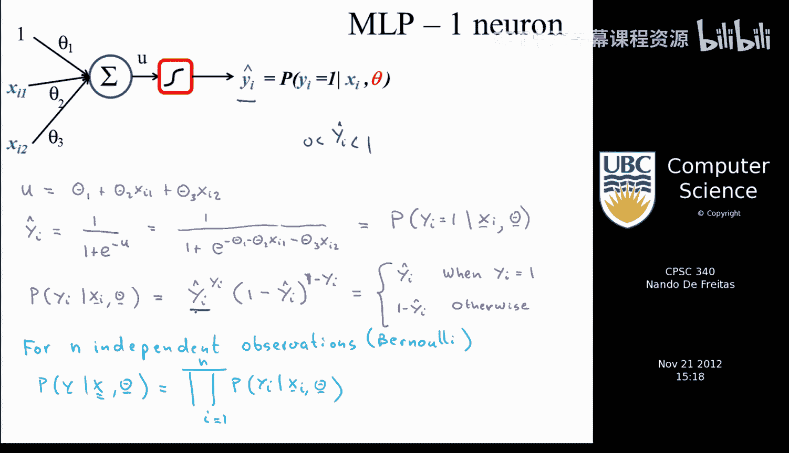

However， sometimes we want to do better the data might not be linearly separable in which case we want to use nonlinear functions。

 like for example in that picture I'm showing you two nonlinear functions。

 the blue linear function is for a neural network that has very few neurons in the hidden layer。

 probably three or four， and then the purple line would be for a neural network that would have like 20 neurons in the hidden layer。

So again， you see the trade off the more neurons。The better your separation with lots of neurons。

 you get zero training error， but the problem is that the test set would do poorly。

 So how do you choose the number of neurons you do cross validation， it's again。

 an issue of complexity control。Another thing you can do is you can add an L2 regularizer to the neural network。

Because then the L regularizerr will set some of the theta to zero。And again。

 it will smooth that decision boundary。So the setup with more neurons is exactly the same as for logistic regression。

 you still have your input data which could be anything。

 and then you have your output data which is binary and what we model is the distribution of the output so once again。

The distribution is not over the x。 the X are given。 The distribution is over the Y。

And the y is a 01， the Bernoulli， so we used a Bernoulli model。

The only difference with logistic regression is the following for logistic regression。

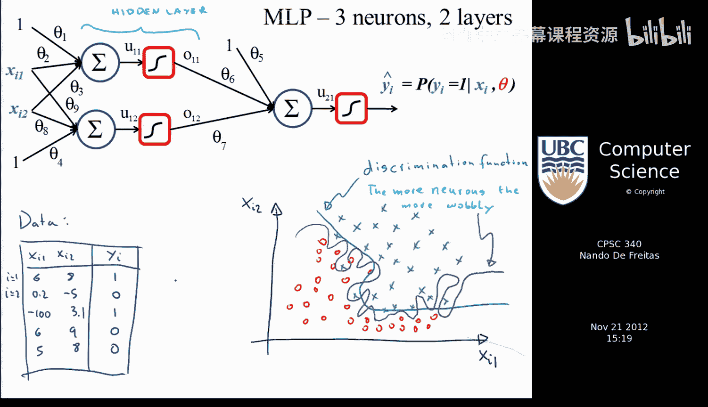

The mapping to go from input to output is a very simple one。 We first compute is you。

And then we just put this， which is basically a linear。

Regression and then we put the linear regression through the sigmoid to give us a number between0 and1。

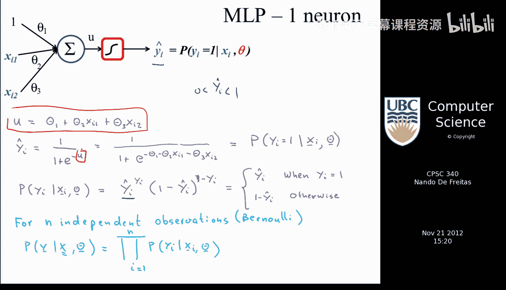

With。The neural network is a bit more involved， because now you have。Two linear regressions， one。

 two。One for each U， the first linear regression is for the top neuron。

 and then the second one is for the bottom neuron in the hidden layer。

And then each of these linear regressions gets weighted。

So first they get squashed through a sigmoid function。And then， they get weight。

And then it gets quashed through a sigmoid function。So we have a complex transformation of the data。

 and that's essentially what allows us to get a nonlinear boundary。However。

 the probabilistic model is still the same， it's still a Bernoulli model。

 the only thing is now why I had is a much more complex expression。

 which is essentially a nonlinear function， a composition of these sigmoid functions。

And the treatment is before for the neural network， if you now have many data from one to n。

Then the overall likelihood is just the product of the likelihood of each data point。

So it's a product of Bnoolees。And one thing I hadn't covered in the last class。

 that I'm going to go over it now is that if you want the cost function。

 if you don't want to think it's just like least squares。

If you don't want to think in a probabilistic sense。

 but all you want to minimize is a cost like the sum of Sc errors and so on。

It's possible to transform a maximum likelihood problem to a problem of cost miniization。

Cost also has other different words that I used to refer to it， like the objective。

 and quite often people use the term energy in neural networks people like to use energy。

And so minimizing the cost is essentially the negative log likelihood。嗯。

And you can see that very easily for a Gaussian。Actually， I will show that to you soon for La。For。

For a Bernoulli distribution， if you take the log and negate。

 you essentially get this very simple expression， which is the。Anthtropy。The cross entropy。

And that sort of made sense because you want to minimize entropy。You want to minimize uncertainty。

 so the objective function makes sense。嗯。Now， there is a clear mapping between cross entropy。and。

Likelihood， okay， one is just a negative log of the other。

Same as the quadratic error in linear regression is just the negative log of a Gaussian。

I have seen papers I actually recently read one where they were comparing。

 and this is actually very common in blogs， where you'll have people fighting whether it's better to do maximum likelihood or minimize cross entropy。

They actually are the same， obviously， but people will have fights in blog and then you know I tried this data set and though you shouldn't have done that data set you have to do it in a serious data set as when you can tease out the differences and then someone will come。

 I spent 5，000 on Amazon and run it in so many core and found a difference of one times 10 to the minus 32。

嗯。And you know quite often， if you don't understand the mapping between costs and probabilities。

Which is one of the poem that I think confronts a lot of people out there because people in general have a poor understanding of probability。

 but you're wasting resources， you're wasting your time doing things you shouldn't be doing。

So cross entropy is the natural cost function for maximum likelihood when you have binary observations。

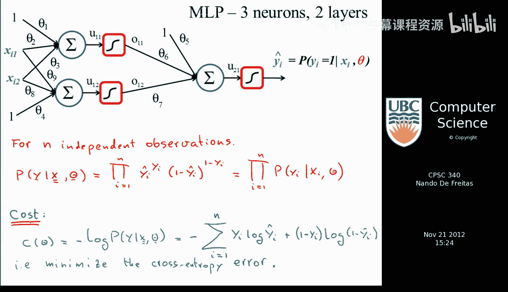

And we also saw some examples of neural networks， Friday I'll go over some more。

We started looking at regression。Now， in regression。

 I'm going to use a different kind of output neuron。 Instead of the output neuron being a sigmoid。

 I'm going to use。The identity。 So I'm using this line to indicate basically the identity in neuro。

You2 one。So why hat is just that combination。And particular Y hat is just as written at the bottom here is theta 5 plus theta 6 times the output of neuron 1 plus theta 7 times the output of neuron2。

And we had had a discussion where we said that theta5 controls the height of the sigmoid。

Theta six sort of squashes it up and down。Theta 1， move the sigmoid left and right。

And Theta2 squashes it horizontally， so either thin or fat。

Sigmoid so we have everything to control so we can squash it in both directions and we can lift it and we can shift it so we have these very nice bricks basically and you can just add up many of these bricks and you can construct any function like in this example if your data happens when we're doing regression we're mapping from X to Y if your data happens to have that shape then we only need two neurons。

Okay， so if you want a table， you basically just need to add up a neuron that looks like。嗯。

That's going to the left and a neuron that's going to the right。 if we negate the thetas。

 we can change the direction of the sigmoid。Because you're squashing it and eventually you squash it to the other side。

 Any reason for using the identity。Yes， good question。

 Why am I using the identity there as opposed to a sigmoid？

What would happen if I had a sigmoid there， my white hats would be in what range if that was one zero and1？

What would be the problem if my Y hats are between0 and1 and my Ys are 6。2 and5？

Could I ever predict why if my Y hat was between zero and1？You need to steal them。Right。

 so the sigmoid isn't。Creating a scaling to 0，1。 I don't need that scaling here。 In fact。

 the scaling here would be wrong because my wise are the real light。In this case。

So all a sigmoid is doing is just scaling something to0 and1 so that we can interpret it as a probability。

他就就是ね呃。You could have the same white hat with different。If you interchange different thetas。Like， if。

You map 36 to 37 and datata 1 to 34 stuff like that it's the same Yes。

 so you shift if you move the neurons like this。If you permeate the neurons。

 you still get the same neural network。Not。Actually that has an implication。

 a big implication in optimization。Which means that up to permutation。

The parameters are unidentifiable， and so what that does is your cost function will have a many。

 many minima。Possibly you know a factorial number of minima。 now。

 if those minima are very close to each other， if they're far away。

 then any of those solutions is a good solution， but if they're close to each other。

 you get a very nasty。Aero landscape。These models are empty hard。And 540。

 I show the mapping between these and the。The sad problem。

 which is a different example of an NPR problem。

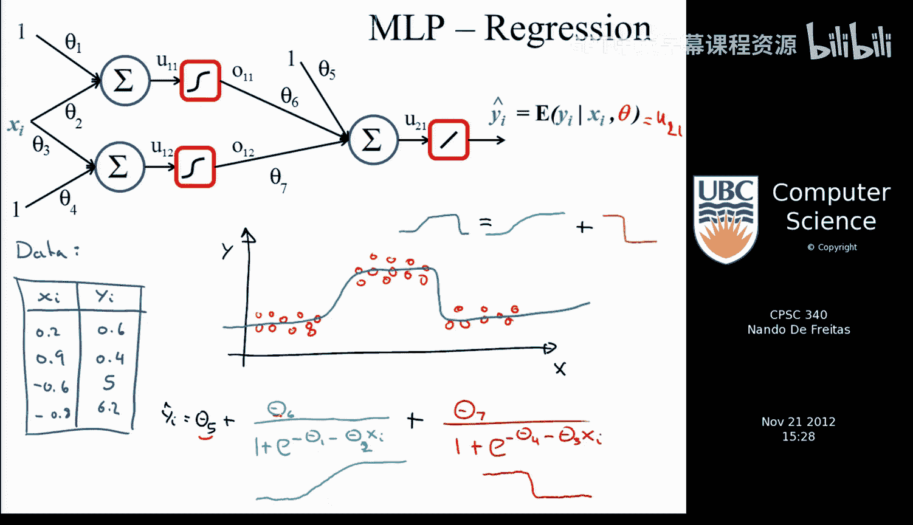

Okay， the other thing。So why I in particular to continue answering this question。Why I had。

I'm going to interpret in the linear case as the mean， the prediction。

And I want that prediction to be a number between minus infinentine infinity。

 that's why I keep that linear near Now the picture says it all that we're doing regression from x to Y。

 any point is distributed according to a Gaussian， that's the model that I'm using now。

And if any point is distributed according to Agaussian， then the picture as it shows there。

 you have a specific Yi。If you evaluate the height of the point。The ice point， that's Y I。

The value at the line at the fit， neural net fit is just why I had， that's the function why I had。

 the difference between why I had and why I is what I'm showing in red， and that's the cost。

And then since each point is Gaussian distributed， and by each point， I mean each y。

 there is no noise in the axis again， the noise isn in the Y， it's just like linear regression。

 The only thing is we change the line for an arbitrary curve。Instead of a line。

 we're now putting basis functions together and doing an arbitrary curve。 In effect， neural networks。

That's the only thing that they bring in into linear regression that it allows us to go nonlinear。

But the probabilistic models are the same， the cross elevation is the same。

 the whole treatment is the same， so if you can do linear regression， you can do neural nets。

 it's just now we create linear functions by adding many basis functions。And so the mean is my hat。

Now we have a nu nonlinear function。 So I'm just saying that why I hat is just this function。

 which is the neural net。That depends on heat and the inputax side。

And now if I take the negative log of P of YI given X Icommal theta。

 I basically get to sum of squared errors， so in particular in the first part of the course。

 we spent quite a bit of effort showing that minimizing the sum of square errors is the same as maximizing a Gaussian likelihood。

And then of course， what we could do is we could now reach regular rises。

 and this is the sort of thing we get to do for homework six。 you get to play。

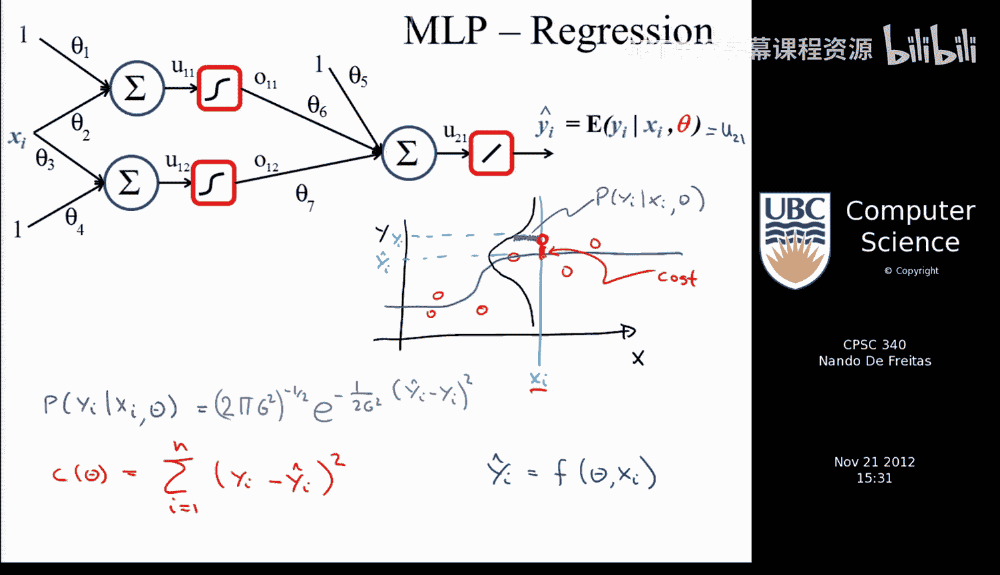

We're trying to get good predictions。Or for the project。Okay。

 so now let's look at a more interesting case， this one is now a bit different from anything we've seen so far。

 but quite often you want to classify data not into one or two sort into two classes。

But you quite often want to classify it into more classes， for example。

 you might want to take news articles and you might want to automatically classify them as sports or Vancouver news or fashion or comedy or whatever it is that you want to classify your articles into。

And so in this case， you have more categories。And we need to deal with a problem that goes as shown here。

 that goes from 2D to actually three possible classics。And we're going to use the following trick。

We're going to do a one of what's called a one of k encode code。If your class。

 if a data point is of class two。So let's assume that we're essentially classifying images。

And we want to say red， green， blue。Those are our three classes。If you're of class two。

 then what we do is we're going to label the y in this sport。

 we're going to put a one in class two and zeros in the other classes if you're class one。

 we put a one。We use a 10，0 twin encode class one。And then the last class would be at 0，0，1。

 So we basically encode 1，2， and 3 as。1，0，0，0，1，0， and 001。

The reason for doing that is because now I can present to the output。嗯。Basically when I train this。

 I'm going to set up the targets for the three outputs to be those numbers，1，0。And1， say， sorry，1，0。

0，0，1，0， or。0，01。What we will get， in effect， is a decision boundary or a discriminant boundaries is。

 as it's often called， that separates， in this case， three classes。

Clas two from class one from class three。How do we do this and also we want probabilities right so we want to still be able to say that what we're going to get out of here is a probabilistic interpretation that allows me to tell what is the probability that the image is red。

 what's the probability that it's green， and what's the probability that is blue。

This is going be our solution。We're going to define the probability that the label says of class 2。

 which is 010， given the input and theta。Using this function。

We're going to use this function because it's going to give us something positive。Okay。

 because if I take e to the y2 divide， if I exponentiateiate anything， I get something positive。

And because I normalize。The outputs， so I take e to the y2 that guarantees that it's positive if I normalize by all the three outputs。

 now I'm ensuring that I will get something that will sum up to one and I'm going to talk about this is the probability of y2 This function has a name。

 It's called a soft max function。It's used with neural networks。

 but it's also used with a lot of other machine learning techniques。

 it's used with logistic you could use it with logistic regression。Because in fact。

 you could just do a logistic regression you could get rid of。

That hidden layer and it would be back to logistic regression。

 and that would be essential logistic regression with many classes。

 which was a question one of you asked me a couple days ago。

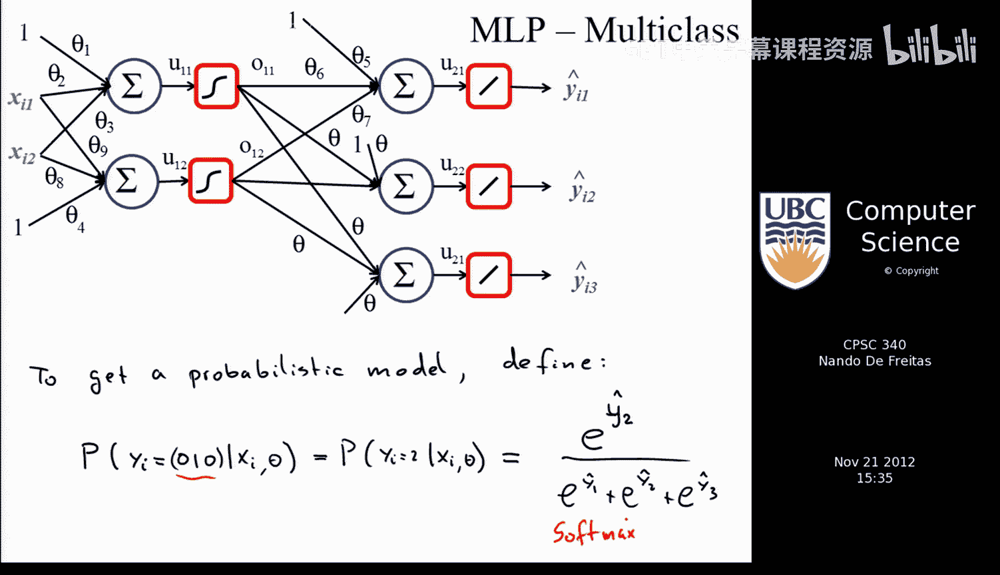

ImP方向。

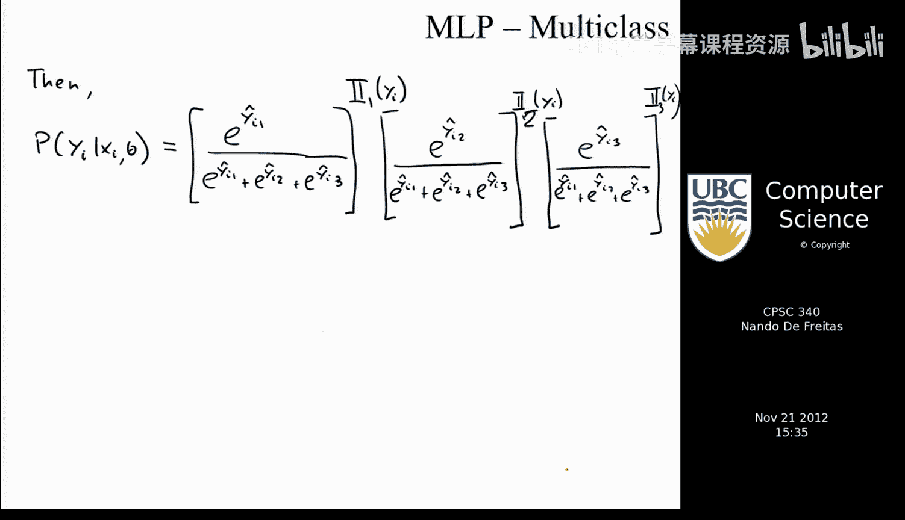

Identity function。So y is2 be between either zero or one。Oh， I don't need them。

 I don't need the YI hats to be between0 and1。 Why don't I？You were live。

Because I'm normalizing everything first， if Yi is negative， I'm using an exponent function。

 which makes everything positive， and in since I normalized， it's making this term between0 and1。

So that's why we're applying to normalization。If I put a sigmoid there actually would still work in this case。

 it actually doesn't matter if put a sigmoid or line。

 it's just a bit more elegant to use the identity。

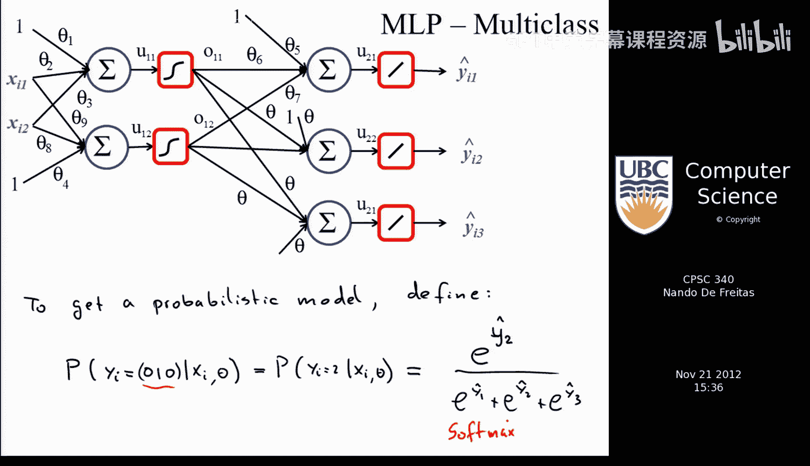

And so。The likelihood then for a single data point is essentially it's like the Bernoulli。

 but now for three classes。And this is essentially what this is saying。It's equal to。

 and then you have three cases each to the Yi one divided by the sum。

When yi equals 1 and the sum are basically is this guy。E to the Y eye。2。Divided by the sum。

When Yi is equal to 2。And E to the Y I。3 divided by the sum。When Yi is equal to 3。Okay。

 so it's the same as the Bernoulli trick。 It's a categorical distribution for three vers。

And now we've just parameter of my the success probability of each of the classes in this categorical distribution。

With the soft Max function， which gar。 And now obviously， if you add to three。

Success probabilities you get。One， so you have a valid probability distribution and each der is between0 and 1。

That's it。 It's just basically flipping coins， except that other coins have， I guess， three faces。

If you want the cost function。What do we do to get the cost function？Exactly。Cost function。

It just equal to the negative log。Of P of y given x comma theta。

 and I'm going to do it for all of them。And that shows。The some。From i equal 1 to n。

And then it's going to be the sum。From J equal1 to3。H。Jy。Of Y I。Times the log。哦。

Send your E to the Y J。Why Ij？Divided by century the sum。So it's again， cross entropy error function。

But with three pluss。So you minimize uncertainty， minimizing uncertainty is equivalent to maximizing likelihood。

Oops， so I missed a negative there。O。So。That's essentially how we get the cost function。

 so we have a cost function for multiclass， the cost function for we know the cost function for regression。

 we know the cost function for two class， which is sort of actually subsumed by multiclass。

 so once we know the cost functions or equivalently we know the likelihood。

 we know how to regularize them but just adding theta transpose theta。

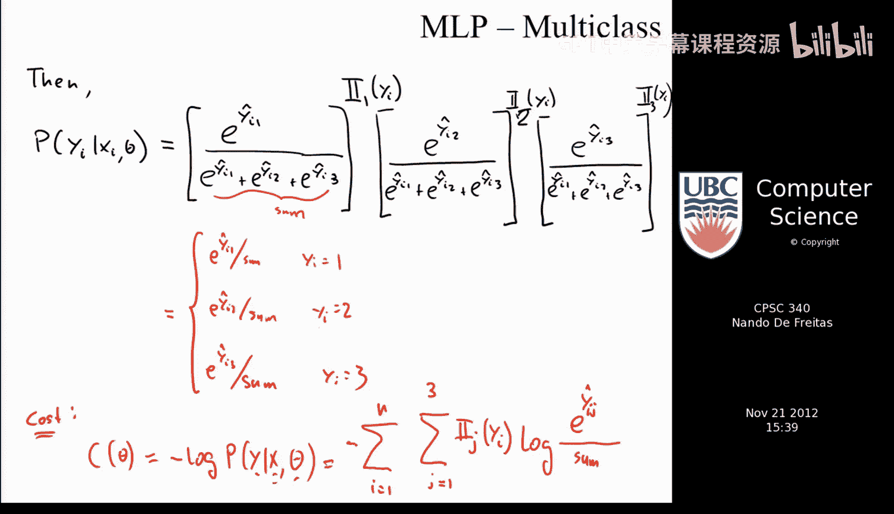

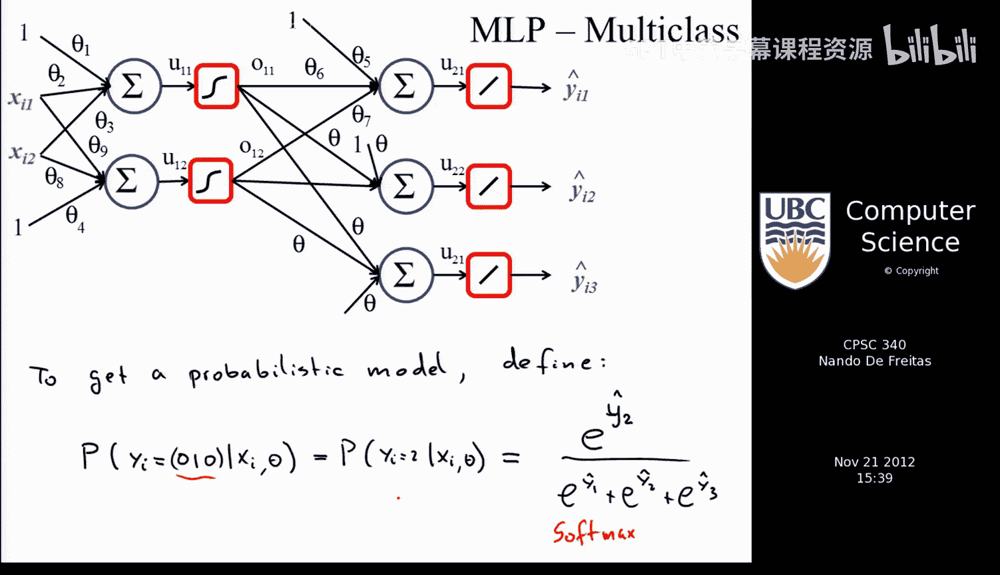

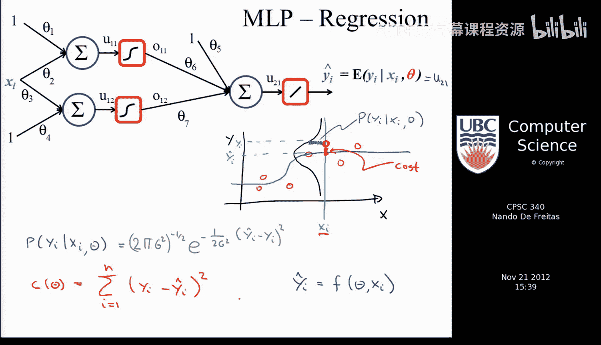

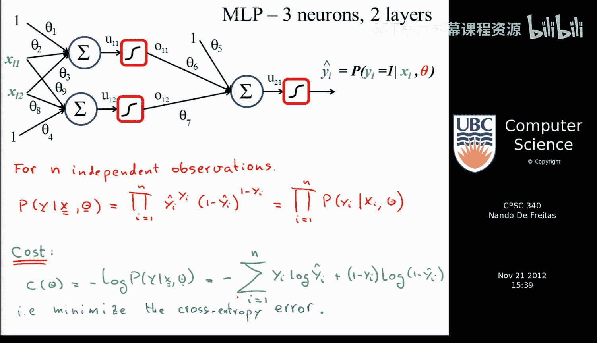

And we also。Know how to proceed to get an estimate of theta。

 which just differentiate a log likelihood， we equate to zero。And solve for heat。In this case。

 we can't solve for theta exactly， so instead we will do gradient decent。

Or you can do Newton's method。 And if you do gradient descent。

 you can do mini batches or you can do online， or you can do the full batch of the date。

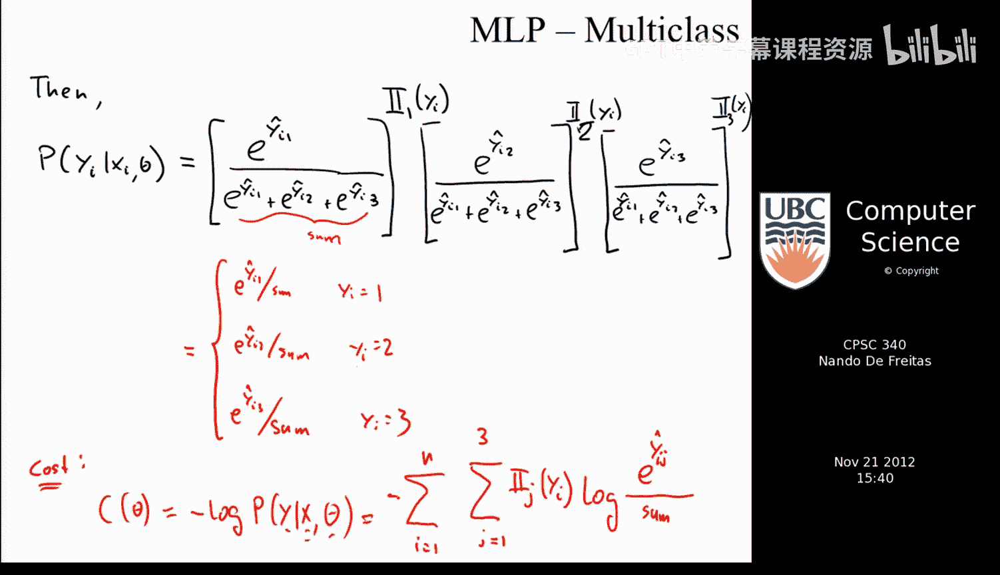

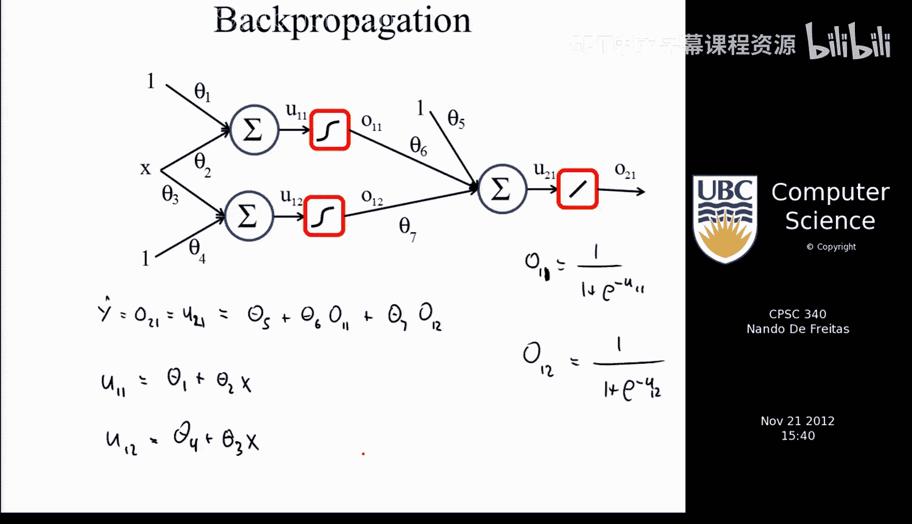

So。Getting ahead a bit， this is what we're going to try to do。

We're going to derive expressions for the gradient of the neural network of those cost functions。

 and when we do that we will end up with nice equations that will look like this。

 though these equations will basically tell us how to update a new theta。

Essentially in the first case in the batch case at iteration K。

 new and this will be true for each theta， so we'll do the gradient for each theta。

 so theta J where J could be 1，2，3，4，5，6，7。For this example will be the all value of theta and then plus。

The great and with respect to that the。That's how we're going to minimize the cost function of the gradient in this case for regression and then for online we wouldn't take the sum over all the data。

 we would just take the current data， so tweets， lots of data。

 you might not be able to load all that data into memory。

 in which case you might want to do it online。When you do it online。

 you can actually do several passes through the data。To keep improving the results。

Let's see how we get these gradients。So how do we do。

 I'm going to do recreation for the homework you have to do binary classification。So I'm using it。

 I'm going to use a quadratic error function， and I'm looking at the online problem。

 So I'm only looking at the current。Error at。At time。I or。Data point I for the I datata point。Okay。

 so my error is the difference between y and y hat squared in regression。

When you do binary classification it's not going to be this cost function。

 it will be the cross entropy。So it's all about just plugging into the right cost function。

We differentiate this cost function。Suppose I want a derivative with respect to Theta J。

The derivativeive of the error function with respect to theta J。It's just， well。

 we' just followed the chain rule here， so it would be minus two times the difference between y and y hat。

And then we need to take the derivative of why I had with respect to theta check。Now。

 the first term that's kind of done is's just the difference between the prediction and the actual y。

 and it makes sense because you want to take a step in the gradient so as to minimize that difference。

And so the next term is the derivative of the output with respect to the theta J。

 So in order to compute a gradient in our neural network。The only thing youll be able to。

Need to know it's hard to compute the derivative of the output of the neural network with respect to each parameter。

That's the chain rule， and for neurone， it has a special name， it's called back propagation。

And we'll see soon why it's cold packed。So suppose you want a derivative with respect to theta 5。

 then I argue is's just theta 1， and the reason is because why hat。It's just equal to theta 5。Plus。

 teacher6。Times output 11。Plus， The 7。Times output12。

That's essentially the function that the network is implementing。

And so if I take the derivative with respect to。Theta5。

 I just get one because there's a one there multiply。So I get this guy。

If I take the derivative of this function with respect to theta6， I just get output 11。

Where output 11 is equal to a sigmoid。With what terms in the exponent？Exact theta n minus theta 2 x。

How do I get output 11， I take the input X， I feed it through the net。

 so typically the way we implement this is we do a forward pass to get all the O's。And all they use。

 so we first do a forward pass。And then derivative derivativeatives is just plugging it in。

So like derivative respect to theta 6， it's just output 11。Likewise。

 the derivative respect theta 7 is output 10。 The next derivative。

 So we already know how to do the gradient for theta 5， Theta 6 and theta 7。Okay。

 so the next one will be the ones that will get a bit more interesting。So， in particular。Okay so。

This is my Y hat， which in this case is just year 21。In particular， I have。If I want a derivative。

Of why heart。With respect to let's pick one。3 to3。That's going to be equal using the chain rule。

 the derivativeative of Y hat。With respect to。So feature three is in this path。

 so I get to feature three by following this path。And just to search what back propagation will be。

I need to take the derivative with respect to012。Then I need to take the derivative of all one。Oops。

I need to take the derivative。哇。So used to theater。Of output12 with respect to u12。

And then the derivative of u1，2。With respect to Theta3。This is back propagation。

If you want a computer derivative， you need to follow the path。From the output to the parameter。

By doing the chain rule。 So the picture， the graph is just allows you to see visually what it is。

You know， it's just a tool to help you with the chain rule。And so what is this equal to？

I'm going to put here。A simple theory。The derivative of output1。Now outputput 12。

 with respect to u12 is equal to01，2 times 1 minus012。阿。

The derivative of one over1 plus e to the minus x with respect to x。

Its equal to one over one plus equal to the minus x。Times1 minus1 over1 plus E to the minus x。

I asked this quite often in exams to prove this result。I'm not going to prove it in classes。

 I suggest you try this out。Okay， so the derivative respect to012 is just theta 7。Okay。

 because why hat。Is equal to theta 7 times012。Plus theta 6011。Plus， theta5。

The derivative of012 with respect， the derivative sigmoid is just equal to basically that sigmoid times 1 minus the sigmoid。

And then if we look at this graph here， we know that u12 is equal to theta 3 times x。Plus。

 theta 4 times 1。And so the derivative of U12 with respect to Theta 3 is just x。

And that's your derivative， you're done。And the rest of the derivatives is exactly the same thing。

Okay so you just follow the various paths， if you want it with respect to theta 4。

 it's going to be exactly the same thing except instead of x。

 you're going to have a1 because you're going to slightly change to this path。

And then if you want the other two parameters， you need to follow the path through the upper ear。

And this will give you all the derivatives， so you get terms of this form。

 the parameter times this sort of term times the input。

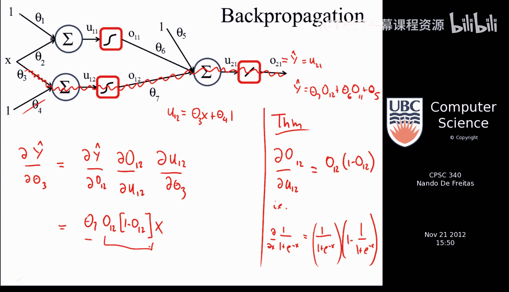

And that's what's here。And now the whole thing is you have to difference。Okay， so recall that。

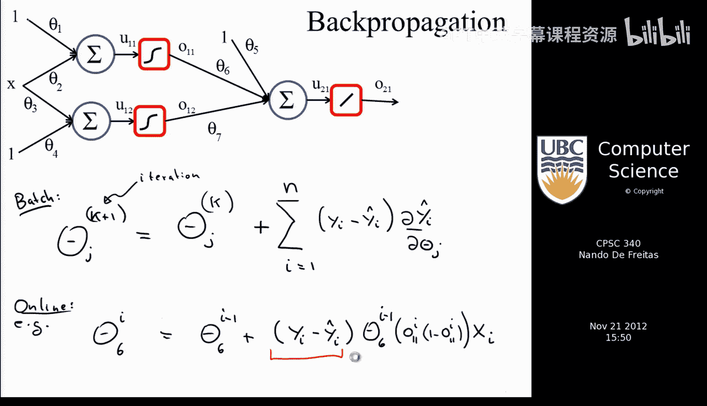

The gradient consists of two terms， the difference。

And then there was the derivative of why hat with respect to the parameter。

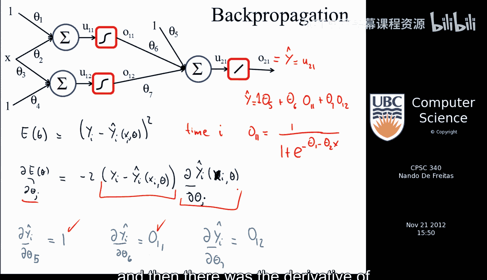

And so that's what you're seeing here， the difference and the derivative of Y house with respect to the parameter。

That's it。That's your algorithm。And you will get one of these equations for each of。The parameters。

Actually， let's see if this is right， because Theta 6 there shouldn't be Theta 6。

 I think I made a typo here。That's correct it now。It011's。I'm going via011。To X I。

 So this is for theta 2， sorry。Right。Because for theater 2， I would follow the path。

I'm following this path， basic。Make sure the middle one， the mask theta。Its supposed。还估计是。

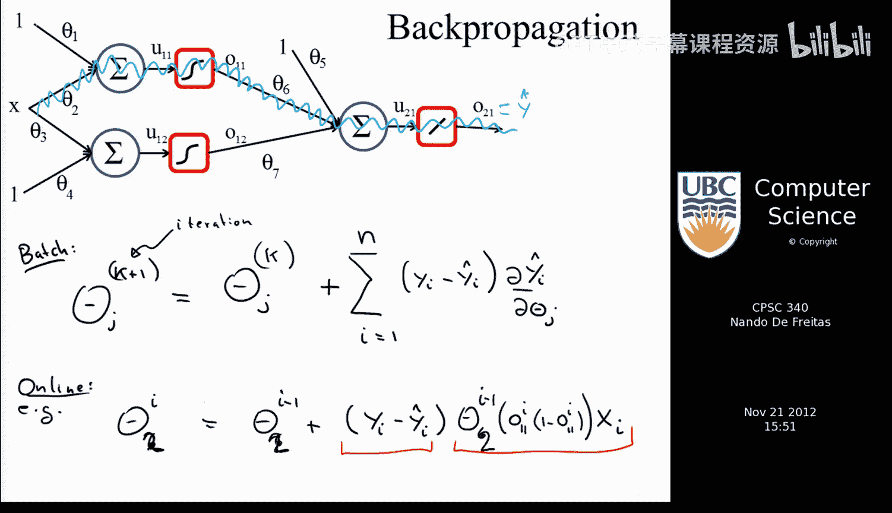

Showed that it was even7。Oh no， that was with respect to Theta。

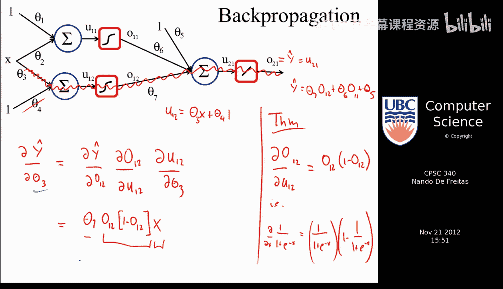

Oh， I see。 with respect to Theta 3。 And so this should be。So this would be the guided multiplies。

 which is  the to6。Okay。Thank you。But basically， you just need to be careful following each path。

 and then you'll get each derivative。 Now， as you do this， you'll see that there's a pattern here。

 All these derivatives look to same。And so it's with a little bit of thinking。

 you can put all this as a single matrix vector multiplication。

 squash that vector through multivari of the sigmoid that just gives you as an output the vector in Python。

And then the derivative computation， these guys themselves。

 you can vectorize it all as matrix vector modification。

 so I haven't done that matrix vector vectorization because that confuses the issue。

 but when you implement a COVID， that's the way you should do it。

And the reason why I'm using these U12 or O12， that means hidden layer neuron 2。

 so U12 is the first layer， the second neuro and the first layer。

 and so if you use those indices you'll see that everything will fit naturally into a matrix and so the algorithm will。

第意。And that's what you need for your last homework。And you just basically get to quos for。

Classification， the only difference is going to be these terms。

 the second terms will be the same as what I've derived here。

 These first term was the right for regression。You're going to be doing it for binary classification。

 so use the cross entropy instead of using the summ of squared error。And that's it。

So the hidden layers。Make。Or sums。These layers。Data terms， I guess。I'm just wondering， like。

You layers you can put more layers or you can put make layers very fat。 So this is a good question。

 So more and it's actually very important question research。 So making it fat。 And that's。

 I'm going to go over some of this on Friday。 If you make it big enough with just one hidden layer you。

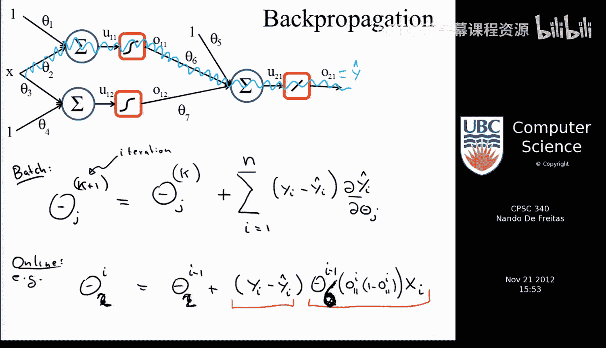