# UBC《机器学习和数据挖掘｜CPSC 340 Machine Learning and Data Mining 2012》中英字幕 p30 -30-undergraduate machine learning 30_ Deep learning.zh_en -BV1pJ2ABFEFg_p30-

Today's lecture now will be about。How are neural networks being used these days and what's the sort of coolest stuff going on with neural networks in particular。

 over the summer， neural networks where。All over the media。

 they were in the front page of the New York Times。And。

And that has to do with the fact that I think we've reached a point at which is possible to implement very large scale neural networks and get them to do some useful things。

And I will go over at these examples， and essentially。

 I will describe what was this neural network that made it all over the media。

 as well as describing a recent neural network that has been winning many of the competitions。

In the cargo websites， bioinformatics competitions， but in the same network case。

 learning is being applied to learn to recognize objects and it has been very successful in the P competitions。

Okay， so today we will go over those networks， we will learn about a particular type of neural network that is used for unsupervised learning called the no encoder。

We will look at how to use neural networks to do object recognition， how to do face detection。

 You know， like in your cameras， the detector faces very easily。 And we will learn about a lot of。

Sophisticated regular Iis that you can bring in into neural networks to actually achieve different goals。

 like， for example， invariant object recognition。

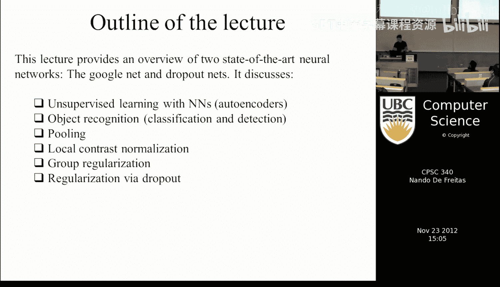

Okay， so in the last class， we looked at these very simple neural networks where we're given a data set because consisting up an input XI and an output Yi。

 and here is sort of a plot for this 1D function。And given these red points。

 we're able to fit a neural network， the green curve。To the red points and two neurons， in this case。

 the neural net is just a linear combination of two neurons。

T neurons is enough to represent this function because each neurons is a step function。

And we have parameters that allows us to transform that neuro so we can squash it horizontally and vertically。

 we can shift it。Up and down， left right， and we can flip it off by negating the feeds。

 so because we have all the control， we can just using this very simple brick。

 we can construct aline function and we can approximate well that function。The red dots。

If we if we add more neurons， we will get an even more complex regression function。

 and there's a natural question of asking ourselves how many neurons should we add。

And I mentioned that one of the ways to answer that question is to do cross validation。

And once we define a neural network。In the case of regression。

 we can think of the output of the neural network as the mean of the Gaussian distribution。

 so if we think of each red point as the data point， the noise isn't the Y， y hat is the prediction。

 why is the true data that was given to us， and so the difference between y and y hat is just the cost function。

 that's what we need to minimize。But the sum of Sc errors， if you negate it and exponentiateiate it。

 essentially gives us a Gaussian， so there is this natural mapping between probability distributions that predict the Y。

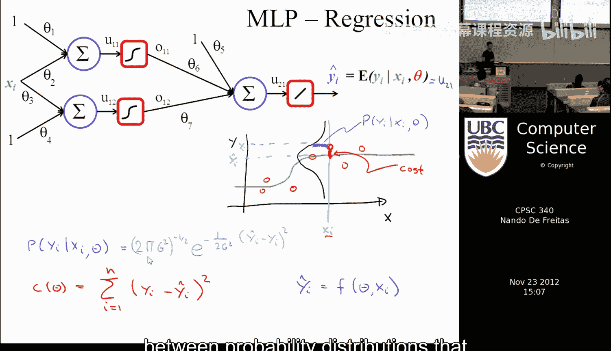

And cost functions。And then we went through this exercise in the class where we showed how one can use the chain rule to compute derivatives of that quadratic error with respect to any parameter。

Like for example， in this case with respect to theta2。And once we have those derivatives。

 it's very easy to just apply an online gradient to send。To learn the teach us。

 so that's essentially what your homework is about。

I mentioned you could use also different types of basis functions。

 folks are trying different basis functions out there。

One of the things that I didn't mention was regularization。So。Just like we did for linear regression。

Our cost function。嗯。For all the parameters。Will be a sum from overall the date cases。

Of the true label。Minus the prediction。And the prediction is a function of the input。

And it's a function of the。不是。Now， if that's our cost function。

 we've learned that in the linear case， we can get better predictions if we add a regular riseor。

 so I could very easily add a regularisor to this cost function。

 so I could add plus lambda some regular riseor of theta。

And then the question is which regular do we add to examples？Of our of datata。Could be。

DL2 norm squared。So that would give rise to the ridge。And the rich neural networks has a name。

Wai decay。Now the ridge is really easy to implement because the derivative of theta squared is just two times theta。

Two times the vector theta， so it's very easy to implement。The rich。 So you just add theta to each。

Update of the gradient。It's the differententiable， we also used the L1 norm of the vector theta and the L1 norm is just the sum。

From J equal1 to in this case， we have seven parameters。 so it would be to 7。Of theta I。theta J。

So it's sum of absolute values。Now， why would that be a useful regularizer。

 It would be useful because it forces the stages to go precisely to zero。

 So the effect of that is that if we have several inputs in this case。

 we only have one input in this neural networks which's not that interesting。

 but if we had several inputs， we could arrange for some of those。Inputs to disappear。

 and so thereby effectively， we would decide which inputs are relevant。

We can do something even smarter。We can introduce regular risees that only look at a subset of neurons。

So in particular， we could use a regularizer。That I'm going to call it a 2，1 regularizer。

 which will be a sum from。ok。Equal one。Let me instead of introducing heavy notation。Try to。

Write it very easily with simple notation。The regularisor will be theta 1。Square plus theta2 squared。

Plus。Theta3 squared。Plus theta4 squared。And I would add here actually theta6 and plus theta。7even。

So what we're doing is we're looking at I've put this into two groups。

 one group of the parameters that go with neuron1， and one group is the parameters that go with neuron2。

And essentially what I'm trying to say is let's do the sum of those。

 the weight of neuron1 plus weight of neuron2。Now the sum of positive things is in a way it's the absolute。

 it's just the L1 norm because the L1 norm is just suming positive。Things， and when I take the norm。

 theta 1 squared plus theta 2 squared。嗯。Actually， there's different ways to implement it。

 so I'm going to take theta6 whoops。好嗯，是。Doing some crazy stuff。

What I'm trying to say is this regularizer that I have here is essentially a sum over the neurons。

For each neuron in the hidden layer。I look， I sum the norm。Of the weights。So it's the sum。Of the L2。

The L2 norm of the way it's corresponding to an error。 So it's an L1 of an L2。

Because the sum of something positive is just the L1 norm。So essentially， I'm grouping terms。

 I'm grouping all the parameters that go with one neuro， and I compute the L to norm of that。

I look at the next neuron， and I group it， as I've done there in the second group。

And then that's gonna my penalty Now， it's going be lambmbda。

Times this plus lambda times this other group。That way I will try to force a whole neuron to be switched up instead of just switching a single link。

 I'm trying to switch off a neuron I'm trying to remove a whole neuron in one go。

 so this is called the L1 L2 norm and in general，The。L1， L2 norm is shows。The sum。From mi 1 to K。

I said J equal12 K。And then of the al two norms of the vector。Jy。So in group J。

There's still a group of factors， theta J， and I'm computing its own to norm。

This sort of sum of square terms is going to come up soon when we explain the Google network。Now。

All of this， you've also seen this picture of the。The person that's kept me awake for the last month。

嗯。And here comes now a big question。We've learned to do supervised learning with neural networks。

 But how do we do un supervised learning with neural networks？ You had a question， going back a edit。

 So regularizers were introduced as a way to smooth out the optimization function with respect to the features we have。

That's correct。So is there a way to smooth out the optimization function with respect to the class。

Glaassesses present our training data。I think I will answer your question of his slides。

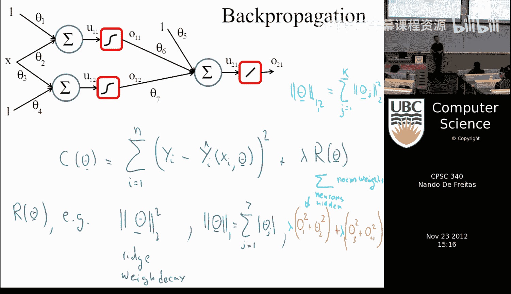

Just give me。 Let me get there。I'll ask you again when I get there。But let me move on。

Moving on to the unsupervised case， we've seen ways of doing unsupervised learning in this course。

Which ones？This year with the SVD and so on。嗯。And even using the base nets。

 when we were learning the parameters of a base net， in a sense， there was no super patient。

 which is had。A lot of data we were trying to infer the structure of the base net or infer its parameter。

The prostate， cancer。Or but it was unnotated with a label。 You were trying to predict a label。

 which was an antigen。 So the prostate cancer example was a regression。 There was labels Y。

 and there was inputs X。And we were and you did the last suit to predict the wise。

The PCA was just sort of the example that we looked at。Now。

 most of learning in the world happens in an unsupervised way。Like when this is my baby。

 she's staring at her mom， trust me， I'm not teaching her how to recognize her face。

But I know she's capable of doing that， in fact， was able to do that from the moment that she was born。

Now， this is what we saw in the course earlier on， we learned to do PCA。And the idea of PCA。

 the cost function for PCA， was essentially given a matrix of images。X。Find two matrix B and C。

That approximate x。Okay just find a reconstruction of X。I'm usings2 matrix BNC and for PCA。

We discovered the dose matrix where B would be equal to use sigma。

And C would be equal to V transpose。In other words， the SVD is the optimal L2 record。

I then mention that if you in addition， add to it。An extra term。

Which penalizes the magnitude of the V vectors。That we would then get something called sparse coded。

 which looks like this。So this is PCA。This is sparse coding。And so each of these guys。

Is one of the filters that gets active when you look at an image patch。Essentially。

 that's the interpretation because we take a lot of image patches and we convert the image patches to vectors。

 we compute the SPD。And then once we have the V matrix。

 what we do is we go from a vector to an image and that's each of those plots is one of the V's。

 one of the eigenvectors， so the first image there that I've highlighted in a box in blue is V1。

 and then the next image is V2 and so on。If you apply regularization。

 you get something that looks completely different。Now， each eigenvector。

Starts looking like an edge detector。Because it's an image that on one side there's light， white。

 and on the other side there's darkness。So it's looking for things in the image where there's strong contrast。

Now， we argued that we want machine learning systems that look like this。

 and the reason goes back to this very old experiment of Hubble and Viel who showed a cat。A bar。

 and then we saw actually a video of that。And there's lots of videos in YouTube of the Huo and Visel experimenterment。

 which I recommend。And you move unless you're sensitive to。

 there's some very cruel animal experiments in it。You move a bar left and right。

 and when the bar is at the particular angle is they're in case D。

A specific neuron that you're measuring starts firing。Like crazy will。It's neurons fire spikes。

So what that means is that neurons in V1， which is the first stage of sensory vision in your cortex。

 are selective to orientations， they detect ages， and each neuron detects a different age。

 and there's a whole entire topographic organization that allows you to essentially detect all the edges in an image。

So being able to construct a machine learning technique that allows us to detect edges is actually quite useful。

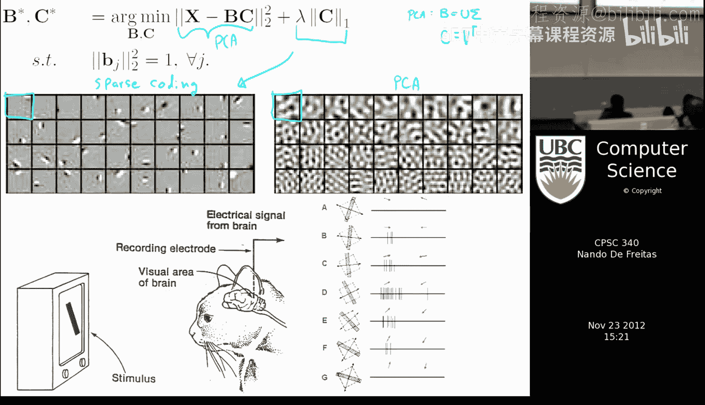

Here is the solution for training neural networks in an unsupervised way。

I took these slide from Andrew Ing， we were all teaching recently at UCLA in the summer school。嗯。

The basic idea in order to train a neuralnerenence super way is something that's called a not decoder。

 it's a very old idea， I don't know the original reference。

 but I know there were papers on those already way back in the 90s or 70s。

And so the idea is as an input， you take the image。

And then you make the neural network predict the same image as the output。

So what I see is my training date。In other words。It just goes back to this thing we discussed at the beginning of the course。

 if you can to close your eyes and you can predict what you're saying。

 you're able to understand the world。And so you image so you take all the images that you observe and you're trying to predict them。

What you do？To for this to make sense， because if you let your brain be big enough。

 your brain could have all the images in the world。You could save them。Now。

 the space of images that we encounter in the world is。It's huge。

 but it's tiny in comparison to the total space of images。

 If you have images that havesize 100 by 1000 small images。

So recall that we say that there are about1 million fibers in the optic nerve that goes back to V1 from your eye。

So that would be dealing with neurons that are about size000。By1 thousand0。Now， if you neurons。

If you look at the space of image，  1，000 5000。There are black and whites， say for example。

That space is two to the million。If you want them to have 256 values， it's 256 to a million。

That's a huge space。That's way more images than any of you will ever seen in your life。

How do you wait neuro。You know。What's the comparison？Oh， I'm just making a simple。

 very rough estimate that one photore is one pixel， but even if you don't make that。

 let's just make a very simple argument that's just based on machines。

256 pixels grayscale image there are if you have a million by a million。

 the possible images that you could have of size 1000 by1 thousand0 is 256 to the power 1 million。

Now， that's a huge space。That's more images than we ever see。

And that's because the images in the world are regular。The brain is a reflection of nature。

If we had evolved a different planet， we'd have different brains。It's a product of evolution。

 we have a world where the space of images is very constrained images tend to be smooth as edges all over。

 and that's what we're going to exploit to learn。Now， that space is still very large。

 so what you actually want then when you do reconstruction with the neural network is you want introduce a bottleneck。

So you create a hidden layer。And you want that hidden layer to have less neuronsance than the size of the image。

 So you're able to compress the image。And from that compression。

 you're able to expand again and you still get the image。 In other words。

 you're able to do the reconstruction。If you do that， then if we can compress。And decompress。

 or in other words， encode code。And they code。And reconstruct the image。Then in effect。

 we've learned what that image is， we've learned what are the important things in that image。

Another thing that one does。After training this is that after training。

 then you can forget about these weights here that allow you to get the reconstruction and you just look at the first part of the neural network。

 and that essentially now is an encoder。Given an image which is a very large object。

 it projects the image to a low dimensional space， so think of it as PCA。

 but it's not not linear a PCA。It allows you to get a low dimensional representation of the image。

You could compress it to 2D so you could take big vectors of images， compress them to 2D。

 and then you could do the 2D layouts that you did for your homework with PCA。

 except now with a neural network， you would be able to get much better layouts。

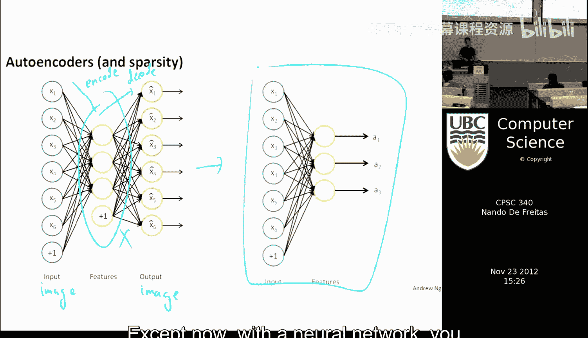

There's another advantage of having。An architecture like this， and it's the following。I can take。

Billions of images of South Africa。 And I can train a neural network like this。

And then when I moved to Canada。That neuro network is still in use。

If I learn all the types of images that exist in Africa。When I moved to Canada。

And I'm introduced to a new thing。In Canada that I need to learn to recognize。

 like I don't know a raccoon。Because we don't get those。In South Africa。

Then I would just take the outputs， the three outputs of the neural net activations。

 and then all I have to learn is three parameters。So I just do logistic regression。

But the idea is I've prelearned all the features。When I lived in South Africa。

 I learned what fangs were， I learned what teeth were。 I learned what fur was。

 So when I come to Canada and I go and hike in the forest and I see a furrick creature with big teeth。

I don't need， you know， it's very clear I immediately detect all those features。

And I know I'm in danger。So this is called transfer learning for self- taughtt learning。

 Andrew calls it self taughtt learning， other groups call it transfer learning。

 and in Pearl talked about this when he visited us he called the transport Learn。

 the idea of you learn a theory somewhere。And then you're able to transport it to a different world。

 and this is essential。 We learn features in an unsupervised way， we learn detectors。

 we learn sort of high level features， and then we move to another place in order to be able to quickly recognize。

 say，A bear， you use all the things that you've learned about fur and so on before。

It was the hand up。嗯。That sort of bottleneck layer。You're showing up。

Do you think that's happening there right now？And no， well， actually。

 there is a bottleneck and the retina and then it gets expanded again。

 and there's an overcomplete representation。So you like。

I guess if we try to map this in a very rough way of what's actually happening。You know。

Like comes it to the eye。You could try to get the numbers right。

 I don't know if experiments have tried to actually get exact numbers right or if we were there but。

I haven't done count myself。At the end of the class we can go over some papers and I can sort of compare。

 I don't know if we are at a stage where we're using 20 million neurons in the first kit later and so on。

 I don't know how big the scale is。

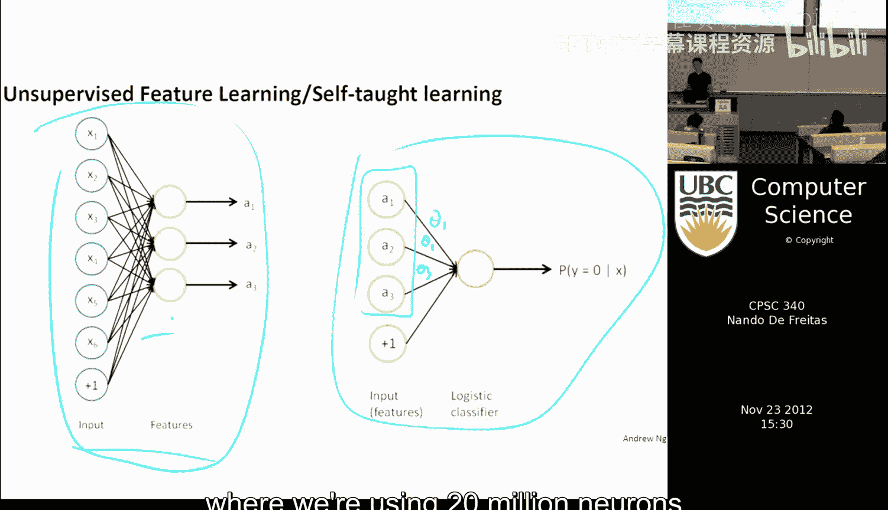

I think we're still very far from。We still need more parameters。Okay。嗯。What people often do。

 So there's two ways in which we could train a neural network like this to reconstruct。

 So essentially what。What we do， if we had a neural network with linear units。

 not with sigmodoidal units， what we would do is we would go from the input to the output。

 so this would be the output。And then we go from the output to the input。 So in other words。

We have the input。We have the hidden layer， and then we go back to the in。

So that was the sort of the network that we had， and then we have the weights W and then W transs here。

So， this is our。Our reconstruction x hat， so we're minimizing the difference between our reconstruction and X。

 and then we add to it ir regular rise。Now， the regular rice is very important。

One of the things you can do is you can use， there's this log co function that actually is a smooth way of approximating an L1 regular riseor。

嗯You。And you could also use something that's like the group L1 regularISsa that we just discussed。

 and I will get to an example very soon。An alternative way of doing this network is instead of using linear neurons。

 you could use a sigmoid neuron so your feet。嗯。The input through a set of sigmoids to encode。

 and then you decode， so we have two stages encoding and decoding。

It turns out that in order to get filter detectors like those over there。That I'm showing。

And to understand these images in the neural network context。Each of these images here。

Each of these guys is the weights that go from each of the inputs to a single near。So。

This is the image。The input image。And if I end the weights that go from the input image to a single nearn。

 there are as many weights as pixels in the image。They're all values between。They're all real values。

 so I can actually visualize the weights as an image。Right， because。This would be P1。

All the way up to P 6。 so that's an image。 So I could also then take this will be my。Pixel1。

And then this weight here will be my P2 and so on， and when I do that I essentially get this guy here。

So that would be near on one。And then this other guy， the green guy， might be near on two。

Which might be say this guy here。 So I basically look at all the weights that go into this neuron。

And that gives me another image。And so。In order to get these。Srse basis。

 I need to simply add that an L some form of L1 regular rise。

It turns out that if you don't have a regular riseizer， then you would just get PCA basis。

You would go with a linear network， you would go back to basically having sinus so it and thats。

The sort of global bases don't match what we observe in V1。So in order to have edge detectors。

The key is to add the regular eyes。 And in fact， we don't even need the nonlinear functions can。

We can just use linear neurons and use a good regular rice。

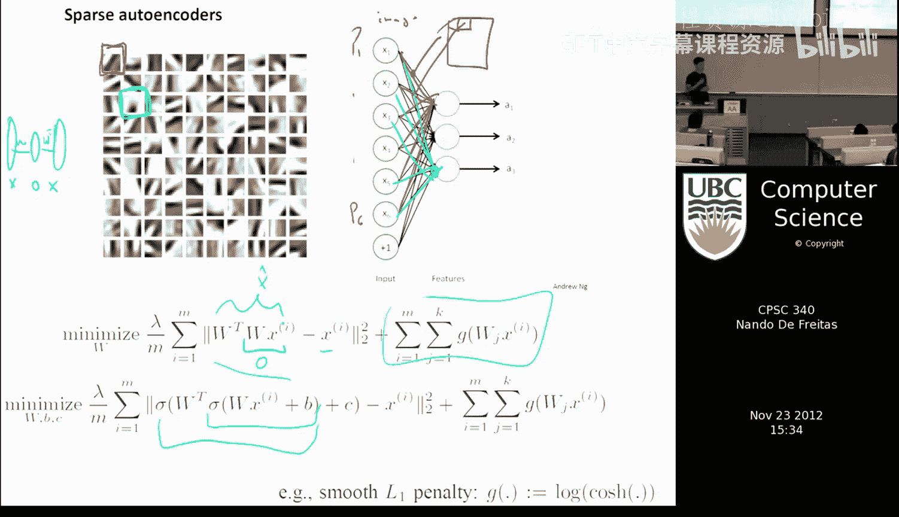

So， this the。

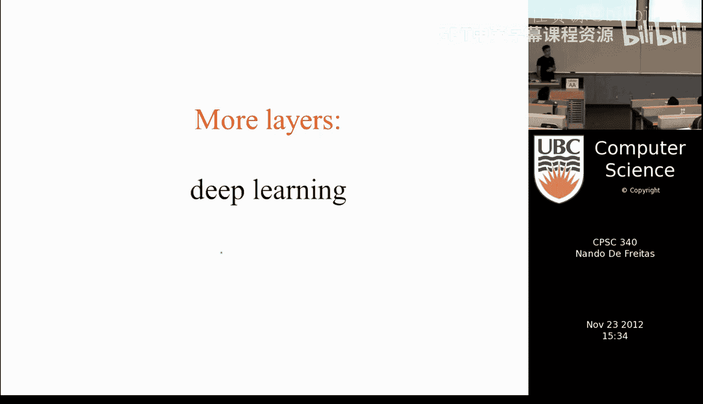

In PC A， you could just take。The basic。Singular values so to the large singular values。Yeah。

 yeah here。Is it straightforward white。maybe some neurons they're similar to each other and we don't need them or does the L1 regulator take care of that and I mean this effectively will sort of do very similar thing to what we did with PCA。

 but with the L1 norm so if you do PCA with an L1 norm， it gives us these bases over here。

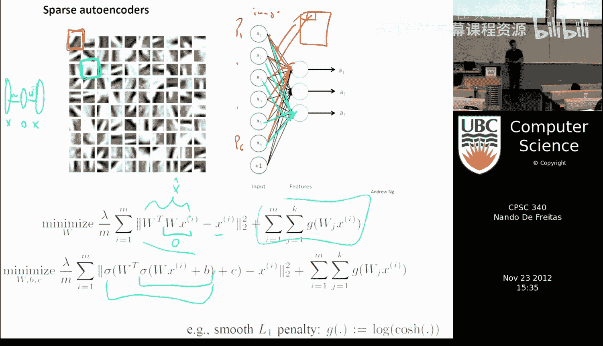

What we're doing here is very similar， but instead of using the SVD， we actually use gradient to set。

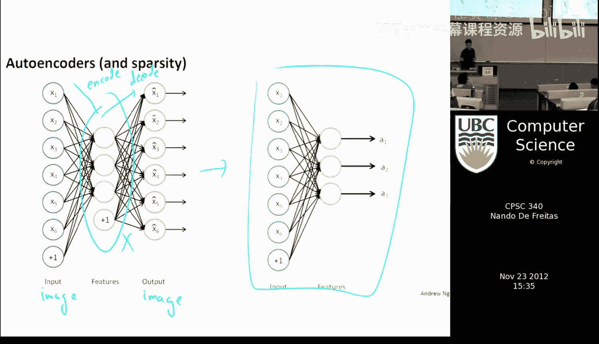

We just do gradient incent to minimize。 in other words。

 the compute derivative with respect to W greater to0。

Don't equ to zero computer derivative and then just follow the derivative。

 And the main reason for doing that is that。The data matrix is so large that doing the SVD actually becomes prohibitively expensive。

The cost of the SV is N Q。And when you have billions of images or so it's not practical at all too。

Try theVD。So this is essentially such an online way of learning that representation。做完了。

If we didn't keep some of the neurons， wouldn't there just be a hole in the image corresponding to？

S is's an ethical point。 There's a sparse thing that it gets sort of。Peatures of that image like it。

But if you don't have that， you don't have a high。Or low singular value。

 then you don't have all these ripples and you don't notice it by。 But here if you don't have。Neuron。

Thered be a full。There be'll be lots of these neurons， and many of them will be similar。

 So even if some are。No， I mean， if I want to represent， suppose I wanted to represent。two。

In order to represent it too， I don't need all possible 20 million orientations and locations of a lie。

You knowWith a few hundred neurons， I can represent it too。

We pretty much will cover all the possible lines that I would need to recostruct it to。

 and there would be a lot of redundancy。So there's 20 million little lines。

So not having all of them activate。It's fine， we'll still be able to get a good reconstruction。Okay。

 everything we've discussed so far is for a single layer。

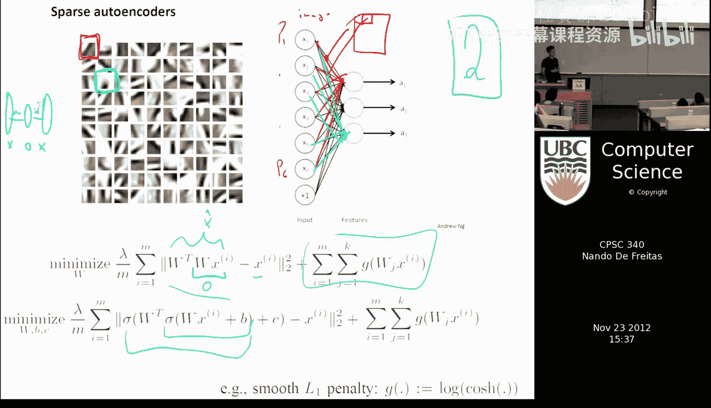

How do I deal with more layers？This is how you go about it。We do this。

What we called the greedy layerwise training， and this was sort of what gave rise to this whole field of deep learning that's become very popular lately。

 and it started with the works of Jeff Heton and Jan Le Khn and Joa Benjo。

The idea is we were going to use。We're going to start with the image。Has the input。

And we tried to predict the image。And what that allows us to do is to learn what the hidden layer neurons。

 which people often call the features。

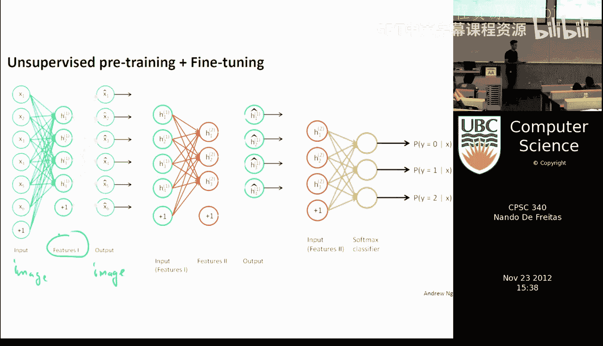

And they're called the features essentially because。

If we go back to the self taught learning case， you can think of these as the features that we're going to use for classification。

It's very hard looking at images to say from an image。

 what are the important things in order to recognize whether an image is a face or not a face。

And in fact， for over three decades， people tried to do it by hand。

 and that's essentially the field of computer vision。And it's a field that failed。

And it's only through learning techniques like the ones that I'm talking about now and next week。

 that that problem of face detection was solved， and now all of you in your cell phones have face detection。

 I think， and that's essentially an application of these ideas。

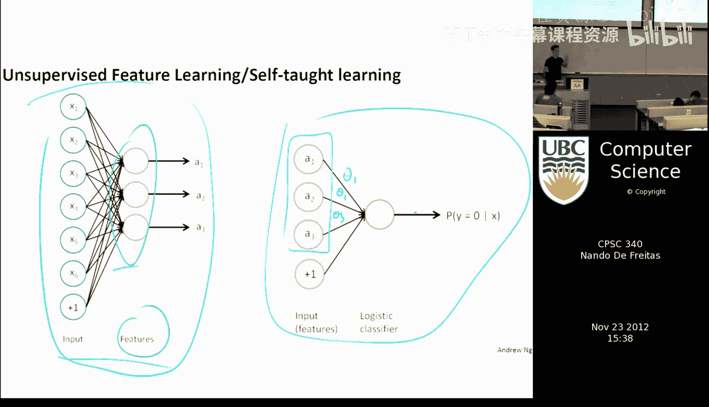

Not easy to do humans do not have the capacity to introspect and be able to actually come up with the rules we saw some illusions in the first lecture that where it was obvious that you actually did not know how you saw and in fact you were surprised by all these change flatness illusions。

Okay， so。Getting back to this， we have the first layer of features。

 and then what we do essentially is we take these features。

And we do a further encoding to get a second layer of features。

So that first layer of features is trying to predict itself。And so on。 And so now， if we take。

The first layer plus a second layer， plus a third layer would。

We've now created a sort of a deep architecture， we start getting neurons。

Embbedded within other neurons。So when you build in a classifier if you to do- so in the end。

 you would just store this。These are your features。 given the features， you can just。

Learn and classify it just like we did before。For transfer learning。And so that's the idea。

 you go from， you learn the first features， then the second features。You learn the final classifier。

 and if you put it all together。You get a deep neural network。

The reason why we trained them like this is because if you just start by writing the full neural network and run back propagation on it。

 it's actually very expensive。Your error terms。Often have these expressions that are the output of a logistic times1 minus the output of a logistic。

 so a lot of these error terms as you doing the chain rule and propagating。

 they tend to go to zero so it' a phenomenon that's called its vanish ins so the gradients give you very little signal so the optimization is extremely slow。

Instead by doing this greedy layerwise training， you can get algorithms that quickly get a good solution。

 and then right at the end when you're done， you can still run back propagation on the full network and just fine tuned the weights。

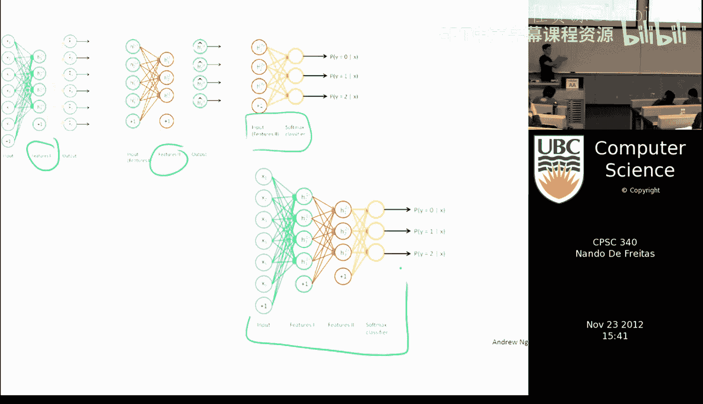

And folks often do that。Now， the Google network。The Google network that made the news。

 has had billions of parameters。 I'll come to some of the details。

It essentially was following this idea， so each of the encoder。

Started with an image of size 200 pixels。Now images， color images are RGB channels。

 so you would have three channels， RGB。Or HSV or whatever encoding you use。

Let's say that they're RGB， red， green， blue。200 pixels。

 And then the first thing that they do is that they only allow。

Each group of eight neurons to be connected to a group of about 18 neurons。

That's to decrease the size of the image。😔，And that first stage of weights is what they call W。

And then they will introduce a further compression， which I will explain soon。Using weights H。

And then they do an operation called local contrast normalization。

 which is essentially standardization。Now， the overall training objective for this neural network is once again。

 this is just reconstruction error， encoding decocoding。They allowed W1 and W2 to be different。

 but they only did this so that they could run it on their 16，000 cores efficiently。

 you could just have W1 the W2 transse。And then the L1 regularizer that they use is the sum of L2 norms。

嗯。This is essentially the L2 norm of the。Of the input time x squared。 So multiplly。嗯。So basically。

 the input goes through two operations of W when we do encoding and decoding。

 and then we multiply times a matrix of weights H in order to get a further compression。

So back to a question that was asked before， here， essentially when I do this。

 I'm actually regularizing the outputs。So I'm basically asking for one of these guys to go to zero。

 so one of the neurons。I'm trying to get rid of。One single neuron by doing this L1 L2 norm。

Theres epsilon that add that's a small number I think 0。1， that's just for numerical condition。

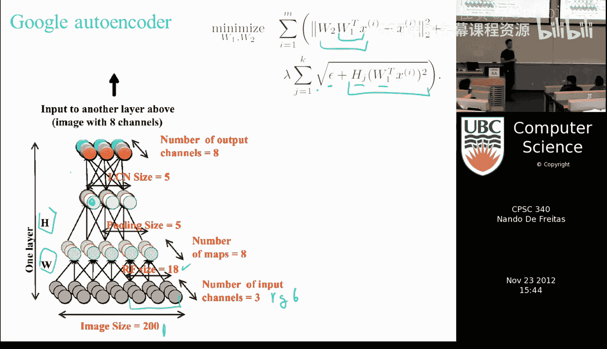

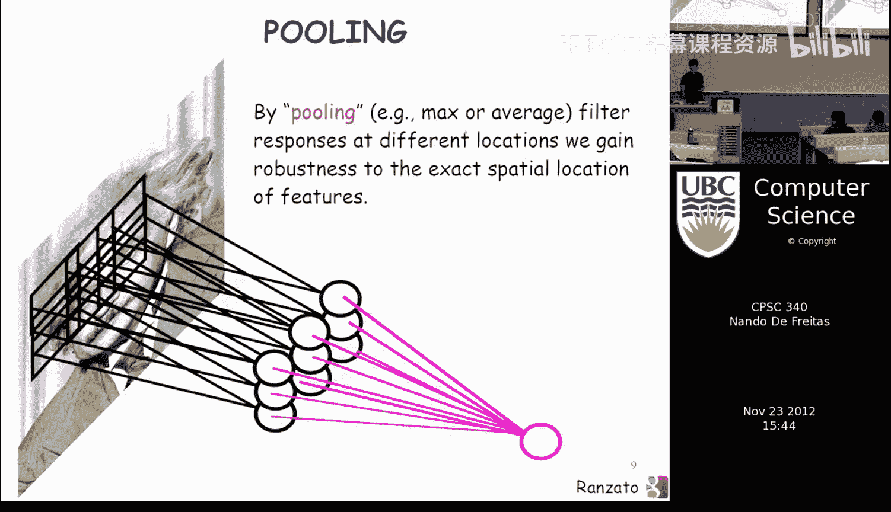

Now， I'm going to now describe these operations poorlying and local contrast normalization。

 This is the first stage is just。

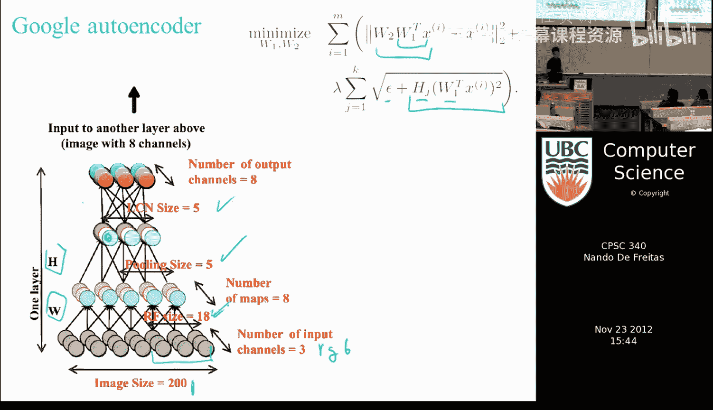

Standard neural network。嗯。Pulling has the objective of trying。 Images are huge。

And so in order to be able to deal， you know， if you take an image。

 theres just 100 by 100 and you assign one parameter to each pixel you already have 1 million parameters。

 So you're very quickly getting to very。Tough computational problems。

What pullinging tries to do is tries to pick an average of a group of neurons in order to compress the image。

So we're trying to just average or pick the level of firing of the largest unit in order to go from a wind of several units to a single unit。

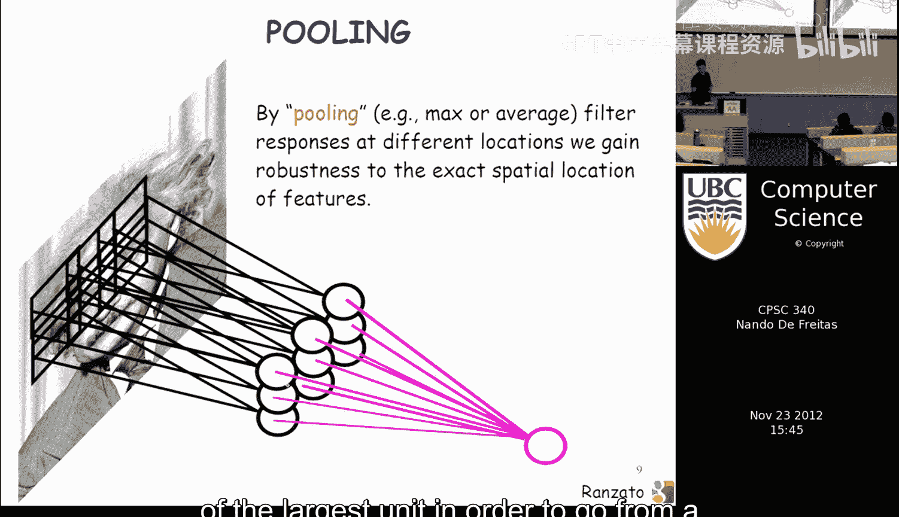

嗯。The form that was used in Google and in fact these operations by the way they don't they actually were invented in the 70s there was a machine called a Necognirant by research called Fukushima that implemented this。

 and since the 70s folks like Yaukku and so on they've been trying all these operations so none of this was new work。

 scientific work for Google， however what Google made possible was to implement this with billions of parameters in 16。

000 core， the sort of thing that only companies with lots of computers and money are capable of doing。

And with good researchers， they had a very good team of researchers， including Mark Correio Rnzato。

 who gave me。His slides。So the idea of pulling is essentially at the next layer。As of neurons。

 as you go from here to here。You essentially take a window。

Of pixels and you just average their squared values and take the square root of that。So it's again。

 some of it's the L1 norm of L2 values。The next operation。

The Google guys apply in order to go from here to here。Is local contrast normalization。

 which is something that we've already learned to do。

Which is to subtract the mean of the data and divide by the standard deviation of the data。

 and that's essentially you make sure that all the data is comparable。

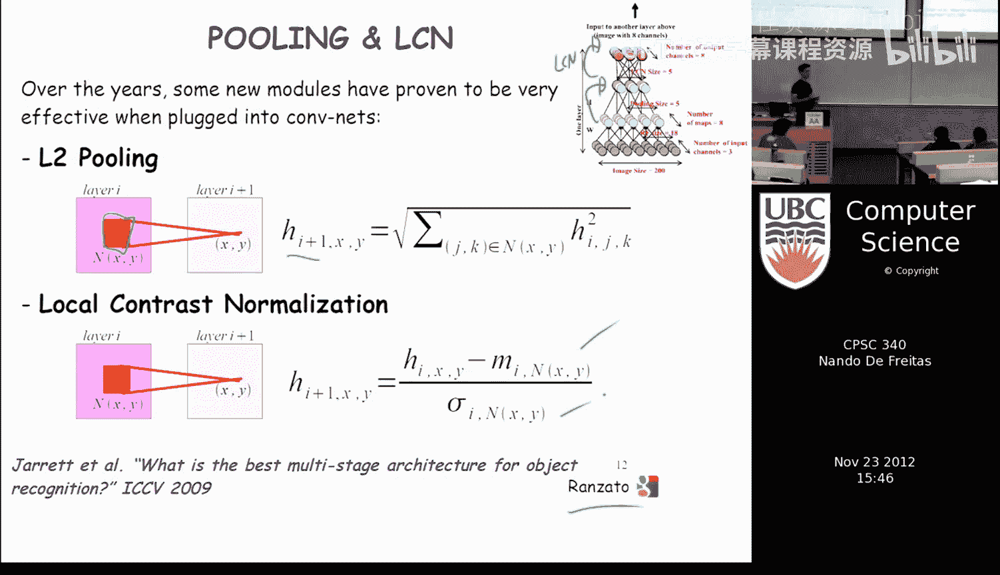

So in more detail， this is what pooling does。If neurons are very similar。

If you just pertu an image slightly， you wouldn't like neurons。deeper。

 if I'm seeing a hand and I move it slightly at the higher level in the layers。

 I would still want my hand neuron to be fiery， so I don't want little perturbations to affect it and the idea of pool is to get rid of these perturbations because if I move it。

 I want nearby neurons。To still fire， so if I have a group of nearby neurons。

And suppose this neuron is most similar to this guide to the first neuron so and it's anti correlated so it fires。

If I have another nearby neuron that fires， I still want my output to remain at one so as long as it's my activation is in the same group。

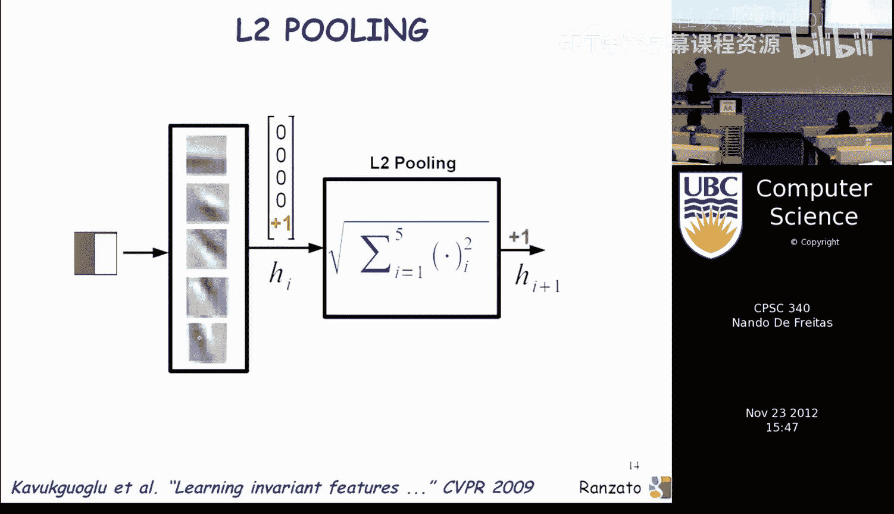

The output neuron will still be active。 That's essentially what it does。 So small distortions。

Do not affect the outcome。Conttras normalization is to do with scale so I mentioned this that when we did linear regression we made all the inputs have the same scale and that's because we're applying the same lambda value of regularizer to all the inputs if you have an input that is if you're trying to classify predict the prices of cars and one input is the number of doors and one input is number of miles per gallon then one input has a very it's a very will tend to be a large number where another input is at just two or four so。

If you do regularization， you'll get rid of one variable much more easily than the other。

And if you change the units to sort of going from gallons。From kilometers to miles。

 then you would have to relearn the network what contra normalization does it。

By subtracting the mean and the V West standard variable， the standard variance。

 it makes all the inputs be between zero sort of be in the range with high probability between0 and1 so that they are comparable。

And that's the idea。 so if you were doing the same， the neuron would fire the same。

If you just scale the input by a constant， so in other words， if the image gets a little brighter。

 if increase， if I switch， if I look at my hand and I switch on the light or switch it off。

 my hand neuron will still be firing， I would still be able to recognize a hand。

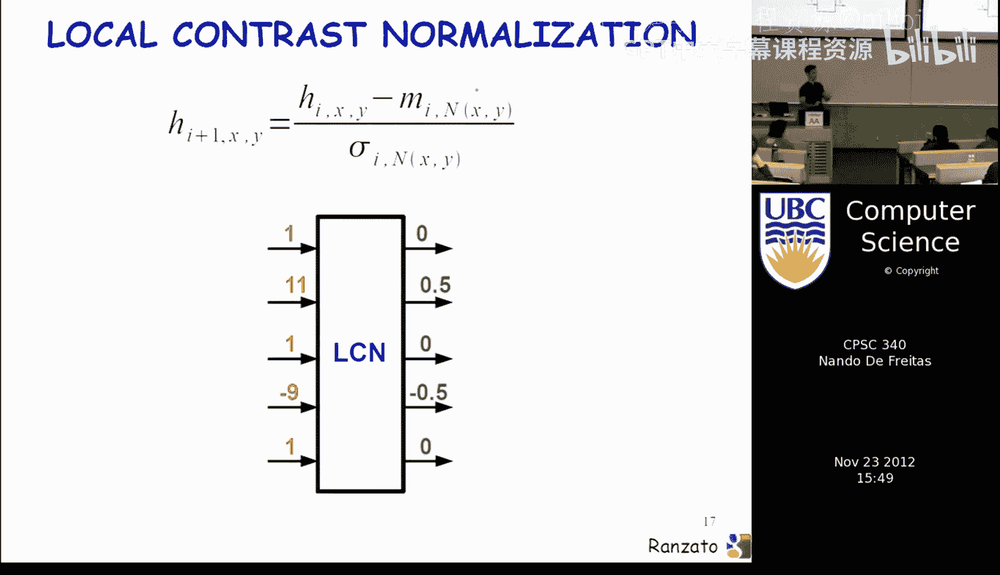

Okay， so I've been talking about neurons that recognize hands and so on。 How do I know this。

 because there are these experiments that show that。Again， putting electrodes in animals。

That specific neurons fire for specific objects in the world。

 like there is there are a group of neurons that would actually fire for any image of hlaberry。

Or in fact， for the name Hallibberry， so the concept Hallibberry is causing a particular neuron to five。

It shouldn't be surprising， somehow we understand what things are in the world and that's encoded in our brain。

There's no magic。Physics。

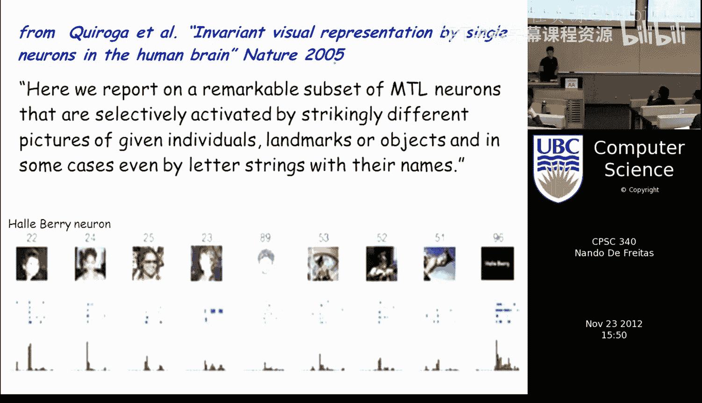

So Google decided to do the following thing。They decided to learn in an unsupervised way using the network that was just describedscribe。

A model that had a note encoder that had1 billion parameters。

 and it used about 10 million images of size 200 by 200， which were just crops from YouTube。

 and here are some of those images。The network consisted of three layers and with three stages。

 which is the sort of sub samplingampling。嗯。Then basically have the contrast pooling and then contrast normalization。

And then they trained。It to reconstruct and the use of sparse regular iss。

 and there's a paper in ICL 2012 that describes the details。

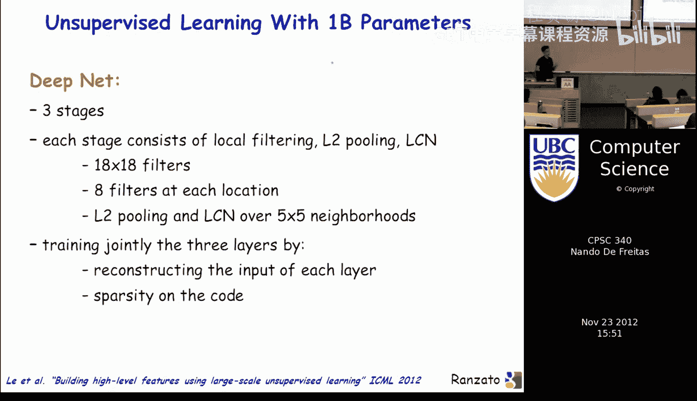

So that's basically each unit consists of this sort of。

Filtering or compression of two pullinging and local contrast normalization， and then you've got。

That's just one stage， and then you have three of these stages， in other words。

 you have three layers。

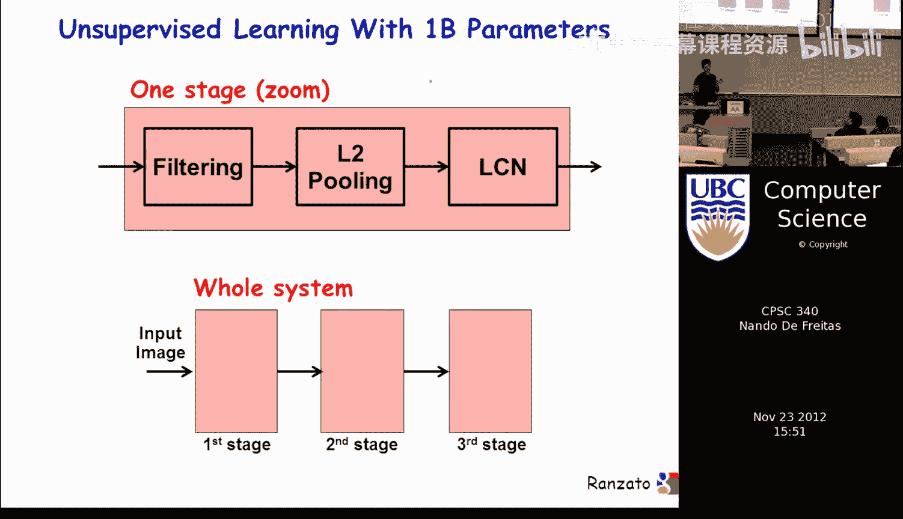

And the first question they had is how do we know that this networks learn something useful？

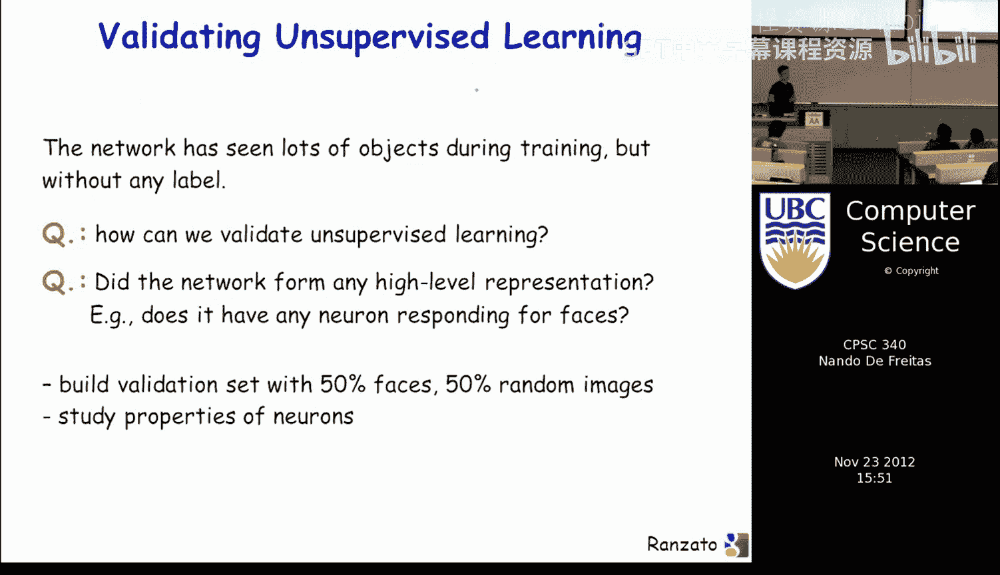

And so。What they did was the following。They took several images。

So the first they trained a network without any supervision。So the network learned for weeks on 16。

000 core。I don't know if it was weeks， but certainly days I would assume。

Once they have trained this network。Then they took a particular urine。In the output layer。

And I checked。When does this neuron tend to fire， so then they showed this neuron a bunch of images of faces。

And they looked at the activation of the neuro， so this is on the X axis in this histogram is whether the neuron fires or not。

 the histogram is essentially account of how many times it fires for a particular activation。

So the number of images for which it fires， so this is the activation and we look at how many images tend to fire for that particular value。

And。Here， it's showing that many images of faces tend to have a higher。

Firring rate than images of non faces， so that neuron tends to fire more for images of faces than four images of non faces。

 so that neuron has learned in a completely unsupervised way to recognize faces。

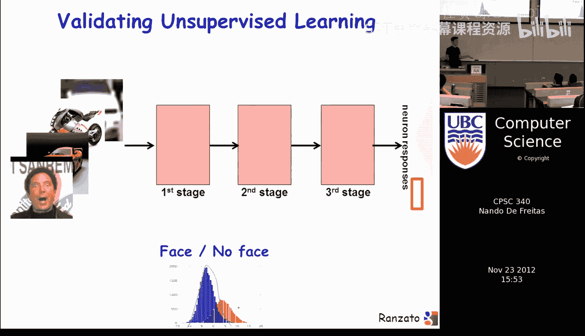

Why do they choose faces？Good question。Prices are。This is what。And he also did cats， and in fact。

 in the New York Time， they used cats because YouTube is full of cats。These are the cats。

Paces is important。Babies are born recognizing faces。

 F is the first thing you need to be able to detect。But they actually did try other classes。

 it would depend on the training data， YouTube has lots of faces and cats。

These are the images that tend to make that nearn fire。Not all of them are exactly basic。

