# 机器学习与数据挖掘：第30讲：深度学习 🧠

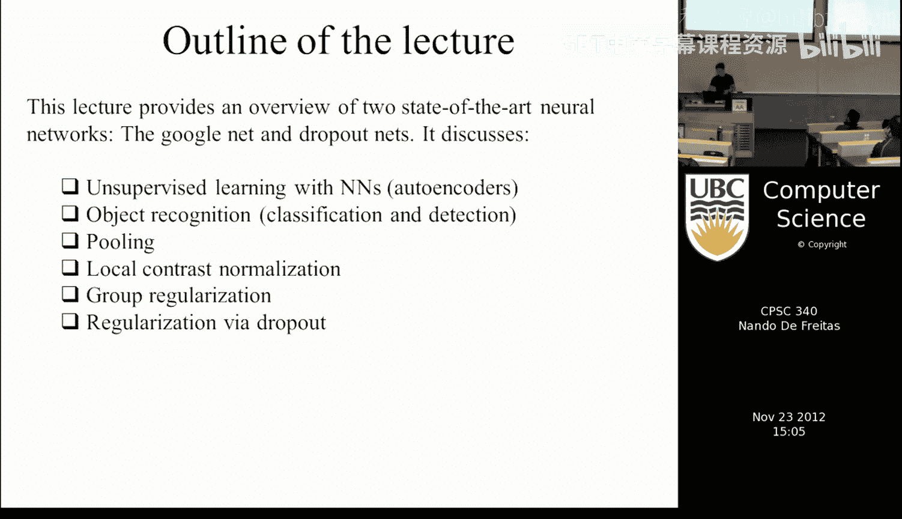

在本节课中，我们将学习神经网络在当今的应用，特别是最前沿的进展。我们将探讨如何利用神经网络进行无监督学习，并深入了解用于物体识别和人脸检测的特定网络结构。课程将涵盖自编码器、池化、局部对比度归一化等核心概念，以及如何通过正则化技术实现不变性物体识别。

---

在上一讲中，我们研究了简单的神经网络。给定一个由输入 `Xi` 和输出 `Yi` 组成的数据集，我们能够拟合一个神经网络（例如绿色曲线）来近似红色数据点。该网络只是两个神经元的线性组合。每个神经元是一个阶跃函数，我们可以通过参数对其进行缩放、平移和翻转。通过这种简单的“砖块”，我们可以构建复杂的回归函数。

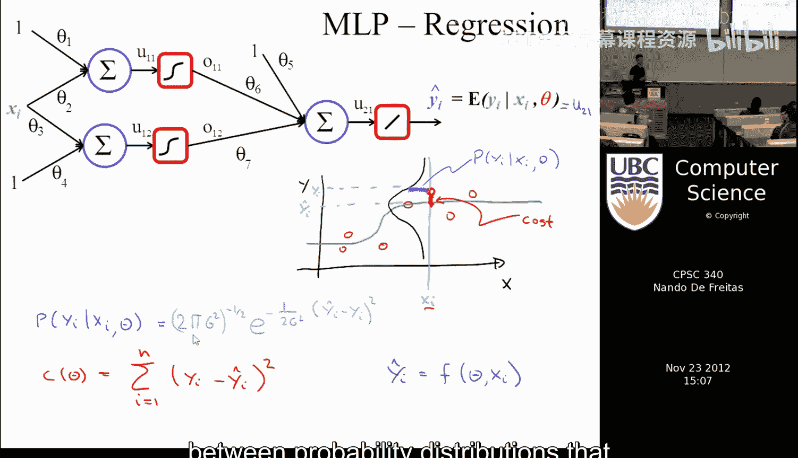

一个自然的问题是：我们应该添加多少个神经元？回答这个问题的方法之一是进行交叉验证。

在回归问题中，我们可以将神经网络的输出视为高斯分布的均值。每个红点 `y` 是真实数据，`y_hat` 是预测值，两者之间的差异构成了成本函数，即我们需要最小化的平方误差之和。取负值并指数化后，本质上就得到了一个高斯分布，这建立了预测 `Y` 的概率分布与成本函数之间的自然映射。

我们通过课堂练习展示了如何使用链式法则计算二次误差相对于任何参数（例如 `θ2`）的导数。一旦有了这些导数，就可以轻松应用在线梯度下降来学习参数 `θ`。

我们还可以使用不同类型的基函数。此外，与线性回归类似，我们可以在成本函数中加入正则化项以获得更好的预测。

我们的成本函数是所有数据案例的总和：
`J(θ) = Σ (y_i - f(x_i; θ))^2`

我们可以很容易地添加一个正则化项：
`J_reg(θ) = J(θ) + λ * R(θ)`

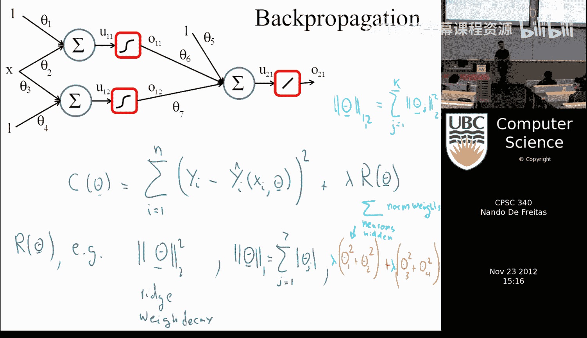

问题在于添加哪种正则化器。例子包括：
*   **L2范数平方**：这会产生岭回归（Ridge）。在神经网络中，这被称为**权重衰减**。它的导数很简单，就是 `2θ`。
*   **L1范数**：即参数绝对值之和。这很有用，因为它会迫使某些参数精确变为零。如果我们有多个输入，这可以有效地决定哪些输入是相关的。

我们甚至可以做得更智能。我们可以引入只关注神经元子集的正则化器。例如，我们可以使用 **L1/L2 正则化器**（也称为组Lasso）。其思想是将与单个神经元相关的所有权参数分组，计算该组的L2范数，然后对所有组的L2范数求和（即L1范数）。这样，我们试图一次性关闭整个神经元，而不是单个连接。

这种平方和项在我们解释Google网络时很快就会再次出现。

---

我们学习了如何用神经网络进行监督学习。但如何用神经网络进行无监督学习呢？在本课程中，我们见过无监督学习的方法，例如SVD（主成分分析，PCA）。PCA的目标函数本质上是：给定一个图像矩阵 `X`，找到两个矩阵 `B` 和 `C` 来近似 `X`。对于PCA，我们发现最优解是SVD分解，其中 `B = UΣ`，`C = V^T`。

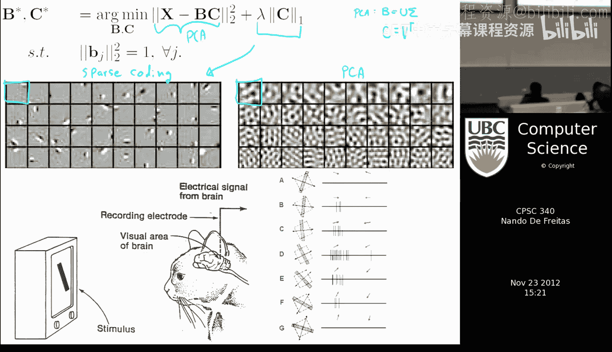

如果我们在PCA的目标函数中添加一个惩罚 `V` 向量大小的额外项，就会得到**稀疏编码**。PCA得到的基向量（特征向量）看起来像全局模式，而稀疏编码得到的基向量看起来像**边缘检测器**（一边亮、一边暗的图像块）。这是因为稀疏性惩罚促使学习到的特征对图像中的局部对比度（边缘）敏感。

我们希望机器学习系统能学习到类似边缘检测器的特征，这源于Hubel和Wiesel的经典实验。他们发现，猫的初级视觉皮层（V1）中的神经元对特定方向的边缘有选择性反应。因此，能够构建检测边缘的机器学习技术非常有用。

---

以下是用于以无监督方式训练神经网络的解决方案，称为**自编码器**。

基本思想是：将图像作为输入，让神经网络预测相同的图像作为输出。换句话说，训练数据就是输入本身。如果你能闭上眼睛预测所见，你就能理解世界。你试图预测观察到的所有图像。

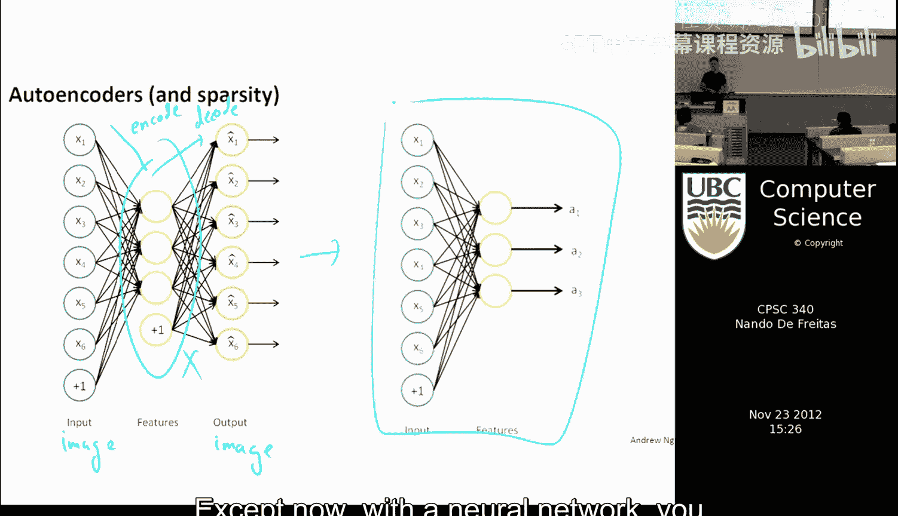

为了使这有意义，我们需要引入一个**瓶颈**。我们创建一个隐藏层，并希望该隐藏层的神经元数量少于图像的大小。这样，我们就能压缩图像，然后再从压缩表示中解压（重构）图像。如果我们能做到压缩和解压（即编码和解码），并成功重构图像，那么实际上我们就学会了图像中的重要内容。

训练完成后，我们可以忽略用于重构的解码部分权重，只关注神经网络的第一部分。这本质上现在是一个**编码器**。给定一个高维图像，它将其投影到一个低维空间。可以将其视为非线性的PCA，能够获得图像的低维表示。

自编码器的另一个优势是**迁移学习**（或自学习）。例如，我可以在非洲用数十亿张图像训练一个这样的神经网络。当我搬到加拿大，需要学习识别新物体（如浣熊）时，我只需使用神经网络输出的激活值（即学习到的特征），然后只需学习几个参数（例如进行逻辑回归）即可。其思想是，我已经以无监督的方式预先学习了所有高级特征（如獠牙、皮毛），在新环境中可以快速应用。

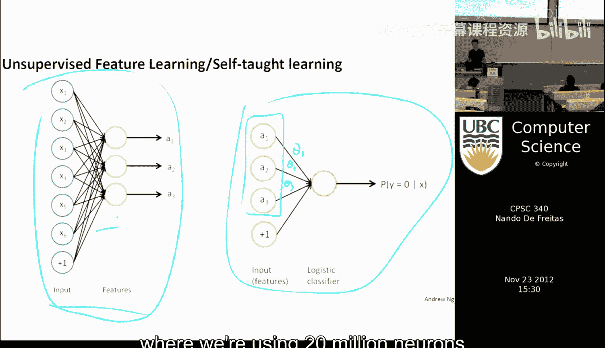

人们通常以两种方式训练这种神经网络进行重构：
1.  使用线性单元：输入 -> 隐藏层 -> 输出（重构）。权重矩阵 `W` 和 `W^T` 用于编码和解码。我们最小化重构 `x_hat` 与原始输入 `X` 之间的差异，并添加正则化器。
2.  使用Sigmoid神经元：通过一组Sigmoid函数进行编码，然后解码。

为了获得之前展示的边缘检测器那样的滤波器，关键在于添加正则化器。实际上，我们甚至不需要非线性函数，只需使用线性神经元和合适的正则化器（如L1正则化）即可。如果不使用正则化器，只会得到PCA基（全局基），这与我们在V1中观察到的不匹配。

在自编码器中，每个滤波器图像对应于从所有输入像素连接到单个隐藏层神经元的权重向量。我们可以将这些权重可视化为一个图像。为了获得稀疏基，我们需要添加某种形式的L1正则化。

这与带L1范数的PCA非常相似，但我们使用梯度下降来最小化目标函数，而不是使用SVD。主要原因是当数据矩阵非常庞大（例如数十亿图像）时，进行SVD计算成本过高。梯度下降提供了一种在线学习该表示的方法。

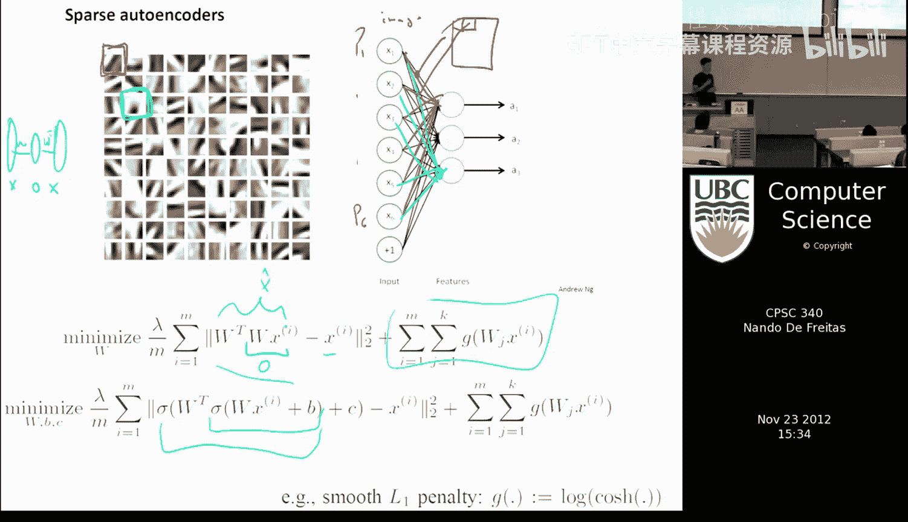

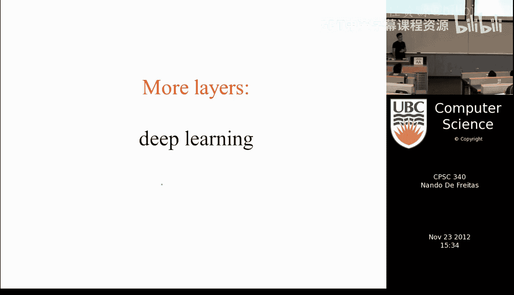

---

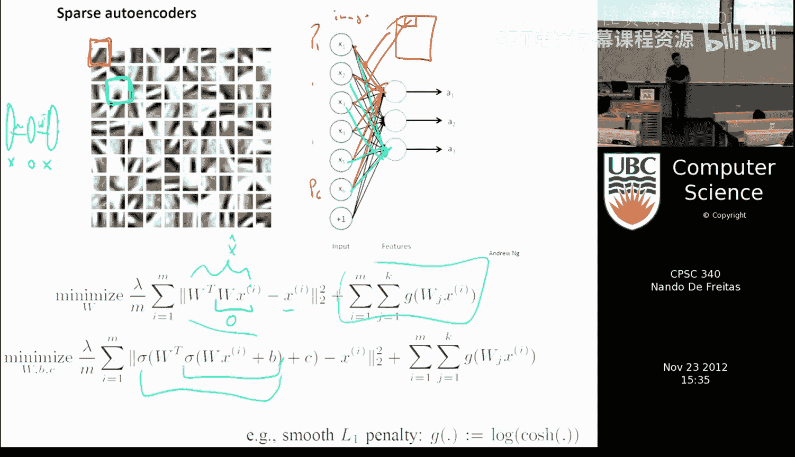

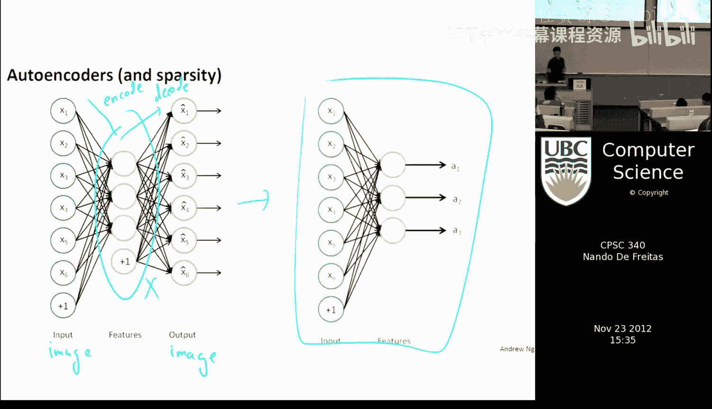

到目前为止讨论的一切都是针对单层的。如何处理更多层呢？我们通过**贪婪逐层训练**来实现，这催生了最近非常流行的深度学习领域。

其思想是：
1.  从图像作为输入开始，尝试预测图像本身，以学习第一层隐藏神经元（特征）。
2.  然后，将这些第一层特征作为输入，再次尝试预测它们自身，以学习第二层特征。
3.  重复此过程。

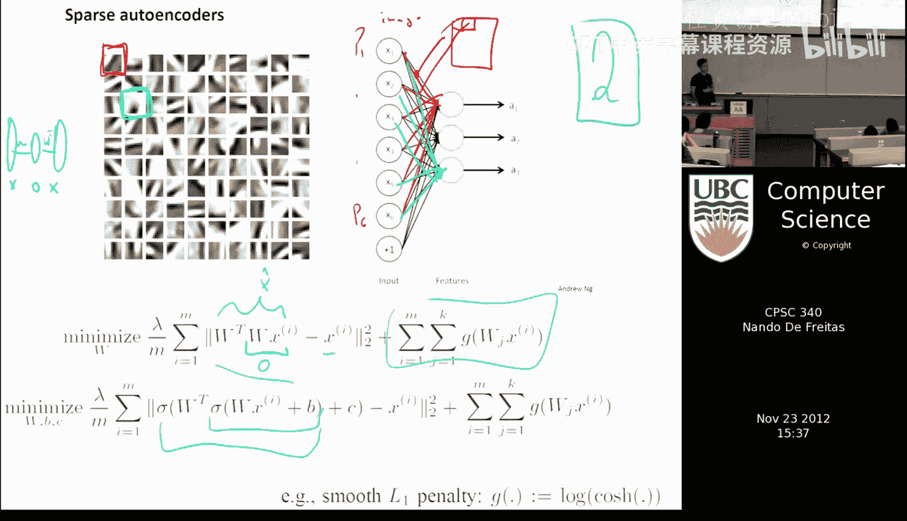

这样，我们就创建了一个深度架构，神经元嵌套在其他神经元之中。最终，我们可以将这些学习到的特征用于分类（例如，在顶部添加一个分类器）。如果将所有部分组合起来，就得到了一个深度神经网络。

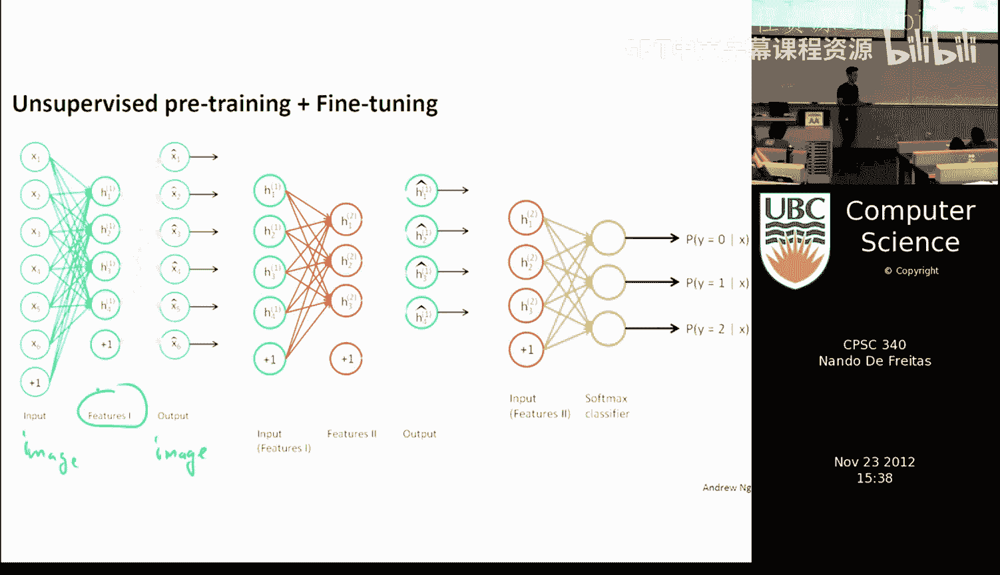

我们这样训练的原因是：如果直接编写完整的神经网络并对其运行反向传播，计算成本非常高。误差项在通过链式法则传播时，由于Sigmoid函数导数的性质，往往会变得非常小（称为**梯度消失**问题），导致优化极其缓慢。通过这种贪婪逐层训练，可以快速获得一个良好的初始解。最后，仍然可以在整个网络上运行反向传播，对权重进行微调。

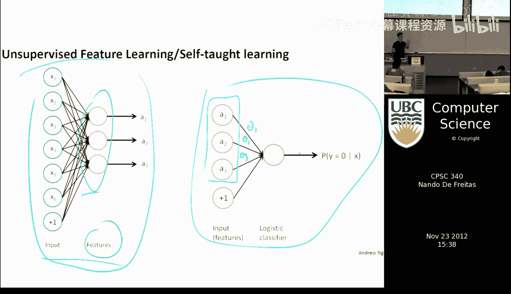

---

现在，我们来谈谈登上新闻的Google网络。它拥有数十亿参数，本质上遵循了这个思想。

网络从200x200像素的彩色图像（RGB通道）开始。首先，他们只允许每组约8个神经元连接到下一层的约18个神经元，以减少图像尺寸。这个第一阶段的权重称为 `W`。然后，他们引入使用权重 `H` 的进一步压缩操作，以及称为**局部对比度归一化**的操作（本质上是标准化）。

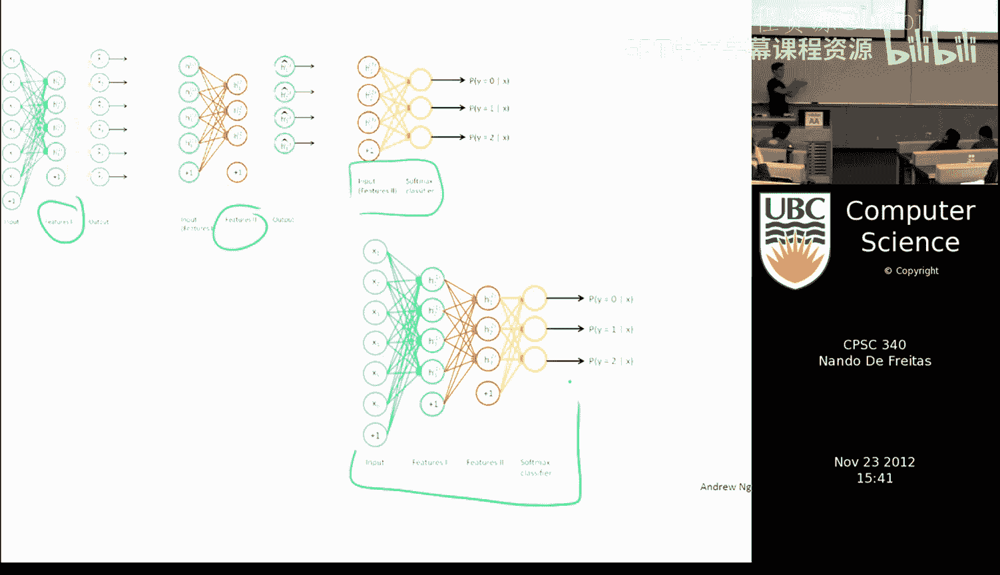

这个神经网络的整体训练目标仍然是重构误差（编码-解码）。他们允许 `W1` 和 `W2` 不同，但这样做主要是为了能在16,000个核心上高效运行。他们使用的L1正则化器是L2范数之和（即组L1/L2正则化），目的是让整个神经元（而不仅仅是单个连接）的输出趋于零。

接下来，我们详细描述**池化**和**局部对比度归一化**操作。

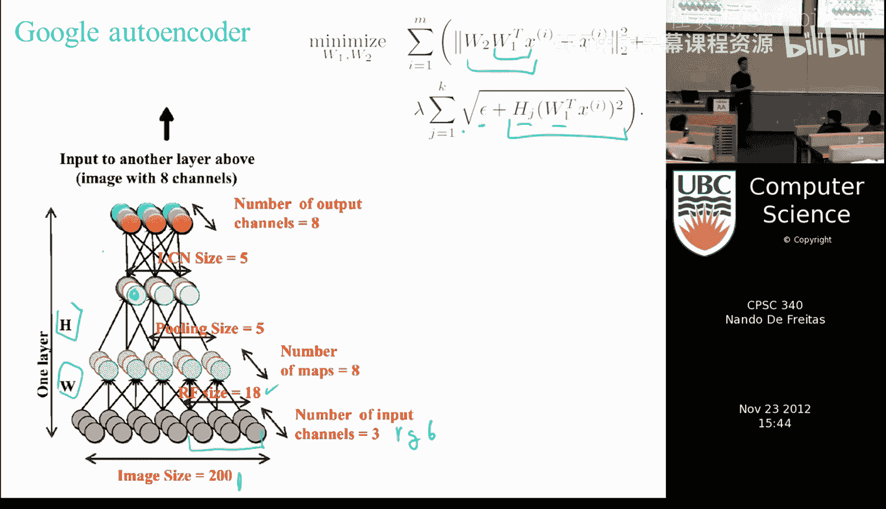

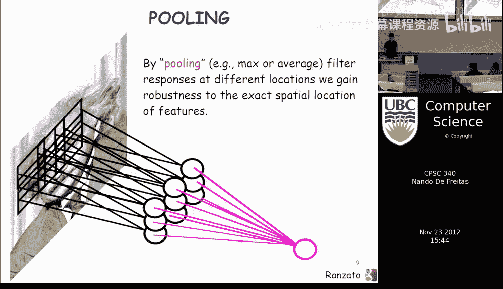

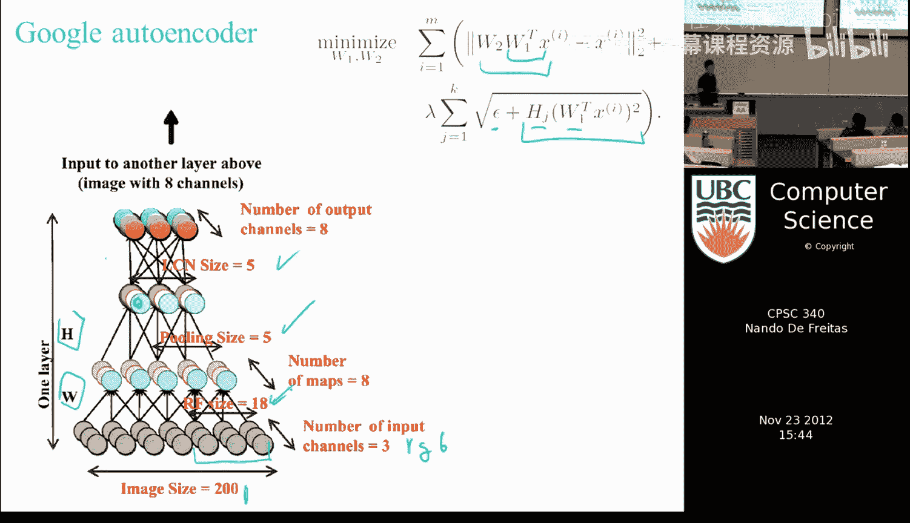

**池化**的目的是处理大图像并引入一定的不变性。图像非常庞大，如果为每个像素分配一个参数，很快就会面临巨大的计算问题。池化试图通过取一组神经元的平均值或最大值，将一个小区域压缩为单个单元，从而减少数据尺寸。在Google网络中，池化操作是取一个像素窗口内值的平方和，然后开平方根（本质上是该窗口的L2范数）。这样做的效果是，如果图像发生微小扭曲或平移，只要激活发生在同一池化区域内，输出神经元仍将保持活跃，从而获得对微小变形的不变性。

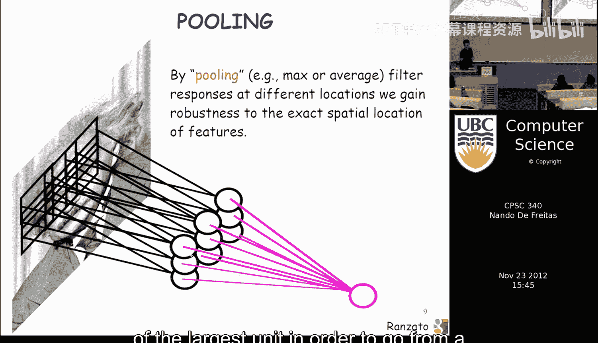

**局部对比度归一化**是我们已经学过的操作：减去数据的均值并除以标准差。这确保了所有数据具有可比性。在线性回归中，我们对输入进行标准化，以便正则化器对所有特征公平对待。同样，在神经网络中，对比度归一化确保输入在亮度等变化下保持稳定。例如，无论光照条件如何变化，手部神经元都应保持激活状态。

---

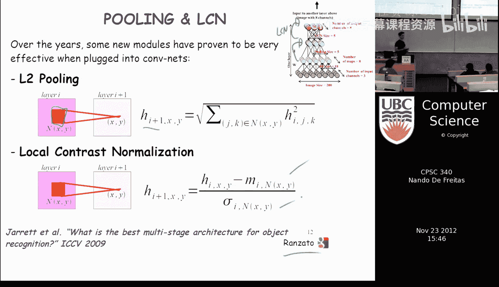

Google决定做以下事情：他们使用刚刚描述的网络，以无监督方式学习一个拥有10亿参数的自编码器模型。他们使用了约1000万张从YouTube截取的200x200大小的图像。网络包含三层，每层都包含子采样（池化）和对比度归一化操作。他们训练网络进行重构，并使用了稀疏正则化器。

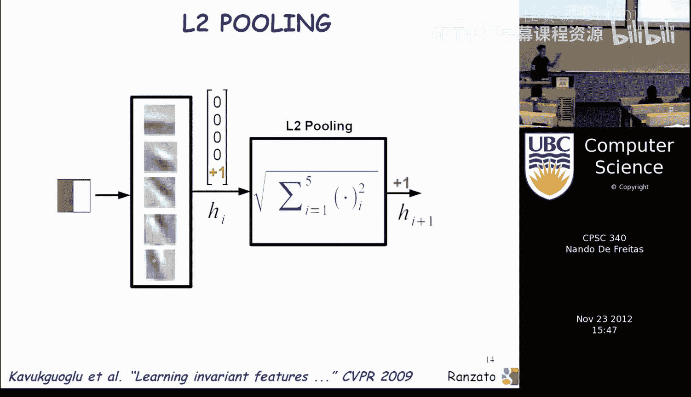

一个关键问题是：我们如何知道这个网络学到了有用的东西？

训练完成后（在16,000个核心上训练了数天/周），他们选取输出层中的一个特定神经元，检查它何时倾向于激活。他们向这个神经元展示一系列人脸图像，并观察其激活直方图。结果显示，许多人脸图像比非人脸图像更能激发该神经元。这意味着该神经元在以完全无监督的方式学会了识别人脸。

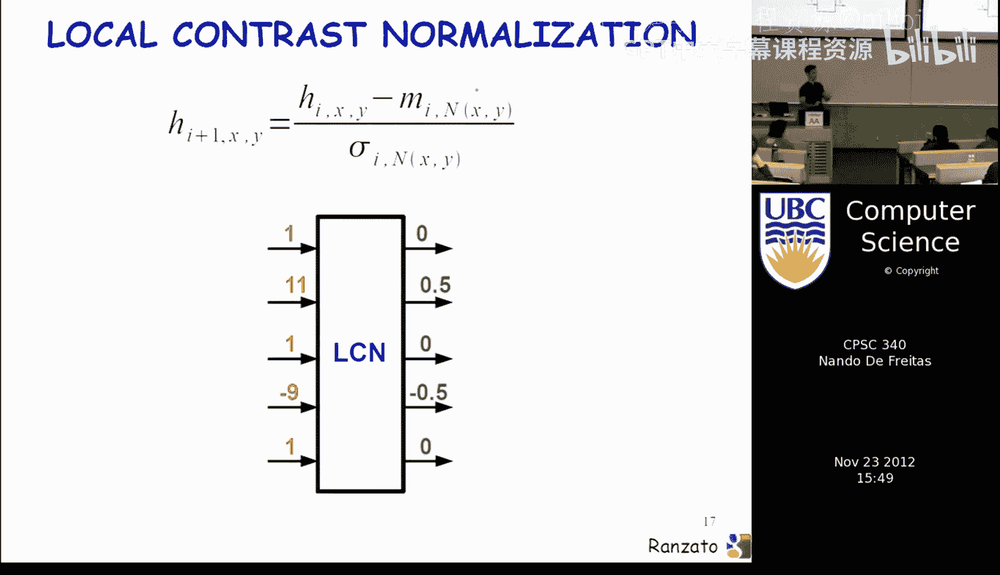

他们为什么选择人脸？因为人脸识别对婴儿至关重要，是首先需要检测的东西。同时，YouTube上也充满了猫的视频，他们也尝试了猫的类别。这些是倾向于激发该神经元的图像。

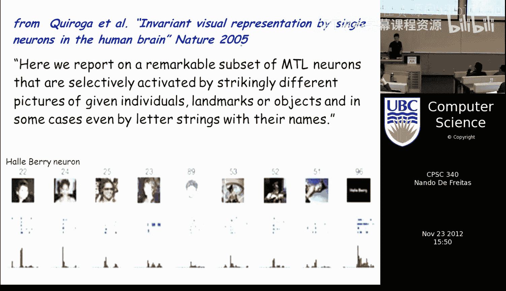

---

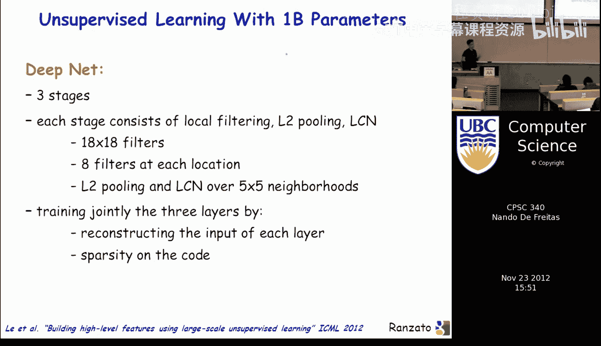

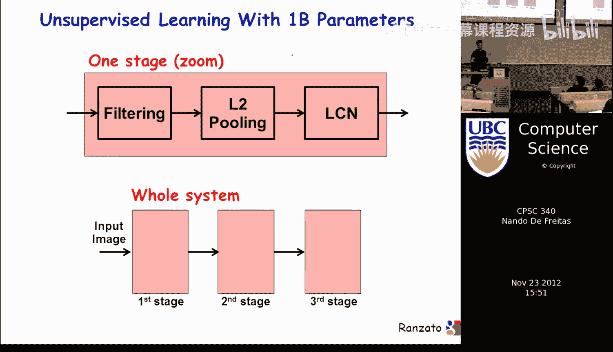

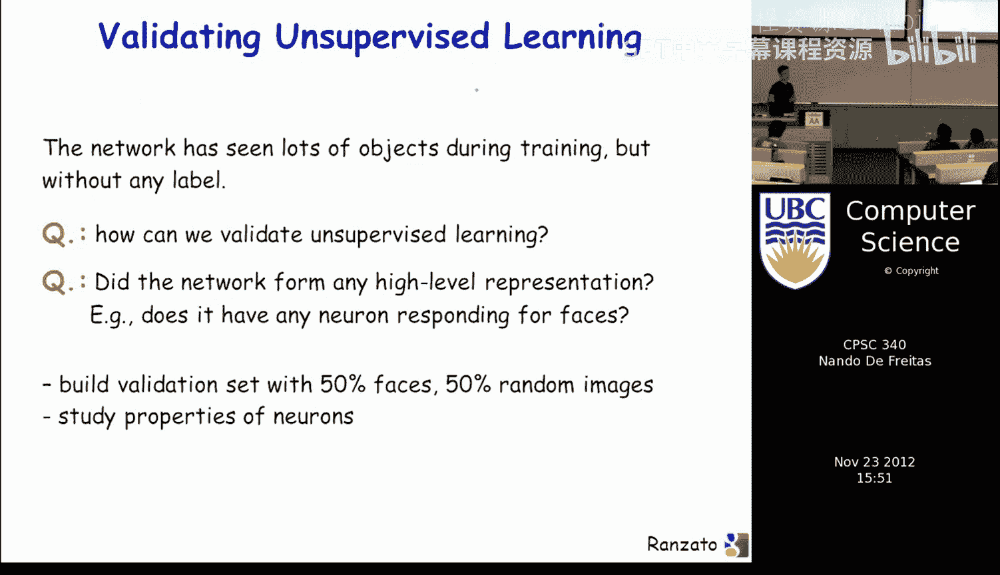

本节课中，我们一起深入探讨了深度学习的核心概念与应用。我们从回顾简单的监督学习神经网络开始，引入了正则化技术（如L1、L2及组L1/L2正则化）以改善模型。接着，我们转向无监督学习，重点介绍了**自编码器**，它通过编码-解码结构学习数据的高效表示，并可用于特征学习和迁移学习。

我们探讨了如何通过**贪婪逐层训练**构建深度神经网络，以解决梯度消失问题并学习层次化特征。最后，我们剖析了引起轰动的Google大规模神经网络实例，了解了其利用**池化**实现空间不变性、利用**局部对比度归一化**实现亮度不变性的机制，并看到了无监督学习如何能自动发现诸如“人脸”或“猫”等高级概念。

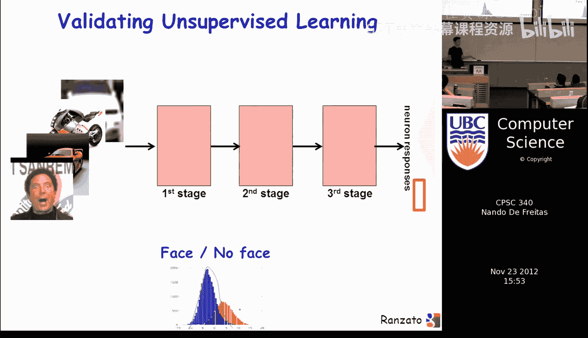

通过本讲，你应该对现代深度神经网络的基本构件、训练策略及其在复杂模式识别任务中的强大能力有了系统的认识。