# UBC《机器学习和数据挖掘｜CPSC 340 Machine Learning and Data Mining 2012》中英字幕 p31 -31-undergraduate machine learning 31_ Decision trees.zh_en -BV1pJ2ABFEFg_p31-

Start overfitting these announcements。Okay， so today's class is about decision forests。

 it we've reached now the last week of classes， so it's the last topic of decision trees and decision forests a forest is。

Many trees。And so in order to learn decision for us was just one of the。

Also known as randomand forests， which is one of the top classifiers these days。

 we first need to learn what a tree is， what a decision tree is。

 once we know how to do trees which we will get to today。

 we'll introduce random forests on Wednesday， and I might finish actually with lectures on Wednesday and then just the Friday for a Q&A or for discussing the competition results。

Or I might just have some examples on Friday。But certainly I'm aiming to end the content of the course on Wednesday。

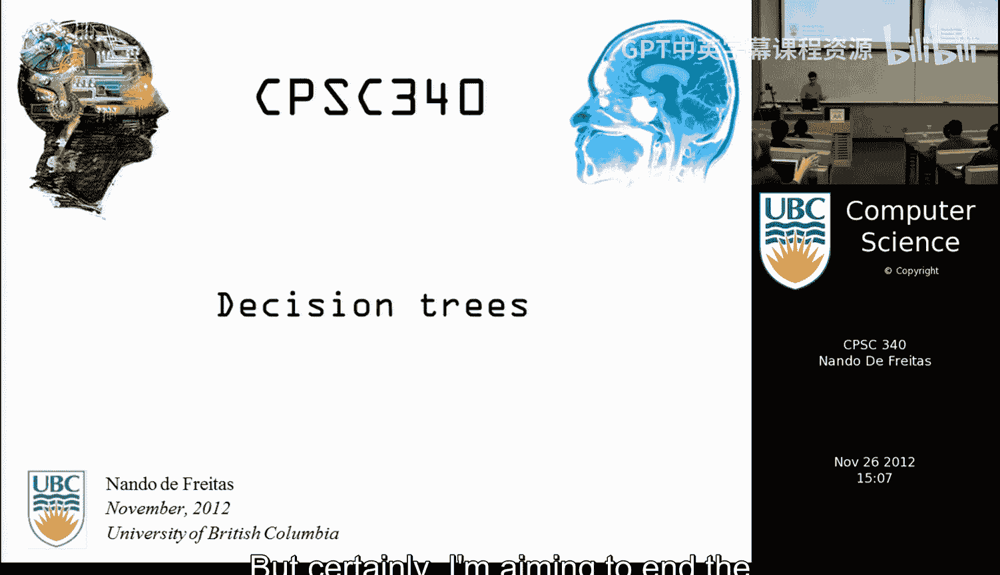

All right， so today's class， the objective is for you to learn what a decision tree is。

 how to construct a decision tree。And for that， we will essentially use entropy。

And then we'll see how we can apply decision trees to classification。

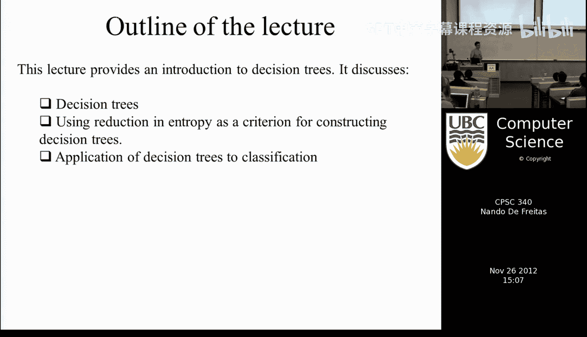

Let's start with some motivating examples。Oh shop。That吃 better的。

So let's talk with some motivating examples of one application of using trees。

And then combining trees to make forests is object detection。

These days all of you have in your cameras and with the techniques that we're going to cover it's actually quite trivial for you to go and build one of these provided you can get a very large data set of images that are set faces and images that are not faces。

 the rest will be trivial for you。It's just off the level of the competition。

 sit down and with a bit of time， you have your face detector。

 but it's not only that you can have a face detector， you can have a detector for anything。

 you take a very large data set of pictures of pedestrians and non pedestrians and you can build a classifier that will tell you whether a segment in an image is a pedestrian or not。

So essentially， what we do is we go over the image with a box at all possible scales。

 And we see whether this box is a pedestrian or not。 And we just classifiedify the boxes。

 And that's what you see there is potentially highlighted。

Where the algorithm has classified the box to be a pedestrian， some of these boxes。

 like the ones we see here at the bottom in red， they correspond to misclassification。

 so the algorithm failed there。And you can detect pedestrians， you can detect cars。

 and so if you're going to be building the cars of the future that drive by themselves。

 this is sort of core technology。Here's another example of what we're going to apply decisionion for us。

 and we will look at the exact details of this example for those of you who have played with the Connect。

The connect is a sensor。It projects a grid on you so that it's a camera that senses depth。Basically。

 so it knows the depth of each pixel。 How far is each pixel from the cup。And that's what you buy。

 you buy the sensor， you put it in front of your TV。And then from the depth image。

 it learns to predict。Whether a pixel is an arm or a leg or a torso。

And it's essentially uses context because usually you don't get your leg up above your head。

 And so just， but you can get your hand。And by doing that， it can predict。

Where your arms and head and so on are。 And so you can do what these folks are doing there。

 They can the connect sensor is just there under the TV。And so， it's。Looking at them。It's， in fact。

 projecting a grid on them so it knows it so it has。It's an active sensor。

 projects a grid and so it knows your depth so you can do it at nighttime even because you can switch off the lights。

 it's an infrared sensor so it will know where you are and you can play games and then the characters on the game do what you do in real life。

And there would be more application than just games for such a sensor。

 because if you want the robot to interact with you。

 it's nice for the robot to know exactly what you're doing when you're approaching the robot。

 if you're approaching the robot like this，You knowThe robot should react differently than if you're approaching the robot like this。

So for。Kind of silly， but it makes sense， you can't interact with people unless you understand。

Their intentions。O。That's where we're going to get to。 But first， we need to learn where a tree is。

 So a tree for us will be a structure like this structure here on the left hand side。

 It will have a root node。So the root of the tree， so it's more like a US your standard computer science tree。

And then it has internal nodes， and at each node you make a decision。So at each note。

 we're going to make a decision at the note。And eventually the tree ends somewhere and those last notes we call them leaves。

So the idea here is that if we have a data set。So we have some red data。And some green data。

so we have five data points， then the decision for us might learn to do something like。

Said most of were the reds in one side。Actually let let me do this in two goals。

So when the first decision might just favor to put most of the points on the right hand side like it does。

 but eventually its objective is to try to separate the points so that，In effect， all the reds。

And in one side， all the reds and the grains that end at different leagues。Okay。

 let me say this again， because in drawing。嗯。I wasn't being clear， so we have five points， three red。

 two green。The first node has to make a decision， whatever that decision is。

 it decides to split the data， so it sends one point to the right and it sends four points to the left and then a new decision gets applied to those four points and that decision then separates the two red from the two green and eventually at the leaves。

The hope is that you will have leaves that will only be red and leaves that will only be green because then given a new point。

 you pass it through the tree， through the chain of decisions and you're able to predict whether it's a green point or whether it's a red point。

On the right hand side， there' is a more concrete picture of this。

 So here is an image classification。Task and the objective is to say whether your photo is an indoor image or an outdoor image。

And so the first question you might ask is the top of the image blue， Does it have a lot of blue。

 if it has a lot of blue， then it checks， is the bottom part also blue。If it's。

Because then if it was blue and blue， it might be an indoor scene。

But if it's blue on top and the bottom is not blue， quite likely it's an image of an outside。

 So if it's false。哦。Then you keep going down until you reach the decision that it's an outdoor image。

So the idea is we're going to do many of these tests。

And how to do these tests will be the sort of things we will go over。

 I'm going to go over many examples。Today and Wednesday concrete examples today we're going to do an ecommerce- commercemer supplication of tests and then on Wednesday I'm going to come back to this image recognition and we'll learn how to build a face detector or a pedestrian detector and we will learn how to build a classifier of a random forest if we wanted to do it。

Okay。Okay， so。So the goal is just to make sure that there aren't。Like red and blue in the same leaf。

 because you want to classify。 You want to separate。And originally， you do not have a tree。

We will construct all your harvest training data。So we start again。

 we have training data and the objective is to do classification。

 and let's say we're classifying into two classes red and green。

And so what you do is with the training data， you try to create nodes。

 you try to pick nodes that will split the data。The most。

And we will make this very precise soon with an example。嗯。And once you've constructed the tree。

 a test time。All you do is you just put in new data， the test data through the first decision。

If it passes it， it goes right， if it fails， it goes left。

And then you keep going through the tree like left right， left right， and then you get to the bottom。

 so like that example on the right， you have a new image。

 you just do a sequence of tests and then based on that sequence of tests。

 you say whether it's outdoor or indoor。So trees are nice because they very they're easy to interpret like any of us can look at that picture on the right hand side and we can understand what it's doing in that sense。

 they're nicer than neural networks， they're not like all these sigmmaoids Scott knows what they're doing and this L1 L2 regular rise blah。

 blah， blah， so this is an easy picture to look at and figure out okay what's going on。

Is it just visual like is there another way to interpret the data？Makes the tree better。

Like think don't kind visualization it。It's visual and you also can sort of get lists of ranked like what are the decisions that are the most important？

And that's going to come to what are the features or that are the most relevant to reach to classify the date。

 which of these genes is the one that's more relevant to the decision？

So random forests will do essentially what lawsuit suit did for us。

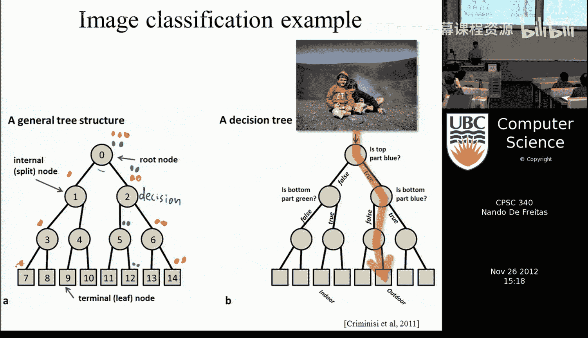

All right， so here's another sort of visualization。

 an alternative visualization for random forest for classification。

 so in this case I have four classes。So we classifying into four groups and this is my training data。

 so my training data in colors like the blue data， that means that it's my training data for the blue class。

 this is my training data for the green class and then I do have some test data。

And the data is essentially a vector in 2D in this case。Or it could be a much bigger vector。

 it could be just like in the gene data， if you want to classify whether a patient has cancer or not and you're using all the genes。

 so and you're using 20，000 genes， then it's a vector in 20，000 dimensions。

In this case for visualization， I'm doing this in 2D。This example by the way。

 comes from this paper which is posted in the Google group。

 this is the Microsoft Techical report on Deccision For us， which is beautifully written。

 it's very tutorial， it's a great read for anyone who wants to learn more about these techniques。嗯。

Better than any book out there。 So I really strongly recommend you。Look at that tutorial。

So we have these four classes， we have some test data， and so originally the number of red。

 a number of green， a number of yellow points is the same， so when you build a classifier。

And you look at the probability of each class。Given the inputs V and the Microsoft guys use V for vector instead of x。

So you have your input vector， and then you have your classes sQL 1， sQL 2， sQL 3 and SQL 4。

 or blue and yellow red green， and originally all the classes are equally likely we're going to come up with some decision and the decision could just basically be aligned line。

Any simple classifier。The trick is where you're going to use classifiers that just have to be epsilon better than random。

These classifiers need not be very good， but if you have many slightly better than random decisions。

 your final decision will be a very good one。If each of you were to give me something that was better than 50% in the Twitter classification。

I could construct a classifier that would be guaranteed to be no worse than any of your classifiers。

The doubt would be， that's the idea of force。Not easy to prove， but。

Fenddent Sha here proved this result and they actually got a good deal which one of the top theory prizes for their work。

One of the top computer science prize。Using a technique very similar to random forest is called boosting。

 I'm not going to cover boosting， we do it in 540 but。

Running for is kind of those very similar things。The Microsoft guys use the thickness of the line to indicate how many data points went to the right。

 how many point data points went to the left。During the train。

And so the idea is that as you go down one branch。The hope is that when you get to the leaf。

 most of the points in one leaf will be of one class。So they will not， each leaf will， unfortunately。

 not be exactly green， green or red or blue。And why is that the case？对对。

Like if the that's one reason。ないです。Noise， precisely。Okay， so data is noisy。

 so quite often you'll have a data that。Just small perturbation。

Will look like belongs to another class even though it belongs to another class。

 so we can split it exactly and so it will end up。At another leaf。

 And also because our decisions are not， our decisions are not perfect。

 Our decisions will be just simple boundaries。 And so some。

Some of the points will be assigned to the wrong class， but the hope is that at our leaves。

 most of the distributions that we get for each class look like that， they're very picked at one cup。

 so any point that falls in that leaf I would classify as red。I wouldn't just say it's red。

 I would say the probability that it's red is 80%。That's the nice thing about random forestry。

 they will give you a probabilistic classification。So whenever you have a new input。

 you go through the leaves and when it reaches a leaf。So you go through all the node。

 the root node and intermediate node until you reach the leaves， when it reaches a leaf。

 what you output is those four bars， the probability of it being read。

So these four bars here at the bottom。whichch indicate the probability of it being of each of the classes。

 so if I were to put this point， this point will probably end up somewhere here。Where。

You will have small blue， big， yellow， small red， small green。Okay。

 so you'll be able to classify the 0。12。

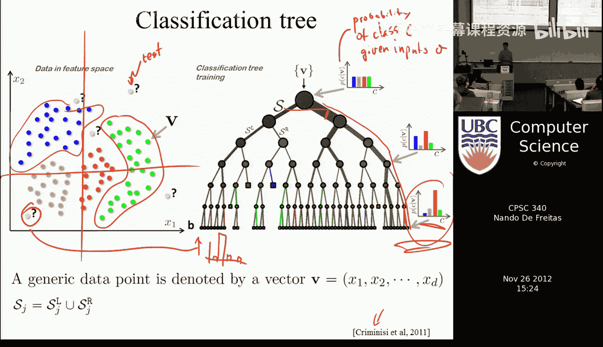

Now I'm going to come back to those examples for images。

 but today we're going to focus on a ecommerce-commerce application and simply because it's easy to introduce the concepts there and because I want you to start thinking that every time you get an Excel sheet。

 you've been given data and you can apply machine learning data techniques too。

Any data that's in an Excel sheet。Many of you， when you go to industry， if you go that route。

 you will end up seeing lots of spreadsheets。It's a very common thing and being able to do something with smart with spreadsheets is usually very valuable。

 a good way to impress your boss for sure。All right。

 so here's an example of a treat that was learned for an e-commer application。다 거吧。

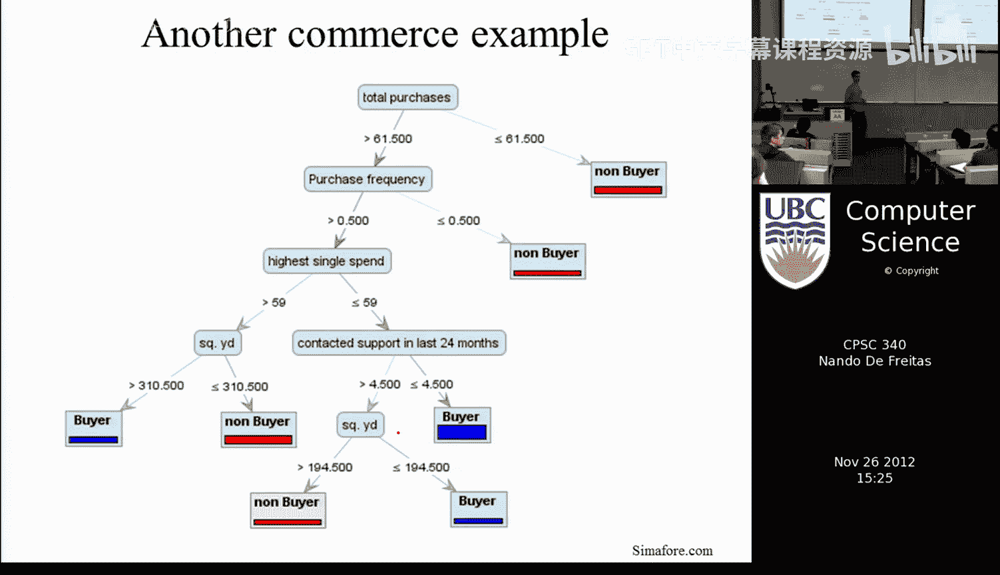

Sure。To at you two。At each level， a decision is being made based on subset of features。

Based on subset of features， that's correct， could you use all the features as well。Yes。

Typically will be a subset of features。We couldOr the matters， or matters。

So the trees will not be optimal。Because if you had to consider the orders。

 then you would end up with an empty heart probe。So we can use Uistic tool come the。我度。

That's correct。 And today， so you're getting ahead of me here。

 So today will be about a heuristic for constructing such trees。

Constructing the optimal trees to split a data in generals an NPR problem。

 but we'll come up with some smart heuristic on how to construct a tree。

 and then we'll just use that。And then what we will find is the trees are actually not very good classifiers by themselves。

 they're not very good at dealing with noise and often these type of decision boundaries are not very good at separating the data。

 and then the solution will be combined many trees。

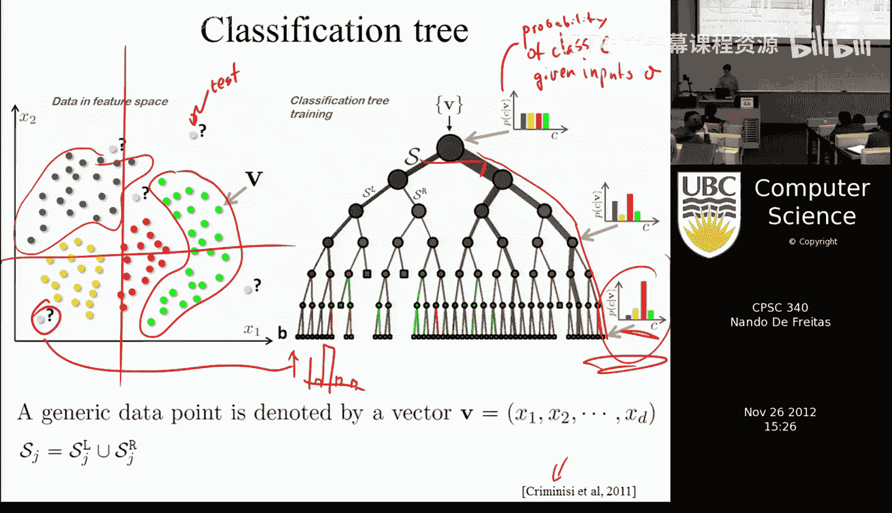

And then we'll get one of the most powerful classifiers that we know of。All right。

 the data mining tree example， here's example of a tree that has already been learned。

And this is the sort of what you would like to end up and what you would like to present to your boss。

 you want to tell your boss I have here a machine learning technique that says that if the total number of purchases is less than 61。

000 for a customer， this customer will not be a buyer。But if that customer does。Byy with。

Has purchases more than 61000， and the frequency of purchases is greater than 0。5 and。The highest。

 whatever single spend is less than or equal to 59。

 And this customer is also nice customer that doesn't contact customer support。

 Then this guy is an excellent buyer。 So we should go with this customer。

 This is where the kind of customer we need to focus on。 If you can convince anyone。的。

This is how they should run their business， and then they try this and they realize it's giving them more revenue。

 you'll probably do well in that business。

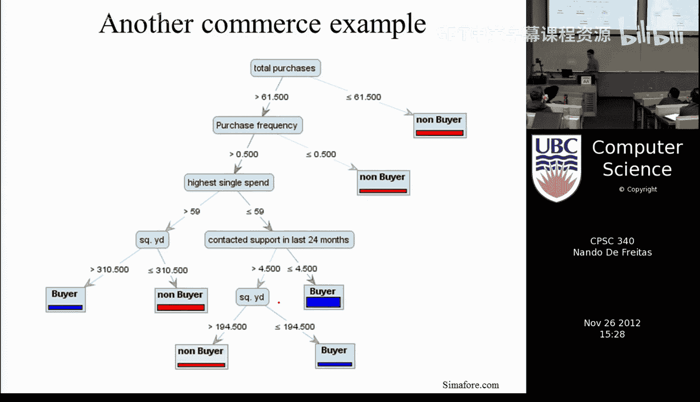

Of course， what you see is this。A spreadsheet。And in today's business is still the case that most people。

 they get spreadsheets。And from those spreadsheets， they're trying to figure out。

What they're going to do。They don't use tools。And you know， the most advanced Excel。

 though you'll see is someone figures out how to do and if then else。

In business and then that already， which is essentially what a tree is， it's a bunch of evidence。

Except that it is constructed automatically。 Some people construct these by hand。嗯。

Now typically this is what you see， you'll see 12 instances， 12 examples or more in this example。

 we have 12 examples。And what this example shows is customers going to a restaurant。

And then different things that makes them decide whether to wait。In line or whether to leave。Okay。

 so the。The label or the target， the label is whether the customer waits or leaves。

And now if you're a restaurant， a person that owns a bunch of restaurants。

 you really want to optimize this。You want to decide how long the wait should be to make sure that not customers leave。

 but it's also convenient to let some customers leave。If you go to a club on Grandville Island。

 you'll see that they played a strategy， you want to keep a line outside so some people will get annoyed and leave。

 but you also want to keep that line for popularity or whatever reasons。

And so here there are things that make people stay or leave， and this might be whether it has a bar。

 whether it's Friday， whether it's raining。Whether you know， different variables。

 when you go to restaurant， it might decide where you stay or leave。And it's quite easily。

 you could have an employee by the door and this employee could be checking this， okay。

 these people left。And could be checking the whether it's it raining， not raining。

And builders they tosect。Okay， so given a bunch of attributes， we wanted this and these attributes。

 each of these attributes will become a node in the tree。Because essentially。

 each attribute will decide whether a person waits or not。So you might find， for example。

 if the price is high and it's not raining。And we happened to be a French restaurant。

And we have some patrons inside that is you have some customers sitting inside。

 then the person will wait。Or you might find out the rules that say， for example。

 if there's nobody inside and we're cheap。And it's raining。People will not wait in line to get it。

So we want to discover those role automatically。

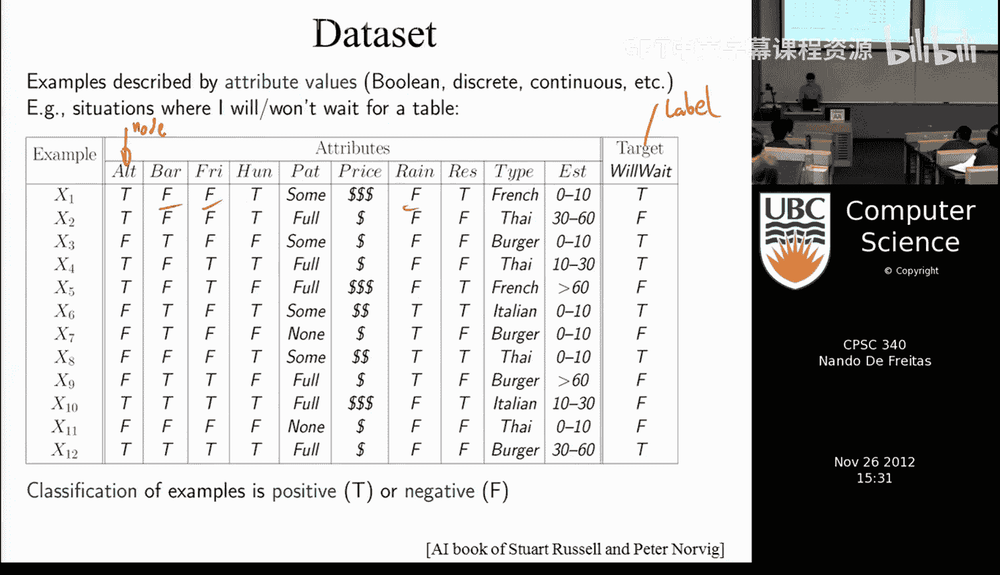

Of course we don't know which of these nodes is more useful。

 and today's part will be about figuring out how to which nodes are more useful。All right。

 so here's one of the trees that was learned from this data set。

 this was Stuart Russell and Peter Norwick in their book， that's the tree that they learned。

 and so they learned that if there's customers inside， if there's patrons。

 and if there's some people wait， if there's no customers inside people don't wait。

So false is that customers don't wait。Now， if the restaurant is full。Then next they ask。

 what is the weight estimate？And if the weight estimate is more than an hour， they don't wait。

If it's 10 minutes， everyone waits， even if the restaurant is full and you get the idea。Now。

 this picture here is showing again the data。And so this is sort of an insert of this。

 so I've magnified this。Here was some date。So we have some data， some customers， 12 customers。And。

And then we， when we're learning， we come up with。We realized that。For customers。

 our data says that four customers， when there were some patrons inside decided to wait。

 two decided to leave。And then when the restaurant is full， this is what happened to the customers。

 two stayed and four left。So that's straightforward。 We just read that from our data。

 We have a date of 12 examples。

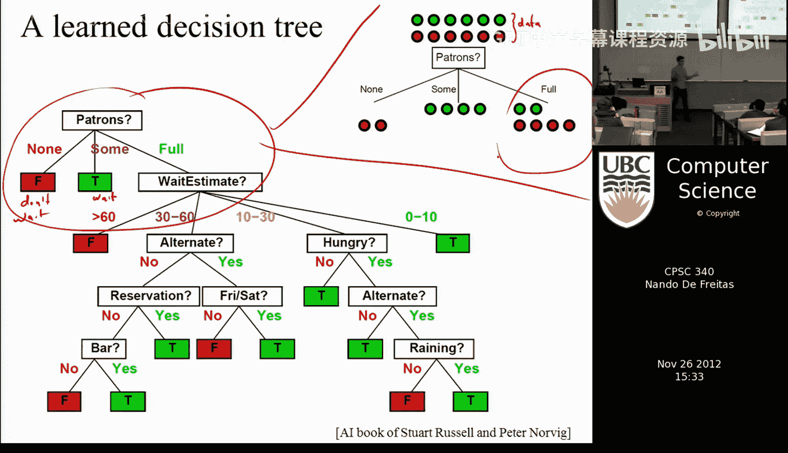

And so I'm looking at patrons， and if I look at， for example， some。I know you have a question。

 I'll come to you soon。If we look at some， we realize that for some。The customers always wait。

 So as long as there's some people inside， your customer will wait。 That's the rule that we。

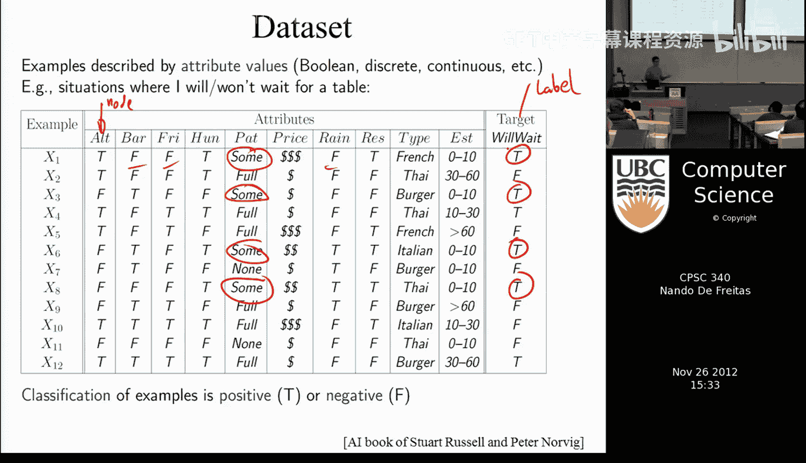

I mean， that's in the， that's just reading off the date。But essentially。

 if you were to apply the patrons test。To your data， this is how it would split the data。

I just noticed that isn't always split into。Branches， they can have intervals。So that's correct。

 It could you could have intervals。 if you have more than one branch。

 several branches and the attributes， they could be continuous， they could be discrete。

 they could be categorical。 So now we're getting into machine learning with the data could actually be of any form。

Trees are very powerful in that sense， they allow us to very easily handle any type of data。

 which is very convenient when youre dealing with spreadsheets。

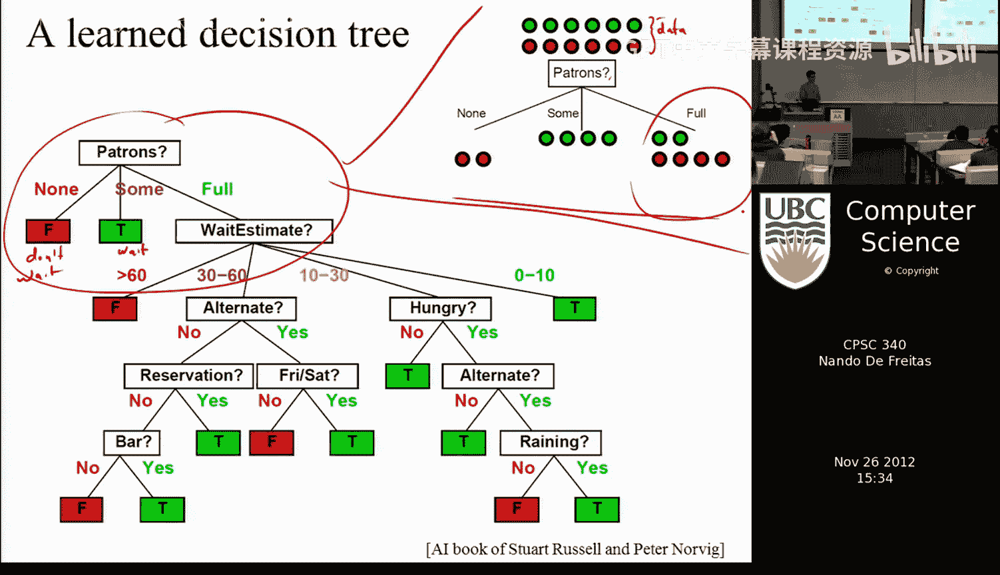

All right， so that's the picture， we have a spreadsheet and all I'm doing is for the test。

 for the node patron or part。

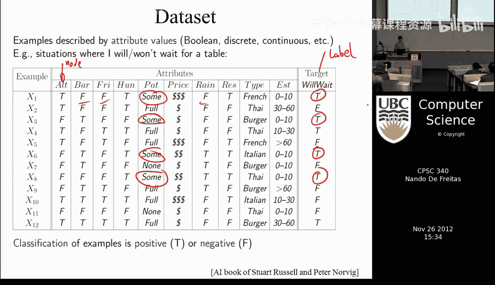

Which is this note here， I have 12 customers， and I'm just seeing how the label gets split。And so。

 here I have。But with probability one。呃。The customers that don't wait。呃。If there's no pay。

If there's no patrons inside， people will not。Wt。While you're classifying them。

 you're asking these questions right you're saying。What are their。What if at the time they'll wait。

 I did come up with these questions。Oh， the question is given from your data。

 You're given this data set。 So the question is。

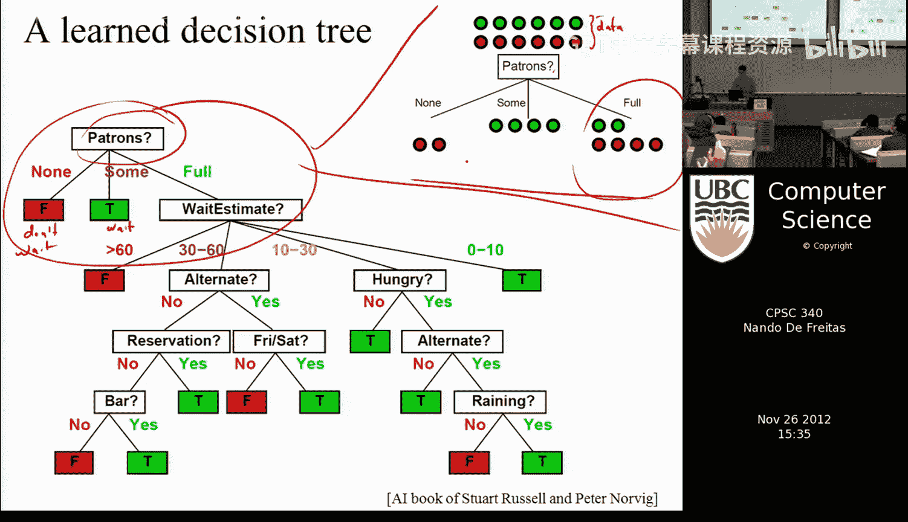

Essentially。The question is basically given by each of these column。

 I have 12 questions I can ask and then the question is what's the sequence of me asking those questions it's like some there's a board game where you also do that。

Yeah。And then this is my data， and all I'm doing is I'm splitting， this is how I can split the data。

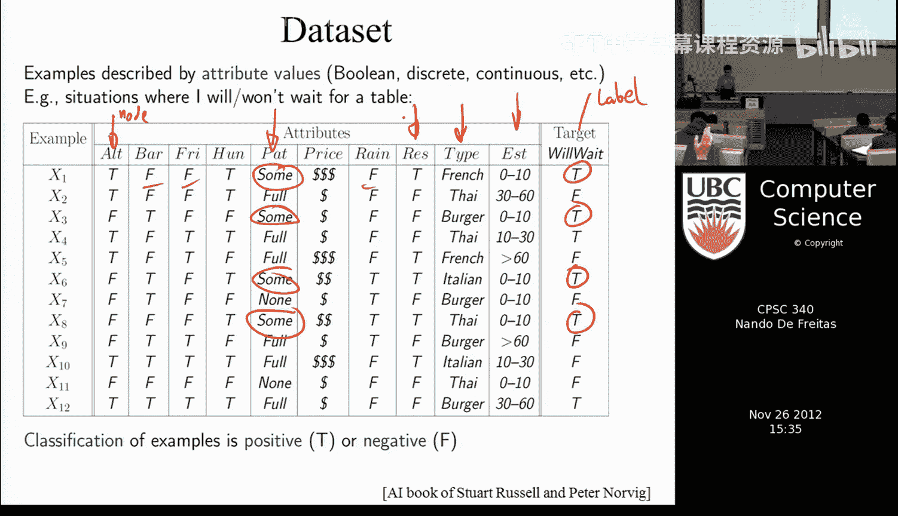

I know that if I were to ask the question， is there patrons in sight， two people wouldn't wait。

 four people would wait if there's some， and then four out of six people would not wait if it's full。

Okay， that's how what I've learned。In a sense， it's almost like learning is too strong a word here。

 I've just split the data according to how many patrons are inside。

 I'm just looking at my test cases。And then now， over here。

I now have essentially what I've learned is that I have a histogram。It looks like this for。Whoops。

For this case。I have one big bar with two and zero。For this case。I have 0。And a bar。

And for this case， I have。Two greens and four red。So that's basically my probability。Of the class。

 given the example。Given the input fee。So I've reached a probabilistic decision。

 if my tree were to be just one node， so a tree with just a root。

And that would be the best I can do for this data set。

I could then conclude that if there's nobody inside， people will always leave。

If there's some people inside that will always stay。And if it's completely full inside。

 then two out of six people will stay。But then I would like to refine。This decision a bit more。

What happens？Then what other variables are important？

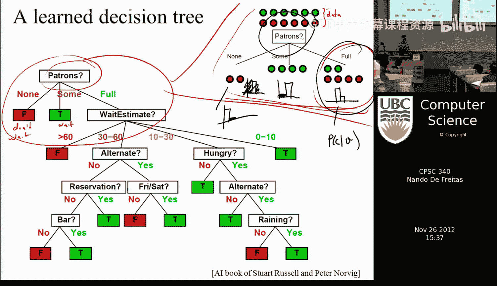

Okay， so the question then is which of these 12 nodes should we pick first？

Which is the best first question to ask？And so。If for this specific data set。

 if my question is patrons， I will get the vision that we have， if however I asked the question。

 what's the type of food， is it French Italian Ti or is it the burger place。

 then the same amount of people in each case would decide to wait or leave。

So then what's the best question to ask first out of these two？

So the first question is there patrons inside is a more useful question to ask because that quickly splits the data。

Into。Brings toward one side， reds toward another side， we want to separate these two classes。Okay。

 so now all we need is a measure to is a way of measuring a way of saying that the left hand side。

 this node is better than the right hand side。And a way of knowing that patrons is better than type as a question is by looking at the entropy of the point。

The class on the left， the justist is， has higher entropy。

Everything there seems to be very well organized。Okay， think of entropy a bit more disorder。

That's very organized。 So that has。That's the worst note， but entropy is not going to be only enough。

 What we're going to want to know is had we gone in any branch， how much would entropy have reduced？

Had I taken a different branch have I gained more information？So we're going to have to look at both。

The current entropy and how much it gets reduced。And again， entropy is the opposite of information。

 so we look at the current information and how much does the information increase by following each of the possible branches。

 by picking each of the possible notes。So entropy as a reminder for a binary variable。

 we went over this， if the total number of data is p plus n， so in this case p plus n is equal to 12。

There are six positives and six negatives。And then the entropy of is just。P log。

 you know it was just theta log， theta times one plus1 minus theta log，1 minus theta。

 all of that minus。

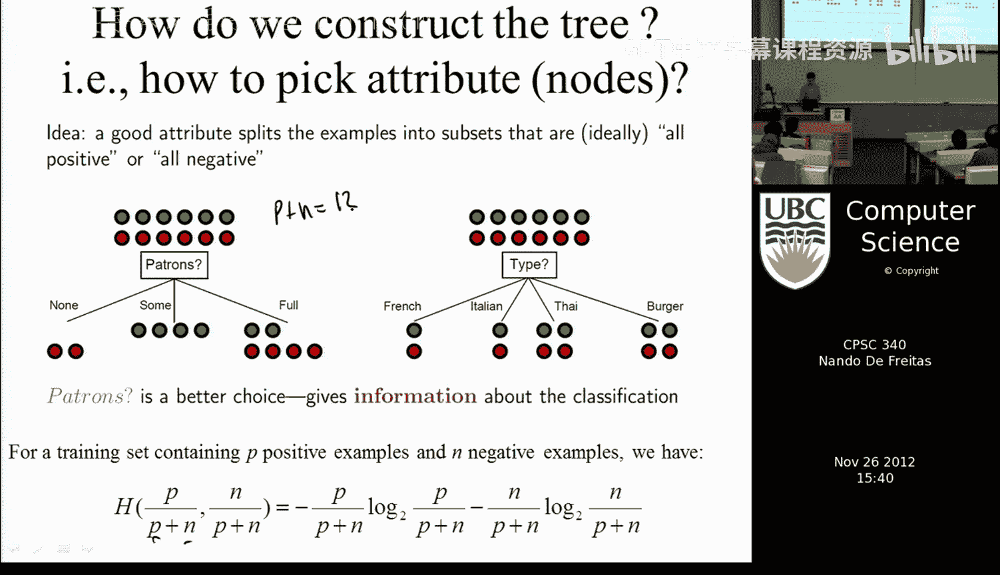

So here is the algorithm。Given。

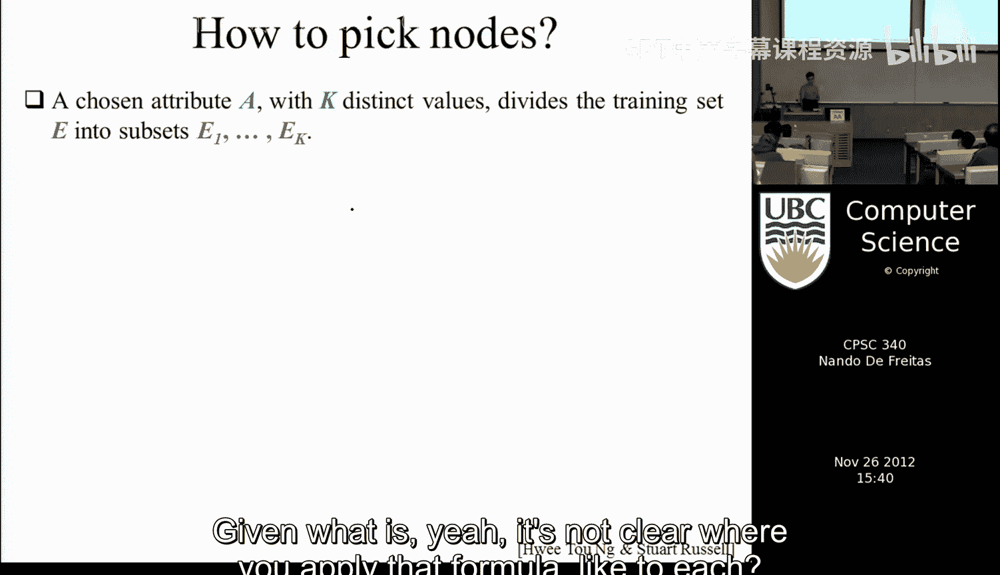

我的。Yeah， it's not clear where you apply that formula。Like to each。Let me give you an example。

 let me first tell you an overview and then I will give you an example。

 and then if it's not clear will。

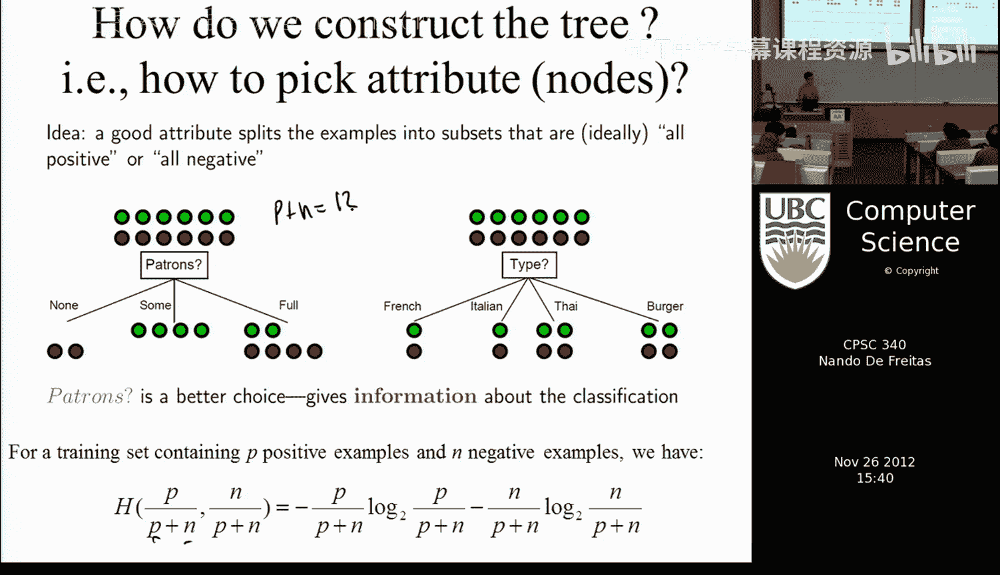

Co it， carefully。So let's assume we've picked a note。Let's call this node A， so it could be patrons。

 it could be rain。Let's assume that just not has。K values。

 so in the case of patrons K is equal to three， some full or not。The entropy。

Now we're going to look at the entropy of the children。The problem is until we make a decision。

 we don't know what the children will look like。So because we don't know what the children will look like。

 all we can do is。Complete the expectation what we think it shouldnt look like。

If we were to pick note A。And node A has。P plus n points。We would look at the entropy of each child。

 so this would be the entropy of each child。And the child of A has the I child has PI positives and NI negatives。

The normalization is just to ensure that we have probabilities that they add up to one。

Before when I did entropy， I had theta and1 minus theta， so I added up to one naturally。

 but because now we don't have the normalization， we need to keep the normalization。

And this here is just the probability that you'll pick the ice sleeve。The root has P plus n。

And then if the leaf has P plus Ni。Then the ratio of PI plus an I divided by P plus n is just the probability of you picking the ice leaf the ice chart。

And this is the expected entropy because you wouldn't know the actual entropy。

And then what we do is we look at the entropy of the root。Minus the expected entropy of the children。

 and so in fact so this is called the information gain or the entropy reduction。

If we were to have chosen node A， how much would have the entropy gone down。

 My entropy minus the entropy of my children。What I expect the entropy of them to be。

 because I don't know the exact entropy， but this is what I would expect their entropy to be。诶妈诶。

Minus and then class my entropy。 so that reduction in entropy。

 so the nodes that reduce the entropy the most。Are the ones that we should pick。Or equivalently。

 the node that maximizes the information the most is the one that you want to choose。

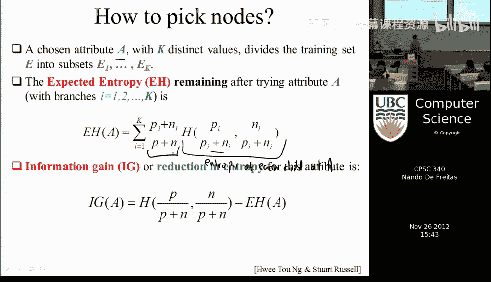

So here's the example。So we have P equal n， so p equal n equals6 in our data set。

 so there are six greens and six reds。The entropy of a half a half is just one。嗯。

Recall that for a beernoulli coin。The entropy looks like this。So it's highest at one。

The units for entropy are bit。I'm using the word bit to indicate the unit of the entropy。

And now the entropy for this guy。In the beginning as one， the entropy here is also one。

Now I need to look at the expected entropy， so two out of 12。Times。

None was the thing that was chosen， and when none was chosen， there were zero green。And it was。

Do you want two other two。Oh yeah yeah， sorry because you divideied by the sum， yeah。

 so there was zero green and there was two out of two red， which is one。😊。

And then the probability of then for some， you have four out of 12。And then for full。

 you have six guys here。Which is the six out of the 12 and then two out of six are green and four out of six are red。

And2，6 plus 46 adds up to one。And then when you compute all this using the formula for entropy。

 you get 0。041 bits。When you do the same thing for this other example， you get zero bits。

So you pick the first one because that gives you the highest information gain。

 equivalently the highest reduction in entropy。And that's how you learn a treat。

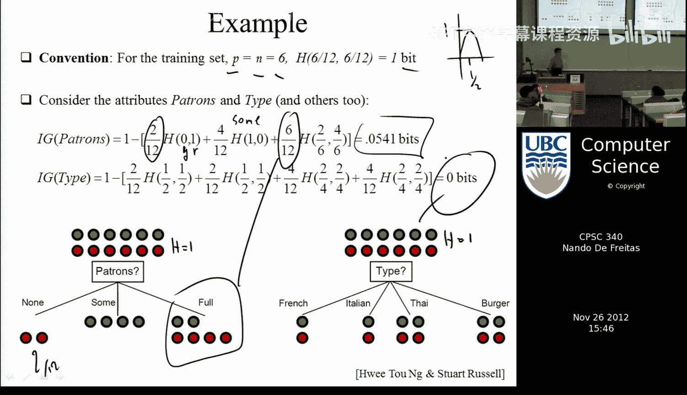