# UBC《机器学习和数据挖掘｜CPSC 340 Machine Learning and Data Mining 2012》中英字幕 p32 -32-undergraduate machine learning 32_ Random forests.zh_en -BV1pJ2ABFEFg_p32-

How do we go from having a decision trees which are very simple classifiers。

 which often if you have noise tend to make erroneous decisions to actually having very power classifiers known as random force。

 that's pretty much state of the art in terms of class。

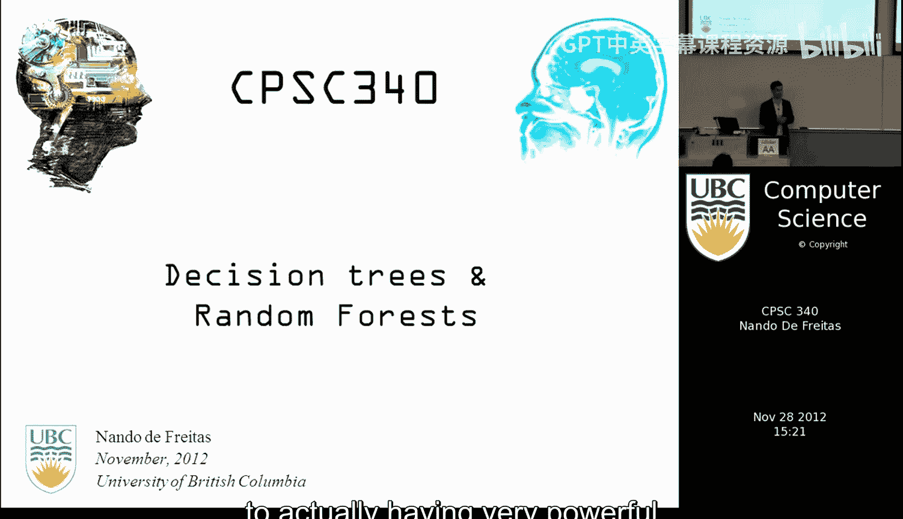

So in this very last lecture I'm going to talk about how you go from trees to random forests。

 I will explain to you how you would build an object detector。

 essentially how this face detecting your cameras works。

And also I' will talk about how the Connect sensor works。

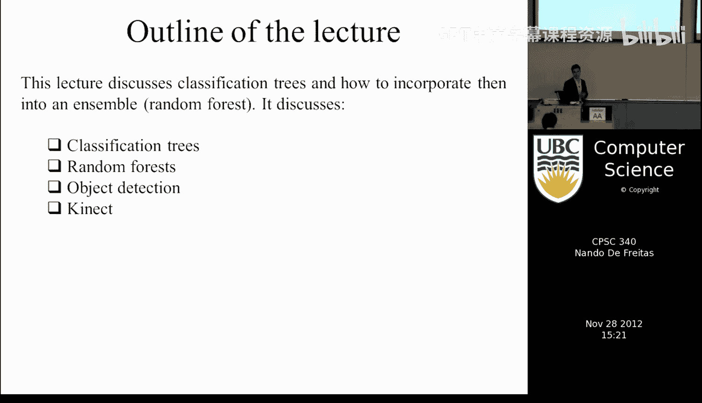

So again， the setup is we have data and we're interested in classification。

 we'll assume that throughout this lecture that the data is a point in 2D， so each vector。

 each input point。s it has two dimensions。And I will assume that each node。

 say the J node splits the data into left date and right data。And at each node。

 we can compute just by seeing how many data points of each color are there in the node。

 we can compute the probability of each class given the input。

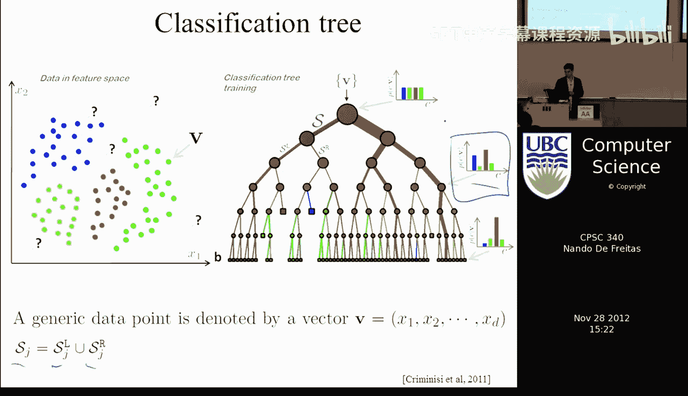

Okay。So how do we deal with this continuous data when we don't have a spreadsheet but what we're given is a data set of points in 2D and we want to classify them。

 and in this case we want to classify them into four classes。So。Let's assume we have two nodes。

In this case， we don't have all the columns given to us of the attributes and the spreadsheet。

 but in this case we are actually going to create those columns。

 the most obvious way to create decisions is to consider a vertical line in a horizontal line。

Now if we had the option of a vertical line in the middle and a horizontal line in the middle。

 so in other words， this horizontal line and this vertical line。

Then we would see that the horizontal line tends to have a few reds still on top， it has some blues。

 has some yellows， there's no greens on top。And at the bottom， is mostly green。Red and blue。

The vertical line seems to be doing a bit of a better job because the vertical line put all the greens and the blues on one side and the reds and yellows on the other side。

Okay， so the vertical boundary seems to split， at least it's able to tele apart two classs quite well。

How do we choose between whether to use a vertical line or a horizontal line？Well， we just do this。

 we compute the entropy。And then we compute a reduction in entropy。

 so we know the entropy of the top so we can compute the entropy of the entire data set。

 and then this is just a proportion of points in each of the two leaves left or right。

Because essentially， what we're doing is。So that's left， this is the right leaf。 and then the right。

Each of these two children corresponds to one of the two divisions of the data。

And then this would be the entropy of the children。But know， if we can calculate our entropy。

Then we compute the information gain， and that decides whether we use this or this。In this case。

 the information gain of split2。Is higher than information gain of one。

And the exact calculation appears in this paper。At the exact numerical calculation。And essentially。

 that's all we need to know in order to construct a tree。Go ahead。That will be for note J。

Thanks for the question， because I'm going to be using it。Those the situation。No no， no， no。

 you're that node J。 J is just the name of the node before I before I was using names like patrons and salary and stuff like that。

 but now my nodes are just indexed by a variable J。And so think of this as no J。

 no J is trying to split the state。So this is the J node， this is my variable。

 and so my J node has two options， it can go to the left or it can go to the right。

All the points in node J。All the data now J， instead of me drawing these circles， I'm just going to。

Say that my data in OJ is denoted by SJ。So SJ is essentially a bag。That has。All of this data。

 in fact。And then I'm going to go to SJ left。The left children for noJ。And then。The right。

Chill the points that were left on the right hand side so every time a point visits no J I check is it greater than let's put a threshold here 0。

2 is the point greater than 0。2 I put it on the right is it less than 0。

2 I put it on the left and so if I use this then all my blue and green points will be on one side and my yellow and red points will be on the other side。

So I know this's just a decision that compares。的。The horizontal。

Coordinate say x1 against the threshold and the in which side to send a date。

And so this is just the number of points that fell on the right or left leave divided by the total number of points。

 so in other words it's the probability of going left or right。

And this is just the entropy of the children。 So once again。

 it's the entropy of the root minus the expected entropy of the children。

 and that's the reduction in entropy。When you had your entropy， entropy uncertainty。

 so this was my original uncertainty， I subtract the uncertainty。

Of my children and what is this uncertainty that's left when I do that？

How useful was it to exploitated this way and this reduction in uncertainties information gained how much you became much more informed about the decision？

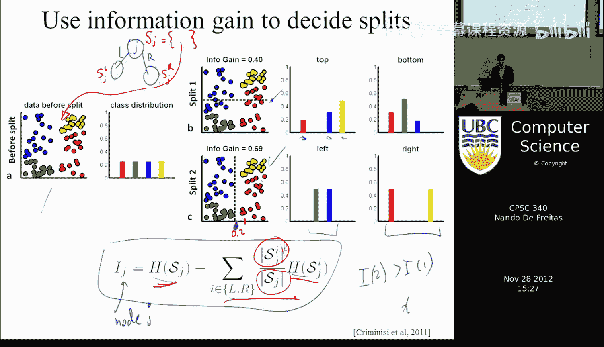

O。And。It's possible to do this for Gaussians， I don't cover it in this course。

 but if you have Gaussians。Currently we're using splits as the decisions。

 but it's possible to just use actually full gapussian distributions and you can also compute information gain for gapussian distributions。

 and then you can say that this is better than this。Because it separates the data department。

If you take 540 and if you've got an A for this course， I strongly recommend you take 540。

 especially if you enjoyed the subject， then I will go over this in detail over that。

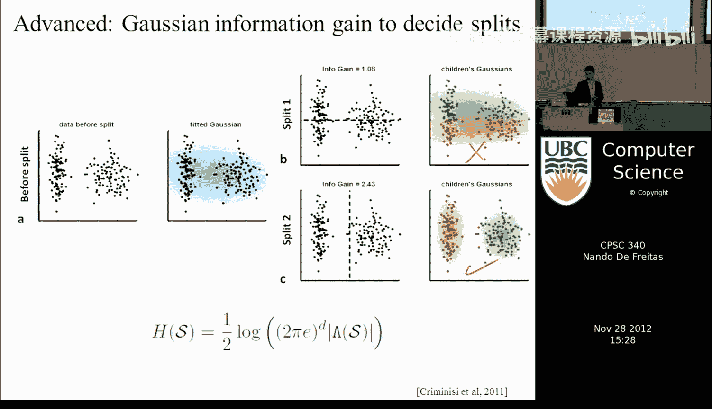

Okay，So we know that。Essentially， our decisions， our attributes now are either。

izonA horizontal line or a vertical line。But obviously。

 you would think there could be more than one horizontal line。Or vertical line。

 so I could use this line， but I could have also used this line or this line or this line or this line。

So essentially what we're doing is we're now going to have a huge family of such lines。And。The。

 the parameter that determines。Exactly where that line is。

 is' going to be something that I'm going to label theta， which could be01。Point2。

So it's just a threshold。And then what I'm going to have， a decision node is essentially a function。

 in this case， a line。Which has different heights， different thes。

And then based on whether you're above that line or below。You're either one or zero。

 or you go to the right or you go to the left it' the same sort of thing。Okay， so that's the sort of。

The mathematical representation of a single node。I know theres just a function that decides。

Whether you go left or right， and it has a parameter theta， the parameter here is just the right。

 the height of the light where I place it。So in order to node， in order to train a node。

I will look at all my possible values of theta， let's say that I start with five values。

And then I check which of those five values is the best one in terms of splitting the date。

In other words， which one is the best one in terms of maximizing the information gain？Once again。

 I have an expression for information gain， and so I basically I just enumerate for each value of theta。

 I check which one splits the data best， and then I pick the best。

So that there sort of a way of not only picking。Just vertical versus horizontal。

 but now we can pick many vertical， many horizontal。A typical strategy， for example。

 what's used in the connect sensor is to just pick a bunch of random theaters， a bunch of random。

And then you just have a big dictionary， and then you just go over each of them and you pick the best。

Once you haveOnce we're done with the training。Then a test time。

The new input comes in and then you just check whether it's above the line or below the line。

 if it's below the line， if it's zero， it goes to the left， if it's one。It goes to the right。

And then on each leaf， we just calculate how many greens are there， how many blues。

 and that histogram gives us the probability of that point being classified into each of the four classes。

So that's basically all of。Decision treescing one slide there。

So everything you need to implement it is in that one slide。 I completely forgot。 Sorry， That's。

 I'll ask all other question too far back。 Would it make sense then to rerun again。

 Like suppose now you' at a leaf where you have the green thread。

 wouldn't you want to do the whole process again with a different type of line。

 That seems like an obvious general so。Yes， that kind of opens up I will tell you one very nice easy。

 efficient way of doing that。

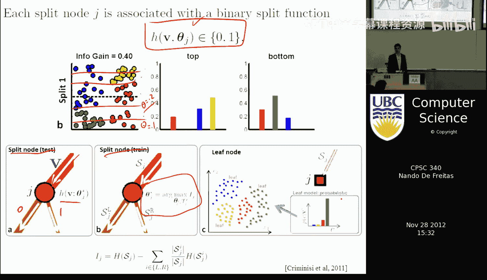

嗯。In a couple slides。Okay， first。So so far， we've seen horizontal and vertical lines。

 The other thing is you might choose to use a line with an angle。So you might want to use。

A logistic classifier。As the decision in each node， so each node now is basically classified。

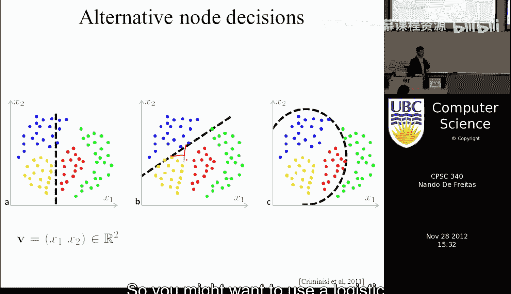

That's essentially interpretation here。 you have a classifier that's class into one or zero。

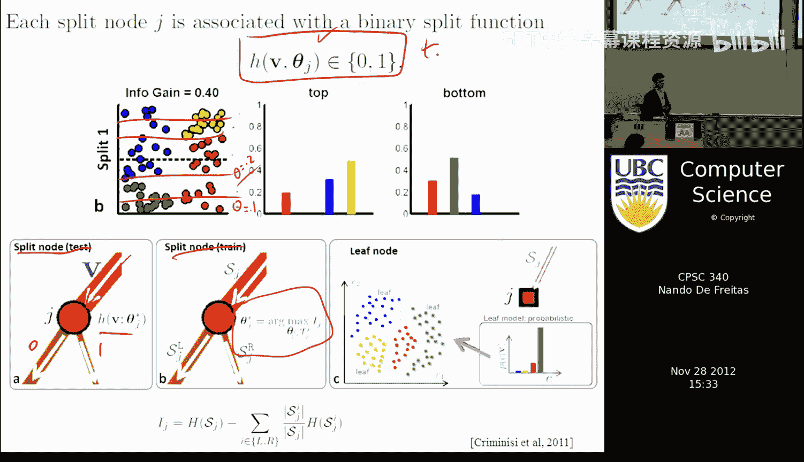

So we can use horizontal vertical lines， we can use more fancy ones and more fancy ones。So。

But it turns out if you're just building a single tree。

 it would be important to use more and more fancy ones。

 but as we will see by using a technique of using many trees， essentially and averaging them。

 it will be enough to use simple trees。And the idea is the following。

 if you have a bunch of simple predictors。Very simple classifiers in this case。

 just is it to the left to the right。嗯。And if you have many of these classifiers and provided that they're better than random。

 they're epsilom， better than random。And provided that they're each unbiased and by unbiased。

 I mean that if the data went to infinity， these classifiers would。

I haven't discussed optimal base errors。These classifiers would be optimal in the usual criteria。

 and so as the data would go to infinity， they would make the right decision and they would be above rather。

In 540， I will make this what I mean by optimal very precise。

 I will actually go over base errors and optimal rates。But for now。

 let's say that provider is clusterifiers un unbiased。嗯。In other words。

 they don't make systematic errors intuitively and provided that they're just a little bit better than chance。

And provided that they're different from each other so that they're not very correlated。

They could have very high variants and they will have very high variants because I'm trying to decide whether someone has cancer or not just based on a vertical line。

dependingending on what I put that line， a bit to the left， a bit to the right。

 I might get very different answers。So the answers will have high variances。

But if I average many things that have high variance。

 I ended up with something that has low bearings。That's essentially the central limit theorem。

 The central limit theorem tells us that if we average many numbers。

 we end up with a Gaussian distribution。And moreover。

 we know that the central limit theorem says that the more points you add。

 the less the variance of that Gaussian。So in other words。

 just by using a sort of very simple argument。One is that if you take many simple decisions and you average them。

You will knock off the various and you will end up with a very good technique。

That's sort of in loose terms why this works and 540。I don't know if I'll get to it in 540。

 but certainly if you come to our reading group meetings。

 you will see we go over these proofs all the time。It definitely do by high variance。

What are we comparing to see if it's different， the output if the distributions are different or we have different。

Oh each classifier might give you very different very different answers if you were to perturb the classifier。

 your answer might be very different， that's what I mean by hyper variance it splits it but what's in what box it mixed。

Mmm。But another way to。Yeah， that's the best idea。Think of it。

 It's probably best to think of it in terms of regression in terms of regression you might have。

You might be trying to fit this and then you can use a high variance function。

 which would be something that would do this。

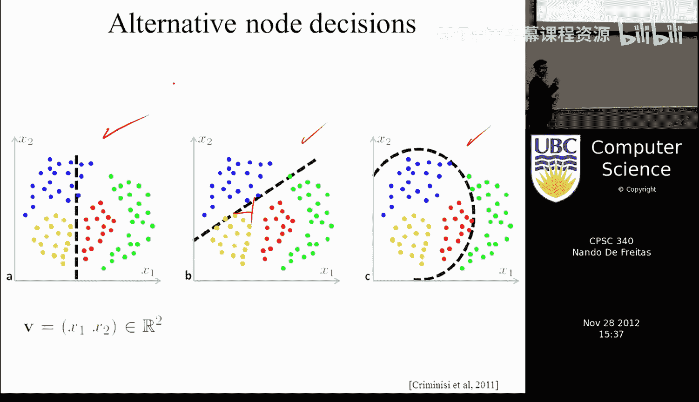

So that would be a function that has high variance going through the points。

 It's not the best function。But if you take one like this and you take another one。Okay。

They're all unbiased and by unbiased， I mean that there's no systematic error。

 A biased one would be something that would be doing this， in which case。

 there is a systematic error。But these， on average， are going through the point。 In fact。

 they go precisely through the point。 So the bias is 0 in this case。

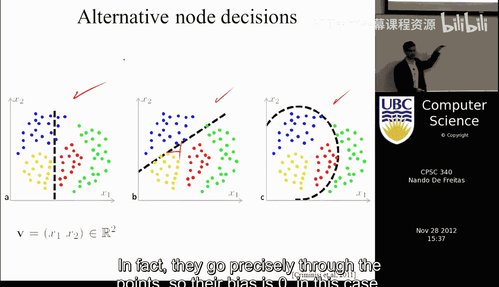

They have high variance， though。 But if I offer the blue and the black line， even in this example。

 you already will start seeing what's going to happen。If I have enough ones。

I will end up with what I want， I will end up with something that will go through the points。

That's essentially that what I'm。In intuition， what I'm trying to communicate。

When you laid out the theory， you actually prove this。

We actually start writing questions about the bias and the variance and so on and how we control it。

And here it's sort of like the variance is in。Or a given data point。

What class that's being assigned for the different treats， that's correct？

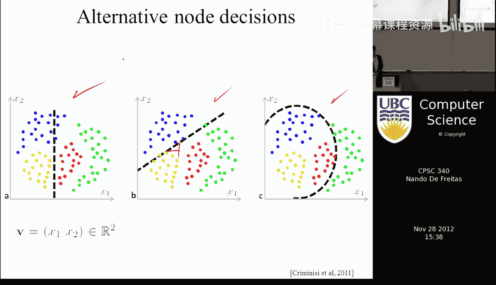

Okay， so how do we average？We're going to be in a way， if everything is the same。

If my blue line and my black line were high variance， but they were exactly the same。

 averaging them would not have helped me。It's the fact that sometimes the blue line is up and the black line is down。

 In other words， provided that the very。They're different， they're uncorrelated。

 that I can actually get something meaningful out of averaging the lines。

If all my lines were like the blue line， then averaging would not allow me to get something that would be like the dashed line。

Now， how do we make the classifiers different？From each other。Leo Bman proposed a following strategy。

Leah said， first of all。Let each classifier have access to a different subset of the data。

So if one classifier will， for example， only see this point and this point and this point and this point。

And then another class five will see different points because now there's less of a chance of them being the same because they're not seeing the same data even。

In addition， in order to make- and so the first step of the algorithm is what is called in statistics of a bootstrap。

 which is you draw some sample from the training data with replacement， you pick a new data set。

Leo and these statisticians here。 and the book that's on the website。

 They like to use the same amount of。Samples， as there are training date。That is not necessary。

 you might actually draw less samples on your training data and in these days of computation where computation and how to distribute。

Data among machines。 It's actually quite useful to have。嗯。

To have a situation where you take your data， you store each chunk of your data in a different machine。

And in Ram， because reading from dusk is extremely expensive。 So you would put。

Different chunks of data and raM in different machines。

 and then you would essentially build a tree in each machine。Separately。

 so each tree will be looking at a different。Set of the date。Now。Footage in inch machine。

You grow a tree just the way we've described how we grow trees so far。

 which is you would pick one node， and then once you pick one node。

 you use information gain to decide how to。However， here there's one more twist。嗯。

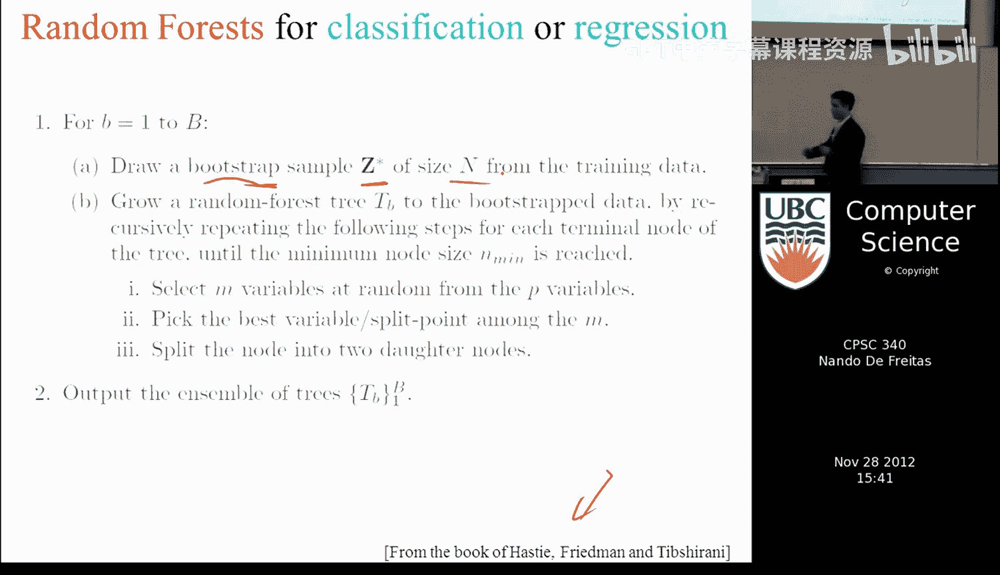

I mentioned。That we produce these five red lines and we would enumerate each of the five red lines。

But some of you might already have thought why5， why not a million red lines。

 because that would give me a much niceier division。And indeed you can use a million red lines。

 and in fact， that's what Li would recommend you to use a million red lines。

But every time you make a decision in a node， just like you only pick a subset of the data。

 you will only pick a subset of those lines。 So out of the million， you sample five。Again。

 the purpose is not to make each of these classifiers the best possible classifier。

 you don't want each of these lines to go to be a very nice prediction， that doesn't matter。

 What's important is that they are unbiased， that they go through the data and that when that they are different so that when you average them。

 you will get the right thing。And so I'll come to you。

 And so the idea then is you pick only a subset of the points， say， five thresholds。

And then out of those five thresholds， you pick the best。And that's using information gain。That's it。

 that's the algorithm。

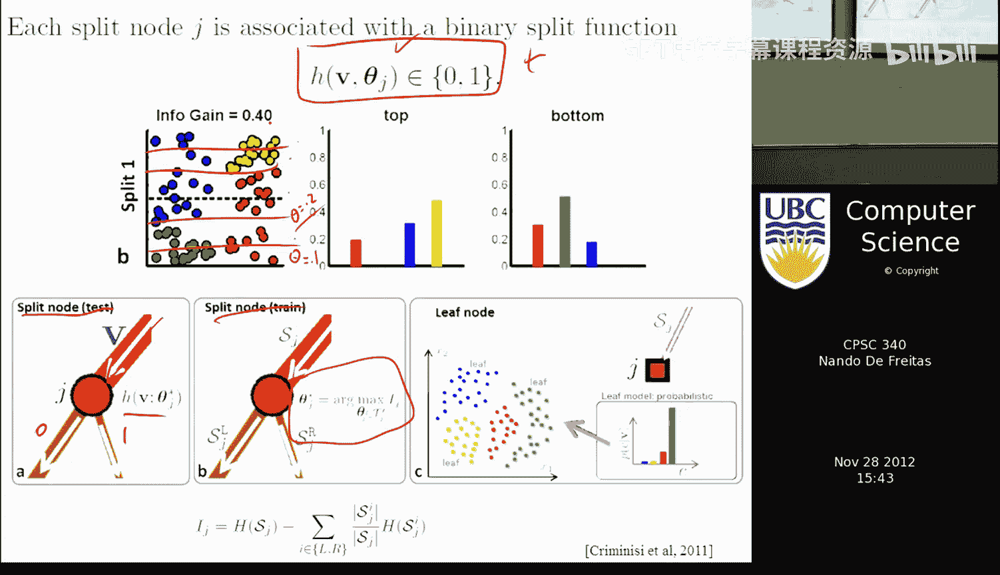

That's random four， so there's randomization of the data and there's randomization of the parameters。

And in fact， in the Connect， they don't even use- sometimes they don't even use information again。

 they just use full randomization。s just pick one of the thes and actually。

 that doesn't work as well， but works remarkably， surprisingly， remarkably well， so I have one， two。

 three。What the variables do you replace？Yes， that's correct。How can you guarantee that。

Trely very different， I mean， randomly yes， but there could be a chance they have they use the same variable。

Well， if you're choosing five out of a million for each node and supposing you go down three levels。

 then the probability of picking those same five。Quite low to。Yeah， if you a million choose。

 a million choose 5。 It's pretty。So what's the percentage of variables that you choose out of？

Typically you might choose 100， so where is this useful？

Each of the base classifiers could be each of the decisions left right could be something like。

 does the word Vira appear in the email？If the answer is yes， right， if the answer is no left。

Does the word paper appear in email， if yes， left， if not right？

So each of these attributes could be awarded in English and this is how you build random for。

 in fact for your Twitter data set， so each of your features is one of the attributes。

And then you just check whether that attribute is present in the date or not。

 is the word Viaggra there or is it not？Now， you would have now。Millions of possible words， and。

You know， combinations of words like Brad Pitt。In English that you would want to check。嗯。

So you don't want to use them all， but you would pick say 100 out of them per node。

 so each node has access to say100 of those。Yeah。Yeah， roughly。 it depends on the application。

 This is a parameter， though。 you're going to be tuning this parameter by cross validation。接下来跟。Okay。

 you want me to help you with the computation next question。😊。

You were saying that class should be unbiased。 What do you mean by unbiased class。

I haven't defined any of these terms unbiased， and for now。

 think of unbiased it goes as in the context of regression， it's easier for me to explain。

 it goes straight through the point。In other words。

 the difference between the value of the function at the point。And the value of the protection。

 say the blue curve is0。There is， think of it as there is no deceive。 There is no。

Something like this would be biased。And even in fact。

 if you look at this curve and you just copy this curve。So this curve is the optimal curve。

It has zero variance， it's not wobbly， but there is a difference here。

 and this difference is what I'm calling the bias。And if you were to get more and more and more data as N goes to infinity。

 this difference would not disappear。Because there's a systematic bias， essentially。

 you have chosen a different height。So biases are things that will not。

By averaging with the central element theorem will not vanish。最取です。

The central limit theorem says that if you look at the estimate minus the truth。

 they will be distributed。Theestator is a function of n。Any estimate or minus the truth？

Are governed by this。If it's unbiased， it means that this is zero here， that as n goes to infinity。

There will be noted。 This would be yes。N goes to infinity。 as n goes to infinity。

There will be no difference between theta hat and the true theta。And then as n goes to infinity。

 there's always some variance， but that variance is being divided by n。 so it vanishes。In 5，40。

 I will give you more details。 but that's just the， the rough idea。

 Is this the slide supposed to explain how we combine the trees to have a refine。No。

This line just tells you how you would construct each tree。

 so each tree looks at the portion of the data and each tree only looks at a portion of the features。

 each node in the tree only looks at the portion of the features。Okay。

 this is how you construct a single tree。你傻仔。Pardon。I。To。

So you're going to have to speak up the minimum。いでさ。

It has to recuriveively need the process until you reach your land。Yeah， that's a parameter。

 I will now tell you about all these different choices and what they are。 Okay， so first of all。

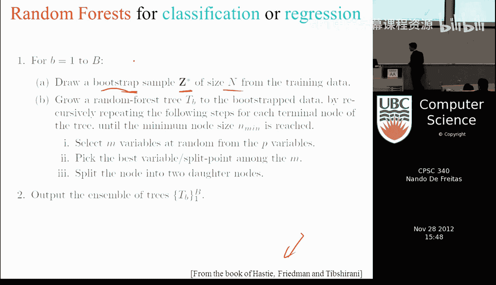

We need to choose- so we pick a subset of the parameters only at each node and for the subset of parameters。

We find the best theta by maximizing information gain。

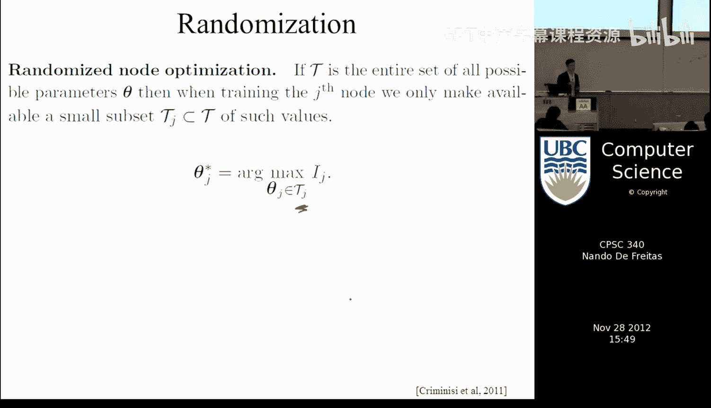

Now， this is answering the question of how do we combine them。Suppose you have three trees。Now。

 for each tree， you compute。YouBa， you have a new test date， a new test data。What you do is you。

 for that test data， you follow all the decisions in the tree until you reach the。The leaf。

 and once you breach out the leaf。Each leaf has associated with it a histogram。

That we got from the training data， which is how many green training data were there， how many red。

 how many blue。And we do that for the next three and for the next three。

 so now we have three histograms if you want to combine histogram， you just average those。

 so you average the green cells and the blue cells and the red cells。嗯。It was yellow cell。

 so it's exactly this operation here。It just operate all the classes。And that's it。So。

Blow the data separately to Iran， there could be overlapping the data。WeDifferent machines。

Completely per。 Learn a tree in each machine。Of course， for it， learning a tree is very expensive。

 learning a node because you need to enumerate all the features。

 so pick a subset to keep the computation cheap。And also to make sure that these trees are all different from each other。

And then at the end of the day， just averaged them， which is this operation here。

So you average all the。Mes of all the。That's correct。Oh no， no。

 for the test data you have now this is a test time for each test point。

You find its sleeve in each tree。Because that's how we classify， I have a new point。

 you give me a new data point， say you give you yourself identify yourself as the new data point。

 and then I check is your height above six feet or below six feet。

Is your weight above 190 pounds or not？And I kept making these decisions。

And then until I reach a leaf。No。And then at each of the leaves。

 I have the probabilities of each class， which is what I did during the training data。So。

 during training。What is。你。

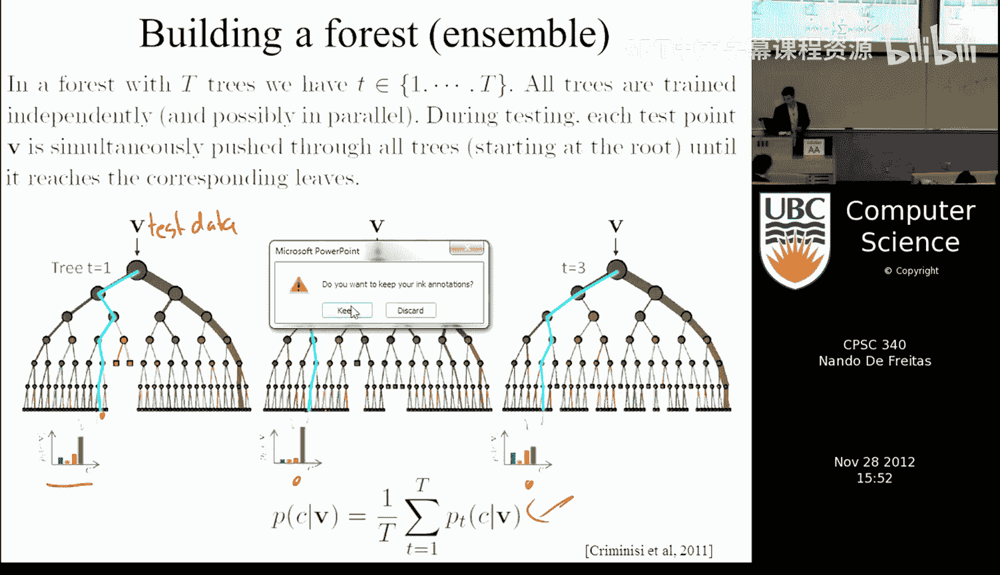

Lial3 is an index over trees。 capital T is all the trees。So I'm averaging the trees。

 averaging as in the usual says， one tree plus another3 plus another3 divided by the number of trees。

Okay let me bring back what the three is because I。

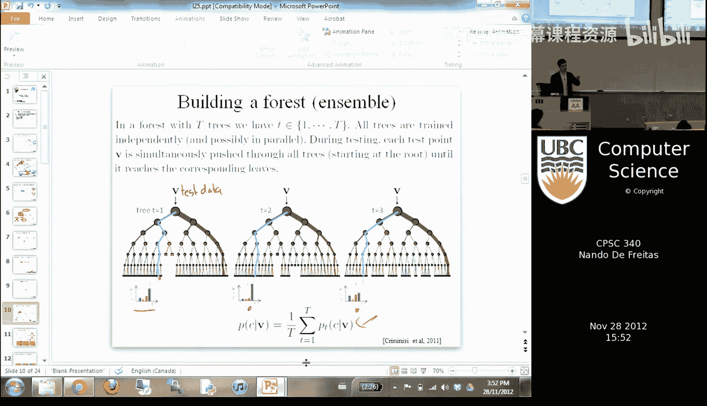

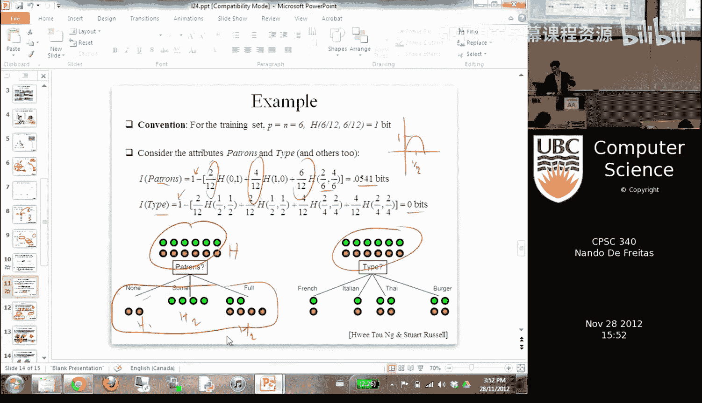

Let's go back to what a tree does。This is what a tree does。A tree， you give it a new image。

 for example， a new data factor。 And then you'd make a few decisions is the top blue。

Then you make an next decision is the part blue until you reach a leaf。And once you reach a leaf。

 you decide whether it's indoor or outdoor。Now， suppose I had many trees which would have different decisions。

You give me a pardon。で。Different nodes， the trees will be different。

And they will be different because the trees have access to different data and the trees have access to different thresholds。

 different thes， different features， so some trees will have the word Viaggrara。

 some trees will not have the word Viaggra。So each three will be different。

Because the construction is。I draw a subset of the data to construct each。

 Each three looks at a different subset of the date。 Moreover， every time I。Optimize a node。

 A node only looks at the subset of the attributes。I know it does not look at all the attributes。

 so there's randomization， I choose say at random 100 out of a million。And so because of that。

 then each tree， if it has three levels， will not be like any other tree。

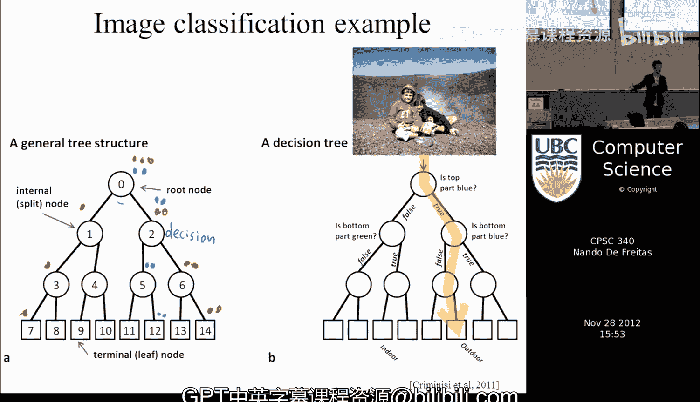