# UBC《机器学习和数据挖掘｜CPSC 340 Machine Learning and Data Mining 2012》中英字幕 p33 -33-undergraduate machine learning 33_ Random forests, face detection and Kinect -BV1pJ2ABFEFg_p33-

Right， so we did trees in the last class and then basically this slide sort of summarizes what a tree is during training。

It just essentially。We pick a very simple split， very simple classifier。

 which could be just one of these verticals split。For example。

 the dashed black line here is one split， and then you count how many points of each classical on each side。

And these are the points at follow top， these are the counts for the points that are on top of the dash line。

 these are the counts for the points that are below。That that's line， and that' it。

 so you split in the training date。like we did for the tree， when we had customers。

 you're just splitting into how many customers left， how many states？You go your three。

The way to choose。AndThen the way you choose between these different vertical bars is just by maximizing information gain。

 which all of you should know how to complete information gain because that's in the final。

And once you know how to compute information gate， this is just a binary decision so at test time when a point comes into a node。

 you check whether the point is on top of the line or below the line。

 if it's on top of the line you send it right， otherwise noise is send it left。

And so trees are very simple decision， just like very。

You know just like vertical horizontal lights on your data should be enough。

 the vertical axis a aligned plate should be enough to separate your data。Of course。

 a single tree is a rock。Wage spliting the data and so we mentioned that a better way of doing this is combining many trees。

 averaging trees， and so when we average trees。What we do is we train each tree。

On a subsle of the data。Or you could train each tree on the full data set。

 some people do that too the Microsoft guys actually， as we will see。

It depends on what kind of effect you want and it depends on your constraints if you have a massive data set loading data into RAM these days just becomes prohibitively expensive。

I mean， we can just flash ra and all the solid state rub the office of the latest。嗯。

technology in terms of RAM， but still there's bottlenecks。

 typically you will work with data sets that cannot be loaded into memory those are the interesting days some of the interesting data sets。

 those are the sort of big data sets。That people care about。Credit card transactions。

 all sorts of customer data， environmental data， medical record et。

But you can load part of the data into the RAM of a single machine and a different part of the data into the RAM of another machine。

 the data records， the data can be overlapping so you can have one customer actually loaded into two machines that doesn't matter each tree learns from a subset of the data that's called bag if you use the full data set and you can actually get confidence estimates and that's called bootstping I haven't covered good strapping I will do good strapping in 540 but right now it also will give you the theory behind this why this works well you know more principle。

Right now it's。With being practical， each tree learns from a little bit of data。Moreover。

 for each tree we don't consider all the possible features。

 we only consider a subset of the features， so we randomize the data。

 so each tree only sees a little bit of the data and moreover each tree only has a subset of the features。

So like， for example， in building a text qua， like for Twitter。

 if you were to build a random forest for your exercise， for your homework。

 then one tree would only look at。P星。100 out of all your was the 10，000 features。

So it would say 100 10，000 and only search it would enumerate over those 100。

 so it would go one by one and would test for each which one has the highest information gain。

 and then it would pick one so you don't search over to 10，000， but you only search over 100。

So you're randomizing， you're picking a hundred， and the reasons we're creating trees that are very different。

And each of these trees might not be the greatest classifier， but when you average many trees。

You get a very strong classifier。AndBy averaging trees， we went over this as well in the last class。

 that means at a test time， you have a new import E。

For that input you every time you reach a note you basically check。

 is it to the right of the threshold or to the left and based on the threshold you said the。

The V left or right until it reaches a leaf now from the training data。

 each leaf has associated with it a histogram， like work those four colors or in this case it was five into four classes。

And so the four histograms as the point reaches each of the leaves。

 sorry the three histograms are those three that I'm showing you there。

 that's the probability of each class， we normalize the histogram so that the four colors add up to one and then all we do is we just add up。

We just add those three things and normalize， so it's just an average of three histogram that still gives you a histogram and that's your final classifier。

 those are your final classes。问题吧。So as you can see， for example， here。

 the first tree and the second tree。The first three and the second are firmly confident that the point should be great。

They believe the is a green God。The last tree believe B is green。

 but it's not very sure it could equally well be almost equally well be red or blue。

 but when you sum them all up。The point will be prevalently green。

 and so green will because two are of。Gre guys strongly think it's green。

 so averaging will give you the right classification。 so even if one tree is not very good。

It's in fact， sort of lowpy。Or is there heard some other function would be？Very good question。

 so there are different ways you could average， this is the arithmetic average。The dropout nets。

 they use geometric averaging， so products。So there's a sort of product averaging。

 and then some people combined using mental level information。

And that leads to other techniques called stacking。And in fact， there is a competition in Wikipedia。

Hold。好即好。The her price， so the Hunter price will be given to whoever can compress Wikipedia the most。

啊。And lossless compression。嗯。Because the hater thinks that。

Compression and intelligence are very intered， so if you want about intelligent machine。

 you should be able to build a machine that's capable of comppressing data the entry that's winning。

Right now， it's called PAQ， and it uses exactly a way of averaging where it's based on context。

How in order to sort of predict what award。Which words will appear next to a word？

It uses the context of the words， but it has to very fancy averaging。

And it's really nice because you can type a few words with that technique and it's so predictive that it can then continue writing a whole paragraph and you read it and it's actual English。

So if you want to see some demos of that technique go to my webage。

 I have a paper called PAQ this year。嗯。You'll see that it centerified。 The technique is amazing。

 really。It's scary， almost。 how it predict。Is that notion of like a confidence interval or some confidence is predictions。

 And would we want to add more weight to things that are maybe more confident。

 So the confidence intervals， especially if you take。Especially if you sample。

 if you have a data set of endpoints and you sample endpoints from a data set of endpoints。

 you can actually get very good confidence intervals with very strong theoretical properties。

 That's good strap。And sometimes we want to know， we only especially if you have few data you have。

 because sometimes you know there's all everyone talks about big data。

But you're running an experiment， you're doing a drug trials。It is again。

 another place where there's。たね。You might only want to give this drug to10 patients with cancer because a few of them die。

In the process of your testing a drug， so getting data there is really expensive。

 so you're only not with few data。And if you only have a few data， you want to know。

Are my estimates good enough based on this among of datata and bootstrapping is a technique that allows you to assess that？

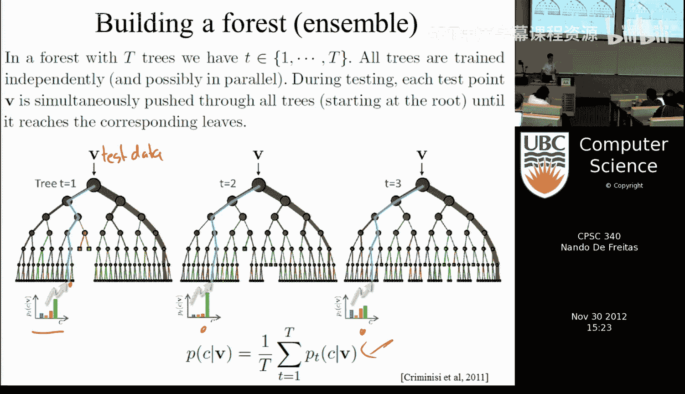

The rest is basically how does this behave， so here is a data set for two classes。

 so the input is two dimensional coordinate net x1， coordinate x2。

 so say height and weight of a person and then there's two trees there on top。So。

This is my first tree， this tree puts a decision boundary here。

 and this other tree puts a decision boundary here if I only use one tree。

My decision by could be something like this， so one class is red， one class is blue。

But if I use8 trees。I start getting also shaded sort of comfort so I know I get better estimates of the probability if you class yellow or class red and as you go for more trees。

 as you can see you start getting a really nice estimate of the probability of points being either red or yellow。

 so for any point there the color intensity， you know how yellow it is or how red would tell you the probability of the point being yellow or red。

So a single tree is just a binary decision， but when you start averaging， it essentially should be。

TheyVery nice。Pohysition so you could have a very nice。Decision surfaces going through these points。

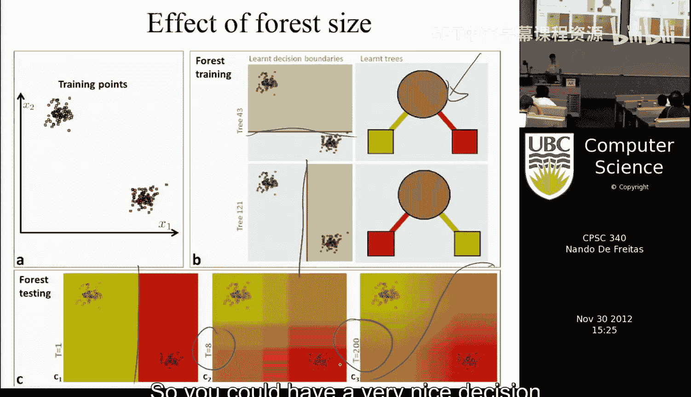

What else is important， oh if you have more classes， random four。

 whether you have two classes or two classes or fourth or is that for？Yeah。

 four classes that work pretty well， as you can see。

 even if you have data like this like as spiral data， if there's noise， it doesn't work as well。

 but it's sometimes quite reasonable。It's not这个。Here is an example of what happens when。

 so one of the big questions here is how big is the trees， how deep should the trees be。

 we want them to be balanced， but how far should they go。

And this has been a big question in research， and especially in the late '90s。

 early 2000s was a huge question。Here are some results that give you the story。

 if your trees are too small， you might have some under5ing in that de particularly。

You could still get some of these points being read， for example。You're big but conservativeservant。

If you use。Trees， there are too deep， so the trees start becoming complex。

 then you start seeing as osci less。So it's the same as with neural networks and with RVS。

 if your model has too many parameters， it has the ability to overfit。

So there is some sweet spot there。Howd we find cross holiday？And by boring。

 I teach you how to do this automatically。One last thing about trees， by the way psyit Learn。

 which I've advertised in the Google group， has decision trees， has random forests。

 so the code is that。WACca， a Java tool， also has a pretty good code for random force。

 but whether you do bagging and the depth of the tree。

 all of these variables are parameters in the coal to the tree。

So I hope you understand what each of these variables does when you get to go and run the code。

bargging。So the previous results all were based on each classifier looks at all the data。

 but here I'm going to compare two things on top。Each tree looks at all the date。

So the only randomization is only other features。嗯。The bottom plot。

 the randomization is also over date， so each three only looks at 50% of the date。So the tree。

 each tree is looking at less data。嗯。What do we observe？A few important things that in 5401 percent。

The points that are closest to the boundary。The points of both classes that are closest to each other。

 they seem to be the ones that matter the most。And what we actually find if you just do delay random forests。

 is that there's these distances from the decision boundary that random forest finds， which is this。

Where the points are is the are the same。This is called a max margin property and it's essentially the key idea that is used in order to build things called support vector machines。

 so support vector machines， if you have many points，That you trying to plus a5。

even if you want to use a linear close fire， there's many lines you could draw that separate these points。

 right？But some lines will be more robust than others。

 what support vector machine tells you what the max margin principle tells you is you look at the points in the boundary。

And then you draw the line。That tries to maximize the gap between the points in the boundary。

 that tries to maximize this gap， this gap is called the march。

And these points in the boundary they're called the support vector。

And the next support factors comes from the fact that these are vectors， points are vectors。

 and then their support because they provide support for the decision partners。So， random forests。

happensapp to have that properly naturally。哎。One more add for 540， we prove this there。

It's proven also in the paper by Tany Kminnii。So if you Google decisionion for us to start from11。

Or pre East in 2011， you will get the Microsoft technical report from where I got these plots。

 it's a beautiful， beautiful description of decisionion Flor。

 I couldn't teach it better than they have done it。

 so I strongly recommend you read that if you're interested in more。Learning more about it。158。

Every page four three。I had resist pain， and I did not。It was not one page didnt life。Yeah。If you分享。

You can say day。喂。Oh don't ask you to do that for the final。I' ask me to do it for you。

 if you ever want to go work in machine learning or continue work in machine learning。

 that's the resource。We only covered classification with randomand For。

 so if you want to go and read this paper， you only need to read a chapter of classification。

 which is the first two chapters， you don't need to read everything else。

I haven't used random forest for regression， but if you're interested， then by any means。

Check out't what thank you， but we're not covering that whole paper。

 we're already covering the first two section。Okay， coming back to this。If you do baggging。

 we observe the following thing， the decision boundaryy moves。

It moves to be more in the middle of to two big cls of points。It's not the max March decision。

It is good number吧。Good。发点。If you have virus， your boundary is sensitive。Exactly。

If this guy note that this guy is very far from its friends。

It might be that that that was just a mislabelling。It was a guy that wrote like， oh my God。

 I fell 540。Happy face。系。ThisIf you wanted to do better than what you did for your Twitter competition。

 and I think the folks last year did better than。You you have well I don't know the numbers was philosophy last year anymore。

 but I think the kind of one actually did better and he took into account this。

And he trying to account for the fact that there were lots of mislabelings。

 if you do that robust analysis you can do a bit better。Because a lot of tweets on this label。

And that's very common。If you work with YouTube data with any data you will have with la。

 that's the nature of the web。

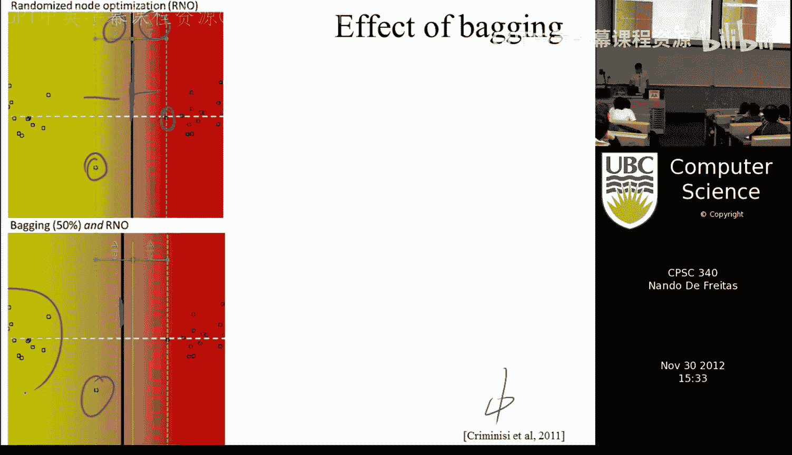

Okay how do we build a face detector or a hit detector or any detector for our objects in the world。

 you first take a huge data set is you're not ever going to be able to call。

 you're never going to be able to teach a machine what a face is by hand， instead you show it 5。

000 faces。电 you go狗。Objects or whatever word that you think will not return faces。

 and that will give you another 9400 nonface images you might want to go through quickly if dimension there's no faces。

Once you have those。Images then。This is what you're going to do。

You're going to take a very simple window。And we're going to use windows that look like this。

Windows that look like this one， and then maybe I think you only need ones that look like this。

These windows will be of size 24 by 24 pixels。And then all you do is。Let's say for example。

 for this guy， take the number， you sum the intensity of all the pixels that fall here。

Minus the intensity of the pixels that fall on the left and on the right。That's your feature。

And because you have many locations and image where you could look， these features are also。

These patches， there's an index I that basically tells you in which location you're placing the patch。

So in total， even though you only have these basic shapes because you can change the location。

 you actually have about 180，000 possibilities。好诉。That's the basic feature。

 extremely simple features， they're just these little patches to just count whats intensity in the y minus intensity on the black。

And then you pick a bunch of thresholds the。And you just check。

 is the intensity greater than a threshold？The intensitysities basically give you all those points in the play that I have shown you and now you just compare it to a bunch of pressure。

So this is the weak learning， it's just a very basic decision。Take this feature。

 you put it in the image， you look at the difference between white and black， and then you check。

 is it great at1 point2？If it is left， if it's not right， that's your basic note。

Then you average all your weight learners。So basically we're using three。

 we will use trees here of oliveage。One node， so each tree， in fact， is a thumb。It's just one note。

 I note that wasn into。There's many of these nodes， So you use。

So you will search for which of the nodes is the one that splits。

That gives you the better split take of the information can we've enjoyed。Before and。

And so for example， here is a good one， here is a bad one。

 one that will give you low information gain。And that's how you build a feature that all relates to building based intent。

It's just a simple decision tree， so you create a bunch of random theaters。

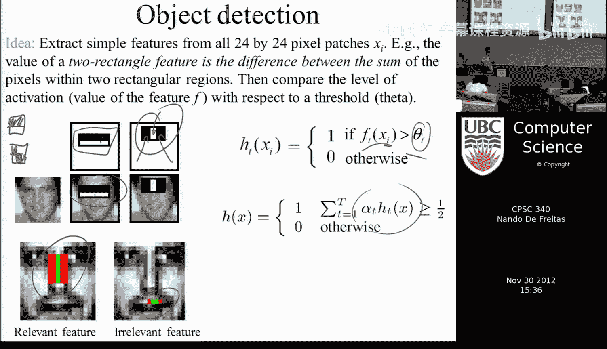

So it's exactly。E around featuresus will give you these different levels。

 each point is essentially an intensity value， intensity。

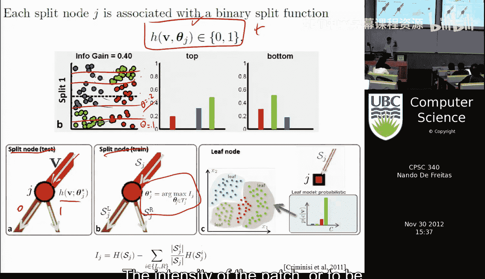

Of the patch。

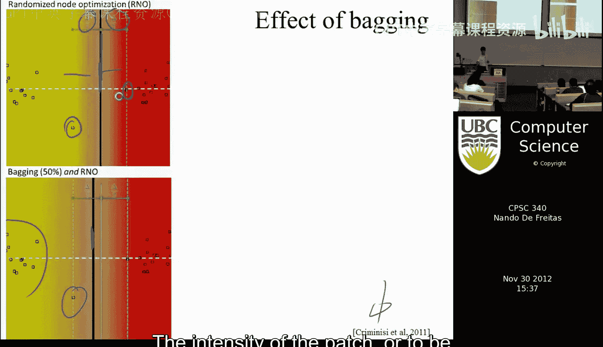

Or to be precise the difference of intensities。And then you do for all of them， but again。

 youra wants to make it efficient， so you subsample of few。

 and then you check which one is the best one in terms of information can and you picked up one。

And then you subsample the data and subsample parameter you keep doing that。

 you produce a bunch of these randomized。Decision， and then you average them。And there's a place。

 a place that's not made out of one thing， is made out of。

Thousands of little things that when you combine them。Determined what to face。

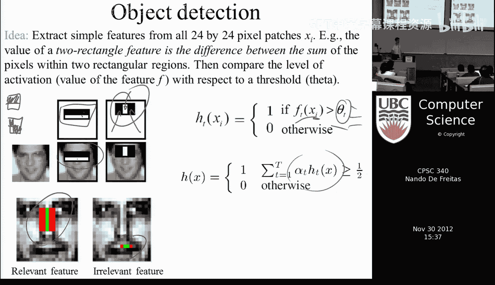

And other more spiritually。In detect faces， I've used it in sports events to detect hockeyer planes so that coaches can then know exactly whether the play was at any point in the game。

In it's the detectors that we use to build the cars that will drive by themselves that California has already legalized and it's the detectors that you can use。

Provided you have the data like kitty faces， you can build a detector to do anything you want。

All right， the last application that I want to cover is this the connect。

 so in the Connect there's a sensor in front of the TV that gives you a depth map， a depth map。

 it looks like this， it basically tells you how far is each point from the count， so it's a depth。

The Congress is measuring the depth。Think of it as like a ra， like a bat。

Robots for all pretty much old robots these days have these sensors。

 they're actually quite cheap like 100 partss， so mass produce， the connect was the fastest sold。

cost to sell the consumer electronic device when it was launched。

Because we're looking at the record breaking profits for Microsoft with the sense。啊。

What Connect wants to do is for each excellent song。

It wants to classify each pixel as being a body part， just like it's done here， here's a prediction。

 so blue will be a hand on to say ahead， purple is this bit of the torso and they want for whatever the shape of a human a front。

 they want to classify it because if they know where your hands are or your torso is。

 they can make sure that it's almost like you're immersed in the game。

 you don't need a we or anything， you can immerse yourself in the game。

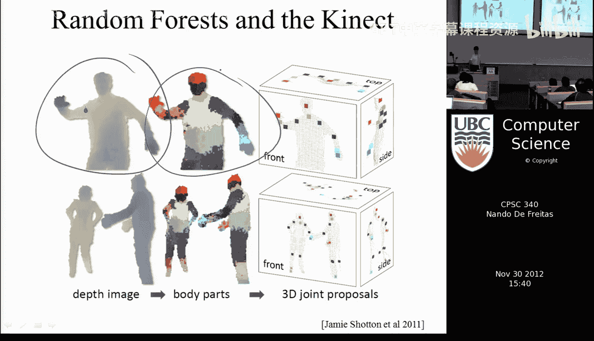

In order to get to work theres。Two clever ideas from Connect and the first idea is well。

 we don't have。Enough labeled data。So if you wanted to produce the data。

 you would have to have an animator， basically a person。

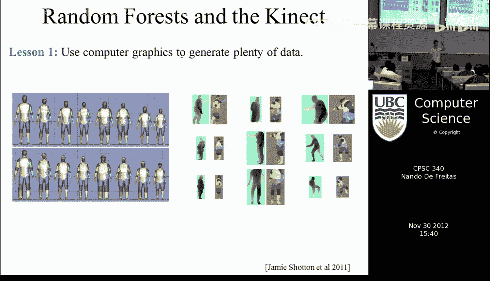

So first you put someone in front of a computer doing all sorts of things。

 you captured an image like this， and then you would have to have gone by hand， this is their head。

 this is the shoulder of pixels。This is the arm， the other arm， this is the hand。

And this would be extremely tedious for the human to do this for thousands or millions of images。

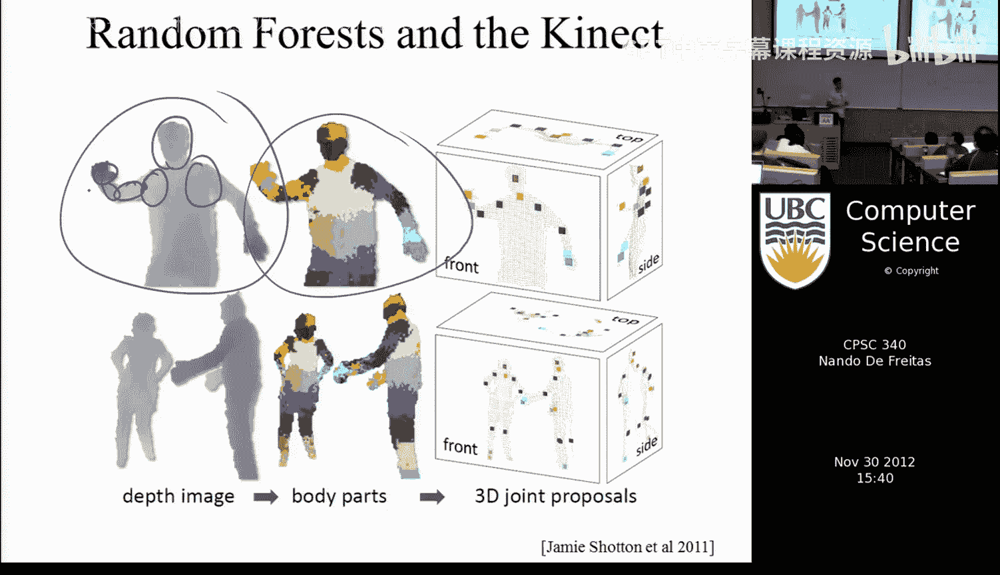

Instead， what they did was the following， they used computer graphics， the insufficient。So。

Because you have models， what you do is you just deform these and for a computer graphics model。

 you know exactly what the shoulder is。And the arms so they actually generate the data synthetically。

 they just take a basic model and then they just apply a bunch of transformations using standard computer graphics technology。

诶。Now they have it varies because now doesn't matter whether the players are short， tall， fat， thin。

 that you can get all sorts of players， they can get a system that works for all sorts of players and they have data because you have a 3D model you can also get to them to 3D model and then you train on the simulated data。

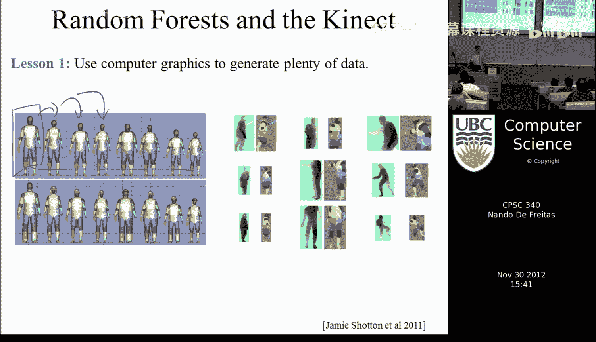

And when you're trying to dissimulate the data you need very basic features。

 the feature that they use for a pixel is extremely simple。They just have a pixel。

 let's say this pixel here。They essentially just smoke at two rays away from the pixel at random。

And then they look at the difference in depth between those two points in the or。So。

Essentially that the point Xs。Following the direction of the vector U。

 you normalize by how far that point x is from the curve from the sensor。

And that you have to do because you and I have something that's that in。

And then you have another point V， and then you look at the difference， that's the feature。

And then the duration is， if something is like， say， the belly。When you have these two factors。

The change in depth is not going to be made， but if you have something like the wrist。

The change in depth。It to be larger。Because often tax the rest。

 the thing that likes to the rest tends to be that out。

So basically the features in this case consist of the distance to the point and then the angle。

 so there's four parameters。And what they do is they just， well， it's only for parameters。

 so what they do is they generate a bunch of random values for these parameters。

And then they build the tree， so you have random parameters and random thresholds so they use。

 they just trace these。And then it will check whether the change inities above a threshold。

 just like we do for the faces， whether the difference between the intensities of the two branches of pixel is above a certain threshold。

 and then they build the tree with this and all larger get connect。Mchll allows you。

So they train us all offline， and then in real time do they only do classification or is it does that actually learn in real time？

Real time is just fresh classification that there's no additional learning at real time。

So machine learning tools like this are really nice because the training is very expensive and it might take days or a week。

But once you've trained that and you want to implement it on a chip。

 which's actually cheap because it's just fit forward classificationification on a chip。

 and that's what allows you to sell these devices for cheap。

So really classification takes very little processing power， you really。Correct。

 and if you use random parameters as opposed to try to learn these parameters。Makes it even cheaper。

What would happen to their model if someone has a disability， let's say， yeah。

 there's only one label。You don't ask me， you have to retrain the data， I guess I don't know。

 I've never tested it with someone with this。 I've tested it with rat。

H theUPC lab here because I wanted to monitor rat from material I was measuring brain waves。

They don't work too well， but the new generation of k sensors that I think just came out now where it's about to come。

 they will be much better， we can use them for animals and so on。I mean。

 this was trained for humans at the particular distance from TV and so on。

 if you want to do better than you。But I believe does my person believe there'll be a generation of these sensors coming out to do all sorts of things。

 this is very hot new technology and we'll see a lot more。Each time。Like the developers， do they？

I have to sell a home new machine like each time they've retrained a model or does it come on medical with and version update？

They will do whatever makes them comp money。I have no idea what this strategy is。

 but knowing business people that what they do。啊。Using this model。

 how to distinguish a right hand from the left hand， or is that knowledge given to it？

There is to do that。I think just from the differences I guess because often the left hand is over here。

 I believe it actually differentiates the two。I have。

 if you're interested in this and want learn more about the Connect or want to implement this。

 one of my master's students is actually an expert on the。

He calls these things all the time and he tries to do better。Microsoft。I was in， but。

Do they collect data？No， I guess not。Collecting data would require putting extra material in the sensor。

I don't know。I' would be skeptic because you want essentially to be as cheap as possible。

 you want to have cheap electronics and collecting data with。Pricice。

So I guess having a real thing that isn't， I mean， it's not advantageous more。No。

 using a synthetic data in these case is extremely smart。They can create as much as they wish。

Very cheaply and it's labeled So if you capture data when people have money。

 you would still have to label it， which is something。Labeling is expensive。

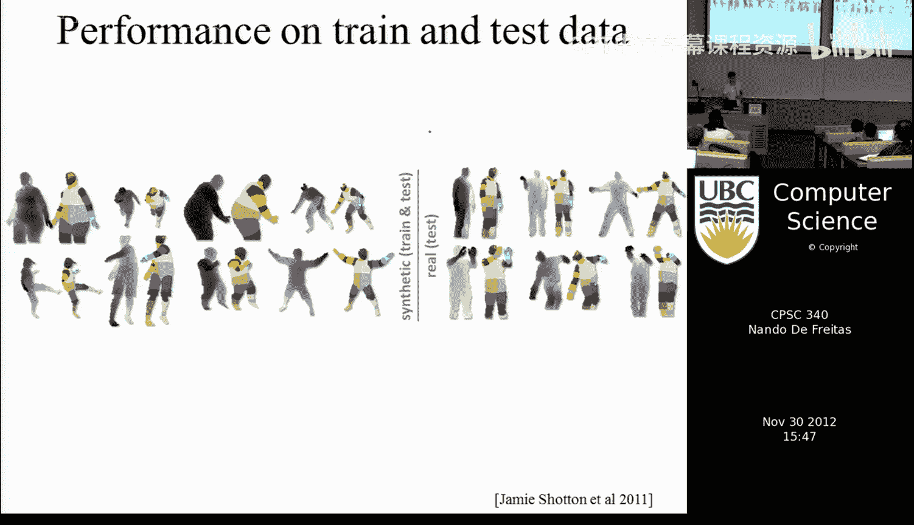

Label data is very expensive， unlabeled data is cheap。

 that's why Google relies on the neural networks and that's why everyone's using your codes because you try to predict。

で根本。If a model can predict the input， in other words。

 if I can look at this scene and close my eyes and predict it in my head。

 then I understand this scene。什。Does deep learning mean does deep learning mean model encoding？

It's using several layers of neural nets， basically。

TheThe latest speech recognition of Google Microsoft。

 it's been on the news if you follow my Twitter or the Google group or whatever。

 you say I've been posting several articles about this it's pretty hard。

 the latest in speech recognition are uses deep learnings， which is multi neuralural networks。

 they're actually like and then。They train layer wise， like you're train a on decor。

And then you do a final refinement step， which is just the backropag algorithm。

 which you all pretty much know how to code。And that's Google's launch speech recognition。

 I personally think it's a lot better than Siri。And they've been quiet about it。

 but just because Google is smart as to how they launch things。

IJust wondering if there's a place Is watching this， but。And the Apple map like stupid。

Is there one place that you can get。Be going on in machine learning。

Is there one place where you could look at all the algorithms that are involved in learning Yeah。

 there's two conferences？That's the， greatest in machine learning。And of course。

 you can build this for people but you can also build this for other things。

 so if you want to create interfaces for robots to interact with humans。

 I think one of the big technology，That will be developed in the future。

 especially as our population gets old and there's not enough young people to look after us and eventually。

To what extent people will be over border control， et cetera， et cea，a and what the politics will be。

We likely will need robots to look after us as we go off。Maybe not， but it's certainly you。So。

It's good that we developing this technology。So that brings me to the end of the course。

I just want to ask the。Evaluations for the Ts。These are important because they help us。

Of course the the time I want to thank you for a great class and every class I end by saying this。

 you didn't know any machine learning when you came in here now you know machine learning。

 now you know how to take people's data and do something with people's data make sure that when you do that that you think about doing the right ethical thing just like you can classify whether a patient is good is likely to have cancer or not so that you help that patient you can also do the same use the same data and the same classifier to decide whether that patient will get insurance or not。

So think about that。

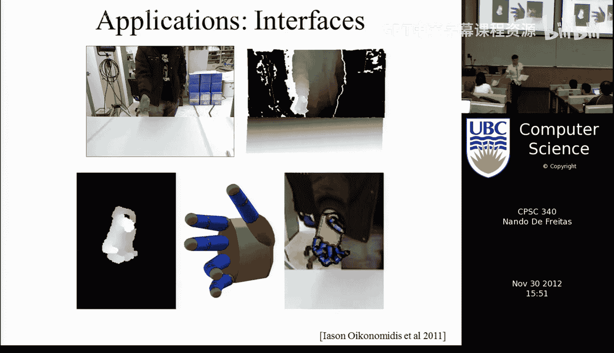