# 机器学习与数据挖掘：33：随机森林、人脸检测与Kinect 🎯🌲👤🎮

在本节课中，我们将学习如何通过组合多个简单的决策树来构建强大的分类器——随机森林。我们将探讨其工作原理、优势，并了解它在人脸检测和微软Kinect等实际应用中的强大表现。

## 决策树回顾 🌳

上一节我们介绍了决策树。本质上，决策树在训练时选择一个非常简单的分割规则（分类器）。例如，一条垂直或水平的虚线就可以作为一个分割。

在训练数据中，你只需计算分割线两侧每个类别的点数。选择不同分割线的方式是最大化信息增益。在测试时，当一个点到达一个节点，你只需检查该点是在分割线的上方还是下方，然后将其发送到相应的分支。

决策树非常简单，仅使用垂直或水平线来分割数据。当然，单棵决策树可能不够鲁棒，因此我们提到更好的方法是组合多棵树，即对树进行平均。

## 随机森林：组合的力量 🌲🌲🌲

为了提升性能，我们组合并平均多棵决策树，这就是随机森林。

以下是构建随机森林的关键步骤：

*   **数据子集**：每棵树在数据的一个子集上进行训练。如果数据集过大无法全部加载到内存，这是一种有效策略。这被称为“袋装法”。如果使用全部数据，则称为“自助法”。
*   **特征子集**：对于每棵树，我们不考虑所有可能的特征，而只考虑一个特征子集。例如，在文本分类中，一棵树可能只查看10,000个特征中的100个，并从中选择信息增益最高的一个。
*   **随机化与多样性**：通过随机化数据和特征，我们创建了彼此差异很大的树。每棵树本身可能不是一个优秀的分类器，但当你平均许多棵树时，你会得到一个非常强大的分类器。

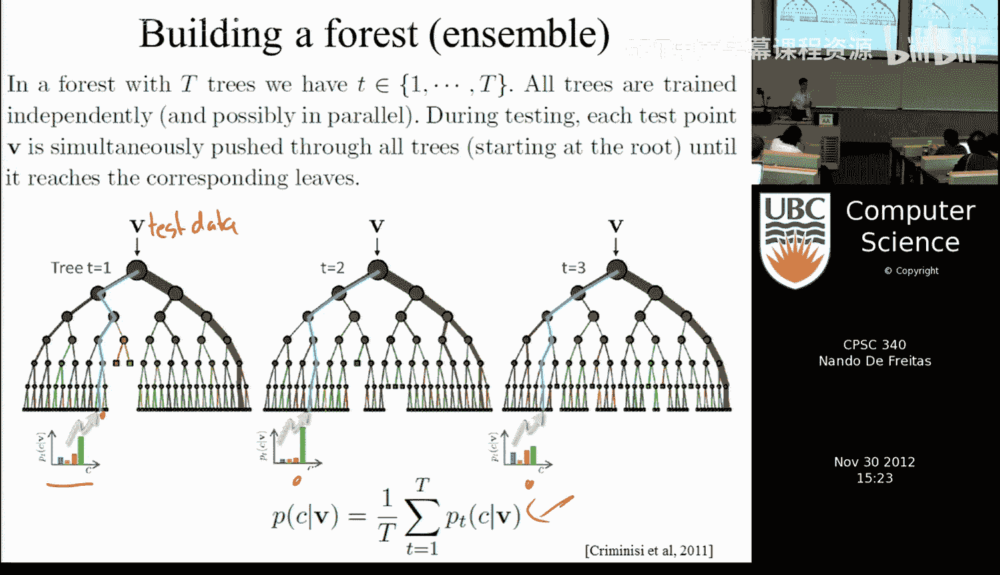

在测试时，对于一个新输入，它经过每棵树都会到达一个叶节点。每个叶节点在训练时都关联着一个归一化的类别直方图（概率分布）。我们只需将所有树给出的直方图相加并再次归一化，就得到了最终的分类概率。

例如，如果两棵树非常确信一个点是绿色，而第三棵树不太确定（可能认为是红色或蓝色），但通过平均，绿色仍将占主导地位，从而得到正确的分类。

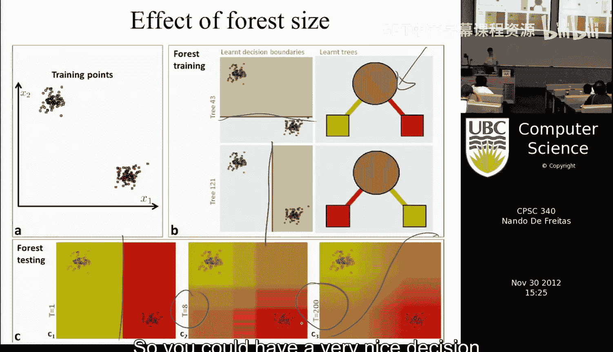

关于平均方法，除了这里使用的算术平均，还有几何平均（乘积）等其他方式，这引出了“堆叠”等技术。

## 随机森林的行为与决策边界 📊

那么随机森林的表现如何呢？假设我们有一个二维数据集（例如身高和体重），包含两个类别。

如果只使用一棵树，决策边界可能是一条简单的直线。但如果使用8棵树并平均它们的输出，我们开始得到平滑的概率估计，通过颜色强度显示一个点属于某个类别的概率。使用更多树会得到更精细、更平滑的决策曲面。

即使对于复杂的螺旋状数据或多类别数据，随机森林通常也能表现得相当不错。

## 树的深度与过拟合 ⚖️

一个重要问题是树应该有多深。我们希望树是平衡的，但深度需要适中。

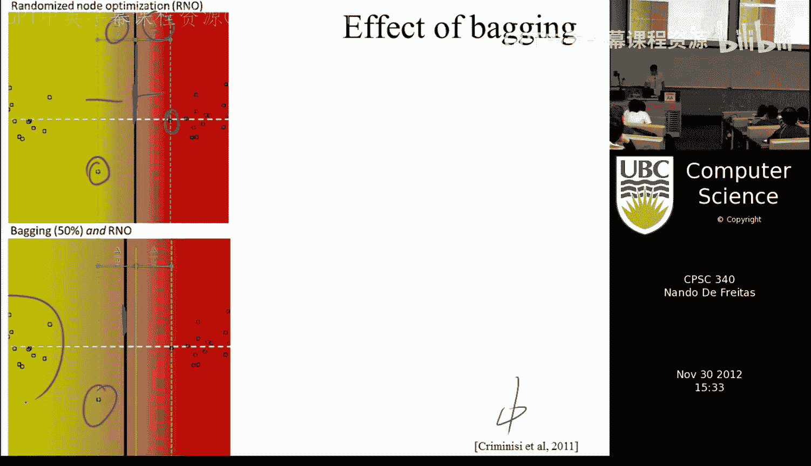

如果树太小（深度不足），可能会欠拟合，无法捕捉数据中的复杂模式。如果树太大（深度过深），模型会变得过于复杂，并开始过拟合数据，就像神经网络或支持向量机参数过多时一样。因此，存在一个最佳的“甜点”。我们通常通过交叉验证来自动找到这个最佳深度。

## 袋装法与边界特性 🛡️

之前的实验结果都是基于每棵树查看全部数据，仅随机化特征。现在我们来比较两种情况：顶部的图，每棵树查看全部数据；底部的图，每棵树只查看50%的数据（即也进行数据子采样）。

我们观察到几个重要现象。当只使用数据子集（袋装法）时，决策边界会移动，更倾向于位于两个大类点群的中间。这种边界对远离其同类的孤立点（可能是错误标注的噪声点）不那么敏感，从而提高了模型的鲁棒性。

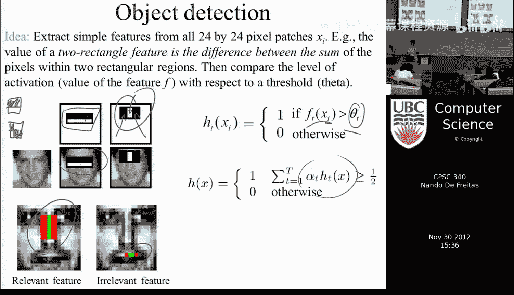

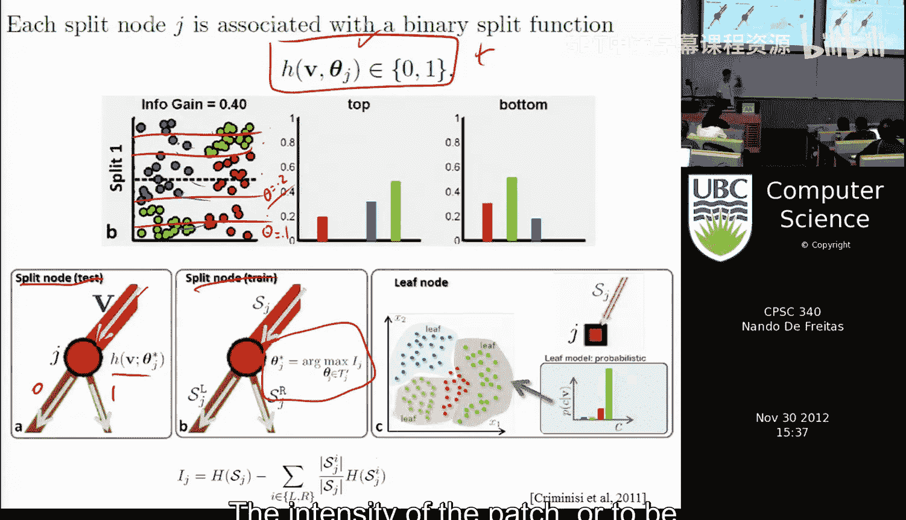

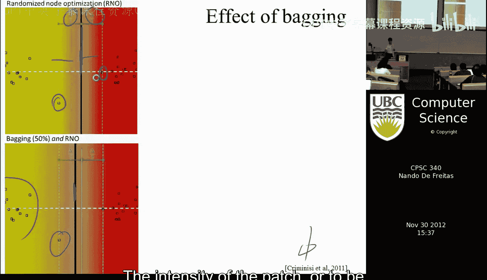

值得注意的是，随机森林的决策边界天然地倾向于最大化边界点之间的间隔，这被称为“最大间隔”属性。这正是支持向量机的核心思想。边界上的这些点被称为“支持向量”。

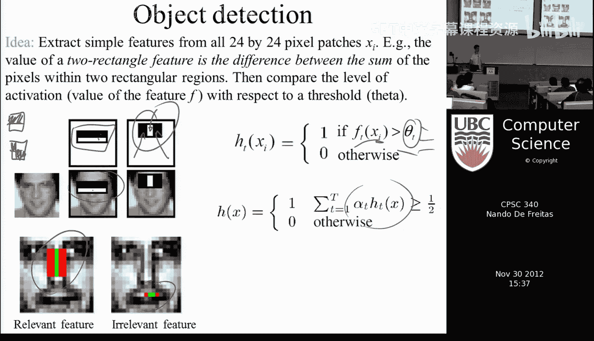

## 应用一：人脸检测 👤

我们如何构建一个检测器来识别人脸、手部或世界上的任何物体？首先，你需要一个巨大的数据集。你无法手动教会机器什么是脸，但你可以展示给它5000张人脸图片和5000张非人脸图片。

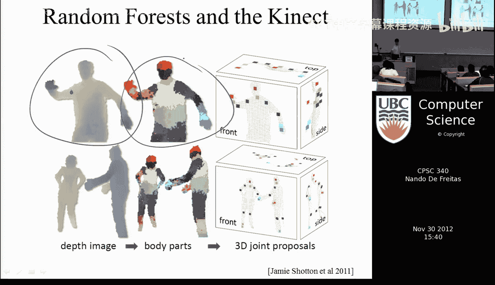

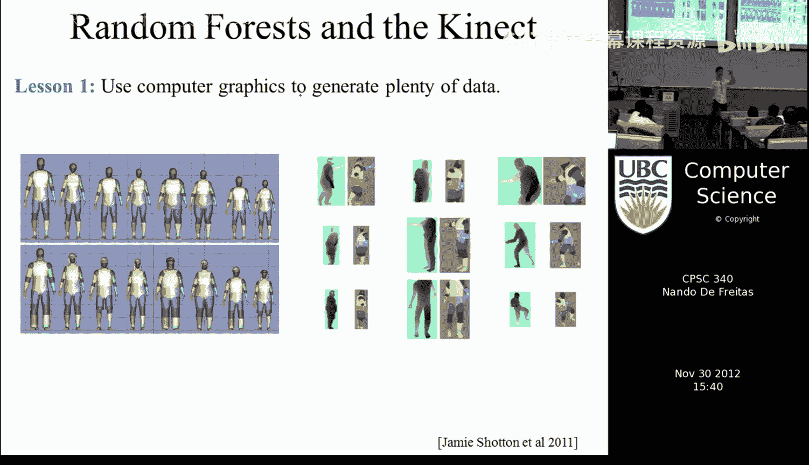

以下是构建人脸检测器的步骤：

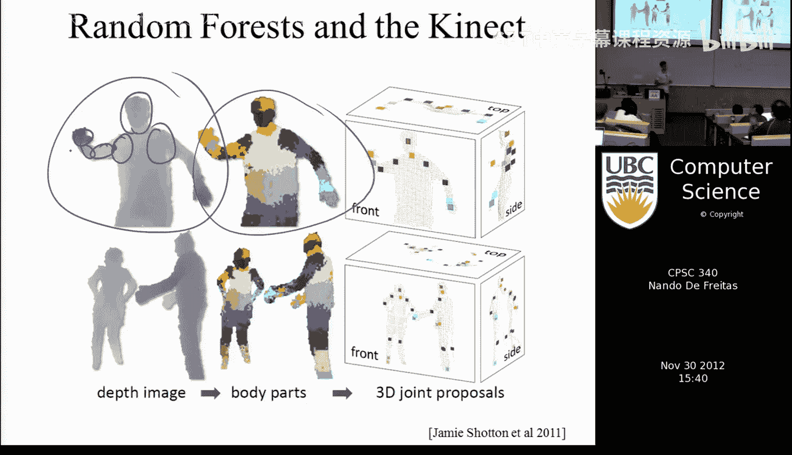

*   **特征设计**：使用非常简单的特征。取一个24x24像素的窗口，并使用一些预定义的简单图案（例如，两个白色矩形块和一个黑色矩形块）。特征值就是白色区域像素强度之和减去黑色区域像素强度之和。
*   **特征生成**：通过在图像的不同位置放置这些图案，你可以生成约18万个可能的特征。
*   **弱分类器**：每个弱分类器（决策树桩）就是检查某个特征值是否大于一个随机阈值。这构成了一个非常基本的决策节点。
*   **构建强分类器**：随机生成大量这样的特征和阈值，为每个创建一个弱分类器。然后，像构建随机森林一样，通过信息增益选择最好的那些，并对它们进行平均（组合）。最终的人脸检测器就是由成千上万个这样的简单“小东西”组合而成，共同决定是否为人脸。

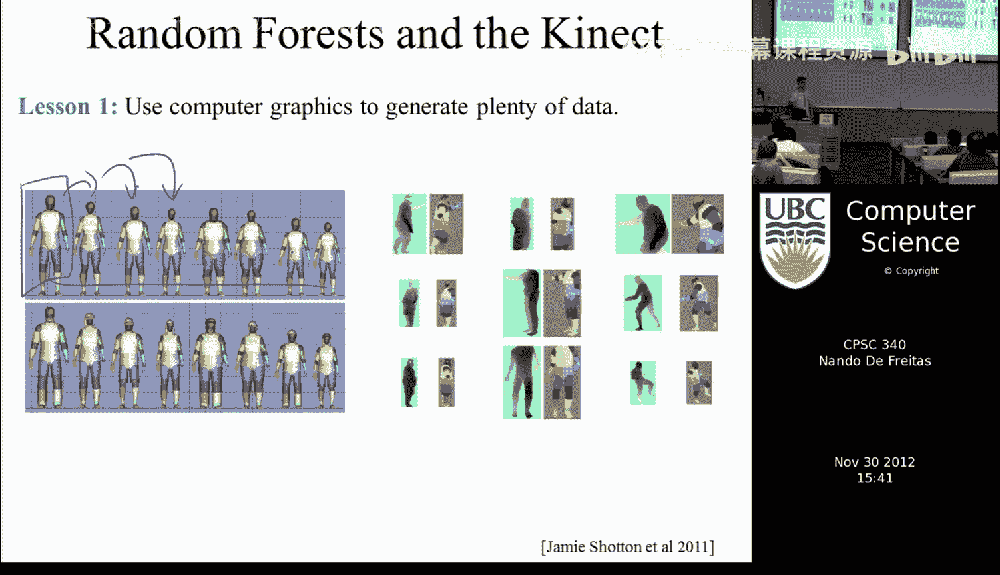

同样的原理可以用于检测冰球运动员、构建自动驾驶汽车的物体检测器等，只要你有相应的标注数据。

## 应用二：微软Kinect 🎮

Kinect前面的传感器提供一个深度图，显示每个点距离传感器的远近。Kinect的目标是对每个像素进行分类，判断它属于身体的哪个部位（例如，手、头、躯干）。

他们面临的主要挑战是缺乏足够的标注数据。手动标注数百万张深度图中每个像素的身体部位是极其繁琐的。

他们的解决方案非常巧妙：

*   **合成数据生成**：他们使用计算机图形学生成合成数据。通过对一个基础3D人体模型应用各种变换（模拟不同身高、体型、姿势），他们可以生成无限多的、且自动拥有精确像素级标注的深度图。
*   **特征设计**：使用的特征极其简单。对于一个像素，随机选择两个方向向量，计算沿这两个方向一定距离处的深度值之差，并进行归一化。这个差值对于不同身体部位具有区分性（例如，手腕处的深度变化可能比腹部更大）。
*   **训练与部署**：使用这些随机生成的特征参数和阈值，构建随机森林分类器。训练过程可能很耗时，但一旦训练完成，分类（推断）过程计算量很小，可以廉价地部署在芯片上，实现实时身体部位追踪。

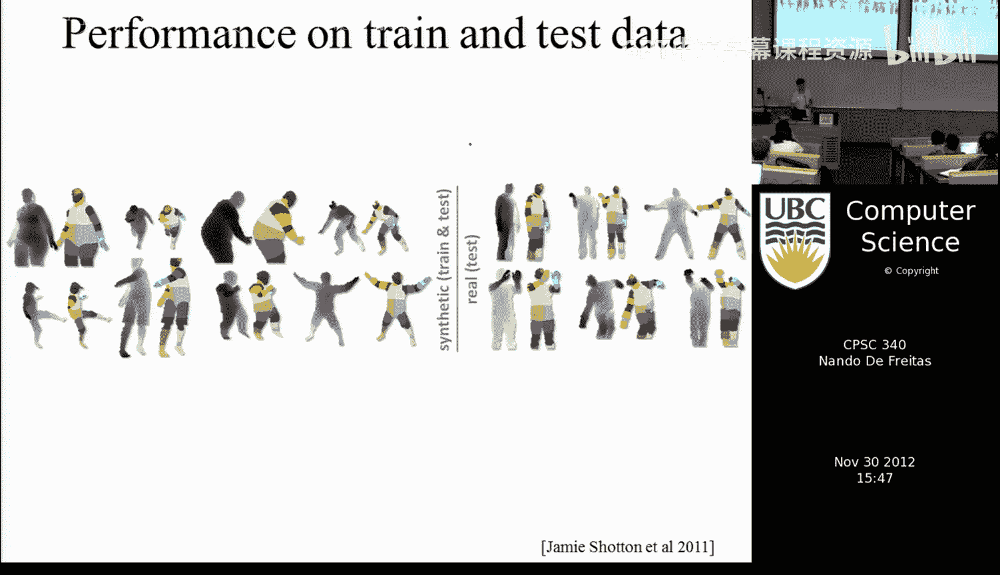

使用合成数据在此案例中非常聪明，可以廉价地创建大量精准标注的数据。

## 课程总结与伦理思考 🤔

本节课我们一起学习了随机森林，这是一种通过组合多个简单、随机的决策树来构建强大、鲁棒分类器的方法。我们探讨了其如何通过数据与特征的随机子采样来工作，以及它如何天然地产生平滑的概率估计和具有最大间隔特性的决策边界。我们还看到了随机森林在两个激动人心的实际应用——人脸检测和微软Kinect体感技术——中的核心作用。

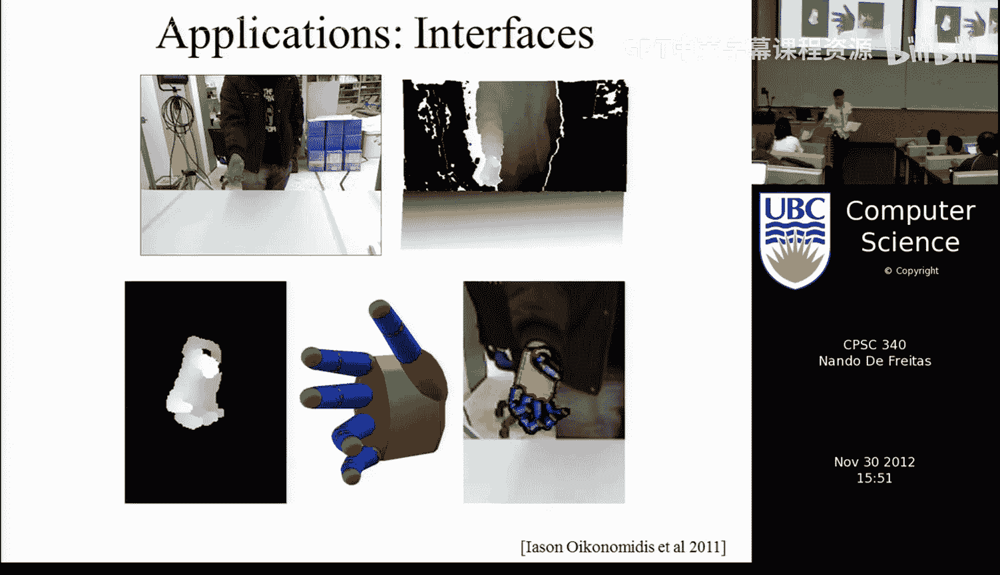

最后，随着机器学习能力越来越强，我们必须思考其伦理影响。同样的技术和数据，既可以用来帮助诊断疾病，也可能被用于决定某人能否获得保险。请务必确保你用所学知识做正确的事。