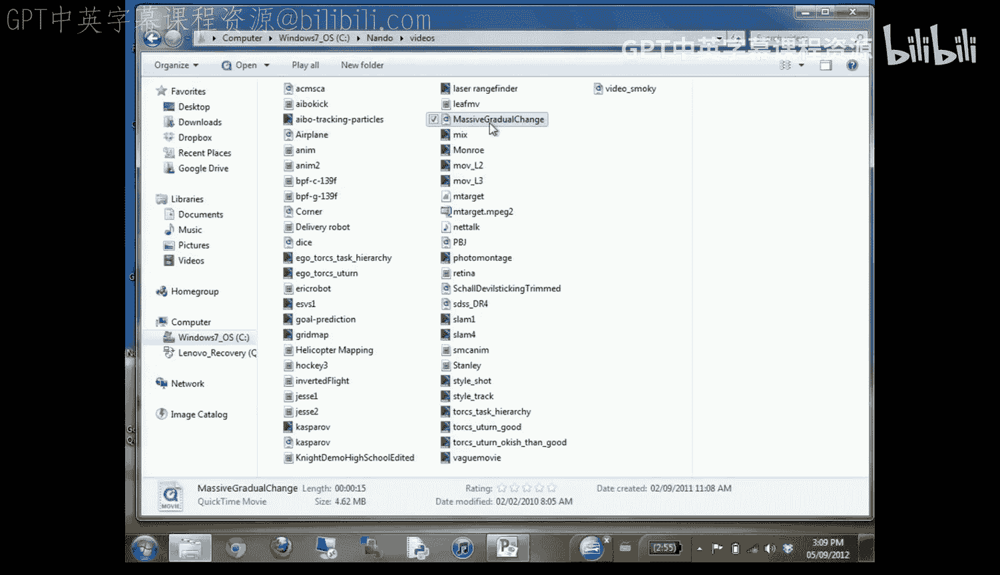
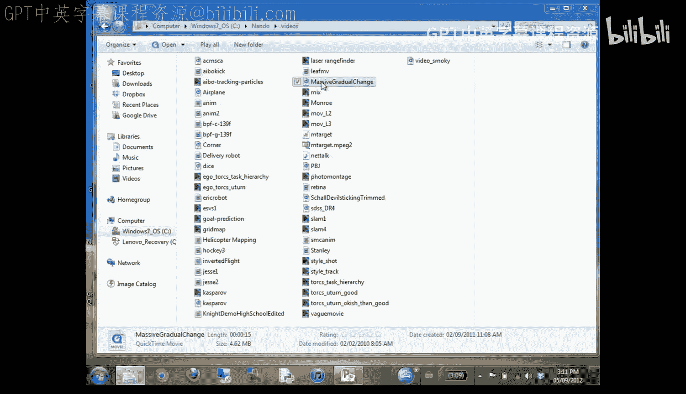
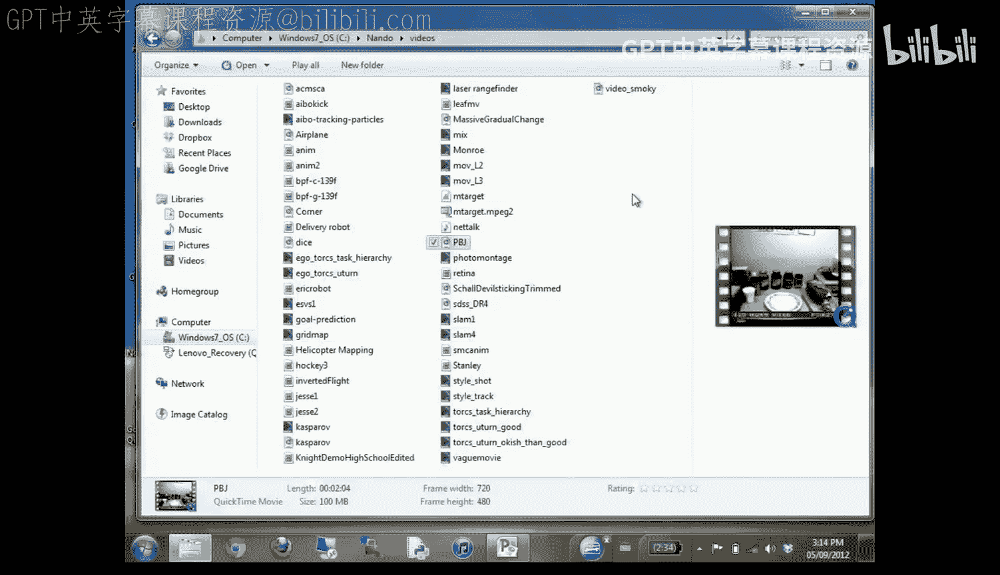
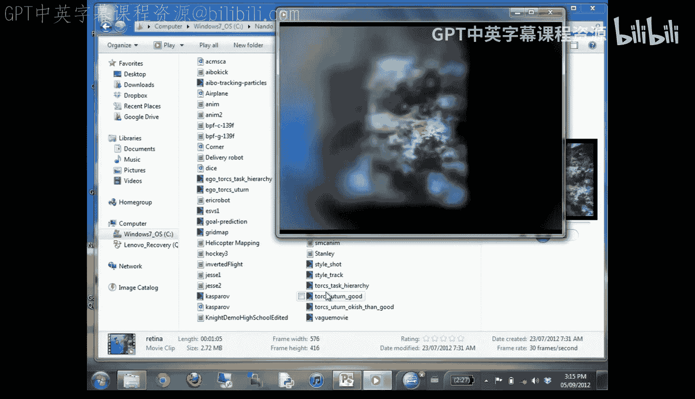
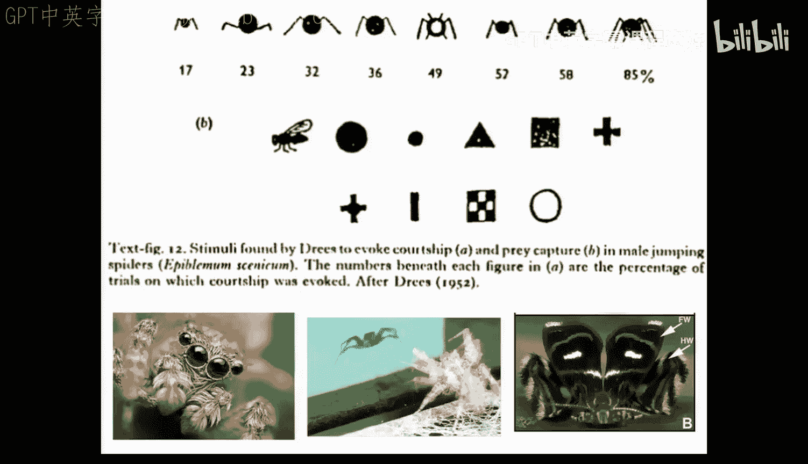
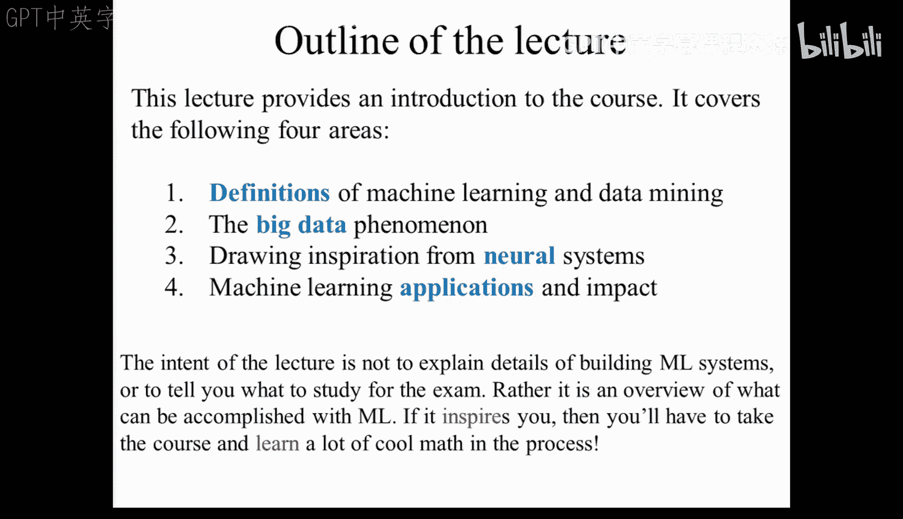
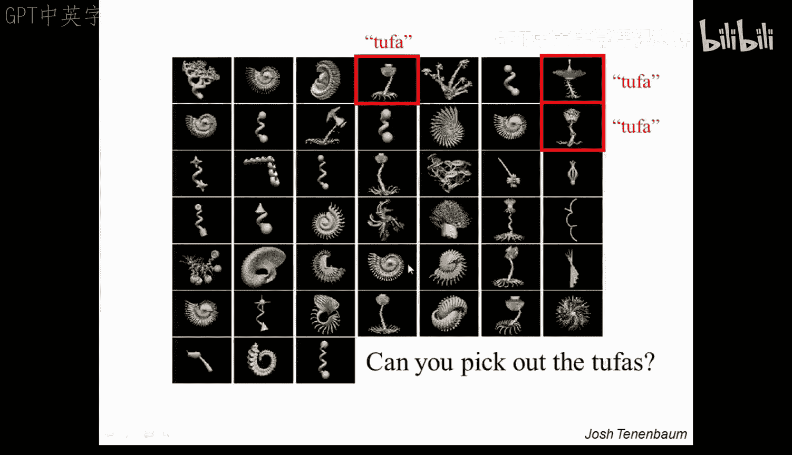
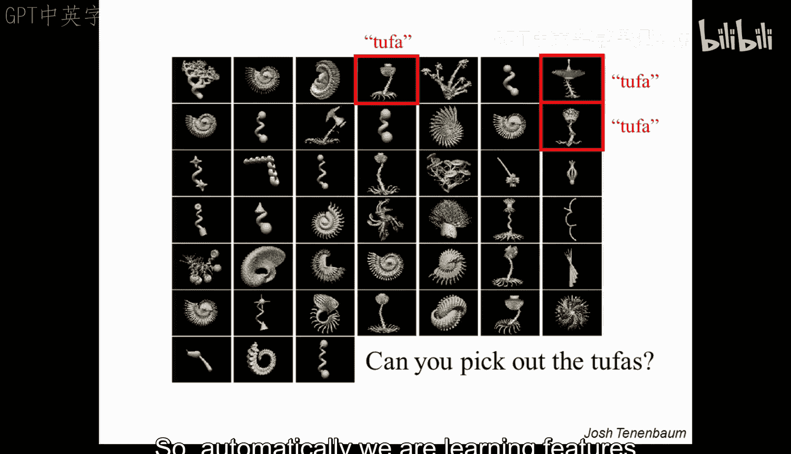
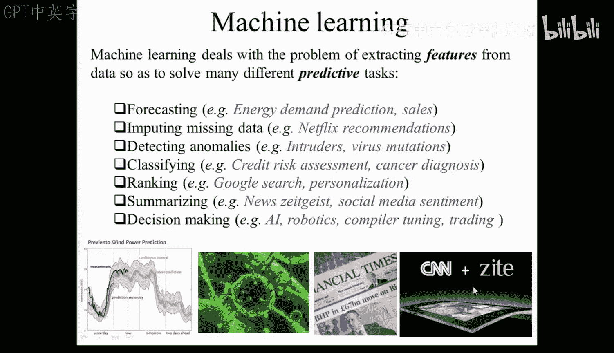
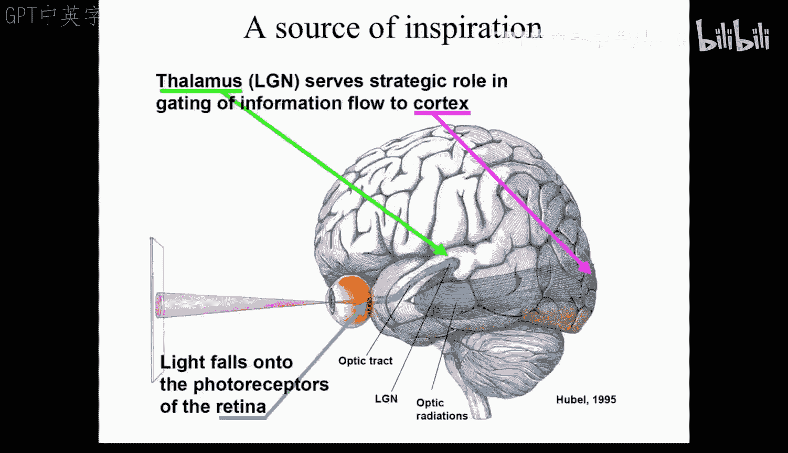

# 01：机器学习导论

在本节课中，我们将要学习机器学习的基本概念、其重要性以及它在现实世界中的广泛应用。我们将从人类感知的局限性出发，探讨为什么传统的编程方法在处理某些复杂任务（如视觉识别）时会遇到困难，从而引出机器学习这一替代方案。

## 人类感知的局限性

上一节我们介绍了课程的主题，本节中我们来看看为什么我们需要机器学习。首先，一个关键原因是：我们人类并不完全理解自己是如何完成某些复杂任务的，比如“看”。

以下是两个视觉实验，它们展示了我们视觉注意力的局限性。

*   在第一个实验中，两张几乎相同的图片快速切换，其中一张图片的飞机引擎消失了。许多人最初无法察觉到这一变化。
*   在第二个更复杂的视频中，场景在每次切换时会发生多处改变（如建筑物颜色、行人消失、标志变化等）。即使观众被告知会有变化，也往往只能注意到其中一小部分。

这些实验表明，我们并非如想象中那样“看到”了整个场景。我们每秒只能以高分辨率处理大约拇指指甲盖大小的区域，其余部分是我们大脑根据经验和预期“脑补”出来的。我们的视觉系统更像是一个为完成特定任务（如抓取物体）而优化的工具，而非一台高清录像机。

既然我们自己都不完全清楚“看”是如何工作的，那么我们如何用传统的“如果-那么”规则来教会机器“看”呢？这引出了机器学习的基本思想。

## 什么是机器学习？

上一节我们看到了传统编程在模拟人类感知时的困境，本节中我们来看看机器学习的核心思想。

机器学习采取了一种不同的方法：我们不再尝试为机器编写详细的指令来告诉它“如何看”，而是向它提供大量的**示例**，让机器自己从数据中找出规律和模式。简单来说，机器学习是关于从**经验**（数据）中自动改进性能的算法研究。

一个生动的例子是跳蛛的求偶识别。当向人类展示一系列图片并询问“哪张最像跳蛛”时，大家的选择与雄性跳蛛在实验中表现出兴奋的图片是一致的。这意味着，即使是只有几千个神经元的小生物，也能通过进化“学习”到复杂的识别模式，这远比我们手动编写识别算法要高效和强大得多。

另一个例子是学习虚构概念“Tufa”。仅通过观察几个正例图片，人类就能迅速总结出关键特征（如长茎、顶部有结构），并判断新图片是否属于该类。这个过程涉及自动提取**特征**并进行类比，而机器学习的目标就是让机器自动化这个过程。

更广义地，我们可以将学习视为一个**智能体**（如机器人、生物）与**环境**交互的过程。智能体通过**感知**环境、采取**行动**、接收**反馈**（奖励或惩罚）来积累经验，并利用这些经验调整自身行为，以在未来更好地实现其**目标**（如找到食物、避免危险）。

## 机器学习的应用与驱动力

上一节我们定义了机器学习，本节中我们来看看它为何如此流行以及有哪些应用。

机器学习之所以在今天变得至关重要，主要得益于**大数据**现象。我们生成、存储和处理数据的能力正在呈指数级增长。例如，谷歌每小时处理的数据量高达1 PB（约100万GB），这为训练复杂的机器学习模型提供了燃料。

以下是机器学习的一些主要应用领域：

*   **预测**：基于历史数据预测未来趋势，如能源需求、商品销量、电影评分。
*   **异常检测**：建立“正常”模型，用于发现异常情况，如信用卡欺诈、网络入侵、病毒变异。
*   **分类**：将数据点划分到不同类别，如信用风险评估、医疗诊断（影像分析）、垃圾邮件过滤。
*   **排名与推荐**：根据用户偏好对项目进行排序，如搜索引擎结果、商品推荐（亚马逊、Netflix）、音乐推荐（Pandora）。
*   **摘要**：自动总结冗长文本的核心内容，如产品评论摘要。
*   **决策**：为自主系统（如火星车、自动驾驶汽车、游戏AI）制定行动策略。

在以下情况中，机器学习通常是必要的解决方案：
1.  需要**自动化**和**自主性**的系统（如太空探测器）。
2.  人类无法明确描述解决过程的任务（如视觉、听觉、自然语言理解）。
3.  问题或模式会**随时间变化**（如用户兴趣、疾病发展）。
4.  需要为**海量用户**或**海量项目**进行个性化（如在线广告投放）。
5.  问题规模**极其庞大**，人工无法处理（如全网网页排序）。

## 数据与理解的平衡

上一节我们看到了数据的力量，但本节需要指出，仅有海量数据并不总是足够的。

像谷歌翻译和语音识别这样的成功案例表明，通过收集大量用户数据（及其修正反馈），系统性能可以持续提升。一个有趣的例子是图像修复：通过匹配海量数据库中的相似图像，可以智能地填充照片中缺失的部分。

然而，**数据并非万能**。谷歌的工程师们指出，当前挑战已从数据收集转向**理解**。例如，在学术引用中，一个错误引用可能因为被多次转载而比正确的引用更“流行”。如果算法只依赖数据出现的频率（流行度），就会强化这个错误。这就需要算法能够真正理解内容的语义，而不仅仅是匹配模式。

因此，未来的机器学习不仅需要处理大数据的能力，更需要推动走向能够**真正理解**数据含义的“人工智能”。

## 课程展望与总结

本节课中我们一起学习了机器学习的核心动机与定义。我们了解到，由于人类自身感知的局限性和某些任务的复杂性，我们需要让机器从数据中自行学习。机器学习在大数据时代的推动下，已广泛应用于预测、分类、推荐和决策等众多领域。同时，我们也认识到，在利用数据力量的同时，向机器注入“理解”能力是下一个重要的前沿。

本课程将使用**数学**作为描述和构建机器学习模型的语言。请不要畏惧，我们将从基础开始，逐步展示数学如何被用来解决这些激动人心的现实问题。如果你对学习新语言（数学）以创造酷炫事物感到兴奋，那么这门课正适合你。

准备好迎接一个充满“惊叹”的学期吧！