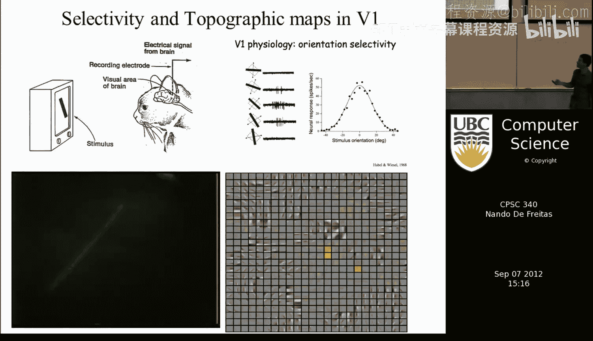
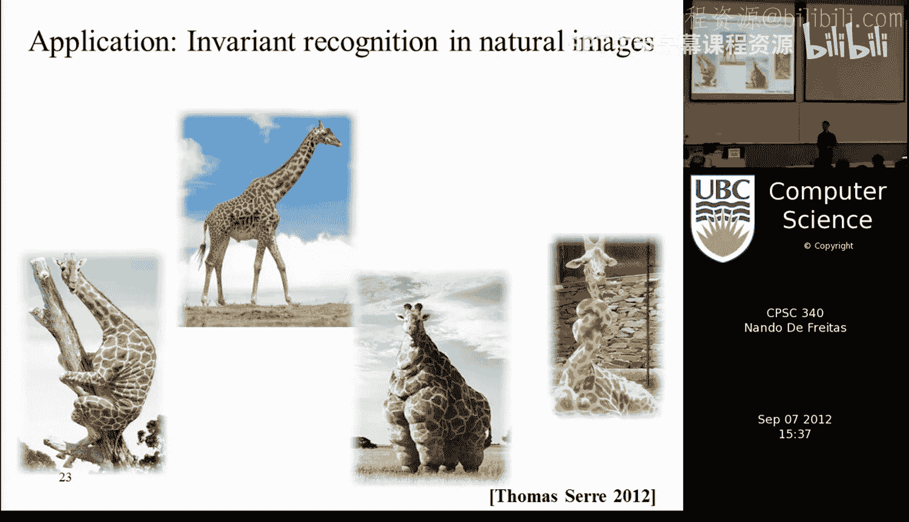
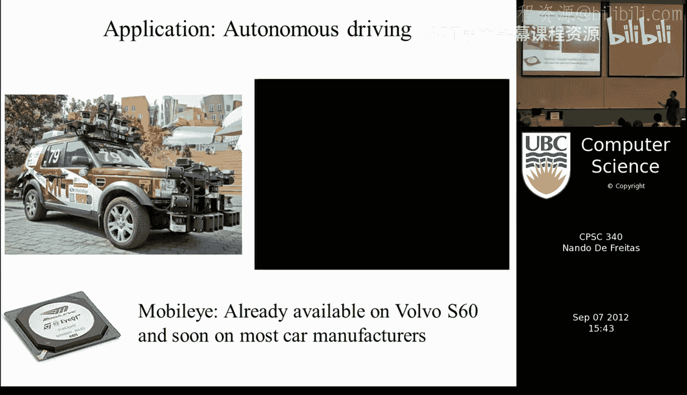
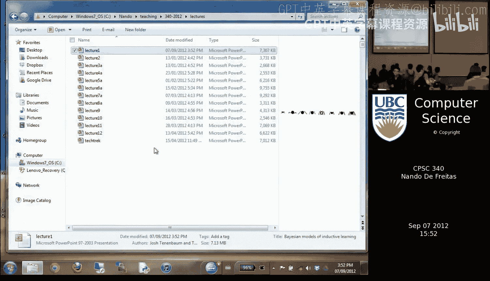
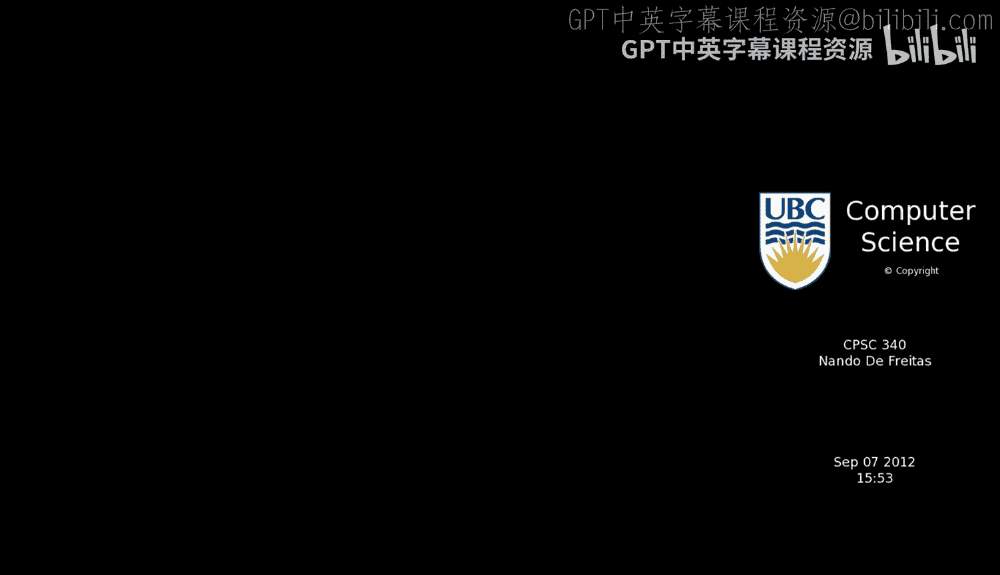

# 02：机器学习导论（二）🎓

在本节课中，我们将继续探索机器学习的核心思想，了解其背后的神经科学灵感，并认识其在现实世界中的广泛应用。我们将看到，通过利用大量数据，计算机可以学会识别图像、理解语言，甚至像人类一样“看”世界。

---

## 大脑的启示 🧠

上一节我们讨论了为何直接编程让计算机理解事物（如识别长颈鹿）非常困难。本节中我们来看看，人类大脑是如何处理这类感知任务的，这为机器学习算法提供了重要灵感。

神经科学研究表明，我们的大脑通过分层处理信息来理解世界。例如，在视觉皮层中，单个神经元只对特定模式的刺激（如特定角度的线条）产生反应。

以下是一个关键实验的发现：
*   **Hubel和Wiesel的实验**：科学家将电极植入猫的大脑视觉皮层。他们发现，当屏幕上出现特定方向的条纹时，某个神经元会剧烈放电；当条纹方向改变，该神经元便停止放电。
*   **结论**：单个神经元负责识别图像中非常基础的特征（如边缘、角度）。复杂的物体（如一张脸）是由大量这样的神经元协同激活来表征的。

这个原理启发了人工神经网络的设计。我们可以构建一个网络，其底层的“神经元”学习识别图像中的基础特征（如边角），更高层的神经元则将这些基础特征组合起来，识别更复杂的模式（如眼睛、鼻子，最终整张脸）。

## 从大脑到算法：特征学习与自动编码器 🤖

理解了大脑的分层处理机制后，我们来看看如何用算法模拟这一过程。一个强大的工具是**自动编码器**。

自动编码器是一种特殊的神经网络，其目标是学习输入数据的高效表示。它的结构通常包含一个“瓶颈”层。

**核心思想**：网络尝试将输入数据（如图像）压缩成一个紧凑的编码（即“瓶颈”层的激活值），然后再从这个编码中尽可能准确地重建出原始输入。通过训练网络最小化输入与输出之间的差异，网络就学会了数据中最关键的特征。

以下是其工作流程的简化描述：
1.  **编码**：输入数据通过网络前半部分被压缩为低维编码。公式可表示为：`编码 = f(输入)`
2.  **解码**：编码通过网络后半部分被重建为输出。公式可表示为：`输出 = g(编码)`
3.  **训练目标**：使`输出`尽可能接近`输入`，即最小化两者之间的差异（如均方误差）。

谷歌著名的“识别猫”项目就运用了类似思想。他们用海量的YouTube视频帧训练了一个巨大的自动编码器网络。训练完成后，他们发现网络高层的一些神经元变得只对特定概念（如“人脸”或“猫”）敏感。这表明，通过无监督学习（仅使用数据本身，无需人工标签），机器可以自动发现数据中反复出现的重要模式。

## 机器学习的现实应用 🌍

现在，我们来看看基于数据学习的理念，在现实世界中催生了哪些变革性的应用。

### 计算机视觉 👁️

以下是几个关键领域：
*   **人脸检测**：早期基于规则的人脸检测程序（例如，寻找肤色和椭圆区域）非常脆弱，无法处理所有情况（如浅色眉毛）。现代方法通过收集数百万张标注好的人脸图片，让机器学习模型从中自动学习，从而实现了在各种条件下的鲁棒检测。
*   **自动驾驶**：让汽车识别行人、车辆、车道线是自动驾驶的核心挑战。公司通过收集并标注海量的道路场景图像，训练机器学习模型来实时感知环境。这有望大幅提升道路安全。
*   **图像分类**：直接告诉计算机“长颈鹿”的定义极其困难。但如果我们提供成千上万张标注为“长颈鹿”的图片，机器学习模型就能学会识别它，即使在新的、复杂的背景中。

### 自然语言处理与语音 🔤

文本和语音是机器学习的另一大用武之地。
*   **机器翻译**：早期基于语言学规则的翻译系统效果有限。如今，像谷歌翻译这样的系统，利用互联网上存在的海量双语对照文本（如加拿大议会的英法文件）进行训练，实现了质量更高的翻译，极大地促进了全球商务和交流。
*   **搜索引擎**：谷歌早期的成功离不开其利用网页链接数据（视为一种“标注”）来评估网页重要性的机器学习算法（PageRank）。
*   **语音识别**：将声音波形转化为文字。现代系统（如谷歌、微软）将音频信号预处理后，输入深度神经网络进行训练，模型的输出就是对应的文字序列。随着用户数据的不断反馈和积累，这些系统变得越来越精准。

### 其他领域 🎮

机器学习的应用无处不在。
*   **推荐系统**：分析你的观影、购物记录，预测并推荐你可能喜欢的内容。
*   **关系挖掘**：从海量文本中自动提取实体（如人物、地点）之间的关系。
*   **体感交互**：如微软Kinect，通过数百万个人体姿态的深度图像数据进行训练，从而能够实时、准确地识别人体的动作和姿势。

---

本节课中我们一起学习了机器学习如何从大脑处理信息的方式中获得灵感，并深入了解了**自动编码器**这一通过无监督学习提取数据特征的核心工具。我们看到，从人脸检测、自动驾驶到机器翻译和语音识别，通过利用大规模数据，机器学习技术正在深刻改变我们生活的方方面面。这些应用的共同关键在于：**让系统能够从每一次交互和数据中持续学习，不断改进**。