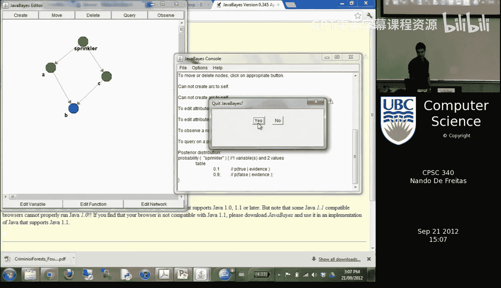
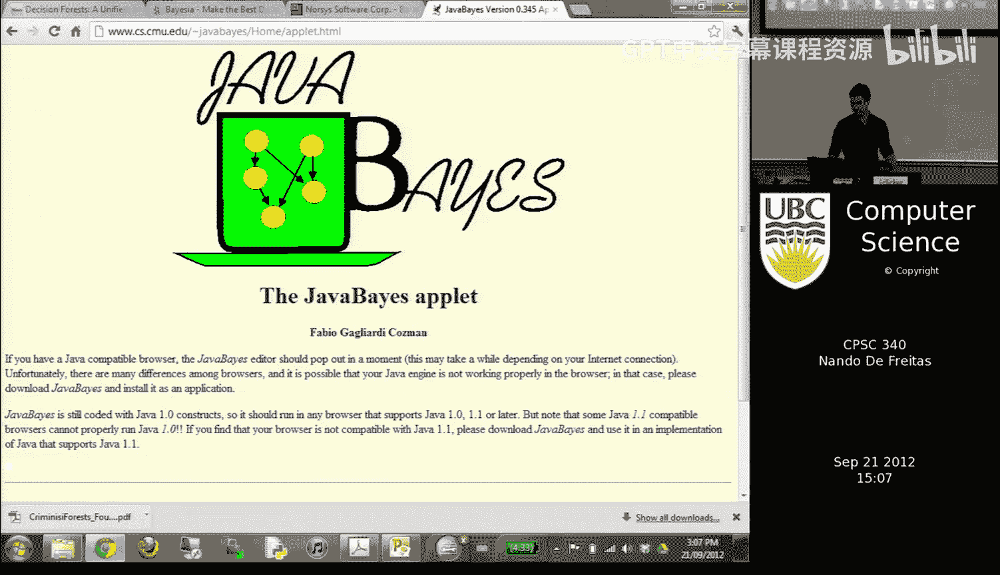
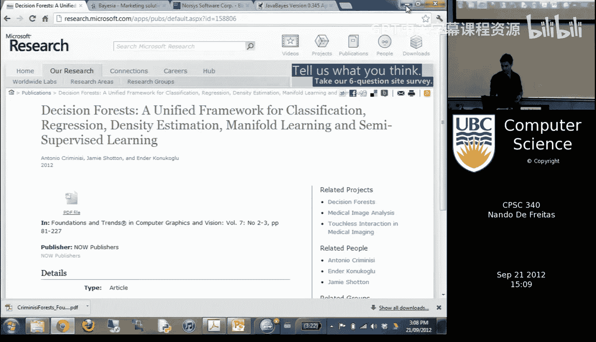
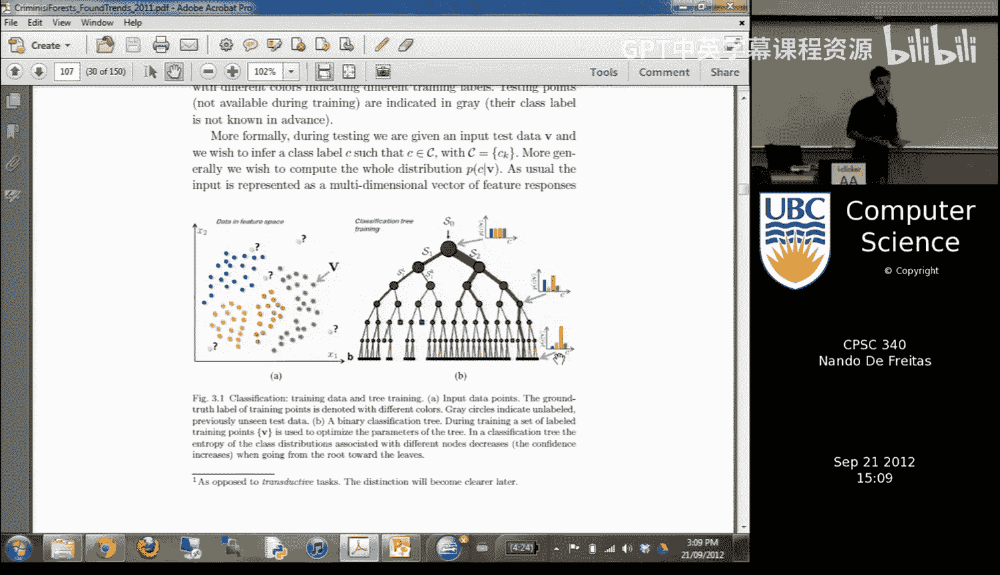
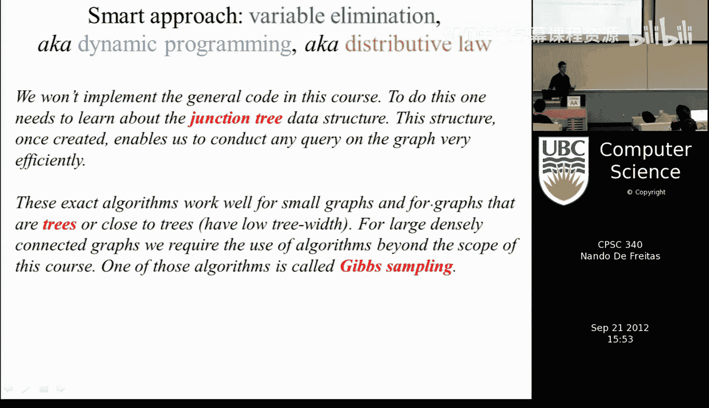

# 07：贝叶斯网络推理入门 🧠


在本节课中，我们将学习如何在贝叶斯网络中进行推理计算。我们将从一个简单的“洒水器网络”示例开始，手动计算边际概率，并理解如何通过动态规划技术将指数级复杂度的计算优化为多项式复杂度。

---



## 软件工具介绍 💻




上一节我们介绍了贝叶斯网络的基本概念，本节中我们来看看有哪些工具可以帮助我们进行建模和计算。虽然我们会手动处理小型网络以加深理解，但在处理大型网络时，通常会借助软件。




以下是两个实用的工具示例：




*   **Java贝叶斯网络工具 (JavaBayes)**：这是一个在线Applet，提供了图形化界面。你可以创建节点、绘制图结构、输入先验概率和条件概率表（CPT），并执行查询。对于课程中的四节点网络，你可以用它来验证手动计算的结果。
*   **商业软件 (如Norsys)**：在工业界，有更专业的软件（如温哥华的Norsys公司开发的工具）用于处理更复杂的贝叶斯网络应用，例如市场营销、风险管理和医疗健康领域。


掌握小型网络的手动推理，有助于理解这些大型软件背后的原理。


---


## 概率推理的实际应用 🎯

理解概率推理不仅是学习理论，它也是许多现代应用的基础。这些应用构建在基本的概率概念之上。

以下是一些高级应用的例子：

*   **概率分类模型**：在课程后期，我们将学习能够根据数据点（例如左图中的彩色点）计算空间中任意一点属于某个类别（如红色或绿色）的概率的模型。这类模型的核心就是概率计算。
*   **微软Kinect体感设备**：Kinect使用机器学习算法来实时预测用户身体各部位（如肩膀、头部）的位置。其底层算法（如课程末尾会讲到的算法）依赖于概率推理。
*   **医疗图像分析**：类似的技术可以用于医学领域，例如在CT或MRI图像中自动识别和定位器官（如肾脏），或帮助医生检测肿瘤等异常情况。利用技术自动化部分医疗流程，对于应对人口老龄化带来的医疗系统压力具有重要意义。

这些高级应用的目标，驱使我们必须先打好概率推理的基础。

---

## 网络模型与概率表示 📊

现在，让我们开始今天的核心内容：推理。我们将使用一个经典的“洒水器网络”作为示例。该网络包含四个二值变量：阴天(C)、洒水器(S)、下雨(R)和草地湿(W)。

其图模型表示如下：
*   C -> S (阴天影响是否打开洒水器)
*   C -> R (阴天影响是否下雨)
*   S -> W (洒水器影响草地是否湿)
*   R -> W (下雨影响草地是否湿)

每个变量都关联一个概率分布：

1.  **先验概率 P(C)**：这是一个关于C的分布。
    *   公式：`P(C=0) = 0.5`, `P(C=1) = 0.5`
    *   可以表示为表格 `[0.5, 0.5]` 或柱状图。
2.  **条件概率 P(S|C)**：这是一个在给定C时，关于S的分布。
    *   例如，`P(S|C=1) = [0.9, 0.1]` 表示如果阴天，洒水器打开的概率是0.9。
    *   注意，`sum_{S} P(S|C=1) = 0.9 + 0.1 = 1`。
3.  **条件概率 P(R|C)** 和 **P(W|S,R)**：同理。P(W|S,R) 有两位父节点，其条件概率表（CPT）包含 2^3 = 8 个值（但只需指定4个，因为每行和为1）。

**联合概率**：例如，变量C和S的联合概率 `P(C, S)` 可以通过链式法则计算：`P(C, S) = P(S|C) * P(C)`。这将产生一个2x2的表格，其所有条目之和为1。

**条件作用的优先级**：表达式 `P(W | S=0, R=1)` 应理解为 `P(W | (S=0, R=1))`，即给定S=0且R=1时，W的分布。从CPT中查找，对应 `S=0, R=1` 的行，得到 `P(W=1 | S=0, R=1) = 0.9`。这些概率值可以从实际数据中学习得到，但在学习之前，我们需要先掌握在给定模型下的推理。

---

## 边际概率计算：暴力求和法 ⚙️

推理的核心任务之一是计算边际概率。例如，我们想计算 **P(S=1)**，即洒水器打开的概率。

根据概率论，当我们不知道其他变量的值时，需要对它们进行求和（即边际化）：
`P(S=1) = sum_{C, R, W} P(C, R, W, S=1)`

利用网络的因子化性质，联合概率可分解为：
`P(C, R, W, S=1) = P(C) * P(S=1|C) * P(R|C) * P(W|S=1, R)`

因此，目标计算为：
`P(S=1) = sum_{C} sum_{R} sum_{W} P(C) * P(S=1|C) * P(R|C) * P(W|S=1, R)`

**暴力计算法**：最直接的方法是枚举所有变量 (C, R, W) 的 2^3 = 8 种可能取值组合，分别代入公式计算后求和。
*   **计算成本**：需要进行 8 * 3 = 24 次乘法运算（每次计算涉及4个概率相乘，但P(C)等对于固定组合是常数）。
*   **代码实现**：这对应于三层嵌套的循环。对于包含n个二值变量的网络，这种方法的复杂度是 **O(2^n)**，是指数级的，对于大规模网络不可行。

---

## 边际概率计算：动态规划优化法 🚀

暴力法的低效在于它进行了大量重复的乘法运算。优化的关键是利用**分配律**，将求和与乘积操作重新排序，先进行局部求和，存储中间结果，再传递给外层循环。

让我们对 `P(S=1)` 的计算过程进行优化：

1.  **首先对 W 求和**：注意到 `P(W|S=1,R)` 只依赖于 W 和 R，而 `P(C)`, `P(S=1|C)`, `P(R|C)` 与 W 无关。因此，可以将内层对W的求和提前：
    `P(S=1) = sum_{C} sum_{R} [ P(C) * P(S=1|C) * P(R|C) * ( sum_{W} P(W|S=1, R) ) ]`
    由于 `sum_{W} P(W|S=1, R) = 1`（条件概率分布归一化），内层求和结果恒为1。我们将其记为中间值 `φ(R) = 1`。在实际更复杂的网络中，`φ(R)` 可能不是一个常数，而是一个依赖于R的函数（向量）。

2.  **然后对 R 求和**：现在表达式简化为：
    `P(S=1) = sum_{C} [ P(C) * P(S=1|C) * ( sum_{R} P(R|C) * φ(R) ) ]`
    我们计算对R的求和，并将其结果记为另一个中间值 `ψ(C) = sum_{R} P(R|C) * φ(R)`。`ψ(C)` 是一个依赖于C的向量（C=0和C=1分别对应一个值）。

3.  **最后对 C 求和**：最终计算变为：
    `P(S=1) = sum_{C} P(C) * P(S=1|C) * ψ(C)`
    这只需要对C的两种状态进行循环计算即可。

**优化效果**：
*   **计算复杂度**：从指数级的 O(2^n) 降低到了多项式级别。对于此例，我们只需要进行顺序的三层循环，每层循环次数等于该变量的取值个数。总操作次数约为 `|C| + |R|*|C| + |W|*|R|`（此处|·|表示取值个数）。
*   **存储开销**：我们通过存储中间结果 `φ(R)` 和 `ψ(C)`（可能不是标量而是向量）来避免重复计算，这是典型的**空间换时间**策略。
*   **算法名称**：这种通过存储子问题解来避免重复计算的方法，正是**动态规划**的核心思想。
*   **数值稳定性提示**：在实际编程中，直接连乘许多小概率值可能导致下溢（结果四舍五入为0）。通常的做法是在**对数空间**中进行计算，将乘法变为加法，最后再取指数，这样可以提高数值稳定性。

**代码结构示意**：
```
初始化 psi 向量（长度为 |C|）
for c in 所有C的取值：
    初始化 phi 标量（或向量，若内层和不为1）
    for r in 所有R的取值：
        phi += P(W|S=1, r) # 这里假设对W求和已解析为1，实际可能需内层循环
    psi[c] = sum_{r} ( P(r|C=c) * phi )
最终结果 = sum_{c} ( P(C=c) * P(S=1|C=c) * psi[c] )
```

---

## 总结与扩展 📝

本节课中我们一起学习了贝叶斯网络推理的基础：

1.  **推理任务**：我们以计算边际概率 `P(S=1)` 为例，展示了如何在给定网络参数后回答查询。
2.  **两种方法**：
    *   **暴力枚举法**：直观但计算成本随变量数指数增长，不可行于大规模网络。
    *   **动态规划法**：通过巧妙地利用分配律，重新排列求和与乘积顺序，并存储中间结果，将计算复杂度降至多项式级别。这是实际算法（如**联结树算法**）的基础。
3.  **核心思想**：对于树状或稀疏连接的图，总存在一种变量消元顺序，可以高效地进行精确推理。对于稠密图，精确推理可能依然困难，但动态规划的思想是许多近似推理算法的起点。



理解这个简单网络的手动推理过程，是掌握复杂概率图模型推理的关键第一步。在作业和后续课程中，你将有机会应用这些技术解决更复杂的问题。