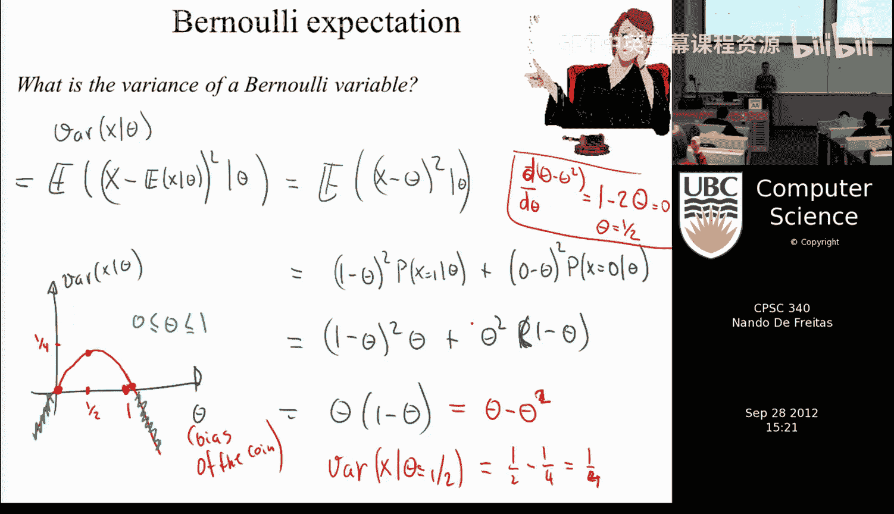
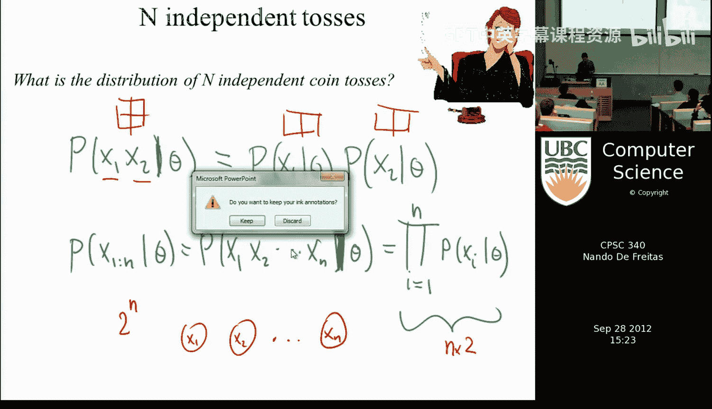
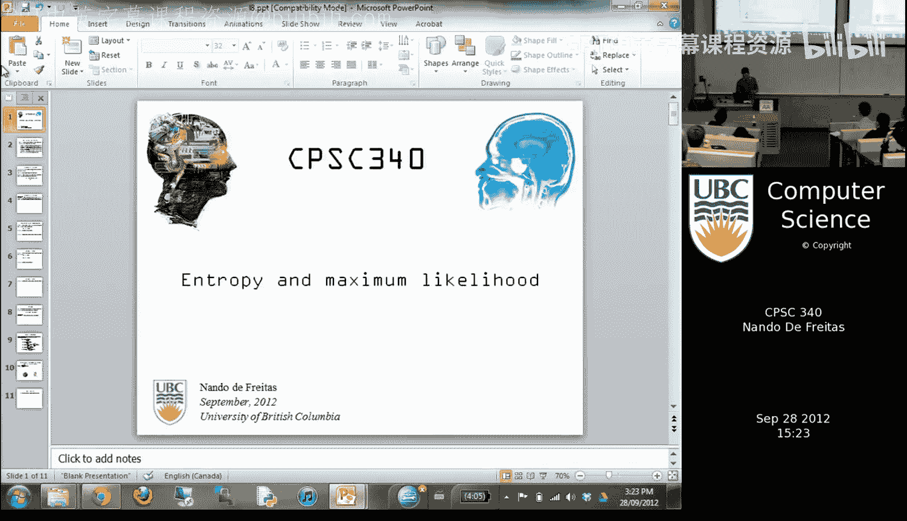
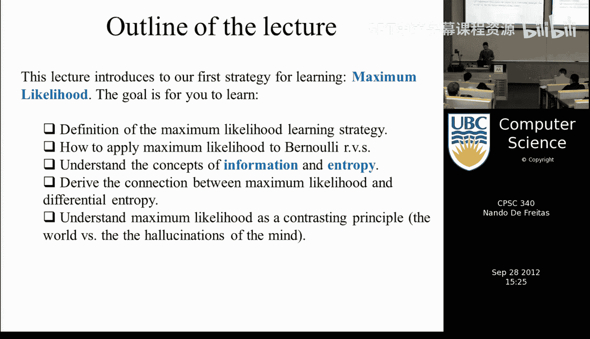
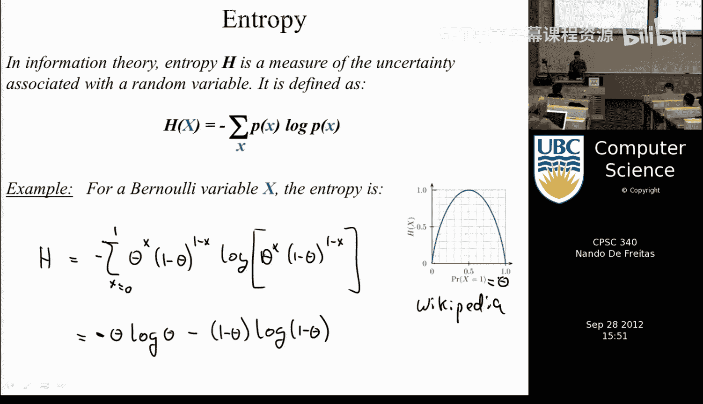
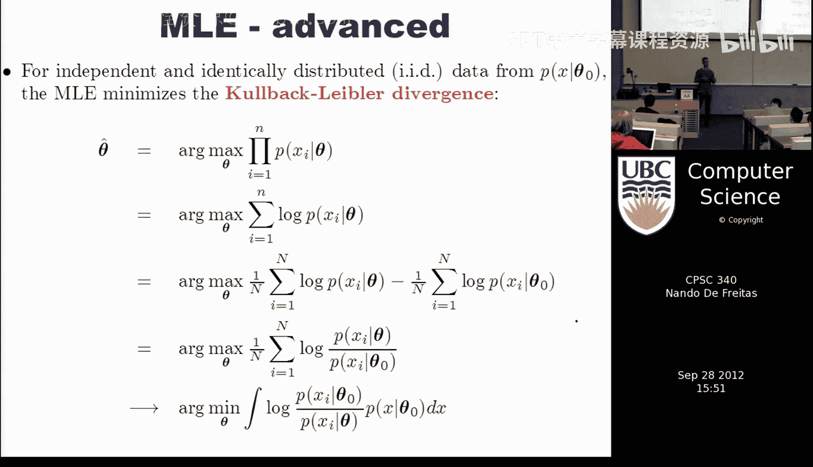
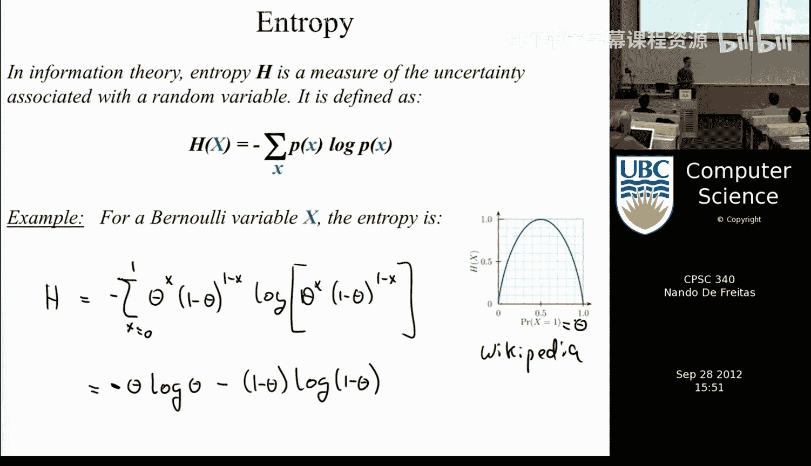
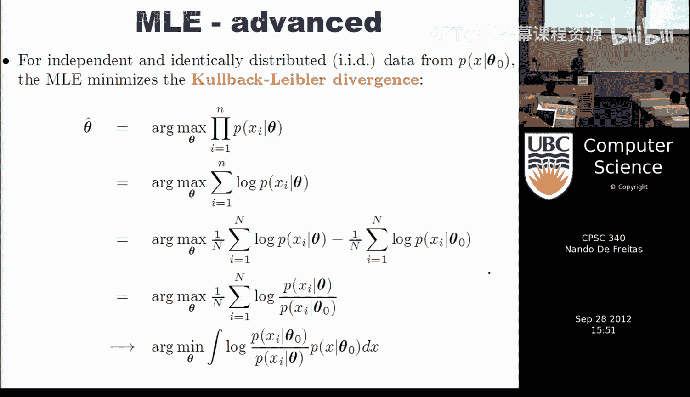

# 10：最大似然估计 📊

在本节课中，我们将学习机器学习中的一个核心原理——**最大似然估计**。我们将从一个简单的抛硬币例子开始，理解如何根据观察到的数据来估计未知参数。接着，我们将探讨熵的概念，并理解最大似然估计与最小化不确定性（或最大化信息）之间的深刻联系。

---

## 概率模型回顾

上一节我们介绍了概率的基本概念。本节中，我们来看看如何为一个简单的随机事件（如抛硬币）建立概率模型。

一个服从伯努利分布的随机变量 **X** 可以这样描述：
*   它以概率 **θ** 取值为 1。
*   它以概率 **1-θ** 取值为 0。

其期望值（均值）为 **θ**。如果 **X** 表示“是否下雨”，那么下雨的期望值就等于下雨的概率。

我们还计算了方差，定义为 **E[(X - μ)²]**，对于伯努利分布，方差为 **θ(1-θ)**。方差是衡量不确定性的一个指标。当 **θ = 0.5** 时，方差最大，不确定性最高；当 **θ** 接近 0 或 1 时，方差变小，不确定性降低。

我们将看到，方差并非描述不确定性的唯一方式，还有一种称为“熵”的度量。

---

## 学习的目标：最小化不确定性

学习，本质上就是**最小化不确定性**。我们来到这个世界时，对很多事情一无所知，而学习的过程就是不断减少未知，这等价于**最大化信息**。你现在学习机器学习，正是在试图减少对这个领域的不确定性，获取信息。

我们将以此作为今天学习的原则。

---

## 独立性假设

我们还学习了独立性。如果两次抛硬币是独立的，那么两次结果同时发生的概率等于各自概率的乘积。对于 **n** 个独立的变量，其联合概率分布可以分解为各个变量概率的乘积。

用图模型表示，即 **n** 个变量 **X₁, X₂, ..., Xₙ** 之间没有边连接，它们是**完全独立**的。因此，整个模型的概率就是每个变量概率的乘积。这里的随机变量是 **X**，而 **θ** 是描述这个分布的**参数**。

---

## 最大似然估计原理 🎯

在回顾了基础知识后，我们终于要开始“学习”这个主题了。本节介绍第一种学习原则——**最大似然估计**。

最大似然估计基于事件的频率观点。它假设存在一个真实的参数 **θ₀** 生成了我们观察到的数据。我们不知道 **θ₀** 是多少，但我们可以根据观察到的数据集 **{x₁, ..., xₙ}**，尝试找到一个估计值 **θ̂**，使得在这个参数下，观察到当前数据的**概率最大**。

用公式表示就是：
**θ̂ = argmax_θ P(x₁, ..., xₙ | θ)**
其中，`argmax` 表示找到使函数值最大的那个参数 **θ**。

---

### 一个直观例子

假设你观察到一个硬币抛掷序列：1, 1, 1, 1, 1（全是正面）。
我们有两个候选参数：
*   **θ₁ = 0.99**
*   **θ₂ = 0.5**

哪个参数更可能产生这个序列？直观上，**θ₁** 更合理，因为一个正面向上的概率为 0.99 的硬币，更有可能连续抛出 5 个正面。最大似然估计就是把这个直观过程形式化。

---

## 最大似然估计的步骤 📝

最大似然估计有一套通用的机械步骤，适用于几乎所有模型。以下是具体步骤：

**第一步：写出似然函数**
给定数据，我们首先对数据做出假设（例如，各次抛掷是独立的）。那么，观察到整个数据序列的联合概率（似然函数）为：
**P(x₁, ..., xₙ | θ) = ∏ᵢ P(xᵢ | θ)**

对于伯努利分布，每个 **P(xᵢ | θ) = θ^{xᵢ} (1-θ)^{1-xᵢ}**。设 **M** 为数据中 1 的个数，**N** 为总抛掷次数，则似然函数可简化为：
**P(数据 | θ) = θ^M (1-θ)^{N-M}**

**第二步：转化为对数似然**
我们定义对数似然函数 **L(θ) = log P(数据 | θ)**。取对数可以将连乘变为连加，简化后续求导计算。
对于伯努利分布：
**L(θ) = M log θ + (N-M) log (1-θ)**

**第三步：求导并令其为零**
为了找到最大化 **L(θ)** 的 **θ**，我们对 **θ** 求导并令导数为零：
**dL(θ)/dθ = M/θ - (N-M)/(1-θ) = 0**

**第四步：求解参数**
解上述方程：
**M/θ = (N-M)/(1-θ) => M(1-θ) = θ(N-M) => M - Mθ = Nθ - Mθ => M = Nθ**
最终得到最大似然估计解：
**θ̂ = M / N**

这个结果非常直观：硬币正面朝上的概率估计值，就是观察到的正面次数除以总抛掷次数。

---

## 最大似然估计的意义与熵 🔗

最大似然估计看起来是一套机械的数学流程，但它有深刻的内涵。为了理解它为何有效，我们需要引入**熵**的概念。

熵是信息论中的核心概念，用于度量一个随机变量的**不确定性**。对于一个伯努利分布，其熵 **H** 定义为：
**H = -[θ log θ + (1-θ) log(1-θ)]**

熵的曲线形状与方差类似：当 **θ = 0.5** 时，不确定性最大，熵也最大；当 **θ** 接近 0 或 1 时，不确定性小，熵也小。**信息**则被定义为负熵，因此**最大化信息等价于最小化熵（不确定性）**。

最大似然估计所做的，正是找到那个能使观测数据最“不意外”的参数。如果数据与我们的模型（参数）预测高度一致，那么模型的不确定性就低。从这个角度看，**最大似然估计是在寻找能最小化“模型与数据间差异”所导致的不确定性的参数**。这和我们“通过学习最小化不确定性”的目标是完全一致的。

---

## 总结

本节课中我们一起学习了：
1.  **最大似然估计的原理**：通过寻找使观测数据出现概率最大的参数来学习。
2.  **标准操作步骤**：写出似然函数 → 取对数 → 求导并令为零 → 求解参数。这是一套适用于众多模型的通用流程。
3.  **熵与信息**：熵是衡量不确定性的指标，信息是负熵。学习的目标是最大化信息，即最小化不确定性。
4.  **内在联系**：最大似然估计可以理解为一种最小化“模型预测”与“实际观测”之间不确定性的方法，从而与学习的根本目标相连。

最大似然估计是机器学习中最基础、最重要的参数估计方法之一。掌握了它，你就为理解更复杂的模型学习打下了坚实的基础。