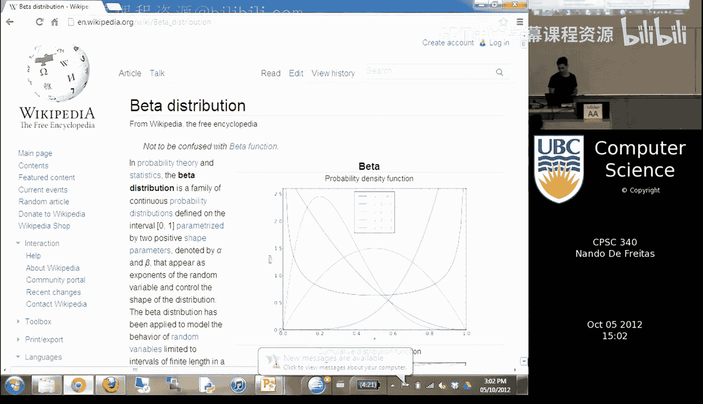
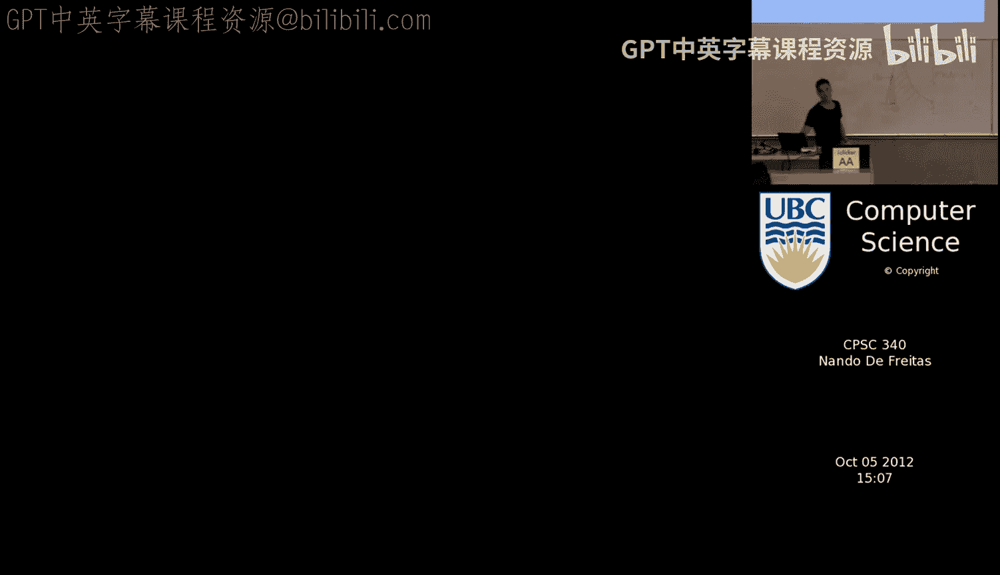
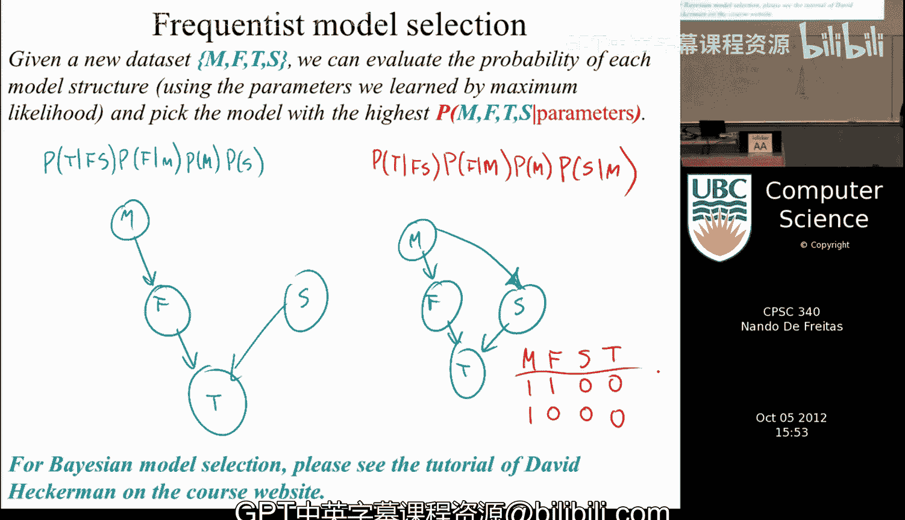

# 12：贝叶斯网络学习 🧠

在本节课中，我们将学习贝叶斯网络中的参数学习。我们将从回顾贝叶斯学习的基本概念开始，然后通过一个具体的例子，展示如何将贝叶斯方法应用于比简单的抛硬币更复杂的场景——即学习贝叶斯网络中的条件概率表。我们将分别使用最大似然估计和贝叶斯估计两种方法来完成参数学习。



## 贝叶斯学习回顾

上一节我们介绍了贝叶斯学习。我们提到，进行贝叶斯学习需要指定两个部分：数据模型（通常称为似然函数）和先验分布。对于抛硬币的例子，这很简单，就是伯努利分布和贝塔分布。未来，我们会接触到更有趣的数据模型，如神经网络和随机森林。

伯努利分布我们已经很熟悉了，它描述了单次抛硬币的概率。对于多次独立的抛掷，我们只需将所有独立的伯努利分布相乘。我们引入了贝塔先验分布。贝塔分布本质上是一个关于参数 θ 的概率分布，而 θ 本身是硬币正面朝上的概率。




在这个图中，变量 x 代表硬币正面朝上的概率，即 `P(x=1)`。在我的幻灯片中，我们用 θ 表示这个变量。关键点在于，我们是在对概率本身（即 θ）施加一个先验分布。因为 θ 是一个概率，其值必须在 0 和 1 之间。贝塔分布正好定义在 [0, 1] 区间上。通过调整超参数 α 和 β，我们可以改变这个分布的形状，以反映我们不同的先验信念。

在连续概率分布中，我们绘制的是概率密度函数。曲线下的面积总和为 1。对于连续变量，我们只能计算某个区间内的概率，即密度函数在该区间上的积分。密度函数的值可以大于 1，只要曲线下的总面积等于 1 即可。

贝塔分布的维基百科页面包含了所有你需要知道的信息：均值、中位数、众数（峰值位置）和方差（分布的宽度）。均值是 `α / (α + β)`。

频率学派使用点估计，他们相信存在一个单一的“真实”参数值，例如用正面次数除以总抛掷次数得到的 θ。而贝叶斯学派则返回一个完整的后验概率分布作为答案。如果需要总结这个分布，可以使用其均值、众数或方差等。了解参数估计的置信度（不确定性）在许多应用中至关重要，例如在金融中，了解市场波动率（方差）比仅仅知道汇率本身更重要。

我们如何计算后验分布呢？我们利用了一个技巧：后验分布对 θ 的积分必须等于 1。根据贝塔分布的定义，这立即告诉了我们归一化常数是什么。因此，在推导时，我们可以忽略常数项，只需写出似然函数乘以先验分布，并使用比例符号。通过合并同类项，我们可以看出后验分布的形状也是一个贝塔分布，其新的参数 α‘ 和 β’ 是原始参数加上观测数据中正面和反面的计数。

具体来说，新的 α‘ = m + α，新的 β’ = n - m + β，其中 n 是总抛掷次数，m 是正面次数。因为我们知道贝塔分布的归一化常数，所以可以直接写出完整的后验分布，而无需手动计算复杂的积分。

## 从硬币到贝叶斯网络

现在，让我们看看如何将这种方法应用到比抛硬币更有趣的例子上。正如之前提到的，对于任何包含二元变量的图模型，无论它有多大，你本质上只需要处理“抛硬币”模型。今天我将用一个例子来说明这一点，并且会先用最大似然估计，再用贝叶斯方法。

假设我们研究三个二元变量：
*   **M**: 是否喝马提尼酒。
*   **F**: 是否去 Fritz 餐厅。
*   **S**: 是否在家学习。
*   **T**: 是否变瘦。

我们进行了一项小调查，记录了五个周末的观测数据：

| M | F | S | T |
|---|---|---|---|
| 1 | 1 | 0 | 0 |
| 1 | 0 | 1 | 0 |
| 0 | 1 | 0 | 1 |
| 1 | 1 | 0 | 0 |
| 0 | 0 | 1 | 0 |

现在，我们选择一个图结构来描述这些变量之间的关系。在本讲末尾，我们会讨论如何选择最佳图结构，但现在我们假设图结构已给定：

```
M -> F
F -> T
S -> T
```

这个图表示：喝马提尼酒（M）影响是否去 Fritz 餐厅（F），而去 Fritz 餐厅（F）和在家学习（S）共同影响是否变瘦（T）。

在这个图中，我们需要学习的参数是各个条件概率表中的数值：
*   `P(M)`: 一个参数 θ。
*   `P(S)`: 一个参数 α。
*   `P(F|M)`: 两个参数（因为 M 有两种状态），我们称之为 γ1 (当 M=0) 和 γ2 (当 M=1)。
*   `P(T|F,S)`: 四个参数（因为 F 和 S 有四种组合），我们称之为 β1, β2, β3, β4。

由于所有变量都是二元的，我们可以用伯努利分布来建模每一个条件概率。例如：
*   `P(M | θ) = θ^{#M=1} * (1-θ)^{#M=0}`
*   `P(F=1 | M=0, γ1) = γ1`， 而 `P(F=0 | M=0, γ1) = 1-γ1`。

根据图模型，数据的联合概率可以分解为：
`P(M, F, S, T) = P(T | F, S) * P(F | M) * P(M) * P(S)`

## 最大似然参数估计

现在，我们使用最大似然估计来学习这些参数。最大似然估计就是选择能使观测数据概率最大化的参数值。

以下是计算过程：

1.  **估计 θ (P(M=1))**:
    观测到 M=1 的次数是 4，总观测次数是 5。
    所以，`θ_ML = 4/5`。

2.  **估计 α (P(S=1))**:
    观测到 S=1 的次数是 2，总观测次数是 5。
    所以，`α_ML = 2/5`。

3.  **估计 γ1 (P(F=1 | M=0))**:
    我们需要看所有 M=0 的情况。在数据中，M=0 出现了 2 次。
        *   在这 2 次中，F=1 出现了 1 次。
        *   F=0 出现了 1 次。
    所以，`γ1_ML = 1/2`。

4.  **估计 γ2 (P(F=1 | M=1))**:
    我们需要看所有 M=1 的情况。在数据中，M=1 出现了 3 次。
        *   在这 3 次中，F=1 出现了 2 次。
        *   F=0 出现了 1 次。
    所以，`γ2_ML = 2/3`。

5.  **估计 β1 (P(T=1 | F=0, S=0))**:
    我们需要看所有 F=0 且 S=0 的情况。在数据中，这种情况出现了 1 次。
        *   在这 1 次中，T=1 出现了 0 次。
        *   T=0 出现了 1 次。
    所以，`β1_ML = 0/1 = 0`。

我们需要对 (F, S) 的其他三种组合重复类似的过程来计算 β2, β3, β4。

一旦我们得到了所有这些最大似然估计的参数，我们就可以填充条件概率表。之后，我们就可以使用这些表进行推理，回答诸如“给定喝了马提尼酒，变瘦的概率是多少？”之类的问题。

## 贝叶斯参数估计

现在，让我们看看贝叶斯方法如何应用于其中一个参数，例如 α (P(S=1))。

假设我对你们有先验信念：我认为你们是好学生，很可能在家学习。我可以用一个贝塔先验分布来表示这个信念，例如 `Beta(10, 1)`。这个分布的形状在 α 接近 1 的地方概率很高，表示我认为 `P(S=1)` 很可能很大。

`P(α) ∝ α^{10-1} * (1-α)^{1-1} = α^9`

现在，给定观测数据（S 的 5 个观测值：其中 2 个为 1，3 个为 0），似然函数是：
`P(S数据 | α) ∝ α^2 * (1-α)^3`

根据贝叶斯定理，后验分布与似然乘以先验成比例：
`P(α | S数据) ∝ [α^2 * (1-α)^3] * [α^9] = α^{11} * (1-α)^3`

我们可以看出，这是一个 `Beta(12, 4)` 分布的形状（因为 `α^{11}` 对应 `α^{12-1}`，`(1-α)^3` 对应 `(1-α)^{4-1}`）。

如果我们想用一个点估计来总结这个后验分布，例如使用后验均值，那么：
`α_bar = E[α | 数据] = 12 / (12 + 4) = 12/16 = 0.75`

贝叶斯估计的结果 (0.75) 比最大似然估计 (0.4) 更接近先验信念 (倾向于高概率)，但也被数据（观测到一些不学习的情况）拉低了一些。这就是贝叶斯学习将先验知识与观测数据相结合的方式。

我们需要对 θ、γ1、γ2、β1-β4 所有其他参数重复这个贝叶斯估计过程。虽然繁琐，但方法是相同的：为每个参数选择一个合适的先验分布（通常是贝塔分布，因为它们是伯努利分布的共轭先验），然后根据数据计算后验分布。

## 模型选择

之前有人提出了另一个可能的图结构：
```
M -> F
F -> T
M -> S
S -> T
```
这个模型与原始模型的分解方式不同。原始模型是 `P(T|F,S)P(F|M)P(M)P(S)`，而新模型是 `P(T|F,S)P(F|M)P(M)P(S|M)`。

我们如何决定哪个模型更好呢？我们可以同时学习两个模型（对于两个模型共有的部分，如 `P(T|F,S)` 和 `P(F|M)`，学习过程是相同的，只有 `P(S)` 和 `P(S|M)` 不同）。然后，在一个新的、未见过的数据集上评估这两个模型。计算每个模型赋予该新数据集的联合概率 `P(新数据 | 模型)`。赋予数据更高概率的模型被认为是更好的模型。这就是模型选择的基本思想。

## 总结

在本节课中，我们一起学习了贝叶斯网络的参数学习。

*   我们首先回顾了贝叶斯学习的核心思想：结合似然函数和先验分布来得到后验分布。
*   然后，我们通过一个包含多个二元变量（喝马提尼、去餐厅、学习、变瘦）的生动例子，将学习问题从简单的抛硬币推广到贝叶斯网络。
*   我们详细演示了如何使用**最大似然估计**来学习网络中的所有条件概率参数，即通过计数和比例来填充概率表。
*   接着，我们展示了**贝叶斯估计**方法，通过为参数引入贝塔先验分布，将先验信念与观测数据相结合，得到后验分布，并以后验均值作为参数估计。
*   最后，我们简要讨论了**模型选择**的问题，即如何比较不同的图结构，其方法是在保留数据上评估模型的整体概率。



通过掌握这些参数学习技术，我们就能从数据中自动构建出可用于概率推理的贝叶斯网络模型。