# 17：贝叶斯网络与概率图模型

在本节课中，我们将学习贝叶斯网络（也称为概率图模型）的核心概念。我们将探讨如何利用图结构来高效表示复杂的概率分布，理解变量间的独立性关系，并学习概率推断的基本思想。课程将结合线性代数与概率论的知识，以直观的方式展示数学如何作为描述现实世界的语言。

## 线性代数与概率论的回顾

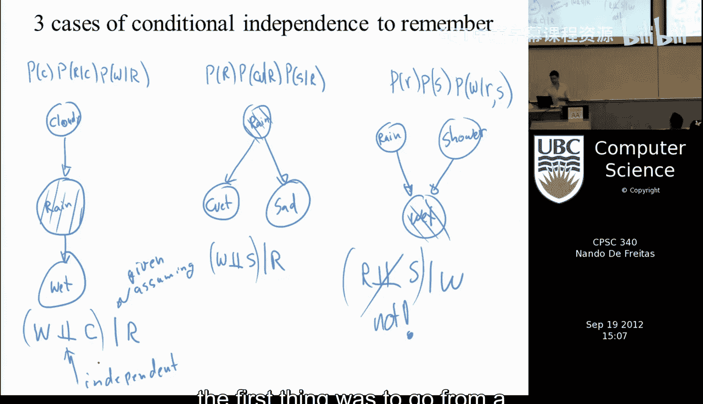

上一节我们介绍了图模型的基本形式。本节中，我们来看看支撑这些模型所需的数学基础。

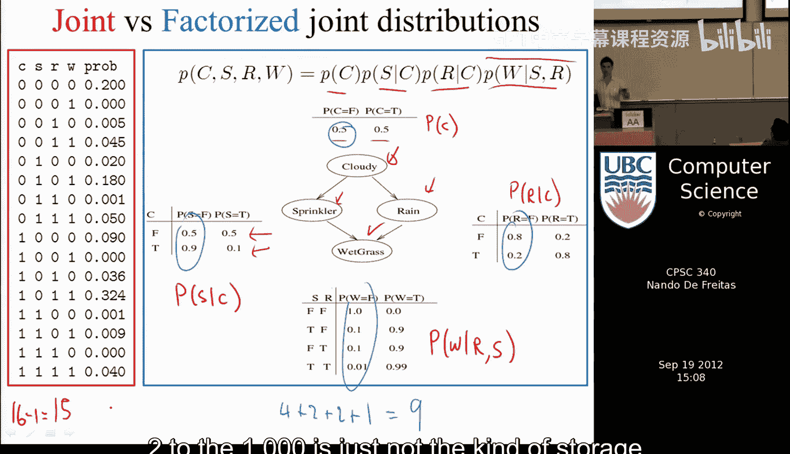

本课程所需的线性代数知识，与我将要回顾的概率论知识处于同一水平。当我回顾线性代数时，会结合各种实际应用，例如在管弦乐中的应用。我的课程更像一门物理课，致力于将数学与世界联系起来，而不是抽象地讨论数学本身。但抽象数学极其重要，只是它并非我们当前讨论的主题。对我而言，数学是一种语言，它让我能够更清晰地描述世界中的事物。因为一旦我有了一个能描述众多事物的公式，这个公式本身就蕴含了大量关于世界的信息，从而让沟通变得更加高效。

当然，有时我们使用语言并非为了沟通，而是出于对语言本身的热爱，就像诗人热爱写诗一样。因此，纯粹进行数学理论研究也有其价值，这些理论未来可能对他人有用。然而，在本课程中，我们将仅在需要沟通思想的程度上采用数学，确保足以清晰地传达概念。

## 关于课程事务的说明

在深入内容之前，有一个请求。如果你对作业有任何疑问，例如如何提交等，请使用Google小组来发布此类问题。在Google小组中提问时，请尽量简洁。助教们也有自己的学业要完成，请不要频繁地通过邮件或其他方式打扰他们。当然，如果是私人问题，则另当别论。

## 图模型的优势与局部计算

在上节课研究图模型时，我们提到了两点。

首先，图模型允许我们将规模呈指数级增长的表示形式，转化为一组紧凑的表示。只要网络连接不是过于密集，我们就能在一定程度上克服维数灾难，因为存储本身就会变得难以承受。想象一下，如果有1000个变量，就需要 `2^1000` 的存储空间，这显然是不现实的。

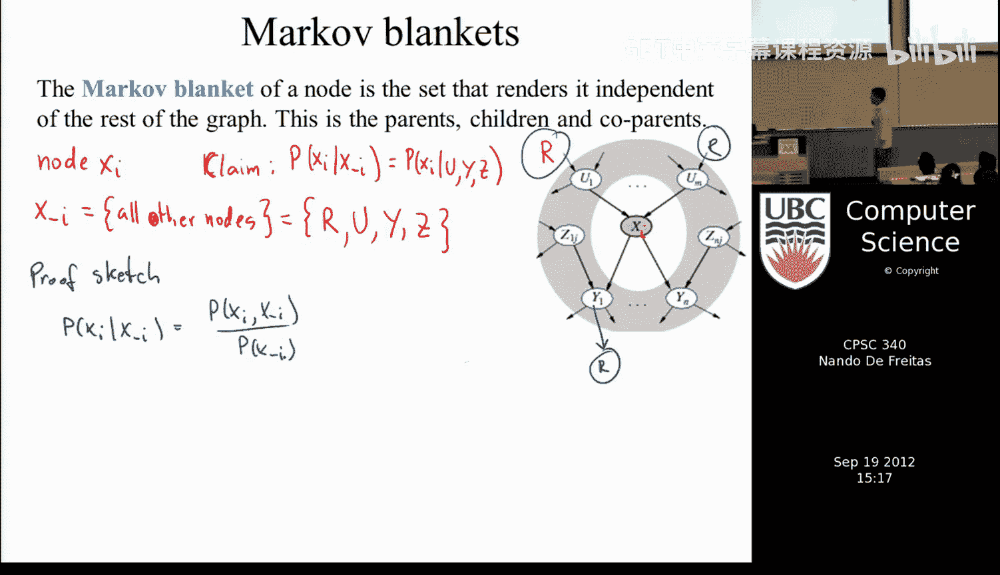

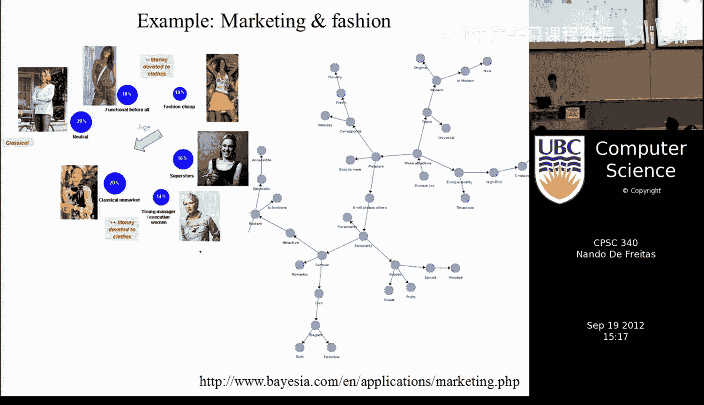

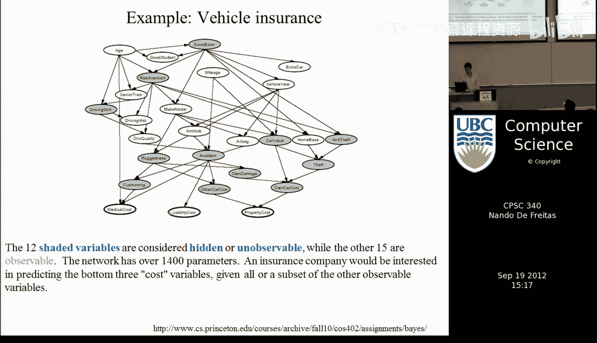

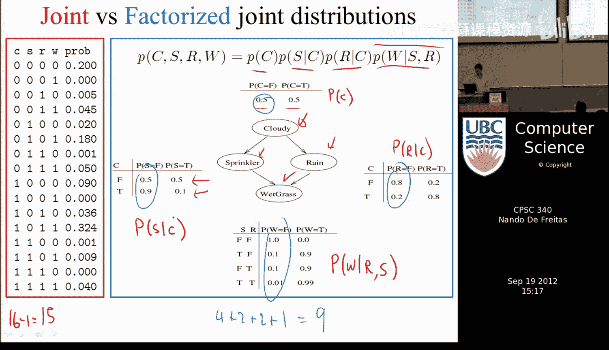

其次，我想说明一个现在看来显而易见，但前人付出了多年努力才解决的问题：如何进行局部计算，并保证全局一致性？也就是说，能否仅通过在此处、彼处进行局部计算，就得到正确的全局答案？这本质上是在问，我们能否分布式地进行计算？就像派出多个小组各自解决子问题，然后汇总得到大问题的解决方案。

事实证明，在三种关键情况下，我们可以利用上节课引入的性质来实现这一点：给定其父节点、子节点以及“配偶”节点（即其子节点的其他父节点）后，一个节点与图中所有其他节点条件独立。

以下是三个关键示例：
1.  **链式结构**：在链 `A -> B -> C` 中，给定父节点B，子节点C与祖父节点A条件独立。
2.  **共同父节点**：在结构 `A <- B -> C` 中，给定父节点B，两个子节点A和C相互条件独立。（遗传学类比：要知道我的基因材料，只需知道我父母的基因材料，无需知道我兄弟姐妹的。）
3.  **V型结构（共同子节点）**：在结构 `A -> C <- B` 中，给定子节点C，两个父节点A和B变得相互依赖。（遗传学类比：要知道我孩子的基因材料，需要同时知道我和我配偶的基因材料。）

这些看似微小的局部案例，是构建更复杂推演的基础。

## 马尔可夫毯与全局独立性

现在让我们观察一个非常大的图。我们实例化一个节点，称之为 `X_i`。假设图中包含三种类型的节点：节点 `X_i` 本身，以及所有其他节点。我们将所有其他节点定义为集合 `x_{-i}`。

我们进一步将 `x_{-i}` 细分为：
*   **U**：`X_i` 的所有父节点。
*   **Y**：`X_i` 的所有子节点。
*   **Z**：`X_i` 的所有“配偶”节点（即 `X_i` 子节点的其他父节点）。
*   **R**：图中所有剩余节点。

**核心论断是**：节点 `X_i` 在给定所有其他节点 `x_{-i}` 条件下的概率，仅依赖于其父节点 `U`、子节点 `Y` 和配偶节点 `Z`。也就是说，概率 `P(X_i | x_{-i})` 中，`R` 会消失。

这意味着，要计算一个变量（例如“我通过这门课的概率”）的概率，我们只需要知道直接影响它的因素（其马尔可夫毯内的变量），而无需关心更远的信息（例如科威特当前的浪高）。

以下是该论断的简要证明思路。我们使用条件概率定义和概率图模型的因式分解性质。

首先，根据条件概率公式：
`P(X_i | x_{-i}) = P(X_i, x_{-i}) / P(x_{-i})`
由于分母 `P(x_{-i})` 对于不同的 `X_i` 取值是常数，我们可以将其视为归一化因子 `Z`，因此：
`P(X_i | x_{-i}) ∝ P(X_i, x_{-i})`

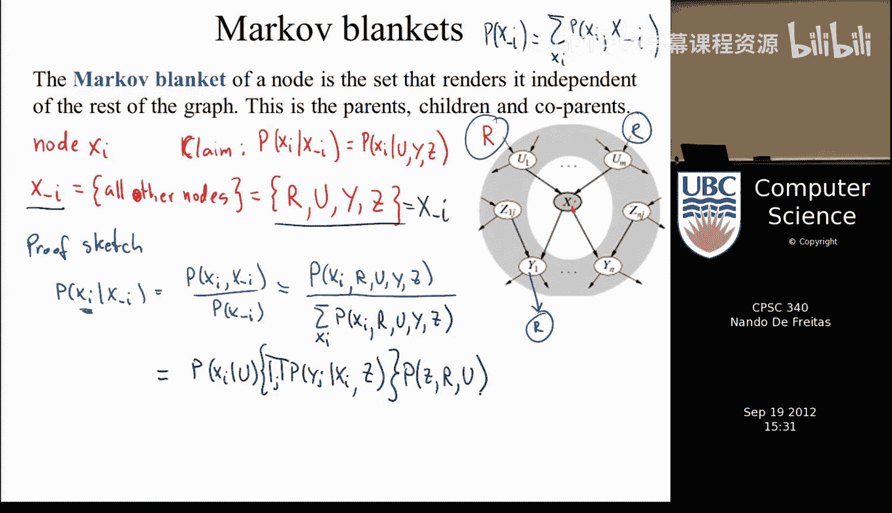

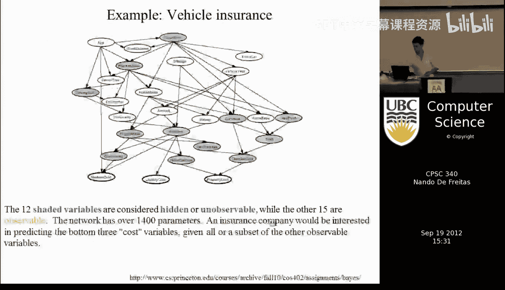

接着，根据有向图模型的因式分解性质，联合概率 `P(X_i, x_{-i})` 可以写成图中所有节点条件概率的乘积：
`P(X_i, x_{-i}) = P(X_i | U) * [∏_j P(Y_j | X_i, Z_j)] * [∏_k P(R_k | ...)]`

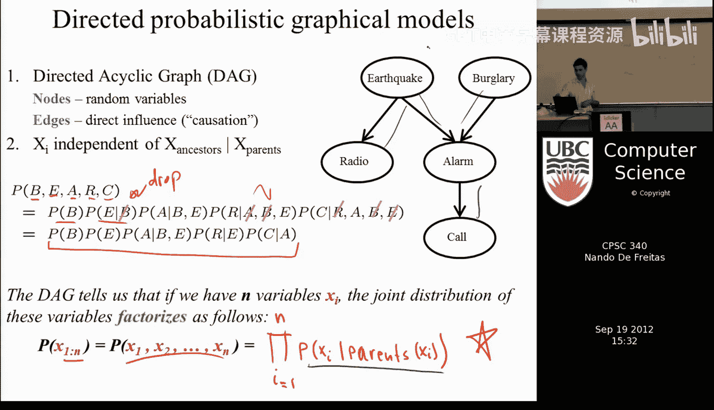

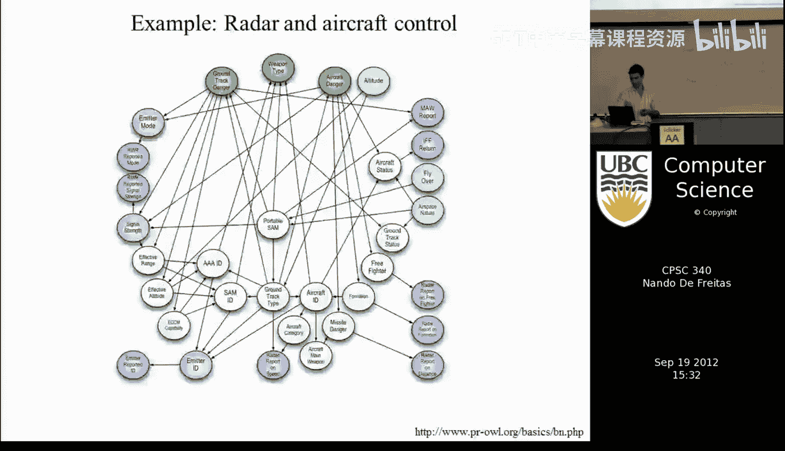

在乘积中，与 `X_i` 无关的项（例如某些 `R_k` 的概率）在计算 `P(X_i | x_{-i})` 的比例关系时可以消去。最终，剩下的项只涉及 `X_i` 本身、其父节点 `U`、以及每个子节点 `Y_j` 及其对应的配偶节点 `Z_j`。这正是其马尔可夫毯内的变量。

**因此**，`P(X_i | x_{-i}) ∝ P(X_i | U) * ∏_j P(Y_j | X_i, Z_j)`

这个性质是设计高效推断算法的基础。当面对大型图模型时，我们使用的算法正是利用了这一特性，只需关注局部马尔可夫毯即可更新节点的概率，无需遍历整个网络。

## 概率推断简介

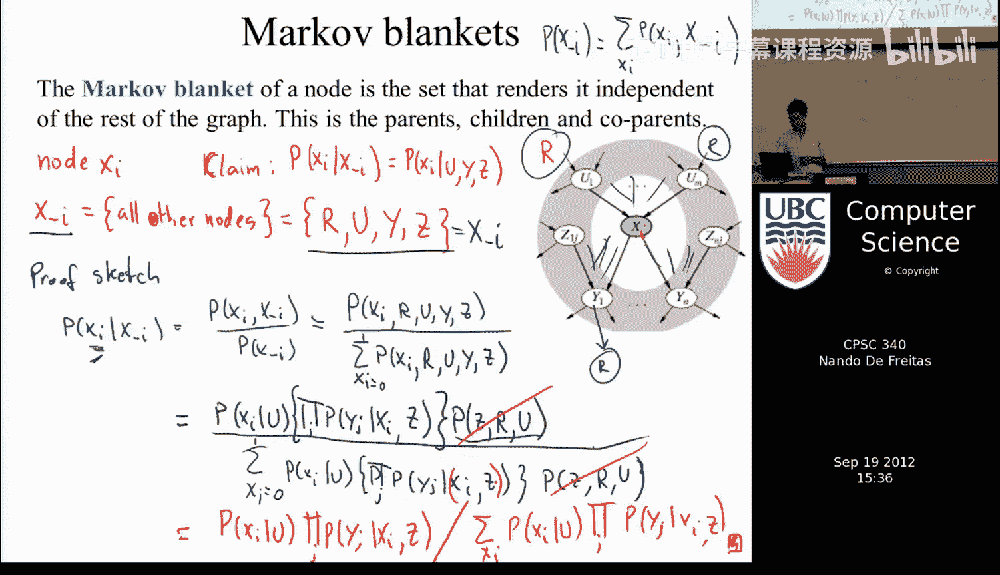

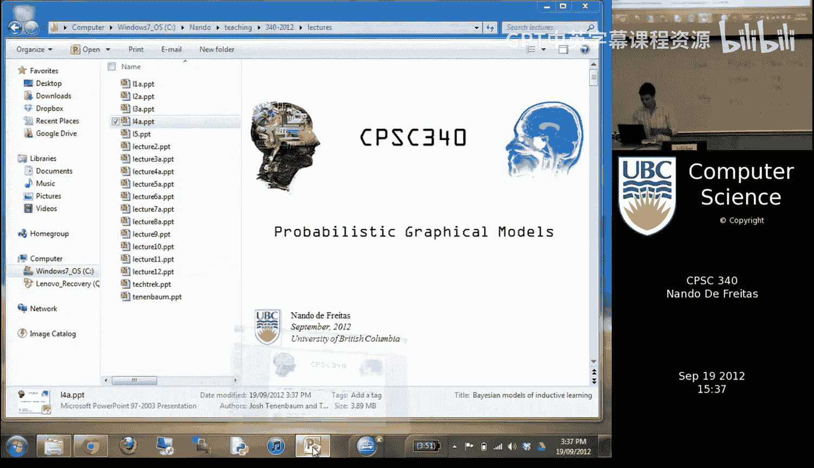

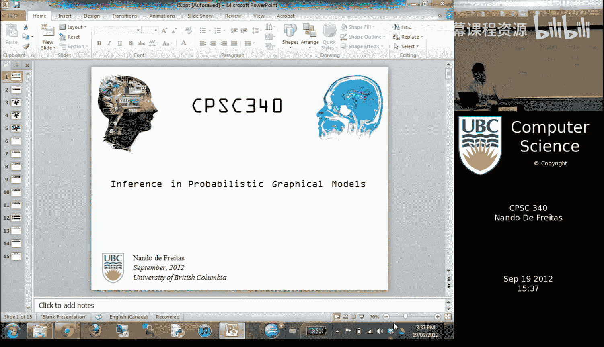

现在让我们看看概率推断。推断是回答查询的过程。

假设我们有一个包含五个随机变量的网络（例如警报网络：盗窃、地震、警报、约翰打电话、玛丽打电话）。我们观察到某个变量，比如“约翰打电话”（用阴影节点表示）。推断的目标就是计算在其他变量（如“地震”或“盗窃”）上的概率分布。

例如，在观察到“约翰打电话”后，我们可能想计算 `P(盗窃=是 | 约翰打电话=是)` 和 `P(地震=是 | 约翰打电话=是)`。最初，我们可能利用图的概率表进行计算。

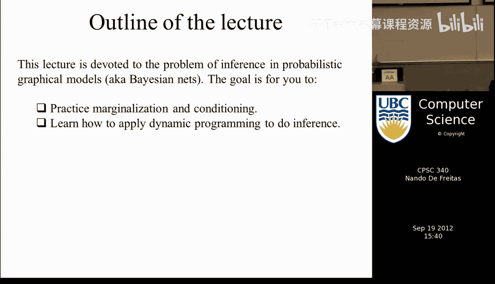

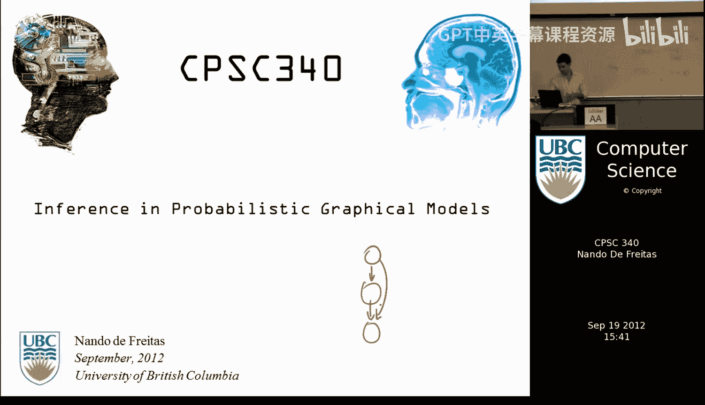

如果我们获得了更多信息，比如打开收音机并听到地震报道（即观察到“收音机报告地震”为真），我们就需要更新之前的概率。现在，“地震”的概率会显著增加。这种获得新证据后，能够区分不同竞争原因（盗窃或地震）的现象，称为 **“解释消除”** 。当然，盗窃和地震也有可能同时发生，所以概率并非完全为零。

## 示例：洒水器网络

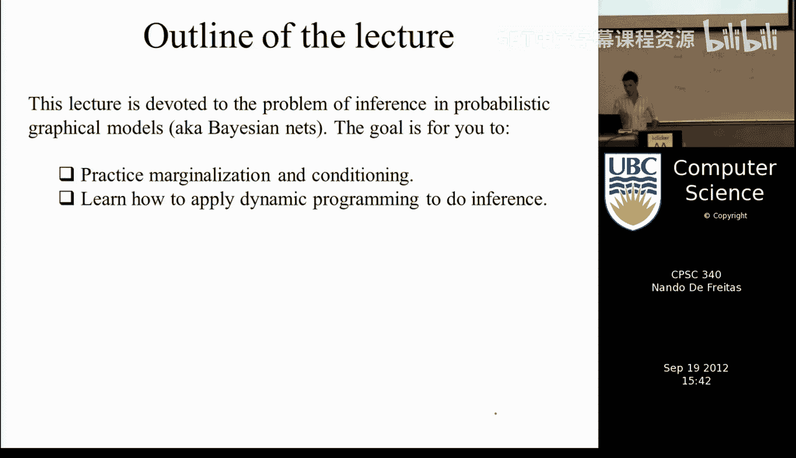

我们将使用一个称为“洒水器网络”的经典例子来演示推断。该网络包含变量：多云、洒水器、下雨、草地湿滑。

假设我们已知所有条件概率表。例如：
*   `P(多云=是) = 0.5`
*   `P(洒水器=关 | 多云=是) = 0.9`
*   ...等等。

现在，我们可能提出以下查询：**给定草地是湿的，洒水器打开的概率是多少？** 即计算 `P(洒水器=开 | 草地湿=是)`。

解决这类问题有两种方法：
1.  **“笨”方法**：进行指数级复杂度的计算，枚举所有变量的可能状态。
2.  **“聪明”方法**：利用图结构和条件独立性，进行高效局部计算。

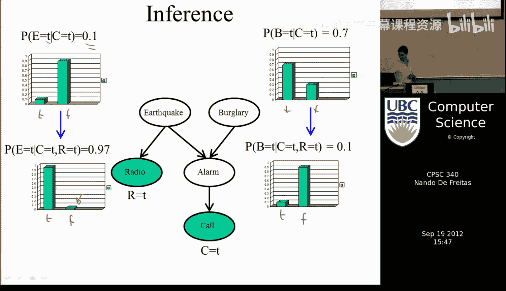

在下节课中，我们将具体展示这两种方法，并介绍如何利用**和积算法**等高效算法进行推断。这也将为我们学习**隐马尔可夫模型**这一重要应用打下基础。

## 总结

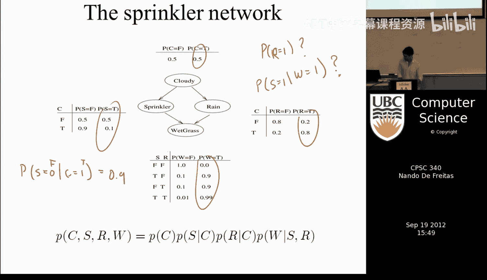

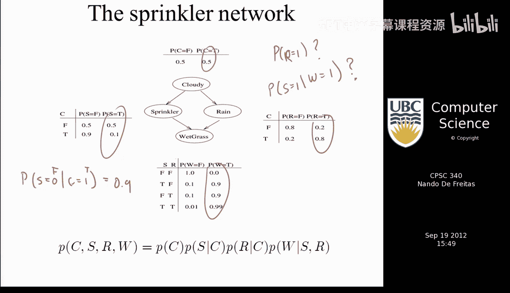

本节课中，我们一起学习了贝叶斯网络的核心思想。我们理解了图模型如何通过紧凑表示克服维数灾难，并深入探讨了变量间的条件独立性，特别是马尔可夫毯的概念，它表明一个节点的状态仅依赖于其局部邻域。我们还介绍了概率推断的基本任务，即根据观察到的证据计算其他变量的概率。最后，我们通过洒水器网络的例子，引出了下一讲的主题：如何高效地进行概率推断。这些概念是理解更复杂概率模型和算法的基础。