# 18：线性预测 📈

在本节课中，我们将要学习监督学习的基本概念，并重点介绍一种最简单但极其重要的模型——线性模型。我们将从线性模型的基本形式开始，解释其工作原理，并展示如何通过最小二乘法来“学习”模型的参数。最后，我们会将一维的线性回归推广到多维情况，并使用矩阵形式进行简洁的描述。

---

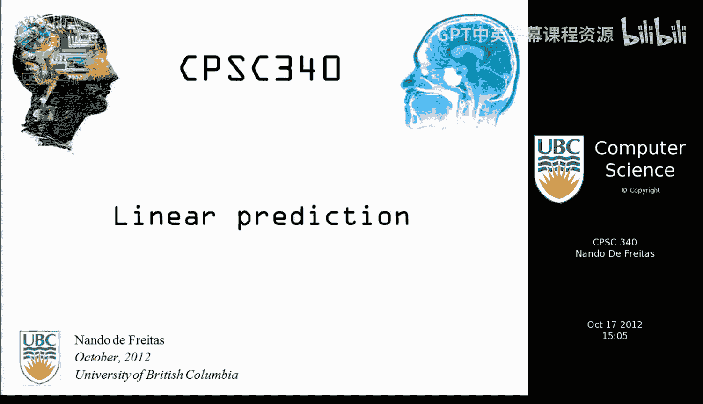

## 概述：什么是监督学习？

上一节我们介绍了无监督学习（如PCA），其目标是在没有标签的情况下发现数据的结构。本节中我们来看看监督学习。

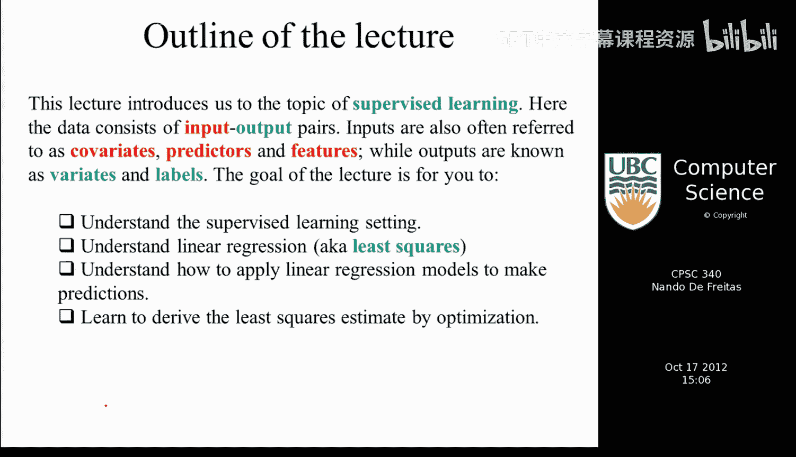

在监督学习中，我们不仅拥有数据，还拥有数据的标签。例如，我们可能收集了每个人的身高和体重数据（特征），并标注了他们的性别（标签）。目标是学习一个模型，当给定一个新人的身高和体重时，模型能够预测其性别。监督学习的核心流程分为两个阶段：**训练阶段**（利用带标签的数据学习模型参数）和**预测阶段**（利用学到的模型为新数据预测标签）。

---

## 线性模型：核心思想

线性模型是监督学习中最基础的模型之一。其核心思想是用一条直线（在一维情况下）或一个超平面（在高维情况下）来近似描述输入特征 `x` 与输出标签 `y` 之间的关系。

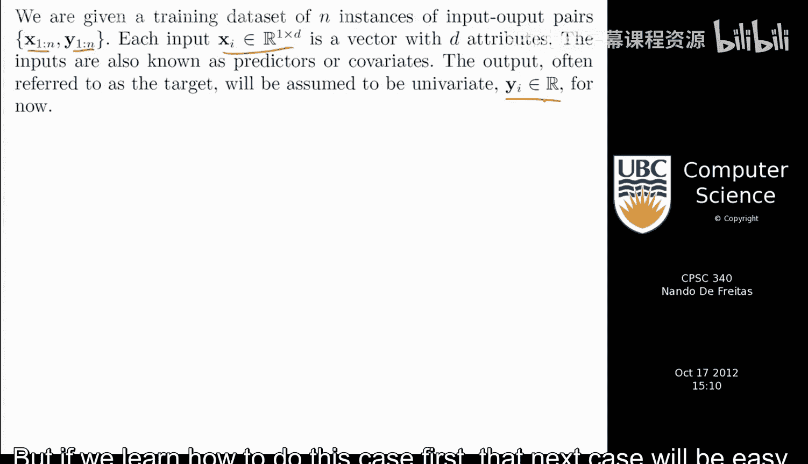

### 一维线性模型公式

在一维情况下，模型公式非常简单：

**`y = θ₁ + θ₂ * x`**

其中：
*   `θ₁` 是截距。
*   `θ₂` 是斜率。
*   `x` 是输入特征（例如身高）。
*   `y` 是预测的输出（例如体重）。

我们的目标是，给定一系列数据点 `(xᵢ, yᵢ)`，找到最优的 `θ₁` 和 `θ₂`，使得模型预测的 `ŷ` 与真实的 `y` 尽可能接近。

---

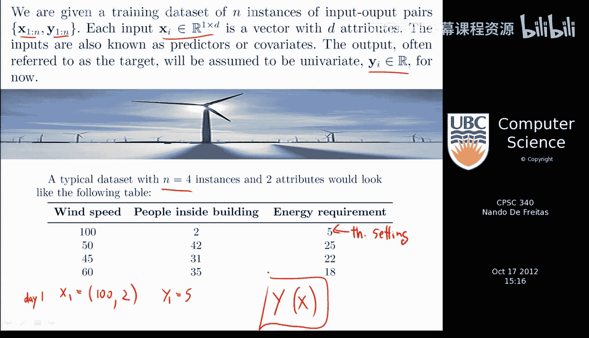

## 如何“学习”模型参数：最小二乘法

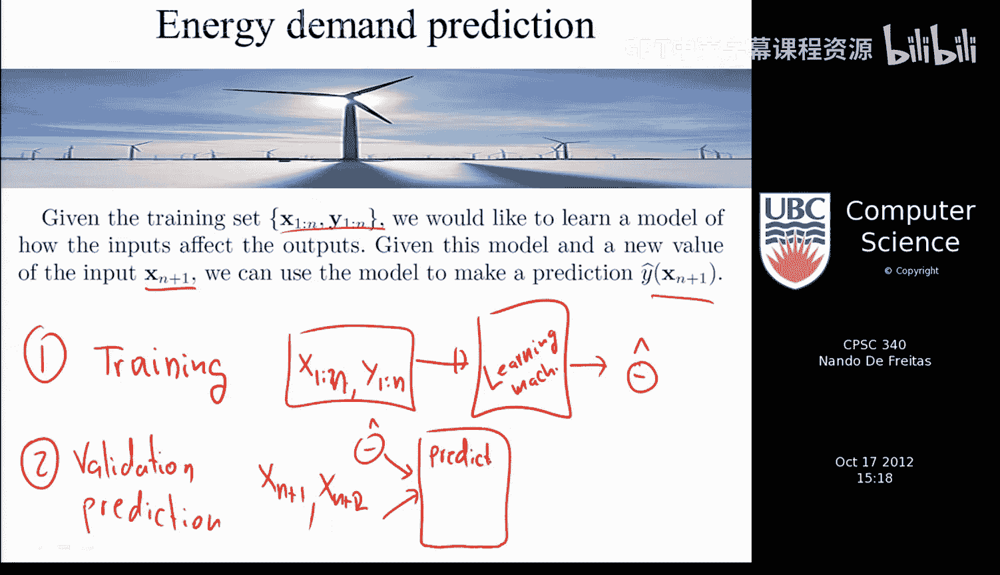

为了找到最优的 `θ₁` 和 `θ₂`，我们需要定义一个衡量预测好坏的准则。最常用的方法是**最小二乘法**。

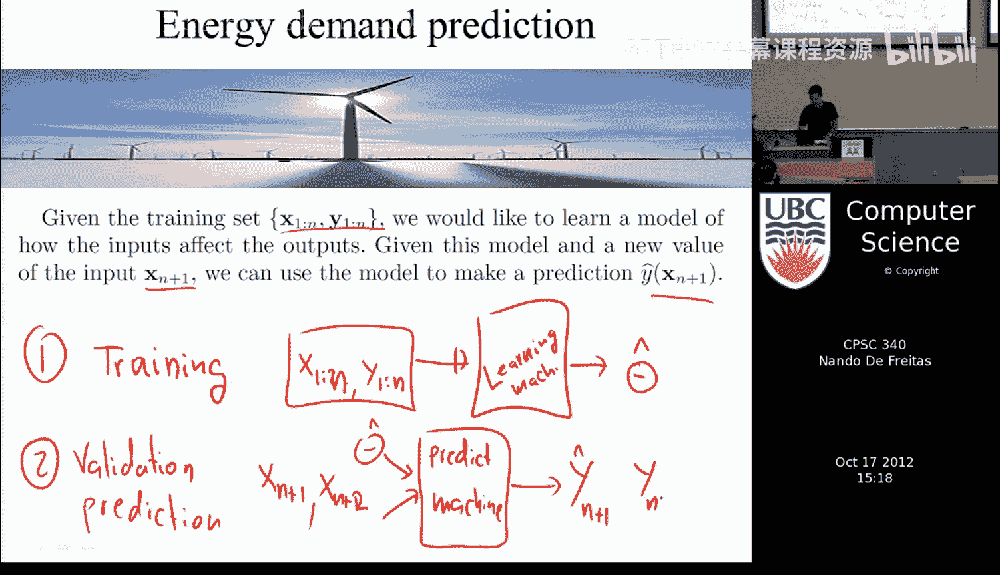

### 目标函数

最小二乘法的目标是**最小化所有数据点的预测误差的平方和**。这个误差是真实值 `yᵢ` 与模型预测值 `ŷᵢ` 之间的垂直距离（残差）。

目标函数 `J(θ)` 定义如下：

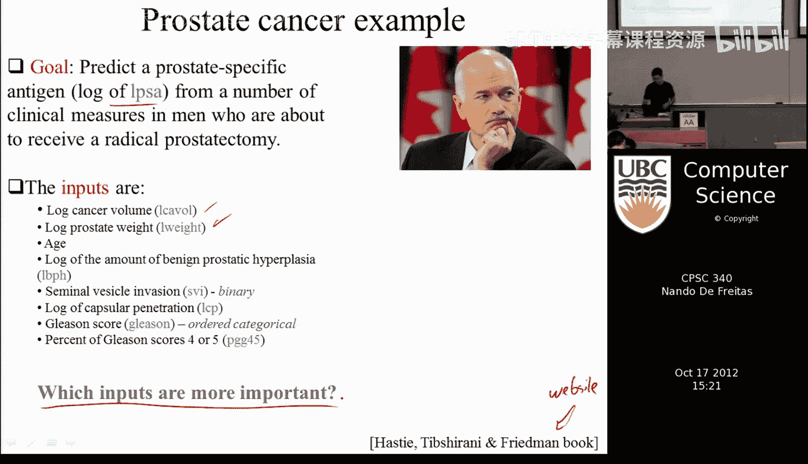

**`J(θ) = Σᵢ (yᵢ - ŷᵢ)² = Σᵢ (yᵢ - (θ₁ + θ₂ * xᵢ))²`**

直观理解是，我们将每个数据点想象成图板上的一颗钉子，将模型直线想象成一根有弹性的木条。木条被钉子“拉”着，最终静止的位置就是使所有“弹簧”能量（即平方误差）总和最小的位置，也就是最优的直线。

---

## 从一维到多维：引入矩阵表示

现实问题中，输入特征通常不止一个。例如，预测房间 thermostat 设定值时，我们可能同时考虑风速和房间人数两个特征。这时，我们需要将线性模型推广到多维。

### 多维线性模型公式

假设我们有 `d` 个特征，模型公式变为：

**`ŷ = θ₁ * x₁ + θ₂ * x₂ + ... + θ_d * x_d`**

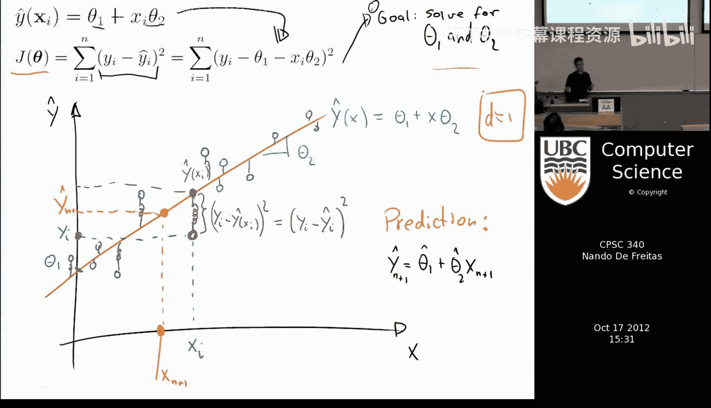

为了将截距项 `θ₁` 也统一到这个形式中，我们引入一个技巧：**增加一个恒为1的虚拟特征 `x₀`**。这样，模型可以写成：

**`ŷ = θ₀ * 1 + θ₁ * x₁ + θ₂ * x₂ + ... + θ_d * x_d`**

### 紧凑的矩阵形式

使用矩阵表示可以极大地简化书写和计算。我们将所有 `n` 个样本的标签堆叠成向量 `y`，将所有样本的特征（包括值为1的虚拟特征列）堆叠成矩阵 `X`，参数堆叠成向量 `θ`。

模型对所有样本的预测可以简洁地写为：

**`ŷ = Xθ`**

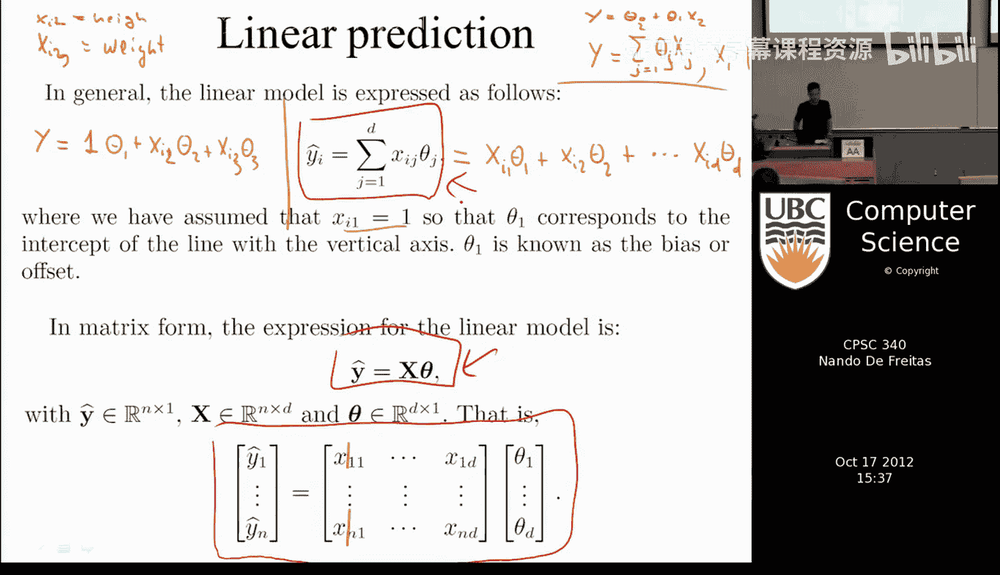

此时，最小二乘法的目标函数用矩阵形式表示为：

**`J(θ) = ||y - Xθ||² = (y - Xθ)ᵀ(y - Xθ)`**

这个形式比求和形式更紧凑，也更利于后续的数学推导和编程实现（例如，避免使用低效的循环）。

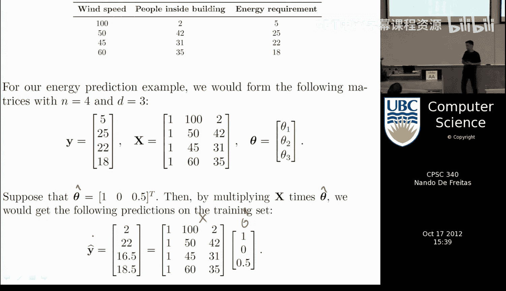

---

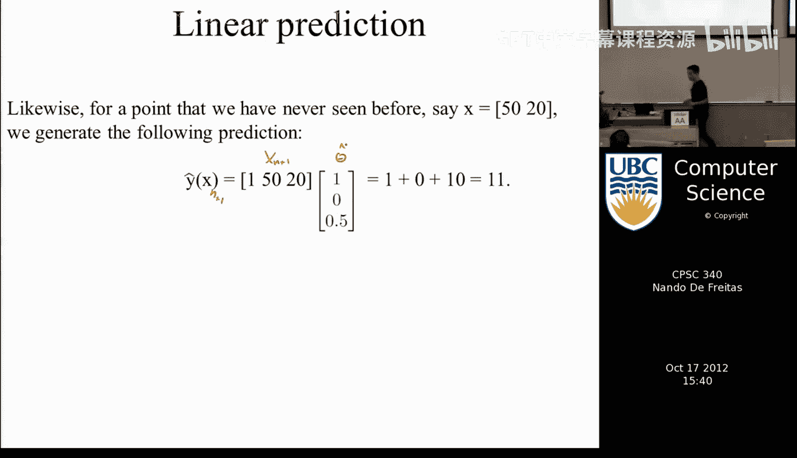

## 学习与预测流程

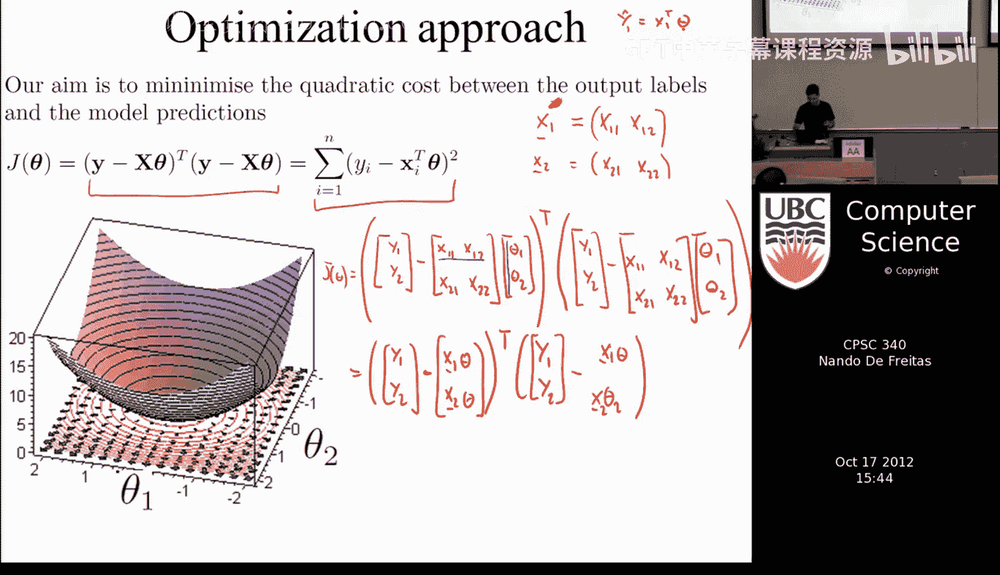

以下是使用线性模型进行监督学习的完整步骤：

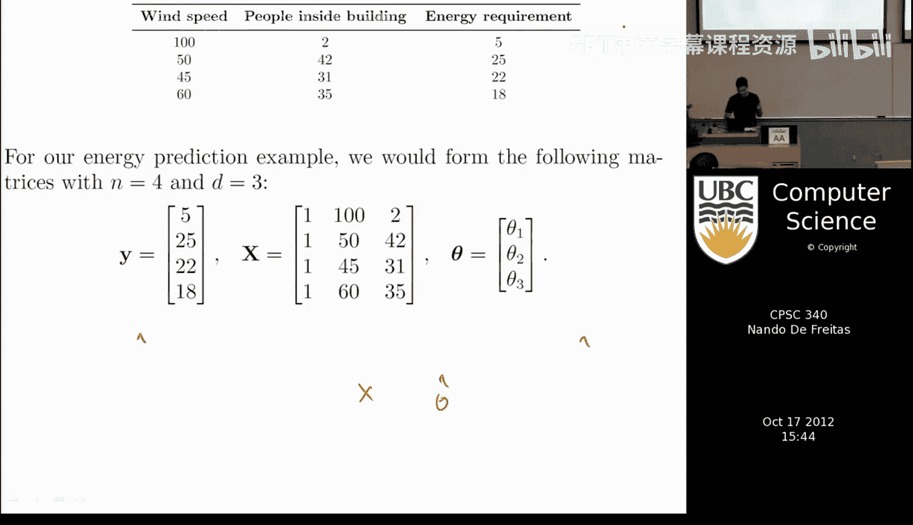

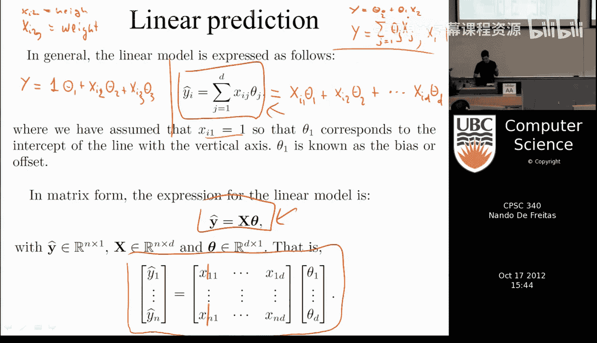

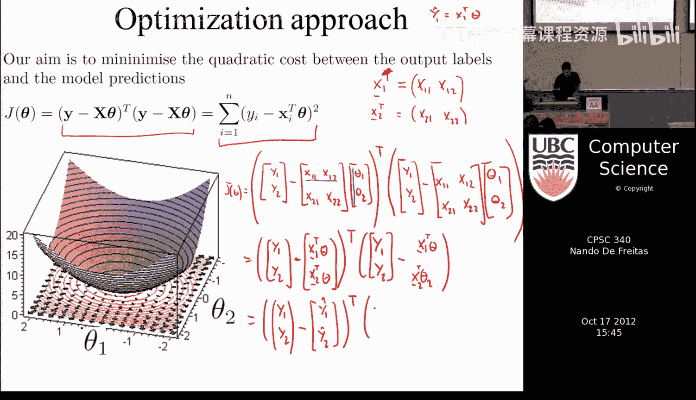

1.  **训练阶段**：
    *   输入：带标签的数据对 `(X, y)`。
    *   过程：通过最小化目标函数 `J(θ)`，求解最优参数 `θ`。这通常通过求解使梯度为零的方程来完成（对于最小二乘，有解析解）。
    *   输出：学习到的模型参数 `θ̂`。

2.  **预测阶段**：
    *   输入：新的特征向量 `x_new` 和学到的参数 `θ̂`。
    *   过程：计算 `ŷ_new = x_newᵀθ̂`。
    *   输出：预测值 `ŷ_new`。

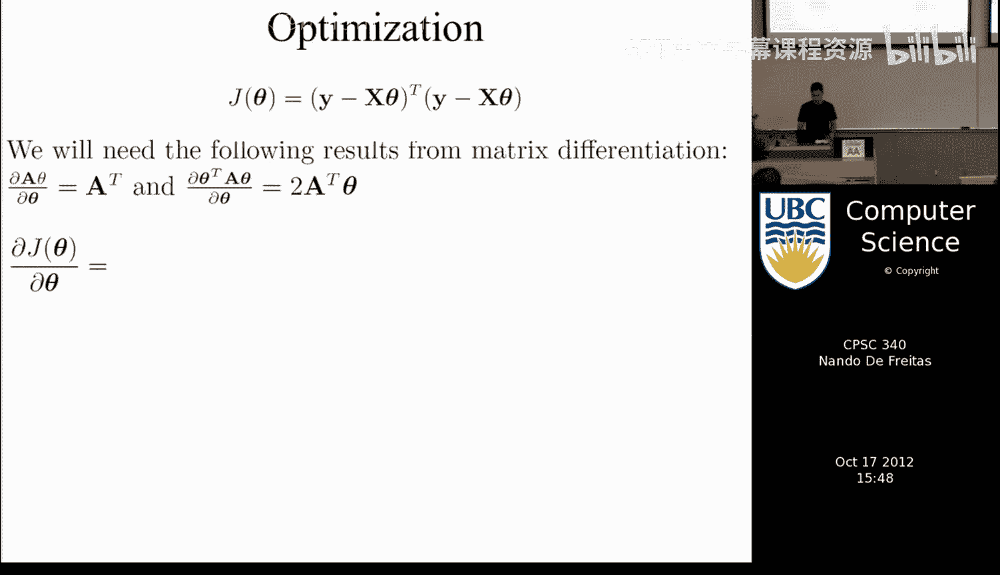

例如，在 thermostat 自动设定系统中，训练阶段使用前四天的（风速，人数，设定值）数据学习 `θ̂`。第五天，系统自动检测当前的风速和人数，构成 `x_new`，然后计算 `ŷ_new` 并自动设定 thermostat。

---

## 总结

本节课中我们一起学习了监督学习和线性模型的基础。

*   我们了解了监督学习与无监督学习的区别，其核心在于利用带标签的数据进行学习。
*   我们介绍了一维线性模型 `y = θ₁ + θ₂x`，其本质是用直线拟合数据。
*   我们学习了通过**最小二乘法**来训练模型，即最小化预测误差的平方和 `Σ (yᵢ - ŷᵢ)²`。
*   我们将模型推广到多维情况，并引入了**矩阵表示法** `ŷ = Xθ`，这使得描述和计算更加简洁高效。
*   最后，我们明确了监督学习的两个阶段：**训练**（求解 `θ`）和**预测**（使用 `θ` 计算新输出的）。

线性模型虽然简单，但它包含了模型、参数、目标函数、优化等机器学习的所有核心概念。理解线性模型是学习更复杂模型（如神经网络、随机森林）的坚实基础。在下一讲中，我们将深入探讨如何求解最小二乘问题，并将其与概率统计中的最大似然估计联系起来。