# 23：狄利克雷分布与分类分布 🎲

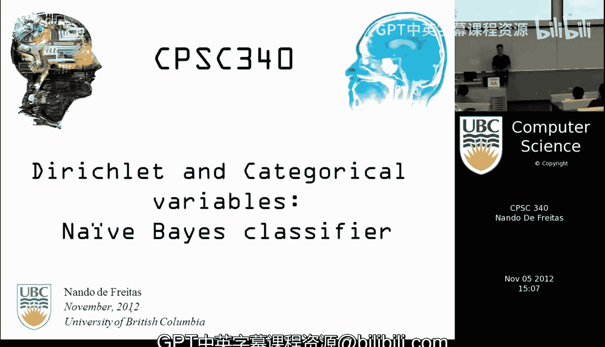

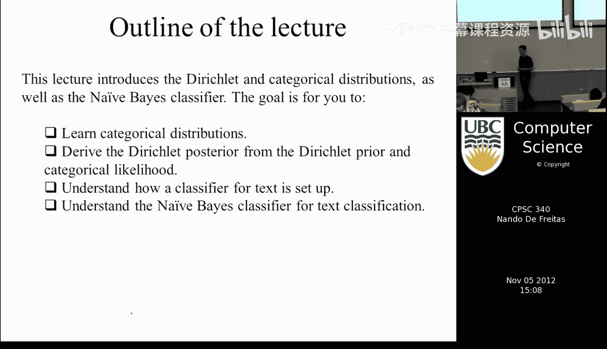

在本节课中，我们将学习如何将二元的伯努利分布和贝塔分布推广到具有多个可能取值的变量上，即分类分布和狄利克雷分布。我们将看到，这些概念是构建分类器（如情感分析应用）的基础。

---

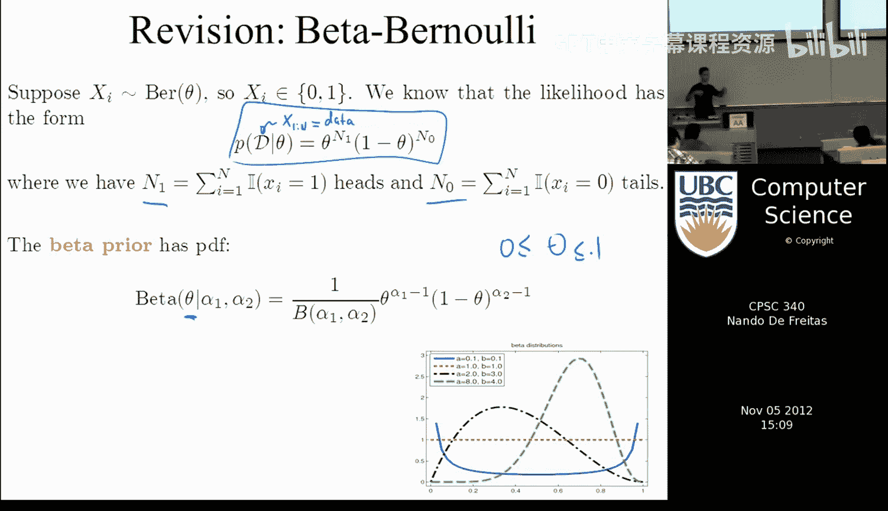

## 回顾：伯努利分布与贝塔分布

上一节我们讨论了二元变量的情况。如果一个变量是二元的（例如抛硬币），其似然函数可以用伯努利分布表示：

**公式**：`P(D | θ) = θ^{n1} * (1-θ)^{n0}`

其中，`n1` 是变量取值为1的次数，`n0` 是取值为0的次数，`θ` 是取值为1的概率。

我们了解到，`θ` 的自然先验分布是贝塔分布，它允许我们编码关于 `θ` 值的先验信念。在贝叶斯推断中，我们不进行优化，也不认为 `θ` 只有一个真实值。我们使用先验分布 `P(θ)` 乘以似然函数，然后归一化得到后验分布 `P(θ | D)`。当先验分布与后验分布具有相同形式时（例如先验是贝塔分布，后验也是贝塔分布），我们称该先验是似然函数的**共轭先验**。

---

## 推广：从二元到多元

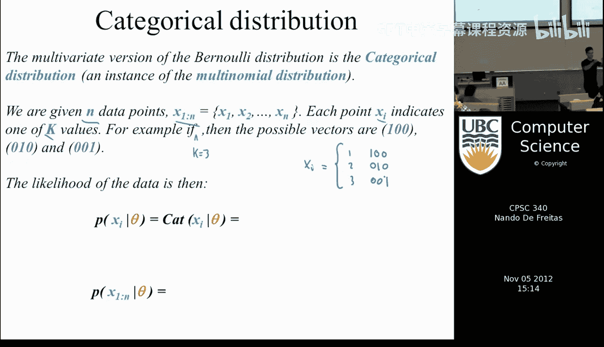

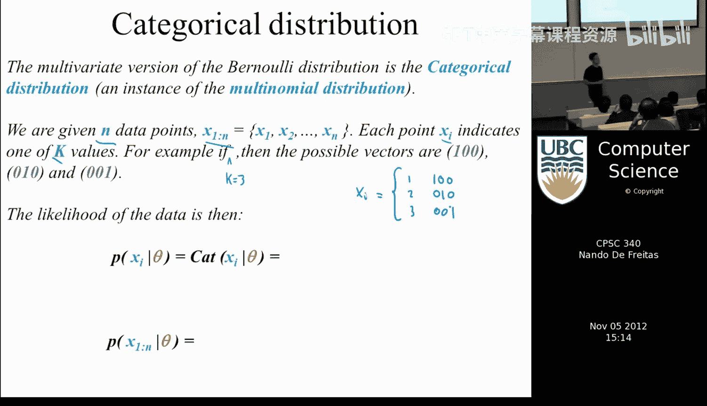

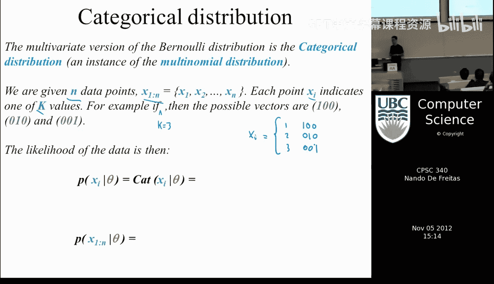

本节中，我们来看看如何将上述概念推广到变量可以取 `K` 个值（`K > 2`）的情况。这就像从抛硬币（两个结果）推广到掷骰子（六个结果）。

### 分类分布

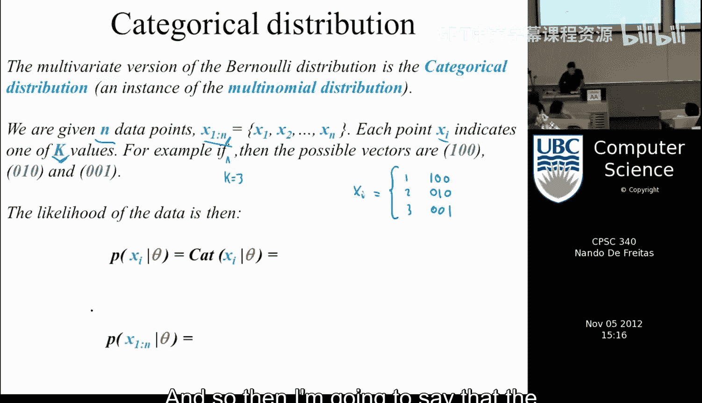

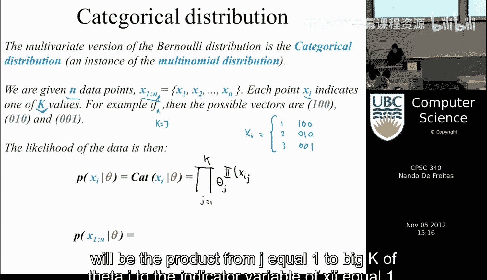

假设我们有 `n` 个数据点 `x_1, ..., x_n`。每个数据点 `x_i` 可以取 `K` 个值中的一个。为了便于数学表示，我们使用“独热编码”：如果 `x_i` 属于第 `j` 类，则将其表示为一个长度为 `K` 的向量，其中第 `j` 个位置为1，其余位置为0。例如，当 `K=3` 时：
*   类别1编码为 `[1, 0, 0]`
*   类别2编码为 `[0, 1, 0]`
*   类别3编码为 `[0, 0, 1]`

**分类分布**的定义如下：

**公式**：`P(x_i | θ) = ∏_{j=1}^{K} θ_j^{I(x_{ij}=1)}`

其中：
*   `θ_j` 是数据点属于第 `j` 类的概率。
*   `I(x_{ij}=1)` 是指示函数，当 `x_i` 的第 `j` 个分量为1时取值为1，否则为0。
*   所有 `θ_j` 必须满足：`∑_{j=1}^{K} θ_j = 1`，且 `0 ≤ θ_j ≤ 1`。

这个公式的含义很简单：`x_i` 属于第 `j` 类的概率就是 `θ_j`。当 `K=2` 时，分类分布就退化成了伯努利分布（设 `θ_1 = θ`, `θ_2 = 1-θ`）。

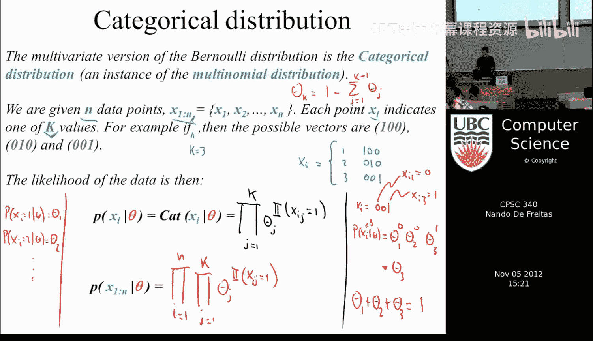

如果我们假设所有数据点独立同分布，那么整个数据集的似然函数就是每个数据点概率的乘积。

### 狄利克雷分布

正如贝塔分布是伯努利分布中参数 `θ` 的共轭先验，**狄利克雷分布**是分类分布中参数向量 `θ` 的共轭先验。

回忆一下，贝塔分布的形式为：`P(θ) ∝ θ^{α1-1} * (1-θ)^{α2-1}`。

狄利克雷分布是其多元推广：

**公式**：`P(θ) ∝ ∏_{j=1}^{K} θ_j^{α_j - 1}`

其中，`α_j` 是分布的参数（均为正数），并且同样有约束 `∑_{j=1}^{K} θ_j = 1`。

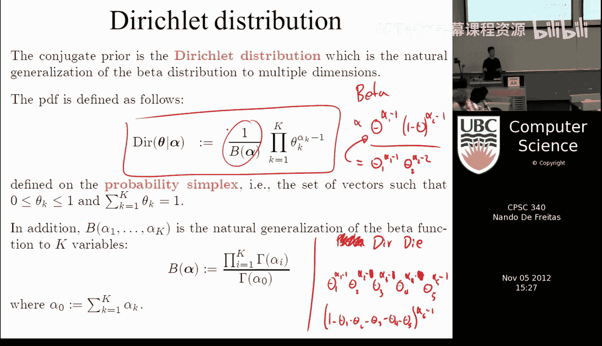

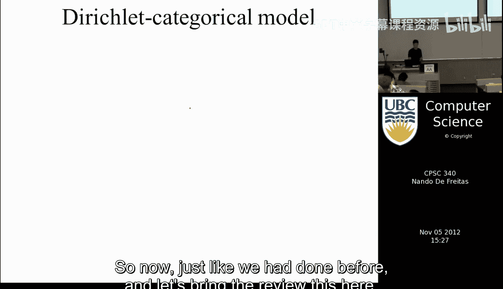

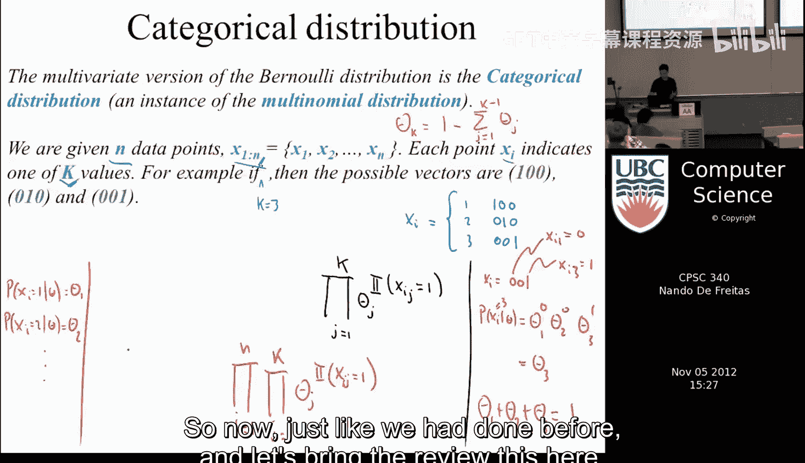

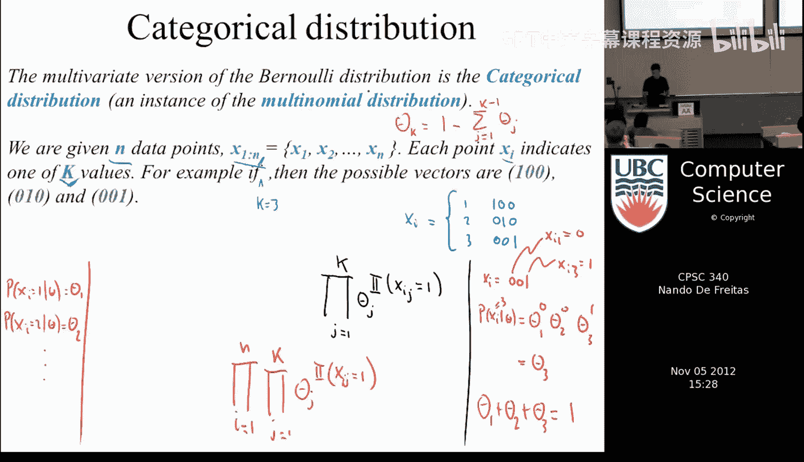

例如，对于一个六面骰子（`K=6`），其 `θ` 的先验就是一个六维的狄利克雷分布。

---

## 贝叶斯推断：从先验到后验

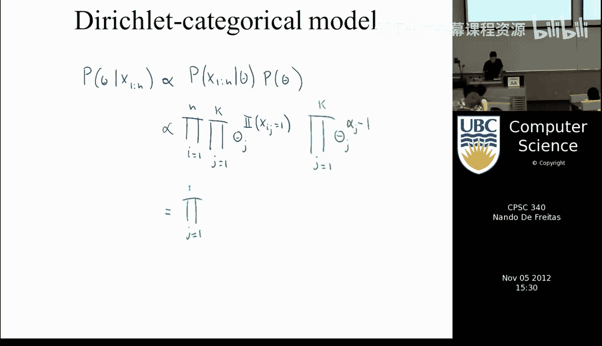

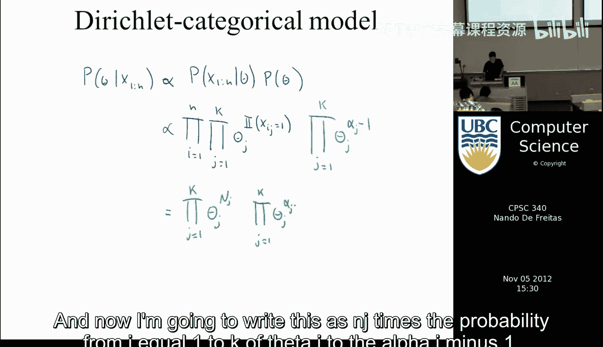

现在，让我们像处理硬币问题一样，对分类分布进行贝叶斯推断。我们有：
*   **先验**：`P(θ) = Dir(θ | α)` （狄利克雷分布）
*   **似然**：`P(D | θ) = ∏_{i=1}^{n} ∏_{j=1}^{K} θ_j^{I(x_{ij}=1)}` （分类分布）

根据贝叶斯定理，后验分布与先验乘以似然成正比：

`P(θ | D) ∝ P(D | θ) * P(θ)`
`∝ [∏_{j=1}^{K} θ_j^{N_j}] * [∏_{j=1}^{K} θ_j^{α_j - 1}]`
`= ∏_{j=1}^{K} θ_j^{N_j + α_j - 1}`

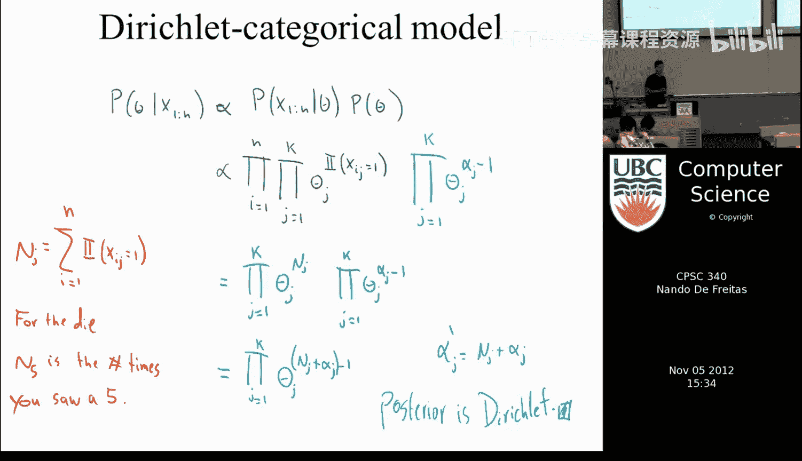

其中，`N_j = ∑_{i=1}^{n} I(x_{ij}=1)`，即数据集中属于第 `j` 类的样本数量。

我们可以看到，后验分布仍然是一个狄利克雷分布，其参数更新为 `α_j' = N_j + α_j`。这完美展示了共轭性：狄利克雷先验与分类似然结合，产生狄利克雷后验。

---

## 应用实例：推特情感分析 🐦

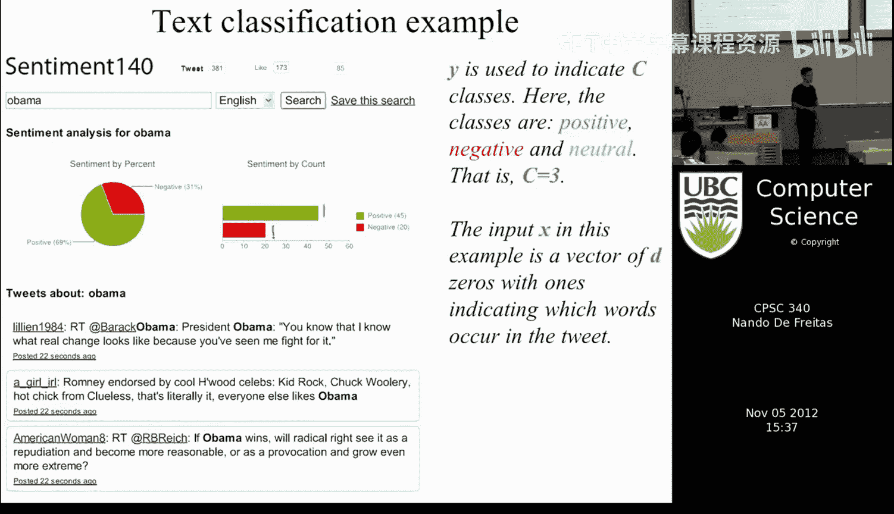

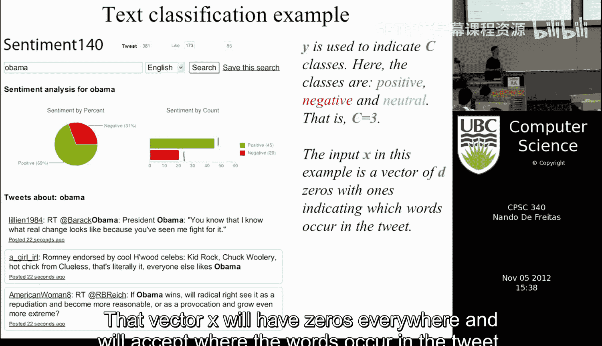

理解了分类分布和狄利克雷分布后，我们就可以构建一个实用的分类器。让我们看一个有趣且即时的例子：分析推特上对某个人物（例如总统）的情感倾向。

### 问题建模

我们的目标是：给定一条推文，判断其情感是**正面**、**负面**还是**中性**。

1.  **定义输出变量 y**：`y` 表示情感类别，是一个分类变量（`K=3`）。我们可以用独热编码表示。
2.  **定义输入特征 x**：一条推文由许多单词组成。我们构建一个包含 `D` 个常用单词（如“great”, “bad”, “OMG”, “cat”）的词典。然后将每条推文表示为一个长度为 `D` 的二进制向量 `x`。如果推文中包含词典中的第 `j` 个词，则 `x_j = 1`，否则为 `0`。这称为“词袋”表示。

### 朴素贝叶斯分类器

为了连接 `x` 和 `y`，我们使用贝叶斯定理：

**公式**：`P(y=c | x, θ, π) ∝ P(y=c | π) * P(x | y=c, θ)`

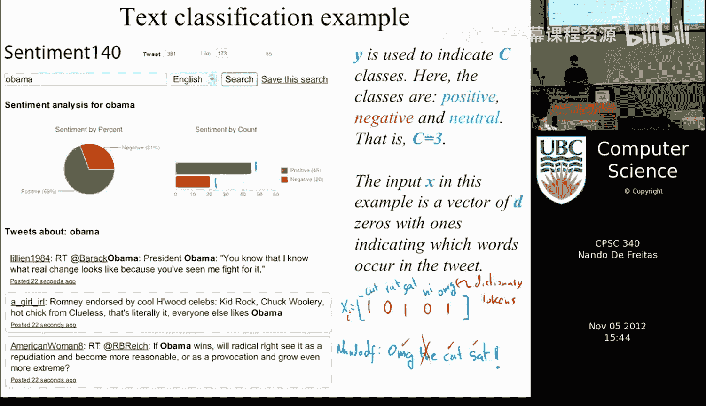

其中：
*   `P(y=c | π)` 是**先验概率**，表示任意一条推文属于类别 `c` 的概率。它服从分类分布，参数为 `π`。
*   `P(x | y=c, θ)` 是**似然**，表示在已知情感类别为 `c` 的条件下，观察到特征向量 `x` 的概率。

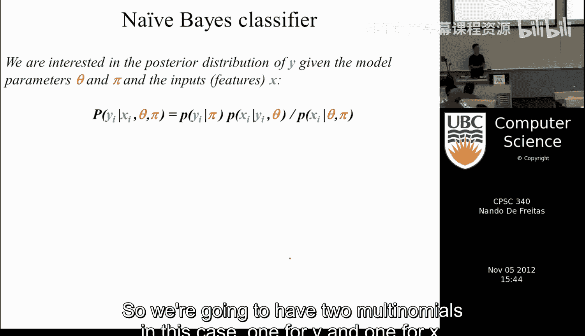

为了计算似然，我们做一个关键的简化假设（“朴素”假设）：**假设在给定类别 `c` 的条件下，特征 `x_1, x_2, ..., x_D`（即各个词是否出现）是相互独立的**。虽然这个假设在现实中不成立（词语有关联），但实践表明它通常能产生很好的效果。

在这个假设下，似然函数可以分解为：

**公式**：`P(x | y=c, θ) = ∏_{j=1}^{D} P(x_j | y=c, θ_{jc})`

其中，`θ_{jc}` 表示在类别 `c` 中，第 `j` 个单词出现的概率。对于每个类别 `c`，都有一套独立的参数 `θ_{.,c}`。

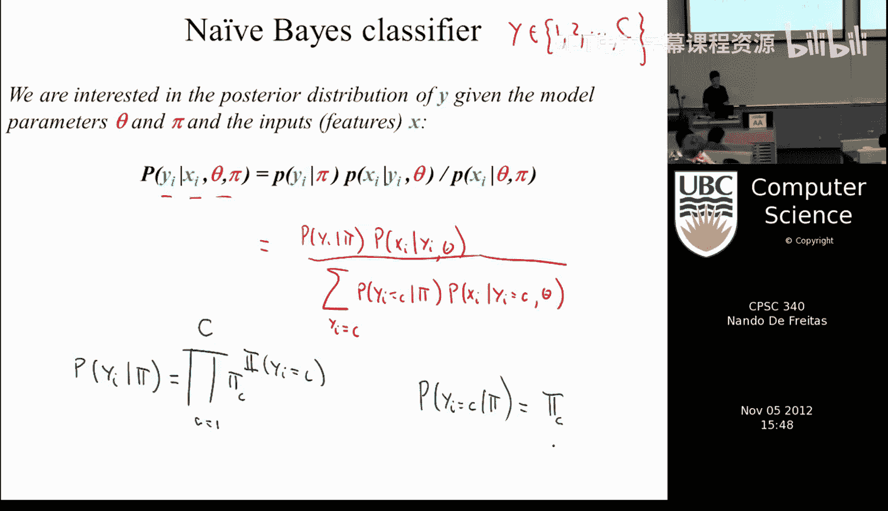

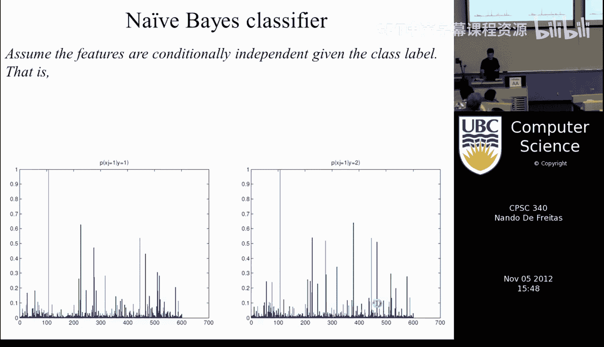

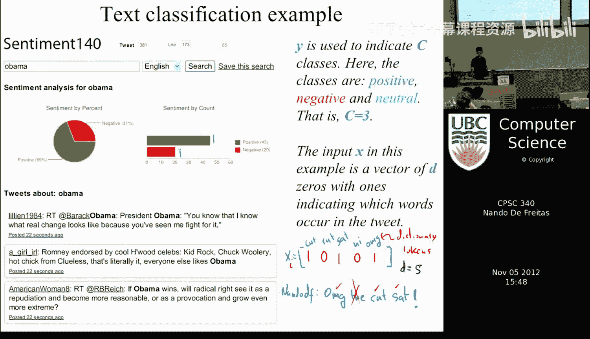

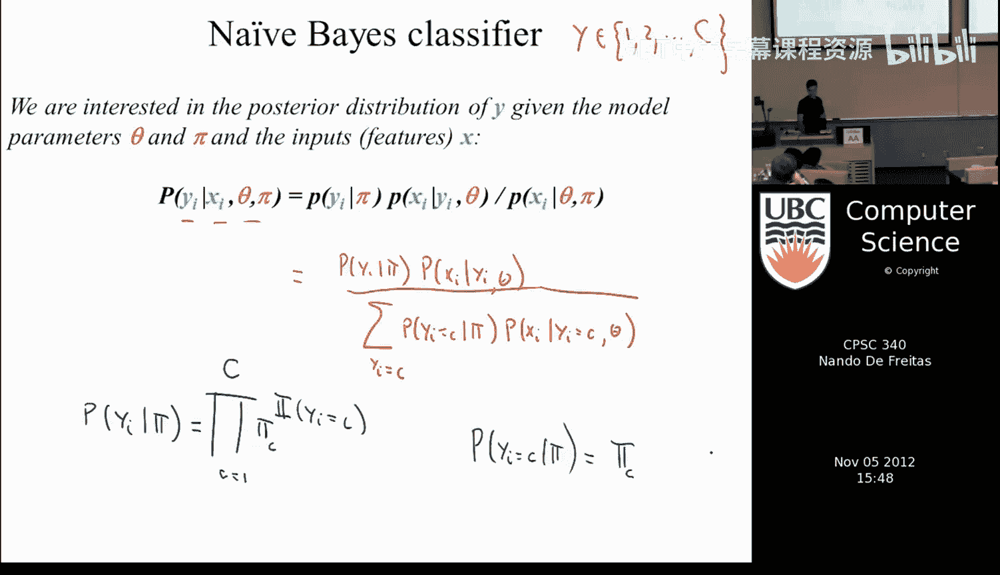

### 模型训练与预测

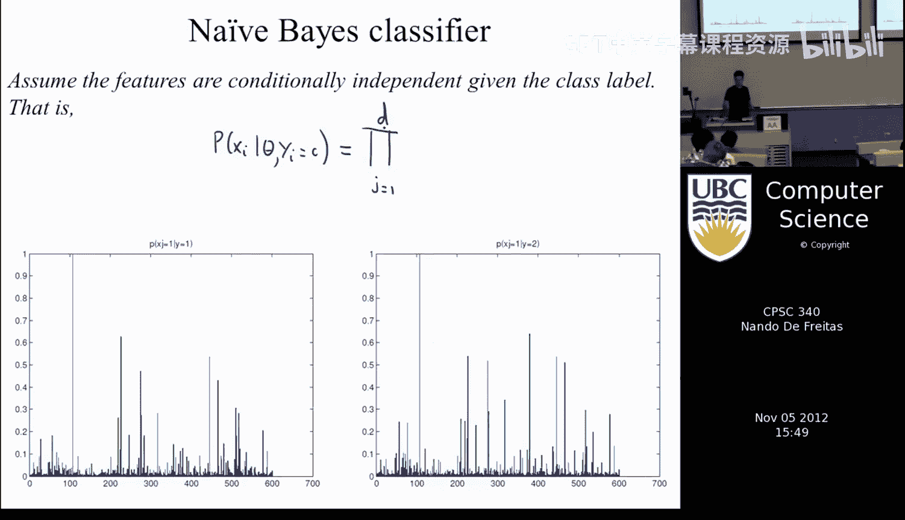

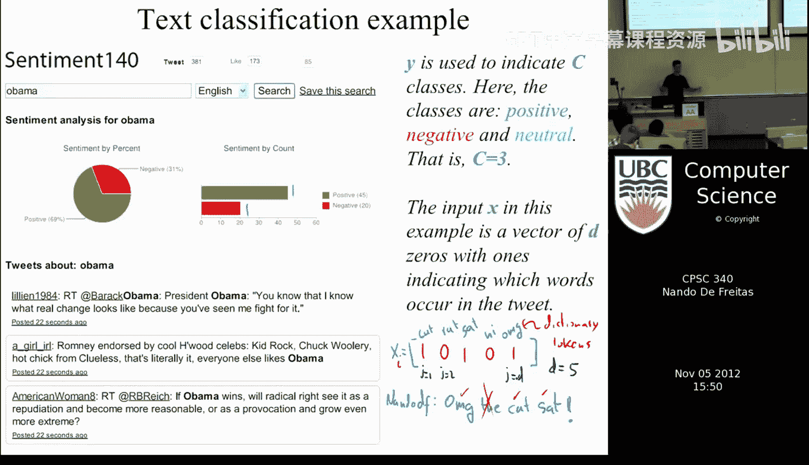

1.  **训练**：我们需要从标注数据（例如，100万条已标记为正面/负面/中性的推文）中估计参数 `π` 和 `θ`。这可以通过最大似然估计（MLE）或贝叶斯估计（使用狄利克雷先验）来完成。MLE的解非常直观且易于计算：
    *   `π_c` 的估计值是训练数据中类别 `c` 的比例。
    *   `θ_{jc}` 的估计值是在类别 `c` 的所有推文中，包含单词 `j` 的推文所占的比例。
2.  **预测**：对于一条新推文，我们将其转换为特征向量 `x_new`。然后对每个类别 `c`，计算 `P(y=c | π) * P(x_new | y=c, θ)`。概率最大的那个类别就是我们的预测情感。

这个模型的最终形式可以归结为一个简单的计数和比较过程，算法非常高效，甚至可以并行化和在线学习，每来一条新推文都可以实时更新模型。

---

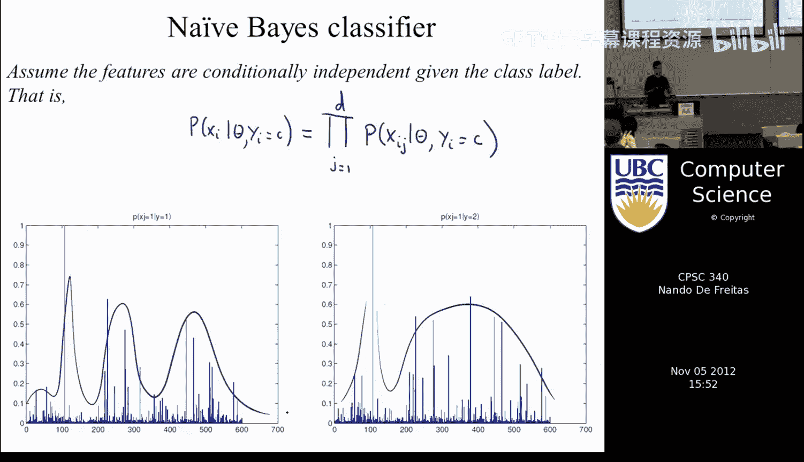

## 总结

本节课中我们一起学习了：
1.  **分类分布**：它是伯努利分布在 `K > 2` 个类别上的推广，用于描述一个样本属于某个类别的概率。
2.  **狄利克雷分布**：它是贝塔分布在 `K` 维参数上的推广，是分类分布的共轭先验，使我们能方便地进行贝叶斯推断。
3.  **朴素贝叶斯分类器**：利用贝叶斯定理和特征条件独立性假设，我们将分类分布应用于文本特征（词袋模型），构建了一个强大而简单的文本分类模型（如推特情感分析）。

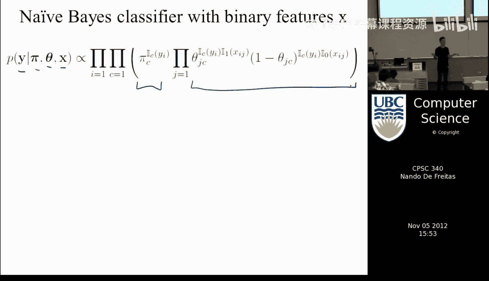

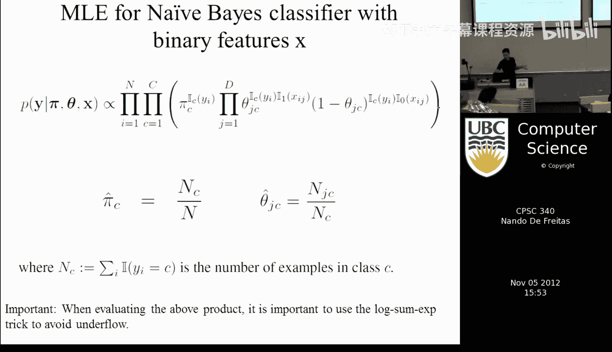

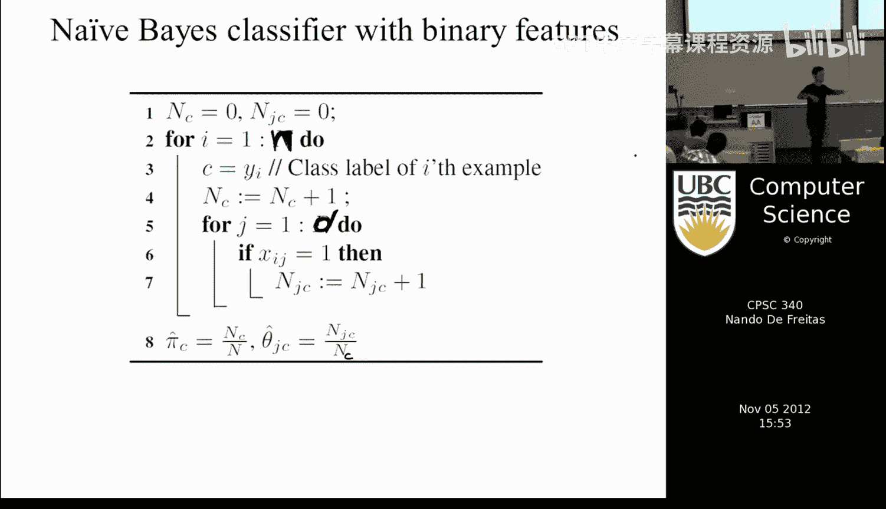

通过将简单的硬币模型推广到多元情况，我们打开了处理更复杂、更实际数据的大门，为后续学习更高级的模型（如神经网络）奠定了重要基础。