# 25：朴素贝叶斯推特情感预测 📊

在本节课中，我们将学习如何使用朴素贝叶斯模型对文本进行分类，特别是推特的情感预测。我们将推导模型的最大似然估计和贝叶斯估计，并理解其背后的原理。

---

## 概述

朴素贝叶斯是一种基于贝叶斯定理的简单分类算法。它假设特征之间相互独立，这使得模型计算高效且易于并行化。我们将从最大似然估计开始，然后引入贝叶斯方法来解决数据稀疏性问题。

---

## 模型与最大似然估计

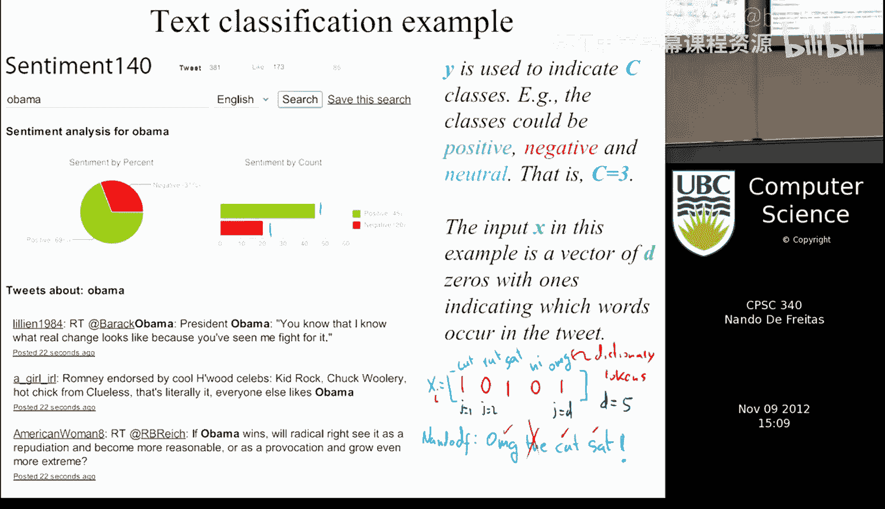

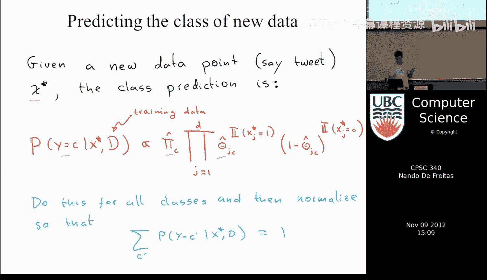

上一节我们介绍了朴素贝叶斯的基本思想。本节中，我们来看看如何通过最大似然估计来学习模型的参数。

朴素贝叶斯模型假设每个特征（例如单词）在给定类别下是独立的伯努利分布。对于有 `C` 个类别和 `D` 个特征（单词）的问题，我们需要估计两类参数：
*   **类别先验概率** `π_c`：文档属于类别 `c` 的概率。
*   **条件概率** `θ_jc`：在类别 `c` 中，第 `j` 个特征（单词）出现的概率。

模型的似然函数可以写为：

```
L(π, θ) = ∏_c (π_c)^{N_c} * ∏_j (θ_jc)^{N_jc} * (1 - θ_jc)^{(N_c - N_jc)}
```

其中：
*   `N_c` 是属于类别 `c` 的文档数量。
*   `N_jc` 是在类别 `c` 的文档中，特征 `j` 出现的次数。

为了便于优化，我们通常使用对数似然函数：

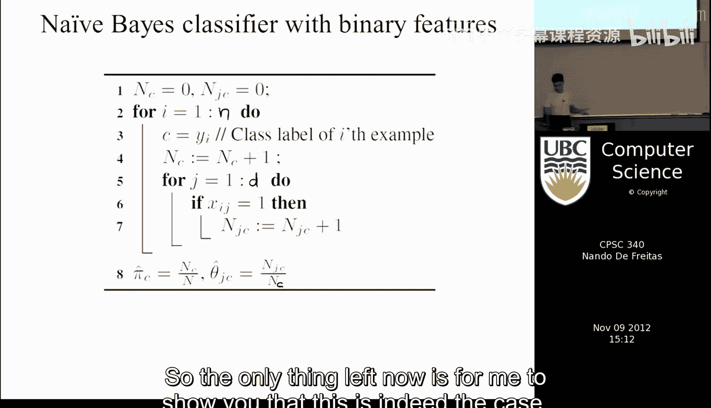

```
log L(π, θ) = Σ_c N_c log(π_c) + Σ_c Σ_j [N_jc log(θ_jc) + (N_c - N_jc) log(1 - θ_jc)]
```

### 参数 `θ_jc` 的估计

首先，我们估计条件概率 `θ_jc`。由于对数似然函数中关于 `π` 和 `θ` 的项是分离的，我们可以单独对 `θ_jc` 求导并令其为零。

对 `log L` 关于 `θ_jc` 求偏导：

```
∂ log L / ∂ θ_jc = N_jc / θ_jc - (N_c - N_jc) / (1 - θ_jc)
```

令导数为零，解得：

```
θ_jc_hat = N_jc / N_c
```

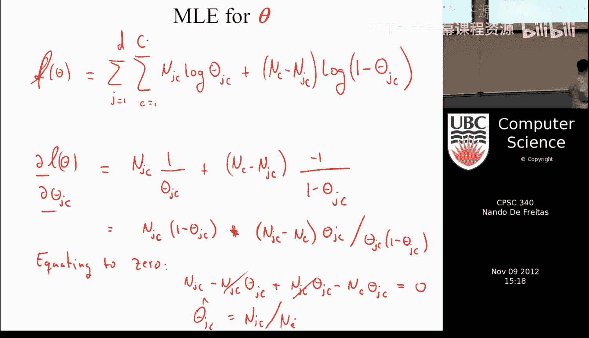

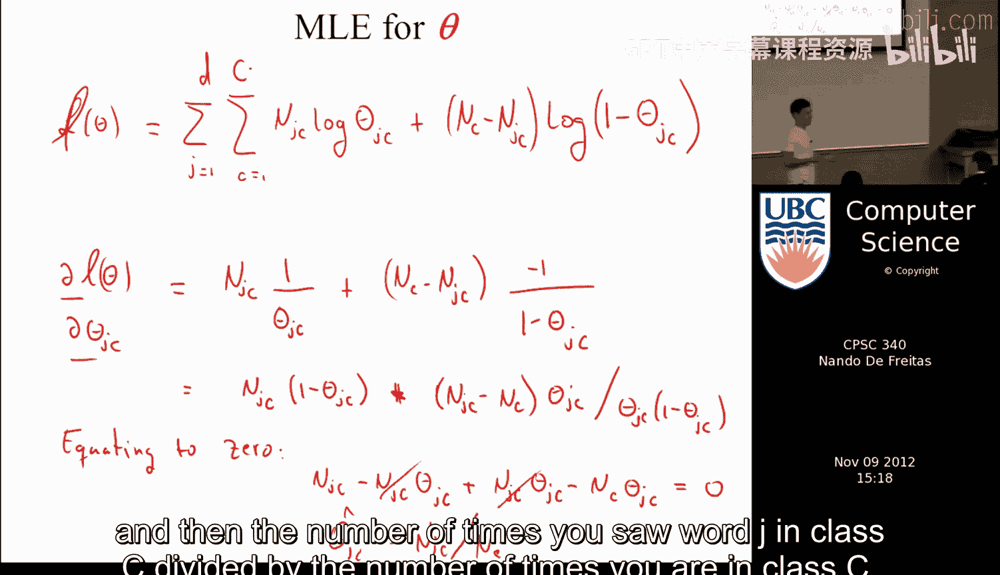

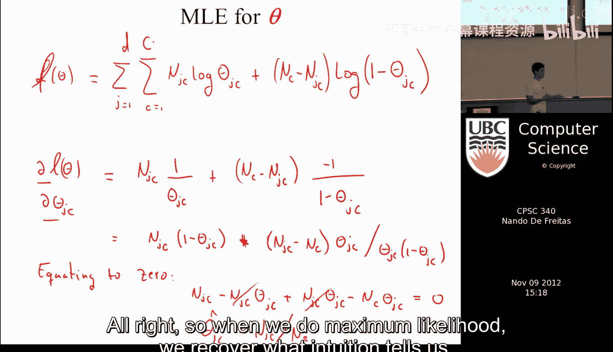

这个结果非常直观：在类别 `c` 中，单词 `j` 出现的概率估计，就是它在类别 `c` 的文档中出现的次数除以类别 `c` 的总文档数。

### 参数 `π_c` 的估计与约束

接下来估计类别先验 `π_c`。这里有一个重要的约束：所有类别的先验概率之和必须为1，即 `Σ_c π_c = 1`。我们需要在优化时加入这个约束。

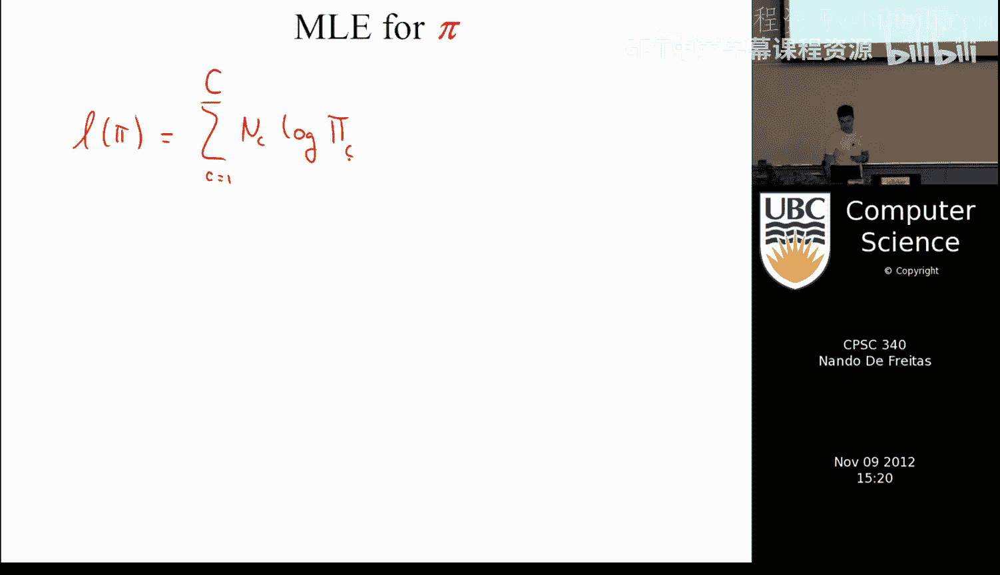

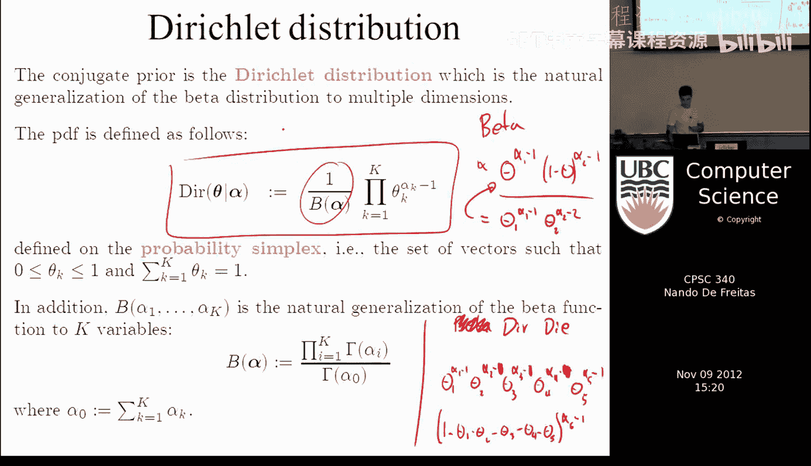

我们构建拉格朗日函数，将约束条件融入目标函数：

```
L(π, λ) = Σ_c N_c log(π_c) + λ (1 - Σ_c π_c)
```

其中 `λ` 是拉格朗日乘子。现在我们对 `π_c` 和 `λ` 分别求导。

首先，对 `π_c` 求偏导并令为零：

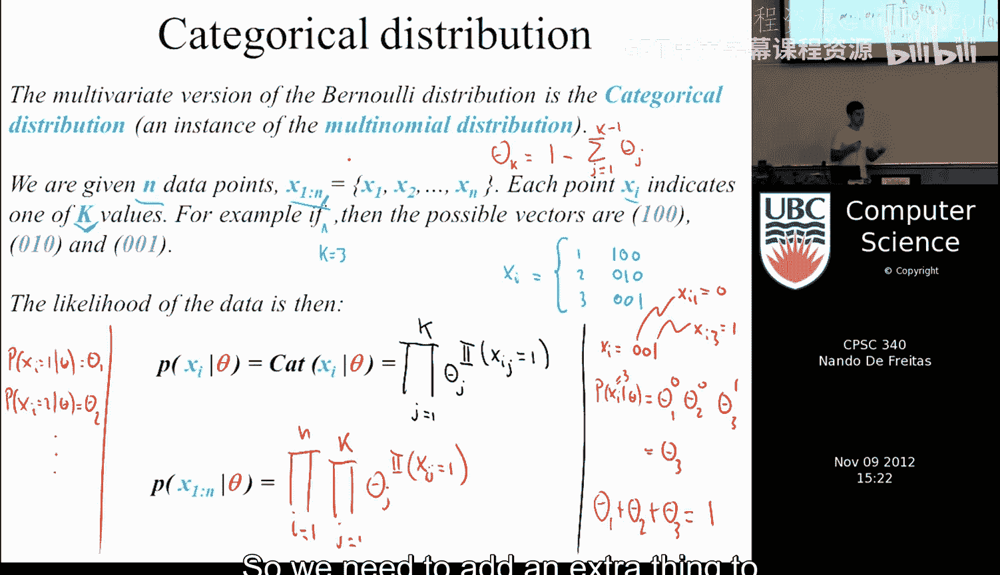

```
∂ L / ∂ π_c = N_c / π_c - λ = 0  =>  N_c = λ π_c
```

然后，对 `λ` 求偏导并令为零，这直接给出了约束条件：

```
∂ L / ∂ λ = 1 - Σ_c π_c = 0  =>  Σ_c π_c = 1
```

现在，我们将 `N_c = λ π_c` 对所有类别 `c` 求和：

```
Σ_c N_c = λ Σ_c π_c
```

左边是所有文档的总数 `N`，右边根据约束条件 `Σ_c π_c = 1`，所以 `λ = N`。

将 `λ = N` 代回 `N_c = λ π_c`，得到：

```
π_c_hat = N_c / N
```

这同样符合直觉：类别 `c` 的先验概率估计，就是属于该类别的文档数占总文档数的比例。

---

## 贝叶斯估计

最大似然估计的一个问题是，如果某个单词在某个类别的训练数据中从未出现（`N_jc = 0`），那么 `θ_jc_hat = 0`。这会导致未来任何包含该单词的文档被判定为不可能属于该类，即“黑天鹅”悖论。贝叶斯估计通过引入先验分布来缓解这个问题。

上一节我们完成了最大似然估计。本节中，我们引入贝叶斯框架，为参数赋予先验分布，从而得到更鲁棒的估计。

我们为参数选择共轭先验：
*   对于伯努利分布的参数 `θ_jc`，选择 **Beta分布** 作为先验。
*   对于类别分布（Categorical）的参数 `π`，选择 **狄利克雷分布** 作为先验。

假设先验形式如下：

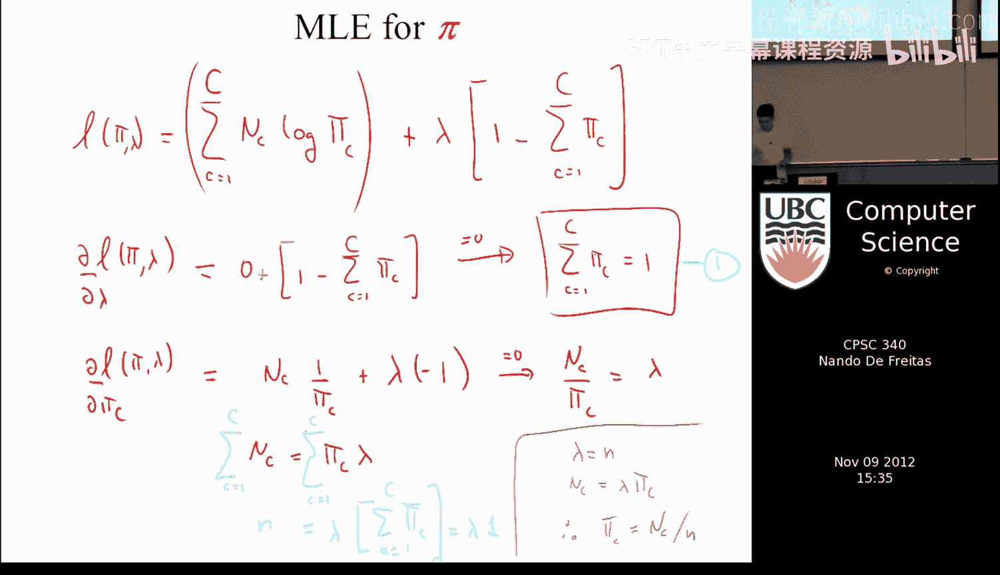

```
P(π) ∝ ∏_c π_c^{α_c - 1}        # 狄利克雷先验
P(θ_jc) ∝ θ_jc^{β1 - 1} (1 - θ_jc)^{β2 - 1} # Beta先验（对所有j, c相同）
```

这里 `α_c`, `β1`, `β2` 是超参数。由于假设特征和参数独立，联合先验是这些分布的乘积。

后验分布正比于似然函数与先验分布的乘积：

```
P(π, θ | 数据) ∝ [似然函数] * [先验分布]
```

代入似然和先验的具体形式后，我们发现后验分布仍然具有相同的形式（共轭性）：
*   `π` 的后验是狄利克雷分布，参数更新为 `(N_c + α_c)`。
*   `θ_jc` 的后验是Beta分布，参数更新为 `(N_jc + β1)` 和 `(N_c - N_jc + β2)`。

我们通常取后验分布的均值作为点估计。以下是后验均值估计：

```
π_c_bayes = (N_c + α_c) / (N + Σ_c α_c)
θ_jc_bayes = (N_jc + β1) / (N_c + β1 + β2)
```

### 贝叶斯估计的优势

以下是贝叶斯估计解决的主要问题：

1.  **避免零概率**：即使 `N_jc = 0`，只要 `β1 > 0`，`θ_jc_bayes` 就不会为零，保留了该单词出现的可能性。
2.  **平滑效果**：先验参数 `β1`, `β2` 起到了平滑作用。例如，设置 `β1 = β2 = 1`（均匀先验）相当于在计数上加1，即拉普拉斯平滑。
3.  **融入先验知识**：通过调整超参数 `α_c`, `β1`, `β2`，可以融入我们对类别的分布或单词出现频率的先验信念。

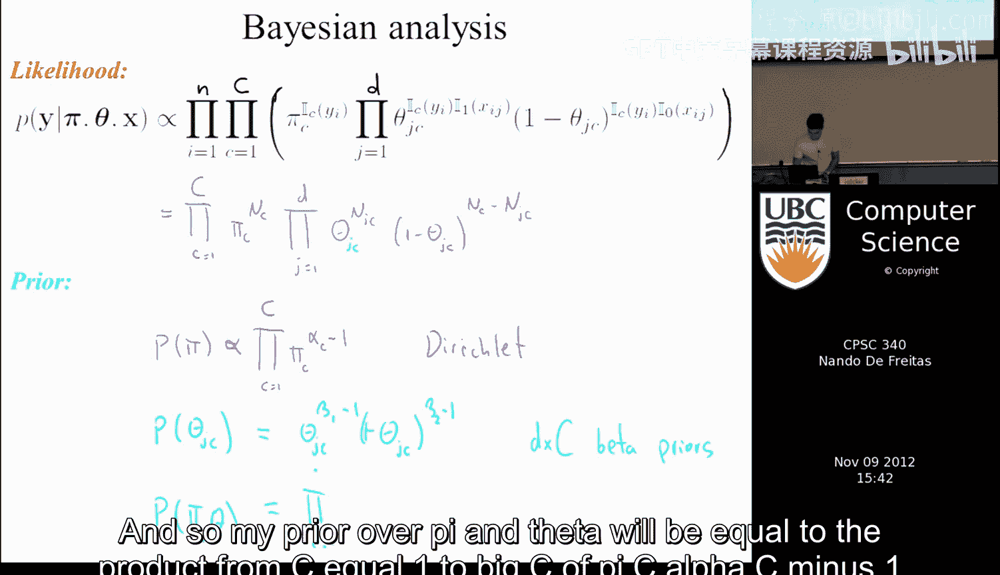

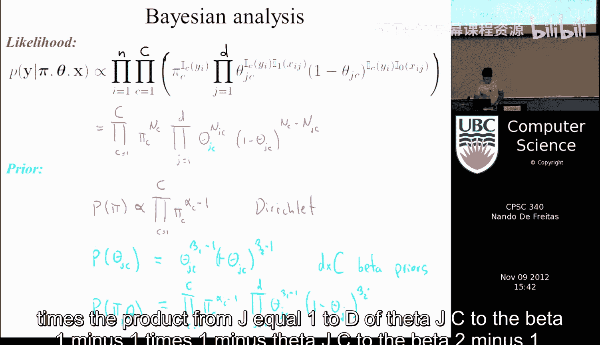

---

## 模型应用与扩展

我们推导了文本分类的朴素贝叶斯模型。这个模型的应用非常广泛。

以下是朴素贝叶斯模型的一些关键特性和应用场景：

*   **高效并行**：参数估计（计数）可以完全并行化，因为每个特征和类别的计数是独立的。
*   **在线学习**：模型可以轻松进行在线更新。每获得一个新的训练样本，只需更新对应的 `N_c` 和 `N_jc` 计数即可，非常适合处理数据流（如推特流）。
*   **应用领域**：除了推特情感分析，该模型还可用于垃圾邮件过滤、博客分类、根据关键词自动归档邮件，甚至对离散序列（如RNA链）进行分类。

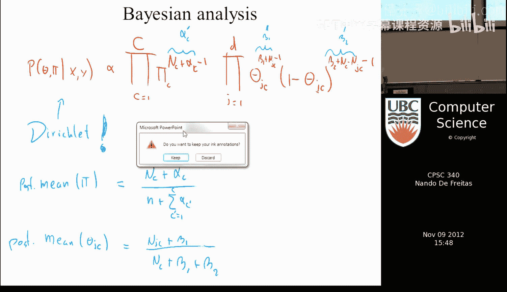

### 处理连续特征

我们目前假设输入特征是二元的（单词是否出现）。朴素贝叶斯也可以处理连续特征。

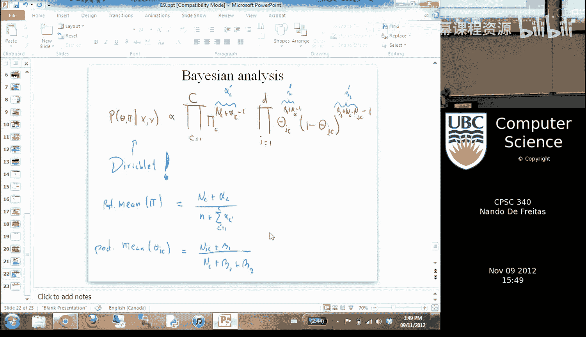

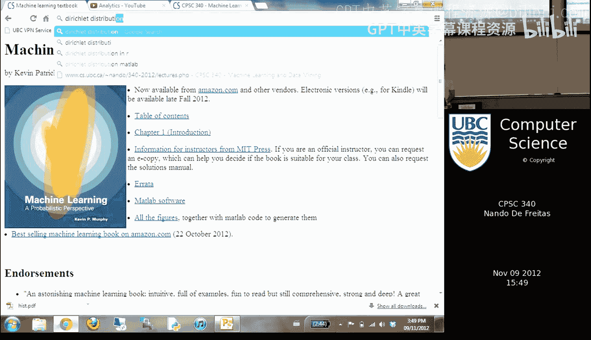

*   **高斯朴素贝叶斯**：如果输入特征是连续的（如图像像素值），我们可以假设每个特征在给定类别下服从高斯分布。此时，需要用高斯分布的参数（均值和方差）来代替伯努利参数 `θ_jc`。
*   **模型选择**：对于像图像这样的连续数据，实践中更常使用其他分类器，如逻辑回归、神经网络或随机森林。本课程后续将重点介绍这些方法。

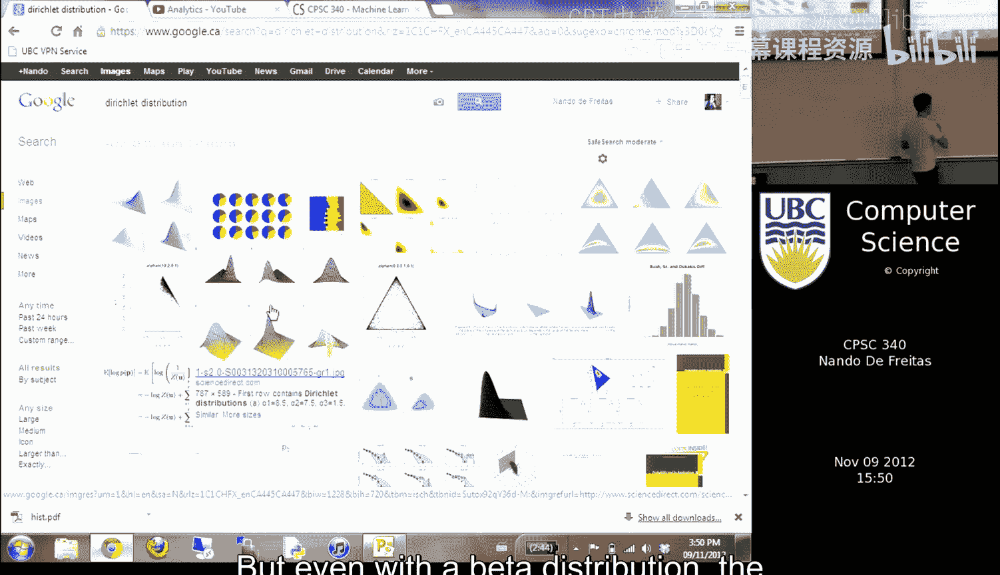

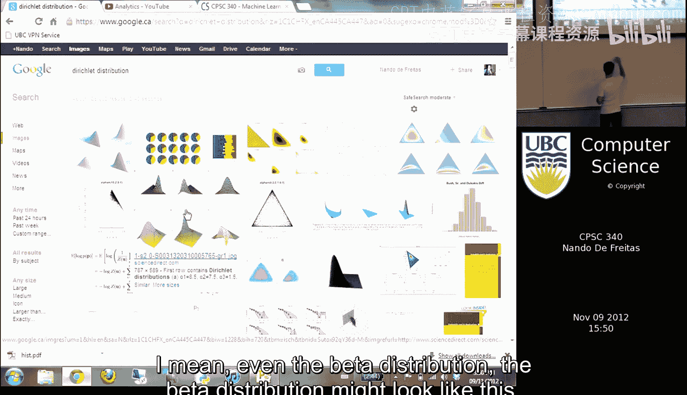

### 与其他技术的关系

主成分分析（PCA）是一种无监督降维技术，它本身不是分类器。但实践中，我们经常先用PCA对图像等高维数据进行降维以去除噪声，然后在低维空间（例如5维或10维）中使用分类器（如朴素贝叶斯、逻辑回归等）进行分类。

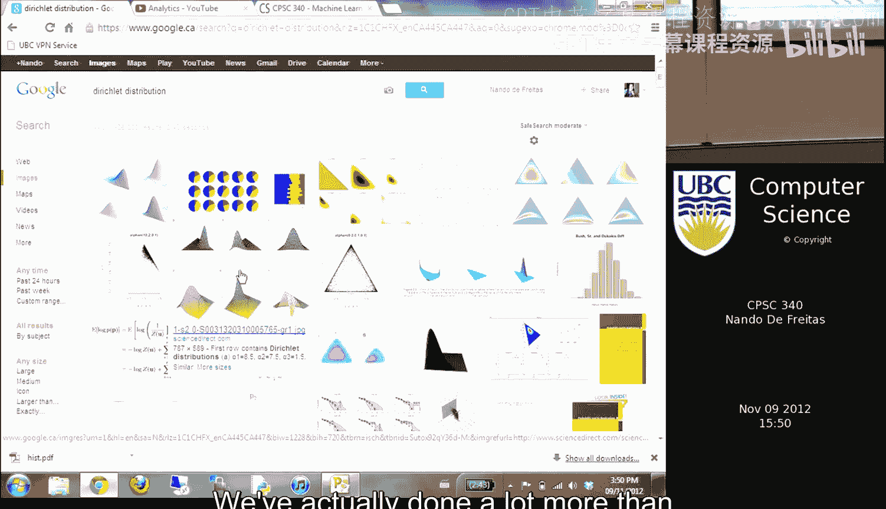

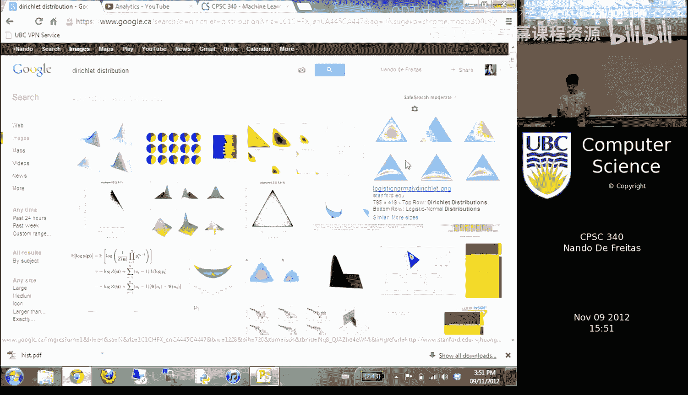

---

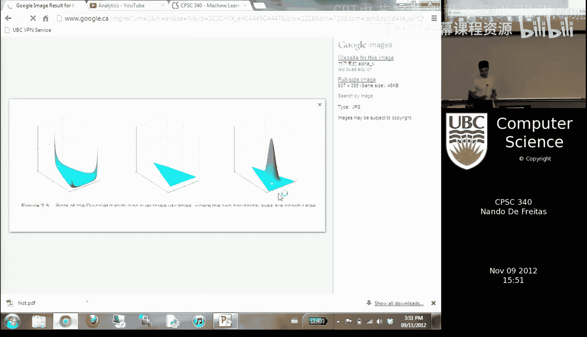

## 总结

本节课中我们一起学习了朴素贝叶斯分类器用于文本情感预测的完整过程。

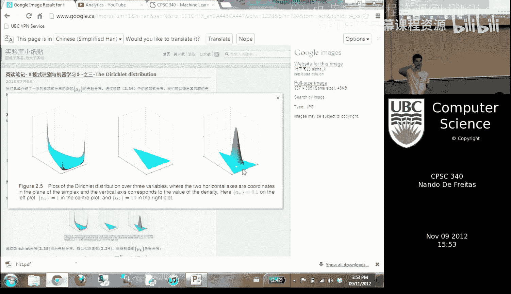

1.  **模型基础**：我们基于特征条件独立性假设，建立了用于文本分类的朴素贝叶斯模型。
2.  **最大似然估计**：我们推导了模型参数（`π_c` 和 `θ_jc`）的最大似然估计，其结果直观（`N_jc/N_c` 和 `N_c/N`），但存在零概率问题。
3.  **贝叶斯估计**：我们引入了Beta和狄利克雷共轭先验，推导了参数的后验分布和其后验均值估计。这种方法通过平滑有效避免了零概率问题，使模型更健壮。
4.  **特性与应用**：我们讨论了该模型并行化、在线学习的优点，及其在文本分类等领域的广泛应用。同时也简要提到了如何将其扩展到连续特征（高斯朴素贝叶斯）。

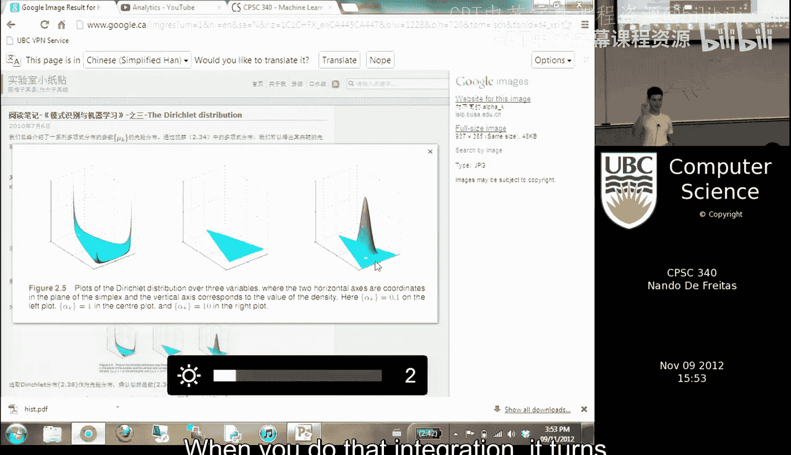

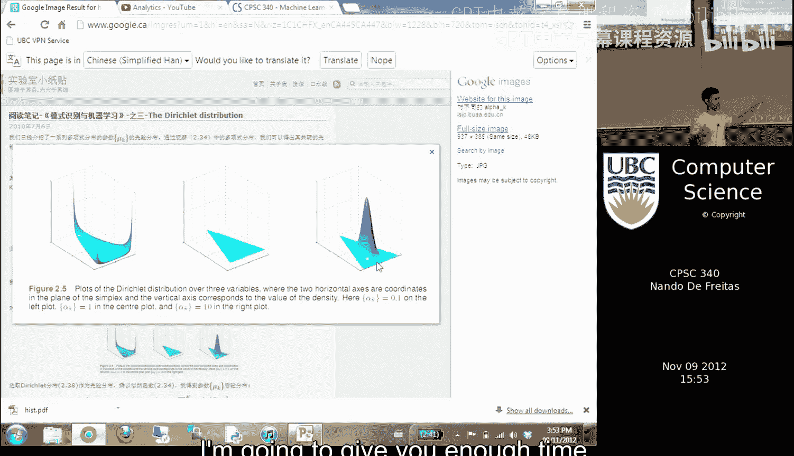

你现在已经拥有一个可以处理多类文本分类的实用工具。通过完成相关的编程作业，你将能够亲手实现这个算法，并观察贝叶斯平滑带来的实际效果提升。