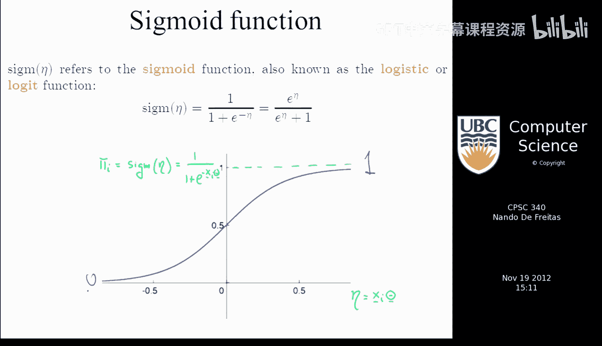
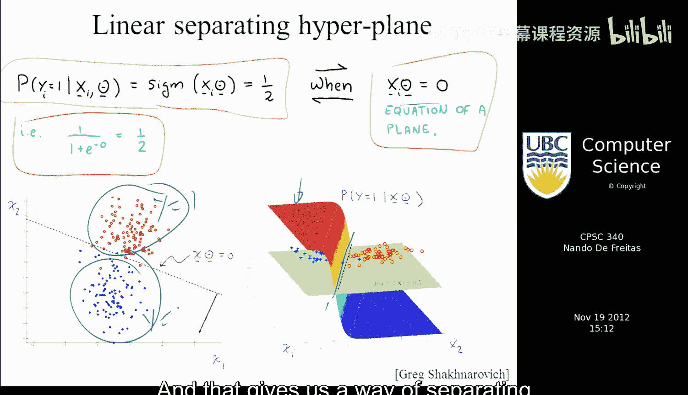
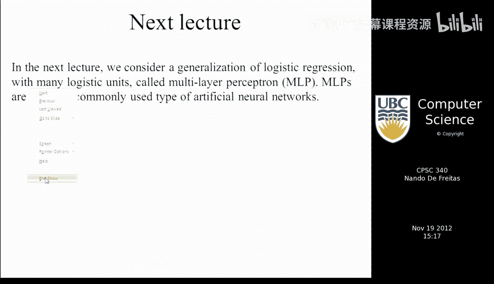
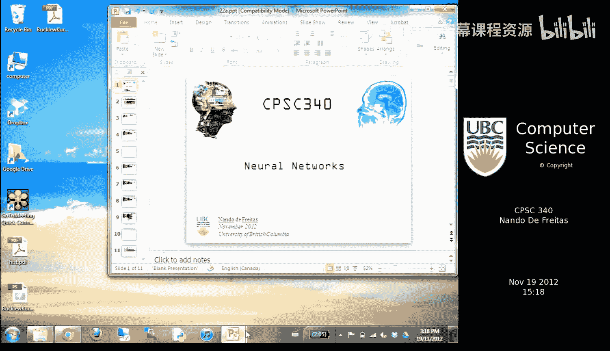
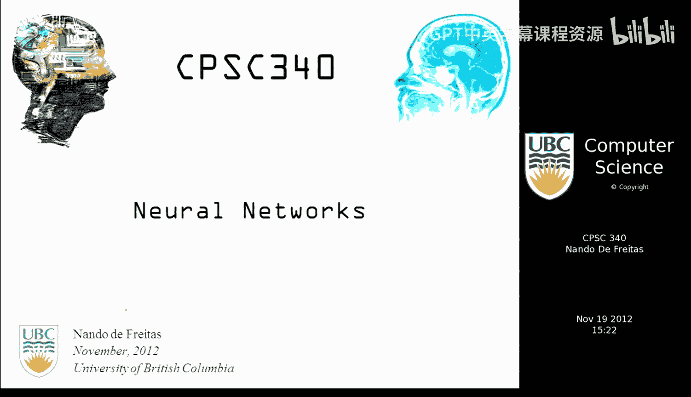
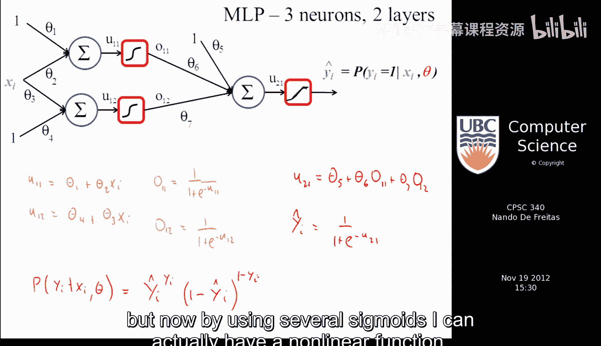

# 28：神经网络 🧠

在本节课中，我们将学习如何从简单的逻辑回归模型过渡到更复杂的神经网络模型。我们将探讨如何为二元数据建模，理解逻辑回归的核心原理，并了解如何通过组合多个“神经元”来构建能够学习非线性决策边界的神经网络。

---

## 概述

我们将从给定的数据开始。在这个例子中，假设我们被给予了一些 X 和 Y 的数据点。例如，我知道一些数据点：`(3, 2.1)`，`(2, 6.0)`，`(6, 8.1)`，`(-2, 3.1)`。与 Y 值是实数的线性回归不同，这里的 Y 值是二元的（0 或 1）。它们可能表示左侧的数字，输入 X 可能是一个人的身高减去某个值，而 Y 则表示这个人是否能通过测试。所以，X 是给定的，没有不确定性。Y 是我们将拥有分布的变量，Y 是这里具有随机性的变量。Y_hat 表示对 Y 的预测，这个“帽子”符号很重要。

---

## 为二元数据建模

如果我们拥有的数据中 Y 是 0 或 1，这本质上与抛硬币看是正面还是反面的数据相同。因此，为 0/1 数据建模的正确分布是伯努利分布。

但现在，硬币的成功概率取决于 X。这正是有趣的地方。

如果我想为我的 Y 建模，我假设所有抛硬币的结果都是独立的，所以我取从 1 到 n 的乘积。每个 y_i 只是一个成功概率为 π_i 的伯努利分布。

到目前为止，我们还没有做任何新的事情，这只是抛硬币。但现在我们说，π_i 本身是 X 的函数。

本质上，我们正在做的是线性回归。我们从 X 开始，拟合直线 `X * θ`，这本质上是一个方程，即一个平面的方程。然后我们通过一个 sigmoid 函数将其“压缩”。

我们通过 sigmoid 函数压缩它的原因是，我们知道这个函数的值在 0 和 1 之间。所以我们得到一个概率。这是一个技巧，允许我们将输出解释为介于 0 和 1 之间的概率。然后 `1 - π` 也是一个介于 0 和 1 之间的数。

这里有两件事：一是在 Y 上定义概率，分布是关于 Y 的；二是组合性，其中 Y_i 的成功概率 π_i 是输入 X 的函数。这就是我们开始为更复杂的场景引入概率模型的方式。

---

## 逻辑回归模型

随着我们进入神经网络，我将在这里重复相同的处理方法，但针对不同的情况：当你有二元数据时，当 Y 是高斯分布时，以及当 Y 有多个类别时。这些情况我们在线性模型中见过高斯情况，在朴素贝叶斯的处理中也见过多类别情况。但现在，我们将为这种形式的模型处理所有这些不同的“噪声”分布，在这种模型中，你有输入和输出，为了从输入到输出，存在某种组合性。

所以，π_i 是成功概率，因此 π_i 确实是在给定参数 θ 和观察到 X_i 的条件下，y 等于 1 的概率。这样做的好处是，θ 是一个在负无穷到正无穷之间的连续变量，它完全不受约束，但 π_i 自然会约束在 0 和 1 之间。因此，我们不需要引入复杂的约束来要求 π_i 和为 1 等等。我们只需使用这种参数化方法，就能确保得到概率。

---

## 参数估计与梯度

一旦我们有了似然函数，如何找到 θ 呢？寻找 θ 的过程是什么？通常是最大似然估计。你会取对数，求导并令其等于零。在这种情况下只有一个困难：当你求导并令其等于零时，你将无法为 θ 求解出一个封闭形式的解。

在我告诉你我们实际得到的梯度之前，另一件事是记住上一节课的内容：函数 `1 / (1 + e^{-X_iθ})` 是一个 sigmoid 函数。sigmoid 函数具有在 0 和 1 之间的重要性质，因此你可以将其解释为概率分布。它在导数方面也有很好的性质。

在 1D 情况下，sigmoid 函数是一条 S 形曲线。在 2D 情况下，sigmoid 函数看起来像我在右侧显示的曲面。

然后，我们要做的是设定阈值。我们在某个值（比如 0.5，当高度为一半时）对这个函数进行阈值处理。然后，大于 0.5 的一侧被认为是类别 1，另一侧被认为是类别 0。这样，我们实际上就有了一个分类器。每当你有一个新的 X，你计算在该 X 下 y 等于 1 的概率。如果大于 0.5，你将其分配到一个类别；如果小于 0.5，你将其分配到另一个类别。

所以，一旦我们估计出这条曲线，我们只需在 0.5 处设定阈值，这等同于在零处对平面进行阈值处理，这为我们提供了一种分离 y=1 和 y=0 数据的方法。但我们做的不仅仅是说它是 1 还是 0，我们实际上估计了它是 1 的概率，所以我们实际上做得更多一些。

当我们对此求导并令其等于零时，我们得到了梯度和海森矩阵的以下表达式。我不会在课堂上做这些，我会要求你在下次作业中做这些，因为我认为在这个阶段，更有价值的是让你练习如何做到这一点。

我们发现梯度由方框中的这个表达式给出。这有一定道理，因为它基本上是在比较 y 和预测值 π。y 在 0 和 1 之间，π 是介于 0 和 1 之间的预测变量。所以，我们正在做的是将预测与实际数据进行比较。如果你的预测与实际数据不同，你的梯度更新就大，因为如果你的预测不匹配数据，你就应该学习，并且以大步长学习。而如果你的预测与数据一致，那么你的更新就小。

我们可以实现梯度下降，但也可以去计算海森矩阵。对于逻辑回归，很容易得到海森矩阵。你也会把这个作为一个练习。一旦你有了海森矩阵（它查看二阶导数的曲率，并且正如你所看到的，也与预测的方差有关），你就能够实现牛顿法。

本质上，牛顿法需要海森矩阵 H 和梯度 G。一旦你有了这些，就很容易应用牛顿法。这就是我们通常解决逻辑回归问题的方式：尝试牛顿法。

可以证明（这是我在线性代数复习中没有做的，所以如果你学过足够的线性代数，可以把它当作一个高级话题），海森矩阵是正定的，在多变量情况下可以解释为具有正曲率。拥有所有正特征值的正定海森矩阵意味着你有一个凸函数，并且有一个唯一的最小值，我们可以找到它。如果我们使用牛顿法，我们可以在这个问题中达到最优解。因此，逻辑回归仍然被认为是一个相当容易解决的问题。

---

## 牛顿法与实现

在具体实现牛顿法的情况下，我在这里展示给你看。这是上一张幻灯片中海森矩阵和梯度的表达式。如果你将这些代入 θ 的估计中，并进行一些简化以获得计算效率更高的东西，你会得到一个实际上有名字的算法。人们也称之为迭代重加权最小二乘法，因为该表达式看起来像一个最小二乘表达式，只是它有一个由矩阵 S 给出的权重。但它本质上是牛顿法。

我已经在课程网站上为你上传了幻灯片，并包含了实际的代码，告诉你如何获取逻辑函数以及如何运行 IRLS。正如你所看到的，实现这个实际上相当容易。这就是用于逻辑回归的牛顿法。

然后主函数只是加载数据、进行估计，然后你只需要调用牛顿法来给你一个新的 θ，然后你评估训练错误率和测试错误率。所以，实现逻辑回归变得相当容易。

---

## 从逻辑回归到神经网络

既然我们了解了逻辑回归，现在让我们转向一个更有趣的问题。逻辑回归是这门课程竞赛的一个比较基准。问题是，这与朴素贝叶斯相比如何？有一个竞赛，这是一个测试它的好地方。

我们只是用它来将数据分成两类吗？我们可以使用任意数量的阈值。所以，我向你描述了二元逻辑回归，但确实你可以进行多元逻辑回归，即处理多于两个类别，就像朴素贝叶斯一样，我将在几分钟内在神经网络的背景下解释它。但是的，这是一个问题。

你可以选择其他函数。相同的权重函数以不同的原因出现。一是从神经网络的角度来看，这是历史原因。有一个想法是有一个激活函数，当神经元不活跃时输出一个值，超过某个阈值后神经元在 1 处变得活跃。当他们尝试对这些模型进行编码时（这是 Jeff Hinton 有一次在晚餐时告诉我的），他们无法对阶跃函数求导，所以他们所做的就是拟合一条曲线，即 sigmoid 函数。

但如果你做机器学习的理论，我未涵盖线性判别分析，这是因为指数族吗？确实，我们正在研究的所有这些分布都是指数族的一部分。但我的意思是，这只是一个概括性的陈述。更直接的回答是，如果你有两个点分布根据两个多元高斯分布，并且你试图区分两者，那么你会发现最优边界是由逻辑函数给出的。所以这是一个我经常在 340 课程中做的版本，但今年我没有做。这是一个统计原因，它最优地区分了两个高斯分布。

对于竞赛，我们只是给你参数然后你加载它们吗？你是得到预测结果，还是也看它花了多长时间？对于竞赛，我们有多宽容？只要它运行时间不超过规定的最短时间（今年我认为我们设定为半小时），任何运行时间超过这个的都是无效的，因为我们不想要疯狂的算法。或者任何导致计算机崩溃的算法也无效。逻辑回归适用于那个数据集。

另一件我没有提到的事情是，我将在神经网络的背景下提到这一点，因为神经网络本质上是逻辑回归的推广。就像我们为线性回归添加正则化一样，所有这些论点在这里仍然适用。我们可以在 θ 上放置正则化项。我们可以放置 L2 正则化和 L1 正则化。带有 L1 正则化的逻辑回归是那里最广泛使用的二元分类技术之一。所以，它被用在像 Kaggle 这样的竞赛中。

对于二元数据，L1 范数和 L2 范数等价吗？比如，1 的值是 1，1 的平方也是 1？让我回头看看，我有一张关于正则化的幻灯片，但正则化是在参数上，而不是在 y 上。我不确定我是否理解了你的问题。

---

## 神经网络：你的第一个神经网络

神经网络，这是你的第一个神经网络。它就是逻辑回归，它是一个神经元。你有一个输入 X_i。它被 θ_2 加权。你加上 θ_1，这就给了你 u。换句话说，你的 u 将等于 `θ_1 + X * θ_2`。

然后我们通过一个 sigmoid 函数。我们得到 `Y_i = 1 / (1 + e^{-u_i})`，也就是 `1 / (1 + e^{-(θ_1 + X_i * θ_2)})`。

这里的数据和之前一样。所以我们有 X，然后我们有 y，比如 0.6，我不知道，也许是 1。重要的是，y 是二元的。我只用一个 X，但显然如果我有多于一个 X，这也可以工作。如果我有更多 X，我只需要另一个 X 点。所以我会有 X_i1，我还可以有 X_i2，然后我会在这里有另一个参数。我没有使用这个，但很明显我可以有很多输入。所以我可以有更多的 X 列。

这是给定输入 X_i 和当前参数设置 θ 的条件下，y 等于 1 的概率。所以，给定 X_i 和 θ，Y_i 等于 1 的概率就只是一个成功概率为 Y_i_hat 的伯努利分布。正如我们所知，这只是在说，当 Y_i 等于 1 时，概率将是 Y_i_hat；当 Y_i 等于 0 时，概率将是 `1 - Y_i_hat`。这只是总结这两个事实的快速方法。

现在，如果我们有 N 个独立的伯努利观测值，那么给定 X_1...n 和 θ 的向量 Y 的概率，就等于从 i=1 到 n 的乘积 `P(y_i | x_i, θ)`。一个变量根据伯努利分布分布。所以它是一枚硬币。然后如果你有 n 枚硬币，你只需将概率相乘。所以这是一个单一的神经元。

---

## 更复杂的递归架构

随着我们转向更现代的神经元，我们开始得到一个更有趣的、更复杂的递归架构。

我们将有一个 X_i。我们将有中间输入：`u_11 = θ_1 + θ_2 * X_i`。然后我们会有 `u_12 = θ_4 + θ_3 * X_i`。然后我们也将通过 sigmoid 函数压缩它们。所以现在把这想象成 3 个神经元。我们有两个神经元。所以，你有一个信号 X，它分裂成两个神经元，然后在输出端再次汇聚到一个神经元。

所以第一个神经元的输出就是 `1 / (1 + e^{-u_11})`，这在左边的表达式中给出。

然后对于下一个神经元，我们有 `u_21 = θ_5 + θ_6 * o_11 + θ_7 * o_12`。最后，我们压缩它以获得预测。所以，为了得到预测，我们对输入应用了一系列操作。

因此，给定 X_i 和 θ 的 Y_i 的概率仍然用伯努利分布建模，在这方面没有任何变化，因为我们处理的是二元数据。唯一改变的是，成功概率 Y_i_hat 现在由一个复杂得多的函数给出。

现在的问题是，我为什么要费心让函数变得更复杂？正是如此。因为最初，我的边界是线性的。但现在通过使用多个 sigmoid 函数，我实际上可以拥有一个非线性函数。

---

## 总结

在本节课中，我们一起学习了逻辑回归作为二元分类的基础模型。我们理解了如何用伯努利分布对二元输出建模，并通过 sigmoid 函数将线性组合映射为概率。我们探讨了使用最大似然估计和牛顿法来求解模型参数。最后，我们看到了如何通过堆叠多个这样的“神经元”来构建一个简单的神经网络，从而引入非线性决策边界，为处理更复杂的数据模式奠定了基础。逻辑回归不仅是强大的分类工具，也是理解更复杂神经网络架构的重要基石。