# 29：神经网络基础与反向传播推导 🧠

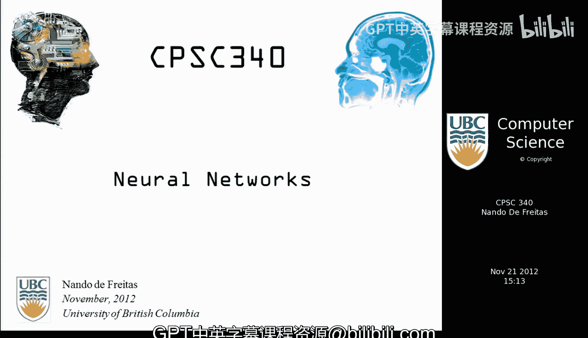

在本节课中，我们将学习神经网络的基本原理，包括其与逻辑回归的关系、不同任务下的模型构建（回归、二分类、多分类），以及核心的训练算法——反向传播的推导过程。我们将从简单的模型开始，逐步深入到更复杂的结构。

---

## 逻辑回归回顾

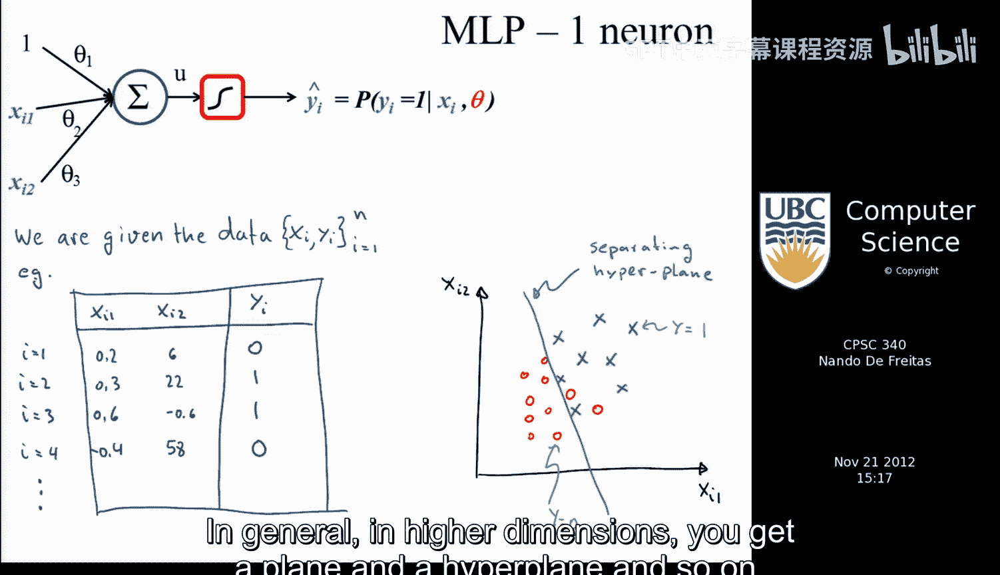

上一节我们介绍了逻辑回归作为二分类的基础模型。本节中，我们来看看它如何被视为一个最简单的神经网络。

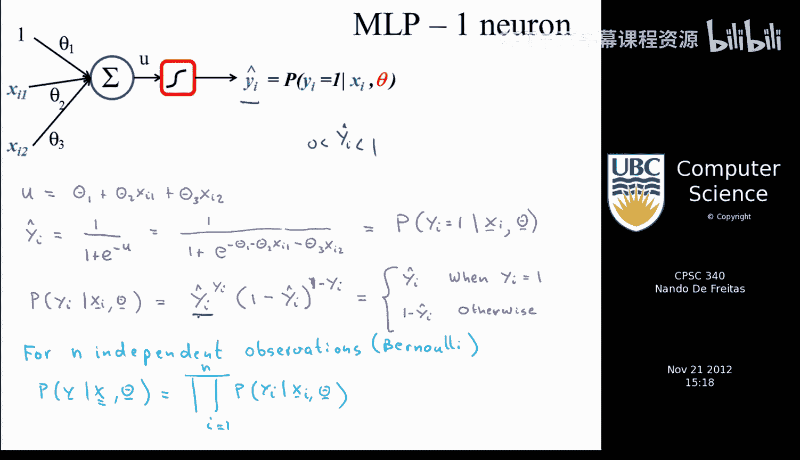

假设我们有两个输入特征 `x1` 和 `x2`，数据形式如下（`i` 为数据索引）：
*   输入：`x_i = [x_i1, x_i2]`
*   标签：`y_i ∈ {0, 1}`

我们的目标是找到一个决策边界来分离两类数据（例如正面与负面推文）。对于逻辑回归，这个边界是一条直线（在二维空间）或一个超平面（在高维空间）。

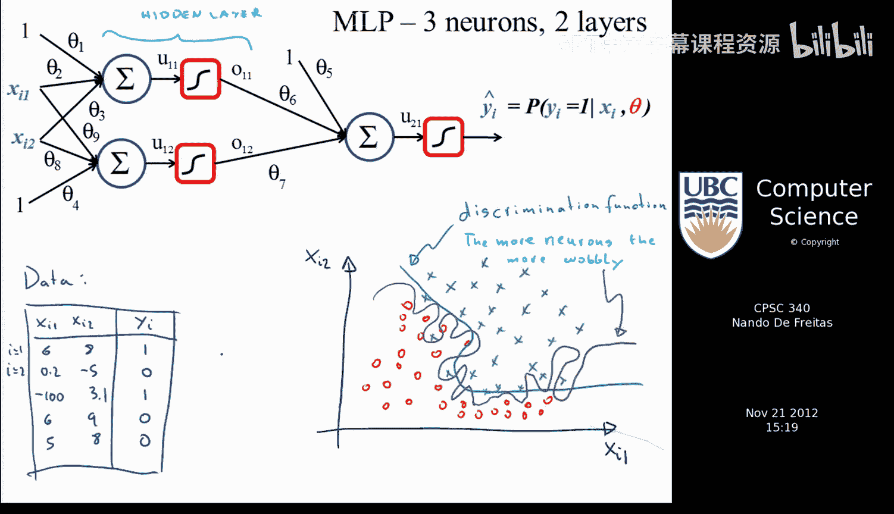

逻辑回归模型可以看作一个单一的“神经元”。该神经元的输出是：
`ŷ_i = σ(θ_0 + θ_1 * x_i1 + θ_2 * x_i2)`
其中 `σ(z) = 1 / (1 + e^{-z})` 是Sigmoid函数，将输出压缩到0和1之间，可以解释为概率。

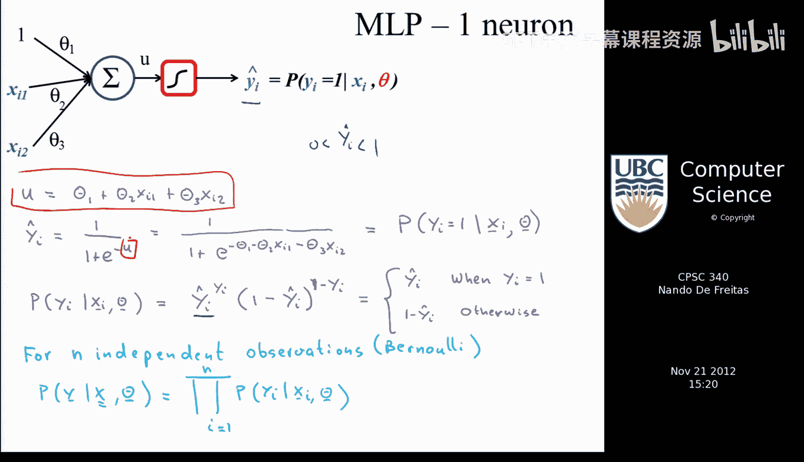

我们将标签 `y_i` 建模为以 `ŷ_i` 为成功概率的伯努利分布：
`P(y_i | x_i, θ) = ŷ_i^{y_i} * (1 - ŷ_i)^{(1 - y_i)}`
对于N个独立观测，似然函数是各数据点概率的乘积。最大化这个似然函数等价于最小化一个称为**交叉熵**的代价函数。

---

## 从线性到非线性：引入隐藏层

然而，数据可能不是线性可分的。为了处理更复杂的情况，我们需要非线性函数。这就是神经网络的核心思想：在输入和输出之间加入一个或多个**隐藏层**。

一个带有隐藏层的神经网络可以进行非线性变换。例如，一个具有3-4个隐藏神经元的网络可能产生蓝色决策边界，而具有20个隐藏神经元的网络可能产生更复杂（如紫色）的边界。这里存在一个权衡：
*   **更多神经元**：可以更好地拟合训练数据，甚至达到零训练误差。
*   **风险**：可能导致过拟合，在测试集上表现不佳。

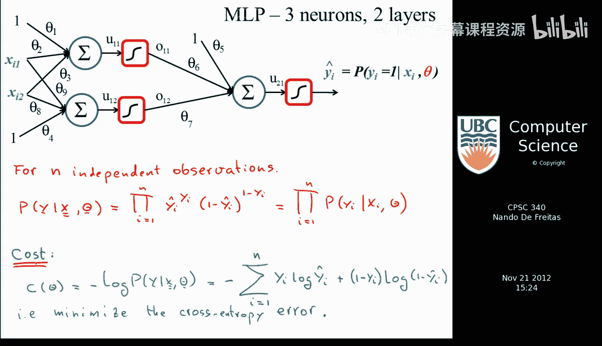

控制复杂度的方法包括：
*   使用交叉验证选择神经元数量。
*   对权重参数 `θ` 添加L2正则化项，使部分权重趋近于零，从而平滑决策边界。

概率模型的核心没有变：我们仍然对输出 `y` 建模（伯努利分布），只是现在 `ŷ_i` 是通过Sigmoid函数复合而成的更复杂的非线性函数。

---

## 代价函数与最大似然的等价性

我们之前提到，最小化代价函数与最大化似然是等价的。这对于理解不同任务的损失函数至关重要。

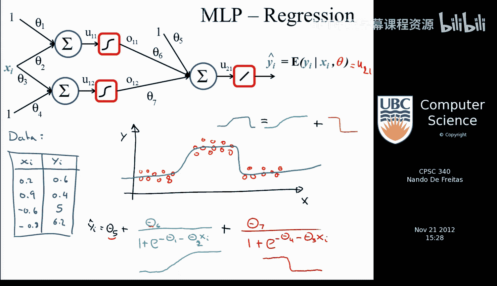

*   对于**高斯分布**（如线性回归），负对数似然得到的就是**平方误差和**。
*   对于**伯努利分布**（如二分类逻辑回归），负对数似然得到的就是**交叉熵**。

最小化交叉熵就是最小化不确定性，这与最大化似然的目标一致。因此，在二分类神经网络中，我们使用交叉熵作为代价函数。

---

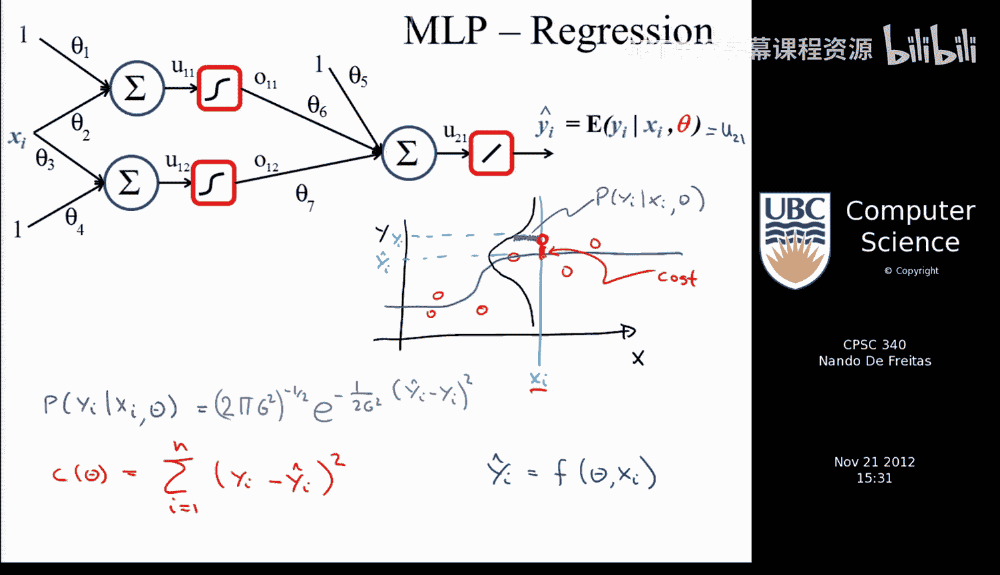

## 神经网络用于回归任务

现在，我们来看看如何将神经网络用于回归问题。关键的区别在于输出层神经元的选择。

对于回归任务（预测连续值，如房价）：
*   我们使用**恒等函数**作为输出层神经元的激活函数，即 `ŷ = u`（直接输出加权和）。
*   这样，`ŷ` 可以取任意实数值，符合回归任务的要求。
*   如果错误地使用了Sigmoid函数，输出将被限制在0到1之间，无法拟合范围更大的真实 `y` 值。

模型假设每个观测 `y_i` 服从以神经网络输出 `ŷ_i` 为均值的高斯分布。因此，最大化似然等价于最小化预测值 `ŷ_i` 与真实值 `y_i` 之间的平方误差和。神经网络在这里的作用是将线性回归中的“直线”替换为由多个非线性基函数（Sigmoid）组合而成的“曲线”。

---

## 神经网络用于多分类任务

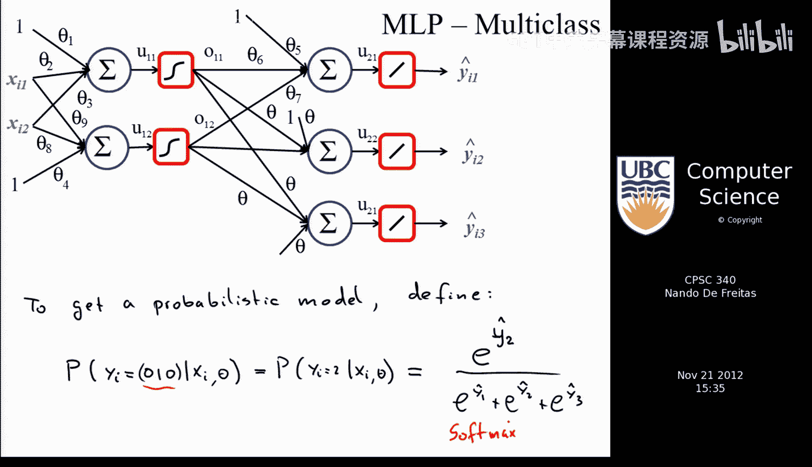

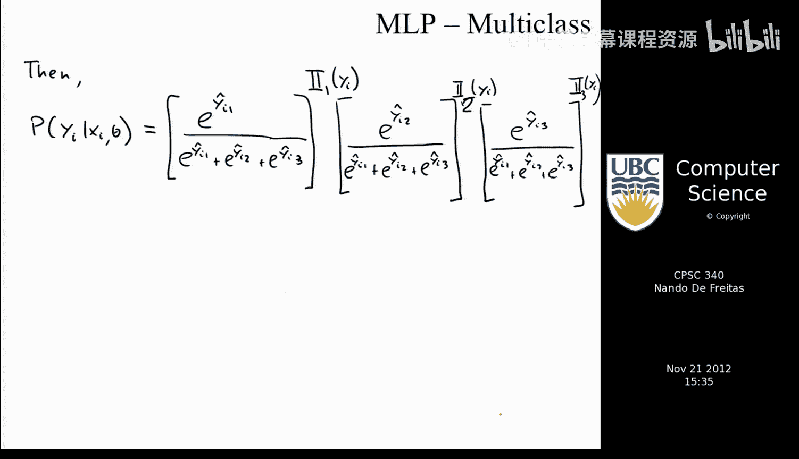

在许多实际应用中，我们需要将数据分为多个类别（例如，将新闻文章分为体育、财经、科技等）。这需要扩展我们的模型。

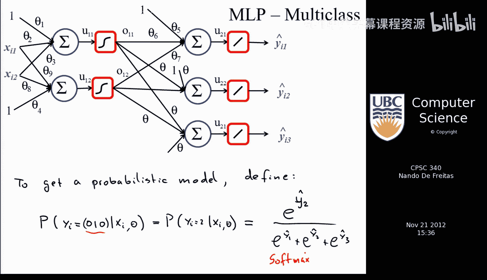

我们使用 **“独热编码”** 来表示类别标签。例如，对于三类问题（红、绿、蓝）：
*   类别1（红）编码为 `[1, 0, 0]`
*   类别2（绿）编码为 `[0, 1, 0]`
*   类别3（蓝）编码为 `[0, 0, 1]`

网络输出层现在有K个神经元（K为类别数）。为了获得每个类别的概率，我们使用 **Softmax函数**。对于第 `j` 个输出：
`P(y = class_j | x, θ) = e^{y_j} / (Σ_{k=1}^{K} e^{y_k})`
这里，`y_j` 是第 `j` 个输出神经元的原始输出（通常使用恒等激活函数）。Softmax确保所有输出为正且和为1，形成一个有效的概率分布。

多分类的似然函数是**范畴分布**（伯努利分布的多类别推广）。其负对数似然同样是交叉熵的一种形式，但需要对所有类别求和。

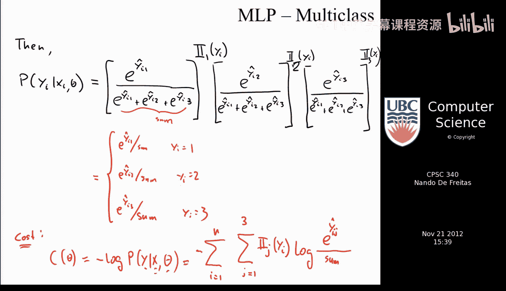

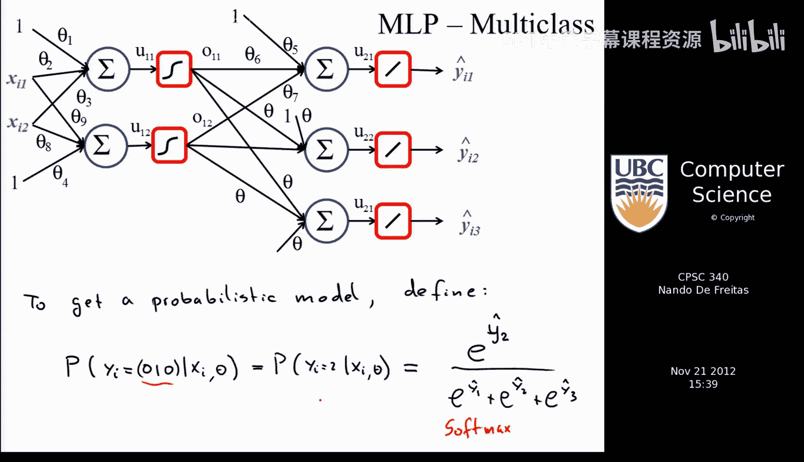

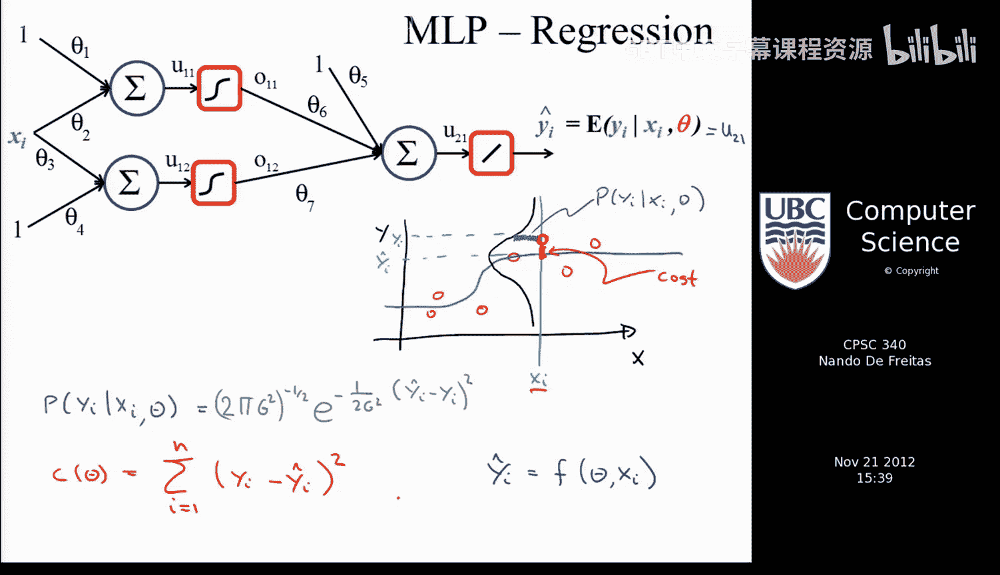

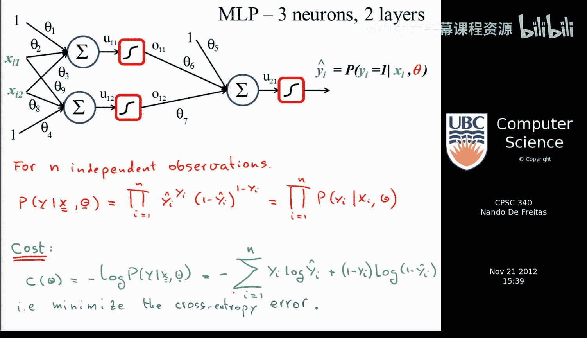

---

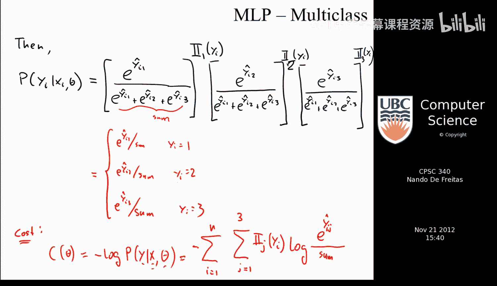

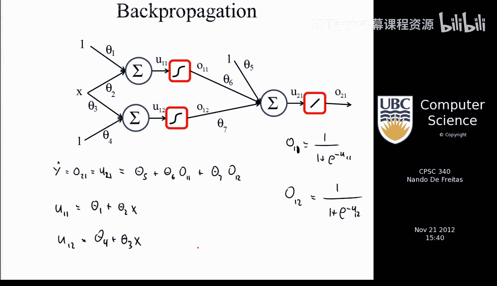

## 参数优化与反向传播推导

定义了模型和代价函数后，我们需要找到最优参数 `θ`。由于神经网络是非线性模型，无法直接求解解析解，必须使用迭代优化方法，如**梯度下降**。

梯度下降的核心是计算代价函数 `J(θ)` 关于每个参数 `θ_j` 的梯度 `∂J/∂θ_j`。对于神经网络，计算这些梯度需要用到**链式法则**，这一过程有一个专门的名字——**反向传播**。

我们以一个简单的回归网络（1个隐藏层，2个隐藏神经元）为例，使用在线学习（每次一个样本）和平方误差代价：
`J_i(θ) = (y_i - ŷ_i)^2`

以下是计算梯度的步骤：

1.  **前向传播**：首先，将输入 `x_i` 通过网络前向计算，得到所有中间值（`u` 和 `o`）以及最终输出 `ŷ_i`。
    *   `u_{11} = θ_0 + θ_1 * x_i`, `o_{11} = σ(u_{11})`
    *   `u_{12} = θ_2 + θ_3 * x_i`, `o_{12} = σ(u_{12})`
    *   `ŷ_i = θ_4 + θ_5 * o_{11} + θ_6 * o_{12}`

2.  **计算输出层梯度**：对于直接连接到输出 `ŷ` 的参数（如 `θ_4, θ_5, θ_6`），梯度计算很简单。
    *   `∂J_i/∂θ_4 = -2 * (y_i - ŷ_i) * 1`
    *   `∂J_i/∂θ_5 = -2 * (y_i - ŷ_i) * o_{11}`
    *   `∂J_i/∂θ_6 = -2 * (y_i - ŷ_i) * o_{12}`

3.  **反向传播至隐藏层**：对于隐藏层的参数（如 `θ_1`），需要沿网络路径反向应用链式法则。
    *   目标：计算 `∂J_i/∂θ_1`
    *   路径：`J_i` 依赖于 `ŷ_i`，`ŷ_i` 依赖于 `o_{11}`，`o_{11}` 依赖于 `u_{11}`，`u_{11}` 依赖于 `θ_1`。
    *   应用链式法则：
        `∂J_i/∂θ_1 = (∂J_i/∂ŷ_i) * (∂ŷ_i/∂o_{11}) * (∂o_{11}/∂u_{11}) * (∂u_{11}/∂θ_1)`
    *   代入具体项：
        `= [-2 * (y_i - ŷ_i)] * [θ_5] * [o_{11} * (1 - o_{11})] * [x_i]`
    *   **关键点**：`∂o/∂u = o * (1 - o)` 是Sigmoid函数的导数。

通过系统地为每个参数 `θ_j` 应用此过程，我们可以计算出所有梯度。计算时存在一个模式：误差信号 `(y_i - ŷ_i)` 从输出层开始，乘以沿路径回传的权重和激活函数的导数。这就是“反向传播”名称的由来——误差从输出层向输入层反向传播。

在实际编程实现中，这些计算可以被高效地向量化和矩阵化。

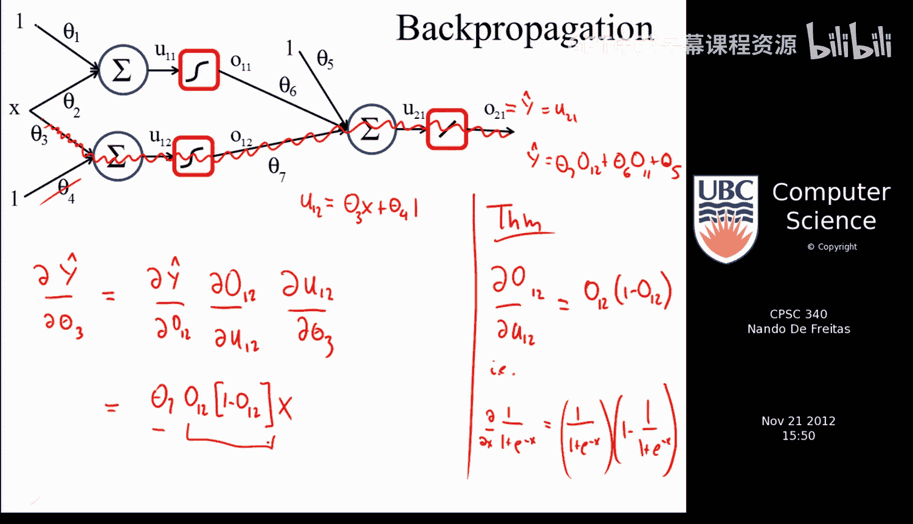

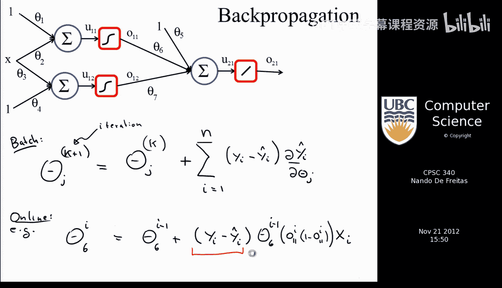

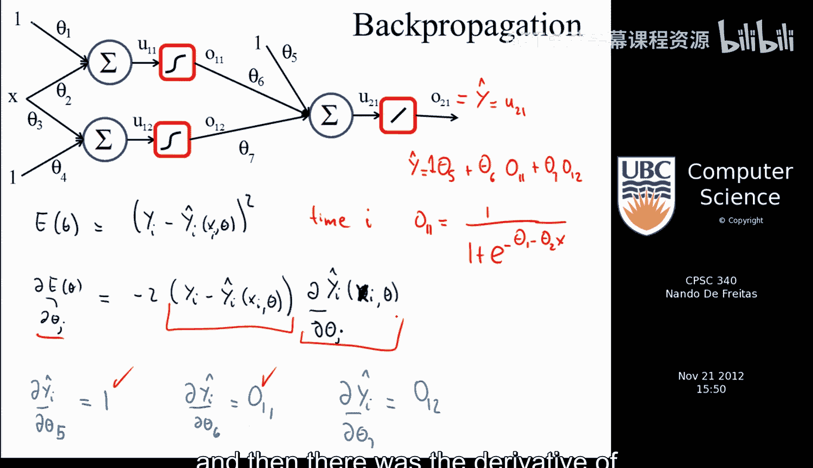

对于**二分类任务**，只需将平方误差代价 `(y_i - ŷ_i)^2` 替换为**交叉熵代价**，反向传播公式中的误差信号项会相应改变，但反向传播的机制完全相同。

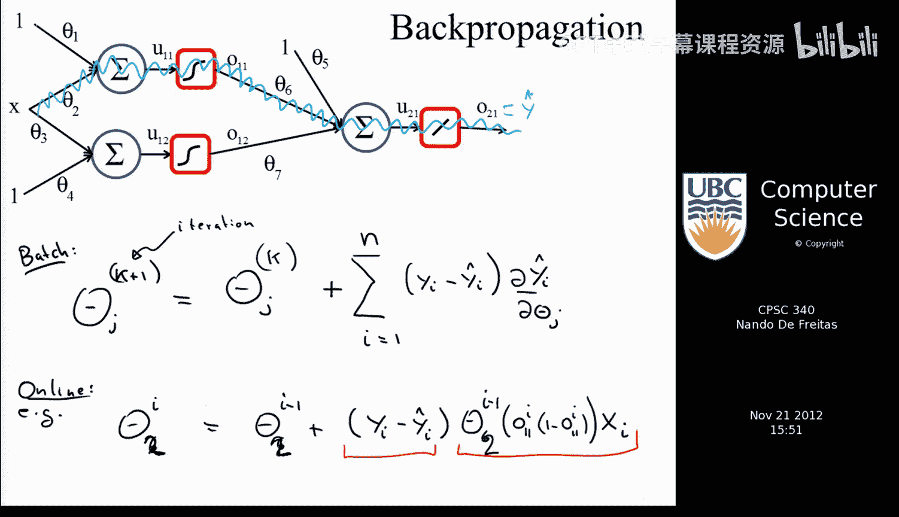

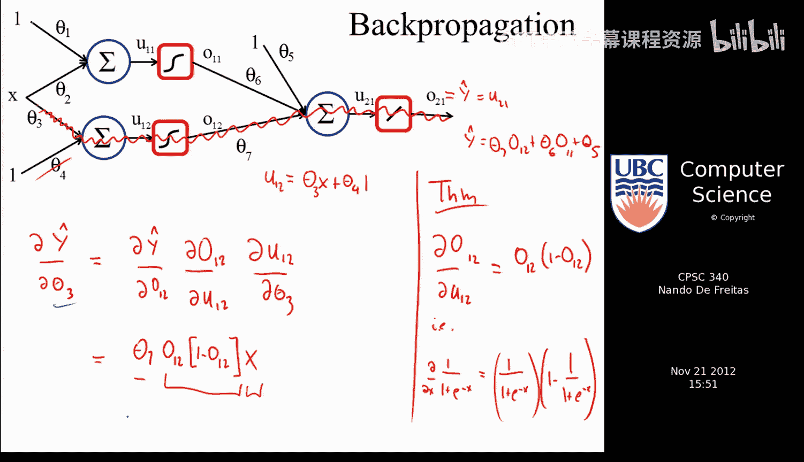

---

## 总结

本节课中我们一起学习了：
1.  **神经网络基础**：逻辑回归是单层神经网络的特殊情况。加入隐藏层后，网络获得了拟合非线性决策边界的能力。
2.  **不同任务下的建模**：
    *   **回归**：输出层使用恒等激活函数，代价函数为平方误差。
    *   **二分类**：输出层使用Sigmoid函数，代价函数为交叉熵。
    *   **多分类**：输出层使用Softmax函数，代价函数为多类交叉熵。
3.  **反向传播原理**：训练神经网络的核心算法。通过链式法则，将最终预测误差从输出层反向传播至网络中的每一个参数，从而计算梯度并用于梯度下降更新。理解前向传播和Sigmoid等激活函数的导数是掌握反向传播的关键。

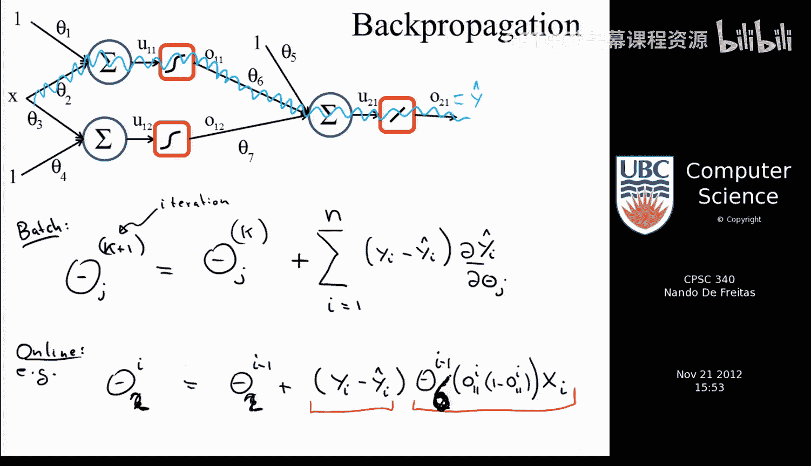

通过掌握这些基本原理，你便具备了理解和构建常见神经网络模型的基础。在接下来的课程中，我们将探讨更前沿的网络结构与应用。