# 31：决策树 🌳

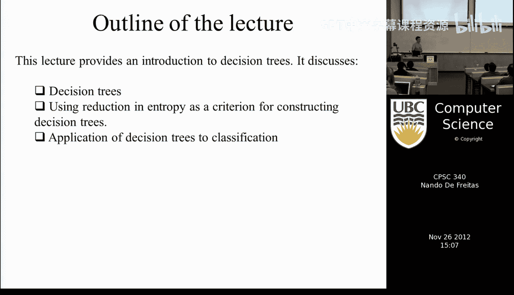

在本节课中，我们将要学习决策树。决策树是一种直观且强大的分类工具，它通过一系列简单的决策规则来对数据进行分类。我们将从决策树的基本概念开始，了解其结构和工作原理，然后学习如何使用熵和信息增益来构建一棵决策树。最后，我们会看到决策树在实际应用中的例子。

---

## 动机与示例 🎯

上一节我们介绍了决策树的基本概念，本节中我们来看看决策树的一些实际应用示例。

决策树及其组合（决策森林）在目标检测等领域有广泛应用。例如，通过收集大量包含人脸和不包含人脸的图像数据集，可以训练一个分类器来检测图像中的人脸。类似地，也可以训练分类器来检测行人、汽车等物体。这种技术是未来自动驾驶汽车的核心。

另一个例子是微软的Kinect传感器。它通过深度图像来预测像素点属于身体的哪个部位（如手臂、腿、躯干），从而实现体感交互。这种技术不仅用于游戏，也可用于机器人理解人类意图，以实现更自然的交互。

---

## 决策树的结构 🌲

在了解了决策树的应用后，我们来看看它的具体结构。决策树是一种类似计算机科学中树状的结构。

决策树包含一个根节点、若干内部节点和叶节点。每个节点都对应一个决策。其核心思想是：给定一个数据集（例如包含红色和绿色点），决策树通过学习一系列决策规则，最终将不同类别的数据点尽可能分到不同的叶节点上。对于一个新数据点，我们只需让它从根节点开始，根据决策规则选择路径，最终到达某个叶节点，该叶节点的类别（或类别概率）就是预测结果。

决策树的优点在于其易于解释。与神经网络等“黑箱”模型不同，决策树的决策过程是清晰可见的，我们可以直观地理解模型是如何做出判断的，并能识别出哪些特征对分类最重要。

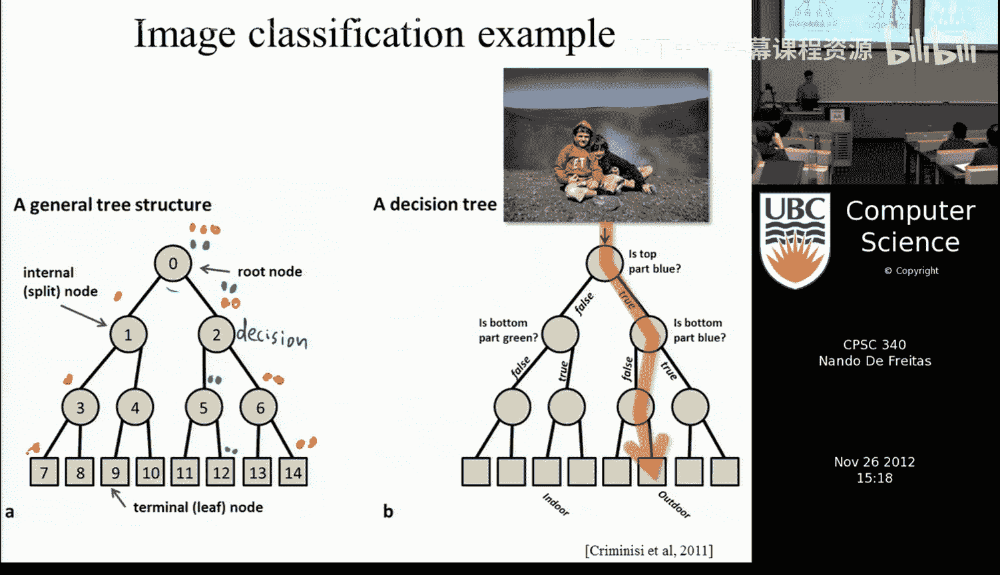

---

## 决策树的可视化与概率输出 📊

上一节我们介绍了决策树的结构，本节中我们通过一个可视化示例来理解其分类过程。

以下是一个用于四分类问题的决策树可视化示例。训练数据用不同颜色的点表示不同类别，同时还有一些测试数据。数据可以是二维向量，也可以是更高维的（如基因数据中的2万个维度）。

决策树在训练时，会记录每个节点有多少数据点流向左右分支（图中用线条粗细表示）。理想情况下，到达叶节点时，该节点内的数据点应主要属于同一类别。但由于数据噪声和决策边界不完美，叶节点内通常是类别的概率分布。例如，一个叶节点可能输出 `[0.8, 0.1, 0.05, 0.05]`，表示该节点属于第一类的概率是80%。这种概率输出是决策树（及后续的随机森林）的一个优点。

---

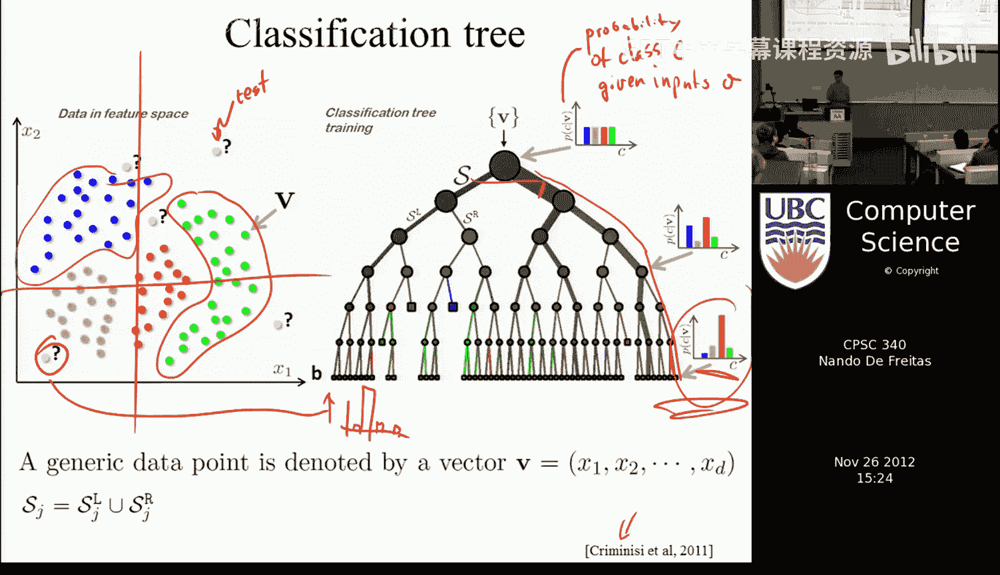

## 一个电子商务应用实例 📈

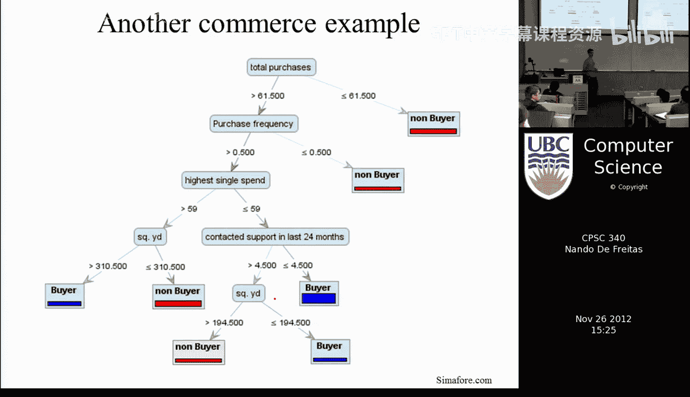

现在，让我们来看一个更具体的、来自电子商务领域的决策树实例。这个例子有助于我们理解如何将机器学习应用于常见的电子表格数据中。

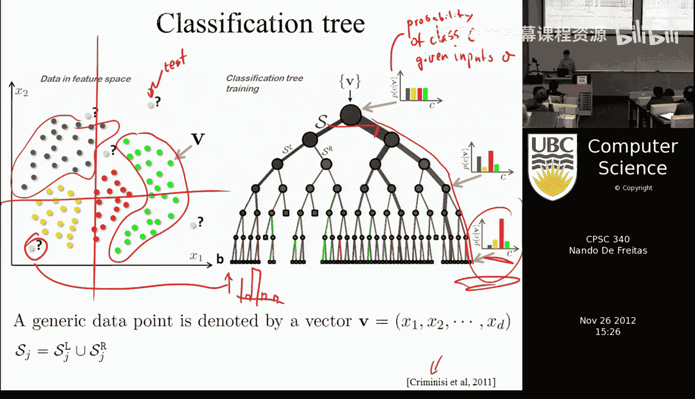

以下是一棵已训练好的决策树，用于预测客户是否为“优质买家”。决策规则基于客户的购买总额、购买频率、单次最高消费额以及是否联系过客服等特征。例如，规则可能是：“如果总购买额 > 61000，购买频率 > 0.5，单次最高消费 ≤ 59，且未联系过客服，则该客户是优质买家”。这样的规则易于向业务人员解释和部署。

在实际业务中，数据通常以电子表格形式存在。决策树可以自动从这些数据中学习规则，这比人工编写复杂的 `IF-THEN-ELSE` 语句更高效、更可靠。

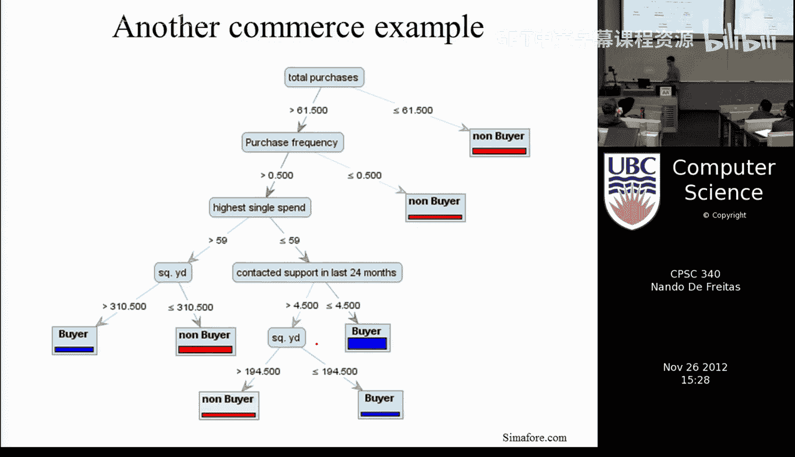

---

## 构建决策树：选择最佳分裂属性 ⚖️

我们已经看到了决策树的样子，那么如何从数据中自动构建它呢？关键在于每一步如何选择“最佳”的问题（即用哪个属性进行分裂）。

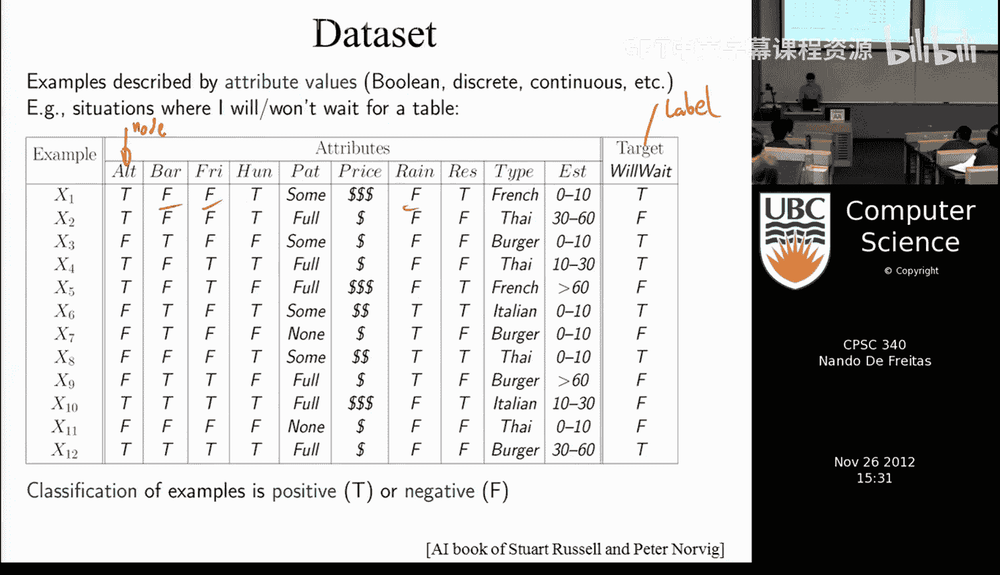

考虑一个餐厅顾客等待的示例数据集，包含12个实例。目标是根据“是否有空位”、“是否周五”、“是否下雨”等属性预测顾客“等待”还是“离开”。我们的目标是找出最能区分这两类顾客的属性作为根节点。

那么，如何衡量一个属性的好坏呢？例如，“店内顾客数量”这个属性可能比“餐厅类型”能更好地区分顾客。我们使用**熵**和**信息增益**来衡量。

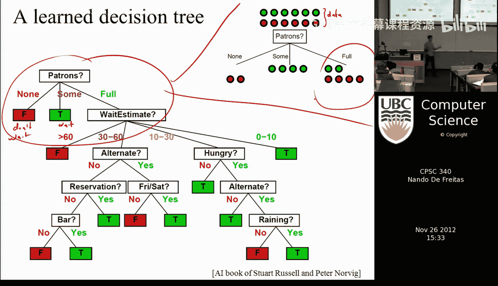

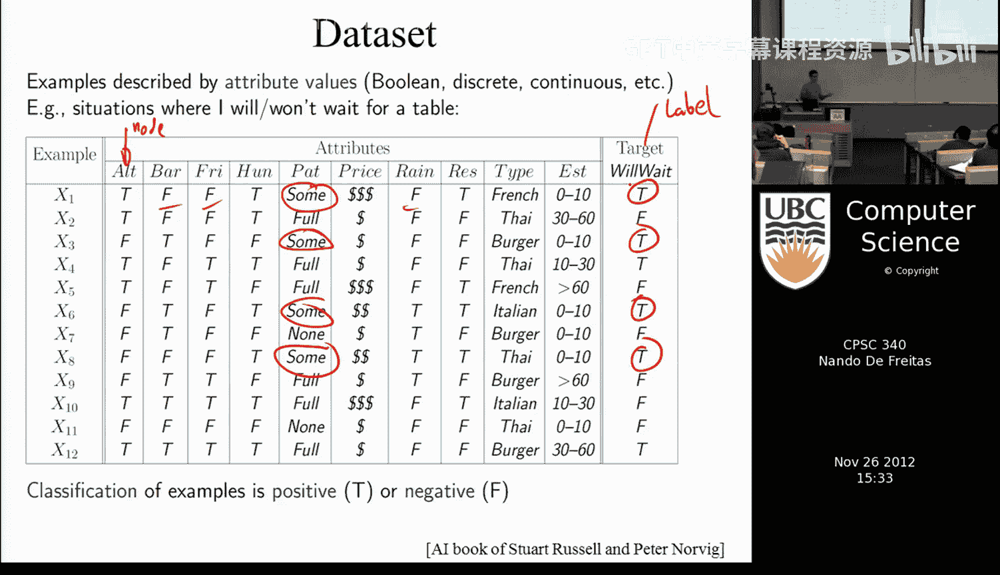

*   **熵**：衡量一个集合的“混乱度”。对于一个二分类问题，如果集合中两类样本数量相等，熵最大（最混乱）。如果只包含一类样本，熵为0（最纯净）。
    *   公式：`Entropy(S) = -p * log₂(p) - (1-p) * log₂(1-p)`，其中 `p` 是正类样本的比例。
*   **信息增益**：衡量使用某个属性进行分裂后，熵减少了多少。信息增益越大，说明该属性带来的“纯度提升”越多，越应该优先选择。

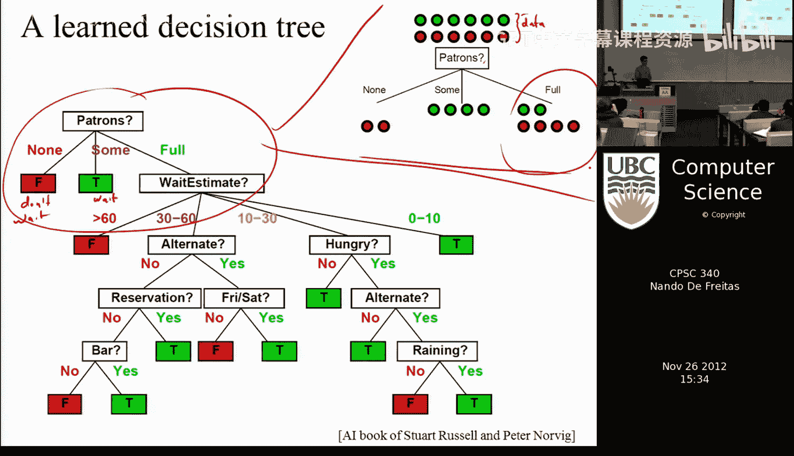

以下是选择分裂属性的算法步骤：

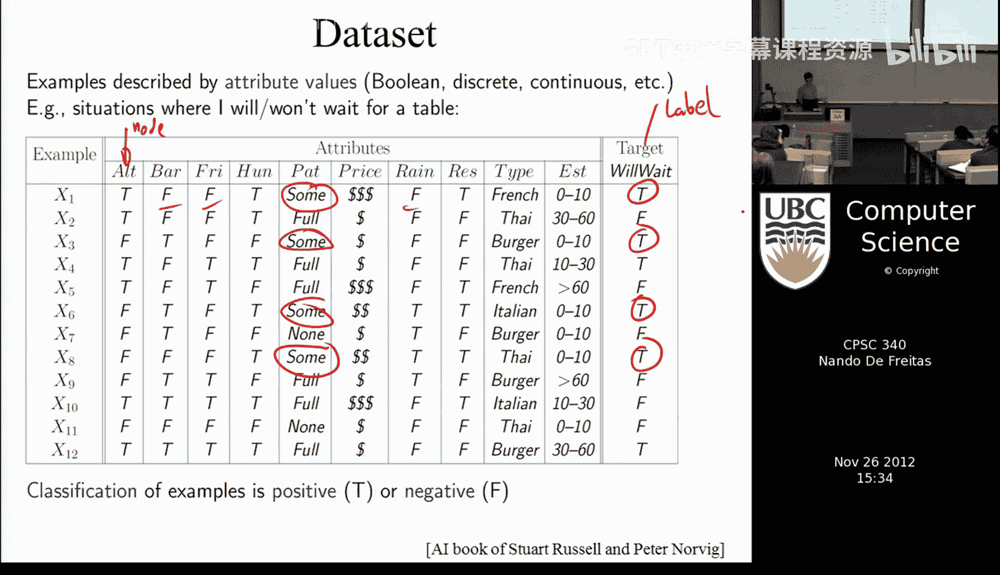

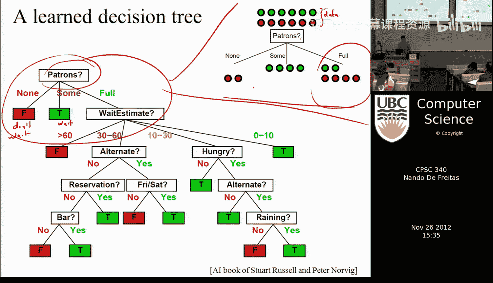

1.  计算当前节点数据集的熵 `Entropy(当前)`。
2.  对于每个候选属性 `A`：
    *   假设用 `A` 分裂，会产生 `K` 个子节点。
    *   计算每个子节点数据集的熵 `Entropy(子节点i)`。
    *   计算分裂后的**期望熵**：`Σ ( (|子节点i| / |总数据|) * Entropy(子节点i) )`。
    *   计算属性 `A` 的**信息增益**：`Gain(A) = Entropy(当前) - 期望熵`。
3.  选择**信息增益最大**的属性作为当前节点的分裂属性。

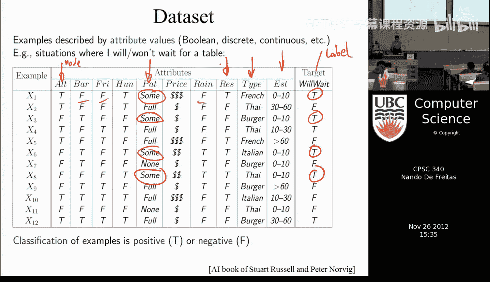

---

## 计算示例 🧮

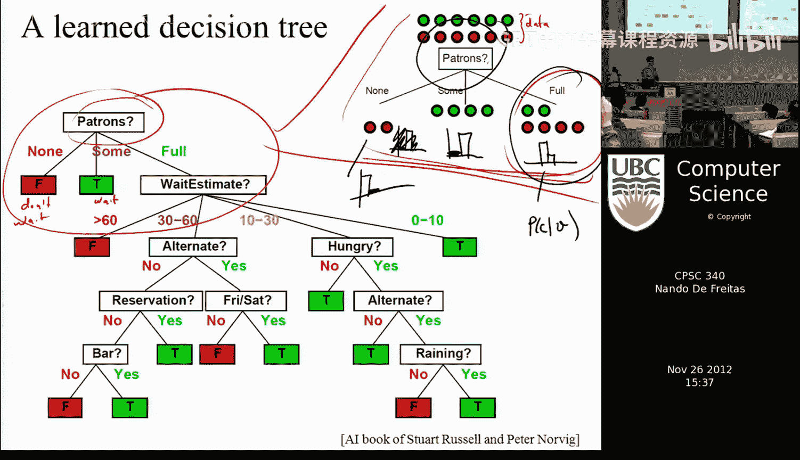

让我们通过餐厅示例中的两个属性来具体计算一下信息增益。

*   **当前状态**：总数据12条，6条“等待”(正类)，6条“离开”(负类)。当前熵为 `Entropy(6,6) = 1.0` 比特。
*   **属性1: Patrons (店内顾客)**：
    *   取值 `None`: 2条数据 (0等待, 2离开)。熵 = `Entropy(0,2) = 0`。
    *   取值 `Some`: 4条数据 (4等待, 0离开)。熵 = `Entropy(4,0) = 0`。
    *   取值 `Full`: 6条数据 (2等待, 4离开)。熵 = `Entropy(2,4) ≈ 0.918`。
    *   期望熵 = `(2/12)*0 + (4/12)*0 + (6/12)*0.918 ≈ 0.459`。
    *   信息增益 = `1.0 - 0.459 = 0.541` 比特。
*   **属性2: Type (餐厅类型)**：
    *   经过类似计算（过程略），其信息增益为 `0` 比特。

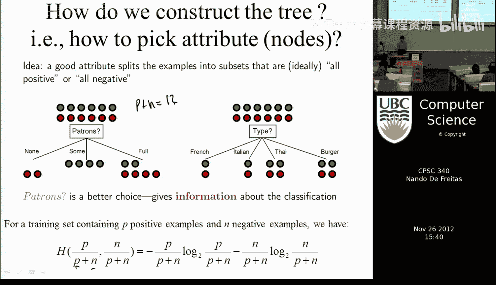

因此，`Patrons` 属性的信息增益更高，应被选为根节点进行分裂。

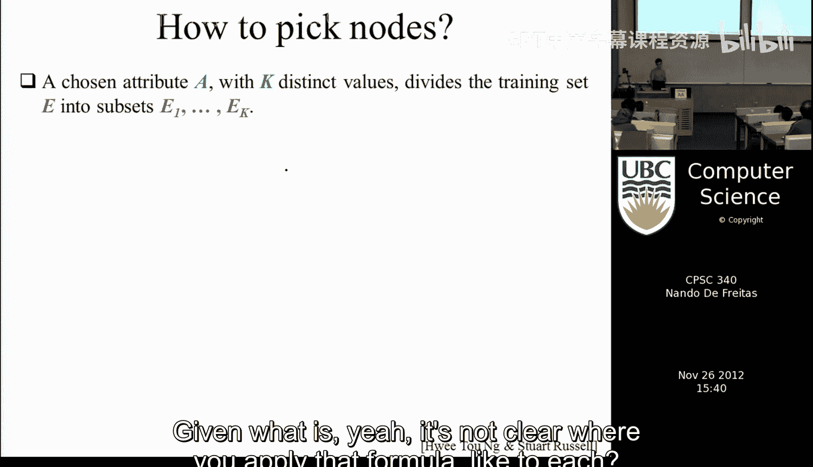

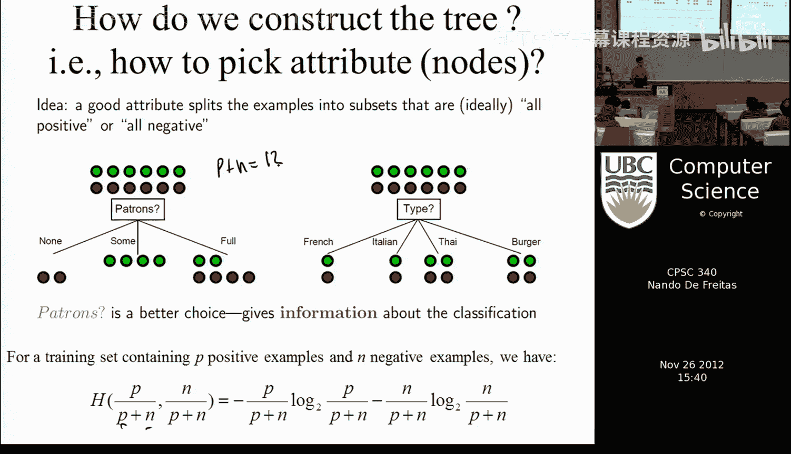

---

## 总结 📝

本节课中我们一起学习了决策树。

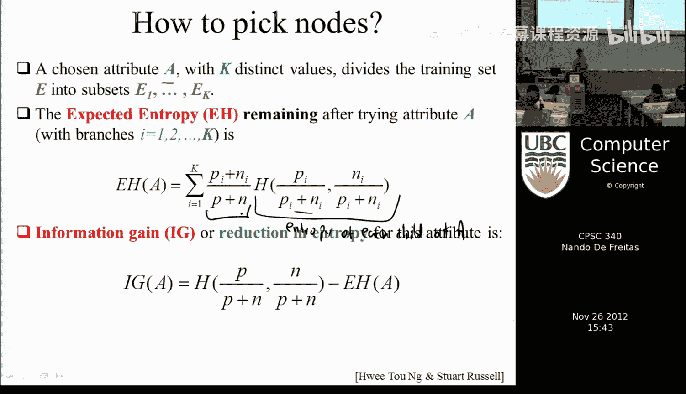

*   我们了解了决策树的基本结构（根节点、内部节点、叶节点）及其直观易懂的优点。
*   我们看到了决策树在目标检测、体感交互和商业分析中的实际应用。
*   我们学习了构建决策树的核心思想：每一步选择能最大程度降低数据混乱度（熵）的属性进行分裂。
*   我们详细介绍了**熵**和**信息增益**的概念与计算公式，并通过餐厅顾客等待的示例，一步步演示了如何计算并选择最佳分裂属性。

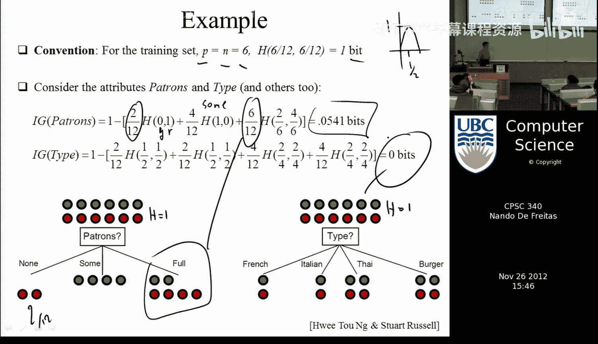

决策树本身是一个有效的分类器，但它对噪声敏感，且单棵树的能力有限。在下一节课中，我们将学习如何将多棵决策树组合成**随机森林**，从而构建出当今最强大的分类器之一。