# 32：随机森林 🌲

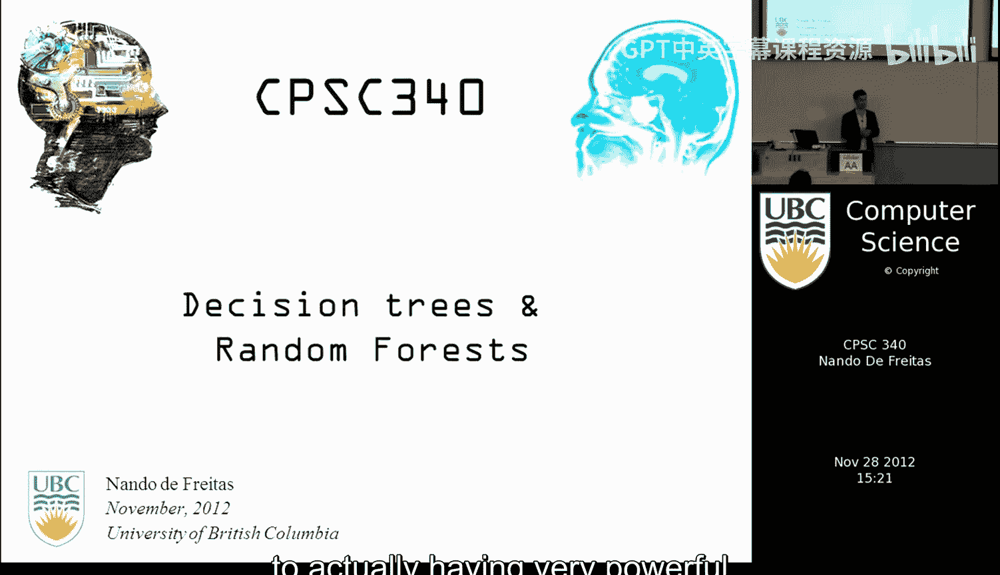

在本节课中，我们将学习如何从简单的决策树出发，构建出被称为“随机森林”的强大分类器。随机森林是当前最先进的分类技术之一。我们还将探讨如何构建物体检测器（例如相机中的人脸检测功能）以及Kinect传感器的工作原理。

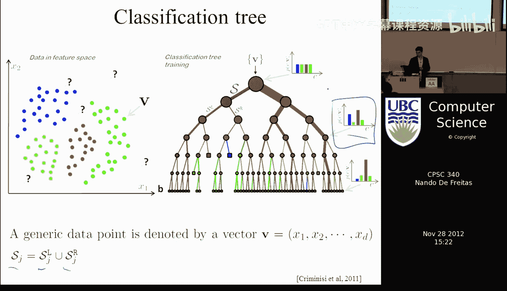

---

## 从决策树到随机森林

上一节我们介绍了决策树的基本概念。决策树虽然简单，但在存在噪声的数据中容易做出错误决策。本节中，我们来看看如何将许多简单的决策树组合起来，形成一个强大且稳定的分类器——随机森林。

我们的设定是：我们拥有数据，并且关注分类问题。在本讲中，我们假设数据是二维空间中的点，每个输入点是一个二维向量。每个节点（例如节点J）会将数据分割成左子集和右子集。在每个节点，我们可以通过计算该节点中每种颜色的数据点数量，来得到给定输入下每个类别的概率。

**公式**：对于节点J，其数据集合记为 `S_J`。左子集和右子集分别记为 `S_J_left` 和 `S_J_right`。一个点被分到左子集的概率是 `P(left) = |S_J_left| / |S_J|`。

---

## 处理连续数据与构建决策边界

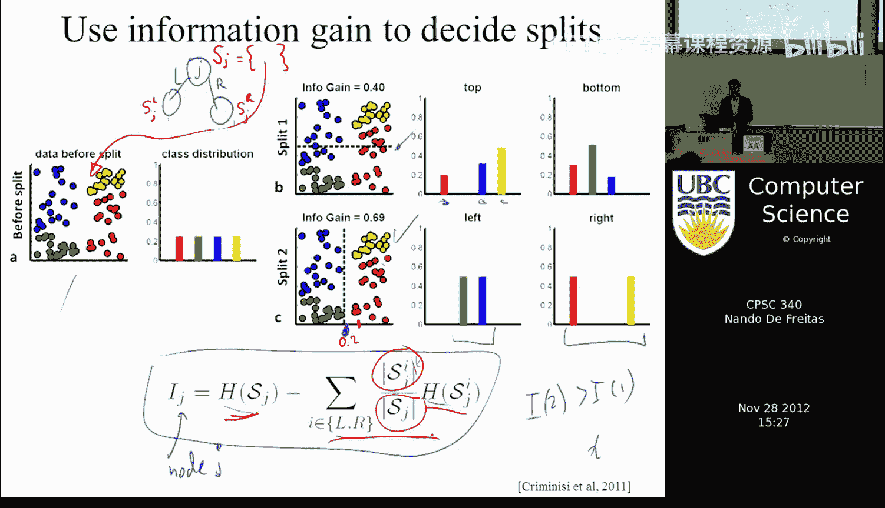

当我们处理二维点数据而非表格数据时，如何进行分类？例如，我们需要将数据点分为四个类别。

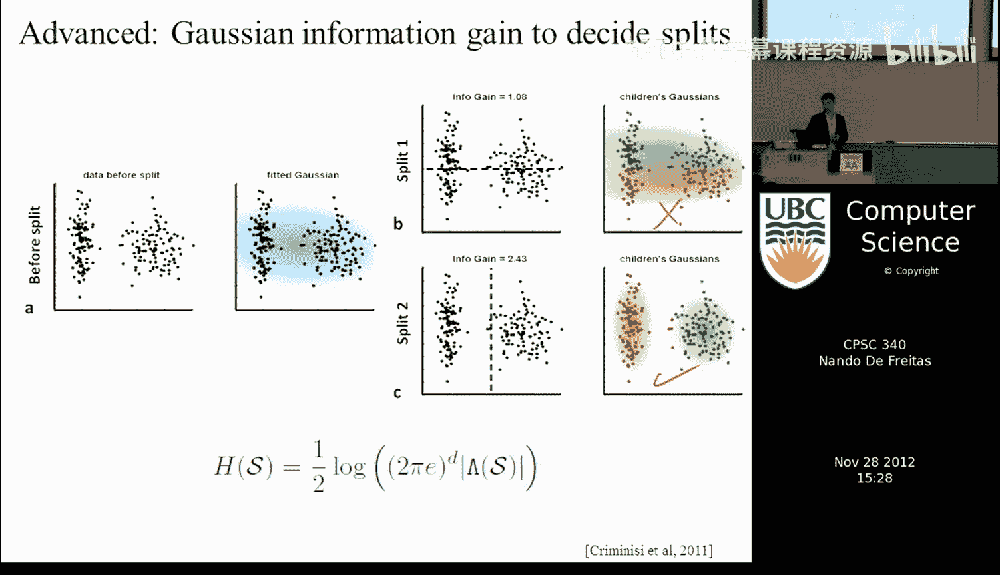

假设我们有两个节点。我们没有现成的属性列，但我们可以创建决策边界。最直接的方法是考虑垂直线和水平线。

如果我们有一条居中的垂直线和一条居中的水平线作为选项，我们会发现：
*   水平线：顶部仍有少量红色点，包含一些蓝色和黄色点，没有绿色点。底部主要是绿色、红色和蓝色点。
*   垂直线：似乎效果更好，因为它将所有绿色和蓝色点放在一侧，红色和黄色点放在另一侧。

那么，如何在垂直线和水平线之间做出选择？我们计算信息增益。

以下是计算信息增益的步骤：
1.  计算整个数据集的熵 `H(S)`。
2.  对于每种分割方式（例如分割1：水平线，分割2：垂直线），计算分割后两个子集的熵 `H(S_left)` 和 `H(S_right)`。
3.  计算子集的期望熵：`P(left) * H(S_left) + P(right) * H(S_right)`。
4.  信息增益 `IG = H(S) - [P(left) * H(S_left) + P(right) * H(S_right)]`。

选择信息增益最大的分割方式。在这个例子中，垂直分割的信息增益高于水平分割。

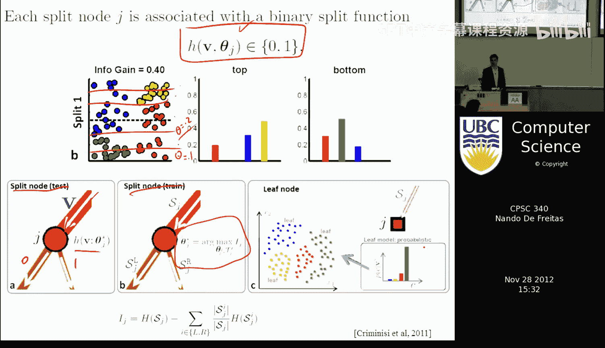

**核心概念**：信息增益衡量了通过某种分割方式，我们减少了多少关于类别的不确定性。

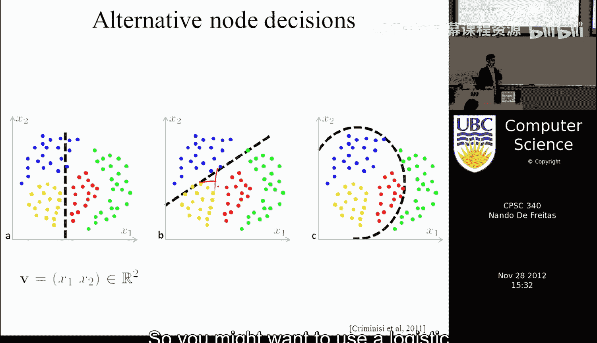

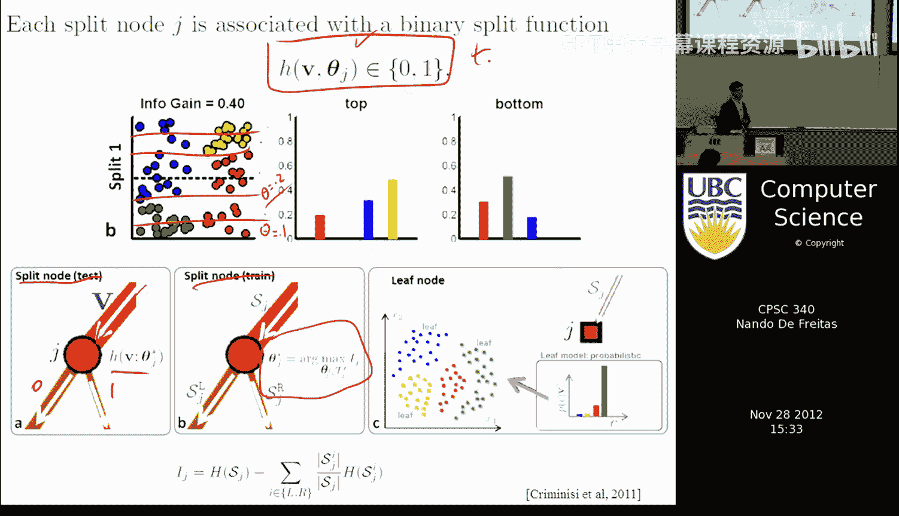

---

## 决策节点的数学表示与训练

显然，我们不仅可以使用一条水平线或垂直线，还可以使用许多条。决定这条线具体位置的参数，我们称之为阈值 `θ`。

一个决策节点本质上是一个函数。对于垂直线，其决策规则是：如果点的x1坐标大于阈值 `θ`，则前往右子节点；否则前往左子节点。

**代码表示**：`decision = (x1 > θ) ? go_right : go_left`

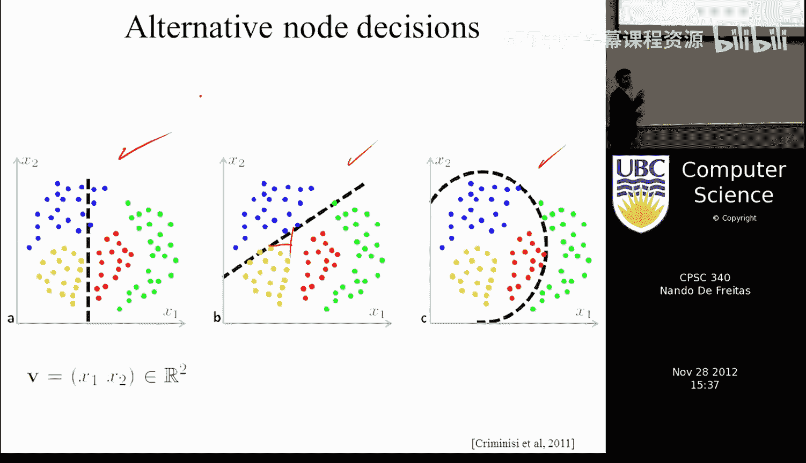

为了训练一个节点，我们需要找到最佳的 `θ`。一个典型的策略是：
1.  枚举一组候选的 `θ` 值（例如，随机选择5个值）。
2.  对于每个候选 `θ`，计算使用该阈值进行分割所获得的信息增益。
3.  选择能最大化信息增益的那个 `θ`。

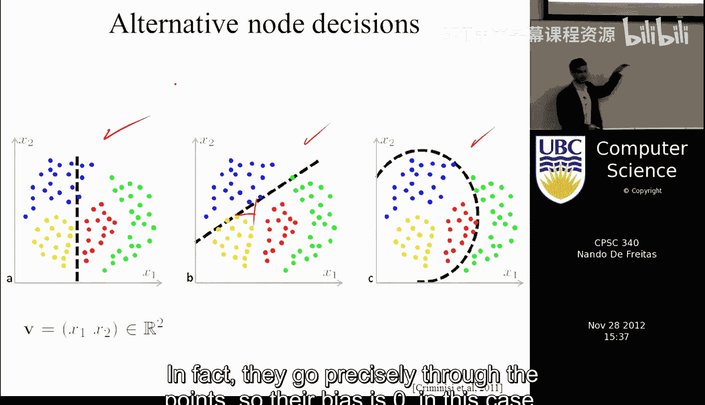

在Kinect传感器等应用中，有时会随机选择一组 `θ`，然后直接从中挑选最好的一个，甚至不计算信息增益，这被称为完全随机化，效果出人意料地好。

训练完成后，在测试时，新的输入点会根据每个节点的决策规则（例如，是否大于 `θ`）被引导至某个叶子节点。在每个叶子节点，我们根据训练阶段统计的各类别数据点数量，计算出该点属于各个类别的概率直方图。

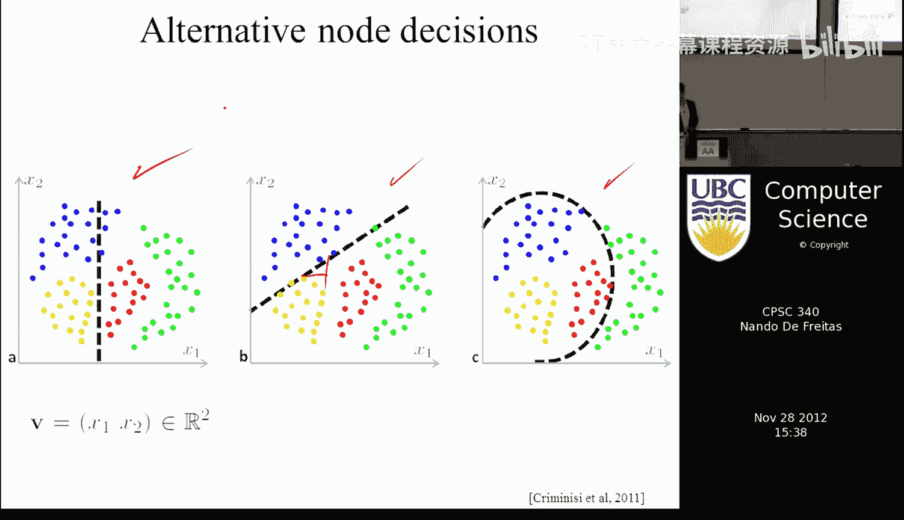

---

## 提升决策能力：更复杂的节点与集成学习

到目前为止，我们看到了水平和垂直分割线。我们也可以使用带角度的线，或者在每个节点使用一个逻辑回归分类器作为决策函数。

**公式**：一个节点可以是一个简单的线性分类器 `f(x) = sign(w^T x + b)`，根据 `f(x)` 的正负决定左右分支。

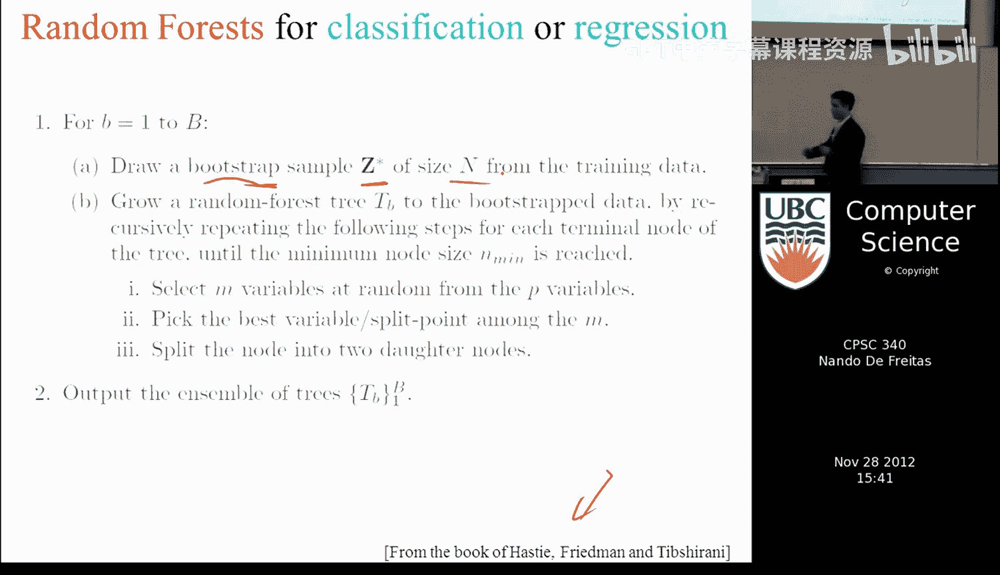

但是，如果只构建一棵树，使用更复杂的节点可能很重要。然而，通过使用一种称为“集成学习”的技术——即构建许多树并对它们的结果进行平均——使用简单的树就足够了。

其核心思想是：
*   假设我们有许多非常简单的分类器（例如，仅基于一条线的左右决策）。
*   假设这些分类器都是**无偏的**（直观理解：如果有无限数据，它们能做出正确决策），并且比随机猜测略好一点（准确率 > 50%）。
*   假设这些分类器彼此**不同**（即它们的预测不高度相关）。
*   每个简单分类器可能具有很高的**方差**（对数据微小变化非常敏感，预测结果波动大）。

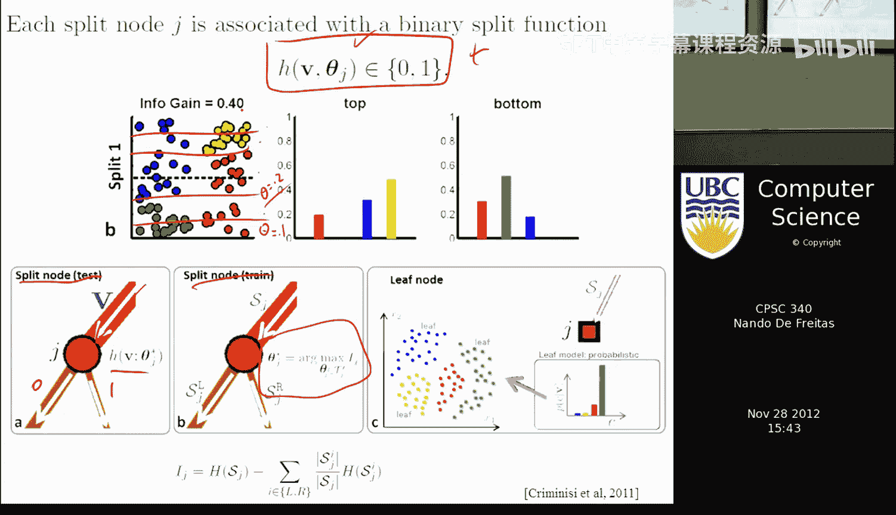

根据中心极限定理，如果我们平均许多具有高方差但低偏差的独立估计量，结果的方差会减小，从而得到一个更稳定、更准确的预测。

**类比**：在回归问题中，高方差、无偏的估计就像许多穿过数据点但形状各异的曲线。单独看每条曲线都不理想，但将它们平均起来，就能得到一条更接近真实趋势的平滑曲线。

---

## 构建随机森林：确保多样性

关键问题：如何确保这些树彼此不同（即降低相关性）？Leo Breiman提出了以下策略：

1.  **对数据行进行随机采样（Bootstrap）**：每棵树只用训练数据的一个随机子集（有放回抽样）进行训练。这称为“自助采样法”。在现代分布式计算中，可以将数据分块存储在不同机器上，每台机器用自己那部分数据独立构建一棵树。
2.  **对数据列（特征）进行随机采样**：在构建树的每个节点时，不是考虑所有可能的特征（例如所有可能的划分线），而是随机选取一个特征子集（例如，从100万个特征中随机选100个），然后只在这个子集中寻找最佳划分。这进一步增加了树之间的差异性。

以下是构建单棵树的步骤：
*   从原始数据中自助采样得到一个子集。
*   从根节点开始，递归地构建树：
    *   在当前节点，从所有特征中随机选取一个子集。
    *   对于子集中的每个特征，寻找最佳分割阈值 `θ`（通常通过最大化信息增益）。
    *   在所有候选特征中，选择信息增益最大的那个特征及其阈值 `θ` 进行分割。
    *   重复此过程，直到满足停止条件（如达到最大深度，或节点内数据点过少）。

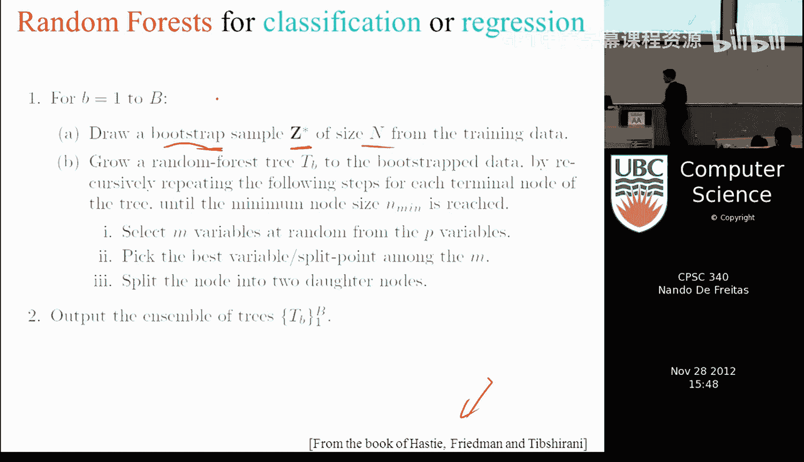

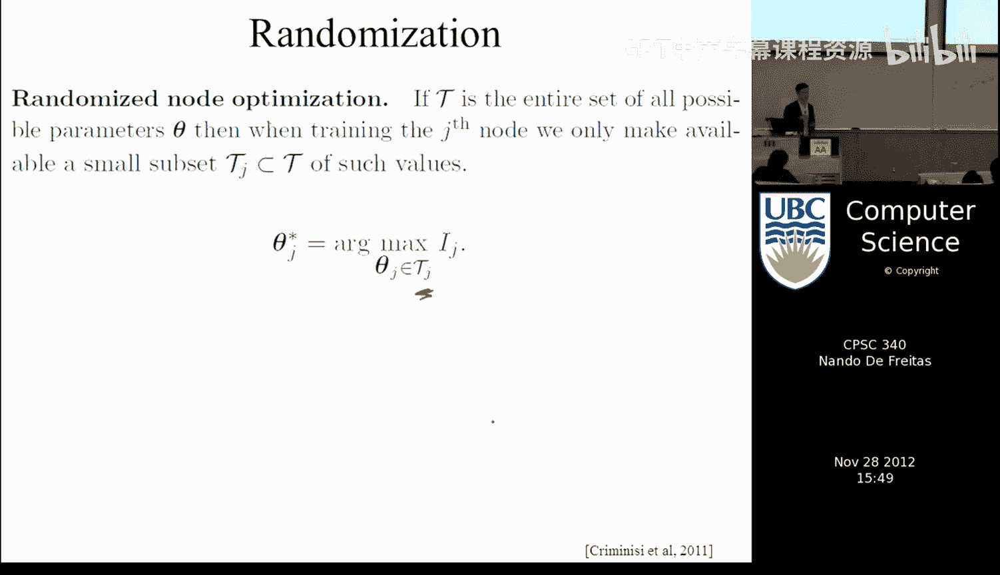

---

## 随机森林的预测：组合策略

假设我们构建了T棵树。对于一个新的测试数据点 `x`，我们如何进行预测？

以下是预测步骤：
1.  **遍历每棵树**：将测试点 `x` 输入每棵决策树。从根节点开始，根据每个节点的决策规则（如 `x1 > θ`），一路向下直到到达一个叶子节点。
2.  **获取叶子节点预测**：每棵树的叶子节点都存储了一个基于训练数据计算的**直方图**，记录了落到该叶子的训练样本中各个类别的数量。我们可以将其归一化为类别概率分布 `P_t(c | x)`，其中 `t` 表示第 `t` 棵树。
3.  **平均所有树的预测**：对所有树的预测概率进行平均，得到随机森林的最终预测概率。

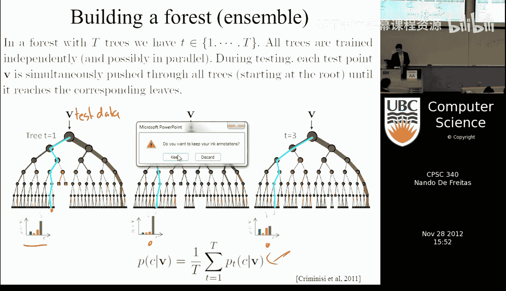

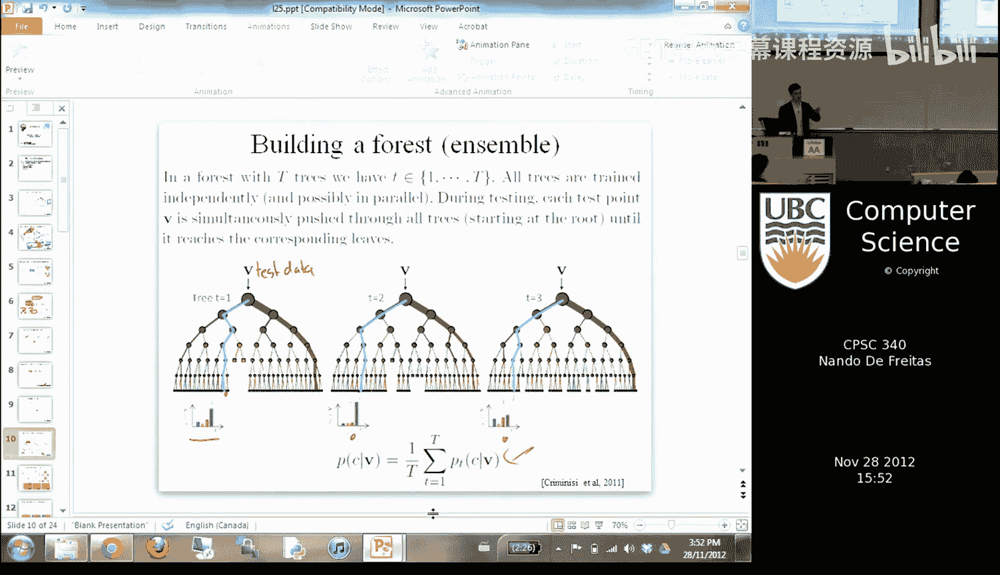

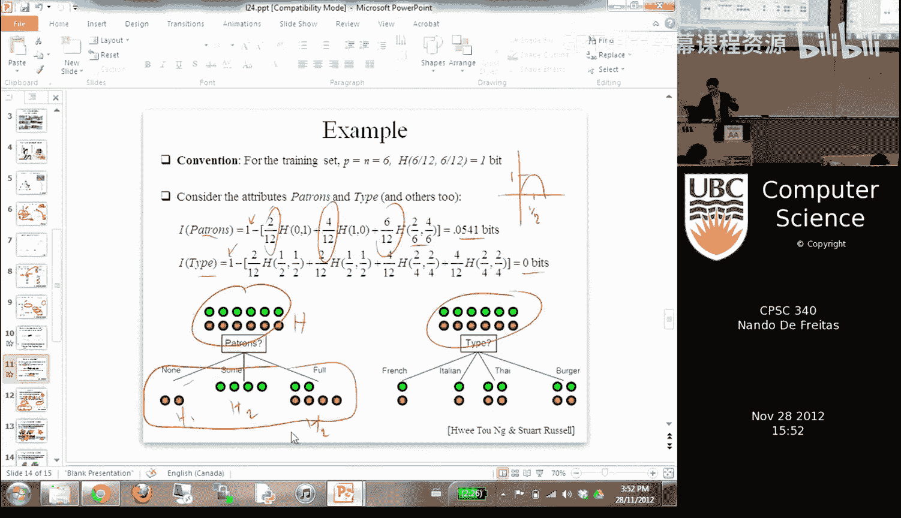

**公式**：随机森林对类别 `c` 的预测概率为：
`P_RF(c | x) = (1/T) * Σ_{t=1}^{T} P_t(c | x)`

然后，我们选择平均概率最高的类别作为最终分类结果。

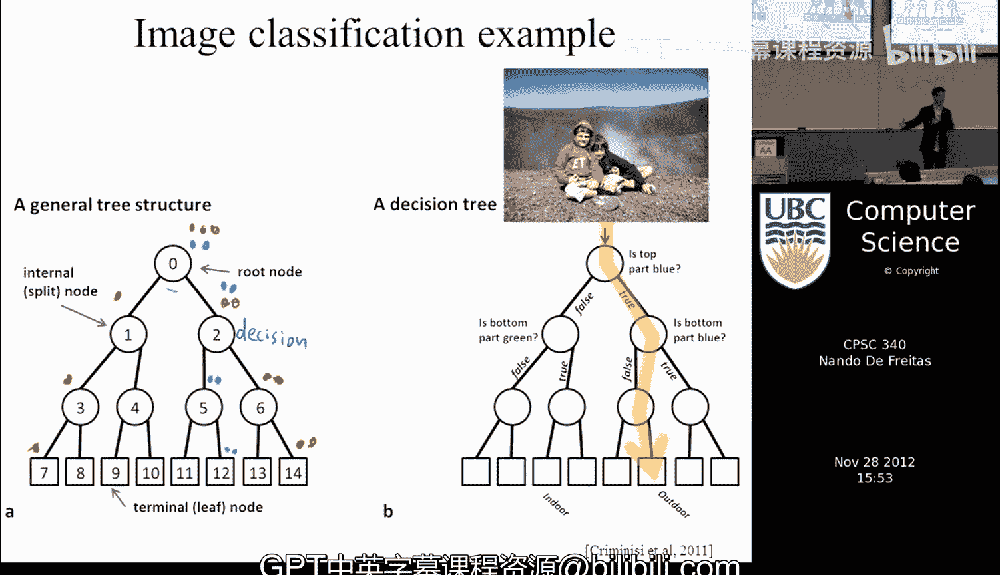

**总结**：本节课我们一起学习了随机森林的核心思想。我们从简单的决策树出发，探讨了其在高噪声数据下的局限性。通过引入**自助采样**和**特征子集采样**，我们能够构建大量多样化的决策树。虽然每棵树可能很简单且不稳定（高方差），但通过**平均**所有树的预测结果，我们能够有效降低方差，从而得到一个强大、稳定且通常非常准确的集成模型——随机森林。这种方法巧妙地利用了“群体智慧”的原理，是机器学习中集成学习的典范。