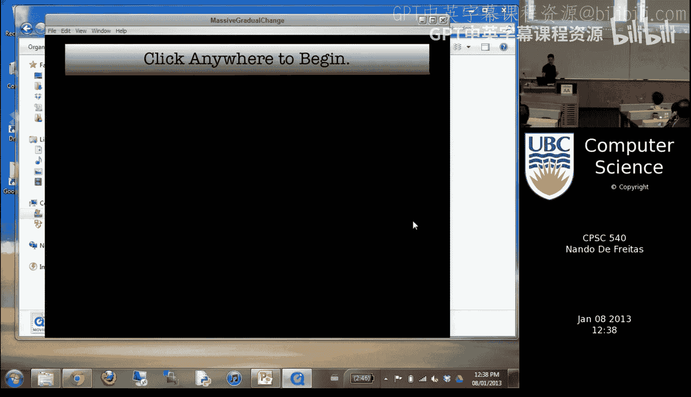
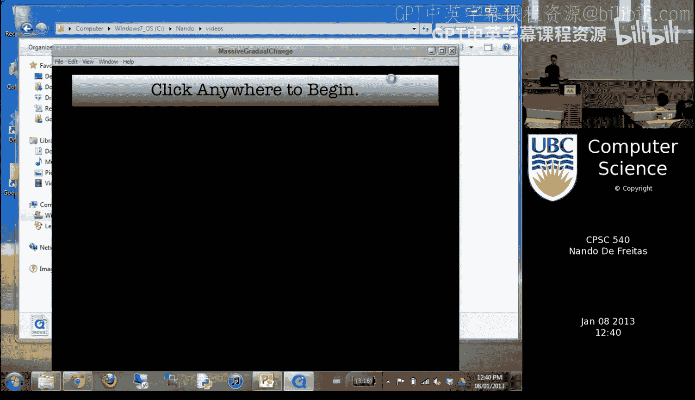
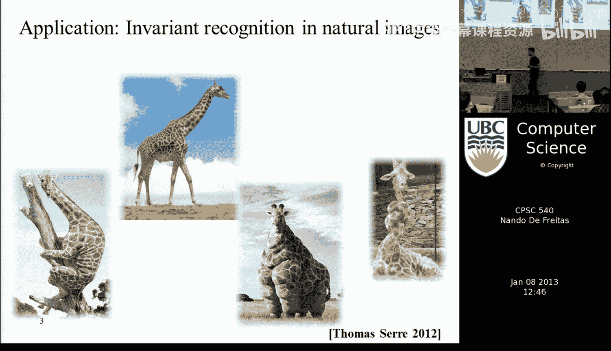
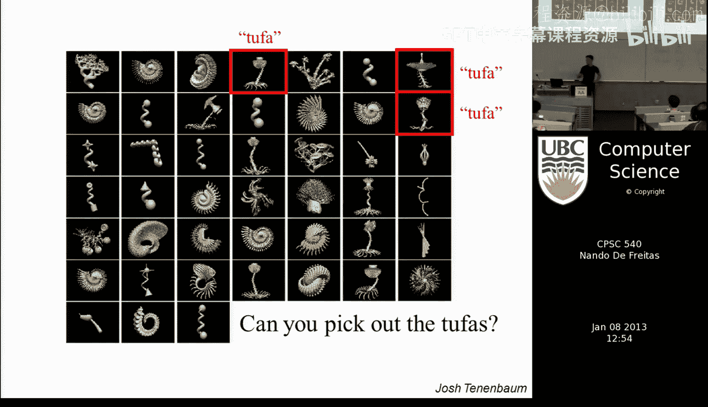
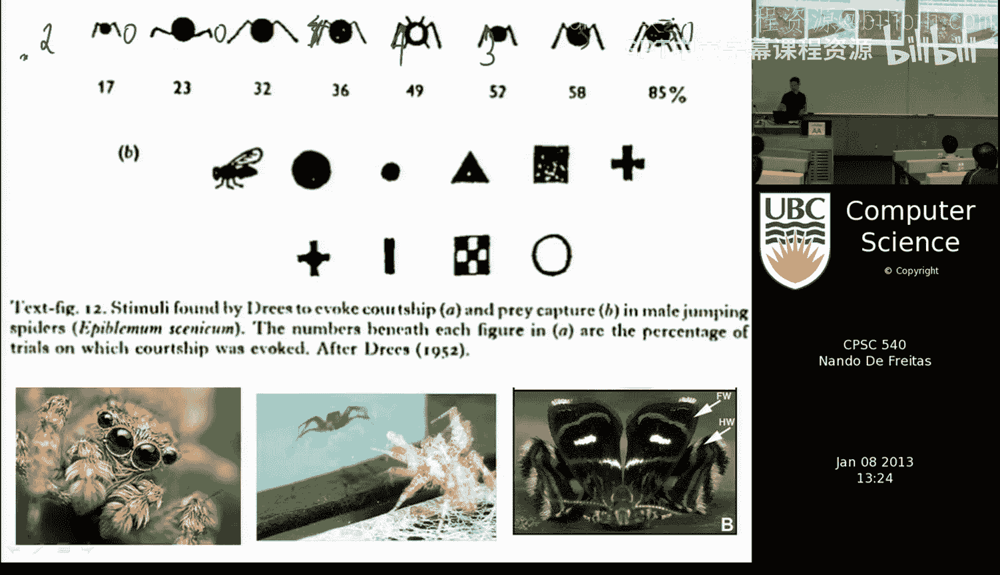
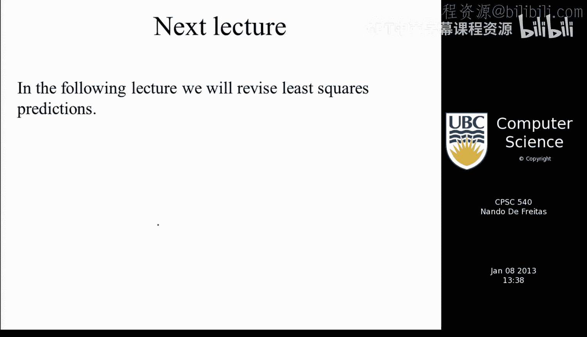

# UBC《机器学习（研究生）｜CPSC 540 Machine learning 2013》中英字幕 p01 -01-Machine learning - introduction.zh_en -BV19g2FBBEEq_p1-

I'm going to play this and then just follow instructions here at the top。

Okay， so which changes did you？Perceive。Co of。Tolller of the doors。啊第四定。保证。Oh yeah， the sign。

 the participants sign change。What else changed。 And this is for everyone，3，40。

The what the railing disappeared。So in particular。There was this rattling has disappeared。

 this sign is different。The building on the right。How many people think that this building on the right is completely different than an initial building？

They the 3，40 people。How many people think there was a dog here in front？At the door。Okay。

 there three party people， there wasn't， I was just tricking you。OkayYeah。There's a person there。

This was the original image， so as you can see the building was in pink， it was a different building。

 there were windows on top instead of doors， the rail was complete， there were people。

 there was a Patic sign and that all changed in front of your eyes。

And most of you were completely oblivious to most of these changes。

 I'm going to restart it and put it one more time。Just to illustrate the point that even if you know。

That these changes are taking place， you will yet not be able to see them all。You will see some。

 but you will want to see them more。And it's because your eye does not see the world。

 you don't have the world in your heads， your head is too small， doesn't the world cannot fill it in。

 so what you do is your eye moves and gazes at the world about three times a second and then you compose with those cases。

 an image of what the world is about and most of what you see is actually imagined。

And imagination plays a big part in this course， this course to a large extent is about imagination。

If you can imagine the world。That means that you have learned。What the world is about。

The videos also illustrate an important thing。And it's that。

If you wanted to program a machine that sees。We are confronting a serious problem here because we think we know how we see and what we see。

 and yet I've just proven to you that that notion is actually wrong。

And we actually don't know how we see。And now if we do not know how we see。

 how can we code in C or Python or matla and tell a machine to see things？

It becomes extremely hard because we can't introspect， and if we can't inspect。

 it's very hard to replicate a brain。All right。That gives me an introduction to the topic of today。

 which will be just your。First lecture and in today's lecture I will tell you a bit about what is machine learning and way you can use machine learning I'll talk about。

So with a big data revolution， why machine learning has all of a sudden become so popular。

 and it has to do with the fact that we now have access to gazillions of data and computing power to process that data。

I'll talk about as part of the course， something is going to be a big part of the course。

 neural systems and how we draw inspiration from biological systems in order to build learning machines。

And finally， I'll just touch on a few applications。

 which hopefully will start already giving you some motivation for what to do for your projects。Okay。

 so how do we tell machines what how to see things。

 so one of the big problems is that the world is not easy to describe。

If you wanted to tell a machine how to recognize giraffe。

 that's going to be very hard because there's giraffe of all shapes。

 it might not be as bad as these giraffe here， which have been exaggerated。

 but it's very hard to tell a computer what a giraffe is because they come in all sorts of shapes or in different backgrounds。

 you could have a giraffe in Africa but all of a sudden you get a giraffe in the snow in the Calgary z and it might be an albano giraffe in which case color wouldnt help you。

So how do we code？What a giraffe is， it turns out to be extremely hard。Or an even simpler problem。

 how do we code what a face is， how do we tell a machine， there's a face in that image。

 and that's sort of something that you take for granted because。

All your iPhones or phones have a face detector， your cameras these days come with face detectors。

You use Facebook， it has fake detectors it knows where the faces are in the images and so on。

How many of you know how to build a face detector？least the three。

 four students should put their hand up because you've seen random floors。

Maybe we'll do that into this course as a homework is a size， build a phase detect。

It's very easy with machine learning technology， but if youre try to do it by coding it is extremely hard。

 so one anecdoote that I always tell people is that once I was doing consulting for a car manufacturer in Japan and when I was doing a visit there to the factory and I sat at the car and it immediately knew where my face is so there's a camera and intent so that they know what I'm doing。

 what I'm looking and whether I'm falling asleep or fatigue and so on。And so but then。

A friend of mine， Jesse， who's now professorfessing Waterloo S， and Jesse is tall and blond。

And this thing could not find his face。And the reason is because there were only Japanese engineers in this and they coded that the face is essentially dark eyebrows and eyes and so on。

 so the system， the handcoed system was extremely brittle。

So it's like a system coded to recognize Iraq。In optimal conditions。

 but impossible to recognize your art when running away from a predator。

The machine learning solution is。Collect a large collection of face images。

These will be from all sorts of different types of people and populations and so on。

 and then come up with a very simple algorithm that will allow you to detect face。

So you can't tell a machine how to， you can't write a program that will tell machines exactly what a face is。

 but you can code。Program that will tell。Explain to machines， these are faces， these are not faces。

 and then let the machine automatically learn what it is that differentiates a face from a non face。

And that's the machine learning approach。It's based on examples as opposed to weak telling the rules。

 we let the machines figure out which are the things。

 which are the features we call them features of patterns or statistics。

That make a face different than any other image。So the first part is to collect that huge collection of images of faces。

You then collect a big data set of non faces and the result is this。

That's how your face detectors are built。I will show you how to do that in the course with a technique called random Fors。

And so you can have nice consumer electronics and so on。Of course， it's not just for faces。

 you could do this for anything， any object， so you might take lots of images of pedestrians。

And train a machine to recognize pedestrians。Now why would I want a machine to recognize pedestrians？

Automated cars。Automated cars are not far， they're already approved in California and soon we'll hopefully have automated cars on the street。

诶。I am trying to remember a failure。This is 20 or 40。Iither 20 or 40。

 I've got my powers of too confused， I 20，000 or 40。

000 people die every year in the United States on car accident。Mostly pedestrian。

To put this in the importance of this project。In context。

 imagine the population of UBC dissipating every year。

That's the cost to not driving in properly and relying on humans to drive。In India。

 when I checked a couple years ago when I was visiting， it was 113，000 people died Korea。

Which may or may not be bad depending on how you count。Now。Actually。

 it is bad regardless of how you count， 113，000 ISs。Huge number of people。So same idea。

You teach a machine， here's a bunch of images， in this case， images of cars。

 and then again commercial systems these days like Mole eye already are able to detect lanes。

 detect cars， and so on。So， but the key to all these huge innovations to be able to have an because without these innovations。

 it wouldn't be possible at all to have an automatic card because how could you deploy a card that can' see and understand what a pedestrian is in front of it？

That would be like murder。嗯。The key to it was to come up to this realization that we could。

Teach machines。What they did。So this course indeed will be about how to write the programs that let machines grab data and decide what a face is or what a pedestrian is and so on。

嗯。Now there's other learning machines out there and those learning machines are humans。

 humans are very good， in fact， not just humans， all animals are very good learners。嗯。

Humans are particularly good。嗯。And I'm about to now test how good humans are learning with this example。

 So I have highlighted here。 I have a bunch of images of objects。Which three of them。

 I'm calling two firsts。Okay， and I've labeled them by putting a red box around them。

So now the question to you guys is how many of you think this one here that I'm pointing with thearrow is a tufa？

Okay， the majority。How many of you think this is a TA？How about this one？Lots of skeptics here。

 how about this？M了ter说。Guess what？Let's go to an interesting sample， this one here。Okay， no。

 not as many people。This guy here。This guy？A few people。Yeah。Okay， let's pick someone who likes。

 let's start with Dr， Why is that a too far？こつが。Okay， stem root and a hand。

 that's what makes it too far。Who else would like to comment of why they said something is a twopa？

Are not。To this。Everything thing at the dog， there's a stamp。 There's a long bra。

There are rules which are sort of single rules。这都。It's hard to describe， but somehow you know。

 because you very confidently put your hand up or kept your hands down。

So even though you couldn't describe it， you could say that that was a two or not a too。对。

Do you know what a two phase？Both three things。Anyone else？So this illustrates several things。

 One is how quickly you learn what a two phase is。 you've never seen a twopa before。

 maybe in your data you the reported， but you very quickly learn what a two phase is。

From very few examples， not all if you have the same opinion on what a twoF is。

 that's why I ask several questions， so it's somewhat subject。

 but there is nonetheless strong agreement，There are features that make a toofa be a toofa。

 whether it's a long stem or the legs or the hairy head。But by and large。

 we're not thinking even of those features when we extract them consciously。It's done subconsciously。

 A lot of the feature extraction and interpretation of the world is done through the subconscious。

 The subconscious is very powerful， perhaps more than the conscious。

We would like to design machines that are capable of doing this that can see a few examples of data。

And just from a few examples can very quickly learn new concepts。

Machines are capable of making these induction leaps as jo and about calls up。

So machine learning is about being able to extract the features。Or the patterns or the statistics。

 the things that makes us tell what a tufa is。And once you have those features。

And you might not do this consciously。 We humans don't do this consciously。

 and that's why it's the hard to code。To try to code things by hand。 And instead。

 we have to rely on machines。Is to extract the patterns that make a twofold。

 the patterns that make a face or a pedestrian， and then once you have those to make a prediction。

Where a prediction could be like a decision。Deciding whether something is a face or not a face。

 whether something is a truth or not a face。Or a prediction of a different nature is this thing going to eat me？

Should I run away， is this too for dangerous or not？

There's other types of predictive tasks that are very popular right now。

 so I'm just going to go over some of them quickly， forecasting。

 and this I will do as an example in the next class。

 where quite often you want to forecast how much energy demand your building needs because based on that you can adjust how much energy you buy and potentially save billions of dollars to the economy。

You might want to forecast sales， if you work for Lulu Le and you want to forecast how many people will go for the pink top？

That's a。A task where machine learning is actually very useful。

 certainly the gap and so on stores across North America very serious about their machine learning。

You might might have rated a few movies， and so you would want a machine to automatically rate the rest of the to predict what you would have。

 how many stars you would have assigned to any other movie so that they can build a better recommendation system。

嗯。You might want to use machine learning once you teach machine learning what is an HIV virus。

 you want the machine to be able to then detect any departure from this thing that it's monitoring from being a virus in other words you want machines to detect mutations now those are very important because the moment you detect the mutation you can choose a different treatment to treat the virus。

嗯。The reason why using your credit cards is so easy these days is because there's very good credit scoring systems。

 as machine learning classifiers that quickly will determine whether you pass the test or not。

 whether you're credit worthy or not so a lot of our economy already。

Relies on the usage of very large scale classification。As well as。Medical diagnosis and so on。

 diagnosis of mammograms and so on is something that machines will eventually do a lot better than。

Humans。Ranking another task where machine learning is very useful。

 so if you use Google imageage search， for example。

 quite often you do a search and then you click on an image， when you do that。

 you basically you're telling Google，Hey Google for this word， this is the image that matches it。

And this is how Google imageage search got better and better over the time。

 because we were all humans were labeling the images by clicking。

Often you do a search for a machine learning term and at the top the top 50 images so there's these pictures of hot models and that's because that's where people click when they search for support vector the machines or whatever I taking on so there's some failures to the algorithm which is what makes me。

What made me realize realize when it is that they were doing。And of course。嗯。

In this huge flow of information that we live in today。

 being able to summarize information is also important。

 and already there's lots of tools that will try to condense information for you。

 whether it's news or any other type of information and make it available。

One of these tools was Zite， and that was built by two students who took this course many years ago。

 my class and Eric Burche。They together with some adventure。

Capitalists here in BC eventually built this company that was sold to CNN。

 If you go to the CNN website， the algorithms that power CNN were developed here。Okay。

 so and finally。'mOften talking about AI， I think machine learning is。The real AI。

Certain a huge component of AI。 It's not all that is needed in order to build intelligent machines。

 but it's certainly a huge component， and great progress has been made in the last decade。

 Thanks to machinear。Now， when do we need machine learning， when our expertise is absent。

 if you understand to send a robot to Mars， remote control is not going to work because it takes too long to transmit a signal so you need a robot that can understand that environment and it can repair itself and so on。

嗯。From the video， it was clear that we can't understand how we see or recognize things or even we don't even understand how we perceive。

Concepts from sounds。And so this lack of ability to introspect motivates the use of machine learning。

嗯。It's also useful when you're dealing with problems that keep changing。

 like if you're trying to give someone good recommendations for， I don't know。

 kitties or dogs or whatever it is that people recommend these days on the web。

People's interests change with time。And so if you relied on curators。

That be would require a lot of curs， so it's important to automate to have automatic systems so that as people's interests change with time。

 you can still provide them with the content that they need。

Connected to that is this problem that often everyone is different， if I wanted to recommend news。

 I would have to build a news recommendation system for each different person because each person is different。

That means that if I have a million customers， I will need say instead of having a million curators。

 what I want to try to have is a million。Automatic systems。Recommending content。And of course。

 for problems where we humans can't reason and when you work for a search engine and for a company doing web analytics。

 then it soon becomes clear that you can't rely on rules of，You can't rely on people to do things。

 The scale of the problem is so large that you do really have to rely on machine learning。Now， data。

Data has increased a lot over the last few years in aslon Halllae。

 Peter Noric and Veranda Perrera researchers at Google。

 and some of the leading researchers on language at Google point out in a paper in 2009， in 1967。

 one million words was considered a large data set。In 2006， I don't even know what that number is。

Trillion， is it。诶。They were data set is well was regarded a large data set in academia。Okay。

 so there's been huge orders of magnitude increase on the data sets that you guys are capable of actually managing in your personal computers。

And then if you go to Amazon， EC2 and so on， it gets even more fun。

What were the success stories of language？Over the last few years。Technological successes。好的，我。

Watson， jopardy。C。Success story。Success stories in that have actually created revenue for a lot of people and solved people's problems。

😊，Google Watson is a good one Google Translate， that's a brilliant one because my wife can be at Taitia doing her job and she needs textiles from India and she needs someone to weave those textiles in China and she's sending emails to all these people in India in China who might be speaking Hindi who might be speaking Mandarin and they're all able to communicate because they're all using Google Translate。

So it completely revolutionizes E commercemerce。Because now the world becomes a smaller place。

 You don't even need to all speak the same language in order to communicate。 Occaionally。

 there's some problems with that， but。That's pretty much how people do things。

 even in small companies in Vancouver， this is how corporations are able to engage in global business。

With their products。What's another example？Apple marketed it heavily。Series， speech recognition。

 So speech recognition theory and。So so many part because were in Canada。

 but Google speech recognition works extremely well and if you tried that recently if you haven't。

 do try Google speech recognition a mobile phone， the beautiful thing as well is that every time you get it right or wrong。

 you provide feedback。For Google。Get back。So I'm assuming that speech recognitionation is one of those problems that will be solved。

So。How。Li combines。Speech recognition and translation。快买。

something like real time translates humans speaking。In another language and。Oh yeah。

 you can even do both of this， so eventually we'll be able to speak if you like。Yeah。

 like size fiction。Where we can all。Maybe必要猜 talk。报的呀。I wouldn't be surprised。

 so in terms of speech recognition using deep nets。

 something I'm going to come to later in the course， there's two teams doing it。

 the first team that started it was actually in Microsoft and then Google got started on it and so they're using slightly the same sort of infrastructure。

To build their technology。Com thing among all these is that there's lots of data。

 there's lots of data in two languages and there's lots of， in other words， in match data。

 so this is the text in French and this is the translation。And the same for speech recognition。

 people created these huge data sets， moreover， the data sets keep getting larger by the minute because where companies like Google and Microsoft and so on have been brilliant is that they give you a service and if you don't mind the translation。

 they allow you to correct it。And now because of that。

 you're always providing data for these companies to get better at providing their products。

 so they're harnessing the crowds。Now for a lot of these applications you do need a lot of data。

 a lot of data is essentially， if you're going to do speech recognition。

 really the stumbling block is not even knowing how to build the technology。

 but it's actually having the data to train。The technology data is the commodity。嗯。

Here's an example to illustrate his pointuse is by Alyosha Es as CMU。

 so he had initially an image that he didn't quite like because it had a house。

 so what he wanted was could I remove this house so you can obviously remove it and then the question is if you have a collection of other images from the web。

 can you use this as collection to fill this in。In a way that will look better than this。

If he found that if he used a few images， it didn't work。But then when he increased this。

He was able to have the machines automatically composing new images that still look very plausible。

For this to happen， you really need a lot of data。Now， coming back to the Google guys。

 they say in their paper that they've solved the problem of how to get people to contribute data and certainly Facebook and Google have done a great job at this。

They claim to have solved the technological problem of aggregating and indexing the data。

They have done this to some extent。 and Google certainly has done a good job still。

There's still a lot to be done。But most importantly， is the fact that。

We still have not interpreted the content。Okay， so。Here's an example， citation matching。

When you do a search in Google， you essentially use an inverted index and you look for that term in the search and you。

You check if that exact word appears in the webage and then you bring back those web pages。

 and then there's some ranking that gets done using an algorithm which if you do the Python exercise in the Python website。

 that will be a way of you learning to learn how to code a Google search engine。Now。However。

 the problem with doing search this way is very much based on popularity。

 Google is a popularity machine。Now， a counter example is citation matching。So。

Citation matching is the problem of trying to decide what are two citations。

 so in scientific papers you always cite other people's work at the end。

 so this is something you will do when you write your report for your project。嗯。

Deciding whether two citations are the same is actually proved to be extremely hard。

 and that's because people often misspellt names， often people write the volume or not include the pages or have the wrong pages。

And what tends to happen a lot with academics is if I signed to work and I didn't get the page number right。

And then someone else。Once to cite my work， but my work really goes back to the other paper。

 they haven't read the other paper， but they just cite it nonetheless。

 and what they do is they copy the citation。And also you're just a couple of hours behind the deadline。

 you have to submit a paper that just cut and paste， put a bunch of citations。

 you'll see what I mean when it comes to hand the project。

At the end and so the problem with this is that if something is wrong， it can very easily propagate。

Now you have 898 citations with the wrong page number and 22 with the right page number。

If you just go with popularity， you will pick those， so you have to do something else。

 you have to actually do an intervention to be able to solve that problem。

Let me show you another example of this。嗯。This is the issue of information extraction。

 and I'd love to see a few projects on this topic in the course。

So this information extraction engine is by Orin Eiani and Danwell。

 who are professors at the University of Washington in Seattle。

And so this allows you to type things like Obama。Married。

And now we're starting to do something a bit more interesting， something with semantic value。

 not just a query， like， you know， not just。Cing in。

Like Obama married and retrieving a bunch of pages that say Obama married。

 but you actually want to know who married Obama， or who did he err and if you do a search。

And they do this by extracting triplets of noun verb noun from the web。哎。And so that is what you get。

 and the numbers I'm imagining is the frequency。That's the web， the web has truth。

But the web is also full of garbage。And extracting information reliably from the web。

 just by using counts， popularity is extremely hard。

And the only way you can fix this is by intervening and well， there's two ways to go about。

 right now they use a bunch of rules。And this is the best， by the way。This is the cream。

 which you're looking at here as to what we can do today。

This is the sort of thing that Google will use。And so on。Likely。

And a lot of companies use Or understand is a great entrepreneur and sold many companies using this type of technology。

If we have to go beyond this， there are two routes， one is to start parameterizing these rules。

Because right now linguists tend to create all these rules of syntax and so on。

 it has to be a noun phrase followed by a verb phrase followed by a no phrase and so on。

 or at then they start adding a bunch of exceptions， if you could just putitize all these。

 and then having a learning machine estimate what at the best。

 predict labels and then have people vote DNA on labels。

 if you could create a cool out that allows people to do that。

 we would learn to do information extraction a lot better。But if you want uncover truth， ultimately。

 we need to contend with the concept of causality。 We need to actually know what is。

We need to conduct an experiment。Or we need to actually probe。

 we need to conduct an action to be able to actually figure out。

We would have to do something now after this point。

 we would have to click we have to do some research and we would have to decide how are we going to do that research in order to be able to discover truth。

So action is necessary for truth。That brings me to the next part。Which is。

Learning is not something that just happens where you have a lot of data and then you learn from it。

That's how I did it in 340 for us there， but in 540。

 we're also going to look at when we actually actively go and seek the data。

 when we do interventions because most systems are not just about。

Being flooded with data and doing something as a result。

 but you actually do interventions in the world。And most of the data。

In order to get data we conduct experiments， I mean this is pretty much at the heart of the scientific method if we want to understand something we need to perform actions so I'm going to do a bit of causality this year in this course。

Because I think it's important。Eventually to have true understanding。嗯。

The course will also have a lot of neural networks and recently there's been a lot of cool stuff happening in an area called deep learning。

 How many of you saw the Google frontline？Deep learning network in the New York Times。1。

So machine learning was big in the news。😊，big enough the two people。

 three people for five managed to see it， it was in the front page of the New York Times so Google was claiming that they had built this neural network that can look at YouTube videos and just by doing that it can learn what a cat is or what a face is and so on and so we're going to go carefully over that experiment in this course and we're going to see what is the state of the art and deep learning but needless to say there's been some really amazing advances over the last three years in this area that our bringing is much closer to doing activegene object recognition。

The speech recognition that got a lot better at Microsoft and Google。

 the reason why it got better was because of this deep learning。嗯。And so quite a bit of the course。

 and it's all very biologically inspired and so we are going to cover that in the course。

 it's going to be almost like a third of the course。嗯。I'm not going to go into neuroscience I。

will not be on this little curicature here in front on your screen， which is there's a brain。

 if you're looking at vision information， there's a visual signal that comes into your eye。

 again that visual signal is very tiny and it's dynamic and it's about the size of the high resolution bit is the size of your thumb。

If thumb at this distance。And then the less the lower resolution about the size of your hand。

 but you really don't see much， this is really mostly imagined。啊。Then there is a。嗯。

Everything goes via。These optic nerves to the back of your brain， which is the first part of vision。

 And try doing this。 Try hitting the back of your head。 Things go black。There's a reason。

That's what your vision is。嗯。Over here with LGNs， there's about a million fibers。😊。

So that starts giving a of graph idea of what the resolution of that image is1000 by1 thousand。

And then at the back there， there's an area called V1， which is very interesting。

NowI'm going to have to say a few things about that。

 Now the brain is a good memory device and it's a predictive device。

 the way we store things in the brain is in an associative manner。

And what I mean by that is for example， something like that with is if you want to retrieve something。

 when you present a new query， like in this case， a plane with clouds， you retrieve a plane。

 so it understands that there's a plane there。嗯。Who doesn't mind giving their phone away？

Can you say your phone number loud forward？6，0，4，44，2，7，1，8。Can you say it backward？T a。1 set。4，4，4。

0，6。Okay so significantly slower when he says it backward and the reason is because you don't really process numbers like a computer does。

 you don't store numbers like you know with a random max memory， whatever。

 what you've learned is this pattern that you repeat Mike which is 77，82391，190。

 it's so easy because it's like this four you store that pattern， which is your four number。

 you haven't stored that numbers， you stored that pattern， that sequence。

Sme is true with the alphabet。 a lot of people can have no problem saying the alphabet forward。

 but people struggle saying the alphabet backward because they。

What they've learned stored is patterns。 sequences and so on。So I have a different view。

 So I'm not an native English speaker， but when I'm telling somebody my phone number using Chinese。

 it's pretty fast。 So when I'm speaking it using English， it takes some time。

So my feeling is when I'm speaking my phone number using English。

I have to recall the picture of my phone number and read that picture。I think that might be the part。

Right Thomas people。Yeah， it's true but you're doing it by association so association by the way here I did association with time but it could be special in fact a lot of people who are very good at memorizing things it's because they think of an image like if I give you a list of 100 objects then what they try to do 100 is actually or overki 10 objects so most people would find it really hard to remember10 objects。

But if the ones that are good at it， they compose an image with the1 objects。

And then they just recite that image， but they create a pattern。A context。And that makes it easier。

Somewhat similar to what you're saying。I mean， the key point being that memory is associatedciative。

嗯。One gang。For today。If you were to pick one of these。To be a spider。Which one would it be？

A jumping spider， how many of you have seen a jumping spider who go all over the place。

 so how many people would vote for this first guy being as jumping spider？You only get to pick one。

 so there's two votes for this one， this one。0， next。C， next。There three votes， four。Next。4。Next。

What three， this guy。One vote， two， three。Next guy。Okay， so that's like what about 30 people。Okay。

Now。If we compare these numbers， so those were images that were shown to a male jumping spider to see if that male jumping spider would see this is a female that wants to have on spiders sex。

You never expected I was going to pull this one on you。And。

The point here that I want illustrate illustrate is that even little animals are not that far from us in terms of their ability to recognize。

 so spiders are actually able to recognize these simple caricatures， drawings。

 so not just actual images of that's a jumping spider and here you see those jumping spider recognizing can recognize making behaviors and so on。

 even when it just watches caricatures and so on， so spiders also these jumping spiders they're able to recognize 3D depth。

And so on， which is essential to。traravel in the world。

 so we don't need to get to the high level brains， I started with the high level brains they're showing a human brain。

 but the very low level brain of a spider is an extremely sophisticated piece of machinery that we still are struggling to replicate with our own electronic devices。

And evolution is beautiful， just like spiders have learned all these amazing。嗯。mentental trait。

 recognition and so on， there's creatures that have evolved like this moth that they've evolved to look like jumping spiders so that they don't fall rate to them。

嗯。Most of what we see in the world gets encode in our brain。

 but even more the location of things in the world， like in this case what we see in red。

 so that's a box that's square and there's a rat that moves in the box and then what we're monitoring is whether a neuron fires or not。

 and as you can see there are particular portions at periodic interval in the box where a neuron fires。

And that's how you can tell where you are。You close your eyes。 You just let that near on fire。

 and it tells you where you are。Where you are is encoded in your brain。Now。

 going back to vision back to this， all these fibers get into these first level of cells in V1。

 and people did the same sort of experiments they put probes。On cats。At the back of the brain。

 and then the shortcuts these bars as shown in the screen。

 vertical bars and horizontal bars and so on。And when you do that。

 the experiment is by Hu and Viiesel， you can actually see the whole video in YouTube if you Google Google and Viiesel。

What they found was the following， if the bar is vertical， it' horizontal， sorry。

 as shown here in the first drawing， if the bar is horizontal， that the neuron doesn't fire。

The neuron only fires when the bar is at a particular angle in this case。

 this angle is where the neuronsn starts firing， that means that each of these neurons is basically tuned to vertical specific lines。

 lines are different。orientation so all these neurons basically have an H map of the world because they fire different neurons will fire for different ages now there's many neurons there in V1 each of the little boxes in this collage is one of those neurons and each of those will 20 million or so。

 will be monitoring checking， whether there's a patch here， whether there's a coordinate there。

 whether there's an H here。And it's all those features。Not just the eyebrows。

But it's these 20 million features when you take compositions of them that allow us to recognize whether something is a face or not a face。

They're all very basic but in having these huge compositions。

 we're able to do all sorts of recognition。So the basic idea， and we will go over this in the course。

 I'm just at this stage just like giving you an overview。

 which hopefully will inspire you to continue and later in the course we'll actually look at the details of how we build these。

But the basic idea is that you will have neurons and each neuron is tuned to one particular stimuli。

 like in this case， an edge that happens in this part of the image。

So our nature is basically a contrast between light and dark。And when that？Neuron sees this。

 it will fight。A spike gets produced， so several spikes start getting produced。

If a neuron doesn't see this， it doesn't fight。And this is the basis for constructing a neural network。

Something that looks at an image。 and then where you have 2000。2。

000 neurons connected to the entire image and some of these units will fire。

 some of them will not fire。The implication of this is that we're mapping an image to a code of about 2。

000 units。We will see in this course how to learn this， how to learn。

What are the receptive fields for each neuro？What should each neuro be paying attention to what pages？

So this， we will learn for each of these neurons。We will learn。

We will learn them automatically from data。And then what researchers have done in deep learning is that they then take the output of these neurons and they feed them to a second network。

where they learn again the parameters of that network and they find that they learn things like the object parts and so on when they use images。

 when they just train it with say images of faces， and then further down up here you have actually entire faces。

So all this gets done automatically these days and that' is essentially what Google was doing。

 Google was taking one of these large networks and was able to just train it and the way it's trained here will be without supervision。

So that's going to be an interesting thing， we're not going to be saying these are images of faces or not images of faces。

 we will learn how to take a huge collection of images and just by using some concepts。

 which is basically what you imagine should look like what you see that very basic idea。

If I have a learning system that's capable of imagining。

What it sees it should be able to learn interesting concepts and that's essentially what Google demonstrated。

 they took a system where you took many images， the idea had been demonstrated to be by many groups in academia。

 but Google just to get to the next level， very large scale。And so they， they。

By just training on all sorts of images in YouTube。

 neurons that were capable of recognizing faces emerged。

So there's one particular neuron in this ensemble of neurons that every time you sees one of these faces it fires。

So now that's also biologically plausible， in fact there's paper。

 there's a very famous story of the Hollowberry neuron where neuroscience actually conducted a study where you know。

Which animal did I use for that？Probably a cat， humans are not allowed in these things。That。

That fire has a neuron that fires every time this cat sees Hallibber， a picture of Hallibber。And。

And then they can also inpart this process。Switch this neuron on and because you've learned the receptorceptive fields。

 you can actually learn what is the input that makes this neuron fine。

 and that was the picture that made it to the front of the Neotypes。

That's essentially we're going to see how to compute this picture in the rest of the course。

 we'll also see as to how the same idea that you can reconstruct the input can be used in order to。

Do the sort of tracking and be able to complete a scene in order to make useful predictions。嗯。

Finally to end this， this is the speech recognition that works now these days on your phone。

 it has a first level which is it goes from sounds to se coefficients that's sort of very easy to do that standard it then uses a deep learning again a neural network to go from those basically sound features to features that can be fed into something called an HMM in order to do recognition so throughout the course we'll go and look at the elements that are necessary to build the system。

And that's pretty much it， so the next class will start already with covering。Supervised learning。

 And we'll start with linear models because they happen to be very easy to understand。

 and then will' progress to nonlinear models。You right yes。Next time， I want to rush you。Okay。你来。Yes。

Yeah， they。I。Yeah。开始。は。ななりまし。Okay。I。And my voice some rather。Thank。没。Yeah，I。看我。呢度使。我。干嘛了？We。你。Yeah。

I recognize that。We actually。Yeah。Yeah。I be。牛。Okay。Yeah。Yeah。But。It。I。Yeah。Yeah。Yeah。さ。Sens。Yeah。

Yeah。对。い搞。后我。来吃。はま。还说で。ではいう。Yeah。やね。I crush can。I。Yeah。Yeah。Yeah。Yeah。아。I。I。没问题的。Yeah。对这个。How도。Yeah。

I have。Just파。你你。Yeah。Then the had more I involved。Yeah。

