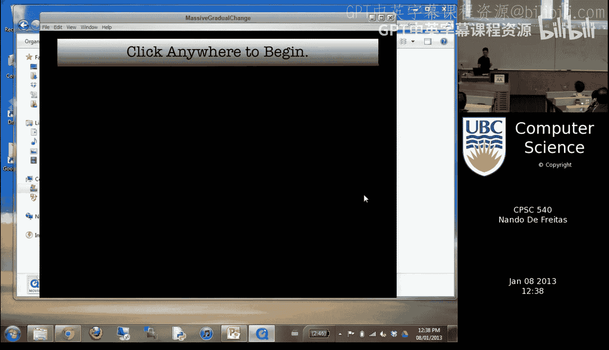
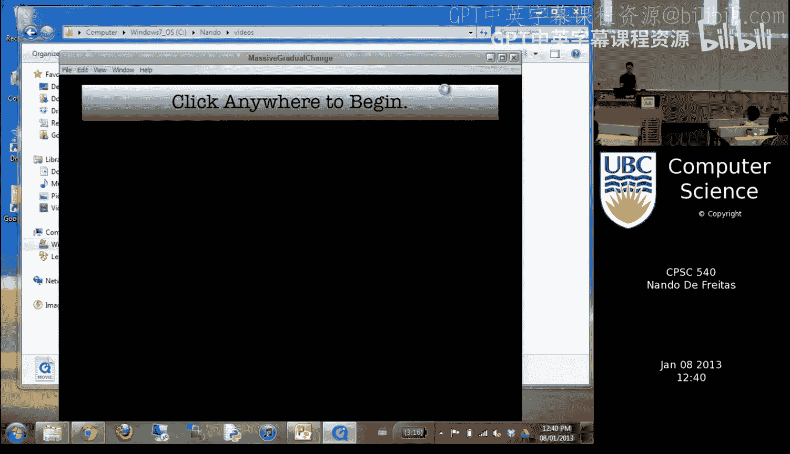
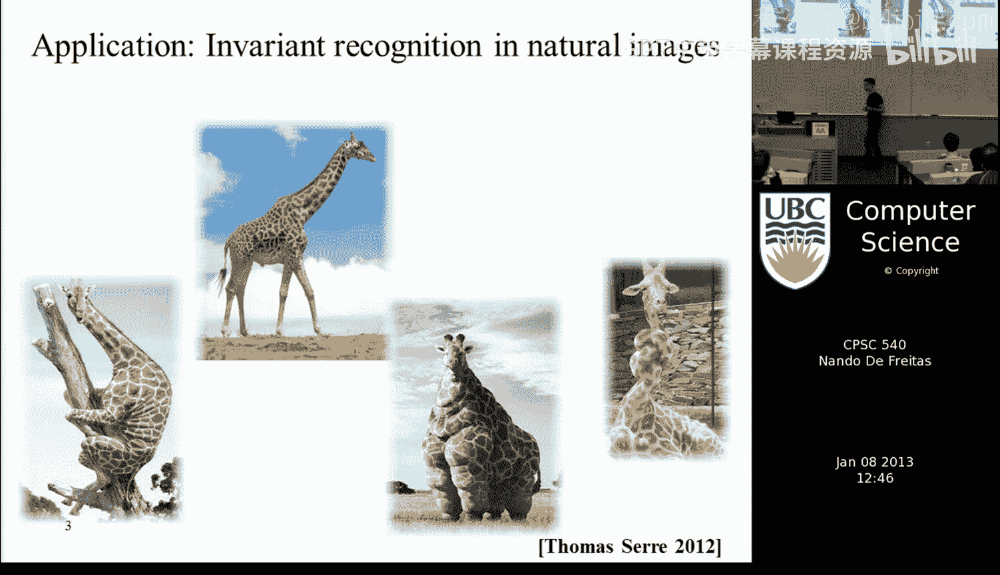
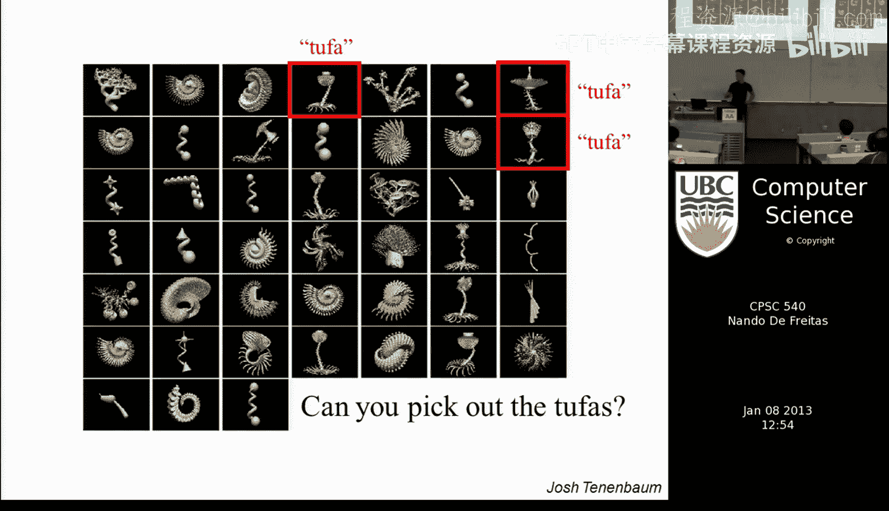
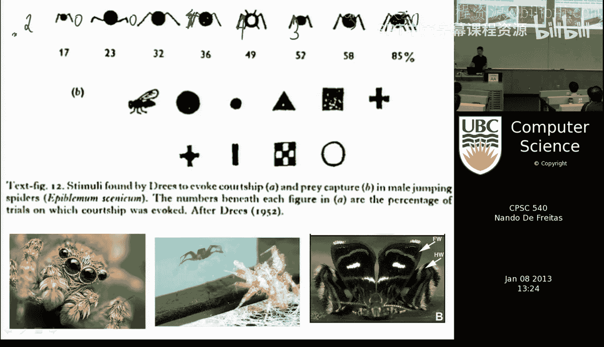
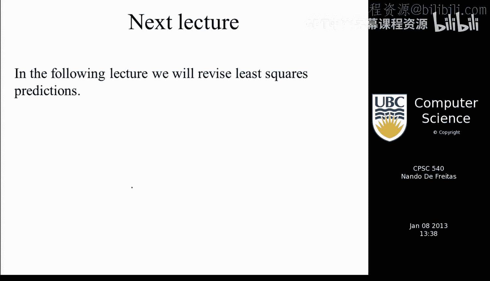

# 机器学习导论：01：什么是机器学习





在本节课中，我们将要学习机器学习的基本概念，了解它为何重要，以及它如何通过从数据中学习，而非依赖硬编码的规则，来解决复杂问题。

## 概述：从“视而不见”说起

上一节我们通过一个视觉实验，揭示了人类感知的局限性。我们以为自己看到了完整的世界，但实际上，我们的大脑通过快速扫视和想象来构建对世界的理解。这引出了一个核心问题：如果我们自己都不完全理解“看”和“识别”的过程，我们该如何教会机器去“看”呢？



## 机器学习的核心思想

传统编程方法是为特定任务（如识别人脸）编写明确的规则和逻辑。然而，对于像识别长颈鹿或人脸这样多变且复杂的任务，编写详尽且鲁棒的规则极其困难，甚至不可能。

机器学习的解决方案则截然不同。其核心思想是：我们不直接告诉机器“是什么”，而是提供大量**示例**，让机器自己从中**学习**模式和规律。



**核心公式**可以概括为：
```
学习算法 + 训练数据 => 模型
```

然后，这个训练好的**模型**可以用于对新数据进行**预测**或**决策**。

## 为何需要机器学习？

以下是需要采用机器学习方法的一些关键场景：

*   **缺乏专业知识**：例如，我们不完全理解人类视觉或听觉的工作原理，因此无法直接编码。
*   **任务不断变化**：例如，用户的兴趣会随时间改变，推荐系统需要持续适应。
*   **个性化需求**：为百万用户提供定制化服务，无法依靠人工完成。
*   **问题规模巨大**：例如，处理整个互联网的信息，人工制定规则不现实。
*   **从数据中自动发现**：我们希望机器能从海量数据中自动发现人类未曾察觉的模式。

## 机器学习的应用实例

机器学习已广泛应用于我们生活的方方面面：

*   **图像识别**：人脸检测（手机拍照、社交媒体）、行人检测（自动驾驶汽车）。
*   **预测与推荐**：能源需求预测、商品销量预测、电影推荐系统。
*   **自然语言处理**：机器翻译（如Google Translate）、语音识别（如Siri、Google语音搜索）。
*   **医疗与金融**：病毒变异检测、医疗影像诊断、信用评分。
*   **信息处理**：网页搜索排名、新闻摘要生成。

## 数据的重要性

近年来机器学习的爆发式发展，很大程度上得益于**大数据**和强大**计算能力**的出现。更多的数据通常意味着模型可以学习得更准确、更鲁棒。

一个关键转变是：在许多任务中，获取高质量、大规模的数据集，有时比设计精巧的算法本身更具挑战性，也更有价值。

## 从生物中获取灵感：神经网络

人类和其他动物是高效的学习者。我们的大脑通过神经元网络处理信息，这为机器学习提供了强大的灵感来源。

**关键生物原理**：
1.  **特征提取**：大脑初级视觉皮层（V1）的神经元对特定方向的边缘等简单特征敏感。
2.  **层次化处理**：简单特征被组合成复杂特征（如物体部件），最终形成对整体（如一张脸）的识别。
3.  **关联记忆**：记忆以模式或关联的方式存储，而非像计算机那样随机存取。

现代**深度学习**正是受此启发，通过构建多层的“神经网络”来模拟这种层次化的特征学习过程。例如，Google著名的“猫神经元”实验，就是通过无监督学习，让神经网络从海量YouTube视频中自动学会了识别“猫”这个概念。

## 超越被动学习：主动探索与因果

然而，仅仅被动地从已有数据中学习可能还不够。要获得真正的理解，有时需要主动干预和实验，去探索因果关系。这是科学方法的核心，也是机器学习中一个前沿且重要的方向（如因果推断）。



## 课程路线图

在本课程中，我们将一起探索如何构建这些学习机器：
1.  从最简单的**线性模型**开始。
2.  逐步深入到复杂的**非线性模型**和**神经网络**。
3.  学习如何让机器从数据中自动**提取特征**。
4.  理解**深度学习**的原理与最新进展。
5.  探讨包括**因果推理**在内的更高级主题。

## 总结

本节课中我们一起学习了：
*   机器学习通过**从示例中学习**来解决问题，而非依赖硬编码规则。
*   它在**缺乏明确规则、任务多变、需要个性化处理和大规模数据**的场景下不可或缺。
*   **数据**是驱动现代机器学习发展的关键燃料。
*   受**生物神经系统**启发的**神经网络**和**深度学习**是当前最强大的工具之一。
*   机器学习的目标是构建能够进行**预测、决策**，乃至**主动探索**的智能系统。



下一节课，我们将正式进入技术细节，从**监督学习**和基础的**线性模型**开始我们的机器学习实践之旅。