# UBC《机器学习（研究生）｜CPSC 540 Machine learning 2013》中英字幕 p02 -02-Machine learning - linear prediction.zh_en -BV19g2FBBEEq_p2-

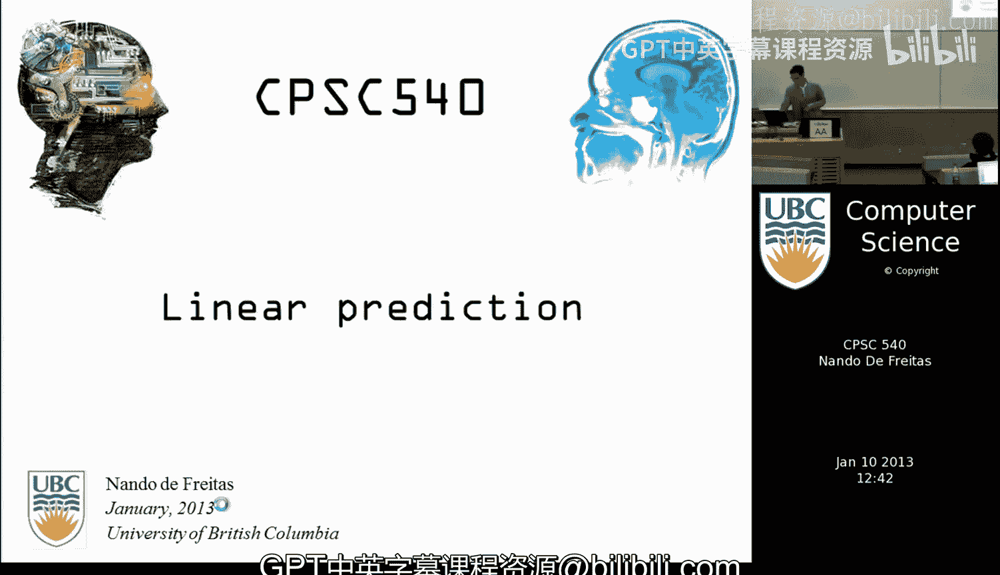

So。The aim then of this lecture will be to talk about linear methods for supervised learning。

And the idea of supervised learning is that we will have two kinds of data， input data， output data。

And the output data is the supervision signal， so for example。

 you might have a collection of images and that collection of images is the input and then the labels is just someone telling you whether the image is a face or not。

So that's what you would use， for example， to build a face detect。

So that the labels are just essentially what a teacher would use to say what the data is。

 what each data point is。U。The machine learning for linear protection is essentially something that's also known as linear regression。

 and most of you have seen least squares before， and essentially that's what we're going to revise today。

 least squares， and most of you know least squares。

 but this will allow us allow me to introduce the language。

Now the inputs are also called in statistics more dryly， they go with the name covariates。

Then the outputs are called various because they vary as a function of the inputs。

 The inputs are also known sometimes as features or the predictors。And as I said just a while ago。

 the output is also known as the labels。Once we and so we're going to go over least squares and we're going to derive least squares and we're going to derive least squares using the optimization approach。

 and in that process I will also introduce the notation that I will use throughout this course。

 essentially matrices and vectors， which is what we use to code。

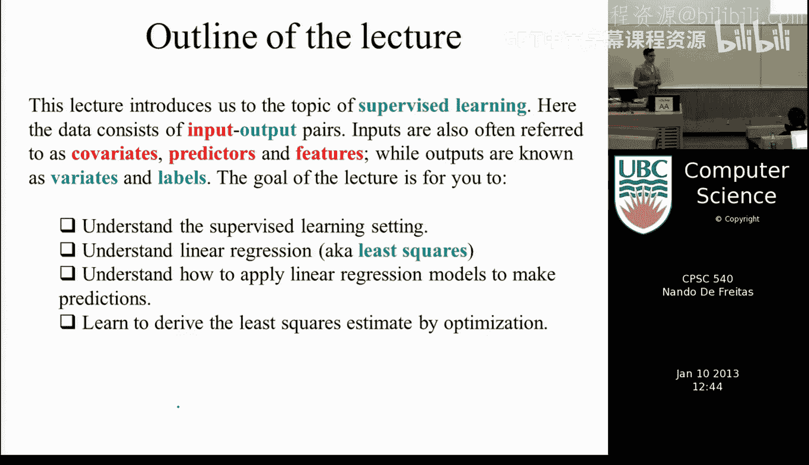

Okay， so linear models by themselves are still quite useful because a lot of real processes can be approximated with linear models and if not one linear models。

 several linear models， for example， the controllers are ensured that your aircraft can land safely。

When you're flying， there's just a combination of linear models， and they work reliably well。

 your planes don't crash often。Oops。And we linear models， also when we introduce more complex models。

 you'll see that there's still going to be subcompons that will be linear models。

So we need to know this in order to move on。To more complex things。 As I said。

 everything here can be done by hand。 by by analytically， I mean that in a piece of paper。

 you can write a solution。When we do neural networks and other techniques。

 you'll find out that that's no longer possible。We can't rely on doing anything by hand。

 but we have to do computing。嗯。Okay， so let's set up the notation。

So I'm going to assume that I have n inputs and n outputs。So， and here。

This end here will indicate the number of instances。 And when I write x1 to n。By that。

 I mean the set of x1， x2。Allold the way up to XN。That is essentially MAlab or Python notation。

And I'm going to assume that input has d components。 In other words。

 that there's the possible components， for example， x。Could be the height and weight of a person。

 So I would have x1 being his height and his weight。 X 2 is his height and his weight and so on。

 And n would be the number of students in this classroom。In that case。

 D would be2 because it's just the height and the weight。

And then associated with it there's going to be a label Y。

 which typically will be an element of the real line。By R， I mean， the real line。And that might be。

 I don't know， a number， a continuous number， which is reflective of IQ。

 I might be trying to predict IQ from height and weight。It's kind of bogus to do that。

 But it nonetheless， you can do it。And people often do these kind of bogus predictions。

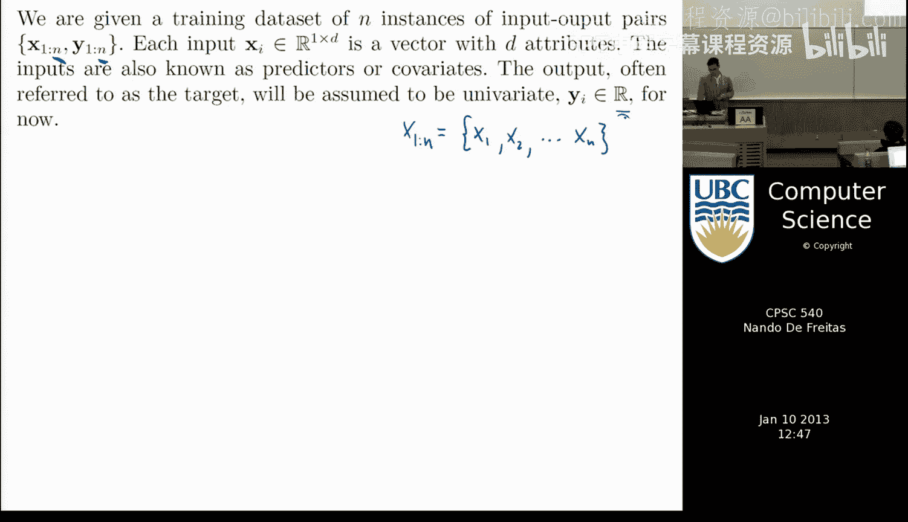

Okay， so here is an example that is not bogus that is's actually quite a relevant example。

So in this case， what we're going to do is I'm going to measure， I'm going to have two inputs。

The wind outside is building。And the number of people inside this classroom does are my two inputs to get the wind outside。

 I can just get it from a website。Because it's being measured somewhere out there。

And to get the number， which is the number of people in this。Room right now。

 all I need to do is put a counter on that door so that every time someone goes through。

 you get counted。That's also standard technology， or most stores on Robson Street have counters at the doors。

 either through a mat or through a camera。 So every time you walk into a store， you walk into a rtia。

 you're been counted。And being monitored。Now。So those would be the two inputs。And so for example。

 in here， I would have that this。Is one， two， three， four。N is equal to4。In this case。

 D is equal to two because there's two inputs。So， for example， the factor x。1。Which is in 2D。

Will be 100。And two， so it's a 2D vector。There's two components and it has the two inputs。

The corresponding label。In this case will be a scalar。which is a matrix with one element。

 and that's the energy requirement to keep this room at a reasonable temperature。

whyhy this would be useful is because classes have different number of students and in order to adjust the thermostat in this room。

 it would really help to know how many bodies are' producing hit here。

 and it also would be useful to know how cold it is outside， if there's a strong chill wind。

 I might have to increase the temperature。If but if there are too many students in here。

 then I don't need to and on on。 Now， if I knew that， if I knew how to have a system like this。

If I could collect a lot of data throughout the term of how many students were in the classroom。

And in what temperature we had to set that the thermostat in order to be comfortable。

 so imagine that the setup as as follows every day someone comes in here。

 checks out how many people are in the classroom。Take looks at the website to see what the wind speed is outside and then goes there to the thermostat and adjust the thermostat so that we have a comfortable temperature inside 20 degrees or so。

Now， this person does it for a whole year。We collect a lot of data。If the person did it four times。

 we would have collected a data set that I'm showing you here。 Okay， that's after four。

Data collections Now once we know this， so now what we can do is have a system that will automatically just look at the wind speed and how many people are in this room and will'll automatically adjust the energy requirement In other words。

 it will automatically adjust the thermostat。Because the thermostat detect the the。Essentially。

Governs how much energy is needed to keep the room at a comfortable speed。Sorry。

 the comfortable temperature。So that's the game， we have four data points that an expert gave us。

 we have two inputs， we have one output， and if we now can build a model that given two inputs can predict the output。

 we now have a very intelligent thermostat。And an intelligent thermostat would make sure that we always have a comfortable temperature。

 moreover most of the time the temperature here is being wasted because this room is too hot。

 so we're actually burning coal or gas or whatever it is that we' burning in order to make this room overheated。

Costing Canada a lot of money， costing us a lot of money， costing our environment。

 precious resources， so if we could fix that， if we could just make every room 10% more efficient。

 would'd be making a huge economic contribution toward Canada。Now。

There are companies that actually arose over the last couple of years that do precisely this。

 they design intelligent thermostats， and this is essentially what they do。

 they predict the energy demand and based on the predictions of energy demand they automatically buy energy from the energy providers。

 and we ensure that the load is sort of even throughout the year。

So this is a very energy prediction right now it's a very hot topic UBC definitely is very interested。

 UBC has been instrumented all buildings to make this actually an actual reality this year's H Ka。

Just the main conference on artificial intelligence is dedicated to this topic。

The topic of energy prediction and computational sustainability that is using computer science。

In order to improve our management of natural resources。

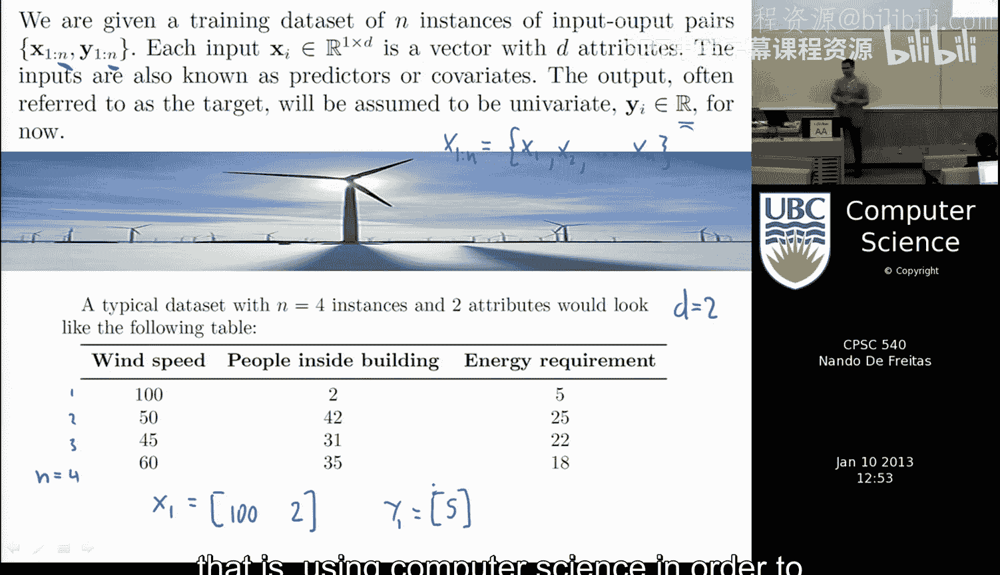

Okay， so once so the setup then is as follows。嗯。In supervised learning。

 we always identify two two stages。 One is the training of the model and a second stage is the prediction。

 So the training。As I mentioned， in step one。Which I'm going to call the training phase。

We take the set of data， x1 to n。With the corresponding labels， why want to n。

And I use curly brackets to indicate sets。The standard notation。And the sort of the flow。Is。

We take the data。We learn from the data and what we really learn is a set of parameters。

Parameter theta of a linear model。Very briefly， a linear model in one in 2D is just a line。

 It the parameters would be the slope and the intercept of the line。 and in 2D。

 it would be a plane as we go to high dimensions， it would just be a high dimensional plane。

That's training。 Training is about getting some parameters。 Now。

 the parameters are a summary of the date。 once you know theta。Like you might have many points。

 but once you know the slope and the intercept， then you have all the information that the data conveys and then you can throw away the data。

The second phase。Its prediction。In prediction， we take a new point that we hadn't seen before。

And we take our estimate of theta。That we got from。Phase  one。The training phase。

And then we put those two guys into a prediction machine， predict。And what comes out is yn plus1。

 and I'm going to put a hat on top of it to indicate that it's a prediction。

So the heart indicates prediction。So we take the training data， which is end data samples。

 and we use that to infer theta。Once we have theta。

 we use that theta to make predictions for new access。 So given new wind speed。

 the number of students here， I would predict how to adjust this thermos start automatically。

And the person that had to come here and adjust the thermostatud by hand， and actually at UC。

 there's a bunch of people doing that。The beauty of this is that those people will be put out of a job because everything will be done automatically more efficiently。

Now， that's one of the。Baker thinks that you need to be thinking about the machine。

 I said it as a joke， but it's actually machine learning is creating a lot of automation。

And automation is replacing many people's jobs。So with machine learning。

 there's very interesting societal issues。

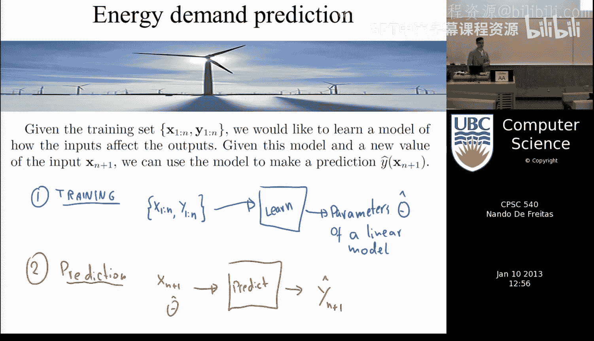

Here's another example in this example in medical research。

 there are several inputs and the inputs in this case for prostate cancer。

 in a prostate cancer study are things like the log cancer volume， the prostate weight of a male。

 the age of the male， et cetera， et cetera， so a bunch of variables。

 medical terms that describe the condition of a patient。

 and then what we're trying to predict in this case in this study。

 which appears in the book of Hati Chicirai。Which is freely available on the course website。

They were trying to predict an antigentro because they're trying to design appropriate treatments to help patients。

So in the world of medicine， machine learning has become extremely important。

We work closely with the BC Cancer Agency because we can actually impact healthcare。

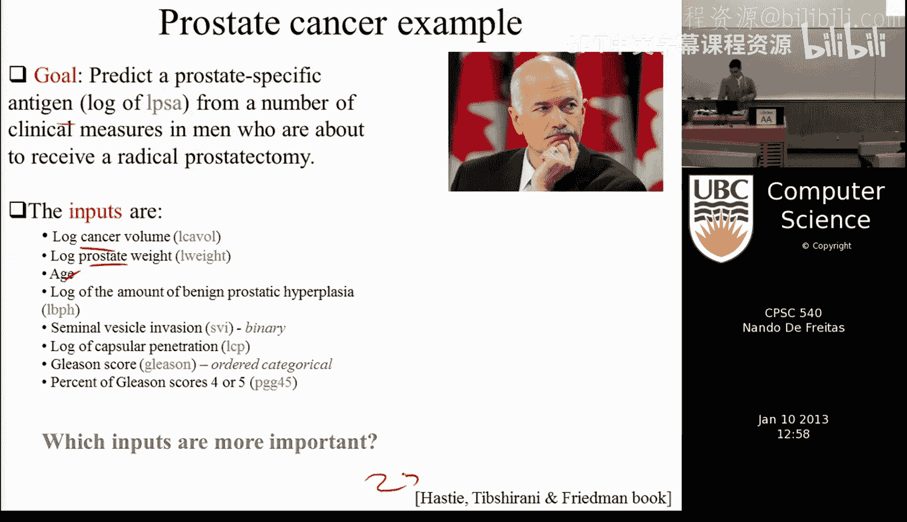

Okay， so。Let's look now at an example in 2D。In 2D， a linear model is essentially aligned line。

It has a slope， which in this case is the to2。There is only one input， which is x。

And there's only one output， which is y。 and then the intercept of the line is theta 1。

And then how do we find out the best Theta1 and Theta 2 given a set of data。

 we minimize an objective function。So， J。This J here， I'm going to call an objective function。

I'm going to call it a cost。Function。I'm going to call it also a loss function。Or the energy。

And then the energy will become more clear when what the meaning is when we do。

When we do neural networks and it's also called the error。

So the optimization approach to machine learning。Is about formulating a cost function。

 Once you formulate a cost function， then you just need to find its minimum。 and that's the solution。

And the cost function depends on the date。So in particular。And for short。

 I'm going to write as I'm using this notation there。So instead of writing Y of Xi。

 I'm just calling itYi。Okay。And so。What's the picture that goes with this？The picture is as follows。

We have two variables， x。And we have Y。I is an index of examples， and in this case。

 we have n examples。And。You know， typically。Typically， the idea is that we have。

We have a bunch of points and then we draw the line that fits the points。

 I tend to do it other way around， I draw the line first。And then the points。

That's seriously cheating。But it makes it easier。To explain。Okay。嗯。So we have several instances， x1。

 y1 pairs， and so for example。This point here。Might be the point x。3。That is。I equals3。

And then the corresponding height for that point。Is what we call y3。So those are my training points。

That's a third training point， order is irrelevant here。

 you could scramble them the eyes because the points will still stay where they are。

 but the main important thing is that the data is just these red points。

And what we're trying to do is we're trying to compute theta， which is the。

Which is essentially the equation of the line。So， in other words。Theta2 is going to give us a slope。

And。Theta 1 is just the intercept of the line。And then if I want to know where y3 is。

So the prediction for the point will be this。The line evaluated at x3。 So this is。Y 3。

Which is essentially the equation of the line evaluated at x3。All right。

 so that's are all the quantities。 that's essentially what linear prediction is。

 is you have a bunch of points， input output pairs。And then fitting。A linear model is essentially。

 in this case， just fitting a line。 if we're in2D。And today you would have two x's。X1， x2。

You would still have why。And then there we would just fit a plane。To the points。Fs。

And as you go to higher dimension， and we can no longer draw it。

 buts the question that we have still has a name and it's the question of a plane and in high dimensions。

 we just call it a hyperplane。Okay， when we fit this。Whats？嗯。

What we're trying to minimize is the quadratic distance between。Y and why hat。

 So we're trying to minimize the sum from one to n of the quadratic distance of y minus y hat。

Okay so if you think of this。This guy here is y minus y hat。

 and the reason why I am drawing this is springs。guessuess。That。

And I will make more clear this idea of energy is that if you had a spring associated to each point and the line。

 and if you move the line and you let go， this line would go like and then it will stabilize at a minimum energy configuration。

And what we're trying to the goal is to essentially minimize those vertical distances。

When does this fail？Yes。Sorry。好。That's correct。 So one way where this would fail is I've drawn the points here nicely on a line。

 They're not actually in a line。But sort of their population tends to look like a line。

 so I'm using a line。The line doesn't go through any of the points， interestingly enough。Okay。

 so we're making a error。On the training set， these points in red are the training set。

And for each point in the train set， we actually make an error。

And that's one of the important things to learn in。In this world that you never get zero errors。

Part of doing machine learning is learning that there will always be a statistical error and that you have to deal with uncertainty and you need to manage uncertainty appropriate。

As we will see later， we will come up with methods that are capable of making the error on the training set zero。

 but if you make the error on the training set zero。Your predictions often will be lousy。

So a big part of the course will be learning to quantify uncertainty and manage uncertainty and problem。

嗯。What else could this fail。 And by the way， just to get a sense here， Katuina。

 how many of you have done these squares before。Okay， at least the undergrad guys， put your hands up。

 I actually do w to see。Allright， so a lot of you haven't done these squares before。

 good because you Ive decided to go slowly so you will learn this is least squares。

 essentially that we're learning today。嗯。And often， many undergrad degrees teach this。But。

Don't worry if you haven't seen it before， because you've learning it。

 that's the objective of today's lecture。And moving on， where can this fail？Youron a vertical line。

All the points on a vertical line， yeah that would be also problematic。What was the first answer？

Oh for asking so the one problem would be， what if the points are like this？Then kind of， obviously。

 that should be a quadratic， not a linear model。Leger model would be the wrong model to model the。

And， and by the way， I haven't said so。 But think of this。

 So let's put a legend here because I think we'll help。I'm going to use these red circles。

 Let's say that these are the training data。And then I'm going to introduce。A test point in。

 let's see what color haven't I used。嗯嗯。Orange。So I'm going to introduce now a test point。Now。

 a test point， I don't fit the test point。 A test point hasn't been given to me。

 It's only after I fit the model。 So as we did before， after I fit the model。

 then I given a new point。Which I'm going to call here。 So in this case， let's actually count this。

 So we have one，2，3，4，5，6，7，8。 So in this case， n is equal to 8。And then I get a new point， x9。

And for x9， I only get the x， I don't get the Y。And my objective is to compute the y。

 And then the way I compute the y is just evaluate the line。And I get this guy here。And this height。

This hiat is y 9。Where why 9。As before。It's just y of x9。In other words， its equal to theta 1。Last。

Per。2 times  x，9。Oops。So I'm evaluating the line at the0 x9 in order to do the prediction y hat9。

Now this， of course， if the points are not in a line， it's not going to work well if everything。

 all the distances are being measured vertically。That's the least course criterion that Gas gave us back。

Several centuriess ago。And it's still very popular。There's better ways of measuring distances。

 like to deal with this issue of all the points being a vertical line。 you might not want to use。

This distance， but you might want to use something a bit smarter like maybe the perpendicular distance to the line。

Later， we will see methods that try to do this。Where else could this fail？And had few argumentss。

Outliers。If there was an outlier。Like。An now apply is a point that is not like the other point。

So suppose you had a point up here。Then the line will be all of a sudden will swerve。

Because that spring would be pulling it so hard that this line would actually just at one single point is going to affect the line。

So if you have mislabels and the web is full of mislabeled data。

You will get to play with some Twitter data where you need to do。

One of the exercises that 340 guys have already done this is I give you like a million tweets with happy faces and sad faces and ask you to build a model that predicts whether a tweet is happy or sad。

And once you do that， then you take all the tweets about your favorite movie and you can predict what the sentiment is about the movie。

 So you could predict just before the Oscars， which are the most popular movies。

 And often that is actually can predict the way elections go， the way Oscars go。

 etc cetera Twitter gives you enough of。That's。Of a signal to actually forecast a lot of things。

 It's just the same as polls。 It's just a public poll。And there， however， quite often， people write。

 I just felt my exam happy face。 And so that the signal has mislas and dealing withliars is an important part。

 But for now， we will assume。That this doesn't happen。

And we will assume that the data indeed is in a nice follows this linear trend。

 and we will assume that there's no outliers。In the next class we will deal without outliers and the next week。

 so actually next week， both classes we will learn to deal with nonlinearity and withoutliers。Okay。

So。Now。We have several data points， so I。Is an index that goes from1 all the way up to n。

And then we also have the several。Inputs， so。D inputs in thought。I will use I as the index of。

 typically throughout the course， I will be an index of a number of data instances。

 and that n is the total number of data instances in the training set。

And then J is the index of the input features。So for example， for energy prediction。

 where D was equal to 2， J1 corresponds to the wind speed and J2 corresponds to the number of people。

嗯。Now， once I do that， I will actually not want to write the this for example。If you。

We already saw it before。That I used Y I equal to。One times theta1 plus。X I times theta2。

 so that was the equation of a line before。The trick that I'm using here in addition， is that。

To deal with the bias， and I just realized I didn't have。That should be easier to see。

To deal with the fact in order to come up with a very compact representation for writing this a equation。

 instead of writing that sum of a Js and then there's going to be an extra index of our eyes。

 I would like to write everything in just with a matrix in a very tight notation because if I have very tight matrix notation。

 it becomes really easy to code this as well in Python and it becomes really easy to manipulate this to come up with algorithms so I will try to shift us to matrix notation right from the beginning because the sooner we move think in terms of matrixes the easier it to code and to manipulate the data。

Most data can be mapped to matrix format and once everything is in matrix format。

 whether it's a text collection， whether it's a collection of images。

 then it becomes easy to manipulate different data sources with the same code。Okay， so。

The trick that I'm also using is that I'm gonna always let the first input be equal to one。Okay。

 and that's only so that I can write this as X1， Theta 1。Plus， X， I 2， Theta 2。

And so I don't need to write。Instead of writing。呃。Y is actual equal to x the to apply some extra term。

 I will be able to avoid having to do this， because my first entry。Will always be equal to one。

So I'm going to assume that I always have one input that is just one。And all that is doing is just。

Adding this bias。Okay， because I'm。Just putting a one there。Okay。

 so that's just a trick to make the writing less。And， of course， now each point。

Because each point why I。So for example， why？One。It's just equal to x11， which is1。I's theta1。

Plus x1，2。Pris theta 2。So I can either write it like this。Or if I use matrix notation。

 that's just this vector。Times dis effect。Which is much more succinct。

 and instead of writing it for each index I， the index I is over effect。Okay， so questions。

For the rest of the course， I'm going to use this notation。 so it might。So。And by the way。

 I like my classes to be。 this is a gra class。 So keep their questions coming if anything isn't clear。

Because at this stage， I'm just trying to set up the notation that we're going to be using。All right。

I will move on sometimes I will also rewrite this。啊是。The vector x1。And。

And I'm going to put a bar here because I can't do bald with my pen， so the underscore means it's a。

And it's a vector of D dimensions。All the way up to X N。Times。Fat。The vector of theta。

 which is a three dimensional vector。Okay， so that's just another way to write this。All right。

 so here's the example。 so we had two inputs。So this was。

The wind speed and the people inside this building， and then the output was y。

 and so my y consists of this is my Y， this column here。And then for in order to generate a matrix x。

 I just take the first。Two inputs， and then I add another vector of one。

And I need a vector of once because I need a line to have an intercept。

 because if I don't have an intercept I can， if I can't shift my line up and down。

 I will not be able to model data that has a certain height because my line has to go through the origin。

 so I need to have those ones。And in this case， I have three parameters。

One parameter is how up or down the plane is， what're into D now we have a plane。

 and then so theta1 controls up and down。And then Theta 2 controls the slope in this direction。

And then Theta 3 controls this slope。So I have two slos and one height。

 Those are my three degrees of freedom。And if I have a new so let's now take an example。

 let's assume that theta happens to be this vector here。And if thetas this vector。

 if I want to make a prediction。For。嗯。For one of their inputs， then。Using that the。

And using the training set， I can make these predictions on the training set。

 so these are predictions。On。Training set。In other words。For these red points that I have here。

 I'm just computing。All of these guys here。The， the value of the line。At the training points。

Of course， predicting on the training data is not very interesting because you already know the right labels for the training data。

 however， by doing those predictions you can compute the error and you can adjust theta。

And once you can predict on the training set， you can go on and you can predict for new access。

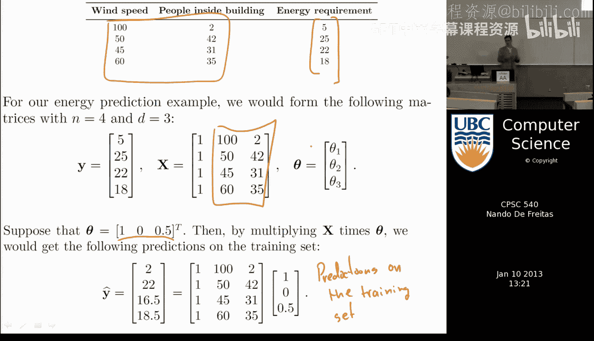

So given a new X， suppose you have a new X， which is。50 and 20， then you're just basically。

 as before。You are the one。And then you use the theta that we had。

 and then you just multiply x times theta。So to summarize。

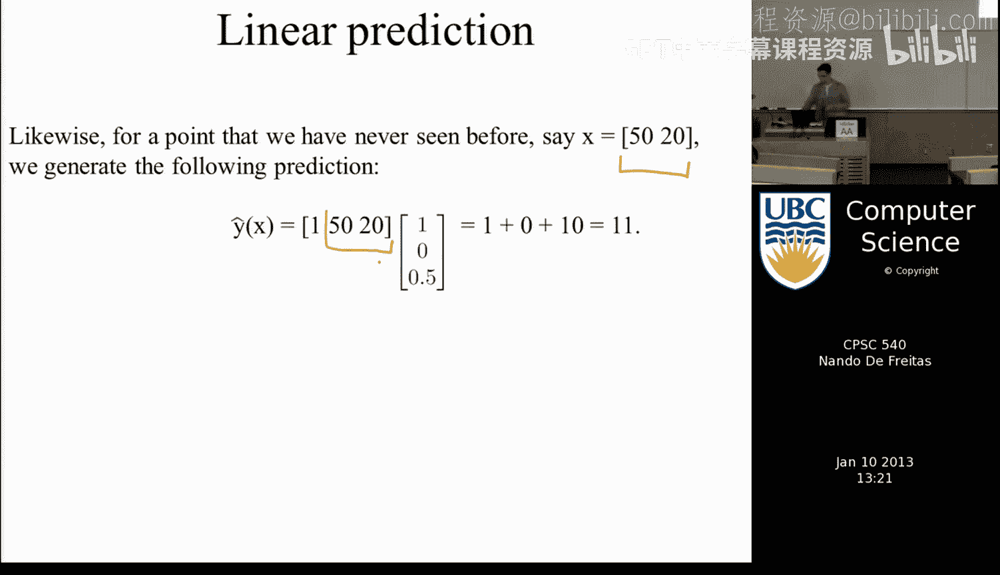

Linear regression is all about knowing how to form these matrices。

 Once you know how to form these matrices。Pretty much your code is done。

 There's only one missing line of code， which is how you compute theta。

 That's the only thing I haven't told you how to do， how to get theta。

 how to get a slope and intercept。But if you know how to form so step one， when you get new code。

 when you get a data， is you need to massage the data into the matrix X and the vector Y。

Once that is done， there will be an extra line of code that tells you how to give a theta。

And then in order to make new predictions， you just need to form the vector x。

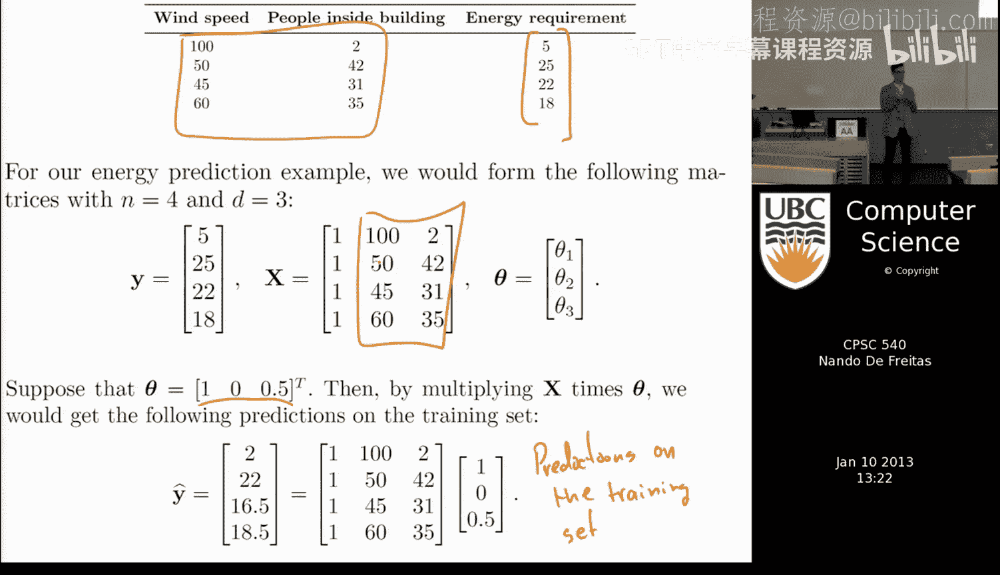

Again， and then multiply times theta， so it's all matrix vector and multiplication。

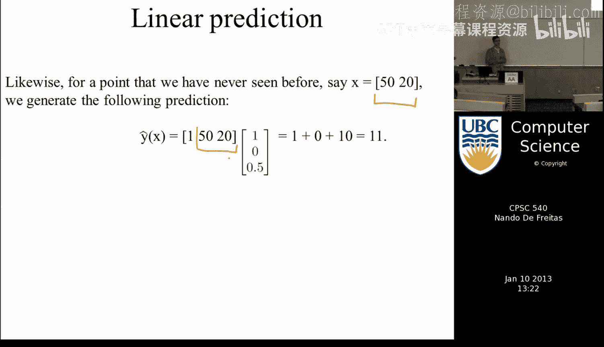

All right。The error function。Let's look at it。 So I have already told you that the error function is essentially this。

Which is essentially the sum from one to n over all the data of the quadratic distances。

 Y I minus Y I hat。Square。If I want to write this， my white hat。

I had told you it's just x times theta if I want to put it in matrix notation， and then my vector y。

And this vector is n by one。The matrix is N by D。And this matrix is D by one。Therefore。

 this whole thing is one by one。So。Just keep track of the dimensions here。

 this's just the matrix sum the vector。And then because we're transposing the vector times itself。

 we get escaped。Which is what we would expect because this guy here is one by one。Ssk。

So we can either write it component wise using sums or we can write it in matrix notation in this form。

 throughout this course I will favor matrix notation because it's much more compact and once you form the mates it's really easy to manipulate the matrices。

Now。If we are in 2D。Okay。In 2D。When you have two theaters， you might in particular。

 if you have a model that's why。I equal theta 1。Always times a one。

 I will not in the future put the one there， but it's sort of implicit that there's a one multiplying teacher one。

Plus Xi times theta 2。So I have two theaters。And if I have two theaters。And I plot。

This function J of theta， the cost function。It depends on theta 1 and theta 2。

And it's a function that will have a term that depends on。Theta being squared。

 and then's one that's theta being linear， and then a constant term。 So it's the equation of a qua。

And because we have a and it's positive because quadratic is positive。

 So we have an equation of a quadratic。 and in 2D， that's what it looks like。 It's a parable。Now。

 the nice thing about the parabola。Is that if we want to find place where the error is minimum。

We can find it easily because par only has one minimum。So the solution is the bottom。Of the problem。

Which is easy to find。Now， one of the things that we will do soon and will be useful later is that for a paraboler。

 we can also slice it like I've done here with these black lines， we can slice it。

 and then we can look at all the points of equal height。And the points of equal height。

They are plotted using these contour lines。And now here is the fact I need from calculus。

 This is like what I need as a background for this course。The gradient。

 that is that the vector of derivatives of J of theta of multivariate function。

Multivariate meaning that it has more than one variable， so it's two variables in this case。

The gradient is the vector of derivatives。In other words。

 it's the derivative respect to theta 1 and the derivative with respect to theta 2。

 If you use those two， you have a vector in 2D。Now if you plot those vectors。

Did you get these blue vectors here。And the fact from calculus that I need you to know is that the gradient is always perpendicular to the contour plots。

In other words， the gradient is the direction of steepest change。In other words， think you're skiing。

 snowboarding。Okay up right now lots of powder， if you go up Cypress。

 you're going to follow the gradient to the steepest direction。

 you essentially look for a place where there's the biggest vertical and you go that way。

And that's essentially what learning is about。 Learning is about full ingredients to the lowest。

Location。Which is where J of theta gets minimized。And when J of theta gets minimized。

 your line is perfectly aligned with the points。We will be able to do this computation analytically in this case because there's only one minimum。

 so in this case it will be really easy， but later for neural networks。

 there's not going to be one minimum there's going to be multiple mini and so we're not going to be able to do this by hand so we're going to use a computer to do it。

 but the con still be the same the one result from cals we need in this course is exactly this to know that to minimize a function you follow the derivative。

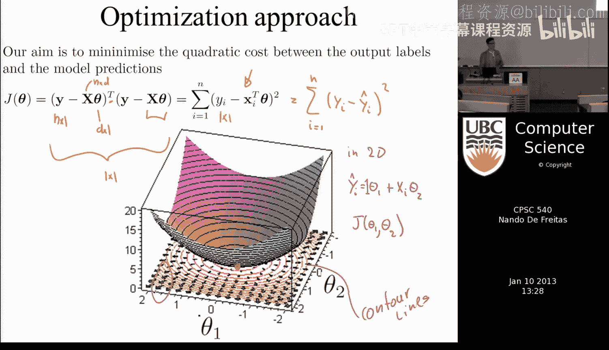

And you look for the point where the derivative becomes here。Okay so。嗯。Homework exercise。

I would like you to write， expand the vector Y， expand the matrix X and convince yourself that。

This should be an equality sign。And the reason I want to give this to you as an exercise is because I want you to get used to the notation quickly and to be able to an important part of doing research with。

And machine learning is to be able to take data。Be able to write it in terms of matrices。

 because the code is always written in terms of matrices， whether it's mat love， whether it's Python。

 So it's important to be able to do this math。I'll do an example。With the derivative。Now。

 let's assume we have J of theta。 So we want to find a minimum and the way to find a minimum is to compute the derivatives。

Now， suppose。That n is equal to3 and D is equal to 2。Then， J of theta。Would be equal to。Y1 minus。

Minus x1。嗯。Let's just write that minus theta 1 minus x1。Times theta 2。Squared。Plus。Y 2 minus。

Theta 1 minus x2 times theta2 squared。Plus。Y 3 minus eta 1。Minus x3 times the to2。Square， okay。

 so that would be。The case when n equals 3 and equal 2。And if you want a derivative。Of J of Theta。

With respect to Theore1。And I use the delta to indicate just the derivative。 Then you would have。

And actually， let me。Already write this as the sum from I1 to3 of Yi。inus theta1， minus X。

 I theta 2 squared。If we take the derivatives。Then we would get。Let me use a different color。

We would have。The sum。Derivative is linear， and because derivative is linear。

 you can take the derivative inside a sum。And then so you would have two times。Y I。Minus T to1。

us X I theta 2。And then the derivative respect to。The term would be just minus1。

And so this is equal to minus-2 times the sum。From I equals 1 to 3 of y i。M- Theta Wan。Minus X。

 I Eta 2。And then if once you have this derivative。

 we're going equate it to 0 in order to find a minimum。

 But then we need to do that the derivative for theta 2 as well。 Now， here's the catch。

 I'm doing this， that。You essentially learn the painful way， what it would be like。

If you didn't use matrices， you would have to do this for each parameter。

And if you have 100 parameters， you'd have to repeat this calculation 100 times。

 and it would be really painful。Fortunately， we have matrices and matrices also come with properties。

And all these calculations， instead of doing them in this painful way。

 will be done with matrices much more quick。Now。I'm going to use a result that's from matrix calculus。

 a result of matrix differentiation， now this I don't think is in the background of many of you unless you've used this in graphics before。

 but we're going to define here matrix derivatives。

It's easy to prove these and you can go to Wikipedia and look at the proof。

 but for this course I will always give you these。If you want to take the derivative of a matrix with respect to a vector。

 that's just the matrix transpose。If you undertake the derivative of a pcadratic form。

 which is theta transpose a theta with respect to theta， then you just get2 a transpo theta。

So it just accepts these as facts。And if you want to know their exact derivation， go to Wikipedia。

 just come to my office hour and I'll give you， we'll go over it。Once we accept this。

 we can write the cost。 we can compute the derivatives， all in one single goal。

 all of the derivatives with respect to all the vector of thes。As opposed to doing them one by one。

And so in particular， the derivative of the cost is just a derivative of respect to the vector。

 So now the thet is a vector。Of this quadratic form， which is just y transpose y。Plus。

 theta transs x transs X theta。Minus2。嗯。Y transpose x feet。Okay， so I'm just multiping terms。Now。

 why was I able to group the two cross terms？In other words。

 y transpose x theta n x theta transpose y。都。Exactly， because we're dealing with scrs。So。

It's always useful to always write the dimensions。 So this guy again， I remind you is n by one。

N by D。And this one is D by one。And so if we look at this guy， this is one by n。Times N by D。Times。

D by one。 So there's whole product here。Its whoops。One by one， it's a scalar， and I can add scalrs。

So that's why I grouped those two。Now， the next step is just to use these two properties。

 property one and property 2， and actually I should have had a third property。

 which is a derivative constant to0。 so that will give me 0。Plus。

 the derivative of theta transse x trans theta。Which is just2。Times。And then the matrix essentially。

 this is the matrix A in this case。So I will just get two x transpose x。Theature。inus2。

 and in this case， this is my other matrix， say a prime。And so I just transpose it to x transpose y。

And that's the derivative。That's all the derivatives， it's a vector of derivatives。

And it's a vector that depends on X and Y。 And that's why。

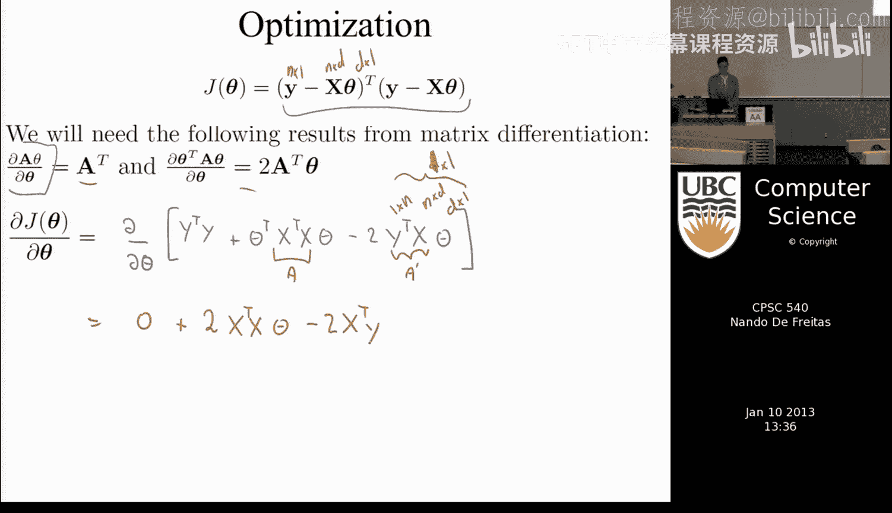

Over here， this vector changes depending on the location of x。

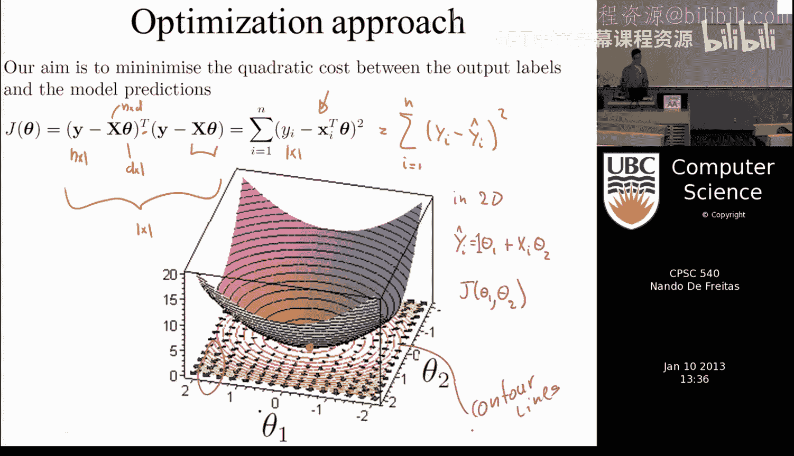

Once we have the vector。All we need to do is equ it to zero。

In whether the derivative becomes zero in all directions。So， the derivative。

Divative is slope in this direction and the slope in this direction where it becomes flat。

 that's when it's at the minimum when we've been able to descend in this quadratic and we get here。

When we are down at the minimum。That's our solution。We have a flat plane。

And that happens when we equate as derivative to 0。 So if we equate it to0。

 we have two x transpose x。Theer。一个。If I move now this to the other side becomes 2 x trans plus y。

I canceled the twos。And I get theta equal， multiplying both sides by x transpo x。Inverse。

I get the least core solution。And that's the one line of code that was missing， how to compute feet。

So if you know how to take your data and you massage into the matrix X and the vector Y。

Computing theaterta is just。Basically， doing a matrix inversion and。In your code， multiply matrices。

 and there's your theta。And when you have a new X， you just multiply that nu x times theta。

And that gives you the prediction。 And that's all there is to linear prediction。

 Linear prediction is essentially。Very simple task， however。

 it's illustrated an important concept that you can think of learning as a process of optimization。

where the cost function is a function of the data and is a function of some parameters and then learning is just basically about adjusting those parameters still that you get to the bottom of the cost function with the derivative of zero in this case we can do it as I've done by hand analytically on a piece of paper for most problems in machine learning we will not be able to do this by hand and we will require the use of computers。

Okay， so you might also be wondering what happens so in this case why the reason why I had a vector for y is because I only had one output。

 so we had several inputs but I only had one output。 However。

 the linear model can be trivial extended to have several outputs for example。

 in this case with two outputs Y one hat and Y2 hat All I need to do in order to have an extra output is just add a new vector of theus。

So in a sense， I've created a second plane。That's independent of the first plane。

 And that's giving me my now my multivariate predictions。

 So now I can go from the inputs to C outputs。And fit essentially fit a series of hyperplanes。

 which allows me to do multivariate。linear new prediction。嗯。

When we do neural networks and logistic regression and all these other techniques later on。

 we will always do the same thing。 We will always take the data massage it into a matrix X。

And a matrix。W。And then the task of learning will be constructing a cost function。

 minimizing that cost function to give us the solution。

So it's very mechanical once you write a cost function， in fact。The task， I mean。

 we're going through this because we're learning it now， but once you write a cost function。

 you can just use generic code to give you the solution the so you would never actually。Do this。

So where your thinking is required is coming up with a good cost function。And as we saw。

 this least course cost function， which is used by everyone at nauseum。Can often fail。

If there's outliers。If the model is really non nonlinear。If points tend to be aligned vertically。

And in those cases， you will need to think about what is the right cost function。

 and that's going to be your innovation coming up with good cost functions。

 The rest is really mechanical。 The rest is just a question of computing derivatives。

And most of it in today's age， there's modern packages that do the differentiation for you automatically。

In fact， there's a very nice package， which I strongly recommend you familiarize your。

Up put a link to it。 and of course， it's called Theiano。In Theana， you gave it an objective function。

And it automatically completes the derivative for you。

It completely actually automatically finds the minimum for you。

 So you don't even need to write the derivatives。 You don't need to know any calculus to use it because obtaining derivatives from objective functions is something that computers are capable of doing automatically these days using automatic。

And symbolic differentiation。Nonetheless， in this course， we will need derivatives。

We need to learn what's behind those packages so that we can also modify them and implement our own。

I that's pretty much linear prediction in the next class。

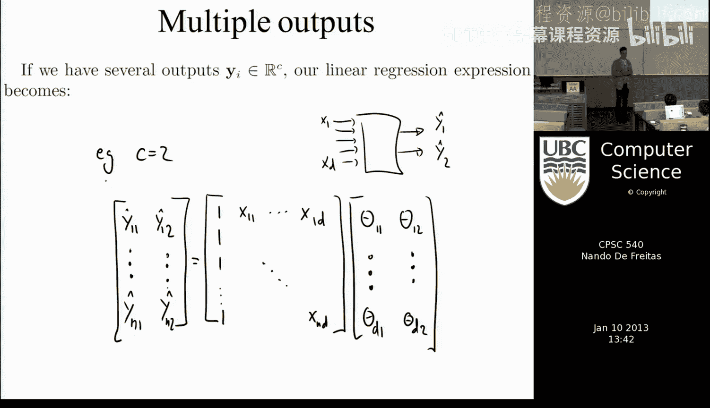

We're going to do the exact same thing that I did today。 We're going to come up。 But， in fact。

 the answer will get just exactly the same as the least correspond' answer。

 But we're going to start from a completely different perspective。I'm going to introduce probability。

Because I mentioned that there were errors。For each point， and there wast a question of uncertainty。

And the right way to manage uncertainty is through the use of probability。

 So probability is the tool that will allow us to manage uncertainty。So in particular。

 Ill need to introduce something called a multivariate normal distribution。

And I'm going to go over its definition。 However， I strongly。

 strongly encourage you to go to the Wikipedia page。

 look at what the multivariate distribution looked like before the next class。

Itll make it a lot easier to understand。Go ahead， be derived has a pretty famous name。

The normal equations。Yeah， there's a question here is called the normal equations。Thank you。

 And also， if you want to make a prediction， a prediction is just y times the new x。Times。

Suppose you want to make a prediction that on the training set。

 it will be Y hat is just x times theta。 Oh and because this is a solution to a problem。

 we put a hat to indicate that is the solution。And we often call this the estimator。Or the estimate。

And this in particular， is called the least squares estimate。And so， if this is white。

Is x times theta， then this is equal to just x。Times x transpose x。-1 x transpase y。

This whole thing here， we often call it the matrix H。And this gives us。We can rewrite it like this。

And， and it's age， because it's。It's called a hat matrix because it puts a hat on y。

You multiply y by h is the same as bringing a hat under y。But actually。

 let's leave it there because you're writing。 but so in the next class。

 I'm going to start with probabilities。I'm going to。Take the same problem。

 but I'm going to cost it as a problem of multivariate Gaussian distributions。

And then I'm going to show that if our objective is to maximize our minimize the uncertainty about the data or equivalently maximize our information about the model。

Explaining the data。We will get a principle called maximum likelihood。

 and maximum likelihood is going to give us the same solution than what we obtain by doing optimization。

The only difference is that once you have this in a probabilistic framework。

 we will also be able to quantify the uncertainty as to how certain we are making right predictions or not。

 and then probability will essentially be the glue that will allow us to build bigger models。

Essentially it's going to give us a language for manipulating the models and building sophisticated models。

 you know to do more interesting tasks。All right， guys， see you next week。

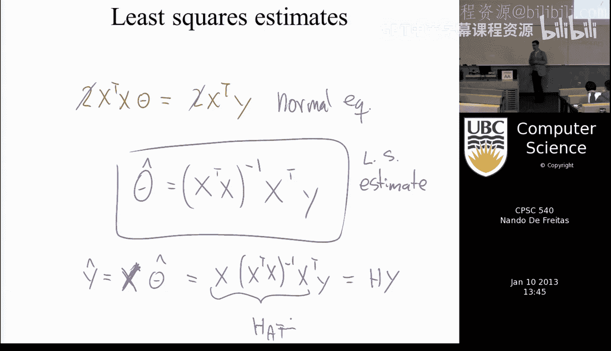

Can you go to this slide， you to band？The this one be。Yeah， we hear computer and one in the。Yeah。

 well， no， it depends on how I'm defining it。 I'm assuming that this is Xi2， and this is one input1。

Okay， I think that is me the that money。Yeah。

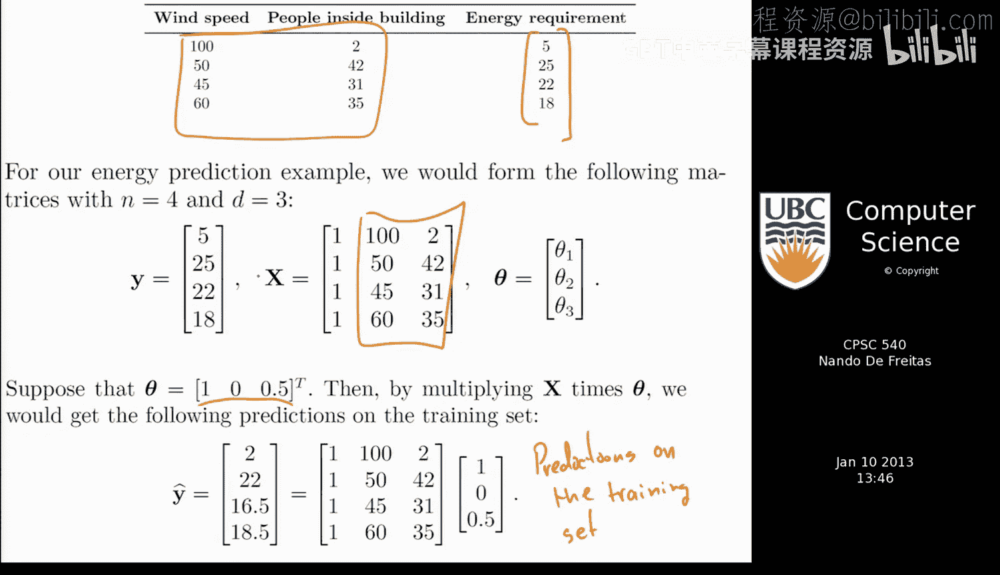

P。Yeah。So。It，I。Yeah。Its so。

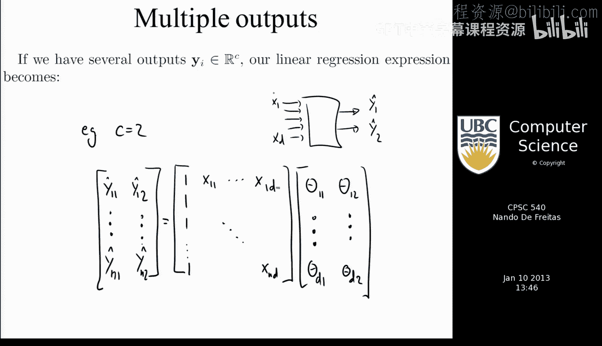

我觉得我。