# 机器学习（研究生）：02：线性预测 📈

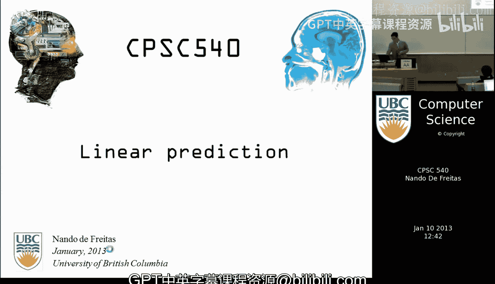

在本节课中，我们将要学习监督学习中的线性方法。线性预测，也称为线性回归，是许多更复杂模型的基础。我们将从最小二乘法入手，介绍其背后的优化思想、矩阵表示法，并推导出解析解。通过本课，你将理解如何将数据整理为矩阵形式，如何构建并最小化成本函数，以及如何利用线性模型进行预测。

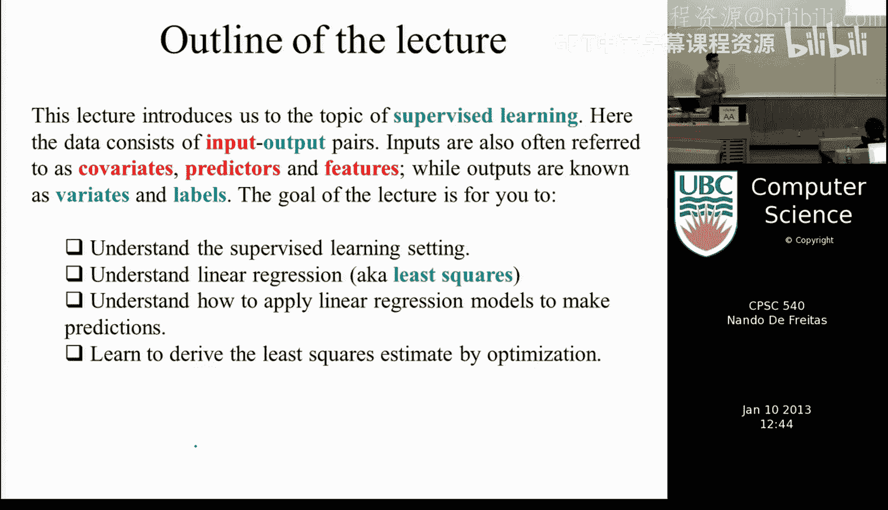

---

## 线性模型简介 🧠

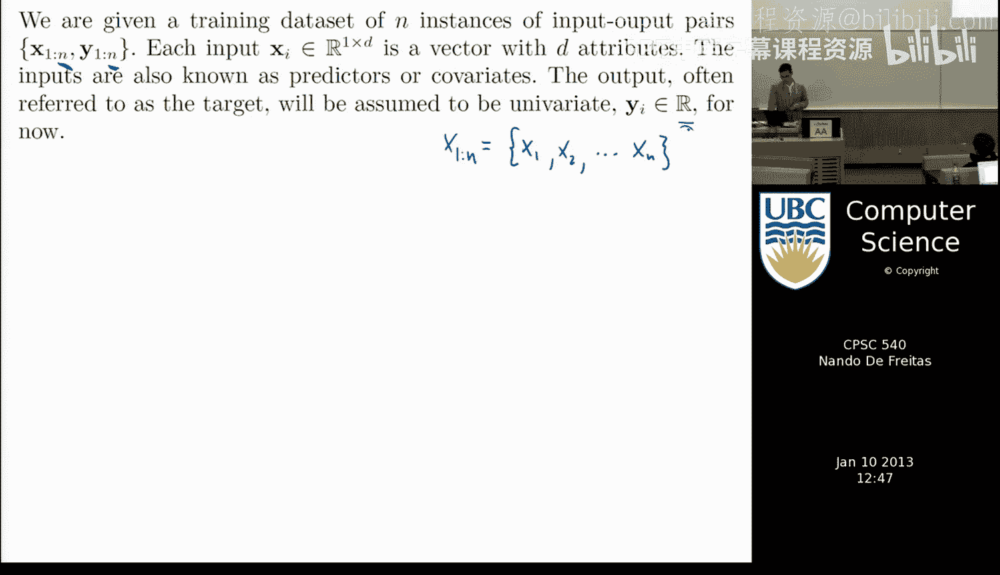

上一节我们介绍了机器学习的基本概念，本节中我们来看看线性模型。线性模型本身非常有用，因为许多真实过程可以用线性模型来近似。即使不能，多个线性模型的组合（例如飞机控制器）也能可靠地工作。此外，当我们引入更复杂的模型时，其子组件往往仍然是线性的。因此，掌握线性模型是学习更复杂内容的基础。

线性模型的一个关键优势在于，其解可以通过解析方法（在纸上）求得。这与我们后续将学习的神经网络等技术形成对比，后者必须依赖计算。

---

## 问题设定与符号 📝

在监督学习中，我们有两种数据：输入数据和输出数据。输出数据是监督信号。

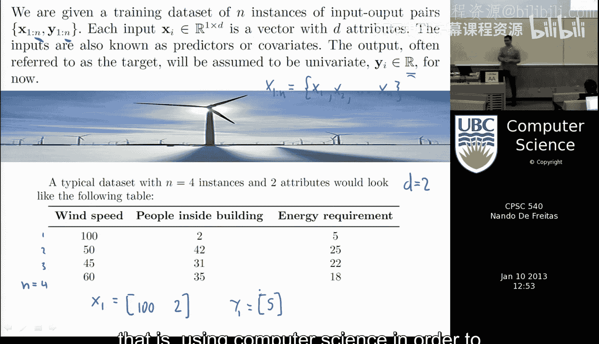

以下是本课程将使用的基本符号：
*   **n**：数据实例的数量。
*   **d**：每个输入向量的维度（特征数量）。
*   **x_i**：第 i 个输入向量，是一个 d 维向量。
*   **y_i**：第 i 个输出标签，通常是一个实数。
*   **X**：将所有输入向量（并添加一列常数1以处理截距）堆叠而成的 n × d 矩阵。
*   **y**：将所有输出标签堆叠而成的 n × 1 向量。
*   **θ**：模型参数，是一个 d × 1 的向量。

我们假设第一个输入特征恒为1，即 `x_i1 = 1`。这是一个技巧，使得模型方程 `y_i = θ_1 * 1 + θ_2 * x_i2 + ... + θ_d * x_id` 中的 `θ_1` 自动成为截距项，从而简化了表达。

---

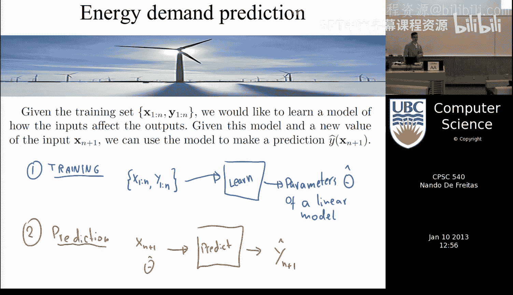

## 实例：智能温控系统 🌡️

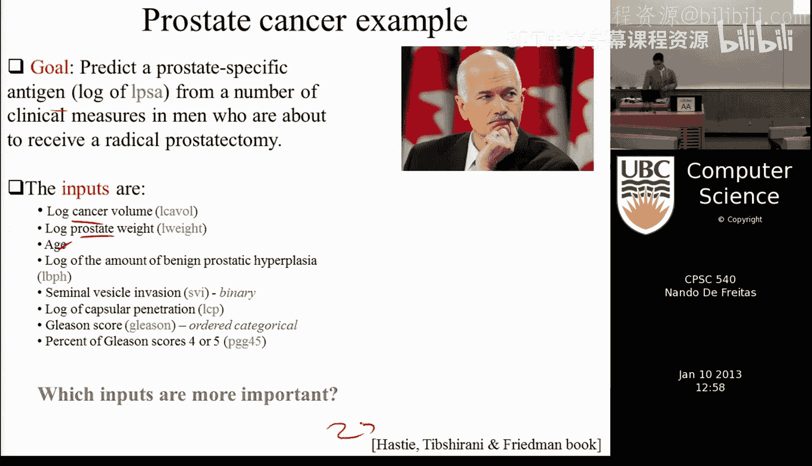

为了理解这些概念，让我们看一个实际例子：构建一个智能温控系统。

*   **输入 (x_i)**：两个特征——室外风速和教室内的学生人数。
*   **输出 (y_i)**：保持室内舒适温度所需的能量。
*   **目标**：收集历史数据（由人工调节 thermostat 的记录）后，训练一个模型。此后，系统能根据实时风速和人数，自动预测并调节所需能量，实现节能。

这个例子展示了监督学习的典型流程：收集带标签的数据（训练阶段），学习模型参数，然后对新输入进行预测（预测阶段）。

---

## 监督学习的两阶段流程 🔄

监督学习通常分为两个阶段：

1.  **训练阶段**：我们使用数据集 `{x_1, ..., x_n}` 和对应的标签 `{y_1, ..., y_n}` 来学习模型参数 `θ`。参数 `θ` 是数据的总结。
2.  **预测阶段**：对于一个未见过的的新输入 `x_new`，我们使用训练阶段得到的参数估计 `θ`，通过预测函数计算出预测值 `ŷ_new`。符号 `^` 表示这是一个预测值。

---

## 线性模型与最小二乘法 📉

在二维空间中，一个线性模型就是一条直线：`ŷ_i = θ_1 + θ_2 * x_i`。`θ_1` 是截距，`θ_2` 是斜率。

我们的目标是找到最优的 `θ`，使得模型预测值 `ŷ_i` 与真实值 `y_i` 尽可能接近。最小二乘法的做法是，最小化所有数据点上预测误差的平方和。

我们定义成本函数 `J(θ)`（也称为损失函数或目标函数）：
`J(θ) = Σ_{i=1}^{n} (y_i - ŷ_i)^2`

将 `ŷ_i = x_i^T θ` 代入，并用矩阵形式表示，成本函数可以简洁地写为：
`J(θ) = (y - Xθ)^T (y - Xθ)`

这个函数衡量了模型在训练数据上的总误差。将其可视化，`J(θ)` 是一个关于参数 `θ` 的碗状曲面（抛物线面），我们的目标就是找到这个碗的底部，即最小化 `J(θ)` 的点。

---

## 通过优化求解参数 ⚙️

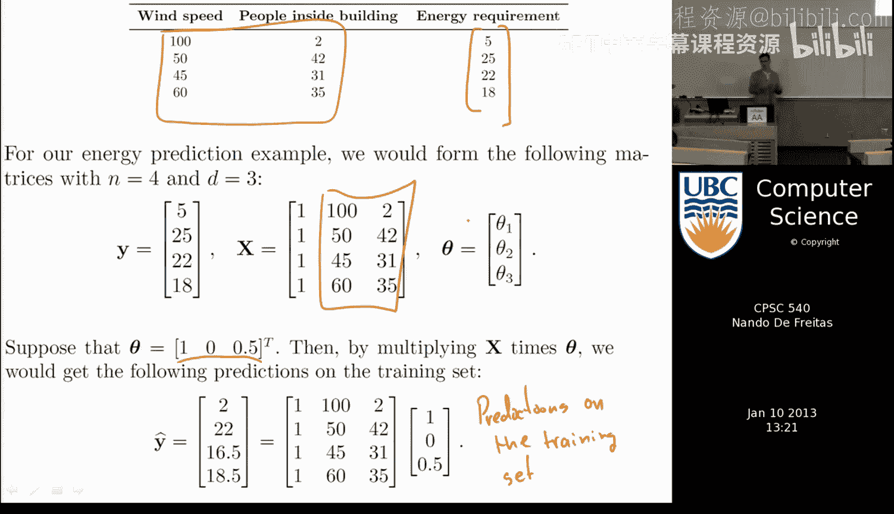

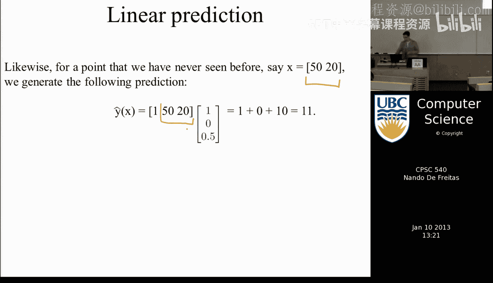

为了找到最小化成本函数 `J(θ)` 的参数 `θ`，我们使用微积分。在多变量情况下，我们使用梯度。梯度是一个向量，指向函数值增长最快的方向。在最小值点，梯度为零向量。

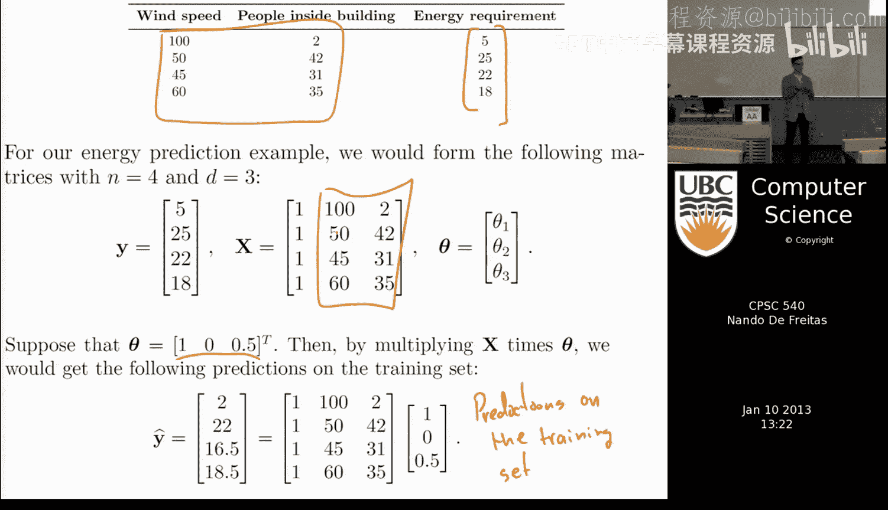

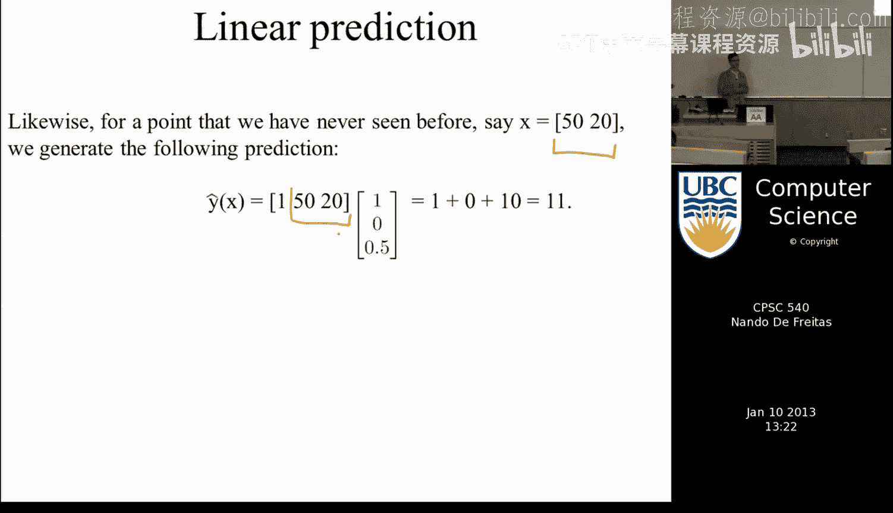

我们对成本函数 `J(θ)` 关于参数向量 `θ` 求梯度，并令其等于零：
`∇_θ J(θ) = 0`

通过矩阵微积分公式（可直接使用，推导见维基百科），我们可以计算出梯度：
`∇_θ J(θ) = 2X^T X θ - 2X^T y`

令梯度为零：
`2X^T X θ - 2X^T y = 0`

整理后得到著名的**正规方程**：
`X^T X θ = X^T y`

最终，我们得到最小二乘估计的解析解：
`θ̂ = (X^T X)^{-1} X^T y`

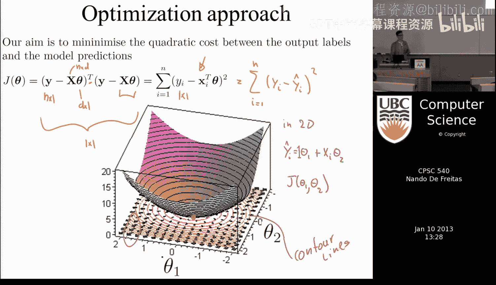

这就是那“缺失的一行代码”。一旦你将数据整理成矩阵 `X` 和向量 `y`，计算 `θ` 就只是一个矩阵求逆和乘法操作。

---

## 进行预测 🎯

在获得参数估计 `θ̂` 后，对新输入 `x_new` 进行预测就非常简单了。首先，将 `x_new` 构造成一个包含常数项1的 d 维向量，然后进行矩阵乘法：
`ŷ_new = x_new^T θ̂`

对于训练数据本身的预测（通常用于评估），可以一次性计算：
`ŷ = X θ̂ = X (X^T X)^{-1} X^T y`
我们常将矩阵 `H = X (X^T X)^{-1} X^T` 称为“帽子矩阵”，因为它给 `y` 戴上了“帽子”（即预测值）。

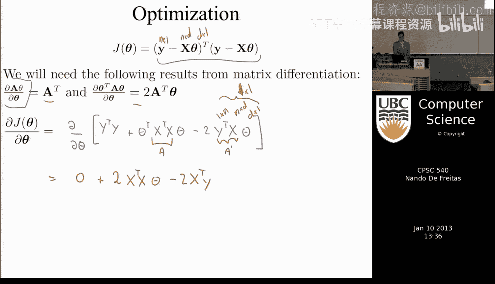

---

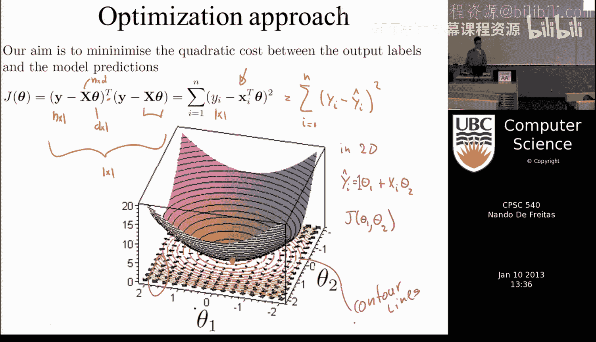

## 从优化到概率视角 🔮

本节课我们从优化（最小化误差平方和）的角度推导了线性回归。然而，我们注意到数据中可能存在误差和不确定性。处理不确定性的天然工具是概率论。

在下节课中，我们将从完全不同的视角——概率视角——重新审视同一个问题。我们将引入**多元高斯分布**和**最大似然估计**的原则。令人惊奇的是，通过最大化数据在模型下的似然概率，我们将得到与最小二乘法完全相同的解 `θ̂`。

概率框架的威力在于，它不仅能给出预测，还能量化预测的不确定性，并为构建更复杂、更强大的模型提供了统一的语言和粘合剂。

---

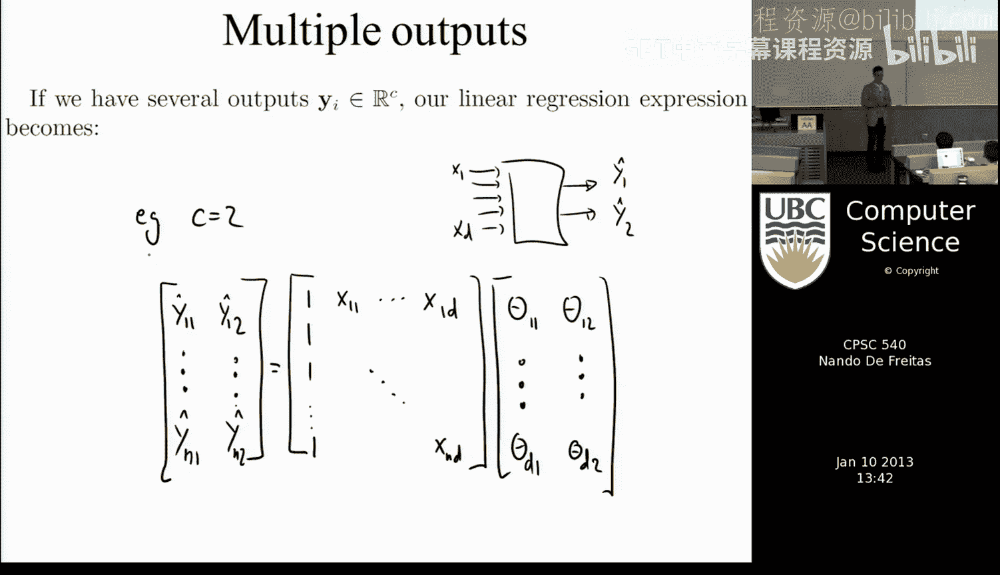

## 总结 📚

本节课中我们一起学习了监督学习中的线性预测（线性回归）方法。我们涵盖了以下核心内容：

1.  **问题设定**：明确了输入、输出、参数等符号表示。
2.  **模型表示**：使用矩阵 `X`, `y`, `θ` 简洁地表示线性模型 `ŷ = Xθ`。
3.  **成本函数**：定义了最小二乘成本函数 `J(θ) = (y - Xθ)^T (y - Xθ)`。
4.  **优化求解**：通过计算梯度并令其为零，推导出参数解析解 `θ̂ = (X^T X)^{-1} X^T y`。
5.  **预测**：使用 `ŷ_new = x_new^T θ̂` 对新数据进行预测。
6.  **核心思想**：将学习视为一个优化过程，即调整参数以最小化成本函数。对于线性回归，此过程有解析解。
7.  **前瞻**：认识到最小二乘法的局限性（如对异常值敏感），并引出概率论作为管理不确定性和构建更鲁棒模型的基础。

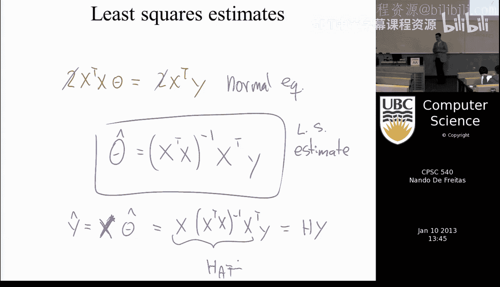

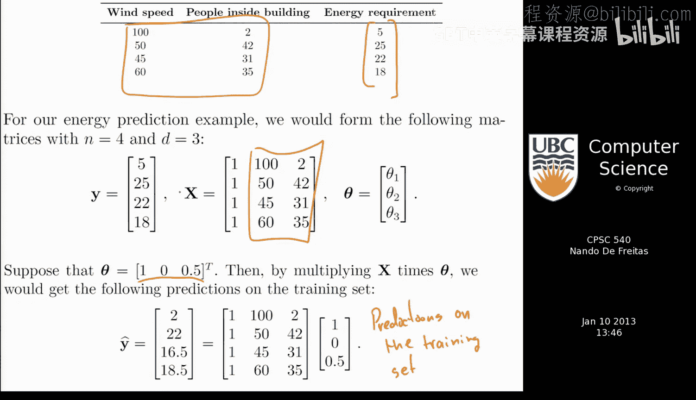

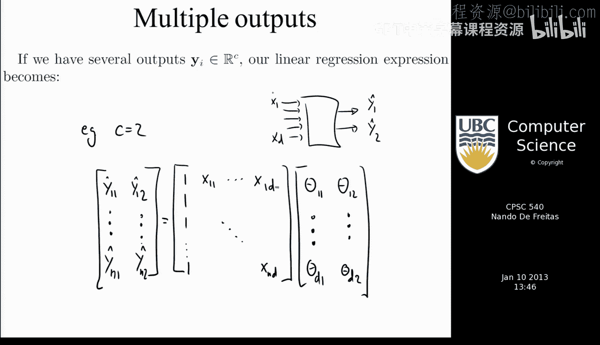

线性回归是机器学习中最基本但最重要的模型之一，它清晰地展示了从数据到模型再到预测的完整流程，以及优化思想的核心地位。