# UBC《机器学习（研究生）｜CPSC 540 Machine learning 2013》中英字幕 p03 -03-Machine learning - Maximum likelihood and linear regression.zh_en -BV19g2FBBEEq_p3-

Unnivariate， Gaussian distribution。How many have seen this expression before？

I'm hoping to a full show of hands。嗯。It's a way of measuring the uncertainty for a variable that is continuous between minus infinite infinity to defined on the real line and the multivariate distribution。

Probably。Have all seen it。Is this sort of bell curve。

Which is the find of the domain of a random variable X。

And a random variable is just a variable that's measuring some quantity that is uncertain。

So think of for example， temperature is a random variable， pressures around the variable。

 most of the concepts that we talk about usually in real life are actually random variables。

 there's no such a thing as temperature。Temperature is just a statistical estimate of。

How the molecules are colliding in this room， inticsipating heat。

I'm not going to go into the details of what is a random variable。

 what is a probability distribution， that sort of thing I'm going to assume that you guys have done a basic course。

And even if you haven't， you'll see that you'll pick it up easy in this course。

 I think most of the math， I will try to。Certainly in 340 I went over all these concepts so if you feel like you're a bit shaky。

 you can't remember your linear algebra， you can't remember your probability。

 please watch the 340 videos from last term， they're all in YouTube to sit back at popcorn。And。

And you'll basically learn everything that you need。

 Okay I'm going to introduce everything in the course， but I might go quickly over it。

Like I won't go into it。You know in 340， I have a whole term to introduce linear algebra probability and so on。

 so obviously I can't afford to have half a term to do that in a graduate class。Okay。

 so the Gaussian distribution is centered。At the parameter mu。

 which in this case is just a scalar because we have a univari distribution， it's a be curve。

It's with。Is controlled by this parameter sigma。The bigger sigma， the wider it is。

Sigma is called this standard deviation， Sigma square is called the variance。

 mu is called the expected value or the mean。And what's the area under this curve equal to？One。

 to probability distribution。Okay， so the integral。Of each of the minus one of a two sigma squared。

X minus mu squared。 if I integrate this over x。What should I get？Start of two bicycles。Exact。Okay。

Does everyone see that？The integral is the area under the curve， in other words。

 the integral of p of x。Dx must be equal to 1 from minus infinity。To infinity。

And so if I use the expression for P ofx， I realized that one over the square root of two pi sigma squared is just a normalizing constant。

It doesn't depend on x， so I just basically move it to the other side。

And that actually turns out to be a very useful fact。

If you know the normalizing constant of a distribution is something that we will exploit in based a different form of learning that I introduced in the next class called Bayesian learning。

Will exploit that fact to be able to do， to be able to obtain estimates of unknown quantities。

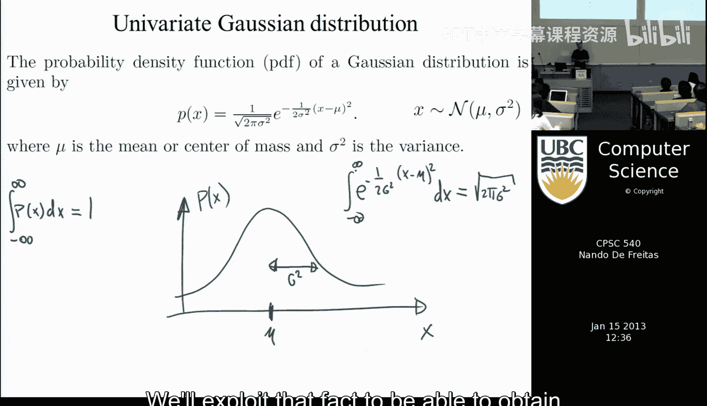

O。Now， if we have a Gaussian distribution， we can also draw samples。Now。

 what I mean by drawing samples， what I mean by drawing samples。Is that if this is my Gaussian。

I can call a random number generator and produce samples。

 And then I will get more samples in the middle， and a few。Perhaps in details。

 but most of my samples will be in the middle。When I write X。Simulated。Or sampled。Or generated。

Yeah general。Right did。From agasian distribution with mean mu and variance sigma squared。

 I'm saying that x is a candidate from that distribution。I've simulated it。Okay。

 now how do we simulate in a computer。How we simulate gaussian variables on a computer。

Has anyone looked into that？Rand end function。华证。出你买什。The random and function in MATlab。O。

 that's definitely one that I've used millions of times。 Now， how does Ran work？ What's the Python 1。

It's formationmation of many random。Brand， okay， sorry。Theran variables become。

Something we're going to talk about today， there's something called a central limit theorem。

That if you have random variables as the n goes to infinity， they sort of become Gaussian。

You might not have the time to wait till infinity， though in your personal computer。

 Rand is a lot faster than infinity。By now。Friday。end。So random is' very fast。

I called I say to my lab or Python， give me 100。Variables that have mean two and variance one。

And it's just like this。It's really fast， so you can't be doing asymptotic calculations in the limit。

It's doing something else。Okay， let's take a step back。How does a computer produce random numbers？

Any random numbers。There are some algorithm。Can I start from a sea。I think if you fix the seed。

 it always produce the。The same su South London London。Exactly。

 you took actually no nonlinear dynamical system。And you simulate。

 and this dynamical nonlinear nonlinear dynamical system is varied enough that if you pick a seed。

 that is if you picked the initial conditions of。If you choose the seatd。

 you're choosing the initial condition of that nonlinear dynamical system。

You'll always get the same random numbers。 That's why we sometimes freeze the seat to get the same random numbers。

 but essentially drawing random numbers is just taking a process that might depend on the time in your computer。

 a deterministic process and then picking these numbers and then assuming that they're actually random。

 They're actually pseudoran， computers are pseudoran devices。

 they don't actually give you random numbers now。They're good enough。That we don't worry about it。

 but there are some various sort of fancy applications of simulation。

Where the random numbers that computers produce are not good enough。And so we get into trouble。

And in those cases， physicists go through great extent toward getting random numbers。

 they will take devices that measure the gamma rays， or I don't know， I' impinging on the atmosphere。

 and they create this box， which is a random number generator that uses these gamma rays and they sell it to you for like 100。

000 bucks。So producing random numbers is actually quite an act， and it's a difficult engineering。

Pieace of war in computers we use， there's been a lot of work considered random number generators in order to produce these。

Random numbers。Now， it turns out that for a lot of machine learning algorithms。

 we will use this process of generating random numbers。

But we'll not just generate them from uniform distributions， but from all sorts of distributions。

And that process of generating from the distribution is essentially the process of imagining。

Okay or the project of the process of predict。Who are the humans that are best at imagining things？

Artists， children。Children are always in the special world。 you know。

 they're inventing little things。 There comes the prince and the prince kills the princess。

 and she like。The dragon flies over。And they always have these little worlds。

 and they're always imagin that' because theyre the ones that are learning the most。

The learning causality and learning relations in the world。

 being able to imagine is essential to intelligence。

And we humans are particularly good at imagination at simulating scenarios in the world and most of us live our lives in these scenarios and you know life is what goes by when you're not thinking about it。

 as many have said， but we're always simulating what's going to happen in the future。

 you know how will this class end up， you know what kind of job will I get if maybe I will I don't know。

 maybe she'll like me and go out on a date or whatever？We live on these simulated scenarios。

 which are essentially our hopes。And so on， that also our regrets because we also simulate the past。

What would it have been if I had done that？If I hadn't been a total juice bag with her。

 would she still be with me， that sort of thing？And that's actually very useful， too。

Because that allows us to deal with what。What scientists call more dry counterfactuals。

And that's going to play a bigger role in learning causality at the end of the course。

Because you only learn what causes what if you can。Think of what would have happened。

 had I not done this， but had done something different。

Being able to do that simulation in your head is essentially doing an experimentation。

 doing actions in your head。We humans keep acting on the world without actually doing anything。

 We just run the scenarios in our head。 And that's essential in order to understand the world。

And to learn so simulating is sort of very important and a lot of the algorithms that we will learn later for learning and this is something I didn't do in 340 at all so for 340 guide is new。

Simulation will be critical to being able to do learning。Okay so。

Computers have the pseudo random number generators that allow them to draw numbers from uniform distributions。

Now， a uniform distribution is just something that will look like。This。Okay， it has uniform height。

Enhance uniform。Now， when we draw samples from a uniform distribution。

We will expect that those samples are sort of。Uniformly distributed。

So that when you take a histogram of those samples， you sort of get back sort of that box。

 that uniform box。If I were to take a histogram of these samples。

 I would probably get a big box here， another box here。Maybe a small box here。

 and then this would be at zero。And essentially this is the process of Monte Carlo。

 your histogram samples， and then just histogram， the more samples I have。

 the better that histogram will approximate the actual density， the actual distribution。Now。

 the way we generate this in a comparison is as follows。We don't know how to generate from agaussian。

 we do have an expression for the cumulative distribution of agaussian。

So if we have a Gaussian distribution。P of x。As a function of facts。We can also integrate。

We can also consider the sum。As we move from the left of the areas and we will get a curve。

That looks like this。And this is called a cumulative。

It starts at zero and it goes all the way up to one because it's the area。

So it's the area under the curve as。We move this point x。X no from left to right。

So that's our cumulative distribution。So what we can do now is the following trick。

And this is what I think Matla does this。You have the cumulative of a Gaussian。

Which has some thoughts at one。And then on the image， on the y axis。We do the following。

We put a uniform distribution there。And then what we do is we draw a random number according to that uniform distribution。

That's using the pseudoranom N generator that gives us uniform numbers。We project。

That number onto the line。And then at the point of intersection。We read off the sample。Now。

 what's going to happen is if you think about it and you look at you take several samples is that you'll end up with。

More samples here and less in details。So you end up with samples。So when you do the projections。

You get something that will look like this。Where most of the samples are around the me。

I should have said the point of a half。Is where the mean is。Because a Gaussian issymmetric。

So most of the samples will be about the mean and very few samples toward the tail。

And the tails of Augustsian because agasian is an exponential function。

 those tails go down to zero at an exponential rate， so they vanish very quickly。

 so the probability of getting a sample in the tails away from the me vanishes at an exponential rate。

Okay， so that's how a computer then generates Gaussian random numbers。That's how Rand end works。

So RAand gives you the uniform random numbers， now we know how to generate Gaussian random numbers。

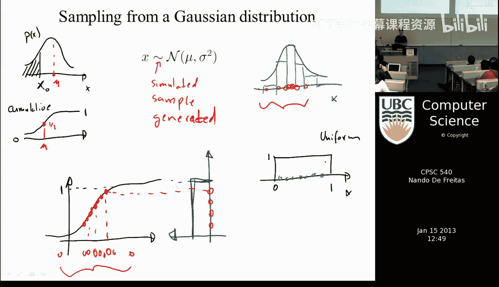

Now we can move on。Most of machine learning isn't with many variables， not just with one variable。

 one variable is like first year， second year undergrad， everything we do is with many variables。

With two variables for illustration purposes， your samples again will sort of capture where most。

 if you were to draw samples from this2D Gaussian distribution， which you call。

Technically by variant。嗯。You would end up with a cloud of samples in the middle and less samples and the tails。

Now， the bivaria distribution， if you look at it from the top， can have many different shapes。

 You could have a bivariate distribution。Like this， that is perfect that's circular。

 you could have one where。The variables， say x1 and x2 are positively correlated。Or something like。

That's where they're negatively correlated。But most of the samples would be in the middle and beyond a certain point。

 the probability of getting a sample is very dull。

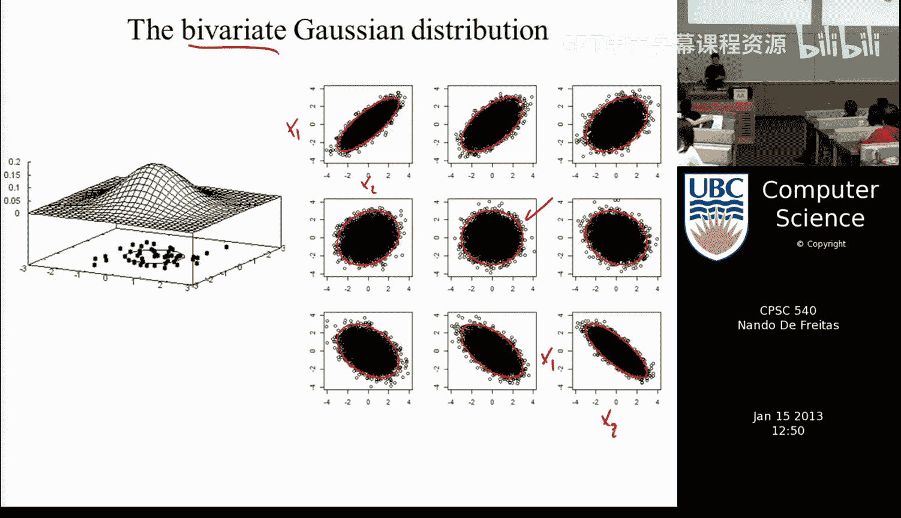

The multivariate gaus and distribution is just a generalization。

 so it's a bell shape in n dimensions。We can no longer visualize it。

 but the expression is still the same as what the expression would be for Augustian。嗯。

And it's essentially given by this formula。let's parse this formula so this is a distribution in terms of why。

 so y is the random variable or random vector in this case because y is the vector in n dimensions。

Mu is a vector of n dimensions and muu essentially is again the center， so in the 2D。

This would be mu1。And this other coordinate of the center would be mu2。

 so the muse give you the center。And then， the matrix sigma。Describes the shape of the bell function。

So in the 2D case。We wouldn't have sigma being。Equal to sigma 11。Sigma 1，2， sigma 2，1。And Sigma 22。

Sigma 11。It's essentially the variance of this distribution。Along the。Along this axis。

 So if I work to look at the distribution。Let's put an eye here if I look at it this way。

I'm going to see a Gaussian。And if I look at it this way， I'm also seeing a gu。

So if I were to cut this on any direction， a bell， I would still get a bell in a lower dimensional。

Space。Sigma 11 looks at the width in the lower in the x directionigma to2。X2 direction。Or sorry。

 in this case， I'm using the variable Y， the y2 direction。And then。This term here。

Looks at the cross correlation。 So let's look at some examples。

 If I have something that is sigma equal to。1，1，0，0。My contour plots will look like this。

 they'll be circular。That's when the variables are independent。If I， on the other hand。

Have some correlation。 So sigma being equal to， I don't know 11。5。5。And sigma symmetric。

 So Sigma 21 is all Sigma 12。Then I would have something that would look more like this。

This would be in an elongated ga。And if they're anti correlated。

 it will be in the the opposite direction。

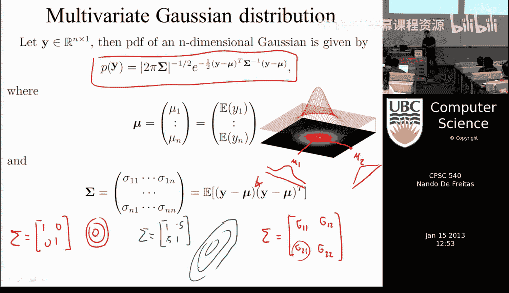

So by changing sigma， I essentially get all these shapes here。These are just different friendship。

 So sigmma muu are just parameters。 They typically will be unknown。 Typically， I'm given points。

And I tried to learn。Did be use and signals。And we'll see an example today of how we do。

 we'll move on to an example， how we learn the parameters of the Gaussian from data。

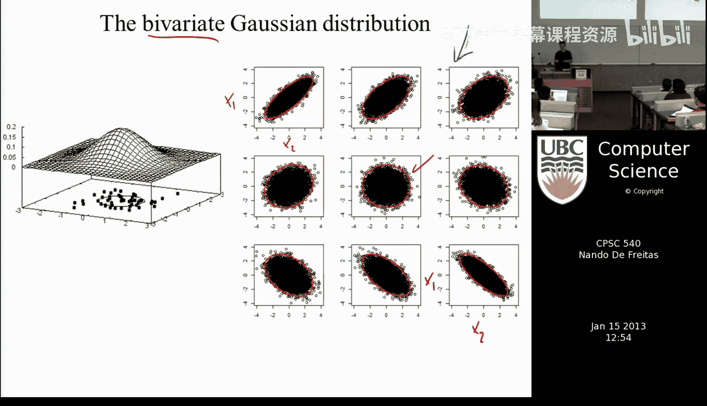

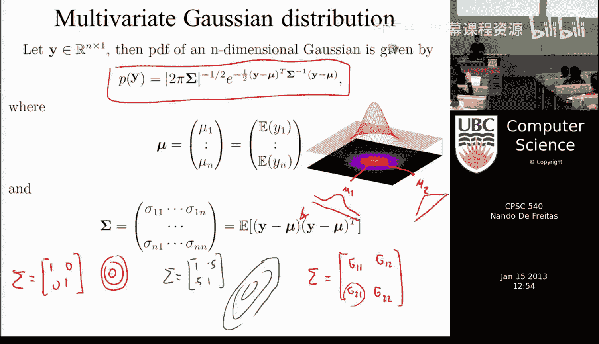

All right， so let's continue playing a bit with the definition of the Gaussians。

I know this is a bit dry， but it's really fundamental to know how Gaussians work in order to do machine learning。

With continuous variables。Now I'm going to introduce a concept called independenceence。

And somehow imagine that this is a circle。I was a poor designer。

So if you have two variables and they're independent。And I'm saying that both variables are Gaussian。

 one variable has mean mu1 and variance sigma squared， the other variable has mean mu 2。

 and it has the same variance， which is sigma squared。Then the joint。Of two independent variables。

 B of x1 and x2。Is the product？Of two distributions， that's what it independence means。

Independence means that you can break the probability as the product of the individual probabilities。

And if we do this calculation and we write this as two pi sigma squared。For the minus a half。

And then we write the expression for these probabilities。I can。Group terms。And write this as two pi。

Sigma squared。To the minus2 over 2。I multipied the constant factors outside。And then。

I write this as e to the minus。And I'm going to write this， try to take this to vector notation。

And I'm going to write this as E to the minus a half。X1 minus me1。

And I'm going to transpose it because it's a scalar， it's the same。And then sigma。Qured。-1。

X 2 minus me2。Plus。Oops， sorry， x1 minus me1。Plus， x 2 minus me 2。

Where I'm going with this derivation is。I'm trying to go from the univariate distribution to a multivariate to the bivariate Gaian distribution so that you can see how you map from one to the other。

And so this is equal to。To派。Sigma squared。Minus with a power minus y。And then I can rewrite this。

As B to the minus a half。Times。X minus。Me one。So I'm going to create a vector here。

Which has me1 and mu2。I'm going not put brackets are separated。Okay。So what I sorry power is。早下げた。

In the power minus to you of this guy。The segment is quite a second。-2 Oh， that should be -1， sorry。

Thank you。I have already done it。So。So basically the way I've written it now。

 you can see that it's just a vector which has the terms x minus the mean。

Times the covariance in this case， which is just。There's matrix here。

So this guy here now is essentially sigma。So。

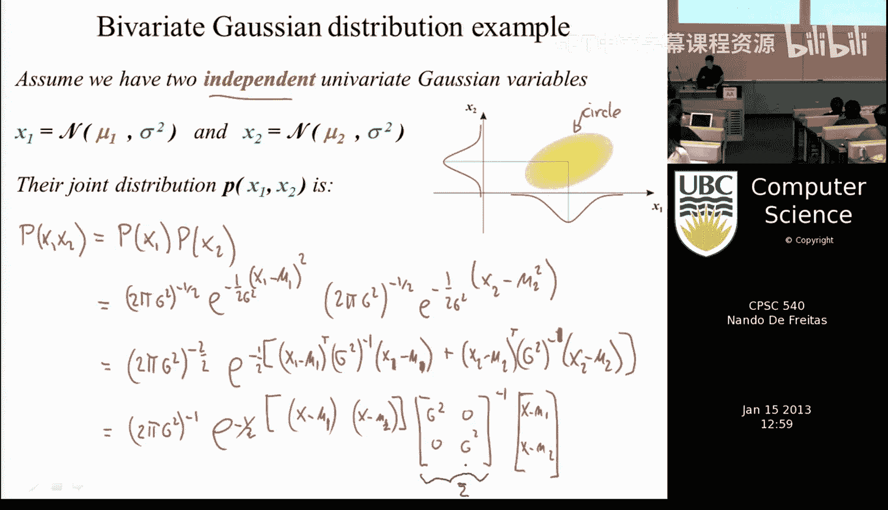

What weSo if we compare it to the expression of Agaussian。

 that matrix that has the sigma square is just a sigma， and then there's a vector y。

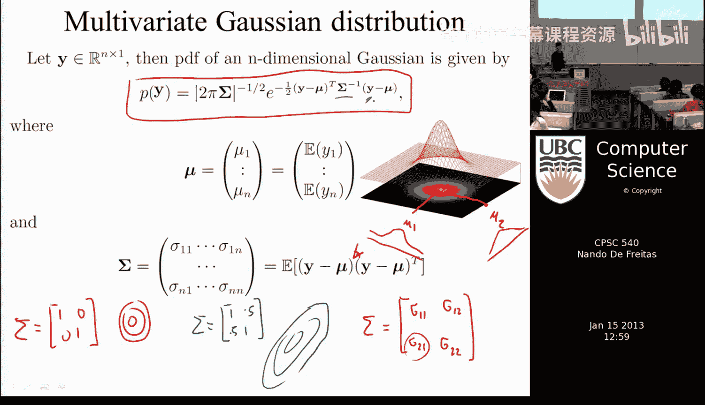

In this case， I'm using the symbol X， and then there's a vector。嗯。

And I should actually use indices here。And then there is a vector of the means mu1 and mu2。

 So that gives us the mapping from Uniivariage to multivariity。

 The other thing that we see is that if variables are independent。The covariance is diagonal。

 there will be zeros of the diagonal， zero in the of diagonal agasian means that you have independence。

There's a question here。Previous。The absolute value。

Oh yes， so we can also so here we have。Not the absolute value， but the determinant of a matrix。

 So the determinant is the product of eigenvalues。Or。The usual form of the German。

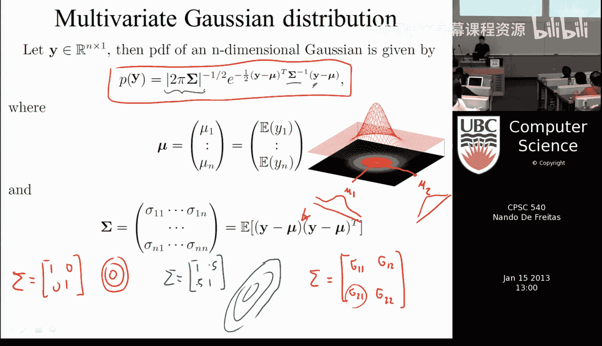

So I haven't shown that part yet， but it's kind of。If， if sigma。If we let sigma be equal to。

Sigma squared， Sigma squared。Like this， or as I often like to write it sigma squared times the identity matrix。

Were at that end matrix some matrix tricks with ones in the diagonal and zero elsewhere。

Then the determinant。The determinant of the matrix is just sigma to the power4。In this case。

Just using the standard definition of the determine。

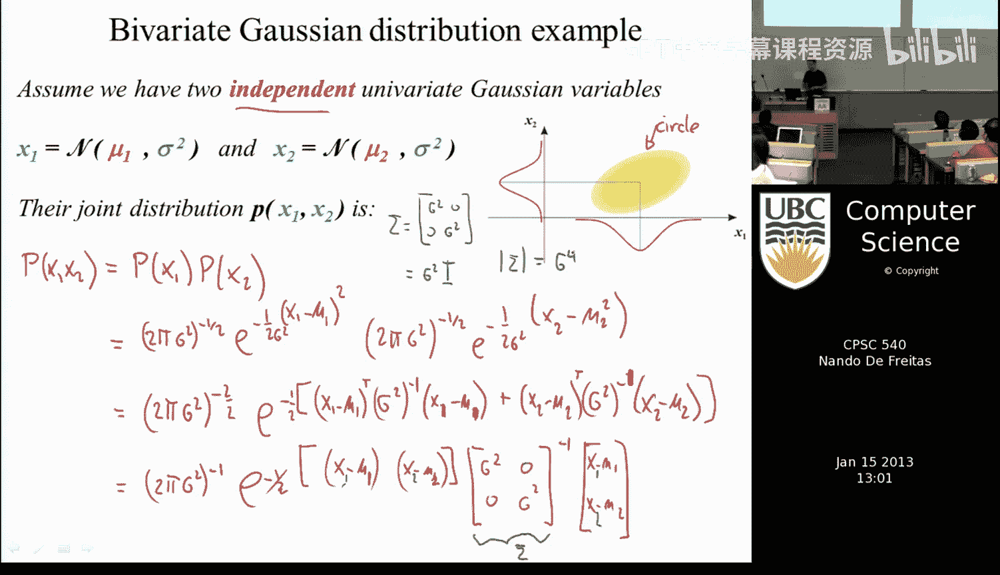

I will leave it to you and this is a good exercise。

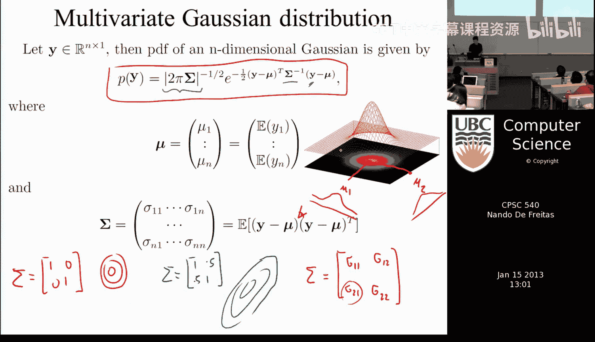

To show that this expression here is identical to this expression。

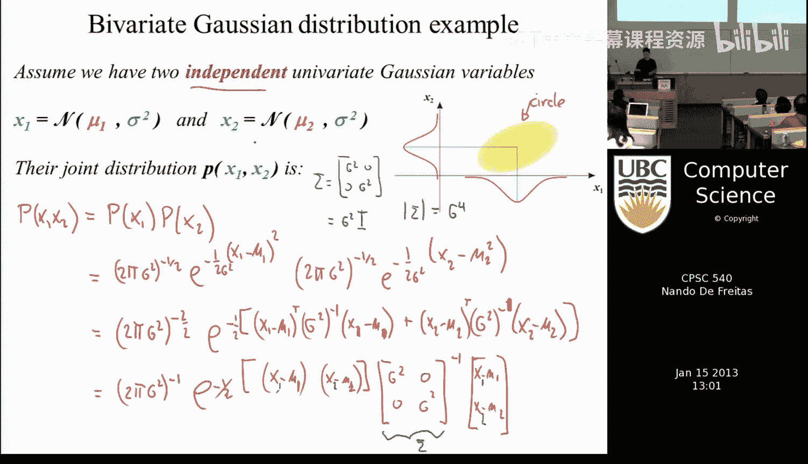

All right。Now how do we sample from this distribution Gaussians is one of those things that is very dry I'm not going to spend more time in this lecture going over the details of Agaussian I strongly recommend you spend some time on the Wikipedia page like I said in the Google group today because then you can just basically revise all the properties of A Gaussian and then I'm going to give you on Thursday a bunch of exercises that will get you to many pure late。

Gausians and learn all about their properties。 I will also give you a data set on Thursday so that you start doing some data analysis。

 A big part of this course is to play with data。 So on Thursday， we start doing that。Okay。

 how do we sample from a Gaussian distribution， So we know how to sample from 1 D Gaussians。

 We know that if we have。One D Gaussian。We know how to draw a sample from a one de Gaussian。

And hences， in particular， in machines。We know how to draw samples from a Gaussian that has zero mean and variance one。

Now。If all we can do is draw random numbers that have zero mean and variance one。

In order to draw random variables that have me mu。We essentially draw if if I had why。

Let's give these guys different names and y is n01， and I want to draw x。

Then I will just basically draw x by。I draw y， I multiply a time sigma。And then I do a shift。

I'm going to get you to prove this in your homework。That these two expressions are equivalent。

But you can sort of at least the mean should be obvious if you want to change if you have random variable center at0 and you need random variable center at 2。

 you essentially draw the random variable center at zero and then you add to shift them。

And with the variance， you just need to pay attention to that square。 Now。

 if you're in the multivariate case， using this derivation that we did before is essentially what were going to what's going to be needed。

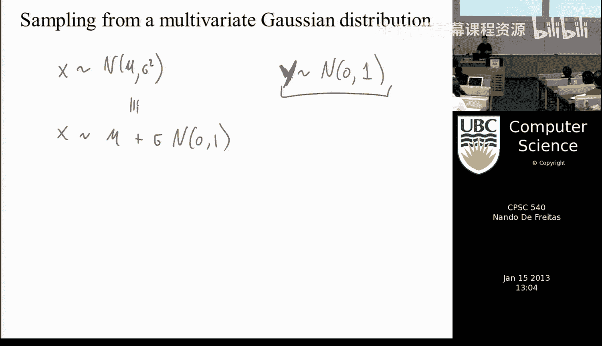

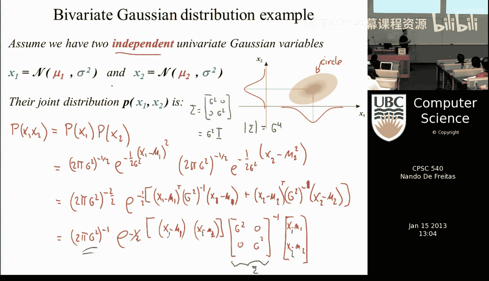

嗯。If we need to draw a random vector。From a multivariate distribution with mean mu and covariance。

Sigma。We will first。Break the matrix， sigma。Into the product of two matrices。

I'm using the double bar and the indicator it's a matrix。And this is called a collesator composition。

And we won't really be doing this。The computer will do this for us。

 I'm just trying to tell you what it is that the computer does so that when you use the computer。

 you know what that device is doing for you so that it's not magic numbers coming at you。

 but you actually understand where they come from。 So if you take a course on sparse linear algebra。

sort of numerical linear algebra， you learn about this thing called a colles composition。

 which is a way of factoring a matrix into the product of two matrices。

 which I'm just stating the fact I'm not going to tell you how to do that for that you take a linear algebra class。

But if you have that， that's essentially the equivalent of taking the square。And we will be able to。

Draw this vector。By simply adding a vector。To the matrix B times。Gussan variables and。G着 one。Now。

 if I know how to draw this guy。If I know how to draw the one de Gausian variables。

Then using the previous derivation， I know how to draw these variables。Because essentially。

 if I want to draw n variables， I would just draw n。1D variables。And once I have N1D variables。

 I multiply them times the matrix B， and I add to it the vector mu， and that's my random vector。

 my Gaussian random vector， multivariate Gaussian vector。Okay。

 so that's just to give you an idea of what the details are of how mat lab gives you those random vectors。

 those gaussian random vectors。四分。Yes。Because as long as the sigmas are what。

People call symmetric positive definite matrixes。They have positive eigenvalues。Which they have to。

 becauseian if Agasian didn't have that property would kind of implode on itself。

 it would no longer be a bell。Okay， so that's how computers generate random numbers。And。

The process of learning from data is essentially going from samples that you see in the real world。

 samples of images， samples of things that people do to a model。In this case。

 I'm using this Gaussian model。Whi at this point admittedly is a bit abstract。

 but hopefully when I start doing linear regression it will be a bit more concrete and then the process of imagining is the opposite is you have that model and you generate samples。

And like I said， and hopefully convince you in the first lecture with those videos that if you can imagine the world。

And the world is， as you imagined it and your predictions。

 that means that you kind of have learned about you understand the world。

If you happen to be one of the unfortunate。People that have extreme forms of schizophrenia。

 You will be imagining， and you will not know whether you're imagining from whether the signal is coming from your senses or from your imagination。

 And so you'll start seeing。You'll start seeing a reality that isn't there。

And that's common in most of us。

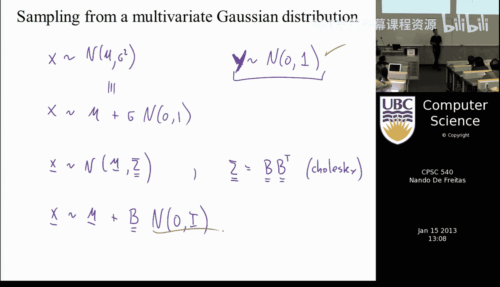

So understanding learning is essentiallyity。嗯。A big part of understanding the the human condition and also a big part of。

Making moves toward designing drugs to help people with mental disability。All right。

 let's be a bit more now concrete to what I mean by learning， were using probability。

Let's now assume that I have three data points。And these will be scalar data points。

 and essentially they are three points，1， 0。5 and 1。5。

 and those are the points that I've shown here in these two alternatives at the bottom。

 so they happen to be oh wow。I'm going to use this one。

 that happen to be the blue points in the nice project。Now I'm going to consider。

 I'm going to assume， and here comes the big assumption。

 I'm going to assume that these points come from a Gaussian distribution。

 That's my model for the date。 They may or may not。 but for now。

 let's assume that they do come from a Gaussian distribution。

And let's assume that I do know that the variance is one， so there's no uncertainty there。

But I don't know what the mean is。What's the mean？That best describes those three points。Now。

 we obviously know that if to get the mean， the expected value。

 a good estimate is just to add those three numbers and divide by three。Which would give us what one。

Okay， so that's the。But where does that come from or does that rule come from。

 that's what we're going to go over now。Let's assume that I have two guesses at theaterta。

 so two different people gave me two guesses， one person told me one。And another person said， no， no。

 no， I think theta should be 2。5。How many of you would pick T equal to 2。5？Cta equal to1。

Okay one of the people with the hand up， why？That's correct。And by likely。I mean。This。

And I think she means。This green bar is taller。If the three points are independent。

In order to compute the joint probability， we just multiply the three green bars。

In the model on the left， the product of those three green bars will be bigger than the product of these three green bars on the right。

 and so that's why we prefer that model over there。This distribution， P of x given theta or sorry。

 P of y given theta in this case， is what we call the likelihood。

Is the probability of the data given the model。 The model in this case is once you know the parameters。

 that's your model。out of two alternatives， the one that makes the data more probable。In other words。

 the one that explains the data better。Is the one that we choose。

 that's essentially the principle of maximum likelihood。

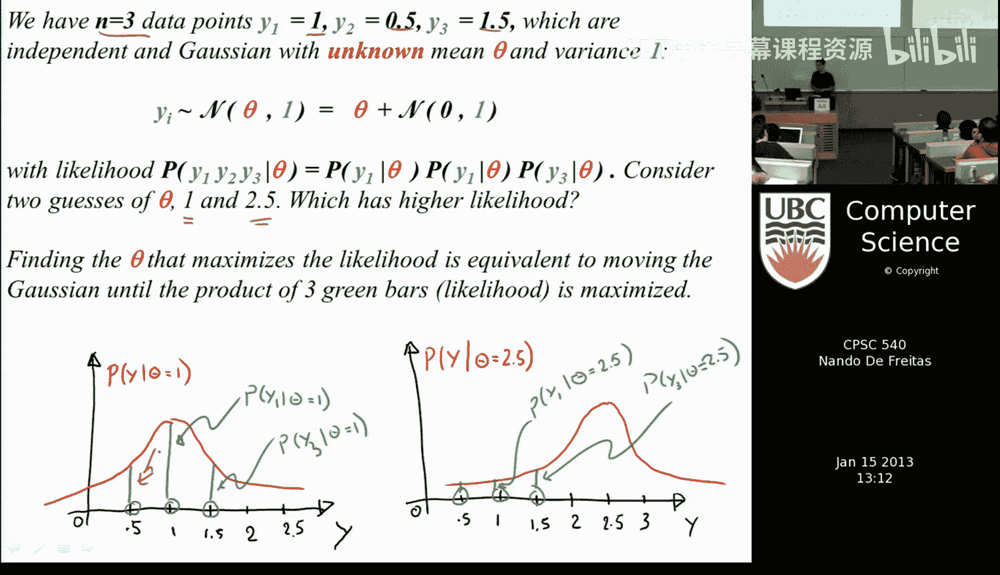

Which I will formalize soon， but it sort of gives you the intuition。Okay。

 now how do we do linear regression？ So in the last class， we learned that to do linear regression。

We would take。If we had several points。And we want to do linear regression。

 We essentially fit a line。For the those points。And then the goal was to minimize these quadratic distances。

So in other words， minimize。Y minus x times theta。Transpose y minus x theta。Over theta。

 and then we said that the solution was x transpose x inverse。Next transpo y。

 so provided that you knew how to form the matrixes X and y， computing theta was a trivial thing。

And that's guaranteed that we minimize these square distances。Which is equivalent。If I rewrite this。

That's minimizing。The sum from Michael 1 to n。What in this case， n is equal to the number of points。

 which is6。Y I。Minus。X I transport。So。On the probabilistic perspective， on the other hand。

 we simply assume that the Ys will be distributed according to a Gaussian distribution。

That H y is Gaussian。And that the mean happens to be the line， in other words， x transpos the。

And we will assume that those points will have a variance。They vary about the line。

So the line will be the me。And the points will vary about that line。

Saying that is essentially in math is the same as saying that the mean is x transpose theta and the variance of sigma squared。

The joint distribution of the vector。Of the n components of the vector y。

 if we assume that those points are all independent。

 it's just the product of the probabilities of each point。And each point we're assuming is Gauss。

With mean， exc theater and various。Sigma square。Now， if I take a product of。

A constant to a power and times I just basically get the constant to the power N。

And if I take the product of an exponential n times， I just get the exponential to the sum。

Overpper end of the exponents， just using the properties of exponentials。You know。

 E to the A times E to the B equal E to the A plus B。Now。

 we see that now this distribution is starting to look a lot like。This minus the  typepo。

So the distribution， the exponent， is starting to look a lot like the error function that we try to minimize。

So maximizing that probability。Will be equivalent， as we'll see as minimizing。This cost function。

Minimizing a cost function is the same as maximizing a probability。So that's sort of very important。

 and that's a common theme throughout all the models。

And now I can do the same thing I can rewrite everything in matrix vector notation instead of writing it as a sum of squares。

 I can group terms， and I can essentially get something that looks more like the second term that we had in the last class。

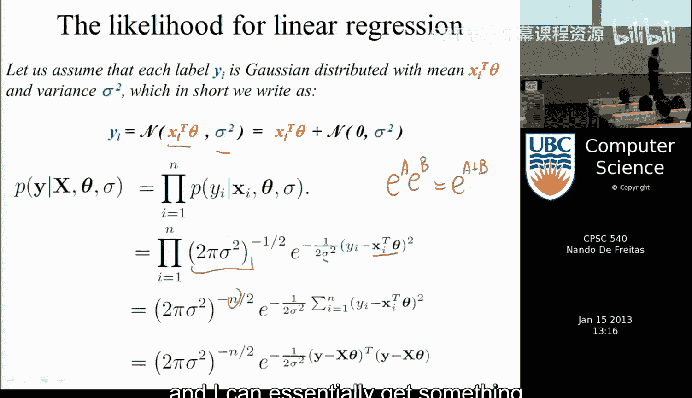

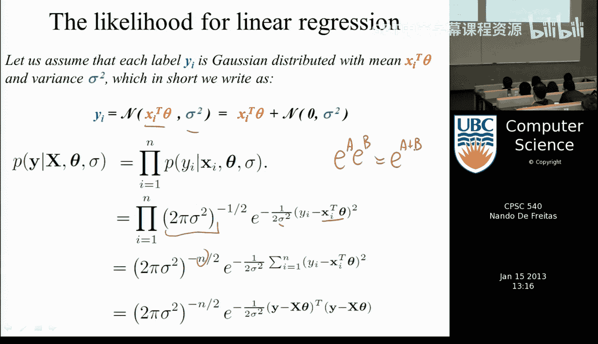

Now。What's the picture， The picture is still the one of linear regression。

So we still have a variable y。An input variable x。We have many points。

We fit a line that goes through those points。The line has a。A slope and an intercept。And。Each point。

Xi。Has height Y I。The prediction is why I had， which is。Exide transpotheta。Which is the me。

And to say that each point is Gaussian distributed。

It's just saying that there is a Gaussian distribution。Whose mean is centered at。

So the mean essentially is equal to Y I had。And that has a variance sigma squared。

So each point is distributed according to August。And the distribution is on the y direction。

Because we talked about the probability of y， not the probability of x， x is assumed no。

Some notation， actually as we're introducing notation， this bar here means given。

So the quantity is on the right。Ar given。Because typically in linear regression。

 someone gives you an x and you have to predict the Y。

 so your uncertainty and predicting is in the Y， not the x， the x is usually given to you。

 so you observe。I go ahead。So let's say there's a certain measurement that you believe it more or less。

 then you're just going to use a weighting matrix。That you believe it more or less。

 you mean a measurement x or a measurement than y。And why。this is kind of what we're saying here。

We're saying that we believe， I believe this Y comes from that Gaussian。

But I'm not saying that it's centered at the line， I'm not saying that I know precisely what it is。

All I'm saying is that it comes from that Gaussian。So when I say that， I'm basically。

 if I understand your question well， I'm saying it's most likely to me say in that interval。

But in the process， when you're， for example， doing the list work。So you're estimating。

 the mean and the variance。And let's say you have some sort of prior knowledge。

If a certain measurement is。More or less likely to be accurate。Then。Oh yes。

 so I might know that one sum of X's will have lower variances than others。

 in which case I would have a different variance yeah， so you could do that very easily。

So I'm going to do the case where the variance is the same for all the points。

 and I'm going to leave the other one as I often do for the exam。You'll see that。发诉。

By the time the exam comes， if you've attended these elections， you'll know the questions。

 Would you of the distribution of why affect fact。The maximize functional you end up with。Yes。😊，I。

 I'm picking the distribution。By choosing the distribution。

 I have made a strong commitment to what I believe in Moles。 but here is the thing。

 if you know how a Gaussian distribution works， you'll know how a common filter works。

 how many people know what a common filter is。If you fly an aircraft。

 it would crash if you didn't know。We just like making an announcement。Other thoughtss。Oh。

 how long will you take？出てやるかま。Yeah， the class ends。Can you come back in 20 minutes。Thank you。嗯。Okay。

 so in 20 minutes remind me。That he needs to make an announcement， we should be done。

And that completed。Aircraft， they use carbon filters to land。The cars that drive by themselves。

 they use common photoss。 What not common photoss。 They're just the mechanisms that take two Gaussians。

 multiply them or collapse gausss。 They're just Gaussian manipulations。

And most of the algorithms we use for many things are just gaussian manipulations。We will。

I've talked about Gaussians over scals， Uni Gaussians， I've talked about Gaussians of a vectors。

 not the ver Gaussians， and next week I'm going to talk about Gaussians over functions。

Once you understand Gaussonova functions we'll be able to actually come up with some very powerful optimization algorithms that could lead to like massive changes in automation in the world over the next few years and once so as of next week I'm going to start just。

In a week and a half， I'll be able to run by you a bunch of project ideas of things that haven't been done yet and that you could do just by understanding what a Gaussian is。

 A Gaussian is a super cool distribution。

Very gentle。

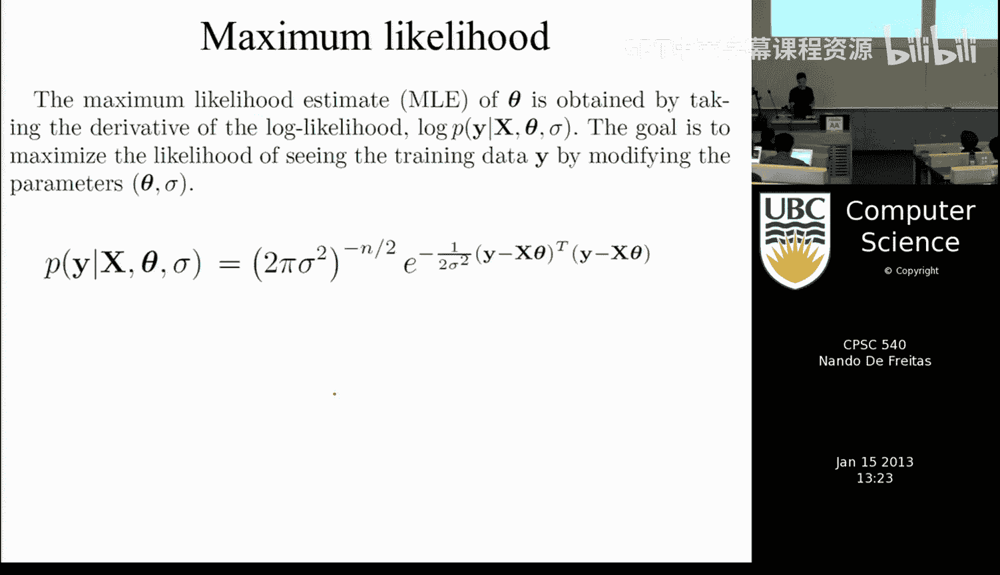

And of course， each point， I forgot to say that， but essentially each point is assumed to be Gaussian distributed。

 so there is a Gaussian。For each of these points。And so， the process。

The process of learning just like before is just the product。

 the process of maximizing these green bars。

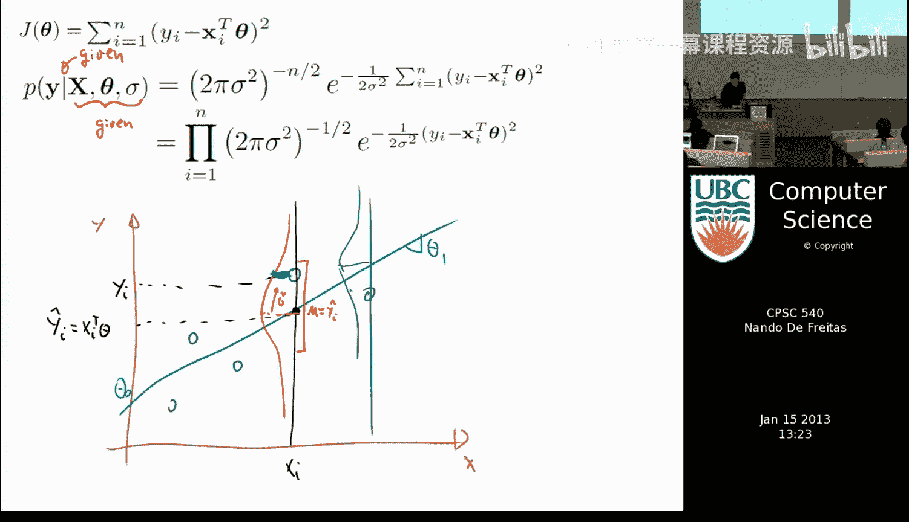

So just like in this previous。

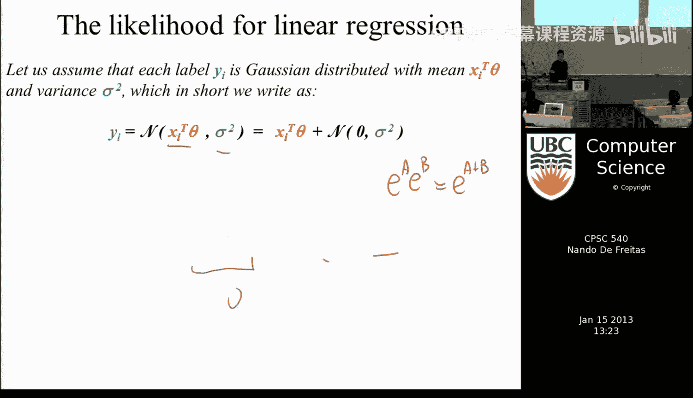

Game where we try to maximize the height of the green bars。

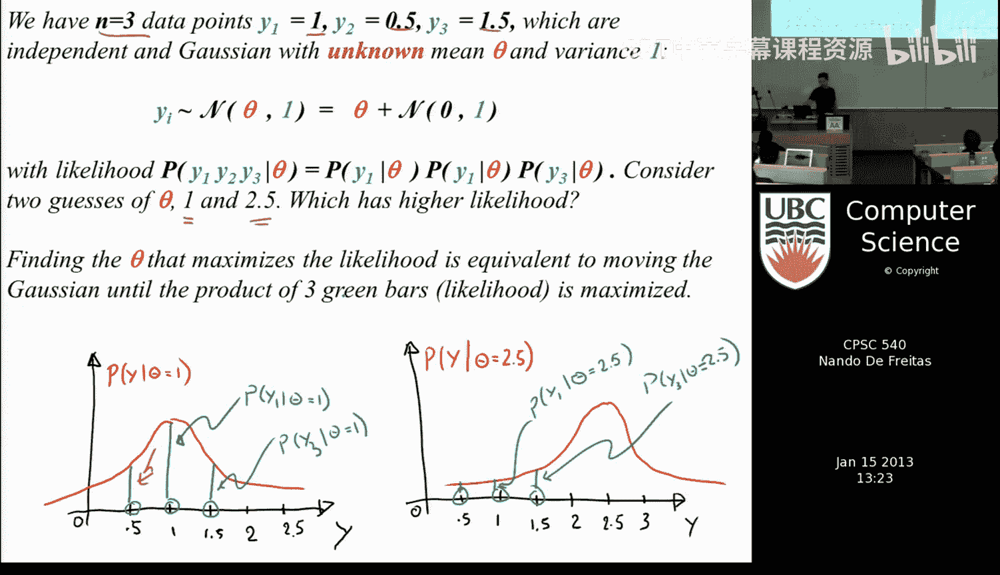

Linear regression is all about changing the slope of that line to maximize the height of the screen bars and maximizing the height of the screen bars is the same as minimizing。

These sprinkle less。In this case。If we assume all the are uniform。

But I have a feeling that even if you were to assume that they were uniformly distributed。

 you'd basically be assuming that there's a distribution somewhere like this。I have a feeling that。

 even if when。But with the uniform distribution assumptions， we will get。A line like this。

YouYou'll get a pretty good line， in fact， that line is going to be more robust to lives。

So this you could do this linear regression with many distributions。For now。

 I'm trying to teach you how to do it with a gas。But but you're absolutely right。

 Would the results be the same， No， no， it's not going to be the same。

Depending which distribution you use， you'll get different results。 So here is one thing that people。

I'm going to take a break and sort of go over。Here's one interesting case。

 suppose you have points that look like this。Now， this is very common're measuring。

You're measuring a flow meter somewhere up in northern BC。

 and that's being transmitted through you know the height of the water is being transmitted through a satellite link back to a place in Surrey where they're doing all the data analysis。

 and they're trying to basically decide when to open the gates of a dam or not。

 they're trying to avoid。The water from fluctuating because when the water fluctuates。

 basically if it goes up too quickly， the little fish go to the shore。

 and then if it goes down too quickly again， then the little fish get caught into the puddles and then the little fish die and as a result the amount of nice fish that we get in our restaurants in Vancouver goes down。

Or the price goes up。 so this is actually a realistic case I've done consulting on this kind of stuff。

What happens there sometimes is that these measurements get corrupted。

 either in the satellite link or the sensor gets stuck or and then of course。

 it's very expensive to send someone to repair and you just have to live with it。

 The data is going to be dirty and it's going to have these guys outliers。Now。

 if you want to predict， do some sort of fit a model to do some sort of prediction。

You ideally would like to fit a model that does this。But here is the catch。Because this point。

Because errors are measured in terms of vertical distances。There is， this error is going to dominate。

 This is going to be a huge number because it's squared。 So we would be， let's call this point y 3。

And so this height here is Y3 hat。Y3 minus the prediction squared is going to be a large number。

So that spring is going to really pull the line。 And so when you learn， you will。

 instead of learning this beautiful line。We end up learning the green line， which is。

I've exaggerated a bit， but it's going to be off what you would want。So in this case。

 what's really screwing us is this Gaussian assumption。Equivalently， the squared assumption。So， by。

Assuming a Gaussian。On this point。I'm placing a probability distribution。And as I mentioned。

 the center would be mu， but because it's an exponential。

 the Gaussian is an exponential means that this height is decay exponentially。

 So this green bar here。It's exponentially small。Now， when I multiply all the green bars。

 this green bar here will be almost zero。 so when I multiply the all green bars time that green bar。

 it's going to give me a very low probability solution。

So the way that the model will try to fix this is by going for the green line。

 tilting the green line， and in which case we get a very bad prediction。How can we fix this？

We get rid of the gu。And we introduce a different kind of distribution。

 so I'm not going to tell you which distribution， but typically what we would use is something that we call a T distribution。

And without defining it， it looks like this。It's a distribution that the tail doesn't decay exponentially。

 It doesn't decay as fast as a Gaussian。 So if a point is out here。

 it will still have some probability。 So that number is not going to be close to 0。

And cause under floors at。Cause any other sort of trouble。

 And then we will still be able to get a line that is close to the black line。 So in some cases。

 it will be important to move away from the Gaussian distribution。 like in this case of outliers。

But before we move away and I introduce all the formulas for the T distribution and so on。

 let's stick with the Gaussian。

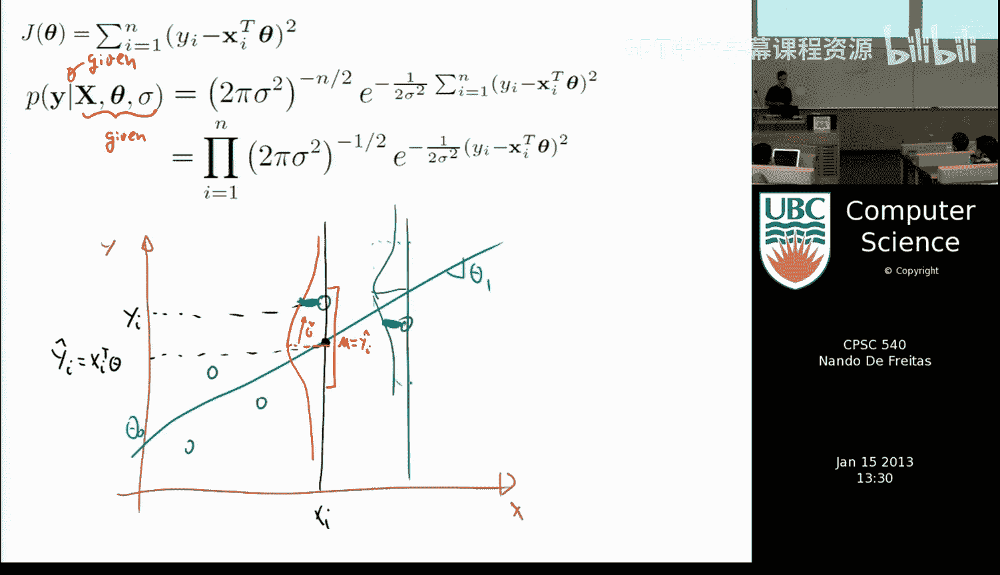

And and proceed to derive the maximum likelihood estimates of thegaus。

 Once we know how to do thealussian， it will be easy to do other distributions。Okay， so。The。

The idea of the maximum likelihood estimate then is for a Gaussian in linear regression is we just maximize this probability。

 or equivalently we maximize the log of that probability。

 and the reason why we take logs is because it's a lot easier to work in log space。

 we get rid of the exponent。So in particular， we're going to define this quantity called the lot likelihood。

Which is going to be to minus n over 2。嗯。Log of two pi。Sigma squared。

Minus1 over two sigma squared y minus x theta。Transpo 1- x feet。Instead of maximizing。

The probability will maximize its log and the two are the same because the log is a monoonic function。

 So it doesn't change the location of the max。Now， if we write a likelihood like that。

And let me write it again here。 So L of theta is equal to。- n over 2。Log。Of two pi。Sigma squared。

In order to get。To find where the peak is of the Gasian， in other words。

 in order to find where there is。Pick is。We just essentially differentiate anyequ to0 and see where the slope is zero。

And so the derivative。Of the long likelihood。With respect to the vector theta。

 then is just equal to 0。Minus1 of a two sigma squared。

And now note that derivative of this guy is just a derivative that we did in the last class。

 because that's just a quadratic。These squares。 So I'm going to do it quickly。

So that would be 0 minus2， let's see if I can do it by heart。I do these things all the time。

X trans y。And I've written that that quickly because I've done this a million times。

 You can go over it in your own time。 We did it in the last class slowly。

And now if we equate to zero。We get theta。is是一个。To x transpose x。So no surprise。

 the theta maximum likelihood。I'm going to put an ML there to indicate that this maximum likelihood the theta maximum likelihood is the same as the theta least squares。

Because the negative log of a Gaussian is just the quadratic function。Oh yeah。I knew the answer。

 so I was working back in my head。Likewise。We can compute the derivative with respect to sigma to get the maximum likelihood estimate of sigma。

 So now you now we start seeing something much more general。Then with going with the cost functions。

嗯。A Gaussian makes sense we can describe its shape and now it has more parameters。

And so when the question comes in， how do we get these other parameters， the variance。

 which is something we didn't talk about， How do we talk about the uncertainty of these points。

And uncertainty is very important， it's important， and I've used this example before with these guys。

 it's important that I tell him your test is positive， the probability that you will die is one。

As opposed to saying the probability1 plus or minus 0。01， as opposed to saying the probability is1。

 plus or minus1。So in one case， I'm basically saying something that is nothing because there's too much variance。

 in other case I'm very certain。So knowing uncertainty， quantifying risk is really important。

And that's why most of finance， in fact， in Wall Street is most of the departments that are just called risk management。

It's all about understanding variance， so knowing the spread of this point is really important and sometimes in fineness is actually more important than actually where the line is。

How do we get this， We have an expression for the likelihood of Sigma。

So we just take the derivative with respect to sigma of the likelihood of Sigma。And if you do this。

You will get a Sigma squared。It's equal to this。It's a standard estimate of the variance。

Okay you get the random variable minus the mean squared。And please do this。

Because you will see it okay。Now， once we've done that。

 once we have the estimates of theta and sigma， we have the likelihood we have recovered the Gaussian。

We know the shape of the Gaus and the super。 We know it's mean and we know it's covariance。

 And if you know it's mean and it's covariance in order to make a prediction。In the training set。

 from the training set， we got the theta ML and the Sigma ML。And once you have those。

 then you just plug those in the Gaussian。And that gives you the prediction。

 So if you have a new point， x star in order to predict。You essentially used the me。

Which is x star transpo theta。And then you also know how certain you are that that's what the prediction should be because you also have estimated sigma and sigma gives you an estimate of the uncertainty。

嗯。This is not， as we will see in a week and a half。

 this estimate of uncertainty is actually not very good。

 but we will learn another estimate that's very useful and that will allow us to do all sorts of very interesting active learning。

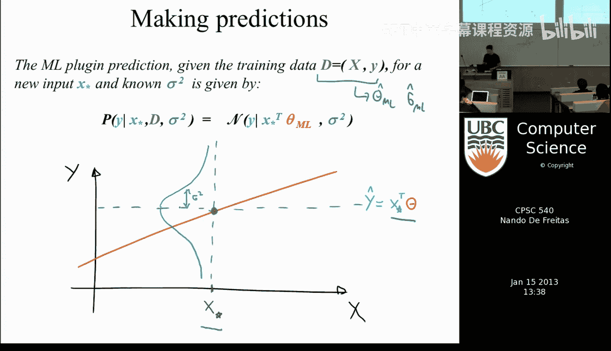

Okay。To summarize maximum likelihood learning。I's part of something called frequentist learning。

It's based on frequencies。We've kind of seen here， this is just the estimator of the variance is's just essentially the counts。

If N goes infinity， that becomes the expectation， which is the true variance of the model。And。And so。

The assumption here is that we actually， there is one truth。

ThatAnd such that if you were to get more and more data， you would be able to recover that truth。

There is this one model that has a true parameter theta node that produced the data in what your game is given a finite set of data。

 you're trying to guess what that theta knot is。And you call that theta not theta hatas we've been doing。

And so in maximum likelihood， we essentially finding that。

Theta had by maximizing a joint probability， a probability of the data given the thetaus。

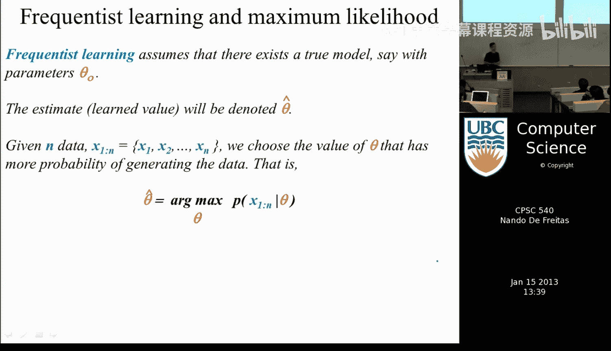

Now。In order to understand。A maximumim likelihood， it's useful to introduce a much simpler model。

So we've seen the Gaussian， another distribution that's very useful to know is the Bernoulli。

 because the Bernoulli is。Some of you already know is a great model to talk about text。

 to talk about words and to talk about things on the web。And certainly。

 that's how we will use it later on。Now Berulli model describes a coin or an event or something that's either true or false。

So it will allow us to do all sorts of logical statements。The pernoli distribution。

It has the following shape。Centory this here。The probability that the coin is 1 is theta。

 the probability that it's0 is 1 minus the。 and then when you add up the two。

 you should get one so that it's a valid probability。So in other words。

It's a binary distribution like this。And then this height is 1 minus the。

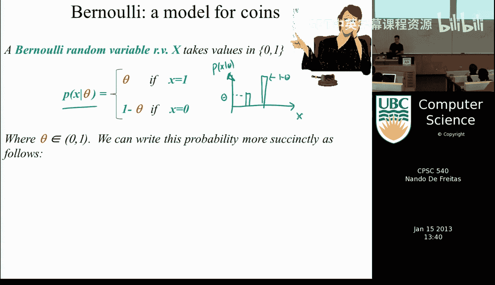

We will succinctly write this as P of eggs given theta。Equal to theta to the x times1 minus theta。

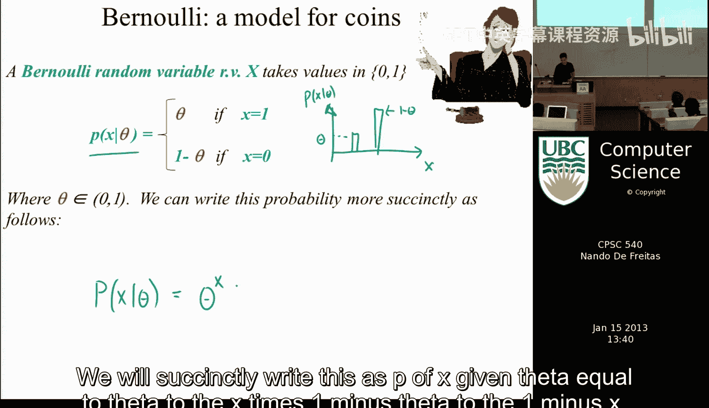

So the 1 minus x。Okay。Because if x， because this will be equal to theta when x is equal to1。

 and this will be equal to1 minus theta when x is equal to 0。

Because one exponent will be zero when the other exponent is one。

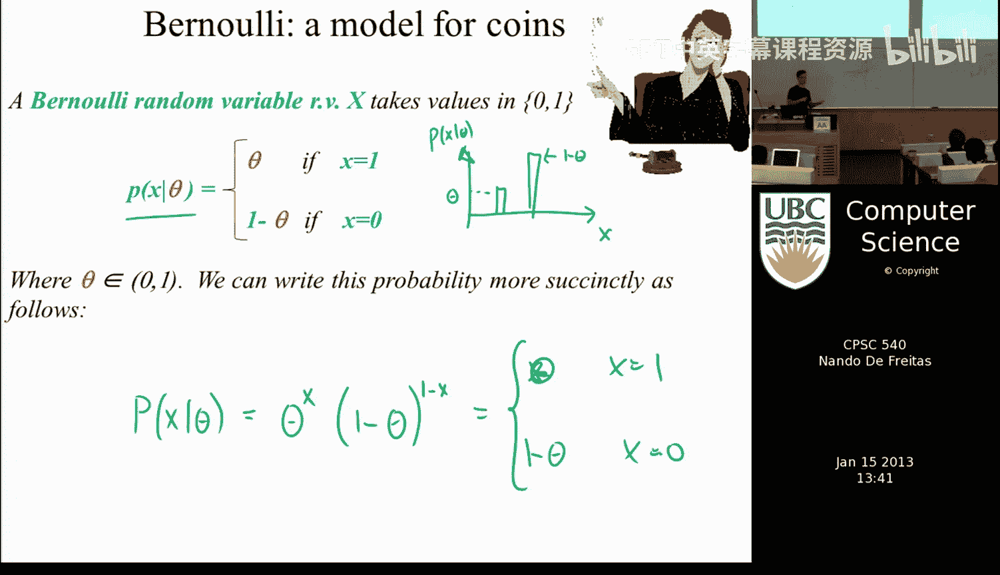

Now， I'm going to define。An important concept。To talk about uncertainty， called the entropy。

The entropy is just。A concept that was introduced by Shannon。

It's the sort of how many of you have done information theory？K。Engineering or C，Yes， okay。

 glad to hear that some of you still in some places are still being taught。

 So modern computers essentially were built on the theory of Shanon。To a large extent。

 at least our communication networks and so on entropy is a measure of uncertainty and is what's used to quantify uncertainty of transmitting bits of a channels for the Wikipedia page will tell you lots of things about entropy right now all I need is to tell you what the expression is。

And to tell you that， if I have a。P newly random variable。The entropy。It's just minus。

The sum of our x。Being either zero or one。And then I'm going to write this whole expression here。So。

 I have。Theta to the x times1 minus。テチャー。To the X。Times the log。

Of theta to the x times 1 minus theta。Pax。Which is。诶。Ohoops1 minus x here。Which is one minus theta。

Time to the log。Of1 minus theta plus theta times the log of theta。And if you plot this quantity。

 it looks like that。 So recall that P of the P of x equal1 is just the。

The entropy for a coin is such that when the coin is completely unbiased。When I have a fair coin。

 a fair coin has the highest entropy。And it just means that if I have a perfectly fair coin。

 you will have no clue whether it's going to， well you'll know that only with probability a half。

 it will either be tails or heads。But if I tell you that the coin has high probability of being tails。

 in other words， this is the bias coin and it has 9%， you know， 90% probability of it being tails。

 then if I'm going to flip it， you have less uncertainty。

 you're kind of certain that it's going to be。Itss bias is going to fall in your favor。

And so that's essentially what entropy measures。 It measures that uncertainty that you have about the problem。

if you don't know anything， you'll have high entropy。And otherwise， now， entropy is the negative。

 the opposite of information。 And in fact， that's how Shannon define information。

 The concept of information that we use mostly in English essentially is that is the opposite of en。

You have more information when the coin is biased when you know exactly what's going to happen。

 and if there's more uncertainty， more randomness， you have less information。missinging on minus。

Quite likely。呃哦，我妈 pizza。1 minus theta times log of 1 minus theta。And then， oh yeah。

 I'm missing two minuses。Thank you。Okay， so in the next class I will finish。

 I'm going to let these guys have some these guys want to tell you something about their competition。

 so I'm going to finish this lecture at the beginning of the next class。

 but now that we understand entropy， which is uncertainty。

I will do a little derivation that will show that maximum likelihood learning is really a process of minimizing your uncertainty about the world。

And the two are sensor are equivalent， whether you approach the problem from information theory or from the process of imagining and comparing what you imagine against what you see or whether maximizing probabilities。

 it will always lead to the same thing， which is maximum likelihood。

 which is a really powerful concept。Right。Go ahead。对。

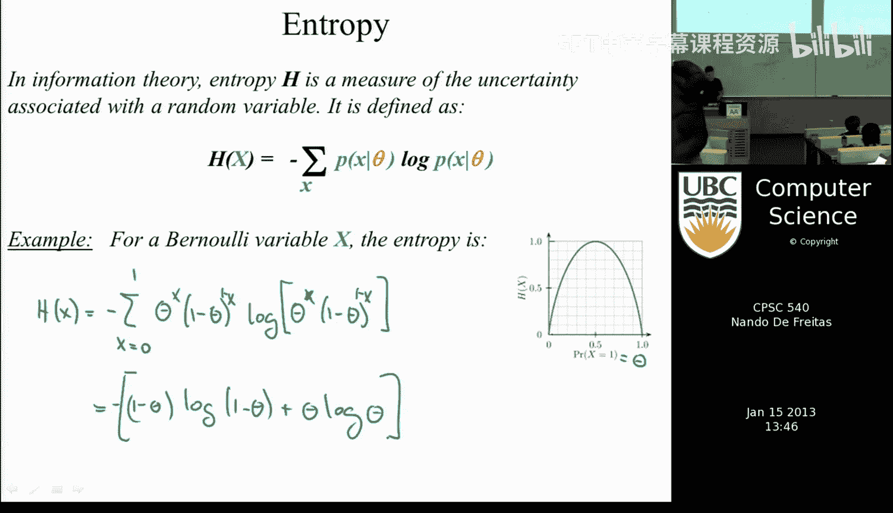