# UBC《机器学习（研究生）｜CPSC 540 Machine learning 2013》中英字幕 p04 -04-Machine learning - Regularization and regression.zh_en -BV19g2FBBEEq_p4-

Let's get started。So in the last class， in the last two classes。

 all we've been learning to do is how to fit a line to a cloud of points。

 so essentially the picture that I'm showing you there on the slides and we've learned to do it two ways we can add a formulate a cost which I mentioned you should think of a cost as some penalty like energy and in this case the energy of some springs and the optimal solution is a stable solution so in that sense。

 an algorithm that finds you a solution is the same as following the dynamics of a natural system。

 in this case the system of springs and finding a configuration of minimum energy。And in fact。

 to physicists， physicists don't talk about algorithms， they talk about dynamics。

Because you could think of what's going on in your brain it's just some natural dynamics which you could model in classical mathematics with a large system of differential equation and so on。

 such approach has been pursued， in fact it's often very hard to get that to work。

But dynamics of a system and algorithms are in a way， the same sort of thing。

 Nature is just running massive of algorithms around us all the time。

 And we we're immersed in such algorithms。The second way to analyze the problem of learning。

And this by the way， this sounds very grand， I'm talking about like in the last class about imagining and hopes and regrets and nature and dynamics and learning and these great concepts of cognition haven't mentioned consciousness yet but。

😊，It will come and then at the same time， all I'm teaching you is how to fit a line to a set of points。

 but just be patient because these principles will guide the type of models that we will build。

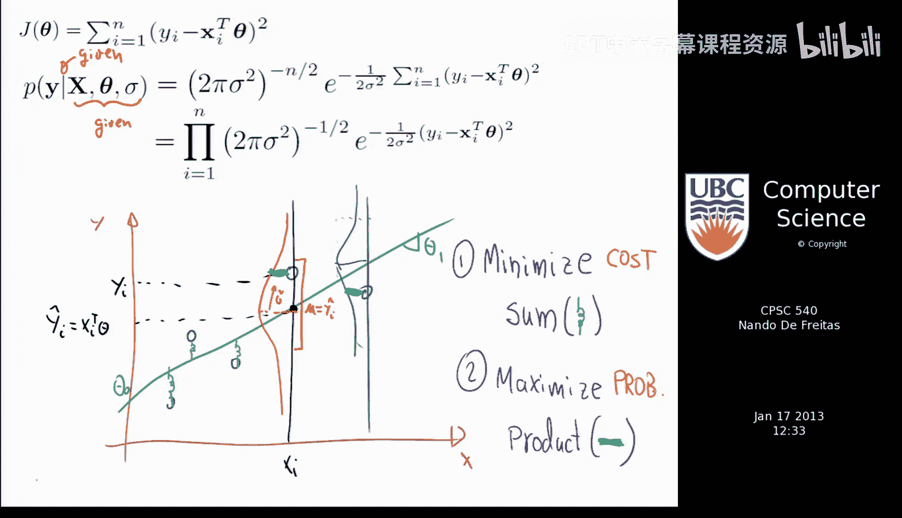

And if we learn how to do our。Basic linear algebra our basic calculus for these simple models。

 I'm just making sure that we build up so that we're comfortable with the math。

 and then I'll be able to introduce much more sophisticated models。

And the key thing is that when I introduce more sophisticated models。

The same risk was the same math that will all apply。So getting the principles。

 which is what today's lecture will be all about turns out to be quite useful。

 knowing how to do the linear model is essential。To understand more complex models。

So we could think of it as minimizing these energies or these costs， that this springs， the blue。

 the can springs， or we could also， as we saw in the last class。

 think of it as maximizing the a product of Gaussian probabilities in this case。

And the product came from the fact that if two events are independent。

 we just multiply their probabilities。In my videos for 340， by the way。

 I have several lectures at the beginning which are all about an introduction to probability。

 what is independence， what are graphiccom models and so on。

 so if you're not sort of super familiar with the，Basic statistics。

 if you haven't taken a course of statistics before。

 I strongly recommend you just watch those lectures。

And then you'll see a concept of independence is quite obvious。

 but just basically think something is independent if if it does not affect something else。嗯。Now。

 if two events are independent， then we can factorize the probability。

The joint probability would be the product of all which would be the probability of fitting all those points as the product of the individual probabilities and the individual probabilities in this case are just those green horizontal green bars。

It's just each point is distributed。According to a Gaussian distribution。And by each point， I mean。

 the height。The Gaussian is in the height。 X is given。 There is no uncertainty in x。

 Someone gives you X， and you have to guess why。So X is observed。But why is where the game is。

 why is the uncertain quantity？And then if we just take the negative log of the product of probabilities。

 we get the sum of the errors。 so we get the cost function。

So there is this natural interplay between solving a machine learning problem as minimizing a cost and solving a machine learning as maximizing a probability。

However， with probabilities， we will be able to do other things that I will come to at the end of this class。

Okay， so that's a sort of message。 And， of course， as we go to higher dimension， it's the same idea。

 You have a cloud of points here in 3D space and you're fitting a play。And in 3D。

 you need three parameters because to determine the exact position of this play。

 so imagine that I have two horizontal axis here， height and weight。

 and then the vertical axis is an unknown variable， whether you will buy candy in my store。

 for example。And so that I can decide whether I should spend time on you when you're in my store。

 so assuming you have height or whether I should send you an ad in your mail。

 so if you have those two variables， you're trying to predict the height of display。

And then to fit this plane two points， you need to deal with this angle。

You need to deal with this angle。And you need to lift the plane up and down the biister。

So three parameters four。In this case。And as you go to higher dimension， we can't visualize it。

 but the equation remains the same。 It's just basically a matrix times of vector。

 So it's very sort of very easy natural。Okay。So。And then we actually did the exercise where we took the probability。

 the joint probability of all the Ys， and we the negative we took the log and we maximized it。

 and we found that the maximum likelihood estimate。嗯。

The likelihood being the probability of the data given the parameters happens to be the same as the least squares。

 not surprise if the cost。Function is the same as the negative log likelihood。

 then the answer should be the same。嗯。I gave you this exercise。

 which I still haven't released your homework， but I think I will move this question to your homework so that you can actually。

Once you have a likelihood， you can actually find all the parameters， not just theta。

 but you can find also the variance of the points， and if you wanted to build a more interesting model to deal without liars。

 for example，We would just follow the same recipe， you write the likelihood， you differentiated it。

 you equ to zero， envoola there come the answers， so the procedure is actually quite mechanic once we know how to write the probabilities。

And throughout this course， I will be writing several probabilistic models。

 and so the goal is to learn how to take data and interpret it in a probabilistic way so as to be able to deal with uncertainty and to be able to make good predictions。

Speaking of predictions， we also saw that in a frequentous way。

 the equation of the line is just given by。X times Theta。

Recall that we usually one of the x is just one so that that deals with the issue of lifting the plane up and down。

So that would include it。There's bias here， as well as a slope。And so given a new point。

 we can predict its height， which is why hat。And but we also have a can also say how certain we are about that point。

 because we can use an estimate of。A maximum likelihood estimate of sigma。

So and that's very useful and as I mentioned to you。

 it's important sometimes knowing an uncertainty is more important than actually knowing what the point is going to be。

 what the prediction will be。Now。Maximum likelihood is part of the frequentest method of learning。

And it's not the only method that is part of this idea of this view of learning。

 which is based on frequency， which is。Data。There's other approaches。

 but I will focus on your maximum life for several reasons that I will make soon clear。Okay。

 so and again， in more abstract terms for any model。

 the maximum likelihood estimate is always the sum of the probability of the data given the parameters。

Whether you have a Gaussian or a T distribution or you have some very complex distribution that is multimodel with neural nets。

 et cetera et cetera， as complicated as it could get in this course。

 the abstract formulation of the learning problem is the same。

 you maximize the probability of the data。Given the parameters。

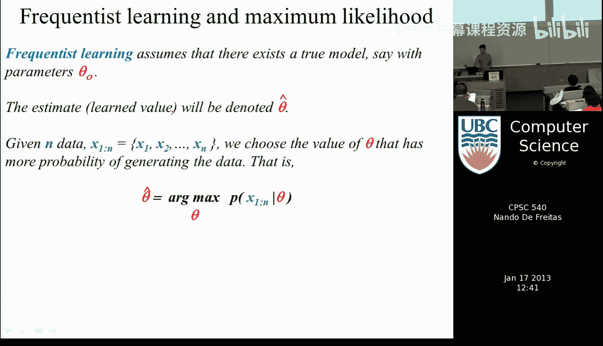

Okay。Now。Another model that another probability model that comes to be very useful besides Gaussians is the Bernoulli and the Bernoulli is just a model for binary events。

 and so we're essentially saying with this that we have a random variable that can be1 or zero and the probability of it being one theta and the probability of it being zero is1 minus theta。

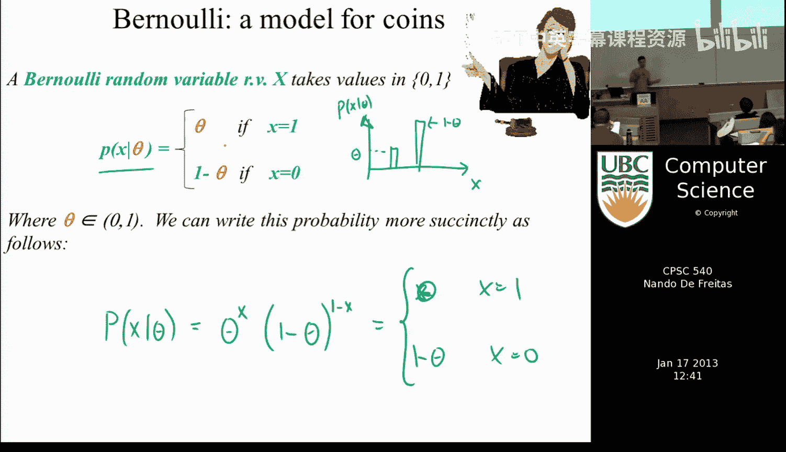

If I have such a probability distribution。Then in the last class。

 we saw that I can compute this quantity called the entropy。

And the entropy has the shape that is shown by that plot in particular for a binary variable。

 the entropy is the highest when that variable is completely unbiased。

 when the probability of it being 1 or 0 is 05， so the more uncertain you are。

 the higher the entropy， so entropy is the opposite of information。

So if I have a coin that has got a 50，50 chance of being held or tails。

You would be very uncertain as to what's going to happen when I flipped that coin。

But if I have a coin and I tell you that the probability of it being tails is 99%。 and I flip it。

 most of you will agree that that coin。Would probably bet on it being tails。

And so your uncertainty is low in that case， in other words， or equivalently。

 your information is high。Okay， whether why are we going over this。

 It will be obvious in the next derivation， and I will go in steps over it。

 So the maximum likelihood principle。If you have IID data。Is equivalent to。

Let's look at the first equality。The maximum likelihood principle is just equivalent to maximizing the probability of the data given feet。

Okay， which is。Arg。Max。Of a theater。Of the probability of all the data from one to n。Given feet。

Let's get to symbols right， arg max is the value of theta that maximizes that probability is the argument that maximizes。

The bar here means。Give。So we're saying that theta hat is the value of theta that maximizes the probability of x given theta。

So you have a probability， that probability is defined over x。

And you might have an unknown parameter like the mean of a Gaussian。

 and then you just keep shifting that mean until the probability of the data is maximized。

If we take logs。The location of the maximum doesn't change。

 and that's why I use artrc max instead of max。 I'm not looking at the maximum of the function。

 but the location of the maximum。If I take a log because it's monotonic function。

 it's just going to change the shape of the function。

 but the location of the optimum will remain what it was。So by taking。By taking the log。

Nothing changes。By nothing， I mean， the location of the optimum doesn't change。

The height will change， but the location won。嗯。The other thing I can do。

 and I do that in the next step。Is I can subtract。From my expression。Another quantity。

That doesn't depend。On theta。Because。I part of this。Because if you have a quadratic function。

If I change its height by adding or subtracting something from it。

 the location of the peak doesn't change。 I'm changing the height of the function by adding something to it。

 but it's the location of this peak。Does not change。Thank you。And so。I add this quantity。And here。

 Theta knot， I remind you， is the true parameter。Theta not is the absolute truth the exact value of theta。

Freequness learning assumes that there is one。Toth thick。Now， the next line is quite simple。嗯。

B of a divided by B is log of a minus log of B。And。The next line is a bit harder。In the next line。

 I'm assuming something that I will teach later in the course。Which is the law of large numbers。

That if you have an expectation。As the number of data increases to infin。

 sorry if you have a sample average， sum over the data， as N goes to infinity。

 that sample average becomes the expectation。We use this all the time。 We never the expectation of X。

Is equal to the integral of x， P of x。Dx。But we often， in order to talk about the expectation。

 we use an approximation of the expectation of x。Which is just equal to one of N some。

Over i equal 1 to n。Of X I。Now， we usually use the sample average to approximate the me。

 and we use the sample variance to approximate the expected variance。嗯。

To prove that this converges to this， as then goes to infinity。That involves some probability。

 but that's essentially what we know as the law of large numbers。

If I have a coin in my pocket and I keep flipping that coin with that coin being unbiased。

As n goes to infinity， the number of heads。Would be expected to be a half。

 So I would recover the true expectation。 That's essentially what frequententist learning is about。

 Frequentist learning relies on。Loss of large numbers。Shouldn't there be a negative。そよ。Comp that。Oh。

Thank you for the question。So。The question is whether there should be a negative。

 I've used another trick。嗯。I haven't finished parsing that expression。

 there's other things that I'm doing。Cita Hunt， in this case， is the arg。max。Of minus f of theta。

But it is also equal。So they are。Men。A pair of feet。In other words。

 the theta that minimizes a function is the same as a theta that maximizes the negative of the function。

And so indeed， he was sharp and noticed that I had swapped theta not with theta， but I did that。

And that would introduce a minus， but because I also introduce the minimum that minus cancels。

I've done another thing， and this is true。So going back to this low large numbers。

The law of large numbers。This is true。When。Xi is simulated from P of x。

I'm going to spend a lot more time later on， but at this stage I'm just going to quote the law of large numbers。

 and this is going to be the driving principle behind Monte Carlo。

 which is a technique that we use to do based on inference。

And it's also a technique that allows us to do large scale computing。Because you just。

The idea of just using a few samples is that you know just in its simplest form。

 you walk into a wine store or a bottle store or whatever。

 and you don't look at the label of each bottle of wine。

 you just sample and go home and hopefully that strategy is enough that will allow you to have a merry life。

And drink good wine。No。So for now， let's just accept the fact that there is this thing called the low of large numbers that say simple averages converge to expectations。

And so。This quantity here would converge to this one as then goes to infinity。

When Xi is assumed to be a sample from P of Xi given theta n。Which is。

And now look to what I've done there with expectations。 So I have a sum。

 And if I have my X coming from that sum， I go back。

To the expectation and essentially one quick way to see this is what I have P of x in your question for the expectation。

 just replace that with a histogram if you're replaced with a histogram and a histogram is just for those of you who've seen delta functions。

 impulse functions to functions would allow you to map from the expectation to the sum。

And if you haven't seen that， just wait a few lectures and we will go over this in detail when we introduce Monika。

嗯。However， the main purpose of this derivation is to get to this quantity here。

And why did I say that the data comes from P of X I given theta no。Actually。

 I'll pose that question to you guys， why do I make that assumption？Because that's the view。Exactly。

 because the frequentest assumption is that the data came from some true model。

There exists a true model that produces the date。Should the eye still be there in the last one？No。

Good one。I corrected a bunch of tys from last time I forgot out， thank you。Now。

This quantity here has a name， it's called a KL divergence。I'm not going to go into it。

 but if you look it up in Wikipedia， you'll see that the kale divergence is a。Distance。

 not quite a distance， but sort of a distance between two distributions。 In this case。

 P of x given theta。Which is the thing that I'm estimating my model。

Because you come up with a PFX given theta and then you maximize it。

 but the first step was to come up with a likelihood， a P of X given theta。

And P of x given theta n is the true distribution。And so essentially。

 what we're doing is minimizing the distance between the true maximum likelihood is minimizing the distance between your model and the true distribution of the date。

Oh， actually。I know what pen to use for this。WhitePad。Now， if we have this。

Using the properties of logs again， this is equal to the a min。好。P of x given theta n times the log。

Of P of x given theta n。The X。Mus。P of X， given theta。Log。They are not log of P of x given theta。Dx。

Now， the quantity each of the first integral。What is it called？说。The negative at。

 there's a sign missing there， the negative of the enthtroropy， essentially information。So。

This is the。Information in the world。And in the model。

If the information that exists in the world matches information in my head。I have learned。

That's essentially maximum。 That's one way to look at the maximum likelihood principle。

Maximizing the probability of the data to give a new model is a question of matching information。

The second term actually is not precisely the entropy。

 but it's actually a term called cross entropy because it has one term that has theta node。

 but the log term doesn't have theta node， it has that X given theta later when we do neural networks we'll see that that's the thing that we need to minimize in order to fit a neural network to build a classifier。

And and indeed， much of learning is about， again， that concept that you imagine。

And if what you imagine matches what you see， then you have learned。Unless your brain again。

 has some dysfunction。And about all of us have such dysfunctions， by the way。Okay。

I'm just going to now mention very quickly some properties of maximum likelihood。

 I'm not going to cover these in 540 if you take a statistics course an advanced graduate statistics course。

 the theoretical statistics course， they will go over these。

 with say Alex Bushard statistics or Rubeen Zmar， those guys tend to go over these results in detail here I will just mention them quickly。

The maximum likelihood estimator is consistent。In the sense that probabilistic is speaking。

 and I'll say what I mean by that， theta hat always converges to theta not。

Now this is just another way of writing it， I'm just putting the notation here so if you find this notation in a paper。

Don't be scared。 All this means equivalently is that the probability of theta hat minus theta n being greater than a small number alpha。

Goes to zero。For any alpha， no matter how small that alpha is， their difference will go to0。

That's essentially a consistency， consistency means that as you get more data。

Theta hack will converge to theta not。Moreover， ML， you can use something called the loft。

 in addition to the loft large numbers， we can use something called the central limit theorem。

And we can show that the difference between theta heart and theta not。Is Gaussian。

And it's zero mean because they're consistent， so in the limit。There's no difference。

 so the mean is 0。 However， there's some variation。Okay。

 so theta hat will oscillate about theta node， there could be some variation。That variation because。

At the end of today， these are theta hat is a statistical quantity。嗯。Which is a function of the data。

But。That matrix， that variance。 so for any there's many other estimators like score matching and so on。

 but maximum likelihood happens to be the one that has the lowest variance。

And you can prove this result theoretically， there's an excellent book that has all these results that I recommend to you guys。

 all of statistics。If you Google it， it will be the top hit。

And that's why people use maximum likelihood because it converges as the N goes to infinity。

 and out of all the SMs that converge， it's the one that has the lowest variance， so in other words。

 it's the one that's most efficient。But then the question that is left out by statisticians is the question of computation。

We're talking here about statistical efficiency。But to us， people who play with data and computers。

 this idea that n has to go to infinity should be ringing a warning bell。And as you'll see。

 we'll be using maximumim likelihood， but keep in mind that in some cases。

 maximum likelihood is not the right thing。And in fact。

 one can very easily construct many examples where it actually fails。

Not only because it requires this crazy idea that you have to see an infinite number of data to learn。

 but it also because often when you formulate a model in the setting。

 you end up with intractable problems which are NP hard or sharply complete。

And then we're in trouble， we don't know how to solve them。Now， finally。

 to finish this sort of quick frequentest view of machine learning。

 an estimator is a function of the data。 so your theta hat is a function of the data。Where。

As I've been saying， the data is just。The same as all your data samples。

Because you see some data and you compute theta hats。

 so Theta hat is a function of the data that you saw。

And we've seen so far only one kind of theta hat， which is the mean of basically the slope of this lie。

 but as you'll see， this is true for any model。嗯。Now。

 there are two quantities that frequencies usually estimate。

 and these quantities are actually very useful to know。 One is the bias。

And the bias is just the difference between the me of the thes that you've estimated and theta not。

And by that expectation。I mean， that theaterta hat is the integral。Of theater。

Times the probability of the data given the no。Integrated over the date。 So， again。

 if you're sampling data。From the true distribution。

And you are to average all the possible estimators that could come。

 that gives you sort of the average estimate。And bias is essentially how far you are on average。

So if I were to plot。Something as n goes to infinity。And。Let's say that that's something。

It's a straight line。That's theta not。Then theta heart。

 you can think of theta heart as something that might be doing this。So it has its's very。So。

 I can look at。The mean。I can look at the mean of the theta hearts over n over the data。

The difference between the green line and the red line， that's the bias。

Which should vanish asymptotically。You would want it to vanish asympttically。

 but then there's also this other error component， which is due to oscillation。

And that's a variance term。 So that's the variance of the cyanist major with respect to the me。

So the oscillation in the blue line， what you want is an estimator that both。Has zero bias。

 and zero variance。But designing suchests tomatoes tomatoes is very hard。 So in practice as。

We will often trade off these two quantities。We might design estimators that have very high variances。

 but that if we take the average will'll be spot on， and in fact that's going to be random for us。

 the machine learning technique that's used to build a connect thats。

I don know how many of you have seen the Connect before。Or it the lot you know。

The number one consumer electronic out there， is if you haven't seen it。

 go to future shop or just go to YouTube and watch the videos。

But basically the machine learning technology that it uses is based on this idea。

 let's use something that's very high variances。Small components that are very high variance。

 but let's average them。 and then you end up with a very powerful classifier that will essentially this device you put it on your TV。

 it looks at you， and it knows exactly what you're doing。 So no wires or anything and it。

You can immerse yourself in a game。At the other extreme。

 we might often want to not have variants because you might be designing something that I don't know。

 an aircraft and you don't want to be gambling on sometimes as aircraft crashes。

 sometimes it doesn't but on the average it's pretty good。

 so there you probably want to rather be robust and accept some sort of control the bias。

 except some bias， but try to eliminate variance。That's basically。The end of the frequentest view。

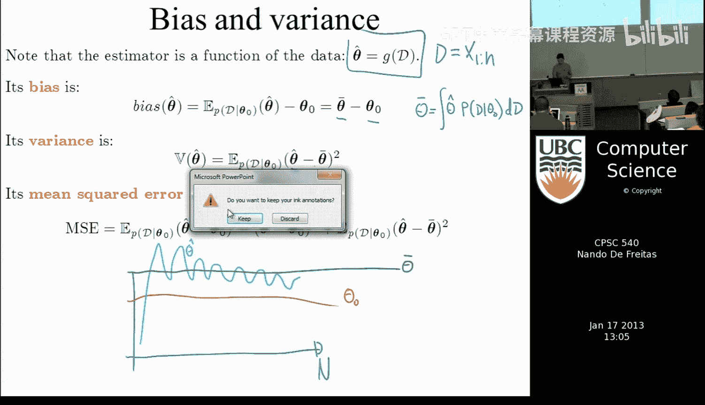

好呃。

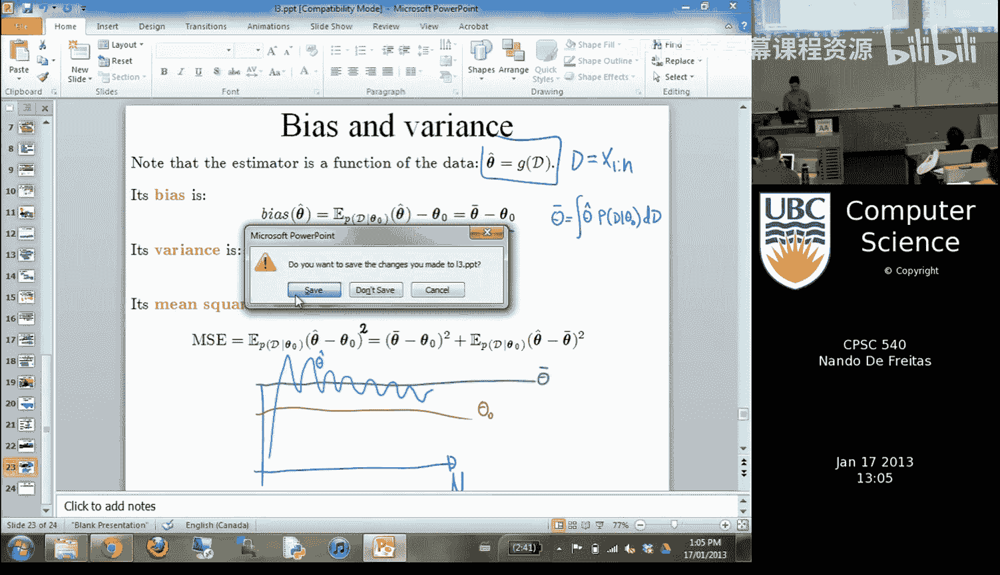

哪0。

Well see how to。Give me one second。

So next we will see how this view。A different view， which is based。How type majors？

あそ。340 I changed factor I think。I should make these in。These are Internet arthritis。

 I that your audio photo videos will not be。All right， so by contract。Okay。

 so now we're going to see that， even though we've。A few of you have used these squares before。

 and a lot of people use these squares that it's very easy to do better。T least squares。

Using a concept called regularization， and that will lead to a technique called a retro regressiongress。

I will also like take away from linear models to nonlinear models in a first step。

So that you can see that the same math that we use for linear models can naturally be used for nonlinear models。

And then we'll start introducing questions， techniques for dealing with when you have many models。

 which one is the right model。And that's essentially going to be a technical cross validation。

 and then we'll talk about a concept called generalization。

Which is such in short that you would want your algorithms when in a new setting with new data to be able to still do a good job。

And that's where machine learning has an age over human operators because humans come up with good solutions for the problem at hand。

 but often solutions don't scale well， at least when building web companies to other settings。

In real life， humans are actually very good at generalizing。Maybe too good。Sometimes。

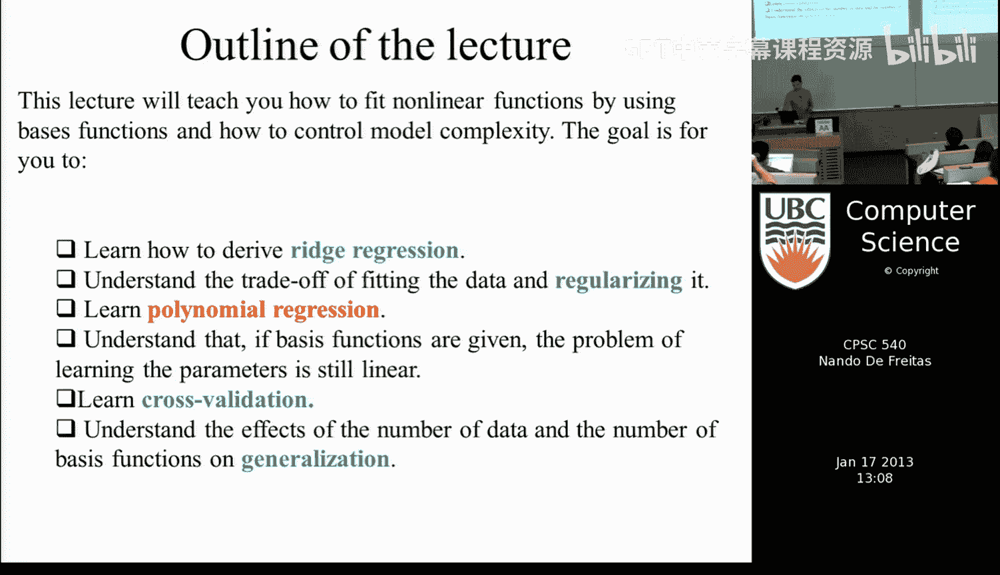

Okay。One problem with the least squares estimate is that it requires you to invert a matrix。

So recall this matrix was D by n。This one was N by D。So this one is d by n， and this is n by one。

 and the vector of parameters is n by1， sorry d by1。There are dear unknowns and equations。

 essentially。嗯。Now， the problem with this is that that matrix that is D by D。

That you're inverting is often poorly conditioned。Because N might be 20 patients。

 so you have end cases。And they might be 20，000 genes。So you have a matrix that is 20000 by 20000。

 but you've only had 20 data points。 So you're in trouble。When it comes invering that matrix。

 because it's not well conditioned。Some folks in the 70s came up with a good hack。

 and this is the hack that I think most of us。Would have come up with。

 which is let's just add a small element to the diagonal because that stabilizes everything。Okay。

 so it turns out that that hack is actually。Very good and by very good neuroosis it stabilizes the problem numerically。

 but it's also statistically， it's an estimator that dominates the maximum likelihood estimator in high dimensions。

嗯。That hack is actually a solution to what we call a penalized maximum likelihood problem where。

This quantity here。Is the penalty。Or also known as the regular rice。In the numerical lingo。

It's called a regularizer because it sort of regularizes the problem， makes it nice。

 gets rid of these conditioning problems。And you can also think as a penalty because we're adding to the cost an extra term。

Now， your objective is still to find a theta that minimizes that cost。

And for a particular deelta square。So this deelta square is going to be a scalar。

And the reason why I am squaring it is just to emphasize that I want it to be positive。

So if we have that a positive number this， I imagine the number3。Now。

 you have to minimize two things in order to minimize the cost J。

 You have to make the line fit the point。But you also need to make the theater small。

Because the only way you can minimize theta squared is by making theta small。

So now we have a trade off between these two quantities。

To see that this leads to that is a small exercise。 So essentially we have。The cost function。

J of theta is just y minus x theta。Tpo， y minus x。Theta plus Delta squared。Theta trans theta。

So the derivative of J of theta。With respect to theta。Is once again two。X transpo x theta minus2。

Xtra plus y。Plus two deelta squared。Clim the identity times feet。

this is using the matrix derivative properties that we introduced two classes ago。

And if I equate to zero。Then I get the desired result， which is x transpo x。Plus， delta squared I。

Times theta is equal to x transpo y。Okay， so it's easy to derive。

 It's very much similar to what we did for maximum likelihood the way we' arrived this the。

Now question， so this is going to be better because it's going to be more stable and as you will see in your first exercise。

 your first homework， this will also give you better predictions。The big question is。

How do we guess Delta squared， And that's going to be。嗯。A topic that we'll have to contend。Okay。

 what is the sort of geometric view of this， The geometric view of this。In 2D。

Let's say that the vector theta has two components。theta one。And Theta 2。So that。

Theta transpose theta。It's just equal to theta 1 squared plus theta 2 squared。Now， I will argue。

 And later， when I talk when we do our lecture on。Constrained optimization well go over this in more detail。

 but for now I will argue that if I want to minimize this and I want to minimize this second term as well。

That's equivalent to just minimizing the first term and requiring the second term to be small。

 to be less than some function of de。You don't need to know what that function T of deelta is。

 You just need to know that wanting the two things to be small is the same as saying that I want one to be small。

 provided that the other one is also small。AndNow if we have something of this form。

We essentially are saying that we have theta ones。Squared plus theta 2。Squared。

 you want it to be less than or equal to some t function， and let me square it for the final it。

So in other words， we have equations of circles。So the constraints ares。So geometrically。

 I can upload these。So if I have theta 2 and I have theta 1。

These are my circles and they're circles centered well not。Centered the origin。Okay。

 so those are my constraints。I also have。Let me use different colors for this， actually。

I also have the objective function， the maximum likelihood objective function。

 which is just the first component。And just like I showed you that with two thes。

 this give you circles， if you have a quadratic like this。

 a little bit of work and we've already seen this in the last class will show you that these guys are just ellipses。

The contours would be ellipses。This this socio quadratic function。And so， that function might。

Be something like this。Okay。Let's add some circle。😔，很少。So now let's ask some questions。

This point at the center。What is it。It's a maximum likelihood that them。Okay， because。

The maximum likelihood is the theta that minimizes the red function。 Therefore， since this is a ball。

The maximum has to be descent。Now， if Delta。Is an extremely large number，10 to the 99。

What would you expect a solution to be for theta？Your。0。So this solution here。

Is what I'm going to call。The theta Ri。And the rich is what I'm calling。

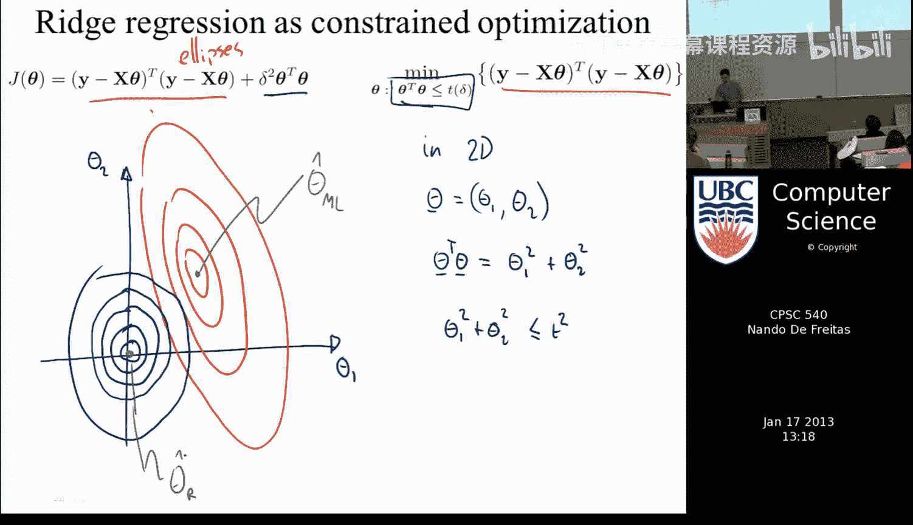

Theres solution here。

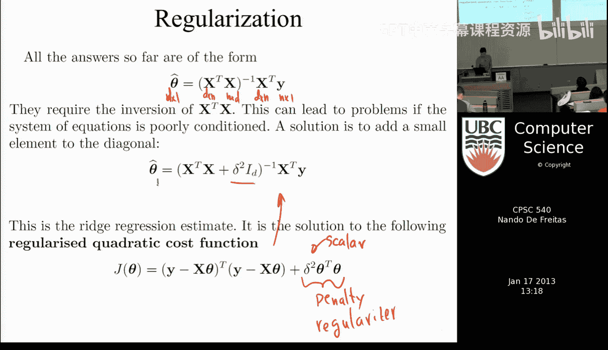

The regularized theater。When。Delta squared goes to infinity。 when Delta squared is very large。

Now when deelta squared is 0。What is my answer？可得。Just back to the maximum likelihood。Okay。

 because if this is0， this basically means get rid of that term。

And we just need to minimize the likelihood。So we have two solutions。For different values。

 So we know what happens at the extremes when Dlta is very large and when Dlta is very tiny。

 So the question is， what happens in between， what are the solutions。Now。

 I will argue that the solutions are。Points。At which。These two。Contours are tangential to each other。

And since the gradient is always perpendicular to the contour plots。

 that will be the point when the two gradients are colonlineia。Why is that true？

Because I want to minimize this cost。 So if I move over here。Suppose， I moved。To the left。

Or to the right， it doesn't matter which way you move。By moving along the contour。

 the cost hasn't changed。 the red cost hasn't changed。But my blue cost has increased。其实。

I'm moving from this contour to this contour， so I'm getting an increased cost。

 so if I move along the red contour my second term increases while my first term increases so the optimal thing then would be for me to get back to this point。

And then the same argument applies symmetrically if I were to move away。In this direction。

 the red would increase the red bowl Im going up in the red paraocola and。

And I'm just going around the contour。Of the。Blue， what？

So the optimal point there must be the point at which these two guys are tangential。

And for any doubt， I can apply that argument。And the conclusion is that。

My answer is given by this curve。For any delta， my solution will lie on that curve。At this stage。

 this is just an interesting geometric curiosity later we will find out that this geometric curiosity is actually essential in order to select variables。

 in other words， if you're trying to predict whether a patient will survive a cancer treatment or not。

And you're trying to figure out which of the 20，000 genes is responsible for the patient surviving。

Then this technique be this interpretation will be useful for you to identify those genes that are responsible for the patient' survival。

 and if you can identify those genes， you can go and design all sorts of drugss and improve healthcare。

Now。Another thing that's important in this curve is that some thes will go to 0 faster than others because the curve is not necessarily straight。

 but it's sort of bent。And that's a fact that we will exploit later on。

 we will use this to create huge models， and then we'll introduce these regularizers so that automatically a lot of thes go to zero。

 So if you have 20，000 genes and each gene gets scaled by a theta，And if most of those thinks go to0。

The only genes that will remain that have a theta， those are the genes that are responsible。

And that way you can figure out which genes are correlated with the outcome of what happens to the patient。

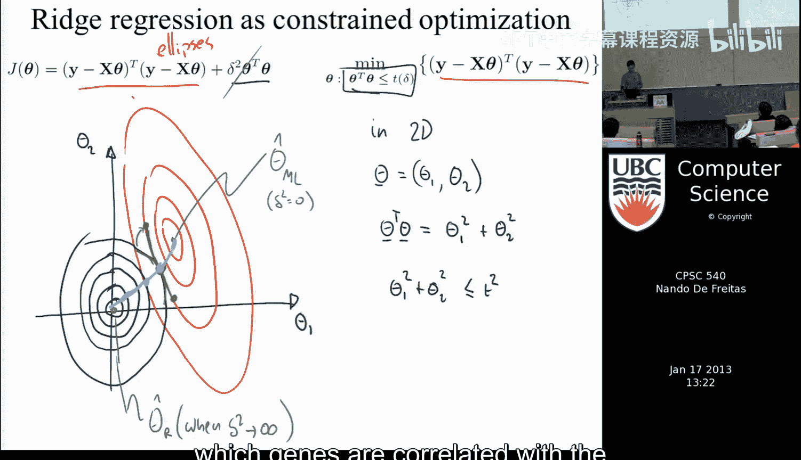

And that's essentially for the data that you will play with in your homework。

 which is a cancer data set for。It's not leukemia。The prorate cancer。

 so some guys have already played with that said， you see that some theus go to zero at the faster rate than another so you can ignore some of the variables。

 but you can't ignore them all。So that's all linear models。

 But let's move on now to nonlinear models。 And we'll see that the ideas for maximum likelihood hidden and rich regression still apply。

 So when you have a nonlinear model。The easiest way to move on to nonlinear models is to just construct what I call a basis function phi。

And a basis function could be in its simplest form， just a polyno。So you have your data X。

We add to it one so that we can shift the curve up and down。Like before。

 But now we also take the data and we squared it， and we've created now a vector that has one and x and x squared。

And because of that， if you now take。If we now just replace。X。By phi of x。

So we're doing this replacement。We still have something that is linear in theta。

So we still have a linear model。Nothing's changed。But a linear model allows you to do nonlinear models as well。

 That's I think， the message I'm trying to convey。The future。Pproces the data。

 So I'm just taking the data， adding this data squared。

 and now I can fit models that have quadratic trends。

So if your data happens to look like a quadratic， you would fit it this way。

And what would be the answer， the maximum likelihood answer。We just be equal to， again， phi。

Of x transpose phi of x。us1 phi of x transpose y。Okay so you just need to know how to form the matrix 5。

 the game then is just the same game as before， and once again， we can introduce the regularizer。

 the rich， and we can also find the regularized solution I there a difference between the technical difference between basis function。

Next slide。

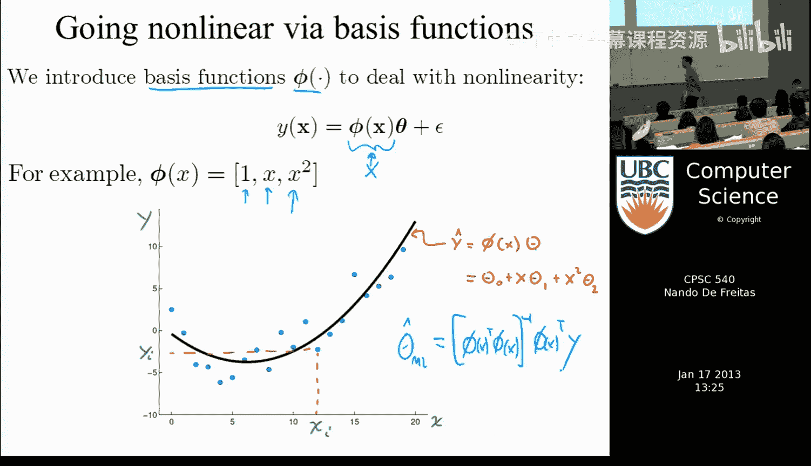

No， two more lights。So that was a very simple 1 D example， if you're in 2D and you have two inputs。

 you can either fit- so in this case we have two inputs x1 and x2。

 but you can create a linear basis function。Or you can in2D also create a quadratic basis function when you have two inputs。

So the same concept applies as you go to higher dimensions。Now。

 here's the catch with polynomous to sort of get you ahead。 The catch is that if。

I'm missing one term here。 If I want it to be general， I would also need a cross term X 1， x2。

Now if I have x1 x to an x3 in three dimensions， I will need one squared， two squared， three squared。

 and then I need all the cross terms of which there are many， I don't know it's combinatorial。

So my space of terms will blow up very quickly。And that's going to be a problem。

 and that's why we don't typically in practice just do polynomial regression。

As a way of dealing with nonlinear problems。Nonetheless， it allows you to very easily。

 And for some cases， actually， this will be enough。

 And this allows you to very easily see that linear models。

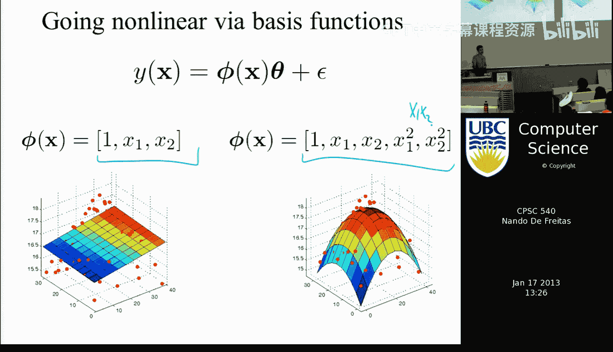

The math of linear models can still be used to do linear models。Okay。

 so just like we did with maximum likelihood， we can also do rich regression。

Where you could imagine that you have a very large polynomial。Here。That is of degree 14。

You've chosen to use this。And。Your basis function is essentially。The data to all these powers。

And so you're trying to minimize this cost function and you can add to it a regularizing。

Now a polynomial with the 14。You know， the sort of a polynomial of degree。One is just the line。

 the two is a parapola， then for three you get an inflection， and so as you go to higher powers。

 this polynomial will be much more flexible， the flexibility increases。啊。

And so a question that might arise naturally is。How big should I make my polynomial。

 how wly should it be？The higher the number of terms。That I'm adding to my basis function。

 I can keep adding terms to it。But the more terms I add to it， the more warooely it will be。

Instead of us answering the question， how many terms to add？What we will do is we will add。

A regularr。Now， by having a regular riser。With a sufficiently large delta。

We are forcing some of the thetas to go to zero。So when one of these guys， for example。

 this guy goes to zero， that basically gets rid of the second term of the polynomial。

So if we make Delta small， we will get a very quickly function。For a medium delta， we will get。

Something that will make us very happy。And for a very， very large delta。

 you're back to having something that is not flexible。But now， just by controlling this regular eyes。

 we're able to。Find the right complexity for fitting the date。

So we might not know that the and we never know this in practice。

 whether the date is necessarily a degree of degree 20 or 15 or three。And so。By using Delta。

 we will be able to control the model complex。The question still remains。

 how do we figure out what Delta should be in practice。How do we compute that？

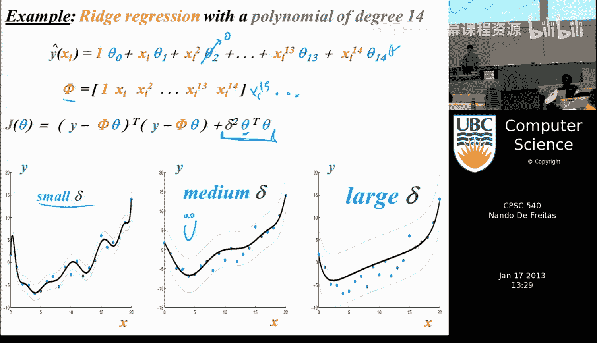

Now to answer your question about kernelels。Just like we use polynomials。

 we could also do the following。We could introduce a set of basis functions。

 and actually before you look at the top of the slide， let's look at the example first。

I could introduce a set of bases。That is essentially the point。Located at a different。Place。

 so essentially A Gaussian。This guy essentially has a red curve。Is this red curve here。

I could take another Gaussian center that2， a Gaussian basis function and put it here。

And I could take another Gaussian basis function and center it at。four。And that would be those。4。

Sorry， those three bes in red。Now， if I multiply those red curves。Byu a quantity the in this case。

 And I added up， then I can get the green curve。And theta can be positive or negative so that green curve could go down or up。

That's the basis， this is what's called radial basis approximation。

It's used a lot in computer graphics， it's very popular for rendering。

And it's used in numerical computation and all sorts of simulation and engineering and so on。

Sometimes we do the following trick。Since we don't know where to put our base。

 because now we have many unknowns。We don't know。 So let's generalize this。

 So the idea is our new feature vector phi。Now， consists of。The location of the basis。In our example。

 at the bottom， there are three bases， so D is equal to3。We chose three means， one， two， and four。So。

 in this case。没。Two is just equal to2。And in this case， me 3 is equal to four。

We chose the scaling parameter to be one， right because we still had to decide how wide。

 how far these Gaussion should be or how thin。And I just chose it to be what？

But if I had to solve the learning problem， I would have properly。

 I would have to figure out what are the muse， what is Lambda and what is theta。

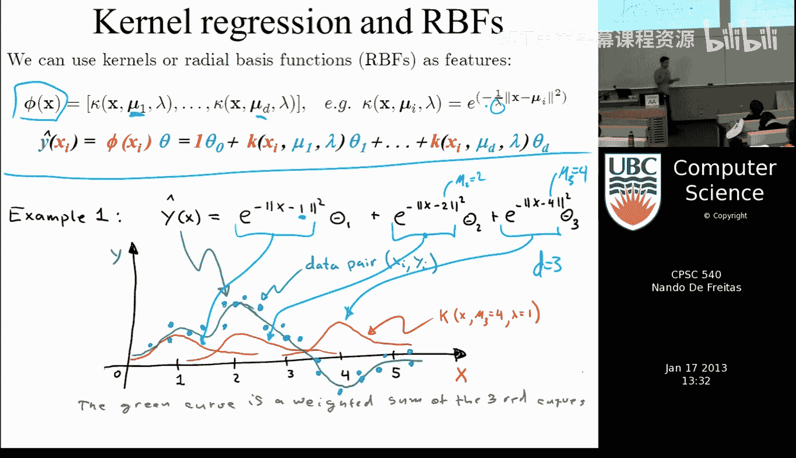

How do we compute。