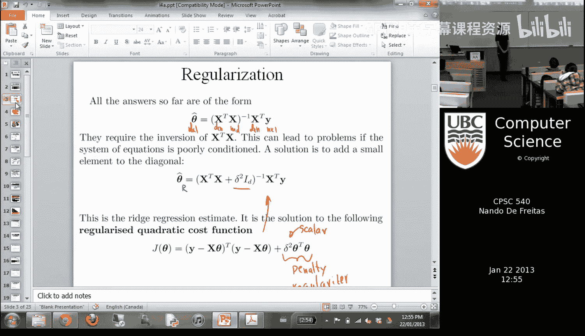
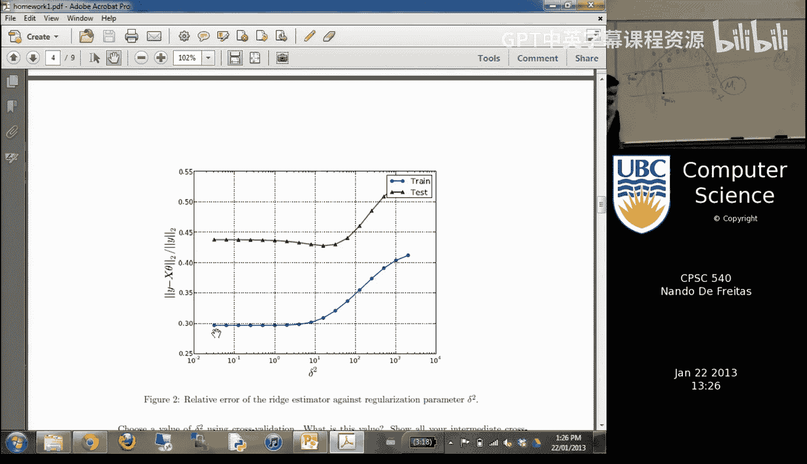
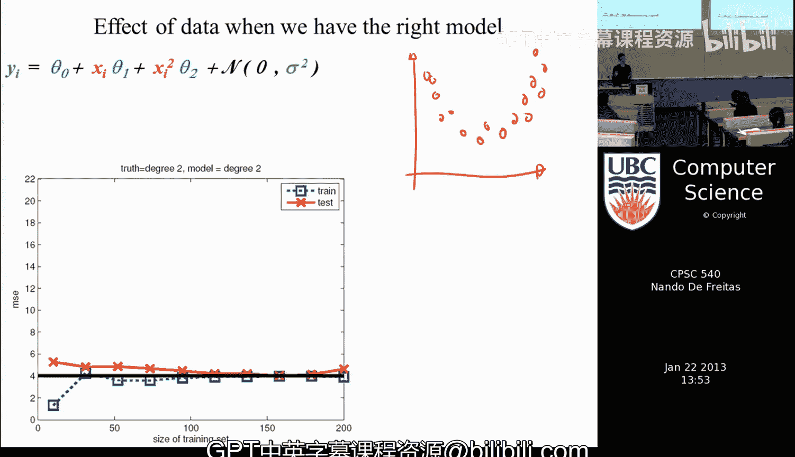

# UBC《机器学习（研究生）｜CPSC 540 Machine learning 2013》中英字幕 p05 -05-Machine learning - regularization, cross-validation and data size.zh_en -BV19g2FBBEEq_p5-

I think their homework will actually be quite useful because you'll very quickly learn a lot about。

About techniques that are useful in medical informatics as well。

 techniques that are very useful for building personalization and recommendation systems。Now。

 but let's go now back to what we've learned so far and。

In the last lecture， I introduced this thing called Ri regression。

 and the purpose of rich regression was at first to just make least squares a more amenable problem。

And by more amenable， what I what I meant was to make it easy to invert a matrix。X transpose x。

 that matrix sub size D by D。In most applications， the number of inputs D is smaller than the number of data。

For example， you could have tweets and then the different。Car brands are mentioned in tweets。

 and in that case， D would be much less than n。But in some cases like in bioinformatics。

 then D could be much larger than n， and that's the purpose of that homework size。

 which allows you to remap the retro regression problem to one of instead of inverting it D by D matrix。

 invert only an n by a matrix。嗯。Now rid is very similar to squared。

 the only real real difference is that there is this extra term which is essentially a diagonal matrix with delta squared on the diagonal on each of the diagonals Now the advantage of having that is that that stabilize as the inversion of that matrix becomes easy to invert so we can actually do this in a computer。

 quite often these squares will your computer will just crash。

Because if you invert a matrixot condition and you don't use anything smart。It's not going to work。

Now。We also saw that this solution happens to be what you would get if you differentiated an objective function where in addition to the least squares。

 the sum of squared errors， we added a term that penalizes for thetas being large。

 So we're purposely forcing the thetas to be small。And so there's two elements to the cost。

 There's this quadratic y minus x theta， and then there's this other quadratic cost theta transpo theta。

If Delta is large， then we're putting more emphasis on the second term， if deelta is zero。

 then the second term disappears and we're just paying attention， we go back to least squares。

For the 2D case， I illustrated this。 So in that case， the vector theta has the components。

 Theta1 and theta 2。 And if we just look at the vectors theta transpose theta。At the contour plot。

 we'll see the contour plots we saw that those contour plots are essentially circles。

Cented at the origin。 If we do the same expansion for the first term。

 we'll get ellipses centered at some point。But we know that the solution。

We know that the minimum of this paraboloid， the center is the maximum likelihood estimate。

 which is the same as the these squares， and that's when deelta 0 when we don't have this term。

And then I also argued that as Delta goes infinity， the thetaus go to 0。

And that all solutions have to be in these point at which the two contour plots are tangent to each other。

 And because I went through an argument that if I were to deviate without increasing， say。

 the red cost， the blue cost would increase in vices。And that's why when you do your homework。

 you'll see that as you the theus will go to zero now that actually turns to be very useful because if you're trying to predict whether a patient will recover from her genes and she has 20。

000 genes that you're using to make that prediction。

It might be that are only two of those genes actually matter。And if you make the other gene。

 the coefficients of the other genes go to0 automatically。

 you'll actually discover which are the two genes that matter for making a prediction。In other words。

If I have that my prediction for。系。Where Yi is。Patient eye， the I patient。That could be the。

I'm going to make it a prediction， which is basically the vector of genes times theta。Which will be。

 say。Gene1。Times， whoops。Gen1 times theta 1 plus gene 2。Times theta 2 plus gene3， times theta 3。Plus。

Dot， dot， dot fl。Gene， 20，000。Times feet 200。So if I have a linear regression model with 20。

000 thes and 20，000 inputs。If。A lot of these thetas go to 0。

 and some of these thes go to 0 faster than other thes。

 I might end up having a situation where I say， let's say that theta 2 goes to 0。

 This guys goes to 0。Everything here goes to 0。 And maybe the only things that survive are theta 20000 and theta 1。

In that case， I know that only gene1 and gene 20，000 matter。

And I don't need to measure all the other genes。 So if I know， and in addition。

 because I know that those are the genes that matter。If I'm going to do an experiment。

I know now my experiment will be about gene 1 and gene 20。

Because those seem to be the two genes that are involved in whether the patient recovers or not。

I do not know the caussation here。 I do not know the those。

Genes would cause the patient to recover or not， but I do know that there is a correlation between those gene1。

 gene 20000 and the success rate。Also say the patient recovering with a treatment。

How would you not forehand that his values were serious？Sorry， how would you know forhand the The2。

 The 3 are zeros？Oh， okay， so that's what the regular isa will do。When I have a regular isa。

Some of these thes will go to zero。At a faster rate， than other features。So， imagine。

I'm going to just accentuate that plot a little bit more。 If my plot were a bit more like this。

So same plot is what I have there。What would happen is that the curve， the regularization curve。

Would be something like this。So this theta。This one here， Theta 2。

Is going to zero at a much faster rate than theta 1。So some thes will go to 0 at a much faster rate。

 So it might be， I so have。An open question， which is how to choose Delta。

But it might be that I will find that the optimal delta is to choose this point here。At that value。

Theta 2 will be almost 0， so I could ignore theta 2 and focus on theta 1。 Later。

 we will learn a technique called the la Zu。Which will actually make it theta to exactly zero。

 which will be much more aggressive in selecting。But it will。

 everything will be based on the same idea that we have here。But already here。

 we see that if I were to choose this value of deelta。Then。

I could basically ignore theta2 and just use theta1。

So that's essentially the idea of the regular Rsor。

 The regular issor is not only going to allow us to invert that matrix。

 but will also allow us to identify which are the important variables。

When you're classifying web pages。You're suppose you're trying to tag web pages automatically。

 you might have the whole set of words that appear in the web pages as features。

 but also the words that appear in the web pages that point。To the web page that you're looking at。

 so you still have a very large set of features， thousands of features。

 and there it will also be very important to select the most relevant features in order to assign a label to the web page and so these techniques happen to be useful there too。

All right。Essentially， and this is another way to visualize it where if we have eight thes corresponding to different variables。

 different xs。And this is actually what you get to do in your homework。

You'll see that some of those seatters go to zero at a quicker rate than others。WithWith Rich。

 it's not going to be really easy to get rid of some variables。嗯。

But we're going to modify the regular riseor。And essentially sort of getting ahead of myself here。

 instead of using an L to regularize， we'll use an L1。Regularisizer。

 which is some of absolute values of cathetas， and that will actually give us a path that goes straight。

To0 for some of the features。That will come in five lectures。Okay so。

The other thing that we covered was how to dono nonlinear regression。嗯。And how you can take。

And linear regression problem and massage it a bed and still get a linear regression problem。

 And so that was where we where we were at the end of the last lecture。

I'll come to the question of how to estimate Delta very soon。

But let's look at the null nonlinear your case。 So I argued that if you have data that is。

 for example， distributed according to a quadratic curve。

 what you could do is construct a model that is quadratic， in other words， where you would have X。

And you would have x squared as well。But then what we do to make this still be a linear model is we construct this vector phi。

And in that vector 5hi， we place 1 x and x squared。

Because the transformation here is a transformation of the input。

 It's not a transformation of the theus。And if we do that， we can still write this as a linear model。

 y equal。Basically phi times theta。 So instead of we replace the x by a phi。That's all we're doing。

 And now we can do。Not linear models。And we can do， of course。

 we can do this in 2D and high dimensions。And again。

The idea of using a regular riseor will be that in some of this when you have a very high order polynomial。

We will be able to set some of those theus to zero。So when Delta is very small。

And this is actually an experiment with real data。 When deellta is very small。

 you will get functions。 You get this the polynomial is very flexible。When Delta is。

The right value will get a nice polynomial。 And if the elseta is too large。

 if our penalty is too large， then we're basically getting rid of too many thes。

So getting rid of theus when you have this polynomial is basically。

Allowing us to discover the right model for the data。 And in machine learning， we do this often。

 we part the problem with。Thousands or millions of parameters。

 we put regularizes and those regularizers will essentially allow us to discover the right model structure。

So the only thing left is how to learn those regularizers from data。As another example。

 I introduced this radio basis functions， which is very popular in graphics。

 very popular in numerical computation。And the idea of an RBF is that you put a basis function。

Or also known as a kernel。In some location。Like in this example。

 I was putting an RBF that happened to be a Gaussian at locations one， two， and four。

 as illustrated by the Red curve here。And if I add these red curves together。

And scale them appropriately。 I get the green curve。 So if I want to create。

An arbitrary smooth curve。 All I need to do is add basis functions。

 So think of basis functions as bricks。Bricks that you can change the size， the width。The height。

If you have bricks that you can change the size， you can build anything。

 You can build the Empire State Building， you can build this building， you can build cathedrals， etc。

And so basis functions， the idea of basis functions is essentially that there are small breaks that allow you to build larger functions just by using the operations of scaling by multiplying by theta and addition。

U。And so if we put all the basis functions in a vector phi。

 then we can still write this as a linear system y equal phi times theta。And。

Again we could apply regularization so I added to the slide the derivation that I had asked you to do in the last five minutes in the last class and that I did on the board where essentially here I go step wise。

 so in Phi I add the basis functions。I would have， in this case， four theta values， four parameters。

 so that's my vector theta。I can construct the matrix phi just like I constructed the matrix big x with all my。

Vectctors phi。And then I can solve for it either by doing the least squares of the rich estimator。

 just like we did with the x。 So essentially all we' doing is a renaming of x。

 So we're just doing a transformation of the x， calling it phi。

 but everything else is still the same。So the point being that if you have radio basis functions or if you have polynomials。

嗯。The problem of learning is still a linear problem。

 even though you can tackle on the linear problems， the computation， the solution is still the same。

 and that turns out to be very useful because if we know how to do one， we can do many problems。Okay。

So that's where we wear。What I' was gonna show you next is what happens。

So one of the problems with the basis functions。One of the problems with the basis function approach is that now I need to decide where to put each basiss in this case。

 I had three bases and I decided to center them at one2 and4 in practice you would need to figure out where to put those bases So typically what people do is they put one basiss at each data point。

So there are as many basis as data points in the data。So that leads to a very large。

 if you have thousands of data， that leads to a problem where you would actually end up having a feature vector that's very large。

And the number of features would be just the number of date。

When you do that what you have is a kernel machine on Tuesday I will discuss Gaussian processes。

 which is a kernel method and we're going to see how we get around doing computation there efficiently。

So the location we could deal with just by doing that trick。

 let's put a basis function where the data point is。And that could be expensive。

 but that's sort of reasonable。 if the data is here， we should put the basis here。

 if the data is not by the door， there's no point in putting basis there。

Because we have no data there。 So whatever fit we do there is not likely to be a very good one。嗯。

And so。But it still leaves open the question of how we choose the width of the base。

 which here I use a symbol lambda to describe the width。And so。As you can see。Here。This。

These are three cases on the right hand side， I'm showing you the basis in blue。So the top plot。

The top right plot is showing your basis functions。Centered at the data。

 so I basically have the data equally distant in the x direction。

And each of these basis functions is very narrow， here I have wider basis functions。

 and at the bottom I have very wide basis functions。If my basis functions were too narrow。

 the fit that I would get on the data would look like this。

If my basis functions are just the right width， I get a nice fit。 if my basis functions are too big。

 then I get， well when you add things that are flat with each other。

 you basically get something that's flat。So I wouldn't get a good fit。So again。

 the question of so we had to choose Delta。Now we have to choose Lambda。And this is typical。

Sorry good。で。All the basic functions。I mean， that's correct。Its fine。三回是是。Some places。你未开。Mhmm。

对 base function who has是。You're absolutely right。 We would want to do that。

 So her suggestion is we should have not one lambda。

 but different lambdas and maybe one lambda for each data point because in some parts of the data we need fine detail。

 whereas another part of the data we need smooth。When we go into do neural nets， we going to start。

 we're going to do that sort of thing where we're going to learn all these parameters。

If we were a stick with linear models。The problem that arises in doing that is that even right now I have two things that I don't know。

 Lambda and theelta squared， I don't know the regular risea and I don't know lambda。

And already estimating those two quantities is going to be pretty hard。

If I assign one lambda for each data， then a technique that I'm going to describe to you would not work。

But when we go to neural networks， we will see that we can do what you suggest。

 which is the right thing to do。Oh， and there's also the polynomial order。 I said。

 let's use polynomials of some degree。 What degree should that be。 So when we do learning， you know。

 when you're building a model， you start making a bunch of if choices。

And that is true when you code pretty much anything。

And this is something that the algorithm configuration guys deal with as well。

 when people build Sa solves。Or problems to I know， any numerical algorithm。

 there's a bunch of free parameters。So it'd be nice to automatically tune those parameters on Tuesday I will describe next week I will describe to your techniques on how to tune those parameters。

Today we're going to look at what is the objective we should be optimizing in order to tune those parameters automatic。

Let's start with the easiest form of computing the parameters。

 and for now I'm just going to do Delta squared。But the same procedure can be used to estimate lamb。

Let's for now， focus on D。Now。This is going to be the procedure。Step one。Given the training data。

So we're given some training data， x comma y。And。Some。Delta squared guess。

So we guess a deelta squared。We compute。Theta heart。

 so we compute a solution to the retro regression problem。Okay。

 so basically x trans plus x plus delta squared inverse x trans plus y。And that's the solution。

The next thing we do。Yes we make。We take the training data。And we compute Y hat。

 which is just basically x times heat。And I'm going to just call it train。Ie compute。Training data。

 training set。Prediction。And I'm going to put the index here x train to emphasize that this is the x from the training date。

So maybe here I should say x train。W train。3。Why test？

And what I'm going to do here is I have my data， I'm going to break the data into two sets of data。

Okay， so if I have 1000 patients， I'm going to use 500 patients。To learn a model。

And then I'm going to test the quality of my model on the other patients， on the remaining patients。

Okay。So my data sets。If this is my data set， I'm breaking my data into a train set and a test set。

The train set I'm going to use to compute theta。 The test set will give me Delta basically。So。

 why test。It's gonna be。The predictions on the test set。

Typically my predictions on the training set will be better than the test set because I learned theta using the training data set。

And that's it。 That's all I need to do。 And then what I can do then is I can take many guesses。

 maybe using some logarithmic scale or whatever。And so here what I'm showing you is five guesses of Delta。

And let's assume that I have。D steps 1，2，3 above。 And if I've done those steps。

 I can compute the training error。Let's say， which is just the sum of squared errors between the prediction on the train and the value of y on the train。

 as well as the sum of square errors on the test set。

And let's assume that when I evaluate those sums， I get those numbers in red。So for your homework。

 question one of your homework。I's about doing this。

Since you're going to be coding it probably this afternoon。

 this is a good time to ask questions if any of the notation isn't clear。对。Just question。

 Why is it getting。Not increasing volume you。对。Ter。Oh。

Good question I just guess these red numbers from my head and I picked them purposely to make them interesting for the remaining discussion。

 but that's a very good point Let me show you what you will actually get in your homework。

This is the solution for your homework。So in your homework。As you vary Delta。By increasing Delta。

This is the behavior that you will see。When Delta is small。When Dlta is zero。You fit the data well。

And that's because essentially if you don't put regularization。This is easier to see。

 in the nonlinear case。Let's do it in 1 D where we have x and we have Y。

And let's assume that we have。Several points that we want to fit。Okay。Now。Actually， let's put this。

Let's make a game out of this。I'm going to fit three models here。

And you guys will tell me which one you like。Mole one。Moel two。A linear regression。

 Model 2 is are quadratic。Model 3。Very high order polynomial。All right。

So we have different polynomials that we're fitting to the data。And this is the training data。

Or rather， I mean， these are the running variables and each of these guys is。A point。

In the training data， so x train。W train。And let's say that it's the I point in the training data set。

How many people like Model 2。Model 3。Model one。All right。Now comes the next day， the next morning。

New test data appears。So you collect it， you collect new date。

 and the next day you observe the following thing。Now， that could happen。

And that does happen sometimes。Learning is not a。It's an ill post problem。

And what I mean by that is that it's infinite solutions to the learning problem。

 and youll it's an inductive process。 It's the basis of all signs induction。And。We make models。

 we see how well the predictions are how good the predictions are。

 and we should always be ready to change our models。Based on the new data that we get。However。

There is a reason why we prefer There are several reasons why we prefer Model 1。

 why we would think and Model 3， by the way， is nice in the following sense。Except for this point。

 which I drew badly。嗯。The training error is zero。For model 3。

And it's zero because Model3 is capable of going through each of the points exactly。Mdel1。

 which you all like， does not go through the red points。

 The black curve does not touch the red points。 So though it's making an error。

When you chose Model one， you accepted the fact that you will never get perfection。

 that you will get an error。

When I chose Model3 and cheat it by bringing the black points。So these are the test points。In black。

I chose it because the error in the training set is zero。

 so I thought that's and that's the sort of typical error of newbiees and machine learning they train the models in the training set。

 and they think the one that gives the lowest training error is the best model。

And that most often is not the case， most often Model one would have indeed be the right model。

 so you have the right intuition。But where does that intuition come from and why is that right？Well。

 we could assume that there's noise in。Observation。The underlying dynamics is not me。

Once we're seeing right now and more。The true。That's an excellent reason。

If you already believe there's noise in the data。You already know that it's not wise to be fitting each point perfectly。

But then， we also。Tend to prefer less squiggly points to other squiggly points。

 Let me illustrate now the second reason was yet another game。So in this game。

I'm going to draw the following day。A bunch of points in 2D。So this is an unsupervised learning task。

Where I just have input data， x1， x2。Now， when you look at this data， what do you see volume？

Any volunteers？Let's start with you。2。2 rings。Who else has a different explanation for those points there。

That's the data。Two clusters。Something that should be using those coordinates。

And that' something would be。Okay， so each point is a coordinate。

But are you suggesting that the explanation is a bunch of points each at this particular coordinate？

H。Ms。At least all valued in a lot of places。嗯。嗯哼。😊，L your combination。Yeah， yeah， in that case。

 you would probably not use a linear combination。 At this stage。

 I'm not asking for to come up with a model to describe the points。

 but I'm just trying to ask you to describe them。 What do you see。Right now， you're the subjects。

 I'm using your brains and models。Let's see what other the models think。

What else do you see when you look at those points？this is psychology， by the way， possibly。

Lots of missing data。 I mean， you would have moral observations so that the whole circum sort of films up。

Okay。不是。It makes this more interesting。New theory， and I。

 Do you still like the theory of two clusters。Anyone？

Let's model the theory of an eye what about the theory of I'm showing you 30 points。

And each point is at this coordinate。That's a good theory。 that theory describes that。

It's a long theory to write it， I would need many lines because I would have said each point what it is。

So in other words， I would use a model 3。A very detailed model， exactly which point is。

Then there is a model that is much more abstract， so there's these different levels of abstraction of models。

What's happening here， Why you tend not to think of this as。Points， individual points。

 And why you jump so quickly to think of these as。A bunch of。

Initially a bunch of points in the middle with a ring， which is the word that was used。

It's because our brains have evolved to exploit something about the world。The world is continuous。

 mostly。 it's smooth。If this is white here， chances are that the thing next to it is white and the thing next to it and the thing next to it。

 And you just need to need to watch out for these discontinuities here。

 And that's why those 20000 neurons that go black when you hit your head at the back。

 look for this discontinuities。 because this is where the model breaks down。

 So we need to just watch out for these edges。 If you keep jumping。

We've learned that the model is the world is smooth。

 and that's because of that continuity that we've encoded in our brain。

 because most of the world is smooth， whether it's sounds， whether it's images。

 whether it's events of a time。嗯。It's so ingrained in us that we've learned。

The right smoothness to fit the data。And part of machine learning is teaching machines to do that。

Likewise。If I show you something like this。I shouldn't let you see what I'm going I draw because it kind of pers the illusion。

Okay， if I ask you， what do you see here。Okay， come on， let's play the game again。And next。

A straight line in a group。A straight line and an S。How many of you would prefer a straight line NNS？

To a V and a V。See， when I say the V， you actually smiled， they smiled over there， which quickly。

 but again there is no reason why that I should not interpret this as if I'm doing classification。

 I'm going to put a decision boundary here， there's a V here and a V here。😊。

And this is the thing what it's hard to teach a machine to do is for a machine to learn that continuity of gradients in this case matters a lot。

And so smoothness plays a huge role。And what we do。Oh， I lost my。Slides。

And so in the homework， you'll see that。So essentially what you see is this behavior that as you increase the regular riseor in the training data。

Your answer will get worse， and that's as you go from a very flexible solution to a less flexible solution。

 your training error will get worse。But your test set error can improve。 And typically。

 your test set error will be like， well， that with actually real data that you will get where it has like a little dent at the bottom。

And that basically tells you where your predictions will be the least in a test set。Now。

 if you've accepted that the test set could be any data set that is thrown at you in the future。

Then what you want to do is you want to make sure you predict your model will work well for regardless of which data set it encounters。

 the test set will。Guide you on how to choose。The optimal Dlta。And so in particular。

 for this picture， you would pick the delta that's here。

 and that's essentially a solution to your homework。

Let's try to formalize that now with this exercise。

 so here I picked these red numbers more to kind of illustrate the technique as opposed to what you're typically encountering in practice what you do in your homework is what you typically encounter in practice。

I love哦。Okay。方是0。I， thanks。Okay so let's go back to the setup， so I have a training data。

 a matrix X train which is n by D with all my training data。I have a matrix that's n by one。

 which is the Y in the training data。And I also happened to have an。

The same matrix is for this test data set because I broke my data into two data sets。

So the index I over the data now goes over the training and over the test set。

And so what I do is I compute theta given a delta， and in this case， the given deltas will be 0。11。

10， 15，100。嗯。And let's for now assume that there are guesses。And next week。

 we will see a smart way of generating those green numbers。But for now， let's just use guesses。

 We guess those five values。Now for each value。Essential for each value of the delta。

 I compute theta on the training set。And then for that feat in the training set。

 I compute predictions on the training set。And predictions on the test set。And in both cases。

 I compute the error and the error in these squares is measured by the sum of squared errors。

 so I just use the sum of squared errors。I might normalize it by dividing over the size of the data if I want to。

 but that's of not terribly important to the discussion。

 most important thing is we can compute some form of error in the training set and some form of error in the test set。

So。Like in this case， the black points are the test set。

 so my errors in the test set would be these vertical distances in blue。

 whereas my errors in the training set will be the vertical distances in red。

And so I'm just summing all the blues that gives me the training sorry， the test set error。

 and if I sum all the red， I get the training set error。And let's assume that I did that。

 And then I ended up getting the numbers that I'm showing you here。So then the question is。

 which deelta do I choose。And let's do this as a game again。Can I get you guys， my 3。

40 students participated a lot more than you guys。So I'm going to start。

 I think I'm going to move 5% of the mark toward participation or keep throwing questions at you。

 let's just do the questions for now。😊，Let's do a vote。 So we have five Dlta。

 So let's put them to a vote。 How many people vote for Delta equal to 0。1 hands up。Delta equal to1。1。

18，18，20，21，3233，24 and5，6，7， 28， 29， 30，31，32， 33， 34， but 35 people。How many people vote for 10。2。

2，2，3，3，3，3，3，3，3，3。50。One，2， three， four， five， six， seven， eight， nine。1 11， 1213， 14， 15， 16。

 1718， 19， 2021， maybe。100。You guys don't take risk。And so the answer is one。By majority of art。

But now let's actually make this a bit more interesting。

Out of those people who chose those 35 people who chose one， can someone tell me why？Or对。え？

some sort of same behavior for the trainer or the tester。This is only one。 the othersers。

 you see a major differences。 So if you believe this is the same。

The same data set comes from the same source。 It should be the same。That's correct。

So his argument is a very good one， but a compelling one， right if you believe the training error。

 the training data is coming from the same source of as the test data。

 you would expect the errors to be about the same and so you would then like something like one Now for the people who chose three。

 what was your chose 10 and 50， what was your reasoning I just wanted to make one point。

Shouldn't that be relative error instead of absolute error just to make sure that you're not。

Point for desk。Yeah， for now， let's assume that the data sets are the same size。 and if not。

 then we would just normalize by dividing the error by the number of points in each data set。

 But that's a very good point。 That's why we would need to normalize。So。

There's three guys that went for 10。 Where are you。And they're hiding。

Why I chose it because now I know how bad my model is， like if I just take it。

 if I just tried to minimize test error， then I'd have no idea how well it would be。

Whereas now I got one and I dont perform。Poly， but I haven't contaminated my choice。嗯。😊。

That's a good reason。 What about 50。嗯。这是。故 time品就是。The only way that you can compare with。

futures to look at your test error。Want to try to minimize。So， his。He's focusing on the test error。

 The test error is the thing that he worries about。 All these are sort of legitimate concerns。

 Let me now give you a procedure， and。Co。Get there。Decrease the test there。Considerably and。

Sor of increases the smoothness too。But it might be that you just got lucky。

 that was the sort of ideal test set that you were given。

And then when another third data set comes in。Which we often keep an extra data set out here。

For validation。It might be that that data set of validation could be very different。

 could be more like the training set and the test set。So usually and in practice always do that。

 we use the train set to get theaterta。To get the parameters of the model。

 we use the test set to get the right model complexity。

 the right model structure to delt in this case。And you keep yet another data set。

Which actually a better name than validation。 I'm just following what's in the textbook that's freely available on your website。

 They use these， there's nomengclature。 but I call that the sanity data set。

Because you will need that data set to make sure you didn't do something crazy。All right。

 so the procedure here that's typically used。Is one I'm going to tell you about two procedures that depend on how risk averse you are。

 one is you would say pick the max， you first look at the max of both errors。

And then you choose the men of the max。So it would be one。So that's the risk averse。Situation。

 that's minms。 Min Maxs is what is what's also known as。Welcome。

Some games scholar is the best response， and it's what you would do to get a monacheash equilibrium。

 Basically， you assume that nature is out there to get you and you try to minimize the worst thing that could happen。

So you minimize the maxing， it's the same example as when you have two children and they have to and you need to cut a chocolate slice and make sure that both of them are happy。

 so what you do is you give the knife to one of the children and let the second children choose because then the first children will try to minimize the fact that the second child will try to maximize by taking the biggest slice。

Providing your children are well behaved don't stab each other。 That's the right strategy。

 That's how you get the national equilibriumlib。Whi' just half。In this case。Now。

 a different view of risk is not the worst case view， but it's sort of the average case view。

In the average case view， what you do is you compute the average。So， basically。51。H and。

What's that 10。5？10。10。And whatever that is 1，100，550。And so you would choose among these guys。

So any of those would be a good solution。And then you probably do a combination of。

Average and worst case。In which case you might want。Average and min Max。

 in which case you would choose that。And so that's very subjective。

 and then as this exercise demonstrated。This class is pretty much half split into people who deal with worst case scenarios and people who think of average case。

Loss。And that bit is subjective。And when you build， and that will depend on the application。

If you're dealing with machine learnings to land aircraft。

 you probably want to think about the worst case。If you want to take more risk and make more if you're in Wall Street and taking more risk is a good thing because it gives you bigger bonuses at the end of the year。

 you probably then want to take use a technique that's less。Let's not worry about the worst case。

 and I should make some money。Yeah。Okay。So those are the two ways of choosing doubt。

And it's up to you to pick whichever you like best。In the case of the you can。

Do want to give preference。That doesn't look when it's overfied。

Which one oh the two1s in terms of the average？Again， it gets a bit subjective。

 So I picked the 19 because I thought that's the min Max out of the two cases。

I'm just thinking with the training area of only one。

And then fake test there that tells me that it's overfi。thinking that way。No。And the reason is。

For the following， that third data set， which is the validation set， Yoanity set。

You have no way of knowing until you've seen it， whether that one is going to look like the training error or whether it's going to look like the test error。

It's possible to design machine learning techniques that do poorly on the training set and do very well on the test set。

Just by flu， it just happened。 know， you'd be dealing with random data here。 so in stochastic models。

Granted is much less likely， typically the training error will be less than the test error。

 but be careful because thats the opposite situation might arise in practice。So。

Between 3 and 21 would。Be very careful in choosing。 Sorry， between。10 and 50。

You might collect some more data。Okay problems with cross validation。

So this technique is called gross violation is one of the most widely used techniques and statistics。

 one of the most useful things you'll ever learn if you play with data。嗯。

Its shortcomings are that you need to choose the guesses of Delta。

 We will solve that using the technique of gasian process and basic optimization of next two。嗯。

There's also an issue that is combinatorial。 This is just for Delta。 But now。

 if you have Delta and lambda as well， you now need to look at all the possible combinations of Delta and lambda。

Now， let's assume coming back to your question that I had a different lambda for each kernel。

You would have to take all the combinatorial space of all the possible lambdas and all the possible deltas。

And that would bring this technique down。So there's a combinatorial explosion。To deal with it。

 we will introduce some useful techniques next week。

 The second problem with this is that I keep saying。

 and then we bring a test set and then we bring a validation set。

 Sometimes bringing in an extra test set involves applying radiation therapy to an individual。

So collecting data is not always cheap。In some cases。

 some internet applications it's cheap to do this， in some cases， it's not。

I'm just going to wrap up this lecture。If you give me two minutes， mentioning some alternatives。 So。

 and this I'll go over quickly。 But an alternative to just this cross validation where you break into two data sets。

Is to do what we call kfold cross validation。And essentially it's illustrated for fivefold cross validation with example there in that picture。

 So the idea is you use the data sets， basically the white boxes to train。

And you use the red to test。So in the first run， you use the last。

 suppose that each of those blocks is 100 data。In the first run。

 you use the last 400 data to train and the first 100 to test。And then in the second run。

 the test set is the。From 200 to 300 and so on。At the end， you just average all the red errors。

And this is used very widely。 Ten0fold cross validation is very common。

 Sometimes people use one fold cross validation。 Go ahead。 What if you as second temporal。

Depenence between your data points， such that like the value of that depends on the data point before Oh。

 very good question。I've been assuming throughout linear models that today date are independent。

 That's why we multiply those calciums。If the data is dependent， we will need to do something else。

We're not there yet。That's a very good question。A lot of data。

 the assumption of independence is a very good one for many problems in practice。So。

It's not terribly restrict。So here is the same， again。

 the situation where your typical train error increases， your test error has a dip。

 And so when you plot the train error versus the test error， as you will do in your。

As you will do in your homework， youll find some sweet spot and that's the optimal value of deta。

So the way to compute delta is， you repeat。That you do the whole full cross validation。

If you do5fold cross validation， you can plot。The fivefold cross validation for different values of deelta。

 which will give you that curve there。 and then you pick the minimum as well。Okay， finally。

To finish this， if your model， suppose that your data comes from a model that is a quadra。Okay。

 so there is a model。And your data is basically a bunch of samples from these gus。

This quadratic curve with Gaussian noise。Let's assume that we use we fit the data with a quadratic function。

