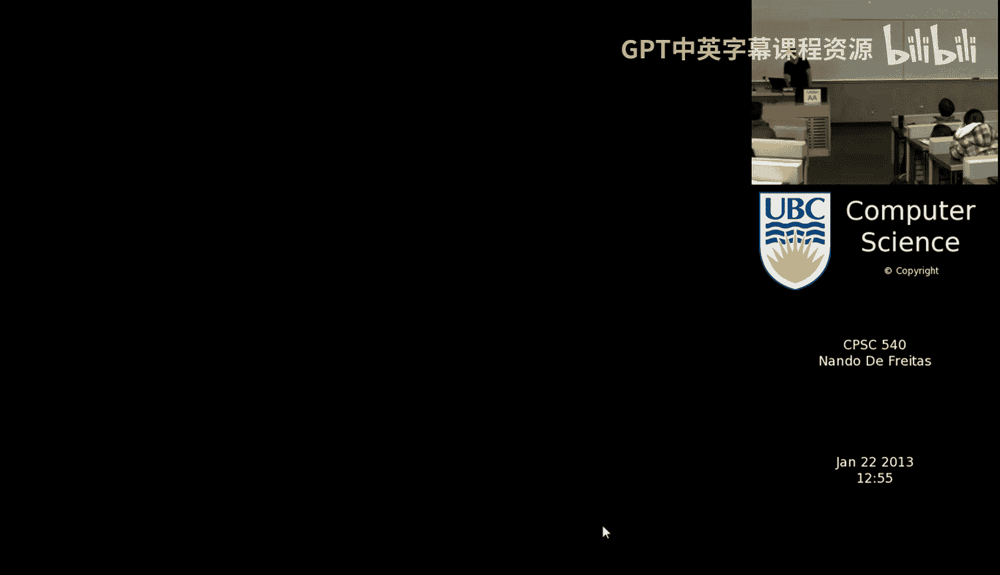
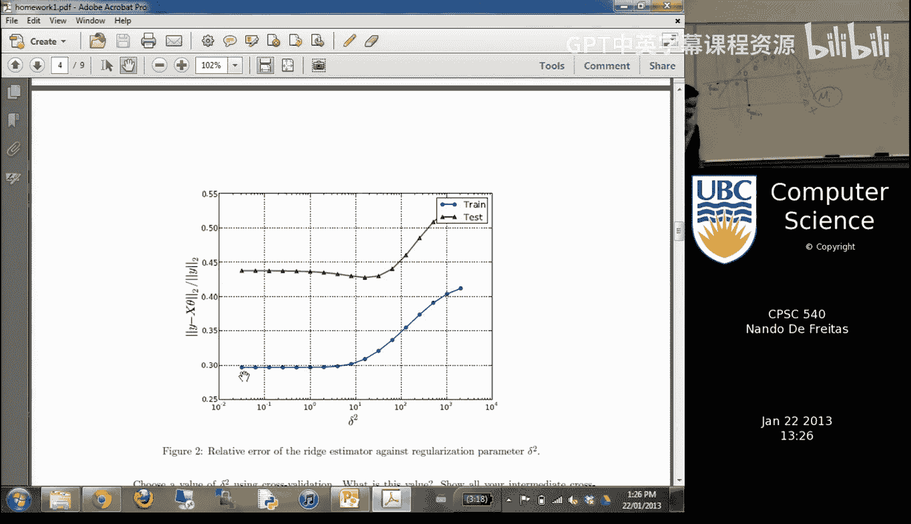
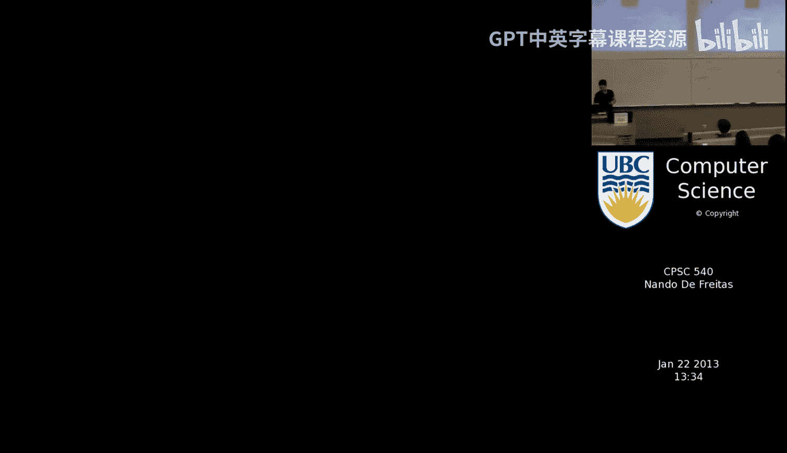
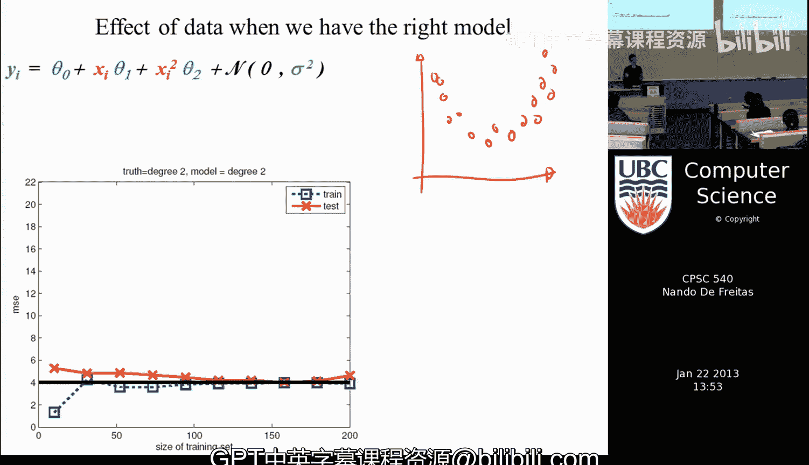

# 机器学习：05：正则化、交叉验证与数据规模

在本节课中，我们将要学习机器学习中的两个核心概念：正则化与交叉验证。正则化帮助我们控制模型的复杂度，防止过拟合；而交叉验证则是一种评估模型泛化能力、选择最佳超参数（如正则化强度）的实用方法。我们还将探讨数据规模如何影响模型性能。

---

## 正则化：从岭回归说起

上一讲我们介绍了岭回归。岭回归的初衷是让最小二乘法成为一个更易于处理的问题。所谓“易于处理”，主要是指让矩阵求逆变得容易。

在最小二乘法中，我们需要求逆一个大小为 `D x D` 的矩阵 `X^T X`。在大多数应用中，输入特征的数量 `D` 小于数据点的数量 `n`。然而，在某些情况下（例如生物信息学），`D` 可能远大于 `n`。岭回归通过引入一个额外的项，将问题转化为求逆一个 `n x n` 的矩阵，从而解决了这个难题。

岭回归与普通最小二乘法的核心区别在于增加了一个额外的项，这本质上是一个对角线为 `δ^2` 的对角矩阵。这个项的优势在于它稳定了矩阵的求逆过程，使得我们可以在计算机上轻松计算。相比之下，直接对病态矩阵求逆常常会导致程序崩溃。

此外，我们还看到，这个解恰好对应着一个目标函数的微分结果。该目标函数在最小二乘误差（平方和）的基础上，增加了一个惩罚项，用于惩罚过大的 `θ` 值。因此，我们有意迫使 `θ` 值变小。

成本函数包含两个部分：
1.  二次项：`(y - Xθ)^2`
2.  另一个二次成本项：`θ^T θ`

如果 `δ` 很大，我们更强调第二项；如果 `δ` 为 0，第二项消失，我们就回到了普通最小二乘法。

在二维情况下，我们可以这样可视化：向量 `θ` 包含分量 `θ1` 和 `θ2`。`θ^T θ` 的等高线图是以原点为中心的圆。第一项 `(y - Xθ)^2` 展开后，其等高线图是以某个点为中心的椭圆。我们知道，这个抛物面的最小值（中心点）是最大似然估计，也就是 `δ=0` 时的最小二乘解。当 `δ` 趋近于无穷大时，`θ` 会趋近于 0。所有解都位于两个等高线图彼此相切的点上。这是因为，如果我们偏离这个点，在不增加红色成本（正则化项）的情况下，蓝色成本（误差项）会增加，反之亦然。

这在实践中非常有用。例如，如果你试图根据患者的基因（假设有 20,000 个基因）来预测其康复情况，可能只有其中两个基因真正起作用。通过正则化使其他基因的系数自动趋近于 0，你就能发现哪两个基因对预测至关重要。

换句话说，我的预测模型是：
`ŷ_i = gene1 * θ1 + gene2 * θ2 + gene3 * θ3 + ... + gene20000 * θ20000`

如果很多 `θ` 值变为 0，并且某些 `θ` 比其他 `θ` 更快地变为 0，我最终可能得到一个只有 `θ1` 和 `θ20000` 非零的模型。这样我就知道只有基因 1 和基因 20000 是重要的，无需测量所有其他基因。虽然我不知道这里的因果关系（这些基因是否导致康复），但我知道这些基因与康复成功率之间存在相关性。

你可能会问，如何事先知道哪些 `θ` 会是 0？这正是正则化器的作用。随着正则化强度 `δ` 的变化，某些 `θ` 会比其他特征更快地变为 0。想象一下，如果我的正则化曲线更“尖锐”一些，`θ2` 会比 `θ1` 更快地趋近于 0。因此，通过选择合适的 `δ` 值，我可以基本上忽略 `θ2`，只使用 `θ1`。

这就是正则化的核心思想。它不仅让我们能够对矩阵求逆，还能帮助我们识别哪些是重要的变量。在网页分类等任务中，你可能拥有成千上万个特征（例如网页中的所有词），正则化技术同样非常有用。

本质上，这是另一种可视化方式：当我们有多个 `θ` 对应不同变量时，某些 `θ` 会比其他 `θ` 更快地变为 0。在岭回归中，要完全消除某些变量并不容易。但后续我们将修改正则化器，使用 L1 正则化（即 `|θ|` 的和），这将为某些特征提供一条直接通向 0 的路径。这将在后续课程中介绍。

---

## 非线性回归与基函数

我们之前还介绍了如何进行非线性回归。你可以对一个线性回归问题进行“改造”，使其仍然是一个线性回归问题。

例如，如果你的数据大致遵循二次曲线分布，你可以构建一个二次模型，即同时包含 `x` 和 `x^2`。为了使这仍然是一个线性模型，我们构造一个向量 `φ`，其中包含 `1`、`x` 和 `x^2`。这里的变换是对输入的变换，而不是对 `θ` 的变换。这样，我们仍然可以将其写成一个线性模型：`y = φ * θ`。我们只是用 `φ` 替换了 `x`。

现在我们可以处理非线性模型了，并且可以在二维和高维中应用。同样，使用正则化的思想在于，当你有一个非常高阶的多项式时，我们能够将其中一些 `θ` 设置为 0。

当 `δ` 非常小时，多项式非常灵活，可能过拟合数据。当 `δ` 取值合适时，我们会得到一个很好的多项式。如果 `δ` 太大（惩罚过重），我们基本上会消除太多的 `θ`。消除多项式中的 `θ` 本质上允许我们为数据发现正确的模型结构。在机器学习中，我们经常这样做：用成千上万的参数来表述问题，然后加入正则化器，这些正则化器将帮助我们找到正确的模型结构。

另一个例子是径向基函数，它在图形学和数值计算中非常流行。RBF 的思想是在某些位置放置一个基函数（也称为核）。例如，我可以在位置 1、2 和 4 处放置高斯 RBF。如果我将这些红色曲线按适当比例相加，就会得到绿色曲线。因此，要创建任意平滑曲线，我只需要添加基函数。可以把基函数想象成砖块，你可以改变其大小、宽度和高度。有了这些可调整的砖块，你可以建造任何东西。

基函数的思想本质上是：它们是小的构建块，通过缩放（乘以 `θ`）和加法运算，可以构建出更大的函数。如果我们将所有基函数放入一个向量 `φ` 中，我们仍然可以将其写成一个线性系统：`y = φ * θ`。同样，我们可以应用正则化。

关键在于，无论你使用径向基函数还是多项式，学习问题仍然是一个线性问题。即使你处理的是非线性问题，其计算和解决方案仍然是相同的。这非常有用，因为只要我们掌握了一种方法，就能解决许多问题。

---

## 基函数方法的挑战与超参数选择

基函数方法的一个问题是，我需要决定每个基函数放置的位置。在实践中，人们通常在每个数据点处放置一个基函数。这样，基函数的数量就等于数据点的数量。如果你有数千个数据点，这会导致特征向量非常大，特征数量就等于数据数量。当你这样做时，你得到的就是一个核机器。在后续课程中，我们将讨论高斯过程（一种核方法），并了解如何高效地进行计算。

关于基函数的位置，我们可以通过在每个数据点放置基函数来解决。虽然这可能计算量大，但这是合理的：如果数据在这里，我们就应该把基函数放在这里；如果数据不在门口，在那里放置基函数就没有意义，因为我们在那里做的任何拟合都不太可能是好的。

但这仍然留下了一个问题：我们如何选择基函数的宽度？这里我用符号 `λ` 来表示宽度。如下图所示，右侧展示了三种情况下的基函数（蓝色）。在右上图中，基函数非常窄；中间图中，基函数宽度适中；底部图中，基函数非常宽。

如果基函数太窄，对数据的拟合会像图中所示那样（可能过拟合）。如果基函数宽度合适，会得到一个很好的拟合。如果基函数太宽，当你将平坦的东西加在一起时，基本上会得到平坦的结果，因此无法获得良好的拟合。

所以，我们之前需要选择 `δ`，现在还需要选择 `λ`。这是典型的情况。有人可能会建议，我们不应该只有一个 `λ`，而应该为每个数据点设置不同的 `λ`，因为在数据的某些部分我们需要精细的细节，而在其他部分则需要平滑。当我们学习神经网络时，我们将会这样做，学习所有这些参数。但如果我们坚持使用线性模型，这样做的问题在于，即使现在只有两个未知量（`λ` 和 `δ^2`），估计这两个量已经相当困难了。如果我为每个数据分配一个 `λ`，那么我将要描述的技术将无法工作。但在神经网络中，我们可以实现你的建议，这是正确的做法。

此外，还有多项式阶数的问题。我说过，让我们使用某个次数的多项式。应该选择多少次呢？所以，当你构建模型时，你会做出一系列“如果”选择，这在编写任何代码时都是如此。算法配置领域的人员也处理类似的问题：人们构建求解器或任何数值算法时，都有一堆自由参数。能够自动调整这些参数会很好。在后续课程中，我将描述如何自动调整这些参数的技术。

今天，我们将看看为了自动调整这些参数，我们应该优化什么目标。

---

## 交叉验证：选择超参数

让我们从最简单的计算参数形式开始，现在只关注 `δ`。同样的过程可以用来估计 `λ`。

以下是步骤：
1.  **给定训练数据**：我们有一些训练数据 `(X, y)` 和一个 `δ` 的猜测值。
2.  **计算模型参数**：我们计算岭回归问题的解 `θ_hat`。公式为：`θ_hat = (X^T X + δ^2 I)^(-1) X^T y`。
3.  **进行预测并计算误差**：
    *   在训练数据上计算预测值：`ŷ_train = X_train * θ_hat`。
    *   在测试数据上计算预测值：`ŷ_test = X_test * θ_hat`。

具体操作是：我将数据分成两个集合。例如，如果有 1000 个患者，我用 500 个患者来学习模型，然后在剩下的患者上测试模型的质量。训练集用于计算 `θ`，测试集用于确定最佳的 `δ`。

然后，我可以尝试许多猜测值（例如使用对数尺度）。对于每个 `δ` 猜测值，我计算训练误差（预测值与训练集 `y` 之间的平方误差和）以及测试集误差。

假设我评估这些和时，得到了图中红色的数字。在你的作业中，当你改变 `δ` 时，你会看到以下行为：当 `δ` 很小时（例如为 0），你能很好地拟合数据，因为如果没有正则化，模型非常灵活。这在非线性情况下更容易看出。

让我们通过一个游戏来理解：我将用三个模型拟合一些数据点，你们告诉我喜欢哪个。
*   **模型 1**：线性回归。
*   **模型 2**：二次回归。
*   **模型 3**：非常高阶的多项式。

假设这些点是训练数据。喜欢模型 2 的请举手？模型 3 呢？模型 1 呢？

现在，第二天出现了新的测试数据。你收集了新数据，并观察到图中的情况。这确实有可能发生。学习是一个不适定问题，意味着学习问题有无限多个解，这是一个归纳过程。然而，我们倾向于模型 1 有几个原因。顺便说一下，模型 3 在以下意义上很好：除了我画得不好的那个点，训练误差为零，因为模型 3 能够精确地穿过每个点。而你们大家都喜欢的模型 1，黑色曲线并没有穿过红点，所以它存在误差。

当你选择模型 1 时，你接受了永远无法达到完美、总会存在误差的事实。当我选择模型 3 时，我作弊了，因为训练集误差为零，所以我认为那是最好的模型。这通常是机器学习新手的典型错误：他们在训练集上训练模型，并认为训练误差最低的模型就是最好的模型。但大多数情况下并非如此，大多数情况下模型 1 确实是正确的模型，所以你们的直觉是对的。

但这种直觉从何而来，为什么它是正确的？我们可以假设观察中存在噪声。一旦我们相信数据中存在噪声，你就知道完美拟合每个点是不明智的。此外，我们也倾向于选择不那么曲折的点，而不是其他曲折的点。

让我用另一个游戏来说明第二个原因。在这个游戏中，我将在二维空间中画一些点。这是一个无监督学习任务，只有输入数据 `x1, x2`。现在，当你看着这些数据时，你看到了什么？任何志愿者？两个环？还有谁对这些点有不同的解释？每个点都是一个坐标。但你是说解释就是一堆点，每个点在这个特定的坐标上吗？至少在很多地方都有值。在这种情况下，你可能不会使用线性组合。在这个阶段，我不是要求你提出一个模型来描述这些点，我只是想让你描述你看到了什么。你现在是受试者，我在用你的大脑作为模型。让我们看看其他模型怎么想。当你看着这些点时，你还看到了什么？很多缺失的数据？我的意思是，你会有更多的观察结果，所以整个圆周会填满。这更有趣了。新理论，我……你还喜欢两个簇的理论吗？任何人？

让我们为“我展示给你 30 个点，每个点都在这个坐标上”这个理论建模。这是一个很好的理论，它描述了这一点。写这个理论需要很多行，因为我需要说明每个点是什么。换句话说，我会使用模型 3，一个非常详细的模型，精确说明每个点是什么。然后还有一个更抽象的模型。所以模型有不同的抽象层次。

这里发生了什么？为什么你倾向于不把这些看作单个的点？为什么你这么快就认为这些是中间的一堆点和一个环（这是使用的词）？这是因为我们的大脑已经进化到能够利用世界的某些特性。世界大多是连续的、平滑的。如果这里是白色的，那么它旁边的东西很可能是白色的，再旁边也是，依此类推。你只需要注意这里的不连续性。这就是为什么你后脑勺那 20,000 个神经元在你撞到头时会变黑，它们寻找这些不连续性，因为这是模型失效的地方。我们只需要注意这些边缘。我们通过学习知道，世界是平滑的，这种连续性已经编码在我们的大脑中，因为世界大多是平滑的，无论是声音、图像还是时间事件。这在我们心中根深蒂固，我们已经学会了适合数据的正确平滑度。机器学习的一部分就是教机器做到这一点。

同样，如果我给你看这样的东西……我不应该让你看到我要画什么，因为这会破坏错觉。好吧，如果我问你，你在这里看到了什么？再来玩一次游戏。一条直线和一个 S。有多少人更喜欢一条直线和一个 S？而不是一个 V 和一个 V？看，当我说 V 时，你们实际上笑了，那边的人很快笑了，但同样，我没有理由不把这解释为：如果我在做分类，我会在这里放一个决策边界，这里有一个 V，这里有一个 V。困难的是教机器学会梯度的连续性在这种情况下非常重要。

所以平滑度起着巨大的作用。在你的作业中，你会看到：随着你增加训练数据中的正则化强度，你的答案会变得更差，这是当你从一个非常灵活的解决方案转向一个不太灵活的解决方案时，你的训练误差会变差。但你的测试集误差可能会改善。通常，你的测试集误差会像图中那样，在底部有一个小凹陷，这基本上告诉你在测试集中你的预测误差最小的位置。

现在，如果你接受测试集可以是未来遇到的任何数据集，那么你想做的就是确保你的模型无论遇到哪个数据集都能工作良好，测试集将指导你如何选择最优的 `δ`。特别是对于这张图，你会选择这里的 `δ`，这本质上就是你作业的解决方案。

---

## 交叉验证的步骤与策略

让我们尝试用这个练习来形式化这个过程。这里我选了这些红色数字，更多的是为了说明技术，而不是你在实践中通常会遇到的情况。你在作业中做的就是实践中通常会遇到的。

好的，让我们回到设置：我有一个训练数据矩阵 `X_train`（`n x D`）和对应的 `y`（`n x 1`）。我还有一个测试数据集对应的相同矩阵，因为我把数据分成了两个集合。所以数据索引 `i` 现在遍历训练集和测试集。

我做的就是在给定 `δ` 的情况下计算 `θ`，假设 `δ` 的猜测值是 0.1, 1, 10, 50, 100。目前我们假设这些是猜测值。在后续课程中，我们将看到一种生成这些猜测值的聪明方法。但现在，我们只是猜测这五个值。

对于每个 `δ` 值，我在训练集上计算 `θ`。然后，对于训练集中的那个 `θ`，我计算训练集和测试集上的预测值。在这两种情况下，我都计算误差，平方误差通过平方误差和来衡量。我可以通过除以数据大小来归一化，但这对于讨论并不特别重要。最重要的是，我们可以计算训练集的某种误差形式和测试集的某种误差形式。

就像在这个例子中，黑点是测试集，所以我在测试集上的误差就是这些蓝色的垂直距离，而我在训练集上的误差就是红色的垂直距离。我只是把所有蓝色加起来，就得到了测试集误差；把所有红色加起来，就得到了训练集误差。假设我这样做了，然后得到了这里显示的数字。那么问题就是，我选择哪个 `δ`？

让我们再玩一次游戏。我要开始投票了。我们有五个 `δ` 值。我们来投票。有多少人投票给 `δ = 0.1`？请举手。`δ = 1` 呢？`δ = 10` 呢？`δ = 50` 呢？`δ = 100` 呢？

根据多数原则，答案是 1。但现在让我们让这更有趣一点。在那些选择 1 的 35 个人中，有人能告诉我为什么吗？或者……训练集或测试集的行为有些相似？这只是其中一个，其他的你看到了主要差异。所以，如果你相信它们来自同一来源，它们应该相同。这是正确的。所以他的论点非常好，很有说服力，对吧？如果你相信训练数据与测试数据来自同一来源，你会期望误差大致相同，因此你会喜欢像 1 这样的值。现在，对于那些选择 10 和 50 的人，你们的理由是什么？我只是想说明一点。不应该是相对误差而不是绝对误差吗？只是为了确保你……对于桌子来说。是的，现在假设数据集大小相同。如果不同，我们只需将误差除以每个数据集中的点数来归一化。但这是个非常好的观点。这就是为什么我们需要归一化。

有三个家伙选了 10。你们在哪里？他们藏起来了。为什么我选它？因为现在我知道我的模型有多糟糕，就像如果我直接取它，如果我试图最小化测试误差，那么我将不知道它会有多好。而现在我得到了 1，我表现得……但我没有污染我的选择。这是个好理由。那 50 呢？这是……故 time 品就是。你能与未来比较的唯一方法是看你的