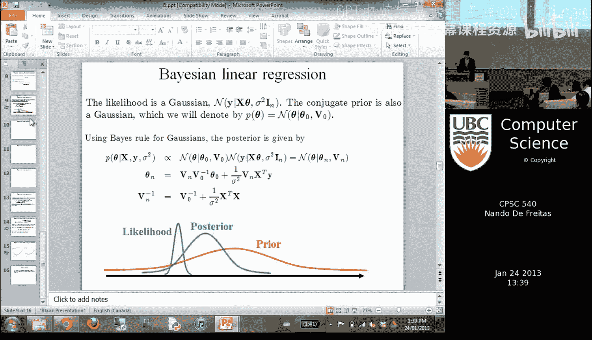
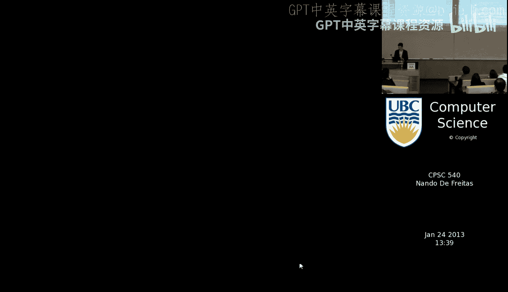
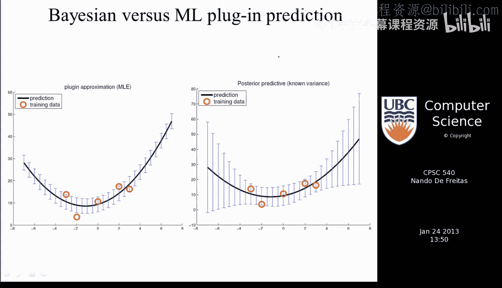

# UBC《机器学习（研究生）｜CPSC 540 Machine learning 2013》中英字幕 p06 -06-Machine learning - Bayesian learning.zh_en -BV19g2FBBEEq_p6-

All right， so let's get started。Today I want to start with a question。

That it's a question of probability and integration。

Suppose we have a multivariate Gaussian like this one here， so it's a distribution of a y。

The variance is governed by the covariance in this case， which is sigma and then the mean x theta。

 So this is precisely the Gaussian that describes the linear regression problem。

When we do our probabilistic version。Now， we know that this is the probability of y assuming that x and feet are given。

Okay， so that's what that bar means。We know that a probability sums to one。

 okay so I think most of us are happy with that fact。

 so the integral over y of the probability must be equal to one。

If that is the case and here is the question for you guys then。What is the integral of this function？

Of this exponential。can毕呀。Pingma squared to the one half。事。If I know that this integral。

She's this girl。Is equal to one。This doesn't depend on why so I can take it out of the integral sort of basic calculus。

 and then I just move it to the other side。And so， I get。2 by。Segma。啊，好。

 so that's using basic calculus。 if you have a constant inside an integral， that constant can go out。

And then you can move it to the other side if， if it's dividing on the other side， it multiplies。

 the determinant is a scale。Now， I noticed in 340， that quite a few people were not able to answer this in the final。

嗯。And so I think that the problem is not to do with the intuition of what you're doing。

 that probabil comess to one， and therefore the thing before it is the normal system and constant。

But what I believe students and most students here did not take 340， by the way， I keep saying 340。

 but there's only like a handful of students from 340 here。

 Most of you are grad students from bioinformatics， computer science。

 there's a few students here from statistics， there's quite a few from engineering。

 there might be a few from neuroscience， physics and so on。

 so it's a pretty diverse crowd here because machine learning is really very interdisciplinary。嗯。

Problem。And I think the reason why some people struggle with this is because of not understanding these symbols。

It's not to do with machine learning， to do with what you learned in first year and second year。

 whatever you studied， Waterloo or UPC or Toronto or whatever you did， your undergrad degree IIT。

And so if you do not understand these symbols。I will one us last time， make this plea。

 come to office hours so that I can help you。By explaining this slowly and so on。All right。

So office hours is the right place for me to take all the time in the world to explain to you that the sort of the basics。

In class I cannot go into the basics of linear algebra and calculus because that's not what this course is about。

I think everyone's on board with that。We will use。Of course。

 I'm not just putting this fact here to point this up。

 I'm pouring this here because actually this turns out to be an extremely useful fact。

There is an alternative to maximum likelihood called Bayesian learning。Ba in learning。

 as we will see， is a problem of integration as opposed to being a problem of optimization。

By doing these tricks， we're able to solve very nasty integrals。 if you had to do this by hand。

 it would take you a page of calculations。If you know what you're doing， if not。

 you could take your 20 pages or 40 pages。Very easily。嗯。

So it's so nice that by using this trick that we know the probability sum to one。

 we can actually write down the answer to these big integrals。

That's actually going to be extremely useful。 So you actually will not need to know your calculus and how to do integral and so on。

 even without knowing the calculus， just the common sense that a probabil comes to one will allow us to actually solve to。

Sove a lot of integrals by hand。When we can do those integrals by hand。

 and we certainly can do them with Gaussians。 And that's why we focus on Gaussians。

We can do them with a few other distributions forson， de Richle and so。For all those cases。

 one can develop machine learning methods， those machine learning methods are actually widely used。

Their examples include factor analysis， which I think a lot of people in bioinformatics use certainly used a lot in psychology。

You can do carbon filters， which is sort of。Component of any adaptive filtering course in engineering。

 or if you're want to study tracking or robotics， that's an essential algorithm we have to learn about。

 that's essentially that follows from this。And the use of Gaussians。In fact。

 today's class is part of the derivation you would have to do if keep deing common filters。嗯。

It appears when you use the slide distributions， which haven't discussed yet。Instead of Gaussians。

 we can also do these tricks and that's the basis for topic models that are used for information extraction and natural language processing。

 so one of the most useful techniques out there on the web for language modeling。

So you can actually do a lot。With modelss。Where you can apply this trick。

The nice thing is that then we will be able to actually do basician learning for a large class of interesting problems。

For some problems， however， it is impossible to solve these integrals。 In fact。

 the computational complexity of solving these integrals is something it's called Sha P。

 It's kind of equivalent like NP P hard。Solving integral and high dimensions is not an easy problem at all。

And so and that happens， for example， if we're doing a neural network。

 if we want to do baseline learning for a neural network。In that case。

 we will have to introduce novel techniques in particular we'll discuss the Monte caral simulation in discourse as a way of solving integral。

But there is this class of distributions。Just this magic class which includes the Gaussians for which we can solve the integral by hand like we just did。

Okay， so I'm going to take now step back into gover。

To finish some of the things I was pointing out in the last class。

 so we'll continue doing linear regression and again， because if we can do linear regression。

 it will be obvious that we will be able to do no linear regression， the principles cross validation。

 regularization， they all carry through。So if we learn them with linear models。Then， we just need to。

Do a bit more work with not nonlinear models， and we'll still be able to use all these ideas。嗯。Okay。

 so in standard linear model， we assume that our data was in this example that I went over。

We assumed that the data was produced by。A quadratic model。

And then we used a quadratic model that only looked at the data to try to infer the function again that is given some data。

 and so the experiment then I then run， actually I didn't run this experiment， Kevin Murphy。

 the author of the book that I recommend for this course run this experiment。

 these plots are from his book。What Kevin did was he increased the number of the size of the training set。

And as you increase the training set， we see that both the training error and the test error converge to the optimal error。

And we'll always make some  error because it's impossible for a quaratic to fit all the points because there is noise in those points as the picture indicates。

If you have the right model， learning happens very fast。Okay。

And both the test and training error go to zero。If your model is too simple。For example。

 if you know for the same points we try to fit a linear model。

 so now Y hat is just a linear model the equation of a line。Then a line cannot fit a patratic。

 It's impossible if it doesn't have enough degrees of freedom。 And so because of that。

 we see that there is a systematic error。 there's a bias error always。

And it's impossible to get rid of thisarrow with a linear model， no matter how many data you observe。

 if your model is too simple。Your model will not be able to capture reality。So in your homework。

In fact， you'll see that the model that you're trying is kind of simple for the bioinformatics application。

And so the consequence of dentist that you see that the test error is indeed very high。

 so if you wanted to decrease that error， you would have to change the model to a nonlinear model。

And in fact， for an extra 1% toward the final mark。

 whoever submits a good linear model will get that。Oh。Not linear model using RPFs or polynos。

 what we've discussed so far。O。But in reality， when we model。

 we do not know whether our model is going to be too simple or whether we have the right model。

So we actually have uncertainty of our models。One way folks in machine learning deal with this problem is。

Especially in applications where data is abundant。The approach is let's use models with lots of parameters。

Because as we get more and more data， the data will constrain。The space， will。

 as we see in that picture， you get more and more points。

 there will be no room for that polynomial to o the light， and so we'll get a good fit。

And that's essentially what we observe here where I。I'm using a model。

That now consists of- so it's a model for predictions。And it has theta n plus Xi theta 1。Plus， dot。

 dot， dot， plus X，Theer 25。So it's a model of 25。呃。With a 25 order polynomial。

So which will oscillate a lot。 But as you increase the number of data。

 you can see that eventually your test error goes down。

The training error tends to be below because you tend to overfit on the training data when you have such a flexible model。

 so your model will do very well in your training data but doesn't do well on the test。

And so by increasing the number of data， you can see that eventually。

Even a very complex model will approximate。The truth。The别 model。

And that's a very important sort of lesson for machine learning that is in this we allow you do in Pra so that there's two ways to get a good model for your data。

 one is you put a regular just typically use a very large model。

 put a regularizer because the regularizer and then do cross validation to find the idealL delta as you do in your homework。

That helps find the right model complexity。But also the more data you have。

 the more room it gives you to have a more complex model。Right now， the goal。

 the game that's being played in artificial intelligence。

 at least in terms of perception of being able to understand objects and speech， is the game of data。

Google is starting to get as much data as possible for this speech recognition in trying to use as much data as possible for image recognition。

And then at the same time， they're trying to build models that are as large as possible。

 So they're trying to， so a lot of the focus in the Google Bra project is about。using many。

 many course and being able to run the algorithms that we discuss in this class in those course。

 so it's not new algorithms or anything， but it's just a question of scale because they believe that the problem of AI is that we are around here or maybe around here。

That we don't have our learning machines have not update， I completely agree with that。

 we've never had built an AI system that uses as much data as I have been exposed any of you have been exposed to during your lives。

And certainly not as many processes as。Any of your brains。All right， so that's essentially。

This is sort of an important lesson。Having a lot of data helps。

 but all if you have the right model complex。And then the whole discussion of big data newspapers and so on。

 keep that in mind。How the size of train。Exction。The use。Oh no， no， we have to change the parameters。

 So the question is the data set is increasing， but am I only using a small data set to estimate the parameters。

 No， the idea is you get estimating the parameters from a bigger and bigger data set。

And so we have recursive ways of estimating the parameters from bigger data to set。Most of the time。

 sometimes we don't， but a big focus on machine learning right now is how to deal with what we call streaming data or the streaming model of computation where your data keeps increasing。

Like imagine Twitter feeds， Twitter feeds are streams， or what a robot experiences is a stream。

 a robot goes in the world and data comes at death throughout the existence of the battery life。

Or in the same with us， animals we just see date all the time as a stream。

And so the focus is on designing algorithms that keep learning adaptively from these streams of data。

So re time， and I'm going to get into it。Of later in the course。

Today's lecture is going to be about this。Maximum likelihood will give you very good predictions。

 So if you have those red points， you'll get that black line fit， which is a nice fit。

And then we made an assumption。Which was that this covariance matrix sigma for regression。Was。

It's no doubt that Sigma。Which is the identity with Sigma current diagonal， in other words。

 we assume that every point has the same variance。And then you can compute that variance by maximum likelihood。

 I left that for you guys as an exercise， which I hope you do。嗯。

So we know how to estimate this variance by maximum likelihood。

 and we were saying that that variance would be the same for all points。

But that in a way doesn't make much sense， right， because。In a way。

 you would want to get something that's more like。What's on the right hand side。

 so that's what this is what we've done。And this is really what we want。Why do we want it？

Why is the right inside most sense， Why do you think I like that one better。嗯。

Let's put of stuff back here。Exactly。So over here in this area， I've seen some data。

 where I've seen data should be confident。What I haven't seen data shouldn't be confident。Okay。

 so I've seen data in Canada and someone asked me， are people in Vancouver nice。

 I could probably say yes or no， because I've seen a lot of data here。 I would have I don't know。

 Yes with 99% certainty。If people ask me，A people in Dartfur nice， I'm like， well。

 I've never met anyone from there， so I don't know。So most likely yes。

 but my confidence assessment should be different in that case I should have more uncertainty。

And so we want models that do this。And this is what Ba learning will give us。

 It will give us an automatic way of doing this。 And this is the being able to quantify uncertainty in this way。

It's also going to be key to decision making。If I want to have a system that is not just learning passively from data。

 but it's actively gathering data。Then that system needs to know what it doesn't know。

 so it needs to have good estimates of uncertainty。Because it needs to be aware of。For example。

 if I'm trying to figure out what kind of candy he likes and I'm offering him candy。

 and I know that he already like the pineapple so I can offer him more pineapple like candies。

But if I know that I've never shown him anything like a strawberry。

 then then I have high uncertainty as to whether he would like strawberry or not。

 so that it's well worth trying strawberry。Just to decrease my uncertainty and learn his preferences。

 so it's key for the design of user interfaces and this is like a silly example that I'm using now。

 but for actually real interfaces we use these ideas and certainly for things like deciding which app to deliver to you guys in Facebook or you get the idea it' no different than the candy example。

Likewise， drilling for oil is the same thing， you want to look where where you already know you're likely to find oil。

 but you also want to now and then sample in areas where you have high uncertainty。

And so often you have the trade off between exploiting。What you already know or exploring in areas。

That are likely to be lowcrive， but where your uncertainty is high。

 So being able to get a model like this will be essential。All right。

 so that provides us with some motivation for Ba learning and I'm going to start with the basics of Ba learning。

 so I'm going to first talk about what's base rule， which is used in base learning。

 how to apply base rule to a very simple example which assume some of you have seen before。

 and then we're going apply Ba learning to the linear model。So instead of doing maximum likelihood。

 we're going to do this completely different technique called Pa in learning。And the way。

The trick we use， which is that we exploit the fact that we know this integral。

 is something that's part of a general procedure for the arriving Bayesian estimators known as conjugate analysis。

 so I'm going to go over that too。Okay， so let's start with an example。You go to the doctor。

 the doctor has good news and bad news。 The bad news is that you've tested positive for a very serious disease。

And the doctor tells you that the test is 99% accurate。They good news。

The doctor tells you that this disease is rare。Okay， only one in 10，000 people get just disease。

Should you be worried or should you not be worried？Should you be very worried or not。Very worried。

How many people would be very worried， hands up？One，2， three， four， five，6， seven， eight，9，11，12， 13。

 14，15。So 15 people would be very worried。Oops。How many people will be totally not worried？

Totally chilled out。One，2，3，4，5，6，7，8，9，10，11，12，13，14。So， it's about。14 people would be like chill。

And how many would be in between。Okay， probably about 20。 Let's say roughly 20。Okay。

 so that's more or less our distribution。Okay， so。Let's see how we would deal with this problem。嗯。

For that， we need to introduce。 and this problem， by the way， arises not only in medicine。

But this is the same problem that a judge encounters。In court most of the time。You know。

 there is the evidence point， so there is。Probability that this person committed this crime。

And then you need to look at how life how。Probable that evidence is and so on。

 so you need to combine these two sources of information。That I have combined here。

 this one and this one。Most often people just look at one source of information and they ignore the other one simply because they have no the ability of reasoning properly and knowing how to combine these two sources of information。

嗯。Or they haven't been educated， this happens also a lot in sports where cyclists， for example。

 test positive for having taken drugs。And。And then people make the judgment based on that。

 but they don't take into account other probabilities。Okay， to answer this。

 we will learn something called base rule。Base rule is fundamental。

 It's one of the coolest rules of reasoning。That there exist。 It should be taught in high school。

 and it's almost a crime that it's not taught in high school。 That's how strong can feel about it。

It's I think， more important than knowing that F equals MA for sure。

Because it's a rule about how we humans reason and how to build optimal reasoning systems。

How to go from evidence to theories。And psychologists love base rule。

So there's a lot of great talks about base rule。There's manyed talks about how babies。

Are actually very good at carrying out base role。And unfortunately。

 our education systems don't maintain that。 So I in particular recommend you look at the TEed talk of。

Alison Gpnk about this。And then there's also some great word by Josh Tenenba。

Josh is a cognitive scientist， Allison， is a psychologist at Berkeley。So in psychology。

 this is based in thinking， especially cognitive well in cognitive psychology is sort of very important。

Very important area of research。So what base rule gives us is a way of swap of inverting probabilities。

If you know the probabilityative B given A。You're able to infert it and get a probability if I given B。

And it's the formal mechanism for doing so。Why is this important？

Because lets give you do it just with one trivial example。

 How many of you have the ability in your computer devices to type a sentence and have that sentence。

Be spoken by the computer。Okay， most of you。 That's easy。 in a computer。

 you might have a robotic voice or these days， you can even get it to have a sexy voice or Brad's voice or whatever。

 So that problem is solved。From words， we know how to generate speech。

The inverse problem we don't know how to solve。Yet。

Google's come very close to have a pretty good system。But it's taking so much effort。

How to go from speech to words。How to invert that process for a computer turns out to be extremely hard。

 A lot of the problems we encounter in AI are this type of inverse problems。

If we have vision is the same thing， our computer graphics has got really good。

 especially texture mapping and so so on， you go to these you know we were always surprised at the latest computer CG movie where we're like。

 oh my God that goal is so real。But the opposite how to go from rules to images is easy。

 but how to go from。Eas in， I mean， easy as in。It still involves a lot of work for what to digital。

But how to go from do the opposite， like how to go from actual images to understand what the objects are in the image turns out to be very hard。

 so being able to invert probbabilities is key。Imper。And certainly with humans as well。

 so there's many psychologists who studied this who study Bay inference as a way of which humans and animals took perception。

Okay， having said all this， base rule is just a consequence。

 it's essentially this formula that's here and it allows you to invert two things。

 let's parse this a little bit。A rule of probability is that the joint distribution of two variables is just equal to the conditional。

Times the margin。So and it's also。A， given B。Time B of B。To get the definitions right here。

 let's give these guys names。 So this is called the marginal。This is the conditional。

And this is a joint distribution。Because it muddle A and B jointly。

My YouTube 340 lectures go in detail in examples with say binary variables on how we do this and so on。

 so if you're in a background of that， I'd recommend that video you。呃。Now， and again。

Sorry about that at this bar here。Means。Givenive。So， we know that。The integral of P of A and B。Offer。

DA and Db is equal to one because probability is sum to1。We know that the integral of a given B。

Over right。Is also equal to。Also equal to one。In this case。

I'm emphasizing that P of A given B is a distribution over A。 It's not a distribution of a B。

 B is being given。 It's deterministic。 It was an observation。Suppposed we see B。

 then we only have uncertainty DNA DNA。And likewise， the integral over any of the marginals。

Like P of A。VA is equal to one， which is just the same rule as the rule for the joint。

We also know that in order to get。A marginal。From a joint， we integrate。P of A and B。

So in statistics。Whenever we have a distribution over two quantities and we want to have the distribution to be only over one quantity。

 the right mathematical operation is to integrate the other pair。

And a derivation of this is in my 340 video， my second lecture video has a derivation of this property。

 so these are basic rules of probability， but they are essential in order to understand base inference。

 so we will make ample use of these rules， this operation here of integration in statistics when we have probabilities we also call it marginalization。

And。对对。The conditioning that I've introduced there is also called the chain rule。Of probability。

And so now finally， base rule is just a consequence of the chain rule。

 right because we've said P of A and B can be written in two ways。

 if I equate those two black lines on the right hand side， I get base rule。This is for ring。

Proal beauty can be。あぶだったよ。A， given B。D。No， because let me try to give this an example。

 P of A and B if I integrate。This is a distribution of a。Given and that you've observed B。

So that bar is very important to understand its semantics。嗯。

This is saying that this variable here has been observed。Now， if I have observed something。

 I know what it is。 There is no uncertainty about it anymore。 that is a deterministic variable。

And so when you look when you see that bar， I want you to think of it as a context。

 It's P of A given B， B could be the country where you are。

 So A might be say a variable that measures temperature。

 temperatureerature is a good random variable。P of A is temperature B is the country。

And so I can talk of P of A given B in Spain and you know P of A given B equal England and so on。

 once I observe the country， I know what the distribution over A。

 each country has this particular distribution over A。And for that， when I sum over， I get one。

So think of each in each or another example， for each country。

 you build a histogram of the heights of people。And you normalize。

So that each country now has a probability distribution over the heights of its individuals。

Once then if I pick any country， the histogram in that country sums to one。However。

 if I don't know the country either， if I have uncertainty as to there's an individual。

 I don't know what country the individual is from， then I need to some of the countries as well。

And that would be the other calculation that I had on top there， summing of A and B。But yeah。

 the bar， anything to the right of the bar， has been observed。It's deterministic。

 there's no certainty。 There's no need for probability to deal with things we know。

Proability is only just for the things we don't know。All right。

 do here is now how this is used in the process of inference。

 which is essentially a process of inferences， a process of we having hypothesis in our head。

 making observations and updating our hypothesis in light of the observations that we've seen。

So I have a belief about religion， say I observe some data or in a documentary about religion。

 and then my updates about religion get updated。What about anything else？

So we have some prior beliefs。And as a toy example。

 think of a child that has a prior belief as to what a sheep is。And it might think， well。

 gods kind of looked like sheep that must be a sheep。With low probability。And then。You know。

 she's going to the countryside with the parents and the parents say， look， look， look， look， ats。

 there is a sheep over there。 and they point to it。 And so she gets a label。So。

We have parameters of she had a model， but now there's a likelihood because there's data。

So she has the probability of the data given the model or the hypothesis in this case。In blue。

India question and in the plot。 And then what Al then does is she combines the likelihood with the prior by using base rule。

And she gets the posterior， which is her new beliefs as to what a sheep must。Look like。Okay。诶。

And this just to emphasize is P of d given H times P of H using pageige rule divided by P of d。Okay。

 because if ice。If I。This quantity here。Is P of D and H prime。If I integrate over one variable。

 I get rid of it。And I'm a get back V ofD， so that's just a straight application of the rules we introduced。

So that's the basis of patient reason。The only problem is we're going to have to deal with doing the sum always。

For most problems of interest， that sum， for a great many problems。

 that sum is actually combinatorial， so it's equivalent of NP hard。

Or happens to be a continuous integral for which we do not know how to solve。

And often it's an integral in high dimensions。 Like， for example， when I write this。

This is actually integral over the vector y， so it's an integral over if you have N observations。

It's an integral in the n dimensional space。If n is a million， it's a million dimensional integral。

And that's not easy to。To doing practice。For Gasians， however， we can do it。

 This could be in trillion dimensions。 And the answer is that。That's the beauty of that trick。

Well ignore that for now。 Okay， so let's go back to our diagnosis problem。

 So the probability of the test being positive of the test being accurate。

 That is the probability that。The test is true given that you have the disease so that the test is false。

 given that you have the disease is 0。99。嗯。D denotes disease as a random variable。

 and T denotes the test。I also said that the disease only affects one in 10，000 people。

 that means the probability is one over 10，000 or 0。0001。

In order to know whether you actually have a problem or not， we just compute。We just apply base rule。

 given the test is positive。What is the probability that I have the disease and the sources of integration。

 the two sources of information I need to integrate are what is the probability of the disease？

In the population。And what is the probability of the test being accurate？And if you do that， well。

 then it's just a question of plugging in numbers。This is 0。99。Times。

 what's the probability of you having the disease，0。00。One， if anyone has a calculator。

 this would be a good time too。Get it out because I will need some help。

And then we have the probability。We know that P of T equals 0， given D equals 0。Plus， P of T。Equal1。

 given D equals 0。Is equal2。Given that you're in Spain， so d equals0， d is equal given。

 the context is being given。And since T can either be0 or1。

If you sum over the two things that T can be， it has to give you one。

 the probability has to sum to one。So， this has to be。1-0。99。

Times the probability that you don't have the disease probability of d equals 0。

 which is just 1 minus0。0001。Plus，0。99 times 0。0，0，0，1。Can someone calculate this0，09。that law。

How many people would now be very worried？Yeah。Yeah。😊，Five people。

 I would still be very worried if this was like cancer or something。

 even if it's so one in a thousand， I might still not be too happy。😊。

But at least now I have quantified a bit better whether I should be worried or not。And。Surprisingly。

 if you actually Google base rule in Google News， you'll find that there's many articles about base rule。

 there's even an article about base rule being banned in courts of law in England last year or the year before。

 and mainly because judges were arguing that common people cannot reason in this way。

Now that's really sad because we're throwing away reasoning。

Just because our inability to learn basic math。So math is important not just for as a way of communicating and I just use math because that's my way of communicating quickly in idea and machine learning。

 I could stand here and just go over the whole course of machine learning without a single formula。

 but it would take a lot longer。To describe to do it。

 And so math just makes things easier to communicate。

 but it also helps us with reason with the reason about simple facts that are beyond just what we。

Technological things。Okay， so this is essentially now an application of this。

 this is how speech recognition works， you want further probability of words given the answer to hear。

We do have good models to generate sounds given words in the old days。

 this slide needs to be updated in the old days we used to use mixtures of Gaussians as the likelihood these days we use deep nets here。

That's why in this course， I will be teaching you about deep nets and our mixtures of gots。

Even though major of custom are useful models。And then for words the language model is actually quite people use simple things。

 for example， they use bygrams， which is essentially how often do pairs of words occur in the English language for that you just get a big collection of text documents and you simply count how often does this word follow this other word。

And with that， that's enough for you to be able to predict which word goes next。For example。

 if I say the silence of the， most of you know what the next word will be。Right。All right。

 so Ba learning。We will manipulate Gausss， we will manipulate neural networks。

 different distributions， but in an abstract way we will always be doing exactly what's on this slide。

 we will start by defining a likelihood， which is the probability of the model parameter is given the date。

In this case， I said， let the data just be a bunch of x's， x1， x2。

 where each x could be say a coin flip。The data could also consist of pairs observations。

 inputs and outputs like linear regression。And we'll see that example soon。

And the other thing we do is we specify a prior。Now a prior essentially indicates two things。

 it might indicate our uncertainty over the parameters。But。嗯。And so in a way。

 wherere by indicating uncertainty of the parameters， by using probability of the parameters。

 were saying that。Our beliefs over the parameters are subject。So based inference， unlike。诶。

And like maximum likelihood， for example， there's not belief in this concept of this true theta。

In finite data cases， as the data goes to infinity to two actually。Mach， but in the finite case。

What we're saying is theta is a random variable。For maximum likelihood。

 theta is not a random variable。For maximum likelihood。The randomness is in the data。Okay。

 so it's P of Y。The randomness is in the wise， not in the feet， thet is just a parameter。

In Bayian inference， we are putting a distribution of a theta。

 so we're acknowledging that there's uncertainty。Now that prior distribution can also be understood as a minus beliefs。

Just like in that example with the sheep and the goats and als and the countryside。

 and so I will choose a prior that encodes my beliefs about the problem。

So this is natural for a robot where I can put in some basic prior knowledge in a robot and then let that robot go into the world and that robot will gather observations and update its knowledge。

The robot updates its knowledge by doing phase rule。

And that gives us something that we call the posterior distribution。So it's a posterrii。And press。

So the posterior distribution essentially follows by multiplying。The likelihood times the parameters。

And there's also， I will write as。P of D。Given theater times be of theater。And that this symbol here。

It means proportional。In other words， up to a constant。P of D is a constant in terms of。

 in terms of theta， because it doesn't have any theus in terms of the posterior。 And， in fact。

 P of D。Like in this case， it's just the guide that normalizes the distribution that makes it sum to one。

Because in other words。P of D。Is equal to the integral of P of T given theta times P of theta。

Which is in to the integral of P of D。And feature。Over feet。So again。

 if we have a joint distribution over the quantities we integrate one， we get the margin。

And that makes sense because P of theta is an integral over the is an integral。Because we know that。

The integral of P of theta given D。Over theta。Is equal to one。So for for this to be true。

 it must be that the denominator in the expression on the right hand side。 that is P of D。

 must be the sum of what's in the numerator of all the options in the numerator。

 That ensures that the quantity sums do one。Okay， the denominator normalizes the denominator。

So it's just a sum over all the options below， and that ensures that the quantities。

 everything sums to on。All the probabilityba up to one。 Okay。

 so that's essentially the general framework。We need to specify a likelihood。

 and we need to specify a prior。 And that prior， in that prior。

 we will be able to put our preferences。So we're not just going to pay attention to the data。

 but we're going to use all sorts of prior knowledge。

OkayThat probably is important to make statistical decisions。 Like let's say， for example。Okay。

 let me put that following exam。I'm going to do a test with you guys。

 How many of you what do you think is the probability。

That I will take a job at some other university this year。Anyone。Let's start with you。

 sitting in front， gets you that 3%， 3%。So I'm going to write just probabilities。

Someone from the back。关这个。40%。Yeah，50%。50%。哇。完。0。01。Now。Let me ask you a different question。So。

You're able actually， before ask you a different question， let me say something about this。

 you're able to assign probabilities and each of you has a different probability estimate。

 hence probabilityba subjective。Your prior beliefs are different。

This is why we introduced that extra P of the to model that。You're able to assign probabilities。

 more， you are able to assign those probabilities。Without。Having ever seen me leaving。Okay。

 so it's not like when you I ask you， what's the probability that the coin will be tails。

Your answer would be it's going to be 50% because if you take a coin and you toss it 100 times and you observe that is you gather data。

 so that's the frequenciesist view， you look at frequencies of currents of something and you use that to say what the probability should be。

 and as the number of coins goes to infinity Ie and some tas。

 the counts of how many times it should be had， it should converge to the true expectation which is 0。

5 and that's basically the law of large numbers。Ba in learning deals with this other case where you have to deal with a problem for which you have absolutely no like previous repetitions because you've never seen me living this university。

 you haven't encountereded how many times I've left and how many times I haven't left。

And yet you're able to assign probabilities to that event。And it's based on your own preferences。

 based on your whatever knowledge。And so on。Okay， so now let's。Let's do an example。

 this example involves quite a bit of algebra， I'm going to do it in class and it's for linear regression。

 how do we derive the posterior for linear regression？

This turns out to be also your homework exercise question two。

So in doing this in class I'm kind of doing the homework for you。

 but I still want you to go and do it because it's only when you do this by yourself that you actually get to appreciate this Now the calculation I'm going to do is very tedious it's basically called completing the square。

Some of us have seen this before and how many of you have seen that before completing squares？Yeah。

 so it's essentially basically an application of completing squares。And。

It turns out that it's what you need to know in order to derive common filters and factor analysis and linear regression and all。

ま子。Okay， so what I'm going to assume， and I'm only showing you here with1D distributions because it's hard to plot just for dimensions。

 but we know that for linear regression， what our likelihood is。 Okay。

 so we've already spent quite a bit of time on the likelihood of linear regression。

And if we maximize that quantity， that probability。

 we get theta equal x transpose x inver x transpose y。Here we're going to do another thing。

 We're going to add a prime P of theta。And that prior is a distribution of a theta。

 That prior is going to have a mean。Ft are not。In a variance be not。

To sort of kind of get to the end of the exercise， at the end of the exercise I will show you that if you make theton node equal to zero and if you make v n be a diagonal matrix。

 you get greater regression。So the Bayesian framework will subsume。In this case， maximum likelihood。

 and it will also subsume bridge regression。 It's a more general framework。However。

 instead of just computing a single theta。What we will compute is a distribution over the thetas。

so we're going to compute a posterior distribution。There's guy here。

Which is the green guy in the pitch。That posterior distribution also acknowledges the has a mean。

 but it also has a variance that acknowledges models the uncertainty。In the theaters。

 And that's the game。 going back to that original picture I showed you at the beginning class。

 our game will be to be very good at knowing uncertainties。 If we know uncertainties。

 we will know which candy to offer him。Okay， so the next exercise。

 what I'm going to do next is I'm going to show you that if I take the prior。

And I multiply the prior times the likelihood， and I solve the integral at the bottom using this trick here。

 I will be able to derive this expression。Which is essentially the posterior distribution。

And that's the exercise that I've given you in your homework in your homework I also ask you to do one more thing。

 which is let's assume that sigma is unknown and let's put a prior on Sigma。

 what is the posterior of sigma。But if you know how to do it for theta for sigma。

 you just follow the exactly the same procedure。And this completing the square stuff that I'm doing now is basically called conjugate analysis and what conjugate analysis means is that the p and the posterior have the same shape。

If my prior is Gaussian， I will show you that the posterior will also be Gaussian。For the variance。

 and in fact， for the homework I gave you the more interesting case。

 I allowed each point to have a different variance， so I gave you a full matrix sigma。

And in that case， you will put a prior on matrices。As I pointed out in that homework。

 a p over a mates where the entries have to be positive is known as the inverse with shirt distribution。

So if you go to the Wikipedia page for the inverse ratio it tells you all the properties。

 what's the mean， what's the peak， and so on。You will then see that if you take an inverse ratio distribution and you multiply it times a Gaussian。

 you get an inverse ratio distribution， and that's the answer that I want you to compute。

And that's essentiallyju what I mean by conjugate analysis。Do you use the conjugate。

We become the same family just to make it easier to manipulate。

So there is so throughout the last 50 years， 60 years。

People have figured out a class of distributions， we actually call it the exponential family and for that class of distributions we can do conjugate analysis。

 you can't do it for all distributions， but this recipes so like if you take a course in basin statistics you will go over each case so we can do it for Gaussians we can do it for inverse way shirts and the Uniivariate version of the inverse way shirt is the inverse gamma。

And you can do it with bason and so on。 So there's a few cases where we can do that in any book on basines analysis。

 if you search conjugate analysis， it will tell you。Which of these cases exactly， so I'm in a way。

 cheating。Because I'm designing my prior to be of the right shape。Whereas in practice。

 I would like to be very flexible in how I choose the prior。

But how to come up with but if I come up with very flexible priors。

I will not be able to use this trick。Because then I will have to do the integral in high dimensions by numerically。

And so sometimes it makes more sense to accept a model that might be not the best model。

 but for which computation is easy。As opposed to come up with the best model and have computation take you。

Ha zillion years to produce your answer。 So there's a trait of them。Okay。

 let's say first how we do this。So we're saying that we start by saying that our posterior is given the data Y and x。

And the variance， I'm going to assume that the variance is given for now。

Is proportional to the likelihood， which we know what it is。

There's essentially that expression there。Times that pry be of feet。Okay， and this is。

Like at the same time， it's proportional to e to the minus one of a two sigma squared。

Y minus x theta。Transpose。Y minus x theta。 So that's the likelihood that we've had full linear regression。

And I just use proportional here to get rid of that two pi sigma because that's just a constant。

Okay so this doesn't depend on theta， the posterior distribution is a distribution of a theta。

 so I put a proportionality constant， if I change this equal to a proportionality。

 I can get rid of this constant。And of course， the prior is e to minus a half。

It has been theta n and various covariance v n。The prior has mean theta not。Covariance V not。Now。

The game that I'm going to play is I'm going to massage， I'm going to complete squares。

 I'm going to combine these two terms。And then I'm going to argue that when I combine those two terms。

 I will get something that looks like this。And then because I know what the integral of this is。

 I will be able to put the constant。So what I'm going to first try to do is manipulate these quantities。

So that I end up with something that looks like this。That look that has a single gas。All right。

 so how do we do that？So I'm going to rewrite this as P to the minus a half。And of course。

 if I have e to the A times e to the B， that's just e to the a plus B。

 so I'm going to combine the two terms in the exponent。And so I have y minus x theta。

Transpa y minus x theta。Plus， theta minus theta n。Transpose be not。

And let me know if I make any mistakes， because I typically make mistakes when I do。

Just derivation because there's lots of indices。Already made a mistake。Let's put it back there。Okay。

 so what we need to do next。で。Take the product of some of these terms。

And so I get sigma minus2 y transpa y。And then I will look at minus-2 Sigma inverse2。

And then I have the cross terms of this guy， which is y transpose x theta。

And then I have the quadratic term when I'm multiply this times this。

 and that's just theta transpose x transpose。Time Sigma，-2。X theta。Plus。Theta transpo v not-1 theta。

-2。Theta n transpa v n-1 theta。And then finally， plus the last term， which is theta not。Transpose。

Be not-1 theta。Okay。Now。What you do then， and the reason why I'm doing this in class even though this is very tedious is because it's going to help you with the homework and also because this is one of those calculations that you when you do Bayesian learning。

 you really have to do this over and over again。 So if one of you has the fortune of ending up doing。

Based in learning for factor and now， for anything that involves Gaussians in your masters or your PhD。

 you're going to have to do this calculation。It's one of those。Ubiquitous。Calculations。

And so I can now rewrite this as e to the minus a half。

And I can just look at all the and I'm going to group terms， so I'm going to complete squares。

 I'm going to group all the terms in theta square， basically theta transpose theta。

 the terms that are linear in theta， the theta terms， and then the other terms， the constant terms。

For the constant and terms， I'm just going to call them cost。

Because I'm working up to proportionality， so in a sense I don't need to keep track of what the constants are。

Minus。And so let's group terms， so I find group terms that would have plus。Okay。

 and here I do want to think it's a good idea to use colors。我哦。No。Yeah。😊，No。其实就是。

Technology has failed as real it was。If anyone knows how to save this。

This is the time to do something。他是他是把它放到分头上比较。All right。So much for my smooth television and task。

这货已全是品王。可。最号。你没有。All right。I'm gonna就。I'm gonna do some magic now。Which lecture was it last year？

Yeah。Yeah。😊。

We've recovered。All right， but in recovering， I've added a few extra steps。Okay， so where we we。

 we had done this step here。And I had done this step。 This is where we were。

And so what I'm doing here is I'm taking the quadratic terms。Which are this guy。

And what was the a quadratic term， which was this guy。 So this is terms that involve Theta。Twice。

 and I'm grouping them。Into a single term。Okay， so the thing in the middle here is just that sigma square times the identity。

 the quantity here is just V n， and so I just need to add it to。When I grouped up。

I'm also going to group the。Let's do what can。I'm also going to group the terms that only involve one theta。

 which would be this term here and this term here。And that gives me。诶。This term here。Okay。

So the first thing I do is I just group the terms that involve theta square。

 and then I group the terms that involve theta， and that leaves me with now an expression that's a quadra。

Now， in order to simplify writing this， I'm going to call this VN minus1。Okay。

 so that's just the name I'm giving it， but to not have to write the whole thing ever again。

And so at the next step。All I'm doing is writing VN minus1 there。

 instead of writing the long expression， everything else remains the same。

Sigma inverse is the same as just dividing by sigma squared。What I do next is the trick。

The beautiful trick。What I'm going to do is I'm going to subtract。And add。The same term。

The reason why I'm doing this is because if I look at。

Let's say green if I look at this and this and this， these three terms。

I can see that that's what I would obtain。If I were to。

Have a Gaussian distribution that has mean theta n and covariance V。

So that would give me a posterior distribution。Because it's a distribution of a theta。

 which has a mean and a variance。This is a constant。

 which doesn't matter what it is because I'm working up the proportionality。

And so the only thing is there is this nagging term here。That's bad term。

 so I want to get rid of that term。Because if I get rid of that term， then I end up。

I'm going to rewrite this in a slightly different way。If I end up with an expression that says。

It's proportional to e to the minus a half。P of theta given x and y and sigma squared is proportional to e to the minus a2。

Theta minus theta n。Times Bn， minus-1。Theta minus theta n。

Which is the same as saying that it's equal to a constant。Times e to the minus a half。

That whole expression there。If I can make this expression， massage it so that it looks like this。

Then I will know what this constant is because that constant is what must make this sum to one。Yeah慢。

30。And the。你那。Next， last。Now I think this is right。I have a quadratic term。

 in order to get the next guy， I'm going to use a quadratic term。The negative term。And theta。

 because there's a minus。那ね。Sorry。Yes one。2分钟。Wait， I'm not following a this term， you would one。

So let's count terms I have cost is one and the quadratic is 2，3 is the next one4 and5。

 which one are you pointing to？我个你。可以倾到。Yes， I mean， the constant is just， I can write。

 a constant is a constant Pla constant， I can manipulate the constant whichever way I want here。

 so it wouldn't match。But and so this is true because if you multiply this guy here。

 you just get theta transpose vn minus1 times theta and then you would get minus2 theta and transpose Vn minus one theta。

 and then you would have a constant term。Which is Tta N via theta A。

Which are not Cta and VNna just quantities。Where C is the random is the ver。So if I multiply that。

 that's what I get， so that's why I grouped those the terms that I underlined in green were the terms that I grouped。

In this expression。So the only thing that remains is for me to get rid of this guy here。

Because if I get rid of this。Then I know what this constant is， right， What's that constant。何見え。

What must it be？I want everyone to write us constant D， and we finish the next class。

And I want you to recall。The following property of Galusians。价格提中一下。

If I integrated the Gaussian doesn't matter what symbols I use for that Gaussian。

 the integral for Gaussian is one。Right， so if that's true。

 then what must be this for P of theta to be a valid distribution。Yeah。

 some people are pointing out to it， so it's just a normalizing constant， which is2 pi Vn。Mus how。

 that's what we need to put there。Because if I put that there。

 that particular constant may ensures that I have a probability distribution。So it's that trick。

 that simple trick is what we're exploiting that we know the integral of aggaussian。

 you know that the a Gaussian integrates to one。 we know that this guy is the thing that makes those distributions sum to one。

It the right， it's the integral at the bottom。So what I'm going to show you in the next class quickly is how we get rid of this term。

And essentially。You will have to actually do it before the next class because it's in your homework。

 You get rid of it by just solving for theta N。 We haven't said what theta n is。

Theta n is just now an arbitrary thing that we've introduced。 if you get， if you solve for theta n。

 you'll get the theta n that ensures that that term vanishes and that theta n that ensures that the term vanishes is the theta n that。

Is in this expression。And that finishes essentially the basin linear regression。嗯。Actually。

 just very quickly， I might as well get done with this。

 and I promise I will make it go easier next time。 If you choose theta n to be 0。

And if you choose this covariance to be a diagonal， you get rich regression。

 the posterior mean is just a rich regression estimate， so we recover rich regression。

And if you choose lambda to go to 0， that is， if you make。If you make the prior distribution flat。

 if you basically say my priority is I really don't know what this the should be。

 you get maximum likelihood， which is when you don't have subjective opinions。In the next class。

 I'm going to go over the predictive distribution， which is the way you calculate these intervals。

All right， see you guys next week， good luck with the homework。

 come to my office hours after this class。Yeah。要是。What。做啊。还看视频。

。