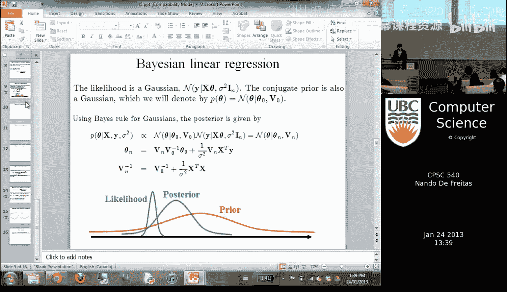
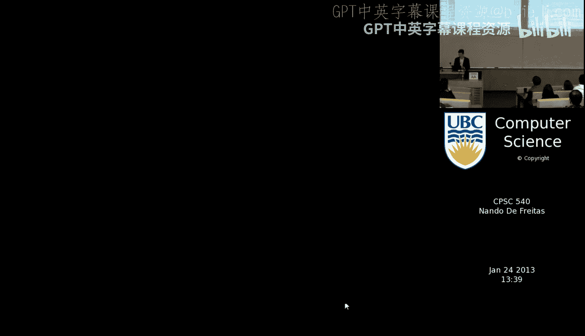
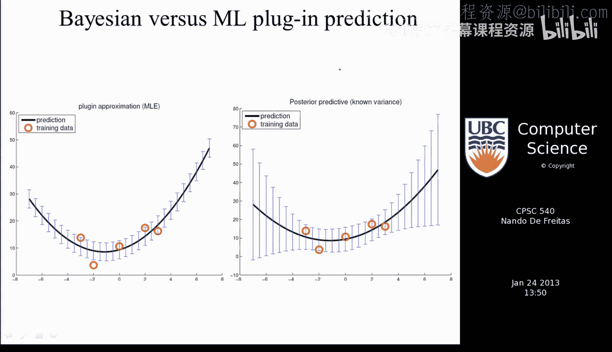

# 机器学习：06：贝叶斯学习 🧠

在本节课中，我们将要学习贝叶斯学习的基础知识。这是一种与最大似然估计完全不同的方法，它通过积分而非优化来解决问题。贝叶斯学习允许我们量化模型参数的不确定性，这对于决策制定和主动学习至关重要。

---

## 概率与积分问题

上一节我们介绍了线性回归的概率模型。本节中，我们来看看一个相关的概率与积分问题。

假设我们有一个多元高斯分布，它描述了线性回归问题中给定 `x` 和 `θ` 时 `y` 的概率分布：

**公式**：`p(y | x, θ) = N(y; xθ, σ²I)`

我们知道概率密度函数的积分必须等于1：

**公式**：`∫ p(y | x, θ) dy = 1`

利用这个事实，我们可以推导出高斯分布中指数项前面的归一化常数。通过基本的微积分运算，我们可以得到：

**公式**：`∫ exp{...} dy = (2πσ²)^(n/2)`

这个技巧非常有用，因为它允许我们在不进行复杂积分计算的情况下，直接写出许多复杂积分的答案。对于高斯分布等一类特定的分布，我们可以手动解决这些积分问题，这构成了许多机器学习方法（如因子分析、卡尔曼滤波、主题模型）的基础。

---

## 模型复杂度与数据量

在标准的线性模型中，我们假设数据是由某个模型生成的。一个关键问题是模型复杂度与数据量之间的关系。

以下是模型复杂度与数据量关系的核心观察：
*   **模型正确时**：随着训练数据量的增加，训练误差和测试误差都会收敛到最优误差。
*   **模型过于简单时**：无论有多少数据，模型都会存在系统性的偏差误差，无法完全捕捉真实情况。
*   **模型非常复杂时**：在数据量较少时，模型会在训练数据上过拟合，导致训练误差低但测试误差高。然而，随着数据量的增加，即使是复杂的模型也能很好地逼近真实模型。

这个观察带来了机器学习实践中的两个重要启示：
1.  使用正则化并结合交叉验证来寻找合适的模型复杂度。
2.  拥有更多的数据允许我们使用更复杂的模型，数据本身就能约束模型，防止过拟合。

当前人工智能领域（如语音识别、图像识别）的一个主要焦点就是收集海量数据并构建大型模型，因为人们相信，结合足够的数据和计算资源，现有的算法就能取得巨大突破。

---

## 从最大似然到贝叶斯学习

在最大似然估计中，我们假设所有数据点的噪声方差相同。但这并不总是合理的，我们更希望模型在数据密集的区域更自信，在数据稀疏的区域更不确定。

贝叶斯学习能够自动提供这种不确定性量化。这对于决策制定至关重要，例如：
*   **主动学习**：系统需要知道它不知道什么，以便决定在哪里采样以最大化信息增益。
*   **推荐系统**：在利用已知用户偏好和探索新项目以降低不确定性之间进行权衡。
*   **资源勘探**：在已知的高收益区域和不确定性高的新区域之间进行权衡。

---

## 贝叶斯规则：推理的基础

为了进行贝叶斯学习，我们需要一个核心工具：贝叶斯规则。它允许我们根据新的证据更新我们的信念。

贝叶斯规则是概率论中链式法则的一个直接推论：

**公式**：`p(A|B) = [p(B|A) * p(A)] / p(B)`

其中：
*   `p(A|B)` 是后验概率，表示观察到 `B` 后 `A` 的概率。
*   `p(B|A)` 是似然度，表示假设 `A` 为真时观察到 `B` 的概率。
*   `p(A)` 是先验概率，表示在观察任何数据前我们对 `A` 的信念。
*   `p(B)` 是证据或边际似然，是一个归一化常数。

贝叶斯规则为“逆问题”提供了形式化的解决机制，例如从语音推断文字、从图像推断物体，这些都是人工智能中的核心挑战。

---

## 贝叶斯学习框架

贝叶斯学习的通用框架遵循贝叶斯规则。与将参数 `θ` 视为固定值的最大似然估计不同，贝叶斯学习将 `θ` 视为随机变量。

以下是贝叶斯学习的基本步骤：
1.  **定义似然**：`p(数据 | θ)`，描述在给定参数下观察到数据的概率。
2.  **指定先验**：`p(θ)`，表达我们在看到数据之前对参数的信念或不确定性。
3.  **计算后验**：应用贝叶斯规则，得到 `p(θ | 数据) ∝ p(数据 | θ) * p(θ)`。后验分布结合了数据（似然）和先验知识，是我们看到数据后对参数的最新信念。

计算后验分布的主要挑战在于计算归一化常数 `p(数据)`，这通常涉及高维积分。然而，对于高斯分布等一类特定分布，我们可以利用“概率密度积分为1”的性质进行解析求解，这种方法称为**共轭分析**。

---

## 贝叶斯线性回归

现在，让我们将贝叶斯框架应用于线性回归问题。我们的目标是得到参数 `θ` 的后验分布，而不仅仅是一个点估计。

我们假设：
*   **似然**：`p(y | X, θ, σ²) = N(y; Xθ, σ²I)` （与最大似然相同）
*   **先验**：`p(θ) = N(θ; θ₀, V₀)` （我们为参数设定一个高斯先验）

根据贝叶斯规则，后验分布与似然和先验的乘积成正比：

**公式**：`p(θ | y, X, σ²) ∝ p(y | X, θ, σ²) * p(θ)`

通过展开指数项、合并同类项并“配平方”，我们可以将后验分布整理成另一个高斯分布的形式：

**公式**：`p(θ | y, X, σ²) = N(θ; θ_N, V_N)`

其中后验均值和协方差矩阵为：
*   **后验均值**：`θ_N = V_N (σ⁻² Xᵀy + V₀⁻¹θ₀)`
*   **后验协方差**：`V_N⁻¹ = σ⁻² XᵀX + V₀⁻¹`

这个推导过程展示了共轭分析：高斯似然与高斯先验的乘积，产生一个高斯后验。

**与经典方法的关系**：
*   如果我们令先验均值 `θ₀ = 0`，且先验协方差 `V₀` 为对角矩阵 `τ²I`，则后验均值 `θ_N` 等价于岭回归的解。
*   如果我们让先验变得无限平坦（即 `V₀⁻¹ → 0`），则后验均值会收敛到最大似然估计的解。

因此，贝叶斯线性回归是一个更一般的框架，它包含了最大似然估计和岭回归作为特例。更重要的是，它提供了参数 `θ` 的完整概率分布（后验），而不仅仅是一个点估计，这使我们能够量化预测的不确定性。

---

## 总结

本节课中我们一起学习了贝叶斯学习的基础。我们从理解概率积分的一个有用技巧开始，探讨了模型复杂度与数据量的关系。然后，我们引入了贝叶斯规则作为推理的核心，并建立了完整的贝叶斯学习框架：结合似然和先验来获得后验分布。最后，我们详细推导了贝叶斯线性回归，展示了如何通过共轭分析得到参数的后验高斯分布，并理解了它与传统方法（最大似然、岭回归）的联系。贝叶斯学习的优势在于其能够自然地表征和量化不确定性，为更智能的决策系统奠定了基础。