# UBC《机器学习（研究生）｜CPSC 540 Machine learning 2013》中英字幕 p07 -07-Machine learning - Bayesian learning part 2.zh_en -BV19g2FBBEEq_p7-

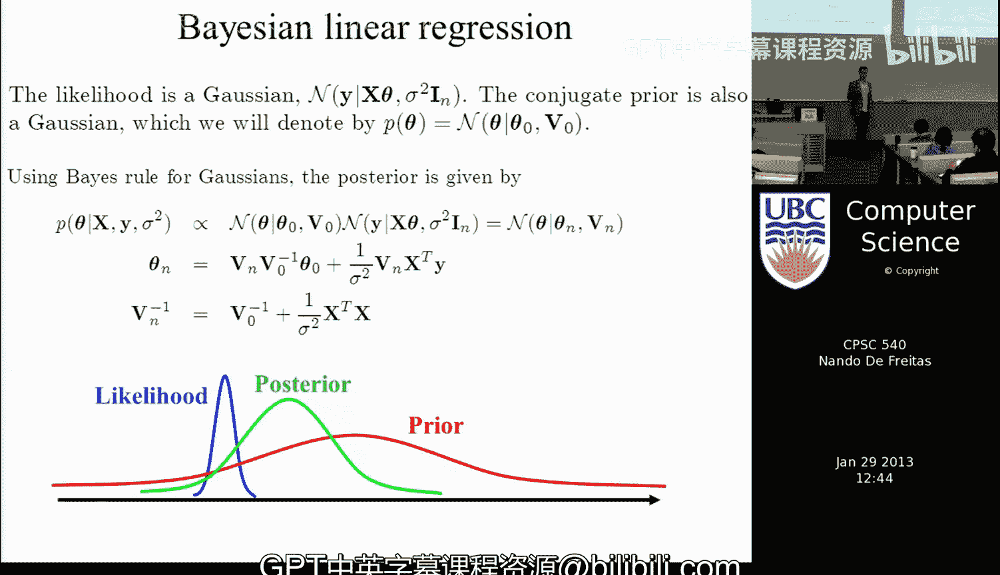

Today's lecture。In the last lecture， we essentially and in your homework。

 you essentially learned that if you have。A Gaussian prior。

 and you multiply times a Gaussian likelihood。And normalize。You get a Gaussian posterior。

So and moreover that Gaussian posterior， its statistics correspond to statistics of things that we've studied before。

 in particular the mean of the posterior， gives you back the rate regression estimate and when delta is zero when the regularization coefficient vanishes。

 that takes you back to linear regression。

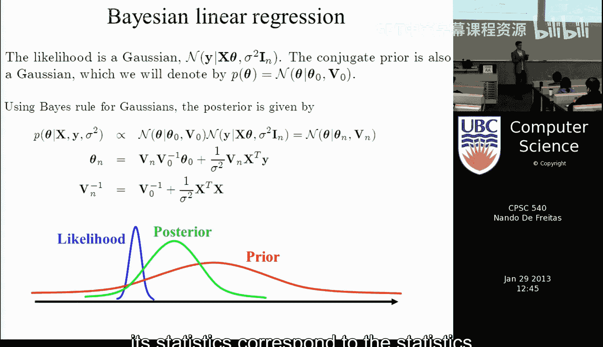

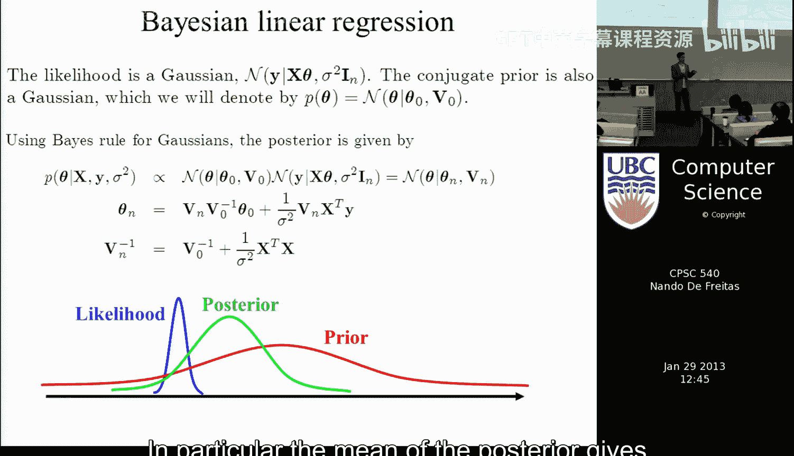

The alternative to doing it this way is to do it the optimization way。

 which you write the log likelihood or the penalized likelihood and you differentiate an equ to zero。

 so to do machine learning and arrive at the same answer。

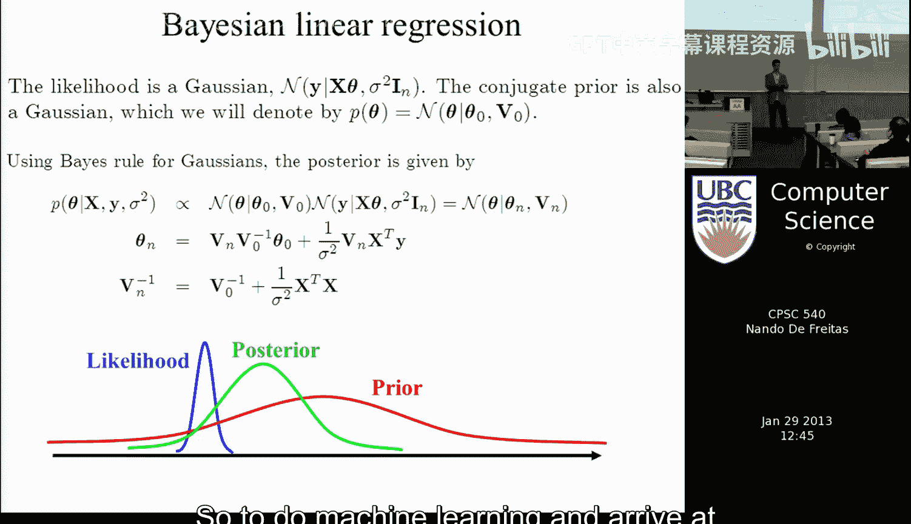

We have two ways。We can go to buy the optimization channel。Whi involves writing the log likelihood。

 differentiating equating to zero， and when you cannot equate to zero following gradients。

 as we will see later in the course。Or alternatively。

 you can just use this the fact that we know some integrals out there and then just multiply the prior times the Gaussian rearrange terms so that the posterior still looks like the prior。

 and that's essentially the basis of conion analysis。So we did an example of cognitiveju analysis。

 which I asked you to do in your homework， mainly because it's the sort of thing that in a lecture is very dry and when you do it in your homework you actually learn to do it properly because you get to do it。

诶。But that picture sort of captures everything if you have a Gaussian prioria。

 you multiply at times to Gaussian likelihood， the answer is that the green curve。

 the posterior and the green curve is sort of like the prioror and sort of like the likelihood。Okay。

 so it's in between。The prior typically your prior knowledge is very vague。

 so you have a much fatter Gaussian， your likelihood tends to be picked where the data is。

And so whenever you get measurements， you get this likelihood。

 your posterior essentially becomes more concentrated， so your knowledge of the seeing data。

It has higher information。So more information means less uncertainty。

 so the tails of the gaussian get。The Gaussian gets narrow and it still go down quicker。And。

And the rest is just algebra， it's taking， you take a Gaussian， you multiply times another Gaussian。

 and that's what we did in this long exercise。

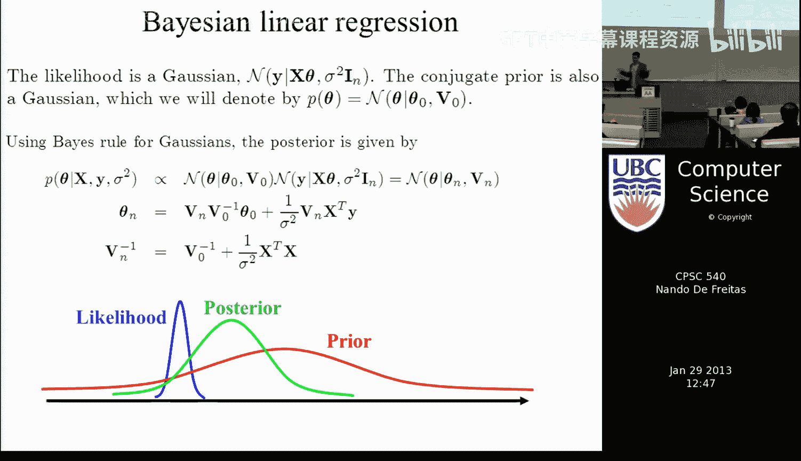

We took this- the Gaussian likelihood for linear regression， we multiplied it by a Gaussian prior。诶。

And there was this very tedious exercise of completing squares。

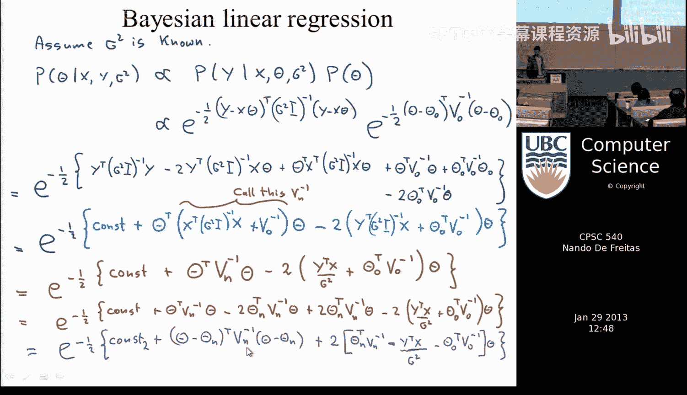

And what we find in the end is that the posterior。Ends up having the。This expression here。

Which is still aorized。But the important thing is that because we know the normalization of the exponent of a quadratic。

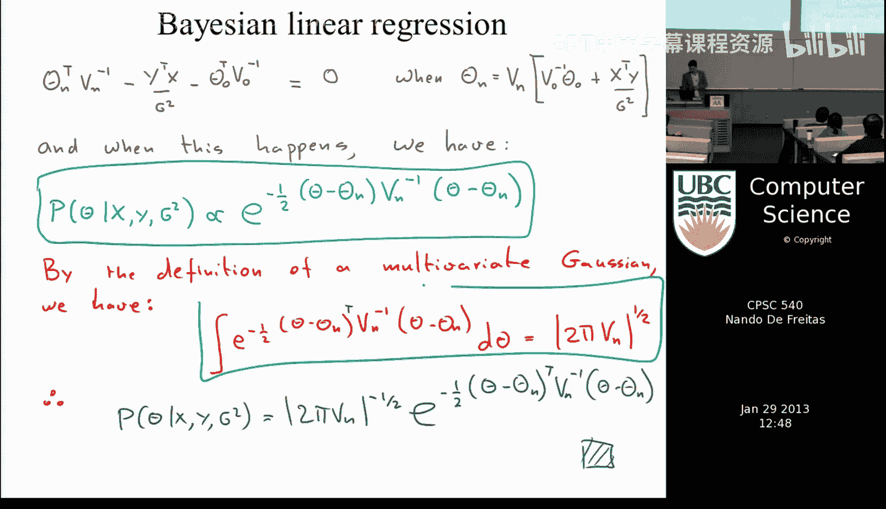

And we know it because that comes from the formula of Agaussian distribution。

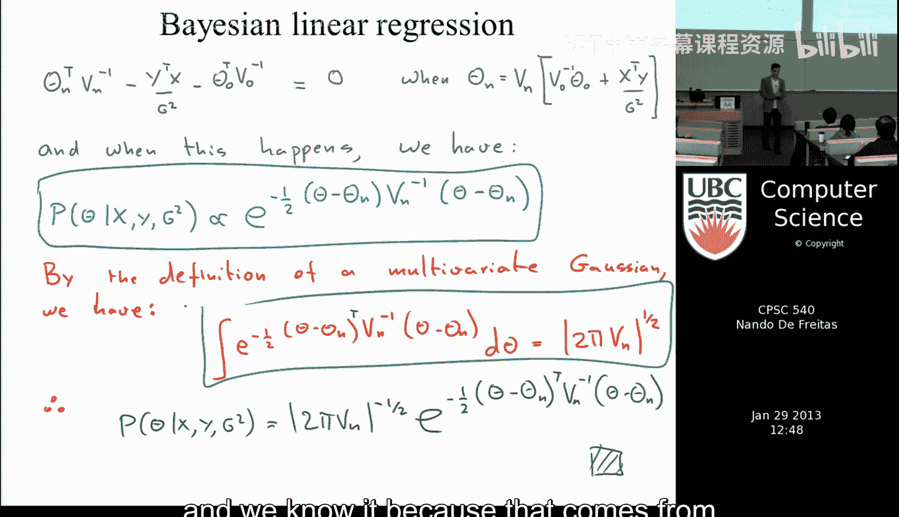

It's possible to derive it to。 I haven't asked you to derive it。 It's a few。

 it's one page of algebra to actually derive that integral from first principles。嗯。But for now。

 I assume I've given you the expression for a Gaussian as I will always。

 and so if you know the expression for Gaussian， you know it's normalizing constant。

 so you know how the integral works and if we know how the integral works。

That means we know what a posterior is。Because we know what we must put here。😔。

So that this whole expression sums to one。

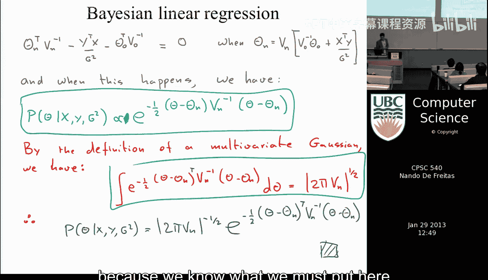

Okay， so the game， as the picture here says， is you take the green curve。

 you multiply it times the blue curve。

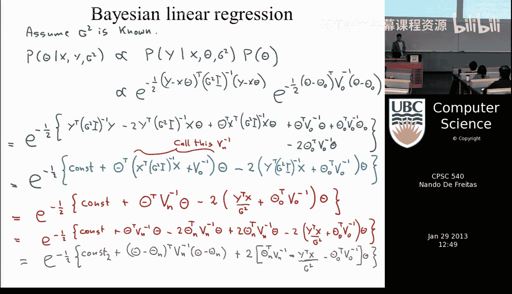

So if you think of a function as a vector with many entries， you're just multiplying two vectors。

And then you' just making sure that that vector， the resulting fact。

 you normalize that vector to make sure that it sum to one。So that's the basic operation。

What happened if you don't know the product， would you just take a uniform distribution。Right。

 so in some cases， we will choose a prior that will not give us with the likelihood that's not going to be conju。

 So were not going to know the integral。When we don't know the integral。

 we're going to have to introduce numerical techniques for solving the integral。

So later in the course we'll get to it， I'm going to introduce Monte Carlo methods on how we solve the。

 but there is this class of distributions like Gaussians that we just love。

And the reason why we love them is because we can solve the integral with Ga。

It's one of those few integrals we can do by hand。Those are very precious and it's one of the reasons why people use calcium distributions to model data all the time because they're easy to manipulate they're the easiest model。

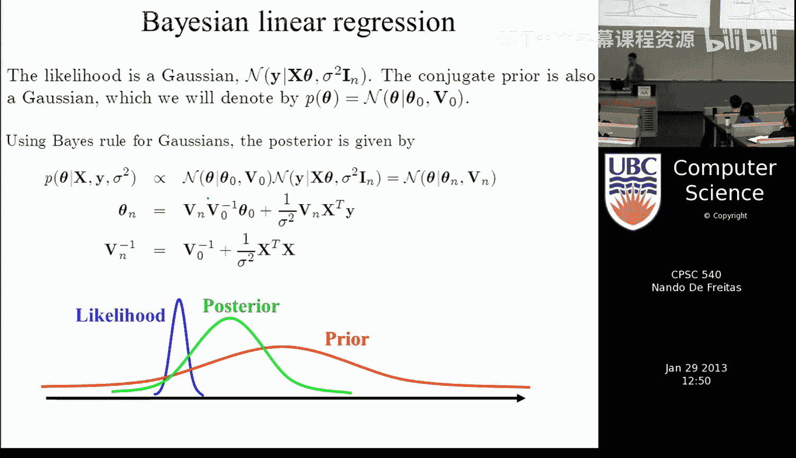

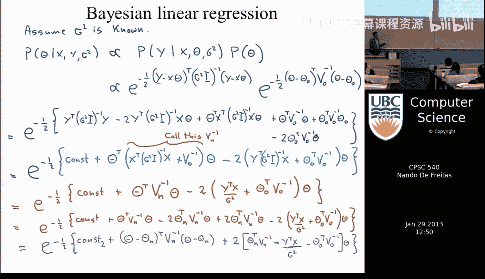

For real date。And that essentially gives us the expression for the posterior。

 and then in your homework I ask you to do the same thing for the variance to estimate the variance。

 and I give you the prior four variances， which is the inverse wish prior。

 and then again if you multiply the inverse way coming like Gaus likelihood with the expression you would get also looks like an inverse way shirt。

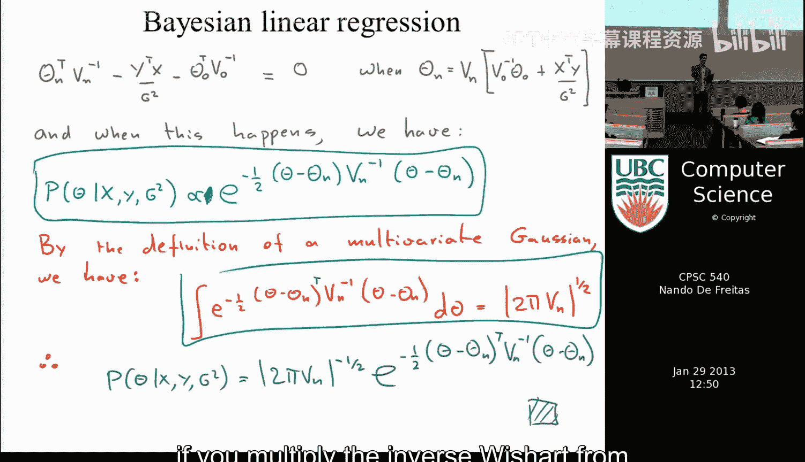

And because you know the normalization constant， because for all these standard distributions。

 we know the normalization constants。Then it's again。

 a very simple exercise to derive the posterior of the distribution of big sigma。In this case。

And if you have the posterior for the covariance big sigma。

 then by choosing the prior parameters to certain values， you get the maximum likelihood estimate。

 which was the other thing I asked you to do your homework。So。You've done it for big Sigma。

 I did it for Theta and class。And in fact， for any model， the mechanics is always the same。

You have a prior， you multiply times of likelihood do if you know the integral。

 you can do this thing called cognitivedju analysis。

 which is and then you get an expression for the posterior and then when you change the parameters of that prior。

You recover the maximum likelihood estimate。

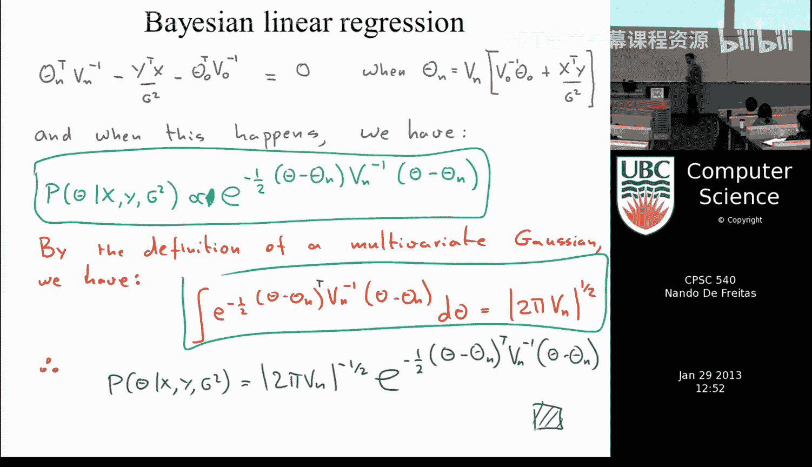

And。And in particular。If we consider a prior， that is zero mean。

So if the price are mean and let's say that for the various we use。

We introduced this quantity tileu square， it just a positive scalar。Then one can show。That。

By introducing this parameter lambda， which is just a rip parameterization to make it a bit more clean of sigma divided by tau knot。

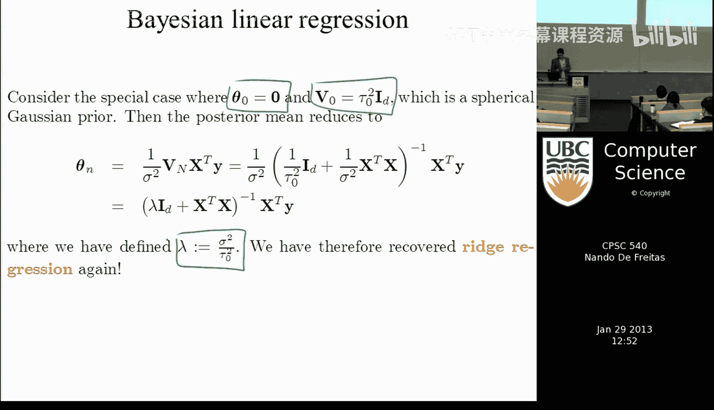

And if。嗯。And if sick吗。

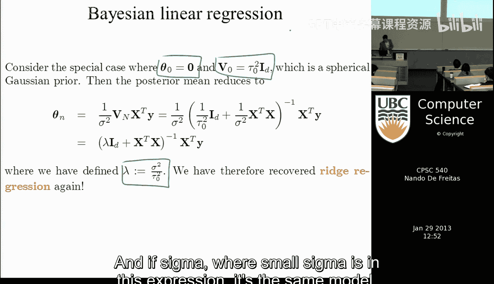

And where small sigmas as in this expression， it's the same mode。

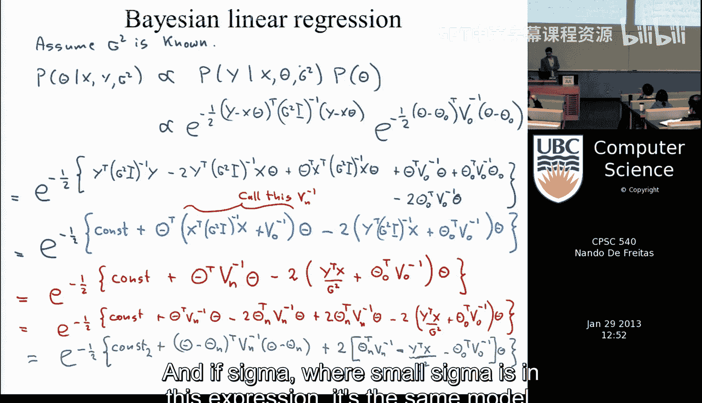

So with that likelihood， but just a slightly different version of the prior。

 then the expression for the posterior mean simplifies to。The rich regression estimate。

RightSo now if we make the p very flat。So。We have our likelihood。But if we take a prior。

Which is a Gaussian that's very， very flat， but it has a very high variance。

If it has a very high variance。Then your town note。Which is it。If it has a very high variance。

 this is sort of become tau node is very large， they're going to infinity。

 but if tau node goes to infinity， lambda goes to zero， and if lambda goes to zero。

 we get maximum likelihood。And this makes perfectly sense if your prior is very flat。

That means you really don't know what's the most likely location of your theater。

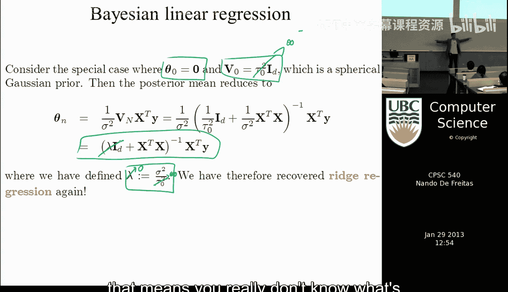

You basically are saying， I don't know by making that prior flat。So nearly uniform。

And if you don't know if your prior doesn't have information。

 then you should get back the answer implied by the likelihood。

And that's really nice thing about the basin framework is it allows us to recover sort of the usual common sense estimators just based on the date。

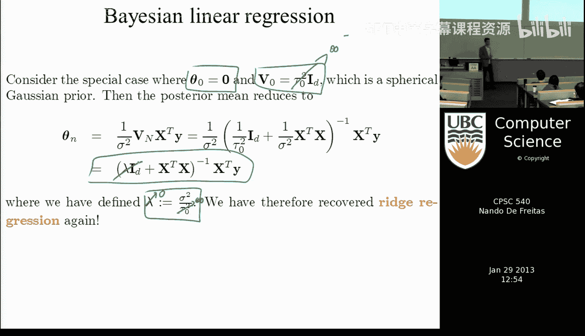

All right， so now I'm going to go just give you without proof。 Well actually， we did prove one part。

 a very useful theorem is from KPM's book。I should say Kevin。Murphy。

 so it's from the textbook that I recommend for this course。If you want to fool proof。

 but essentially the theorem says that if you have a Gaussian， P of x a marginal。

In a conditional P ofY give an x of this form。Then the posterior。So in other words， p of x。Given y。

 the posterior being equal to p of y given x， the likelihood times the prior。

And this is a general theorem for any x for any Y， so don't confuse this y and this x with the ones for linear regression。

 This is just a general theorem for two variables， Y and x。But I need two variables y next。

The posterior P of x given y。

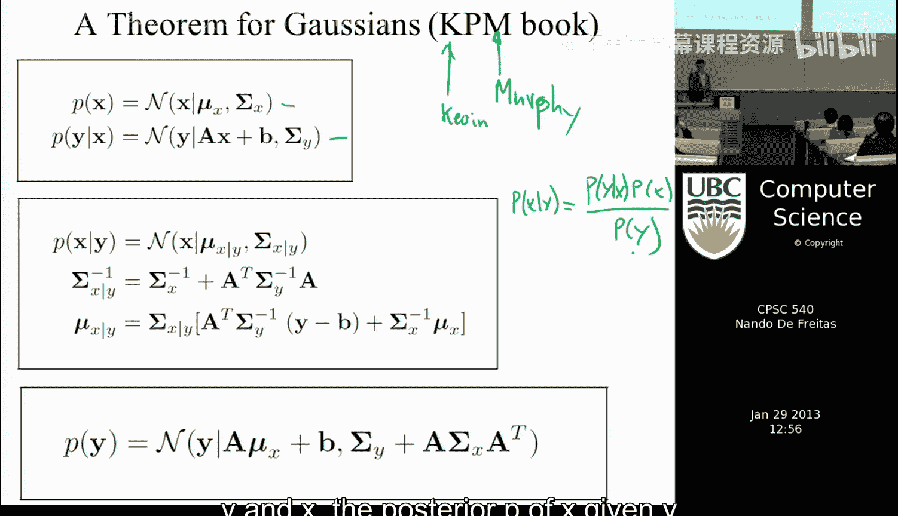

Always admits this particular expression。So if I had given you this theorem。

You wouldn't have done any completing squares because when you did completing squares。

 what you did is you did a specific variation of this theorem， that's what you proved。

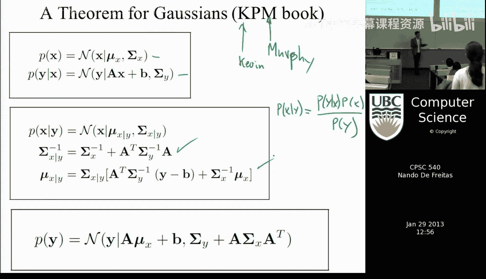

So you approved this first。You proof box too。Okay， so this proof we did。

 one proof that we didn't do was the second box， which is something called convolution。

In convolution， I'm saying it's convolution because essentially in order to get P of y。

What we do is we integrate。我朋。A dummy variable x prime。P of y give an x prime。Times p of x prime。

D X prime。That's very similar to the operation of convolution you've seen in signal processing。

 but all I'm saying is if you take two gaussians multiply and then you sum over the variable x。

The expression for P ofY will always be of this fault。I think I might give you that as a。

Homework exercise later may or may not， because honestly you don't learn much of doing that exercise other than to manipulate Gauss and distributions if you're serious about machine learning or data mining or you want to do something for you PhD that involves machine learning then I really strongly recommend you do this derivation。

And it it's in chapter four。Of Kevin's book。It gets really tedious。

 so I don't want to do it in class。But once you have。

 we've proved the first part and once you have the second part， you can pretty much do everything。

With gausss。So in fact， if you just remember now this。Theorem。

 just keep it in a piece of paper or whatever。 When you have to do this。

 gettic posterior for a Gaussian distribution， you're not going to have to do the completing squares again by hand。

Basically followed this recipe。Now， the reason why I'm talking about convolution。Its because。嗯。

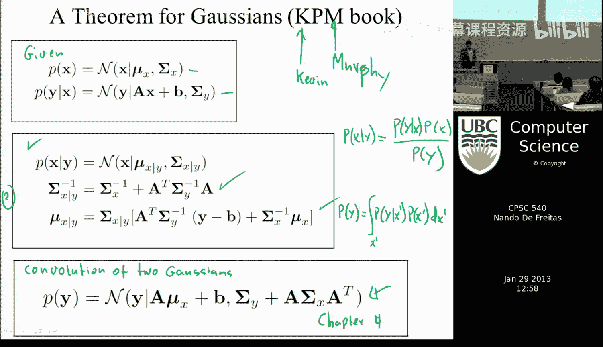

That allows us to do prediction。 So we know that we have expressions for the posterior mean。

And for the posterior areas， we've derived。But now if I use the expression of the multiplication of20s integrated out。

 there is the convolution operation， just by applying the theorem in the previous page。

 I get this expression for the predictive distribution。If you want to make a prediction。

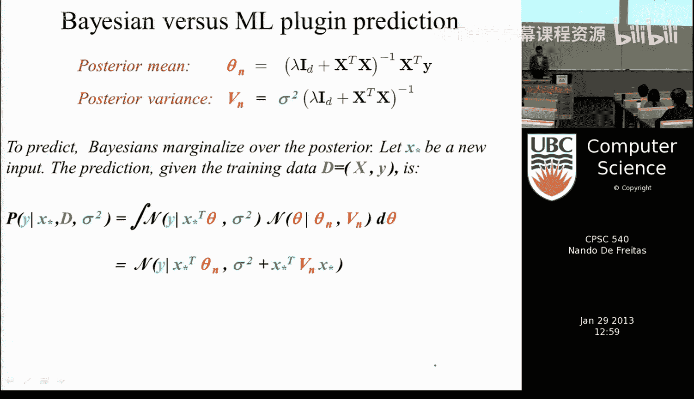

In other words， given a new Xx star， I want to generate a prediction of why y should be。

Given my data。

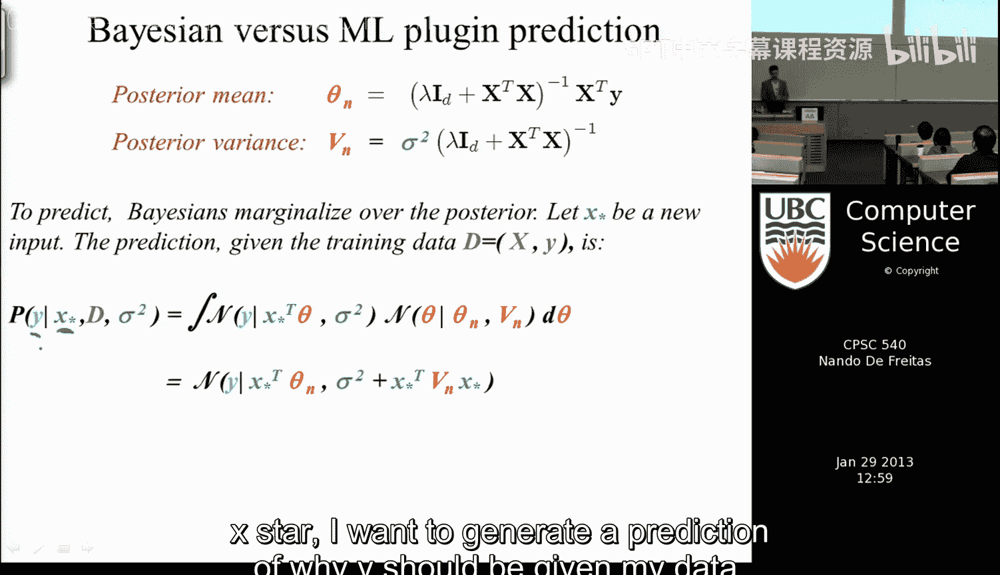

Which includes all the training data。X，y。Then for Bayesians。

 the way to make a prediction is you take iss essentially you marginalize out the parameters。

Or if you will， for each possible value of theta。Your prediction is weighted by the posteri。

So it's a weighted prediction。If there were three。And it's weighted by an infinite number of thetas because the integral is overall the whole domain of theta。

 but essentially。The frequencies to make a prediction just use the likelihood。Right。

 because I told you if you want to make a prediction when you do least squares， you just。

Take the new x multiply times theta that gives you you prediction。

 and then the uncertainty is just a sensory sigma。But this is saying that let's not just use this。

But let's rather wait， each theta gets weighted by its posterior probability。Okay。

 so it's an ensemble predictor。

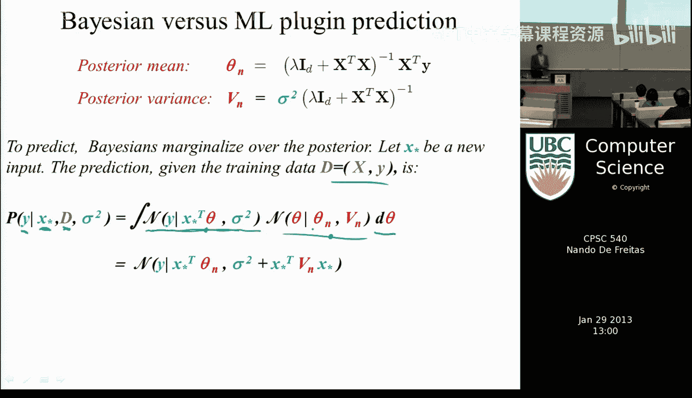

And to if we apply the theorem in the previous page， we get this expression here。

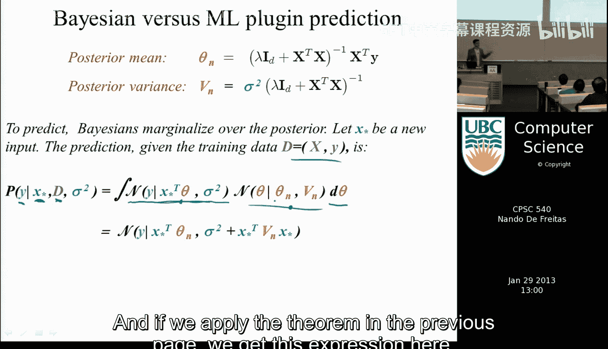

So in contrast to the ML as prediction。The ML prediction was just to take x times theta and have the same variance。

The basin way， so the DML basically assumes there is one single theta。If there was us。In other words。

 what the ML guys are doing。

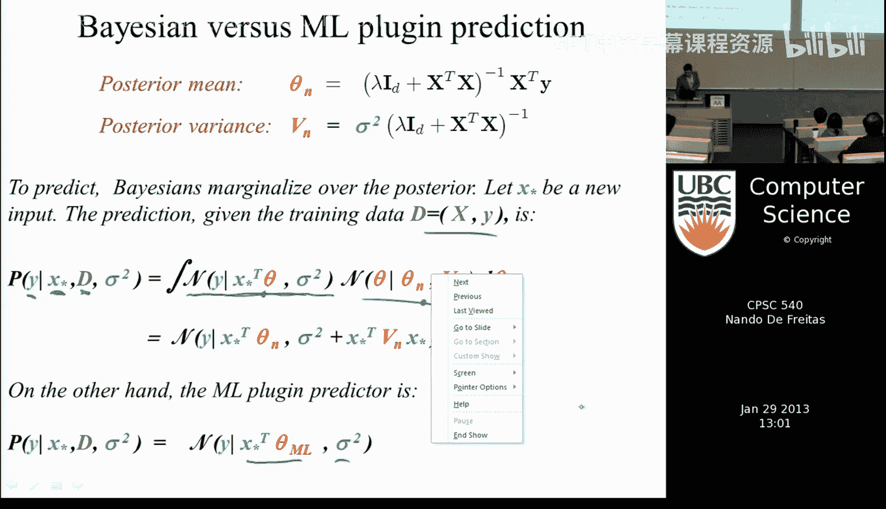

And notice is true， this integral there is。P of y given x theta times p of theta。

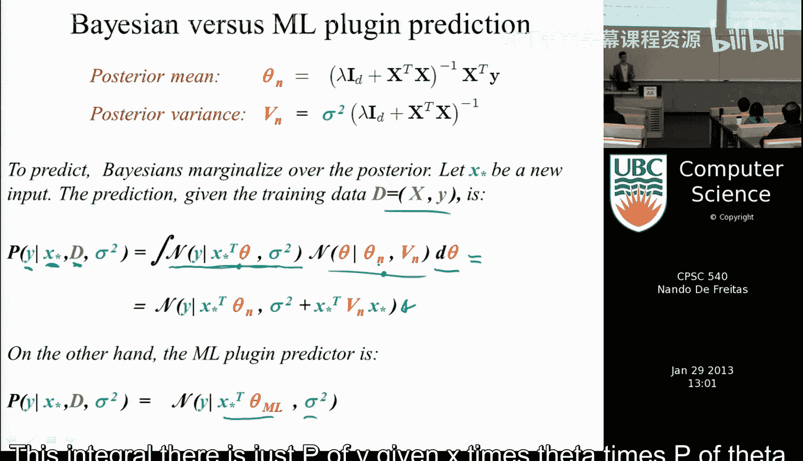

And so I'm just integrating out TA， so that by the rules of probability。

 there's no approximations there anything， that's just exact application of marginalization。

The frequent approximateoximateimate this because essentially what they do。

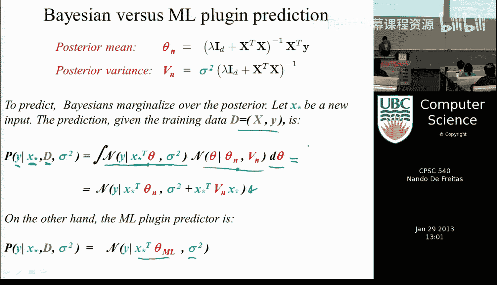

Is they replace this integral by a Gaussian and y。Given X theta。

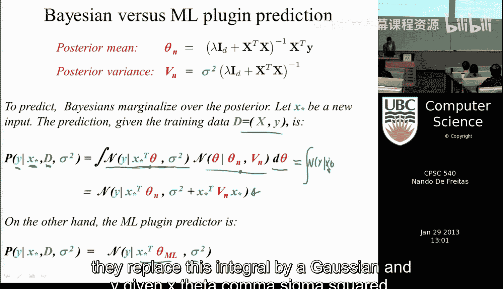

Proal sigma squared。And then they use a deelta function。At theta ML。He feet。

The deelta function is just a spike。At one value。The delta function is also called the the rack function or the impulse function。

 as engineers call it。And one of the properties of the derived right function is if you do an integration。

With respect to the the function， you essentially just picked the theta ML。In other words。

 if I were to multiply。Agaussian。Times a spike。Then it would be zero everywhere except where the spike is。

 and at that point it would be the value of the Gaussian。

And that's why that integral simplifies to this expression here at the bottom。

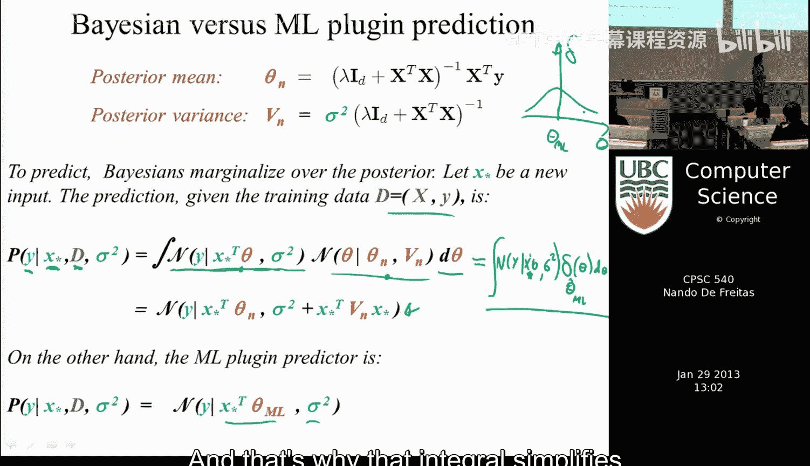

Because there frequencies assume there's only one true theta。There is only one theta。

 Bas always assume there's an infinite number of thes。

 and you should weight each prediction by that value of the。So。The implication of this is that。嗯。

The theta N， the posterior theta， the theta ML。They might not be that different。

 the theta range and the theta max likelihood often in practice can be quite similar。

 except for numerical computing issues。However， an important thing is this term。

Note that both expressions have the same sigma。But in the Ba scheme， there's a new term that appears。

And that term has the new input data。

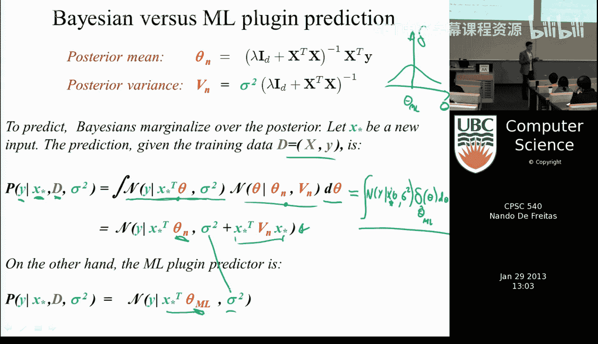

X， and it has this matrix V， which is sort of。

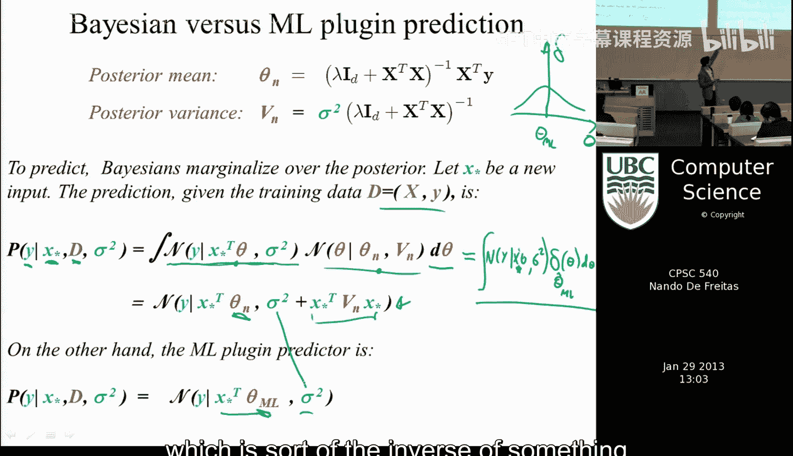

The inverse of something that has to do with the data， the training data， x transpose x。

The effect of that extra term is as follows。Your frequentest estimates。Always have the same weight。

And that with is sigma。Square。Because we said there was the same sigma and that sigma applied to every point。

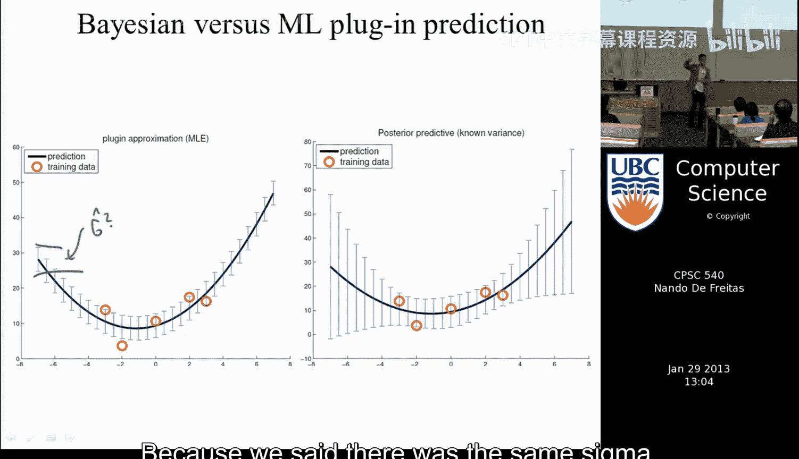

And so each point。If we look at it marginally， this is x。

And this is why each point is distributed according to a Gaussian distribution。

 just is stillill the regression。However。That extra term that the Bas give us。That extra eggs。

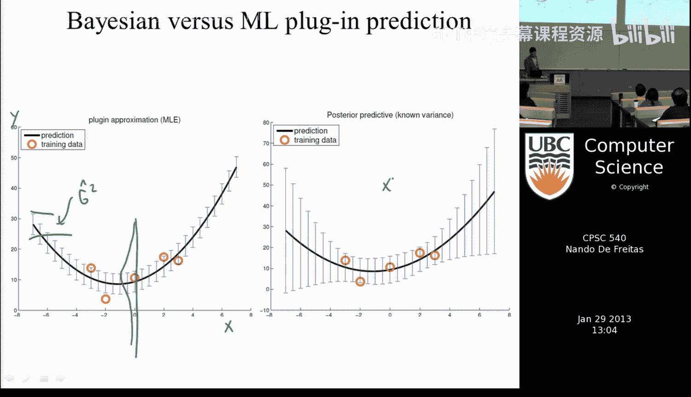

X star。VN。

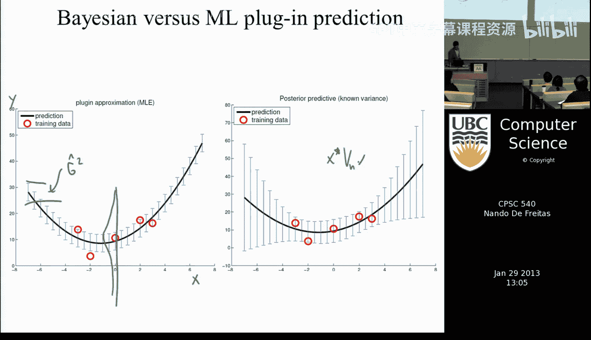

Ex startt term。LetMake sure I get the right transport。

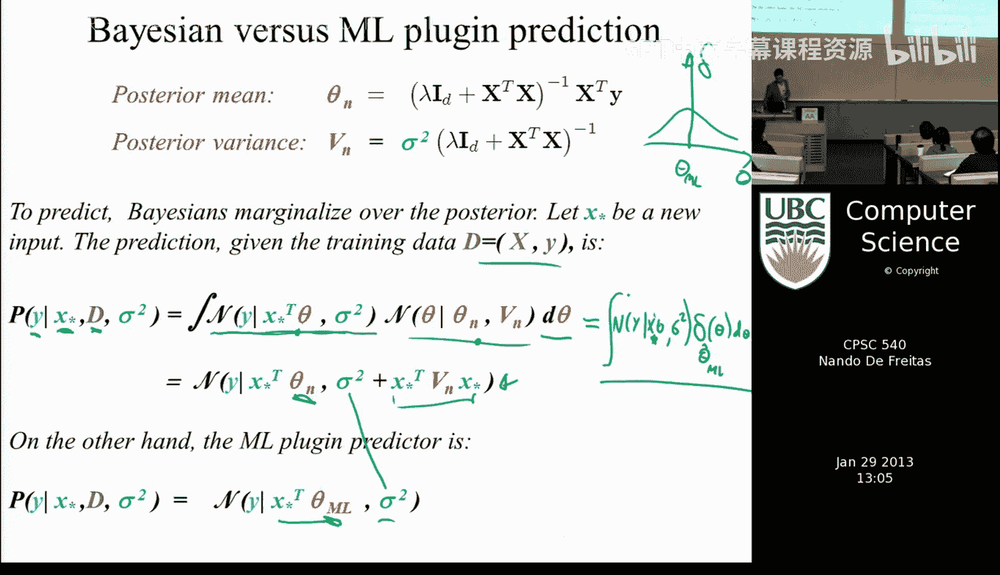

We'll ensure that where we have data。So this would be these bars here。Where we have data。

 because now the height of the bars is data dependent。When we have data， those parts will be narrow。

While we don't have data， those barss will be high。In other words。

 if we know that there's 8 one part of the space， we are confident of our estimate。

But where we don't have data， we should not be confident。

Maxim luck it fails quite badly in this regard， because the estimator is as confident here as it is here。

 and that doesn't make sense。So that's sort of important。 If you care about confidence intervals。

 you want to be。

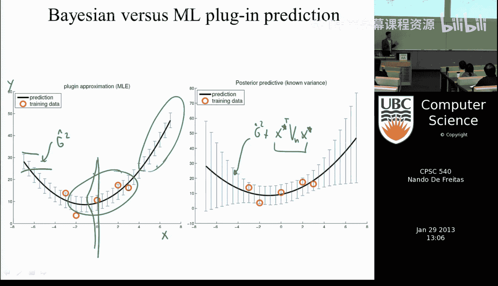