# UBC《机器学习（研究生）｜CPSC 540 Machine learning 2013》中英字幕 p08 -08-Machine learning - Introduction to Gaussian processes.zh_en -BV19g2FBBEEq_p8-

But let's go over a quick review of what I think is important to know。Suppose you have。

A cloud of points。And let's say that there's two variables， x1 and x2。

And this cloud of points essentially describes。Realizations of these two variables。

So you might have an individual， you're measuring height and weight， and that would be x1 and x2。

 and then you just plot it on a plot。嗯。You might get measurements that look like that。

Or you might get measurements。That。Look more like this。Okay， so each circle is a measurement。

 one single data point。But those two are unknown variables， x1 and x2。No。我哪一。

When we use multivariate Gaussians。We will essentially fit Gaussians to the。

The process of learning in either the case on the left or the case on the right。

Is the process of fitting a Gaussian to those points。

And hopefully that Gaussian describes those points。So for example。For these points here。

 I might want to choose a Gaussian that is centered of the origin because they seem to be zero mean。

And I might use some sort of covariance that is circular。

Because the points are sort of distributed in a circular way。Here， there will be more like ellipses。

And the mean will be a desent。The idea is that the mean that is the location of the ellipse。

And the size of the ellipse described the data， they're our model of the data。

I'm going to refer to the center of this as。A the vector mu。M is a vector。

 It has two components because there's an x1 doesn a x2。s It's a point in 2 D。 Therefore， it must be。

Have two components。Now， it is also true。That any of these points。Has two components， x1 and x2。

So we can think of these points in the plane as vectors into d space。They can be negative。

 they can be positive， the real numbers， we often use this symbol。Belonged to the real。Plae。

 so if put a square， you can think the R is the real line， which is from minus infinity to infinity。

 If I square it， I'm getting the real plane， which is a plane。

 a sheet of paper that extends all the way to infinity。To say that something is Gaussian distributed。

It's essentially saying that any point x1 and x2。Comes from。

That's what that tilde means it comes from， or it's simulated from or it's sampled from。

 all these are the same ways of saying the same thing。It's an example。

 any point there is an example of the kind of things you would expect to be within that red circle。

And we say it's Gaussian。And we will say that it has， in this case。

 the mean is0 zero because it's centered at the origin。And now the question is。

 we need to talk about how are the points related to each other？

So we need a concept that allows us to say how？Does increasing x1 change x2？Are x1 and x2 related？So。

The variable that we used to describe that is correlation or equivalently covariance。

So in particular， there is a variable called correlation。Sigma x， Y。Or x1 x2。

 which is just a covariance of x1 and x2。Divided by the standard deviation。Of x1。

Times the standard deviation of x2。Now， what are all these quantities？The covariance is the term。

That goes inside， the covariances are the terms that go inside as matrix。Oops。

They are the expectations。In this case， we have a zero mean variable。And for this particular entry。

 the entry that should go in the cell is the expectation。Of x1。Times x 2。

Sigma of x1 will be defined as the standard deviation。Which is the square root of the variance。

Which is the square root of the expectation of x1 squared。If my mean wasn't0。

 I would have to subtract0 E。I'm using to denote the concept of expectation。

 The expectation is think of the sample average， like if you tos a coin a thousand times and you can how many times it's head。

As it， as the number of。Coin tous goes to infinity， you expect the number of heads to be a value。

 That is essentially what I mean， by expected value。But now。

 the other thing that it's cleared here is that the covariance。And by assuming the mean 0。

 it's easier for me to make this argument。That the covariance is essentially a dot product。

Of x1 and x2。Now， what happens when we take products of vectors？

If you have a vector that looks like one and zero。And you dot product at times vector as one and zero。

We get one。Okay， so the vector multiplication， first entry times first entry。

 second entry times second entry。However。If I have a vector， that's 10。And in this case。

 not that10 and 10 are the same factor， so they're extremely similar。

 they're so similar that they are the same。But I could choose something that's very different to 10。

0，1。Now they don't agree on the first coordinate and they don't agree on the second coordinate。

So when I take the dot product， I get zero。What can we conclude from this fact？

We can conclude that dot products。Measure。Similarity。If two points are close by in 2D。

If they're similar， their dot product will be high。

 so the dot product this is a measure of similarity。Now， that allows us to now go and。

What this covariance should be。Let's assume that。 this is。This entry is1， and this entry is one。

Because it's just normalizedize so that the variances are one。Then in this case。

I would expect this to be 0。Because I can very easily pick a point in this cloud。

I can very easily pick two points in this cloud that have this property。Or put it another way。

 If I increase x， suppose。Suppose I increase x1 and I go here。Then my chance。Of getting。

A point x2 that is positive。Or one that is negative。Is the same。By knowing something about x1。

 I don't know better about x2。So they're un correlated。Information about x1。

Does not help me gain more information about X2。If I know that x。On the other hand。

 contrasted to the case on the right。嗯。In this case。Okay， let's go with the blue。In this case。

 if I pick a particular value of x1。This particular value。

Then I know that x2 will be positive with great probability。

So knowing something about x1 tells me something about x2。So on the right， the points are correlated。

 the two variables are correlated， knowing about x1 allows me to know something about x2。On the left。

 when the points are spherical。I don't have that information。

If I do my Gaussian for this right hand side。let's assume that I still have one。

 but over here I'm not going to have zero。 I'm going to have some positive number。

That positive number basically indicates that if I expect x1 to increase。

 I should also expect x2 to increase。Whereas on the left， I'm saying that if I expect x1 to increase。

 I should not necessarily expect x2 to increase。Okay。That clear。

Because that's sort of what a Gaussian what correlation is with random variables。

 so this is a property that we exploit throughout the course。

 it's essentially the basis of being able to do linear regression and no linear regression。

So this is essentially where a multivariate Gaussian is， in this case， a bivariate。

AVivariate Gaussian because there's only two dimensions。

But it allows us to see that if the entries of the covariance are 0。

 it means that variables are uncorrelated。So increasing one does not decrease the other。

 one does not depend on the other。If the entries are not zero。

 it means that one variable does depend on the other。And then they can depend on a positive way。

 or they can depend on a negative way， depending on your product points。

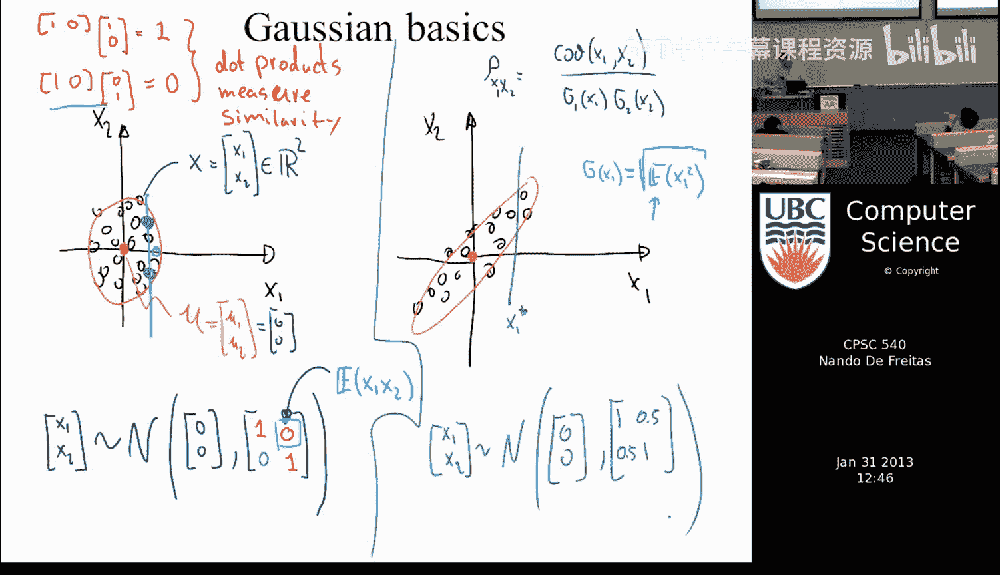

那。Let's illustrate now the Gaussian one more time。Let's assume we have some points。Again。We have x1。

2。We have contour plots。And then this time I'm actually going to plot the Gaussian in 3D。

 which is this bell shape curve。This is essentially the distribution of x1 and x2， we call it。

The joint distribution， because it jointly models X1 and x2。In addition。

I'm now going to do the following。I'm going to cut the Scuss。At a particular value。

 So I'm going to choose a particular value of x。Okay， let's say this value here。That color X1 wither。

In cursive， and I'm going to cut。I'm going to sort of。Cut a plane。Right through this gu。

 so imagine you have a cake that looks like a bell。And you take a knife and you just cut it。Now。

 imagine that you're this guy that's standing here。On the side， looking at your cut。

What shape would you expect your cut to have？A Gaussian， so if you're looking at it from this angle。

 you would。Still quite likely expect to see a Gaussian that looks like this。Let's plot it。

So you would be looking at x2。And you would be seeing a Gaussian that looks like this。

That Gaussian is the probability of x2。Given that x1， the variable x1 is that particular cursor。

That particular slice。So when I write， and for short， in the course。

 to avoid always defining the random variable。I often just write it this way。

 So this is a common practice in a lot of papers。But when you see that bar。Here。

Please do not ignore this bar because this bar is so important。This bar gives us the semantics。

Sometimes here there's a comma or not a comma， that's not very important。

 but that bar is important because the moment you see x2 given x1。

 I'm talking about a distribution over x2， whereas is when I say x1 and x2 I'm talking about a 2D distribution of both x1 and x2。

So there are two very different distributions， but one is obtained by cutting the other。

Or we have a different way of talking about it in the language of statistics。

 we call it the cutting process， we call it condition。So。Theres guy here。

Goes by the name of the conditional distribution。Now。Let us assume。

That the distribution of x1 and x2， the joint。Is Gaussian？With me。The mean is the center。

Mir  one and Mi2。And let's assume that it has a covariance。That's Sigma 11， Sigma 12。

Sigma 21 and Sigma 22。So that's our Gaussian that describes that cloud of points in that plot。

Sigma 1，2 and sigma 21 are just a transpose of each other。

And one of the properties that a covariance must have， so if you have a 1D variable。

 it wouldn't make sense to have a Gaus the sigma for a 1D Gaussian happens to be the width of the Gaus。

 so the width has to be positive， it doesn't make sense to have a sort of a Gaussian that implodes on itself that has negative variance。

And so likewise， for multivariate Gaussians， it doesn't make sense to have a Gaussian that implodes on itself。

 and so we require that covariance to be positive in some way。

And that concept is what we call positive defafness， so we require that matrix。

 the covariance matrix to be symmetric。And we requires eiggervalues to be positive。

 that stops it from collapse。In particular， we require that。嗯。

Any arbitrary variable x times the covariance matrix。Has to be positive。

So the exponent of agaussian has to be poted。A Gaussian is always e to a distance。

 and that distance has to be positive。 That's what symmetric positive definitely。

More important to our argument is the following thing。

I might want to know what is the mean of dys Gaussian， which I'm going to call it mi 12。

I also might want to know。What is the width of this gaus， which I will call Sigma 12？

Wouldn't it be great if there was a formula that we could just read from the original model？

Given the original model that we could just figure out Mi 12 and Sigma 12。

So think of the following setup， I have a cloud of points。

We already know how to use maximum likelihood to fit a Gaussian to a cloud of points。

 We know how to estimate the mean。 It's just the average。

 and we know how to estimate the variance as well， just by using the sample。Very incesment。So。

 we could。Otain that red bell because we have all the tools that allows us to do it。

But if I now ask you， give me the conditional。In other words， compute the green curve。

How would you do it？That actually require some work。This requires about four pages， perhaps。

A lot less depending on how。Trifty you are with your notation of derivations。

 it's based on an idea called the short complement or the matrix in versions lemma。

 I'm not going to go over it in the course。Okay because it's a lot of alg。

If you are serious about machine learning， I strongly recommend you read chapter four of the textbook for the course of Kevin Murphy's textbook because he did a great job at putting in all the steps。

But for now， let's assume that that theorem is given to us and will always be given to us。

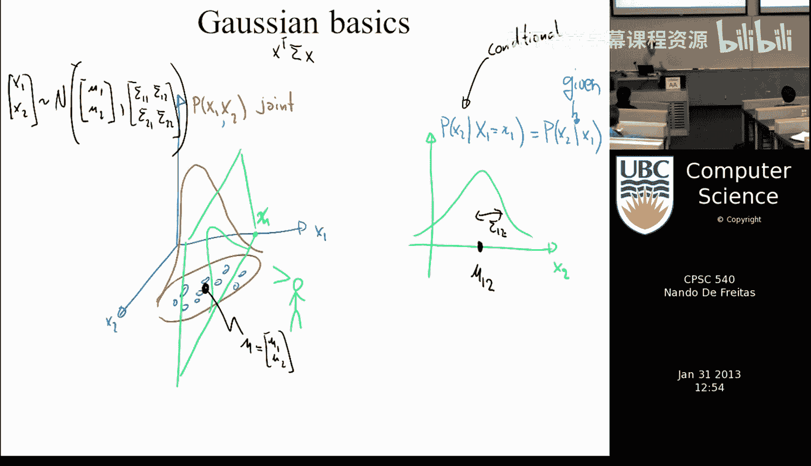

The theorem， essentially tells us。That mu 12 is equal。To new one。Plus， sigma 1，2 times sigma。

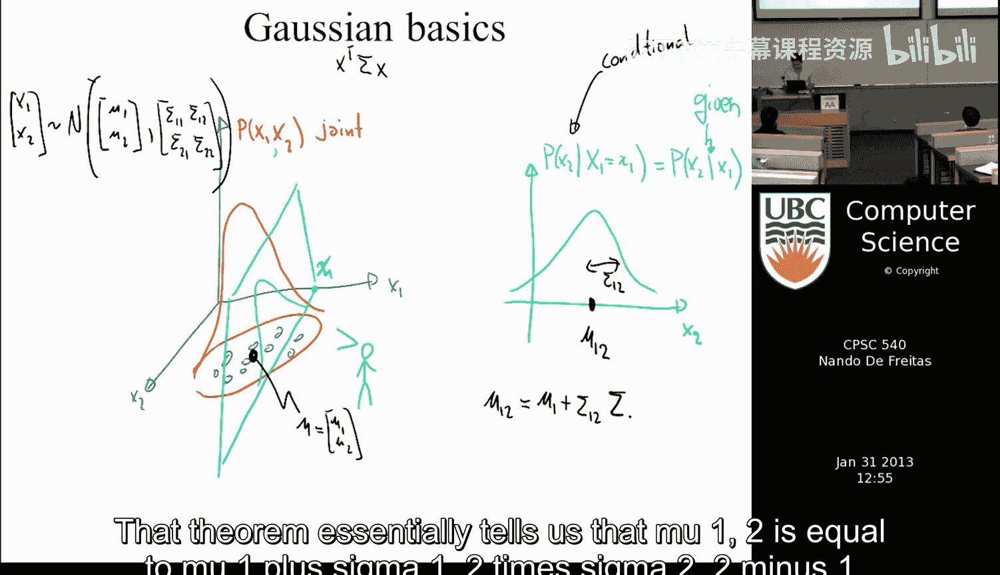

2，2，-1。Times x 2 minus mue 2。Where that x2 is that tilde x2。That were conditioning on。

so that formula exists。Moreover， there is also a formula that says that Sigma 12。Is equal to sigma 1。

1。in- sigma 1，2， times sigma 2，2。-1 times Sigma 2，1。

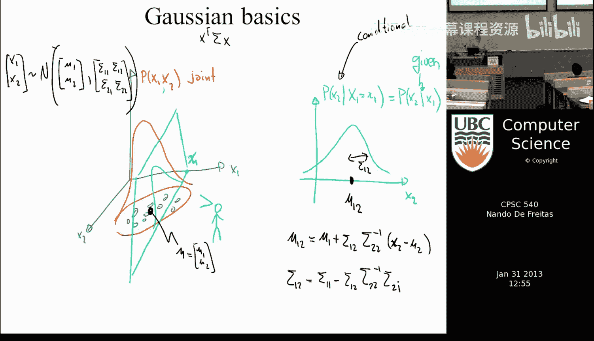

That， essentially is what。This theorem is same from Kevin's book。

The theorem says consider a multivariate gas。We're going to consider two blocks of that multivariant。

So there's going to be a vector x1 and a vector x2 so far because I've been plotting I've assumed that x1 is scalar next to a scalar。

 but of course the treatment is much more general x1 could be a vector。

 x2 could be a vector if you append two vectors， you still have a vector。

And that vector is Gaussian dis。Each vector component has a mean， mu1 and mu2。

 they have the same covariance that we've just went over in the drawing。And so。The theorem。

Essentially tells us what should the expression be for Sigma 12 and what should the expression be for Sigma 2。

Sigma mu12 and Sigma 12， the theorem is well within the reach of any grad student at UBC to go over the proof。

 in fact， if a grad student can go over that theorem。

 I think there's a problem to whether you should be in grad school or not。

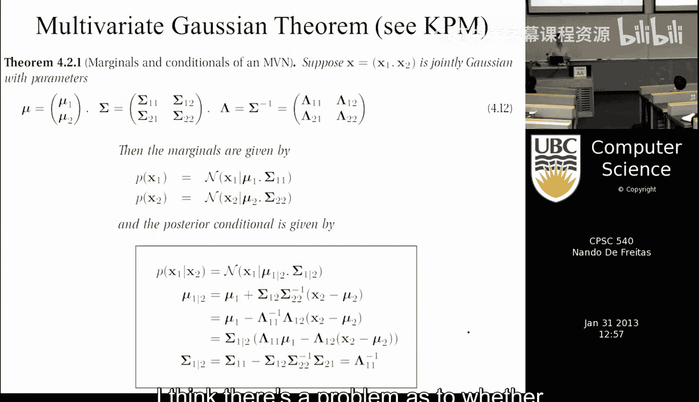

But it's just tedious algebra， and there's no point in bore you with that algebra。

What's important is for you to accept that such a theorem exists and to understand what the theorem does for you。

 The theorem simply allows you to go from a joint distribution to a conditional distribution。Okay。

 so if I give you a joint， if I tell you this is the covariance of the joint。

 this is the mean of the joint， you should be and ask what's the conditional。

 you should be able to just apply the question， those two questions to tell me what the conditional is。

That's the value of the theor。Okay。One more background thing about Gaussians。And。This have gone。

Quickly over before in the course， but I think it's worth spending a bit more time on it。

I'm going to do the following thing。I'm going to assume。That we have。诶。Gussian variable。

 a Gaussian distribution。That we want sample from。So now we're going to do the opposite process。

Before we had points and we were trying to figure out the curve。

Now you're can assume we have the curve， in other words， we have the mean and the variance。

 which is enough to plot the curve but to reconstruct the curve。

And we're going to try to produce data。The motivation in learning for producing data is that if I can imagine the world。

And look at the world， and if what I see does not match what I imagine means that I need to update my knowledge。

 I need to learn in other words， so that I can understand the world。

So imagining is central to machine learning。And so I need to be able to draw samples from agaus and deserv。

 that's sort of one of the simplest things I could want to imagine。

I will assume that I have a mechanism that produces uniformed samples。😔。

So you have a random number generator that will give you numbers of equal probability between  zero and1。

That's what a uniform distribution is。I will also assume that I can compute the cumulative of a gas。

Now， what is the cumulative of Pga？The cumulative a Feralsian。Is what you get？

So this is where muu is。The cumulative for Gaussian is what you get if you start summing the area under the curve of the Gaussian as you move from the left。

 so all the way up to here， this area has a value。That value is the cumulative distribution。

If I am to plot accmulator。Over here， it would look like this。The inflection point。

 the point at which there's an inflection in the area is the mean。

Right because the area to the left should be about the same as the area to the right。

Because the Gaussian is symmetric。I know this curve will go to 0。So one question for you guys。

What is the asymptote of this curve？Is it two， is it three， is it pi1？

Because the area under probability distribution solution is one。Now。

 I've purposely drawn it like this。So that I have my uniform distribution。

 which is between zero and1， produces numbers between0 and1 with equal probability。

 so it must be 11 because the area of 11 is one and the area not probability must be one。Now。

 if I can draw a random number from a uniform distribution。

What I can do is I can project that number。To the curve and what it meanss the curve。

I project back and I get a sample from the gu。😔，This is how we sample。

We just said this is how you compute a sample， whether you use MATLb or C or Python or whatever language you're using。

They all use this technique called the inverse cumulative。Ming。And then if you do this。

 often you will get something like this， you will get more samples in the middle as you would expect and less samples here。

Le samples in detail。So this is how we generate samples。

For a Gaussian distribution that has zero means or well， in this case the mean wasn't zero。

 but typically we have a procedure in our computer that is capable of generating 01 Gaussian variants。

And essentially， it uses the。Uniform distribution to be able to do that。Now。

 let's assume that we're capable。And this process of sampling。

 I'm going to use the tilde to indicate。 So a tilde think of imagining。So I'm sampling a point I。

From a Gaussian that has mean 0 and variance 1。Now。

 if I want to imagine something from a Gaussian that has。Mean。

I don't know mu and some variance sigma squared。What I will do is I will just imagine。

A Gasian that's 0，1， because that's what I want know how to do。

And then I will multiply at times sigma， and the reason there's a sigma and a sigma squared is remember that variance is the expectation of x times x。

 so it's an expectation of x squared。In fact， x minus the mu times x minus the mu。

So x minus me a squared in the 1 d case。If I multiply times a number。

 what I'm doing in terms of the expectation of that number squared is essentially squaring the variance。

And of course， if I have a random signal。And I just add to it a constant value。

 I just change its height。So adding a number mu is just changing the height。

And now I have a way of drawing a random variable。That has any mean， or any variance。

So that's the Univariate case。In the multivariate case。

Suppose now that I have a vector with two variables， x1 and x2。

How do I draw a vector from a Gaussian？That is0 mean。And with covariance， the identity matrix。

That is， how do I now draw random factors？In2D。To do this。

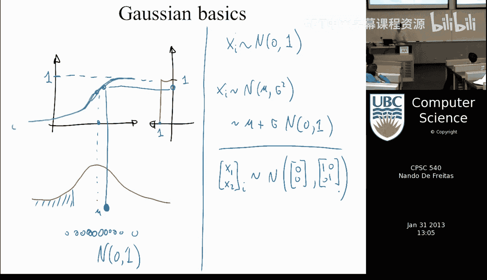

We appeal to our theorem again。

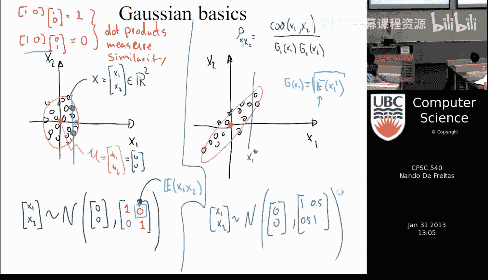

Oops。Our theorem also tells us。That when you look at this Gaussian distribution。

 the multivariate Gaussian that has this variance sigma 1，1 mu and mean mu 1。

 the marginal distribution。Just has min Mi 1 and Sigma 1，1。 So to get the marginal。For x1。

 you would just take the components mu 1 and sigma 11， and to get the marginal。

For the other variable， you would take u2 and sigma22。

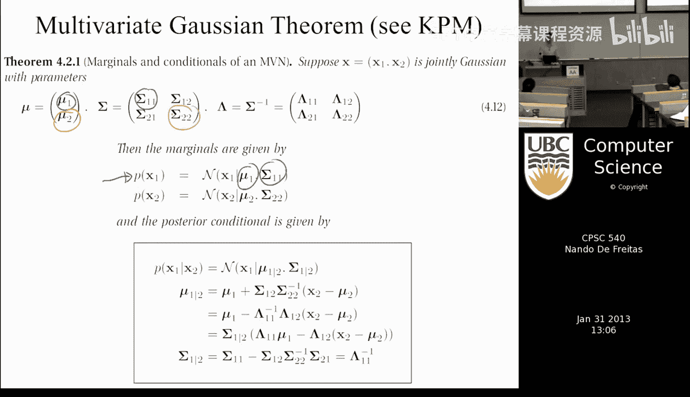

In other words。What this equation is saying is that x1 by itself comes from a Gaussian that's 1 d Gaussian that's 01。

 and x2 comes from a 1 d Gaussian that's 01。They're not corre。Because the of di are0。

 that means that if we have the capability of drawing a random number。

Drawing 1 D random variables that are Gaussian 01。 We also now have the capability of drawing。

Vctorors， because all we do is weappend them。We draw each component， we draw x1 from a 1 d Gaussian。

01， and then we draw x2 from 1 d Gaussian， and that's equivalent to drawing the vector x1 x2 from that Gauss。

Okay。Finally， if I want to out draw the vector， x1， x2。From a multivariate Gaussian。

 that has an arbitrary mean mu 1， mu 2。And an arbitrary covariance， Sigma 1。1 sigma  to 2。Sigma。Two。

1， sigma，1，2。Let me call this matrix。Sigma， And let me call this vector mu。For simplicity。

Now I don't have a way of I need a way of taking square roots of matrices。

In order to be able to draw from this， because essentially I want to use the same trick。

 Let's call this vector x。 I want to basically say that if x comes from a multivariate gasian with mean mu and covariance sigma。

Then x must be a sample from a multi。V Gaussian， whoops I went too quick。

It would be nice to do exactly what we did for the 1DK that is to write this as the mean plus some quantity。

Times a Gaussian that0， and an identity。Okay， it would be great if we could do that。But for that。

 we need some sort of definition of what is the square root of a matrix？

That definition is something that we get from linear algebra。And for your purposes。

 I don't need you to know what it is or how to derive it。 If you're interested。

 just type it in Wikipedia and we'll tell you everything that you need to know about。

 It's called a col composition。One of the most important algorithms ever invented。

It basically says that you can take that matrix sigma。And write it as a product of L of two matrices。

1。Matrix and its transpose。LL trans， so the col composition， it exists in any program。

 any programming language， there will be a function there that you can say。

 give me the col format matrix。The way you compute Kleski is very similar to how you do。

LDU the composition。So I don't know if you remember， like if you have a linear system of equations。

 we used to manipulate a linear system to map it into a lower triangular matrix。

 diagonal matrix and an upper triangular， Kleski procedure is very similar to that。

The point is we have that， and if we have that， now we have a way of drawing Gaussian distribution。

 We have a way of imagining Gaussian vectors for arbitrary means and arbitrary variances。

That's the background。Now， let's go back to regression。Let's assume， now that we have。X。And F of x。

And that F of xes unknown known。And we get data， and our objective is to learn F of X。

 We're trying to understand what is the function that describes the date。

And so let's say that we have three data points。I will label those data points。X 1。With height F1。

I should have drawn that a bit higher。X 2。X 3。And then I'm going to call this F2。

 and I'm going to call this height F。3。Okay。Now。I'm going to assume that the X are given。

And that I want to model the Fs。Moreover。I will assume。

That I want to model the Fs with a multivariate Gaussian distribution。

So I'm going to say in particular。That。F1。An F2。And F3， which are three numbers。For a vet。

I'm going to assume that that vector for simplicity has zero mean。Okay。And that it has。

A covariance matrix， which I'm just going to call k11。Okay，1，2， K1，3。Okay，2，1。Kase 3，1。给。

2 Okay three，2。K3 and K3。Okay。Now。What I will do next to。

Is I somehow that covariance captures the correlation between those three points。

If you look at those points， sort of x1 and x2 should be somewhat more correlated because they're nearby。

Then x1 and x3。So。I should expect。That this covariance。

Let's say that covariance the variances along the diagonal is 1。

 I should expect that x1 and x2 are a bit more correlated， perhaps。

And so I would have here something like 0。7，0。7。X1 and x3 are less correlated because they're far apart。

 so maybe I have here 0。2。And the next two the next three are also correlated。

 but just a little bit less， So let's say for argument sake，0。6。The precise numbers don't matter。

 what matters is sort of the differences between them。Now。

 how could I construct a matrix that has this property。

 a matrix that says that F1 is highly correlated with F2？Not so much correlated with F3。

The way to do it。Is to let each element。K I J。Be given by a measure of similarity。

 How do we construct a measure of similarity， Theres many， many ways。 One possible way is to use。

This quantity， which we call the squared exponential current。

It's exponential and it's squaring a distance。Now。This guy here has the following properties。

This guy here is zero。When the distance between Xi and Xj。Go to infinity。E to the minus infinity is0。

 each to the minus a large number is one over each to a large number， which goes to zero。

It will be one when Xi is equal to x j。Okay so in particular。

 that's why we get the once along the di。So that function would allow me to get an SPD。诶。

I haven't proven it。There's a bit of math that could prove that this leads to an SPD matrix。

But it certainly will give me a matrix that will have sort of that shape that I want。

 where I want points that are nearby to be more related to each other than points that are far apart from each other。

And so if I were to fill the matrix using such a function。

I would come up with a good model to describe that cloud of points。

Or at least describe their heights。I'm not intending to describe the Xs。The axis are given。

 I'm only using the axis to construct K。The X I used to construct K。But the distribution is over F。

The heights， just like in linear regression， the distributions over the ys， the heights。

 not of the x， the x has an input that you're given， and then you need to make a prediction F。

So if we want to capture similarity of points， we essentially use these similarity curves。

Another fact。Is that if we have。Like let's say that you wanted them to be disimilar。

Let's first learn similarity and then we'll deal with this similar。

 it's possible to modify the kernel to actually make points。We have different properties。我只。

T to good at this issue。mI one of your goals to know a bunch of these different functions just to kind of match whatever？

Yes， you will need to know some of these， but what we will also do is we will introduce parameters。

And then the process of learning is figuring out just parameters。

And we do that by maximum likelihood， for example。And so by learning the parameters of those functions。

 we will be able to change the kernel， we will be able to fit the kernel to the date。

 we'll be able to get kernels that gives us the most probable explanations of the date。

But you are supposed to know if you do research using gas and processes。

 it's good to know a few kernels， just called exponential kernel is by far the one that's used the most。

And。But you could use different types of kernels， upon ethnic nerve。

 there's kernels that give you more jacketing functions。

 there's kernels that give you periodic functions and so on。 So there's a whole family of kernels。

And there are books written on kernelels。Their entire books dedicated to kernels。

 as kernels for text， theres kernels for images， and so on。

I will just use this quite exponential kernel because my intent now is not to go and bombard you with all the things you could do。

 I first want to make sure that if I just give you one kernel， you know what to do。

And once you know what to do with that kernel， you'll figure out what to do with the rest。Okay。

 let's proceed now to the。Where things do get interesting。Okay， so we had our three points。

Which I remind you where x1。F1。This is still left of x and this is still x。I have x2。I have x3。

But now。Let's assume that。 I also have a point。X。T are。Someone just gave me a point， X star。

And I do not know the height of that point。So the corresponding F， which I'm going to call F star。

 is a question mark is a no。I know my data。D consists of my pairs， X1 and F1。X 2。NF2。And x3 and F3。

That's my date。 I've been given days。So I've been given the data。I've also been given。By next star。

Given these two things。I must answer this question， what is the height of F star？Should it be this。

Should it be this。Should it be this？Should it be this。

Let's put it to a vote how many people think it should be the bottom triangle。The next one。

The next triangle。The upper triangle。Okay， we have one vote for the upper triangle。

 so we'll shade it a bit and。So you seem to believe that this point is a good。

Now why did we choose that point we have to ask ourselves。

And the reason why I chose it is because if this distance here is small。We somehow expect。

That the distances of that point to the points。That are near it in terms of the heights。

Will also be small。If I picked any of the other points， I would end up with a big distance。

So it's a game of minimizing distances， this is what we call smoothness in machine learning。

So for the small variation of the x's， you only want to see a small variation in the ys。

Point in the in the Fs。Okay， so。From before， if we go here。

I knew that my Es were distributed according to A Gaussian。

And I'm just going to say that the vector F， which is F1， f2 and F3。

This is according to a Gaussian that has zero mean， so now this is sort of the vector of zeros。

And covariance K。So I'm calling this matrix here。Okay。

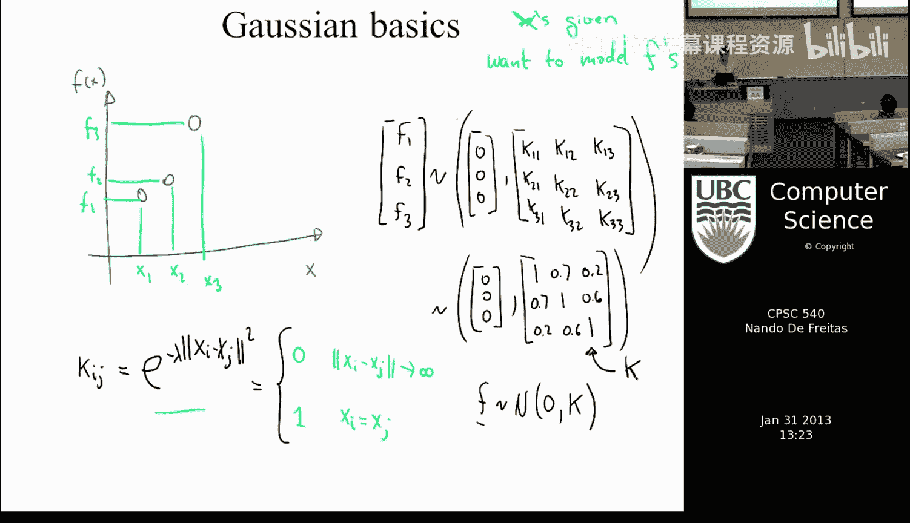

Okay。So I know that F is distributed according to a。Gussian distribution in three dimensions。

 so a trivariate Gaussian that has mean zero。And has covariance， okay？I will also assume。That F star。

Comes from a Gaussian distribution。Which is also zero mean， that's going to be my assumption。

 my assumptions I would expect。The test data to come from the same distribution as the training date。

It will have mean 0。And it will have a covariance， which we're going to call k of x star。

Why should the star should be at the bottom， but that doesn't matter。An X star。

It's a self covariance in other words variance， so Kx star。Coma x。St is just equal to e to the minus。

X star minus x。Oops。X star squared， which is just really one。Because x star minus x star 0。

82 to 0 is 1。OK。Now， F and F star by themselves are independent。I somehow want them to。

Have the same property that all of you voted for。 That is that they be correlated。

 that if you increase x。If by increasing F。Sorry， by increasing F。Can't get this x as an X right。

 If you increase x， F seems to increase。 So if you increase x star， F star should also increase。

If you increase x， F star should also increase2。Because that's essentially why we pick that tri。

So I want them to be correlated。So I can't just have them as to independent Gaussians。

But I must have them。Together。As a4 vector， a 4D vector， a 3D vector F， and a 1D vector F star。

Coming from Maggasian distribution， that still zero mean。But with the covariance。That is first。

The covariance scale。Which is K11。K1，2。Okay，1，3。K21。A 3，1， K2，2。K。3，3， N K2，3。And K 3，2。

And now I'm in four dimensions。 so I also need to look at。The correlation of one was star。

And I have here the case star， star， star star。And I'm using the notation that this is just what I'm calling k star。

 star， star star so that I can fit。And I'm also using the notation that K1 star is just equal to the similarity between x1 and x star。

So I would have K2 star。K3 star。And here I have the transpose， which is。K。Star1， okay， star two。

K star 3。I'm going to group this block。This block is the matrix K。

 this block here I'm going to call the matrix or K star。

 and then this one as already is there is just K star star。And let's just lastly close the bracket。

So now we have a joint distribution over F and F star。

If I ask you to get me the conditional of F star given F， what do you do？How would you go about it？

Just use the theorem， we have a multivariate Gaussian， a joint Gaussian， we want the conditional。

 we use the theorem。When F is given， that means you have a four dimensional Gaussian。

And if you've done a cut in three dimensions， those are the three points out。

Three cuts and what you just left with a1y Gaussian。And that's the Gaussian for x star。And so。

Fs in particular， if I using the theorem。F star is equal。To K star transport。

Times big k minus-1 times the vector F。That's。F star。 That's the mean of F star。Which is。

 I'm going to say it's the expectation of F star， which is muse star。That will be most likely。

 this height here。Me star。I also can use the theorem and get a covariance。It's Sigma star。

Which is equal using the theorem。 I'm just reading it off here from my notes。It's just K star。

K minus-1。Im k。Star， and I need a transpose。Plus。Okay， star， star。Oh， sorry。

 minus this plus K star star。What this sigma does is it。Sorry about that。

 that sigma gives me the variance。That's what that sigma star gives you。So for any point now。

 I know what I mean for any X star。I can predict what the mean should be。

 and I can predict what its say confidence intervals would be。 say a fifth times the variance。

Whichever confidence interval trouble you use。When you plot confidence intervals。

 you can just use the variance so two times the variance。

 and then for a Gaussian we have these rules that tell us what are the 95% confidence intervals and so on。

So in other words， for the point。In the test set， I can predict the mean。

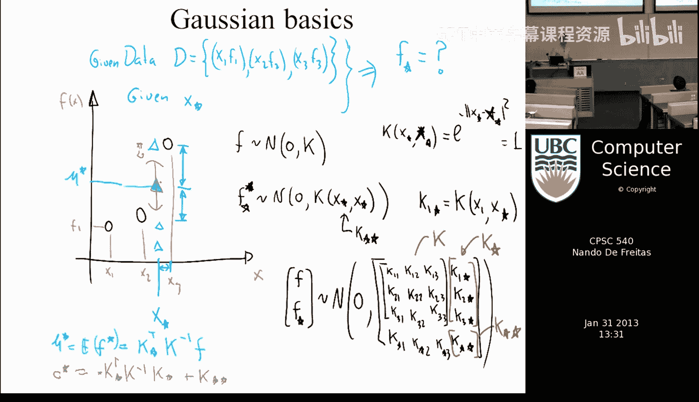

And the varies。Okay， so we have a gain x1。It's2。F3。So I argued that for a point text star。I know。

It's me。And variesries。Something like this。But now I can pick a different X star。

If I choose another x star， let's say here， I would also get something that would look like this。

And if I pick a next star here， I might get something that would look like this。Right？

I could pick any X star。So having derived the expression for the mean and the variance。

 I actually now have a general way of predicting for any x star， I just plug in the X star。

 I get a prediction from mu and signal。So in effect， if I take a large number of points。

I can plot a beautiful line。Going through those points， that's just the meme。

Each point in that line is the me。In fact， I can use an infinite number of points。

And here comes the gaps and process idea if I can do it for any point， in fact。

 I can do it for the function。what I have is a function that I put as input X star。

I get us output the mean in the variance。 It's a function。I also have a function。

That gives me this confidence intervals。Oops。If I connect the confidence interval， let's use purple。

If I connect these confidence intervals。I will get something that will look like this。

So for any point X star， I can compute the Comp intervals and I can compute the mean。

If my technique works well， I would expect a confidence intervals to look like that。 In other words。

 where the data is， I have。High confidence， so the uncertainty is low。When I don't have data， I。

 I can't be too confident。So as I try to extrapolate。Beyond where my data is。

 I should not be too confident of the predictions I'm getting。

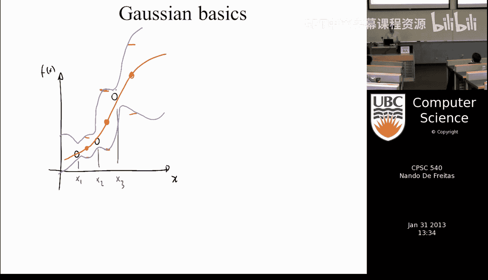

And this brings us to Gaussian processes。So we basically covered it。

 most of the preliminaries that allow us not to understand what Gaussing process is are doing。

A Gaussian process is a distribution of our functions。

And it is over functions because the mean and the variance are just functions of x。For any x。

 I can get tell you what the mean is， so there is a function。You pass x， it returns me of x。

There's another function called a kernel， which it's the function of two things。You pass x， any x。

 and any other x which we call x prime in this drawing， and it returns k， it returns as k。

So we have those two functions。If I have those two functions。

 what I can do is I can get a very fine grid of points。Very fine grade。 So fine。Now when I plot it。

 it looks like a function， even though what I'm plotting there is a vector。And each collar。

 each line there， is a single vector。But because I've chosen my points。

X1 and x2 so close to each other， it looks like a function。So I create。X 1，2， n。From x1 to n。

 I create。Mu。In this case， I've chosen mu to be the zero vector。

So it's the zero vector within entries。And I create a matrix K。Which is。N by n。

Which I create using this formula。So that two points are close by， the more similar。

 two points at a far apart should be less similar。And after I've created this。系。

Find what the colles composition is of K。And then I draw a bunch of samples F I。

Which are samples from a Gaussian distribution that has mean 0 n。And covariance K。

But the way I draw it。Is by。Throwwing。Standard 01 Gaussian variables and multiplying them times the matrix l。

The square root of K。Okay。Just like we did before to generate good numbers。

And what you see is this curve here is F1。This curve here is F2 and so on。

And this plot here is equal to， I believe，50。

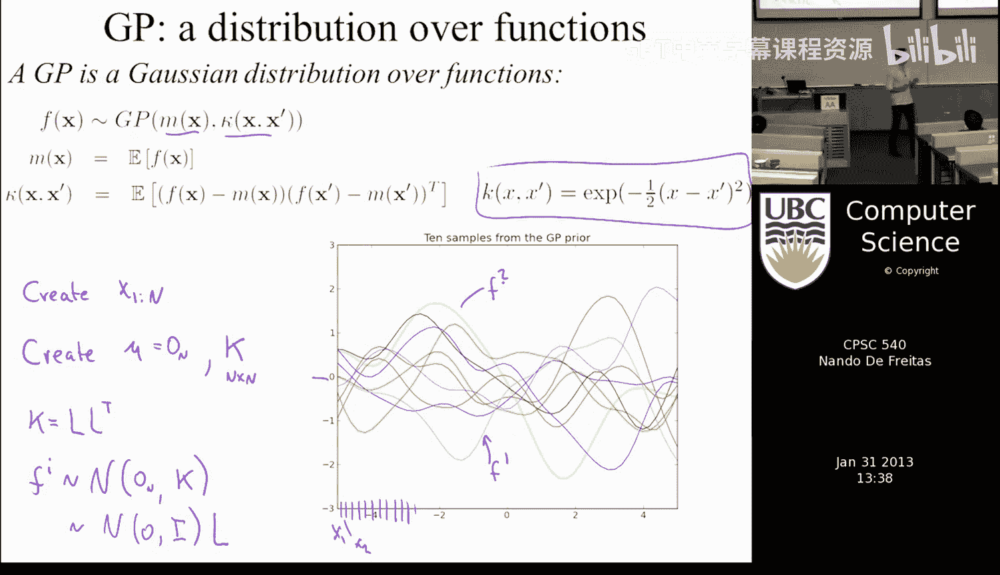

The code that I used to do this。Is this code。This code basically says that it's 50 points and it's 50。

I then generate a regular grid of points for x。I compute the kernel matrix to compute the kernel。

 I just call this function called the kernel function， which you pass A and B。

 and it returns the value of the kernel。And it's this E to the minus square distance。

I then compute colles composition here。And then this operation here is just a sampling。

Health times n0 i。And I draw 10 samples。

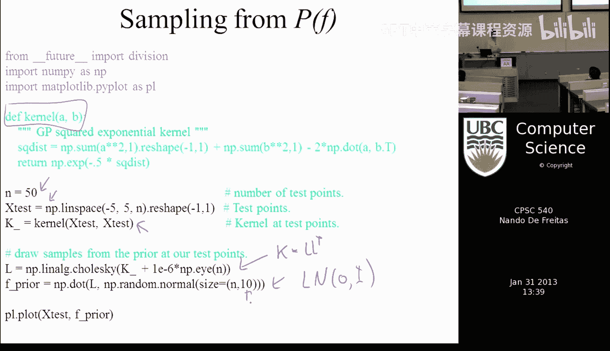

And then I plot them。And that plot。Is that problem。So that's where those functions come from。

And I'm saying functions。Because theoretically， I could make this end go to infinity。

 The number of points go to infinity， so I could， in principle， draw functions。

The only thing that's stopping me from working with functions is because engineers still have not figured out how to build analog computers properly。

That's the only thing computers have already existed。Properly。There are animal computers。

Each of you has an animal computer in your head。

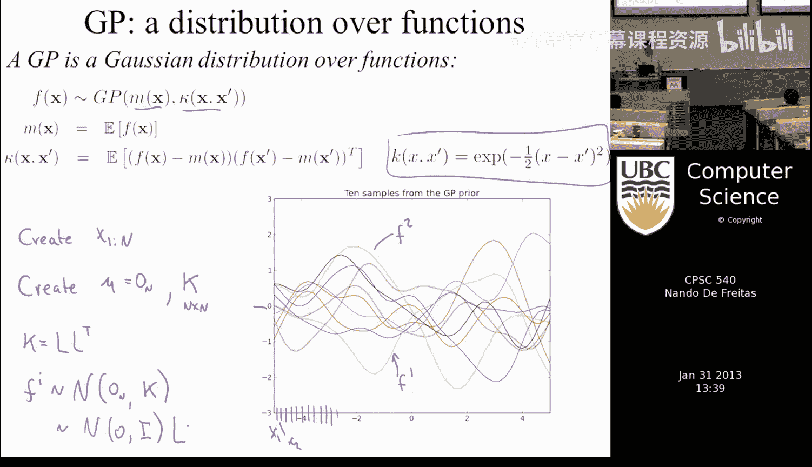

We also appreciate attention。Yes， I mean， this is an analog device。

And there's other models that Fneumn came up with。Let's not go there。

 that's outside machine learning。

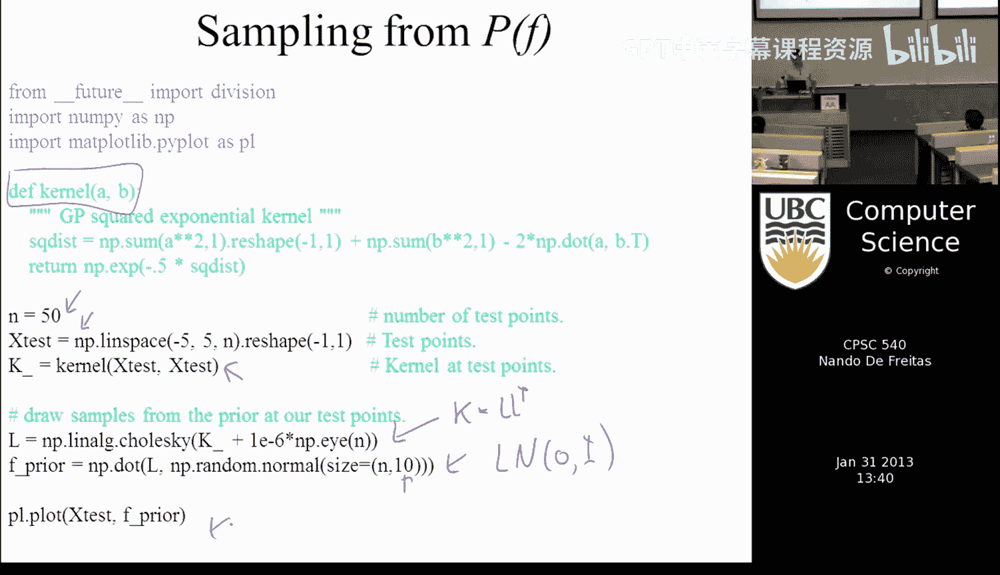

Now。The process of making predictions is just like in the drawing。

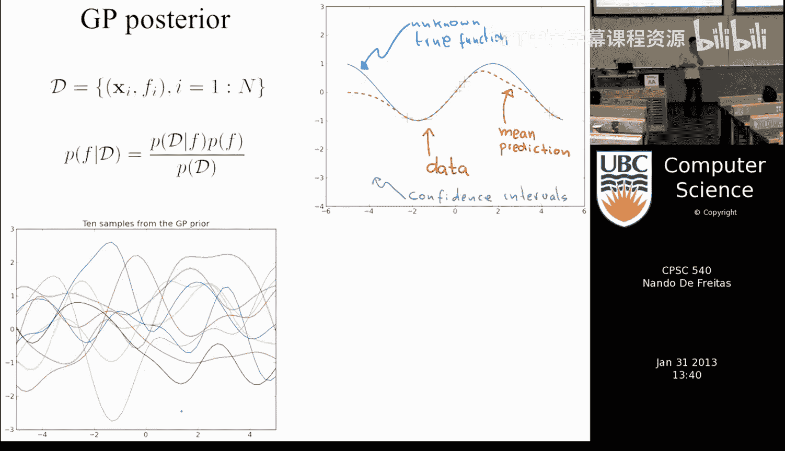

It's just like in this drawing here that we did before， if I want to make predictions。

 I'm going to have my points x comma F， and then I'm going to try to generate the mean and confidence interval square。

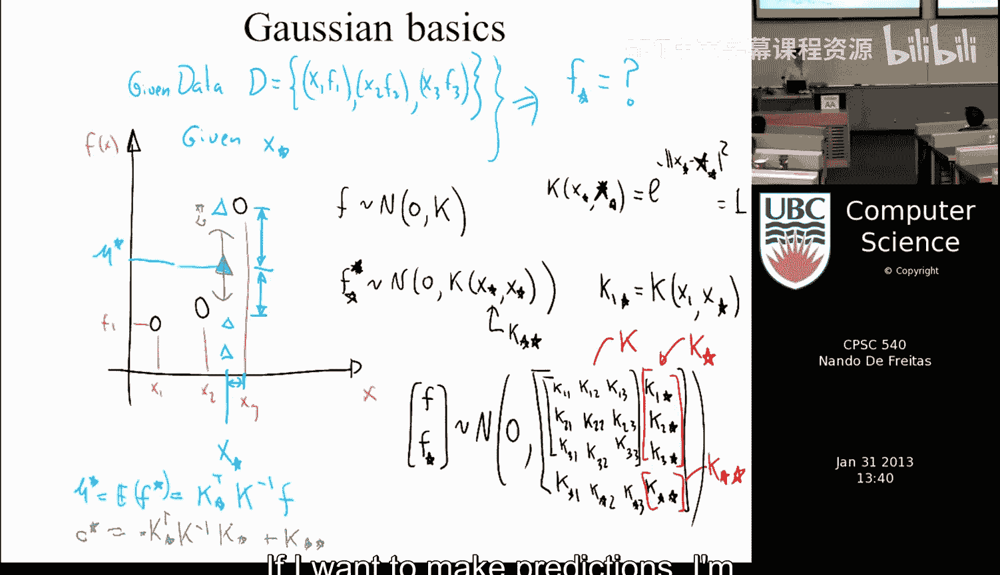

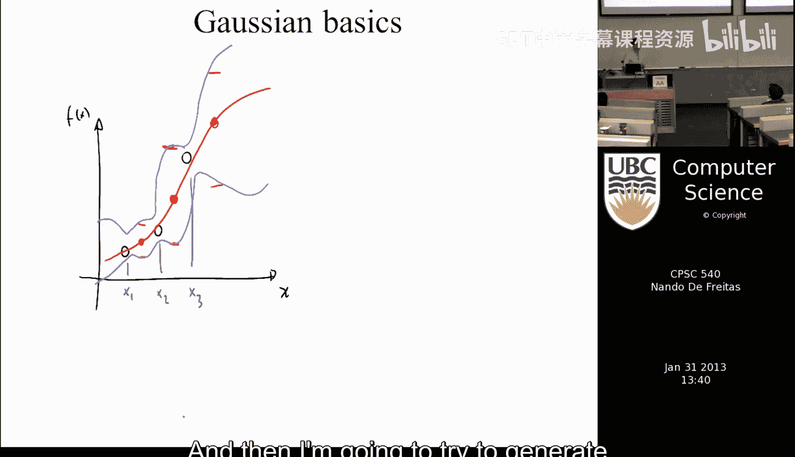

In other words。Given that I have。The training data points， these points here， X I and F。

I will combine the data with my prior other functions。And why is it a prior， It's a prior。

 because I'm specifying via the covariance that I want my functions to be smooth。

I've chosen a similarity matrix， because I'm basically saying。Hey， function appator。

 when you fit my data， make sure that if two points are close by， that the heights are also close by。

That is how I'mco prior knowledge。I'm including the prior knowledge that most things I see in the world seem to be of that nature。

Let's just not pay only attention to the data， but let's also pay attention to things that seem to me common sense to describe the world。

And if you do that。Then， well， we get these feds now。

This is actually also using that piece of code that I've shown you a snippet and that piece of code was being distributed to you in the Google group。

 and it's also on the course website with the homework， homework is available on the course website。

And if I were to draw functions from that Gaussian。

I haven't told you what the mean is and the variance， but it's essentially the conditional Gaussian。

We're going to play the same game， the joint is going to be F and F star。

 and then F star given F which just going to be a conditional gas。

I can evaluate that conditional Gaussian for any point。

 and that's what allows me to take a large number of points along the X direction and for all those points I can compute me and for all those points I can compute a confidence interval。

And I get these beautiful plots that look like that where I did， and fortunately。

If I do what the theorem tells me I get what I want， where there' is datata， the variance is small。

 where there isn't datata， the variance is large。And if I were to draw samples from the Gaussian now。

 the samples would look like the bottom right figure。The data basically squishes the uncertainty。

 grabs all those functions， and ties them。By how much it does it depends on how noisy the data is in this plot the data is actually not very noisy at all。

 so we're seeing a good concentration of the functions， but we don't see as always。

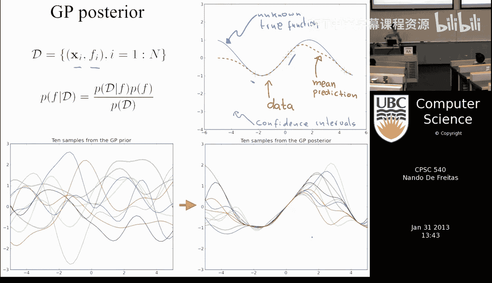

As will see late。Now。The confidence intervals of this nature are very useful because as we know。

 if you know where you're uncertain， that's where you can query the next point to minimize your uncertainty。

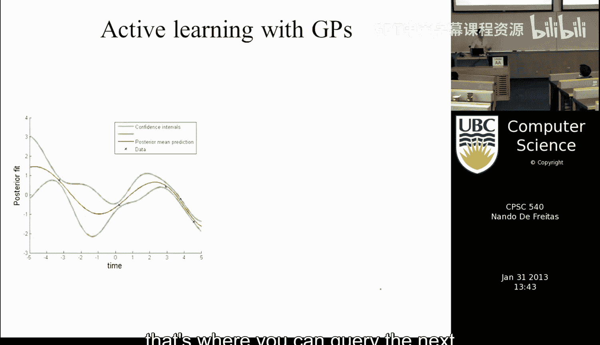

Now。Let's just do what we've done with the drawing， but let's do it now a bit more formally。

So more formally， we have data， Xi and FI， and we have N such data points。

I'm going to assume that we don't have noise， so F is just f of Xci。

We can actually when we try an next， we actually get to observe the function。

There's no noise in that observation。Now， given a。Vunch of test points。 X star。

We can assume that each of these point x star is itself a vector。

Because we might be trying to observe not just 1D quantities， but 2 d quantities and so on。

We want to compute F star， so it's the same game as before we have access。

These access are the input features。We have x stars， which is any arbitrary test point。

We have the Fs from the training data and so the only unknown is the F stars。The X are given。So。

 we form。The matrix K， we form the matrix K star and form the matrix K star star。Once you have that。

 then you know that F and F star are the joint vector that comes from that multivariate Gaus。

As before， we use some kernel。And here you can see that I've started introducing parameters that change the curve。

And if you have that。Multtivariate Gaussian， we use our theorem。We get the quo。

And that's what I'm using to plot that。So for each point， x star。

 I know the mean and I know the variance。If I have about 50 points here and actually。

 this plot was generated with 50 points。The sensor I'm showing you here is essentially for those 30 points。

Chosen along， finally along this grade。For those 50 points， I'm plotting you。

 the mean muse star and K star star。And sort of sigma that the variance of these points。

This' guy here。So the sigma star is giving me this。With。And this location here is Mu star。

And that's essentially why Gaussian processes work。 So when we do Gaussian processes， we essentially。

All we're saying is as the input。That we want two points whose x is nearby to nearby x to have nearby fs。

And that's all we're saying。And then we model all the fs with the Gaussian。

Because a Gaussian allows us to model similarity。And then for any other point that we add to the Gaussian。

We can generate a much bigger Gaussian that's a multivariate joint Gaussian over F and F star。

And then I want to know what should be F star。For any X star， I just collapse by condition。

So I take slice and now look at another project。And again， I can draw functions。The kernel matters。

 so that's how we do gauss processes。

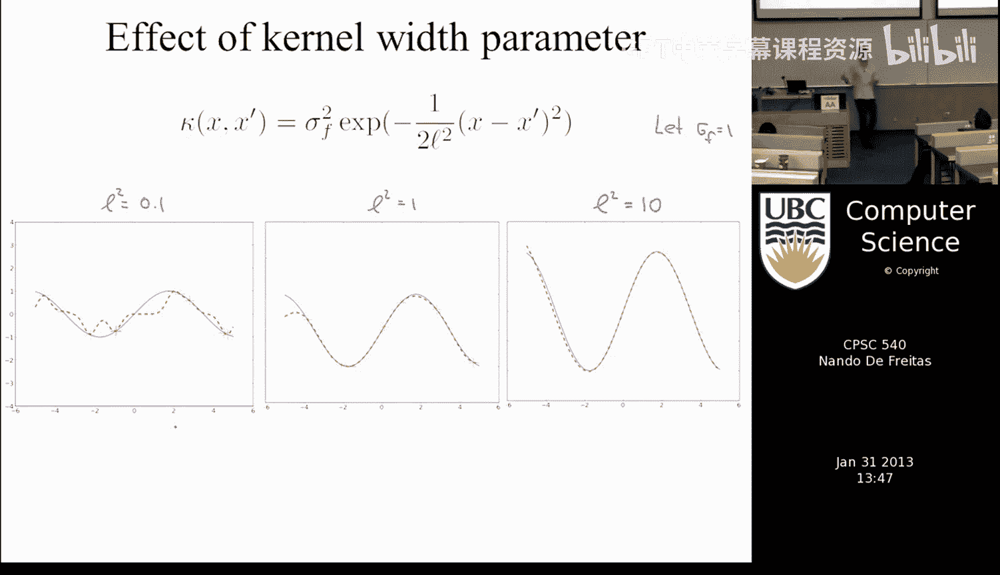

So now I hope you look at the code。And you will see that at the code。

Essential consists of those two formats。I will spend next lecture going over Gaussian processes and I will finish this lecture next time。

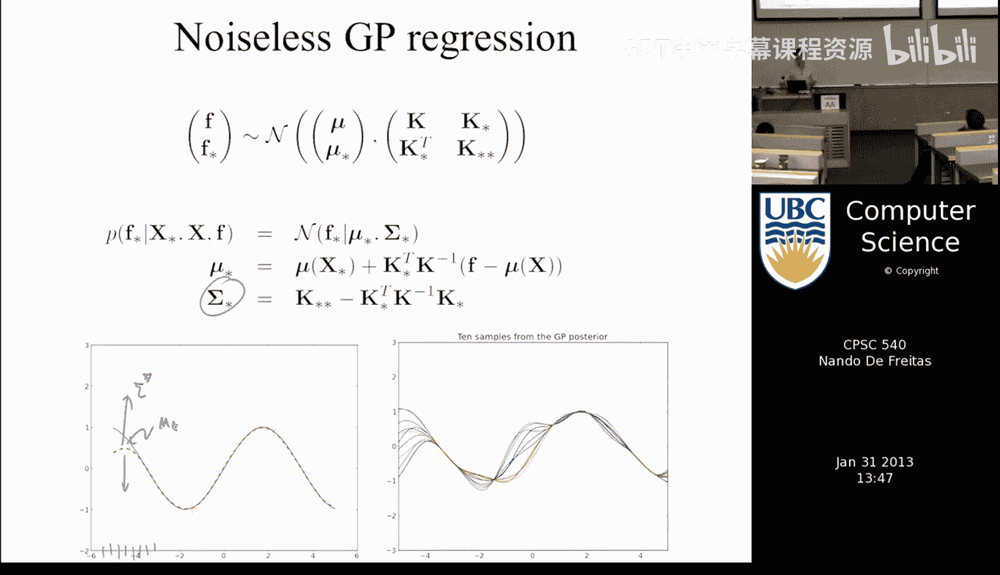

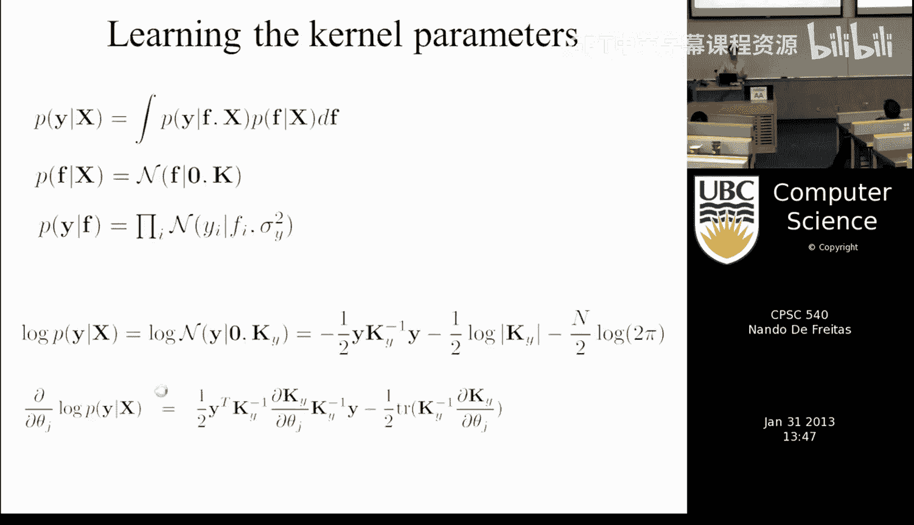

But whoops。

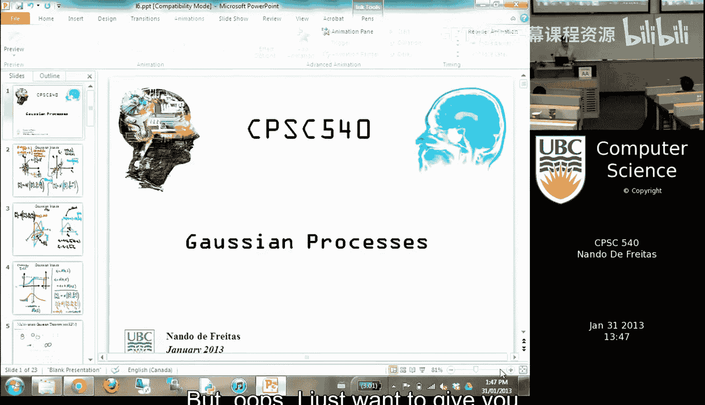

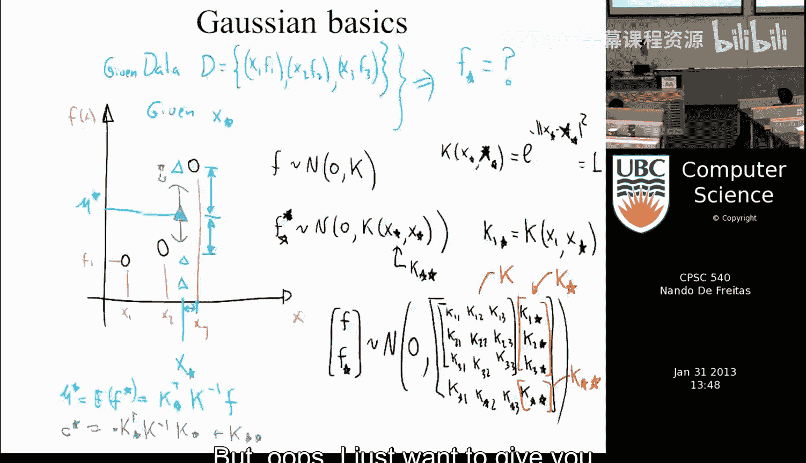

I just want to give you some guidance in reading the code。

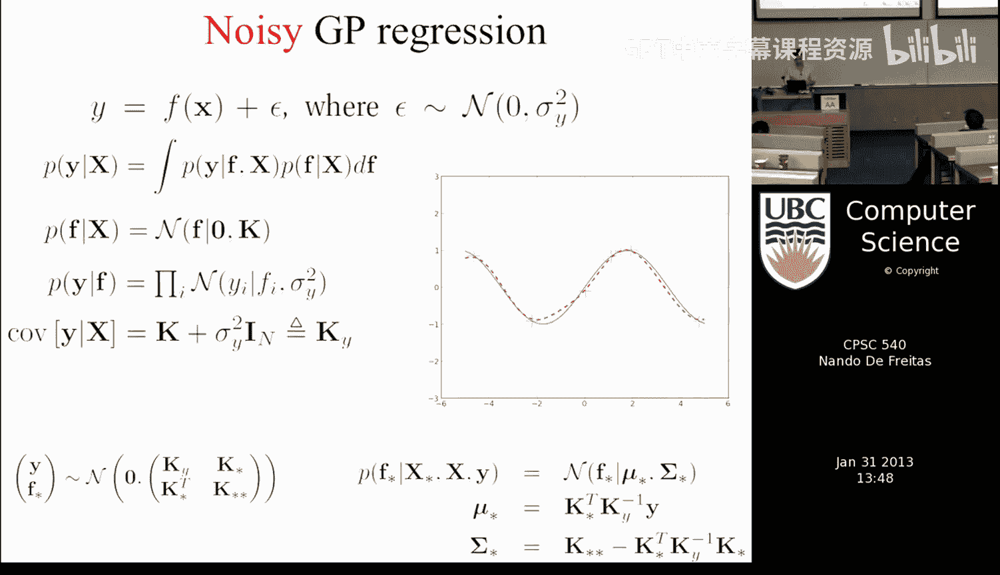

I'll finish the lecture， we'll continue with this lecture on Tuesday。

 I've decided to throw some material out of the course and make the course。

Go slower over the material to make sure that we can follow what's going on。

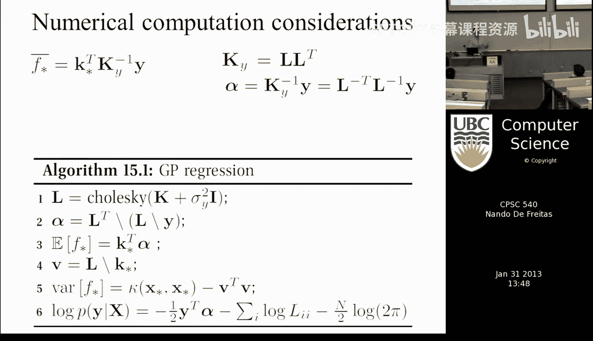

Gusing process is an extremely useful technique you can apply to everywhere。

 so it's worth spending your time。

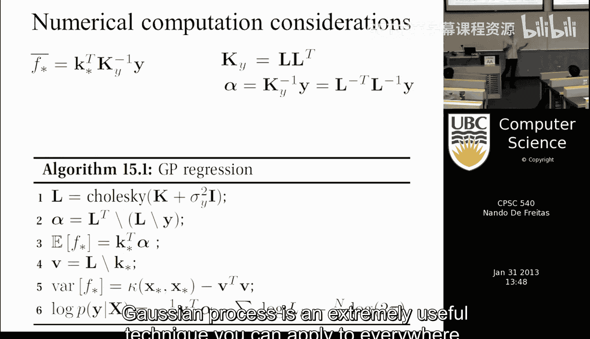

The code I will give you。Computes Gaussian processes using Klesk。

So the mean prediction F bar is usually to indicate the mean。Oops。

We're going to finish the presentation。 but what I'm going to tell you now is enough for you to understand the code。

 The code computes the me。Now。Niveively， we could just use this formula。However， K。

Tends to be poorly conditioned。So if we invert it， we get it into trouble。

A numerical stable way of converting k is to compute a colki the composition of k。And for now。

 ignore this y here， I will explain the why in the next lecture。Just think of it as our usual pay。

We're going to form the Kleski。And from the Kleski， we're going to call this guy alphapha。K minus1 I。

 And so instead we're going to use the inverse of the kla key。

 which is much more easily easy to compute。And then if I call this term M。If m is equal to L-1 y。

Then it must be that LM is equal to y。So in order to compute M， I solve。

A linear system of equations with matrix L and vector。Why。That is essentially how I do the code。

In the code， I compute col the composition of k。And then I solve a linear system。

Which in Python or mat lavishes with this backslash operator， that gives me M。And then。

Once you have M， you have another linear system， which is L minus transpose M， which you can call。

 I don't know。Q， and then you solve for Q。Oh in fact， at that point is actually alpha。

 and then you solve that linear system of the equation for alpha。So L transpose。Alpha is equal to M。

And so。That's how I'm computing。啊。This term alpha， once I have alpha， I'm multiplied by k。

 and I get the expectation， which is just mu star。And the same trick is used for the virus。

And in that many lines of code is the code for doing Gaussian processes。

It's conceptually hard to get Gaussian processes because you're competing with functions and because we're no longer using our notions of calculus。

 but instead to get at it， we're getting at it from probability。And priors。

But once you're comfortable with the probability and you get gaussian processes。

 you realize that now you have a tool that can do any nonlinear regression。

Like linear regression is actually not much easier than doing this and is so much more limited than this。

This gives you good fits， this gives you confidence intervals。

 and this will be the basis to do a lot of very cool applications， algorithm configuration。

 forecasting。It's calcium process used a lot， they used in say graphing animation。

 they use all over the place， it's an extremely popular tool。Allright， see you next week。

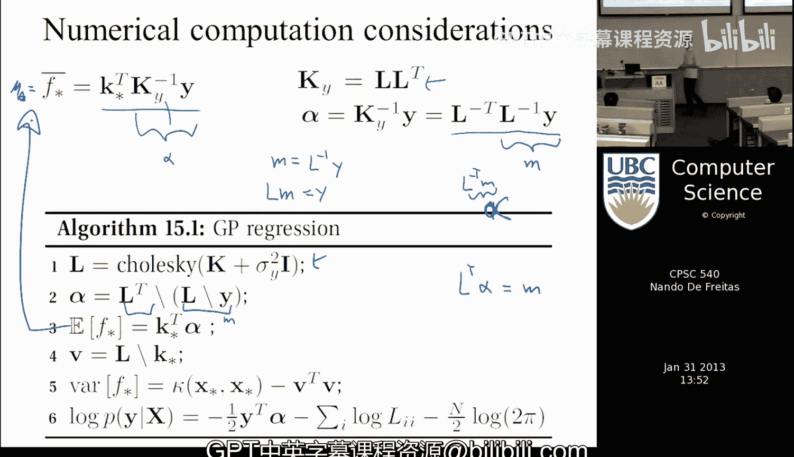