# 机器学习：08：高斯过程简介 🧠

在本节课中，我们将要学习高斯过程的基本概念。高斯过程是一种强大的非参数贝叶斯方法，用于回归和分类任务。它允许我们直接对函数进行建模，并提供预测的不确定性估计。我们将从回顾多元高斯分布的核心概念开始，逐步构建出高斯过程的理论框架，并理解其如何用于函数回归。

## 多元高斯分布回顾 📊

上一节我们介绍了高斯过程的目标是建模函数。为了理解它，我们需要先回顾多元高斯分布的核心概念。

假设我们有一个由点构成的云团。假设有两个变量，x1 和 x2。这个点云本质上描述了这两个变量的实现。例如，你可能测量个体的身高和体重，那将是 x1 和 x2，然后你将其绘制在图上。你可能会得到看起来像这样的测量值，或者得到看起来更像这样的测量值。每个圆圈是一个测量值，一个单独的数据点。但这两个是未知变量 x1 和 x2。

当我们使用多元高斯分布时，我们本质上是在对这些点拟合一个高斯分布。无论是在左边还是右边的情况下，学习的过程都是将高斯分布拟合到这些点的过程。希望这个高斯分布能描述这些点。

例如，对于这里的这些点，我可能想选择一个以原点为中心的高斯分布，因为它们似乎是零均值的。我可能会使用某种圆形的协方差，因为点的分布大致是圆形的。在这里，会更像椭圆。均值将是某个值。其思想是，均值是椭圆的位置，而椭圆的大小描述了数据，它们是我们对数据的模型。

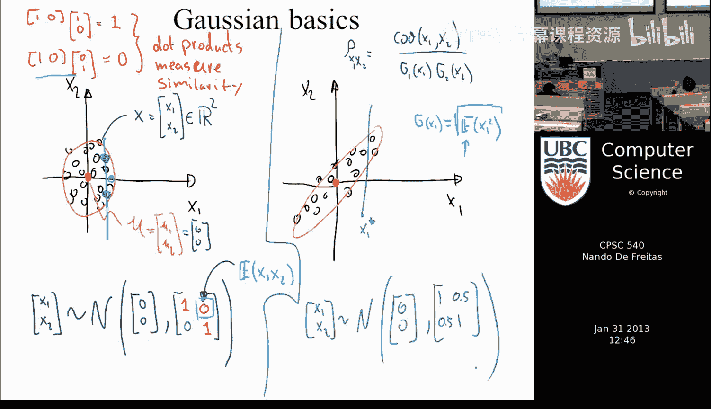

我将这个中心称为向量 μ。μ 是一个向量。它有两个分量，因为有 x1 和 x2。它是二维空间中的一个点。因此，它必须有两个分量。同样，这些点中的任何一个都有两个分量 x1 和 x2。所以我们可以将平面上的这些点视为二维空间中的向量。它们可以是负数，也可以是正数，是实数，我们经常使用这个符号：属于实数平面。所以如果加上平方，你可以认为 R 是实数线，从负无穷到正无穷。如果我将其平方，就得到实数平面，这是一个平面，一张延伸到无穷远的纸。

说某个东西是高斯分布的，本质上就是说任何点 (x1, x2) 都来自（这就是那个波浪号的意思，它来自、或从中模拟、或从中采样，所有这些说法意思相同）。它是一个样本，那里的任何点都是你期望出现在那个红色圆圈内的那种事物的一个例子。我们说它是高斯的。并且我们会说，在这种情况下，均值是 0，因为它以原点为中心。

现在的问题是，我们需要讨论点之间是如何相互关联的？所以我们需要一个概念，让我们能够说明增加 x1 如何改变 x2？x1 和 x2 相关吗？因此，我们用来描述这一点的变量是相关性或等价地协方差。

具体来说，有一个称为相关性的变量 σ_{xy} 或 σ_{x1x2}，它只是 x1 和 x2 的协方差除以 x1 的标准差乘以 x2 的标准差。现在，所有这些量是什么？协方差是进入矩阵内部的项。它们是期望值。在这种情况下，我们有一个零均值变量。对于这个特定的条目，应该进入单元格的条目是 x1 乘以 x2 的期望值。

σ_{x1} 将定义为标准差，它是方差的平方根，也就是 x1 平方的期望值的平方根。如果我的均值不是 0，我就必须减去均值。我使用 E 来表示期望的概念。期望可以认为是样本平均值，就像你抛硬币一千次并计算正面朝上的次数一样。随着抛硬币的次数趋于无穷大，你期望正面朝上的次数是一个值，这本质上就是我所说的期望值。

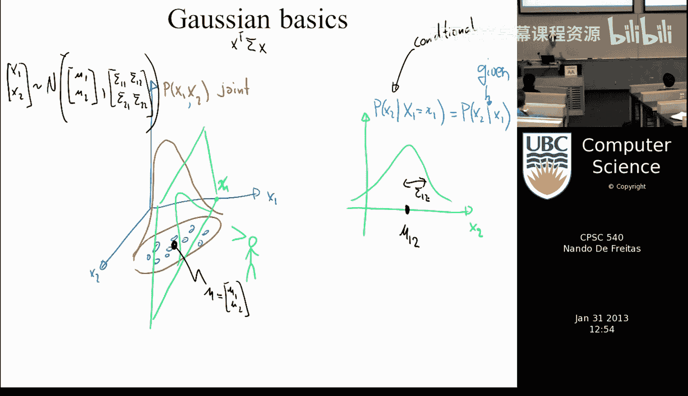

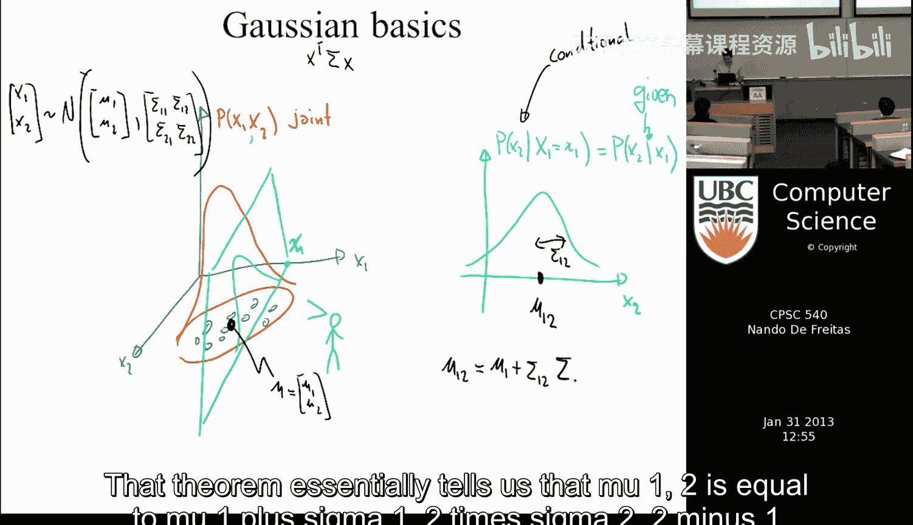

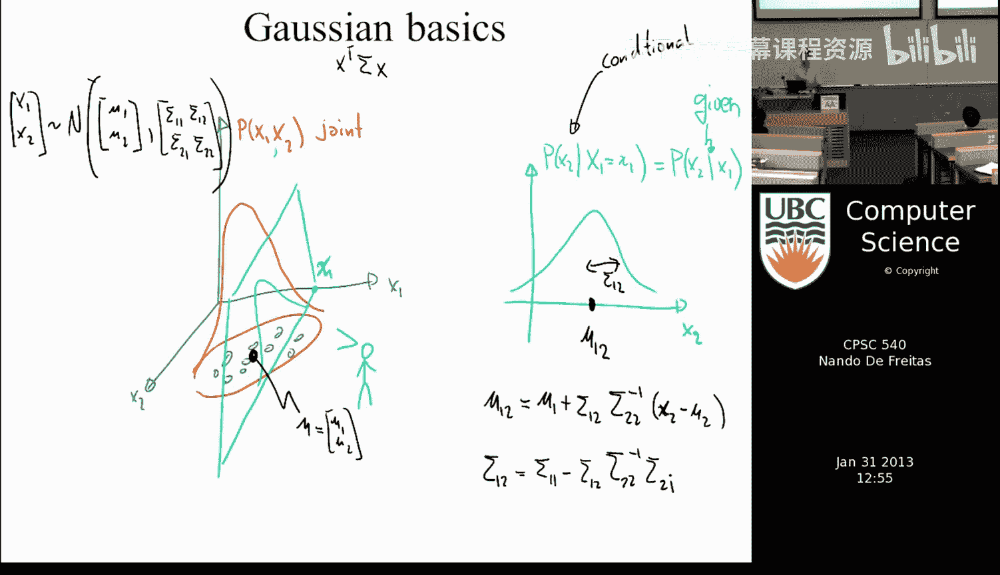

但现在，这里需要澄清的另一件事是协方差。通过假设均值为 0，我更容易进行这个论证。协方差本质上是 x1 和 x2 的点积。

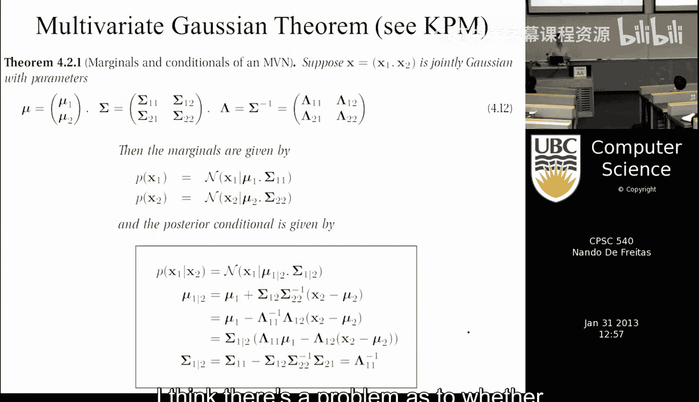

现在，当我们取向量的乘积时会发生什么？如果你有一个看起来像 (1, 0) 的向量，并且你将其与向量 (1, 0) 进行点积，我们得到 1。所以向量乘法是第一个条目乘以第一个条目，第二个条目乘以第二个条目。然而，如果我有一个向量 (1, 0)，在这种情况下，(1, 0) 和 (1, 0) 是相同的向量，所以它们极其相似，相似到它们是相同的。但我可以选择一个与 (1, 0) 非常不同的向量 (0, 1)。现在它们在第一个坐标上不一致，在第二个坐标上也不一致。所以当我取点积时，我得到 0。

我们能从这个事实中得出什么结论？我们可以得出结论，点积衡量相似性。如果两个点在二维空间中很接近，如果它们相似，它们的点积就会很高。所以点积是相似性的度量。

现在，这允许我们去思考协方差应该是什么。让我们假设这个条目是 1，这个条目是 1，因为它只是被归一化，使得方差为 1。那么在这种情况下，我会期望这个为 0。因为我可以很容易地在这个云团中选取一个点，或者换一种说法，我可以很容易地在这个云团中选取两个具有这种属性的点。假设我增加 x1 并到达这里。那么我得到正的 x2 点或负的 x2 点的机会是相同的。通过了解 x1 的一些信息，我并不能更好地了解 x2。所以它们是不相关的。关于 x1 的信息并不能帮助我获得更多关于 x2 的信息。

另一方面，与右边的情况对比。在这种情况下，如果我选取 x1 的一个特定值，这个特定值，那么我知道 x2 有很大概率是正的。所以了解 x1 的一些信息告诉我一些关于 x2 的信息。所以在右边，点是相关的，两个变量是相关的，了解 x1 让我能了解一些关于 x2 的信息。在左边，当点是球形分布时，我没有那个信息。

如果我为这个右手边做我的高斯分布，假设我仍然有 1，但在这里我不会是 0。我将会有某个正数。那个正数基本上表明，如果我期望 x1 增加，我也应该期望 x2 增加。而在左边，我说如果我期望 x1 增加，我不一定期望 x2 增加。清楚了吗？因为这就是高斯分布中随机变量相关性的属性，所以这是我们在整个课程中利用的一个属性，它本质上是能够进行线性回归和非线性回归的基础。

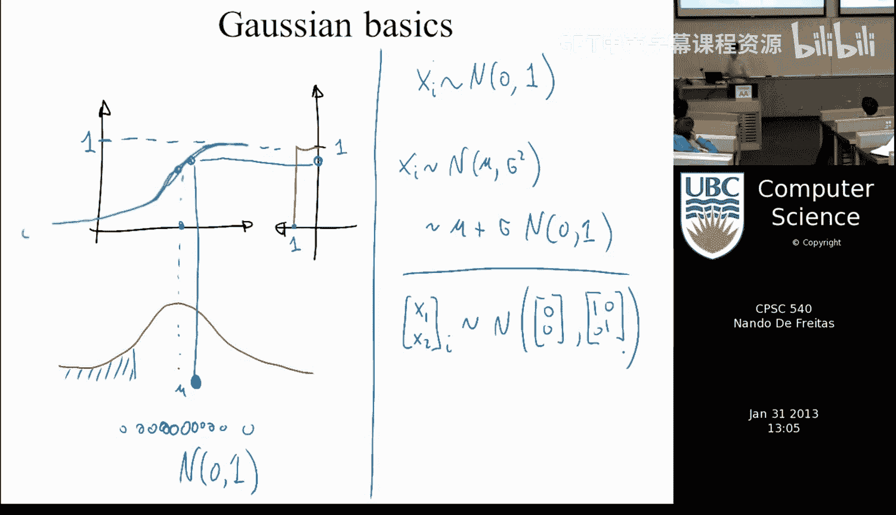

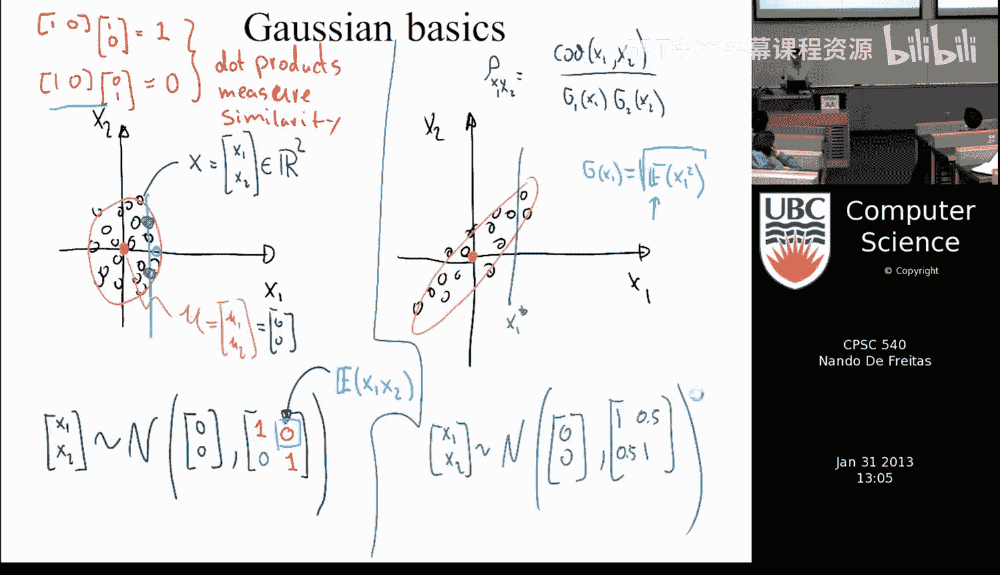

所以这本质上就是多元高斯分布所在，在这种情况下是双变量高斯分布，因为只有两个维度。但它让我们看到，如果协方差的条目是 0，就意味着变量是不相关的。所以增加一个不会减少另一个，一个不依赖于另一个。如果条目不为零，就意味着一个变量确实依赖于另一个。然后它们可以以正相关的方式依赖，也可以以负相关的方式依赖，这取决于你的点积。

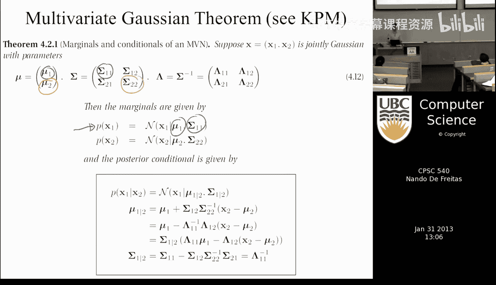

## 条件分布与联合分布 🔪

上一节我们回顾了多元高斯分布中相关性（协方差）的含义。本节中我们来看看如何从一个联合分布推导出条件分布。

让我们再次说明高斯分布。假设我们有一些点。同样，我们有 x1, x2。我们有等高线图。然后这次我实际上要在三维空间中绘制高斯分布，就是这个钟形曲线。这本质上是 x1 和 x2 的分布，我们称之为联合分布，因为它联合建模了 x1 和 x2。

此外，我现在要做以下事情。我将在特定值处切割这个高斯分布。所以我要选择 x 的一个特定值。假设这里的这个值，那个彩色的 x1，我将切割。我将切一个平面穿过这个高斯分布。想象你有一个看起来像钟形的蛋糕。你拿一把刀切开它。现在，想象你是站在这里侧面的这个人，看着你的切口。你期望你的切口是什么形状？一个高斯分布，所以如果你从这个角度看，你仍然很可能期望看到一个看起来像这样的高斯分布。让我们绘制它。所以你会看着 x2，你会看到一个看起来像这样的高斯分布。那个高斯分布是 x2 的概率，给定 x1，变量 x1 是那个特定的切割，那个特定的切片。

所以当我写，并且为了简短，在课程中为了避免总是定义随机变量，我经常这样写。所以这是很多论文中的常见做法。但当你看到那个竖线时，请不要忽略这个竖线，因为这个竖线非常重要。这个竖线给了我们语义。有时这里有逗号或没有逗号，那不太重要，但那个竖线很重要，因为一旦你看到 x2 给定 x1，我谈论的是关于 x2 的分布，而当我说 x1 和 x2 时，我谈论的是 x1 和 x2 的二维联合分布。所以这是两个非常不同的分布，但一个是通过切割另一个得到的。或者我们在统计学的语言中有另一种谈论方式，我们称之为切割过程，我们称之为条件化。

所以这里的这个家伙被称为条件分布。现在，让我们假设 x1 和 x2 的联合分布是高斯分布，均值为中心 μ1 和 μ2。并假设它有一个协方差矩阵，是 Σ_{11}, Σ_{12}, Σ_{21}, Σ_{22}。所以那是我们的高斯分布，描述了图中那个点云。Σ_{12} 和 Σ_{21} 只是彼此的转置。

协方差必须具有的属性之一是，如果你有一个一维变量，拥有一个高斯分布的 Σ 是没有意义的，一维高斯分布的 Σ 恰好是高斯的宽度，所以宽度必须是正的，拥有一个自身内爆的、具有负方差的高斯分布是没有意义的。同样地，对于多元高斯分布，拥有一个自身内爆的高斯分布也是没有意义的，所以我们要求协方差矩阵在某种意义上是正的。这个概念就是我们所说的正定性，所以我们要求那个矩阵，协方差矩阵是对称的，并且我们要求其特征值为正，这阻止了它崩溃。具体来说，我们要求任何任意变量 x 乘以协方差矩阵必须是正的。所以高斯分布的指数必须是正的。高斯分布总是 e 的某个距离次方，那个距离必须是正的。这就是对称正定性。

对我们的论证更重要的是以下事情。我可能想知道这个高斯分布的均值是多少，我将其称为 μ_{1|2}。我也可能想知道这个高斯的宽度是多少，我将其称为 Σ_{1|2}。如果有一个公式，我们可以直接从原始模型中读取，那不是很棒吗？给定原始模型，我们可以直接计算出 μ_{1|2} 和 Σ_{1|2}。

想想以下设置，我有一个点云。我们已经知道如何使用最大似然来将高斯分布拟合到点云。我们知道如何估计均值，它就是平均值，我们也知道如何估计方差，通过使用样本方差估计。所以，我们可以获得那个红色的钟形曲线，因为我们拥有所有允许我们这样做的工具。但如果我现在问你，给我条件分布。换句话说，计算绿色曲线。你会怎么做？这实际上需要一些工作。这可能需要大约四页纸，也许更少，取决于你对符号推导的熟练程度。它基于一个称为 Schur 补或矩阵求逆引理的思想。我不会在课程中详细讲解，因为涉及很多代数。如果你认真对待机器学习，我强烈建议你阅读 Kevin Murphy 教科书课程的第 4 章，因为他在其中详细列出了所有步骤。

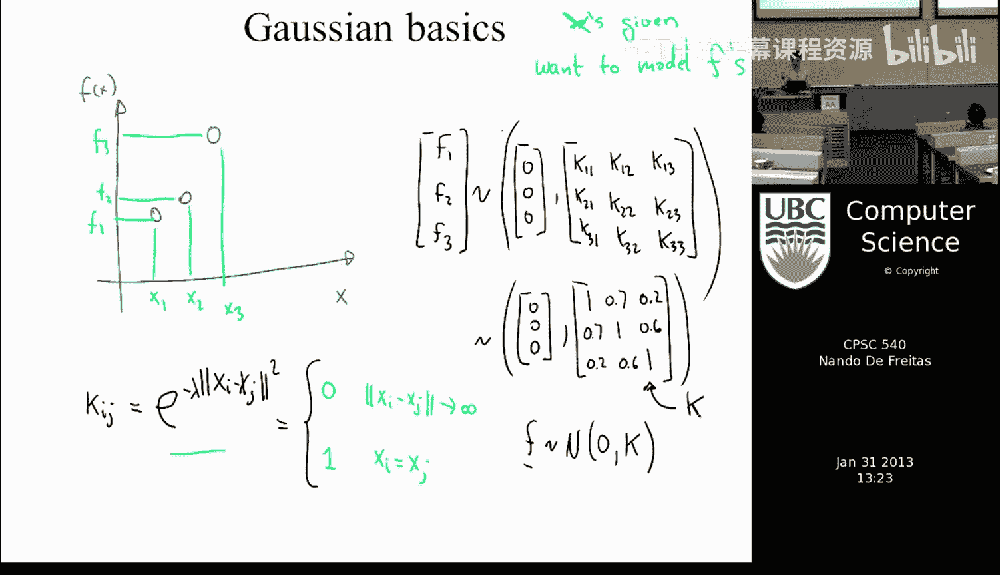

但现在，让我们假设那个定理是给我们的，并且将始终是给我们的。

该定理本质上告诉我们，μ_{1|2} 等于 μ_1 加上 Σ_{12} 乘以 Σ_{22}^{-1} 乘以 (x_2 - μ_2)，其中那个 x_2 是我们条件化的那个波浪号 x_2。所以那个公式存在。此外，还有一个公式说 Σ_{1|2} 等于 Σ_{11} 减去 Σ_{12} 乘以 Σ_{22}^{-1} 乘以 Σ_{21}。

这本质上是 Kevin 书中所说的定理。该定理说，考虑一个多元高斯分布。我们将考虑该多元分布的两个块。所以将有一个向量 x1 和一个向量 x2。到目前为止，因为我一直在绘图，我假设 x1 是标量，x2 是标量，但当然处理要普遍得多，x1 可以是一个向量，x2 可以是一个向量，如果你将两个向量连接起来，你仍然有一个向量。并且那个向量是高斯分布的。每个向量分量都有一个均值 μ1 和 μ2，它们具有我们在图中刚刚讨论过的相同协方差。

所以，该定理本质上告诉我们 Σ_{1|2} 的表达式应该是什么，以及 μ_{1|2} 和 Σ_{1|2} 的表达式应该是什么。该定理在 UBC 任何研究生的能力范围内，可以去证明它。事实上，如果一个研究生能理解那个定理，我认为你是否有资格读研究生是个问题。但这只是繁琐的代数，没有必要用这些代数来烦你。

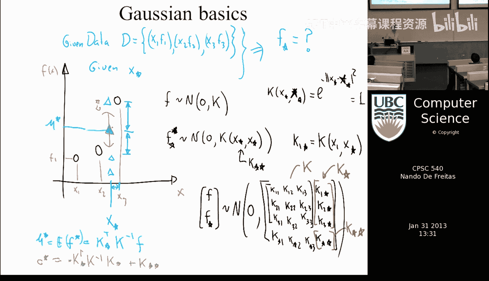

重要的是你要接受这样一个定理存在，并理解这个定理为你做了什么。该定理只是允许你从联合分布转到条件分布。所以如果我给你一个联合分布，如果我告诉你这是联合分布的协方差，这是联合分布的均值，你应该能够应用这两个公式来告诉我条件分布是什么。这就是定理的价值。

## 从高斯分布中采样 🎲

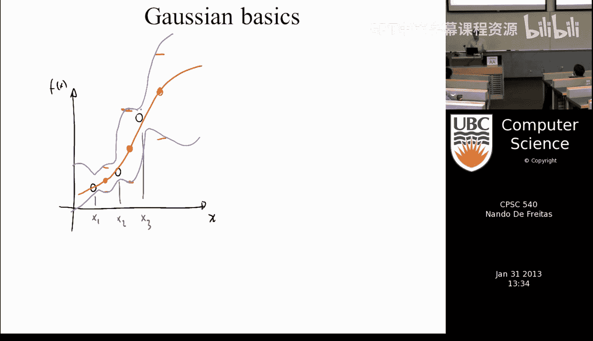

上一节我们介绍了如何从联合分布得到条件分布。本节中我们来看看如何从高斯分布中生成样本，这是“想象”数据的关键步骤。

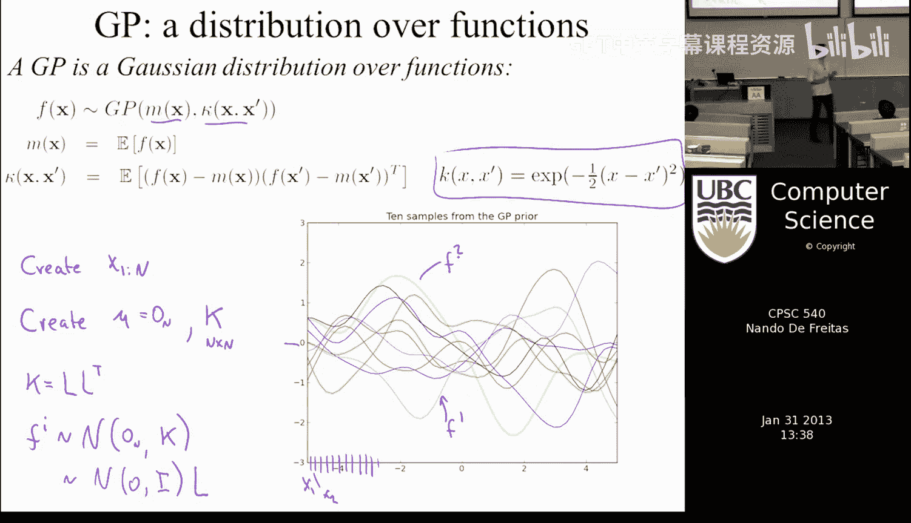

关于高斯分布还有一件背景事情。这在课程中之前已经快速讲过，但我认为值得花更多时间在上面。我要做以下事情。我将假设我们有一个高斯分布，一个我们想要从中采样的高斯分布。所以现在我们要做相反的过程。之前我们有点，我们试图找出曲线。现在你可以假设我们有曲线，换句话说，我们有均值和方差，这足以绘制曲线但重建曲线。我们将尝试生成数据。在学习中生成数据的动机是，如果我能想象世界，并观察世界，如果我看到的与我想象的不匹配，意味着我需要更新我的知识，我需要学习，换句话说，这样我才能理解世界。所以想象是机器学习的核心。因此，我需要能够从高斯分布中抽取样本并观察，这可以说是我想要想象的最简单的事情之一。

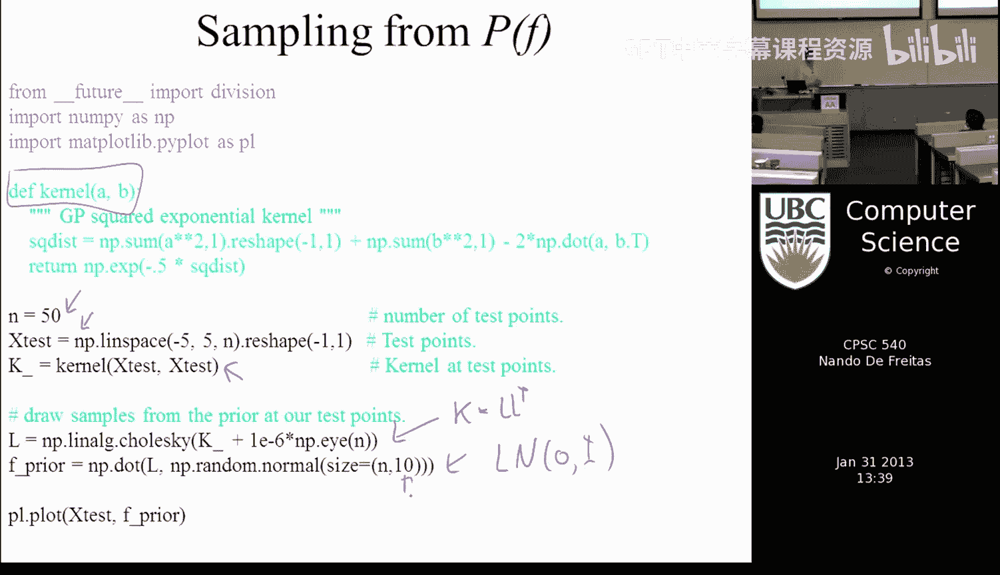

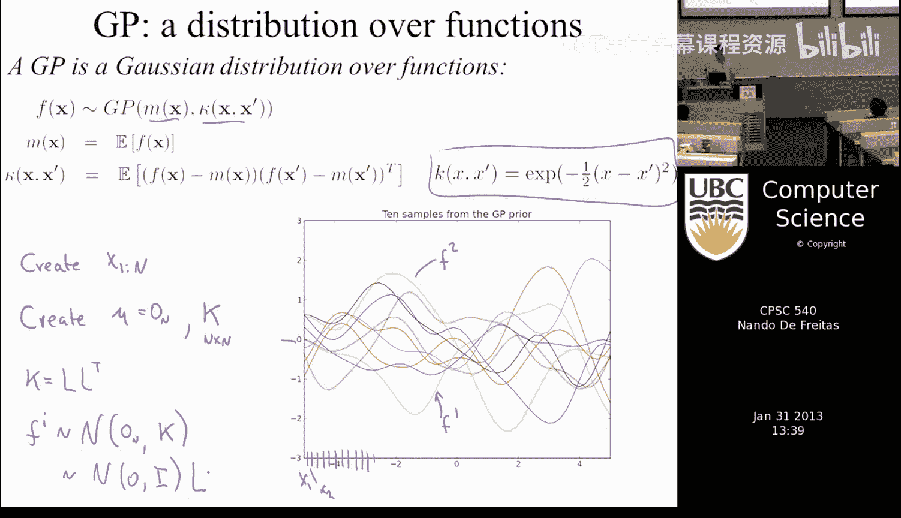

我将假设我有一个产生均匀样本的机制。所以你有一个随机数生成器，它会给你在 0 和 1 之间等概率的数字。这就是均匀分布。我还假设我可以计算高斯分布的累积分布函数。

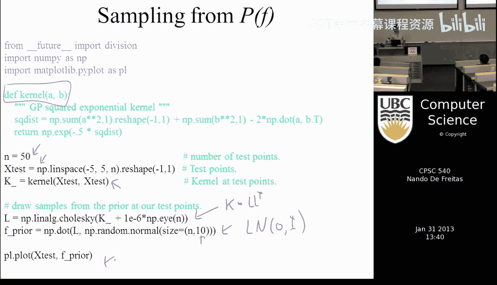

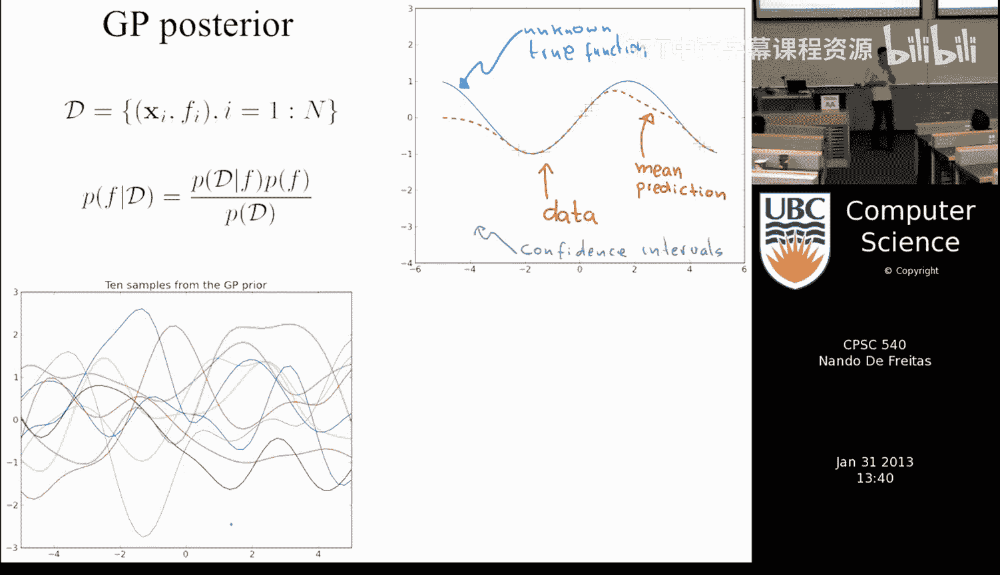

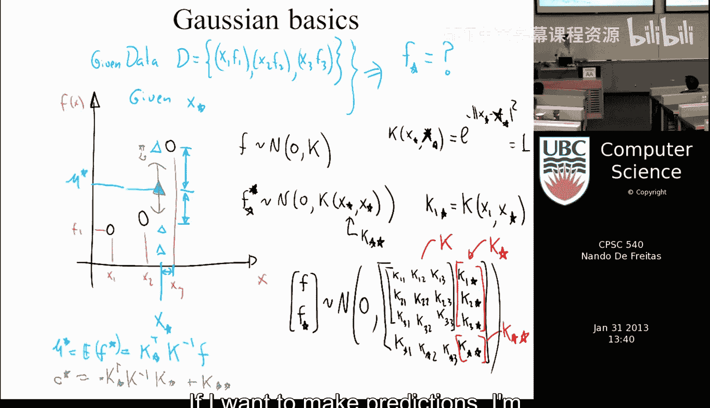

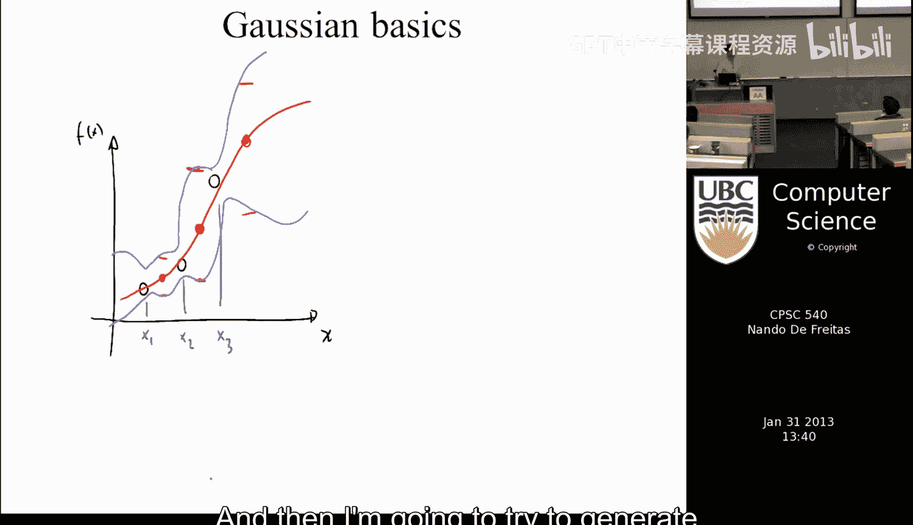

现在，高斯分布的累积分布函数是什么？高斯分布的累积分布函数是你得到的东西。所以这是 μ 所在的位置。高斯分布的累积分布函数是当你从左向右移动时，开始对高斯曲线下的面积求和所得到的值。所以一直到这里的这个面积有一个值。那个值就是累积分布函数。如果我在这里绘制一个累积分布函数，它看起来会像这样。拐点，面积发生拐弯的点，就是均值。因为左边的面积应该与右边的面积大致相同，因为高斯分布是对称的。我知道这条曲线会趋近于 0。所以给你们的一个问题是，这条曲线的渐近线是什么？是 2，是 3，是 π，还是 1？因为概率分布曲线下的总面积是 1。

现在，我特意这样画它，这样我就有了我的均匀分布，它在 0 和 1 之间，以相等的概率产生 0 到 1 之间的数字。所以它必须是 1，因为 1 的面积是 1，而概率面积必须是 1。现在，如果我能从均匀分布中抽取一个随机数，我能做的就是我可以将该数字投影到曲线上，投影到曲线上的意思是我将其投影回来，我从高斯分布中得到一个样本。这就是我们采样的方式。我们刚刚说这就是你计算样本的方式，无论你使用 MATLAB、C、Python 还是任何其他语言。它们都使用这种称为逆累积分布函数采样的技术。然后如果你这样做，你经常会得到这样的结果，你会像预期的那样在中间得到更多样本，在这里得到更少样本，在尾部得到很少的样本。所以这就是我们生成样本的方式。

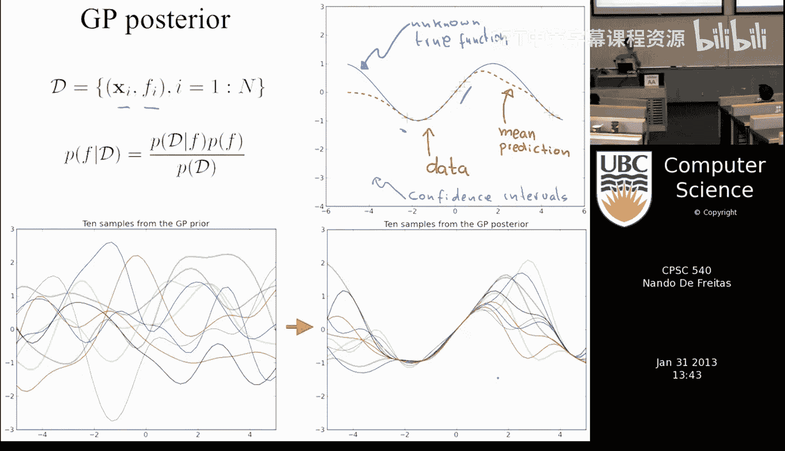

对于一个均值为零的高斯分布，或者在这种情况下均值不为零，但通常我们在计算机中有一个能够生成 0-1 高斯变量的过程。本质上，它使用均匀分布来实现这一点。

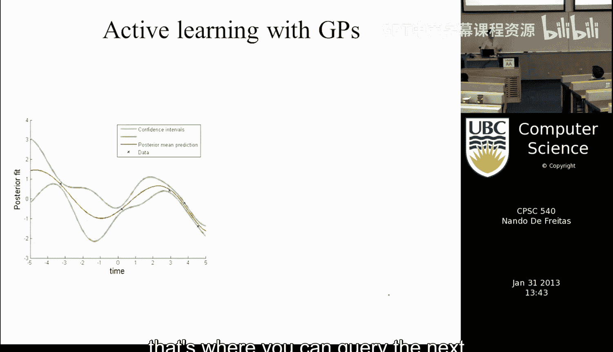

现在，让我们假设我们有这个能力。这个采样过程，我将使用波浪号来表示。所以一个波浪号可以认为是想象。所以我从一个均值为 0、方差为 1 的高斯分布中采样一个点 i。现在，如果我想从一个具有均值 μ 和某些方差 σ^2 的高斯分布中想象一些东西，我会怎么做？我将只是想象一个 0,1 的高斯分布，因为那是我知道如何做的。然后我将其乘以 σ，这里有 σ 和 σ^2 的原因是记住方差是 x 乘以 x 的期望值，所以它是 x 平方的期望值。事实上，在一维情况下是 (x - μ) 乘以 (x - μ)。所以是 (x - μ)^2。如果我乘以一个数字，就那个数字平方的期望而言，我本质上是在对方差进行平方。当然，如果我有一个随机信号，我只是给它加上一个常数值，我只是改变了它的高度。所以加上一个数字 μ 只是改变了高度。现在我有了一种绘制具有任何均值或任何方差的随机变量的方法。

所以这是一维情况。在多维情况下，假设现在我有一个包含两个变量 x1 和 x2 的向量。我如何从一个高斯分布中绘制一个向量？该高斯分布均值为 0，协方差为单位矩阵。也就是说，我现在如何绘制二维随机向量？为了做到这一点，我们再次求助于我们的定理。

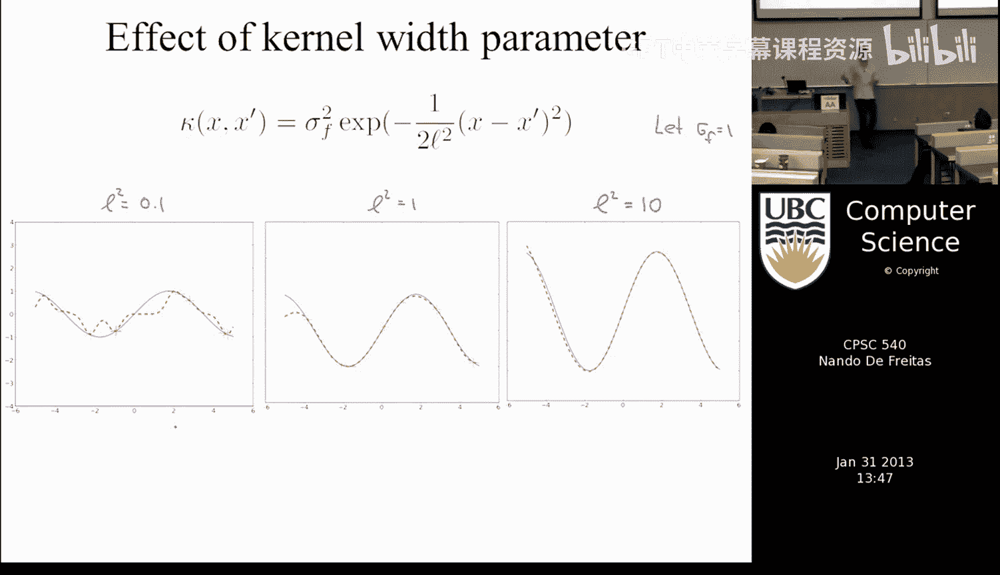

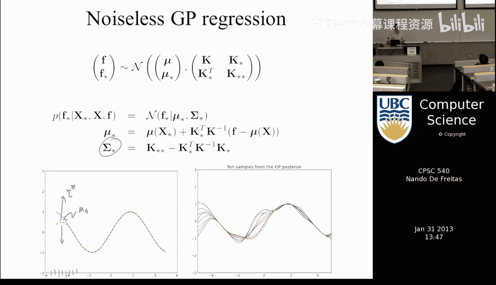

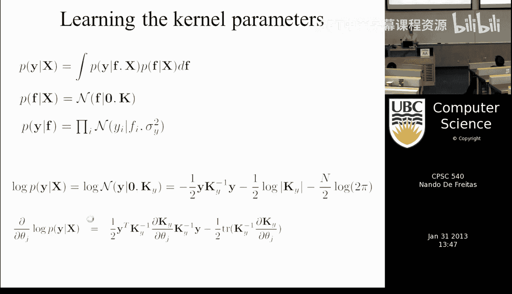

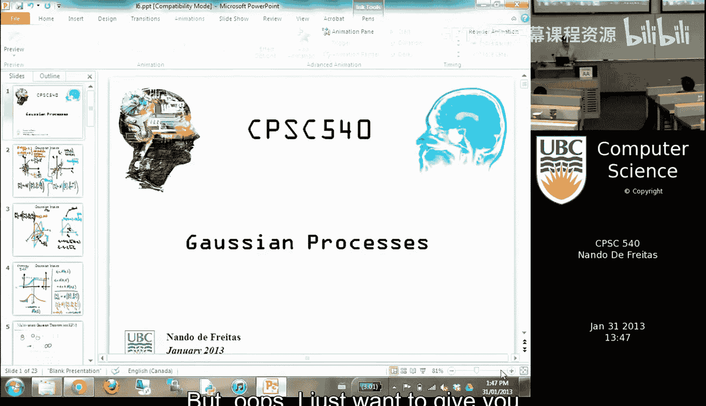

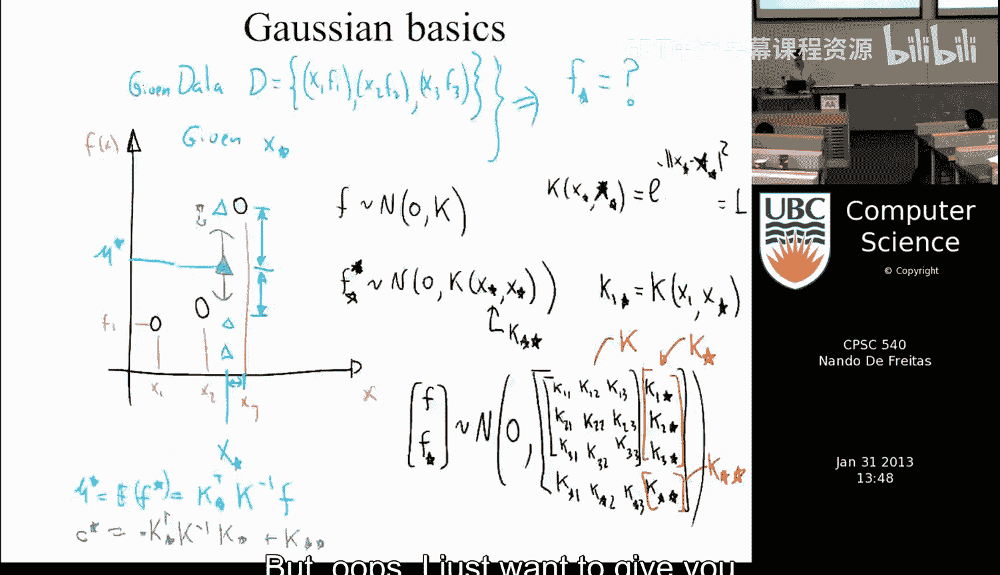

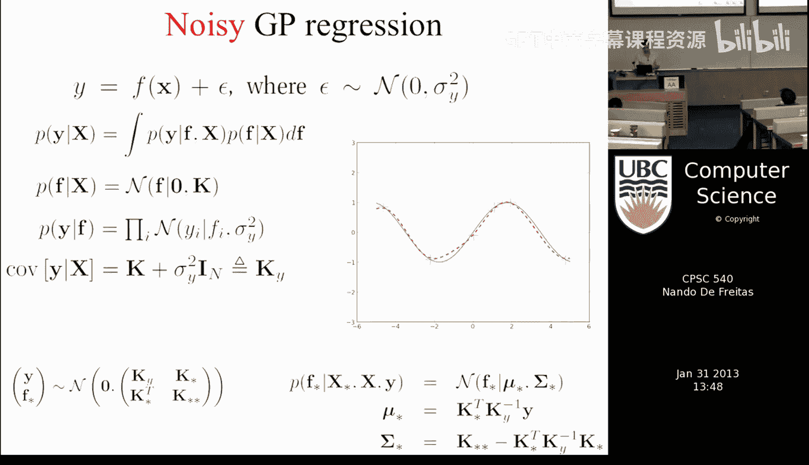

我们的定理也告诉我们，当你观察这个具有方差 Σ_{11} 和均值 μ1 的多元高斯分布时，边缘分布恰好具有均值 μ1 和 Σ_{11}。所以要得到 x1 的边缘分布，你只需取分量 μ1 和 Σ_{11}，而要得到另一个变量的边缘分布，你取 μ2 和 Σ_{22}。

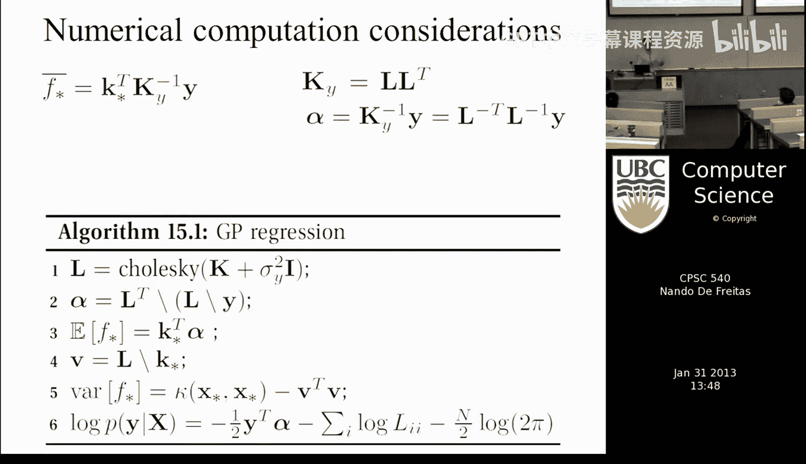

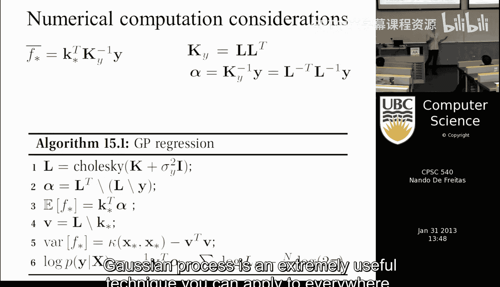

换句话说，这个方程说的是，x1 本身来自一个一维的 0,1 高斯分布，x2 来自一个一维的 0,1 高斯分布。它们不相关，因为非对角线元素是 0，这意味着如果我们有能力绘制一个 0,1 的高斯随机数，绘制一维的 0,1 高斯随机变量，我们现在也有能力绘制向量，因为我们所做的就是将它们连接起来。我们绘制每个分量，我们从一维高斯分布中绘制 x1，然后我们从一维高斯分布中绘制 x2，这等价于从那个高斯分布中绘制向量 (x1, x2)。

最后，如果我想绘制向量 (x1, x2)，从一个具有任意均值 (μ1, μ2) 和任意协方差 Σ_{11}, Σ_{12}, Σ_{21}, Σ_{22} 的多元高斯分布中绘制。让我称这个矩阵为 Σ，称这个向量为 μ 以简化。现在我没有办法，我需要一种对矩阵求平方根的方法，以便能够从中绘制，因为我本质上想使用相同的技巧。让我们称这个向量为 x。我基本上想说，如果 x 来自一个均值为 μ、协方差为 Σ 的多元高斯分布，那么 x 必须是一个多元高斯分布的样本。如果我们可以像一维情况那样做，那就太好了，即将其写成均值加上某个量乘以一个 0 均值和单位协方差的高斯分布。如果我们能做到这一点，那就太好了。但为此，我们需要某种矩阵平方根的定义。

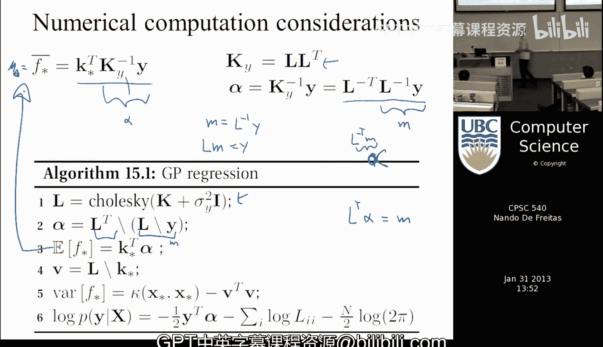

那个定义是我们从线性代数中得到的。对于你的目的，我不需要你知道它是什么或如何推导它。如果你感兴趣，只需在维基百科上输入，它会告诉你需要知道的一切。它被称为 Cholesky 分解。这是有史以来发明的最重要的算法之一。它基本上说你可以