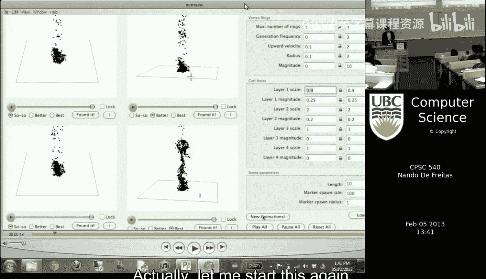
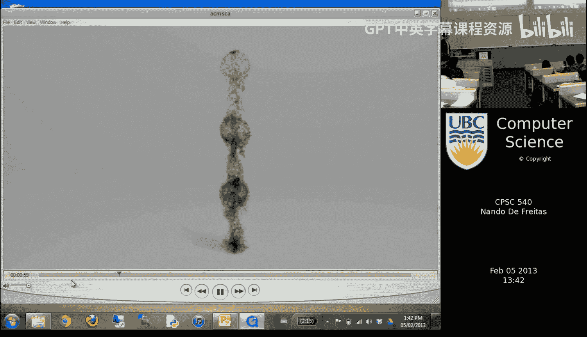
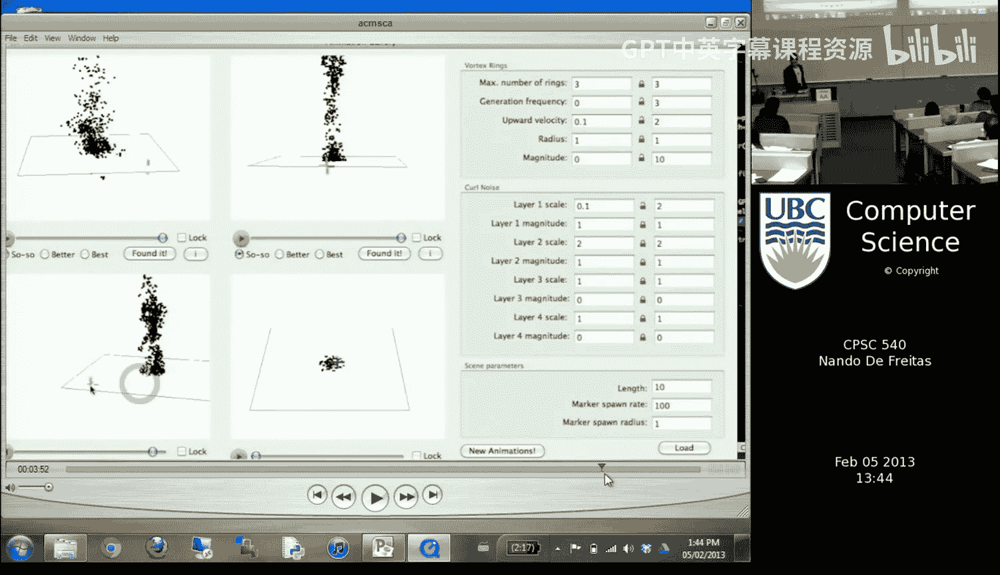
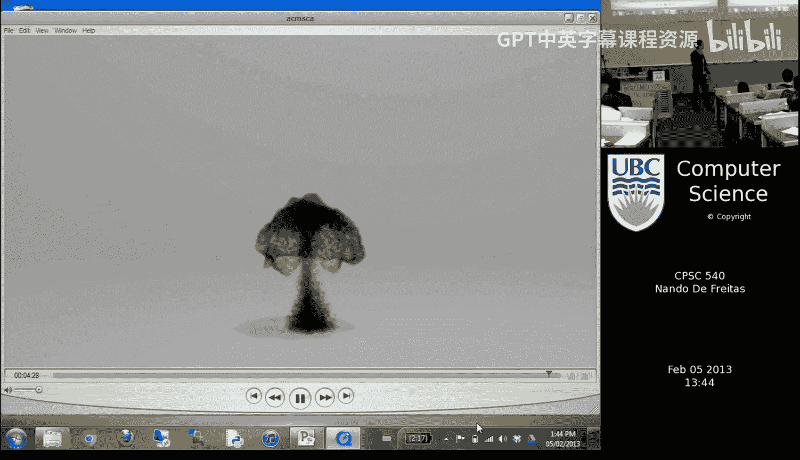
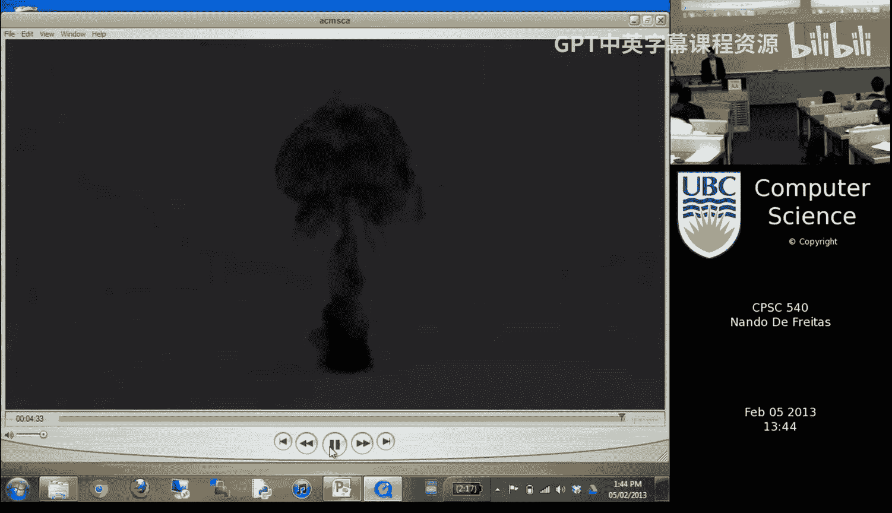

# UBC《机器学习（研究生）｜CPSC 540 Machine learning 2013》中英字幕 p09 -09-Machine learning - Gaussian processes.zh_en -BV19g2FBBEEq_p9-

Then doing predictions on a test set simply amounted to conditioning。

 So a very basic operation of Gaussians is all you need in order to do no nonlinear regression。

 And so that if you have just a few data points。Like indicated in this picture。

We have just a few data points in this case。Only five， but despite that there's very little data。

 we're able to come up with a fit of the data that seems to be very plausible。

 not only do we get a nonlinear fit of the data， but we also get good what appear to be good confidence intervals for that data set。

In particular， as I've said many times in our repeat。Where there is data you should be confident。

 when you don't have data， you shouldn't be confident。Where you don't have data。

 you should believe only your prior knowledge， where you have data， you should believe the data。嗯。

Gussian processes， the key to Gaussian processes is theyre captured。

Our belief that a lot of functions in the real world are smooth。

and indeed if you look at the space of natural images and sounds in the world。

 you will find that smoothness is a very reasonable assumption。

 so if the data that we acquire from the world satisfies this property。

 then we would expect that calcium processes will turn out to be a very powerful way of modeling the world。

And we started going over Gaussian processes when there is no noise。

So to recap our data set consisted of points。And evaluations of a function。Now。

 this function is in art。 it's important to get us the following thing。 The function。

 all I need to do is evaluate it。 I do not need a mathematical expression for that function。If。

That function could be， for example， his preference for different countries in the world。

And I could be asking him questions like， do you prefer Brazil to Canada？

Do you prefer the UK to France？ Do you prefer Korea to Japan？And by doing these questions。

 I will be able to learn a GP that will describe his preference。

 a GP in this case would be an object that's， I guess there are threeDs over the globe。

And you could map it just like a map toD。And that would give。

His preferences of countries in the world。So he is the cost function， he is F， I'm asking him。

 I'm giving him points， I am giving him countries。Or pairs of countries in this case。

 And then he's returning to me the valuation of those points。 I gave him two points。 he replies。

One or zero， one if he prefers the first one， zero if he prefers the second。So in this sense。

 the function just needs to be evaluated， so GPS are actually very good when you have intelligent user interfaces。

 when you want to have computers that can interact with humans， if you want to build robots。

 this turns out to be a very useful tool。There was a question。So in this。Like in this case。

 what this sense between two。Because A I in this country and he wise。Right。

 so I have not introduced very good observations， so the way he was giving me data was as binary labels。

I prefer it to be O BTC， I have not taught you how to do that yet。

What I have taught you to do is regression， so let me repeat the exercise with what I've given you。

On a scale from zero to one， how much do you like Canada？うん怖い。On a scale from zero to one。

 how much do you like Brazil？On a scale from zero to one， how much do you like Costa Rica？

Let to scale from zero to one， how much do you like Antarctica？He will get a unit function。

 I can go to hell on a scale of 0 to1。 How much do you like North Korea。清点。

And it probability subjective， I've already， weve establishedab that with experiments in this class。

So she's giving me different numbers。嗯。And his function would not be very interesting。

 His function would be just uniform。Nonetheless， it would capture the data。

 His case is really trivial to fit。 It's just a line。 which just need a bias。

 Her case is a bit more interesting。 Art 3 is 0。1， Canada。小关俾。Thank US。只要。Mexico5。 Burund디。Yeah。てて。

Right， the cost function has no now。嗯。The important thing is the setup here。When I choose a country。

 I'm just choosing a point in 2D。When she gives me a number in return。

 she's giving me her subjective evaluation for that point， she's giving me F。 I give her X I。

 she gives me FI where I is the index of a countries。And just by doing this， I would fit the GP。

And I would already learn which country she tends to prefer， whether she prefers Asia。

 whether she prefers， provided that I assume that if countries are nearby。

 the preferences are similar， that's the sort of hypothesis that I'm using here。呃。

The point being that F is a function that might be in the head of the user。

 F is not a function for which there is a mathematical object that describes it。

When I learn to fit a G， I am learning the mathematical model。That describes。

The world or the preferences in your head and so on。So in this case， initially， I said at XI。

 how many people you have run the code。Those who haven't do it soon because it really maximizes your learning experience to do so。

嗯。Certainly in the next homework you will get to play with it。

But it does help when I give his cold snippets， have a look at them。

 take the time because it definitely makes much more concrete what I'm going over here with sort of dry math。

Okay， so back to the dry math。If you know the joint distribution of agaussian。

 and we have the point F in the training set。Arbitrary test set points。Then， computing。

Computing predictions。It's just a question of。Diving the conditional distribution from the joint。

 an exercise that we went over in great detail in the last class。 So if you know how to go from。

 you use your axis to construct these matrices。Which are the matrices of similarities between the training set and the test set。

The self similarities in the training set， which is just K。

 and the self similarities in the test set， which is K double star。

And once you've constructed these matrices of similarities。F star is unknown。

 F is known from your training data， and then the process of prediction is just computing the posterior distribution of F star given F and the previous X。

For which there is an analytical expression telling us what the mean is and what the variance is。

And so for several points here。Several test points at star。

So I create a very fine grade of these X star points。And for each X star。

 I can compute the mean and the various， and so I can plot it。

 and it looks like that beautiful plot there where I'm showing you the mean in blue。

The true unknown function is in red。 So I'm showing you my model seems to capture the world pretty well。

And quite importantly， where the model。It doesn't have data， it's very uncertain。

 and those confidence intervals capture that。That错。Since I have a Gaussian distribution for F star。

 so this is a Gaussian distribution with mean mu star and covariant sigma star。

 since it's a Gaussian， I can draw samples from a Gaussian。Each sample is a vector， in this case。

 I think of 50 components。And each column that I'm plotting there on the right hand side is once such vectors。

So each color corresponds to a vector with 50 entries that I've drawn from that Gaussian distribution。

And these are essentially the predictions I drew 50， but I could have drawn 50，000。

 I could have drawn 50 trillion and the shapes which you wouldn't be able to perceive differences because。

There's enough for a solution there to fool the eye。没。

I could have an infinite number of points and still be able to do this because indeed。

 a Gaussian process is defined of functions。嗯。And what you see that essential a calcium process does is that where there is data。

You have all these functions in your prior， and what the data does is it just grabs all these functions and squeezes the uncertainty。

So you're not posterior samples。Look like samples from。The posteralist route。

 and it makes sense because if you look at these curves。

 though the curves that would fit inside the gray intervals on the left。O。

So we did this in detail in the last class， and we also looked at the effect of choosing the kernel width。

The kernel has parameters， so you can decide whether you want to be similar to things that are only very close by or whether you want to be similar to things that are a bit further away。

 that's but to do that you says she changes the variance of the Gaussian， this parameter L。

And here I'm showing you a few values。 if you use an L that is very small。So in other words。

 a very thin kernel。If you use a very thin k， then only points that are nearby are similar to each other。

 and so you would expect a more wly function， which is what we observe when we try。On the other hand。

So as you can see here， the mean is in red is a very weekly function， and as we increase L。

 the function becomes smoother。and eventually if I kept increasing it。

 it would become actually share a straight line。They become way too smooth。

So there's a natural trade off here， so we have to choose this kernel width。

And the simplest way that you already know is cross validation， so you could use quite recently。

All right， who's got Skype going in their computer？

Can I ask you to please turn off all online media in your computers？It is distracting， thank you。外博晒。

Yes， we control the smoothing by controlling this parameter of the kernel。

 one way to choose this parameter is by doing cross validation， so like you guys have done before。

Go ahead。不是。I think the because the true function seems to be the same everywhere。

 So I think that true function here no， I know the true function is blue and the prediction is in red。

Because it's now， as you can see， it's the red， the red is more wly here， as you can see it's。

It's going up and down， as whereas the red here tends to be a much more straight。Fction。

 much smoother。So actually， I hope I did sorry just to say I hope I got it right here， Oh no。

 I didn't。This seems to be the true function。And the other one is the prediction。If you run the code。

 you will see it for yourselves。 So this is the important thing。 I gave you the code that does this。

 so you can go to that code now and you can tune， you can play with that parameter in the code。

 and you can see what happens。And nothing's going to teach you better than for you to go and play with it。

And see， okay， if I increase L， what happens if I make L really large。

 What happens if I make L really small？Go into those experiments because you will get a lot from doing those experiments。

Go ahead in the smallest the one on the left there， that little peak on the red。

 what's dragging the prediction up like that because there's no data points up there， you know。

 what's dragging the prediction up。On the red here。red。Right there， yeah。嗯。I have no idea。

 It could be just simply because of the nature of the curvature of the function as it's coming from left and right。

They both have negative courageva， and thus might be what's forcing it。

One thing I could do with a GP to get rid of this is I could also force。

TheIf the data consisted of the slopes and the just the function evaluations。

 I could match on the slopes as well， and I would get it much smoother。There was another question。

Someone。Let me move on。Like I said， play with the code and then you can see the effect of this parameter and then doing cross validation。

 you can set this parameter， and I'm going to talk to you about a few other ways of how to tune this parameter today。

So I would seem looking at these pictures that also changing all changes your confidence quite dramatically so if you。

Because on the left you have very Yes， it will change your confidence because when you change L。

 you change K。And both the mean and the various are functions of k。So it's very important to。

When you change this。Depending on the objective of the analysis。

 if you're just looking for mean predictions， then you would do cross validation。

But if you need to model uncertainty， then the choice of L is actually quite tricky。

And especially in the next class on Thursday， I'm going to come to a case where it is particular tricky。

But for now， imagine that you have。Lots of data， your purpose is just a fit to function。

 and that you can do cross validation。Because it's the one technique I've torture so far and in that setting。

 you now have a very powerful way of doing function approximation。

Before we get to the more detail on how to learn that parameter of the kernel。

Let's first deal with a few other things that are equally important。

The first thing is how to deal with noise so far I assumed that the function F didn't have noise。

 but of course sometimes when I ask a question like when ask her for a rating on a country like Burundi that she might not be entirely certain as to how much she would like it because she doesn't know what Burundi looks like。

 and then there is uncertainty。嗯。And if there is uncertainty。

 you want your model to deal with that uncertainty， so there would be uncertainty in her reply。

And so we need to then acknowledge our uncertainty in one way to do it。

If I assume that the data is just ratings and that their noise is Gaussian。

Then I we just add a Gaussian variable。To my function evaluation。

And get a noisy function of evaluation， which I call why。So why is the noisy function measurement？

In an initial experiment where he was giving me zeros and once。

 I would have had to use a Bernoulli model to model that kind of noise。Okay。So if we have。嗯。

Galussian noise。In order to compute a distribution of Y given x， I need to integrate over F。

 I need to marginalize F。Okay， so if we have。If I want P of A and I have P of A and B。

 I have to sum of a B in order to get P of A。 That's a basic operation of probability When you have a variable you want to get rid of it。

 you need to integrate over it。We know each of these quantities， like for example。

 P of F is just the prior。Which I said， let's assume that it's zero mean。

 assuming we have standardized the data， and let K be our similarity kernel as before。

But now we're saying that each data point that I observe will be independent and will have Gaussian noise。

Since each point is independent。If I have end points。

 I just need to multiply N1 d Gaussian distributions for each point Yi that I observe。

And if we use the convolution theorem。That is the integral of the product of the Gaussian So we're introducing that in last class。

Then you'll see that the distribution for y the noisy function still has the same mean。

But its covariance increases。And increase in covariance。

The covariance for y now includes the covariance of F plus the covariance of sigma squared。

If you do not want to use that theorem， I want to think of it that different way。

 just think of the linear properties of expectation and the linear。Coference， indeed。

 is just an expectation。If you have independent random variables， using N。

The linearity of expectation。If you want to know the variance of adding two random variables。

 you just add individual variances。It's a property that follows from。Lniarity。

The conclusion be that why will' have now covariance。K why？So in mapping F。

The noise free function to a noiseless function， y。All I'm doing is I'm modifying the kernel。

So that the kernel now has an extra diagonal entry。Which corresponds to the noise in the date。

The noise observed when I asked a question。Once again。We know how to model。

Now that I know what the covariance of y is， it still has mean 0。

 except that the only new thing is I replaced。K by this KY。

 where Ky has this extra sigma for added to the diagonal。And the rest is， as before。If you have。

An expression。嗯。If we have an expression for the joint distribution of a Gauss。

 we just use our theorem。To get an expression for the conditional。

 which includes the mean and the variance。So。Having Gausainos。

Only involves a minor modification of the algorithm。

 which is the addition of a diagonal term sigma squared。Everything else is the same。

There's just a very minor modification to account for uncertainty。When you plot this。You， however。

 observe that even when you have data， even in the regions， where there is data like here。

There is still uncertainty。Before， because we assume no noise。

 that uncertainty collapsed at the data now the uncertainty doesn't collapse at the data because there's always this error we will make。

 we're assuming we'll always make an error of sigma squared at least。

Because that's the uncertainty in the data。However， we still have the same properties as before。

 where we have data， we have less uncertainty， where we don't have data， we have greater uncertainty。

Now， that's essentially all there is to GPS。 I think this slide summarizes the whole thing。

If you want to fit。A GP to data， you just construct a matrix K。Using the similarity kernel。

If you have noise in the data， you just need to add。Sigma。

 the variance of the noise to your diagonal of K， that gives you now your KY matrix。

And if you've rescaleed the data， so there is zero mean。

Then the only thing that's left for you to do。Is called these two questions from this star and Sig star。

 And that gives you the predictions on any point， x star。

So the mean prediction as well as the company centical， and we're done。

 we have a beautiful way of fitting data。So the code is really simple。嗯。How how could we measure the。

Vance of her。Sigma Y how can we measure it？You have to estimate it from data。How do you estimate？

Exactly。Exactly how you did it in homework Gu， maximum likelihood。

 or which prior would you put on Sigma？Exactly。And the inverse withhir is one thing I didn't say is the inverse wishhirt in 1 D has a name。

 it's called the inverse gamma distribution。Okay， so in 1 D， the inverse was distribution。

If you plot it。It looks like this。Carmy，There is a parameter， door parameters like a sixig miles。

Starting。你觉得。Do that。どかで。Yes， you still need to choose the parameters of the prior。That is correct。

And actually that points to a very subtle question， I'm choosing， I don't know what my sigma is。

So instead， I'm going to say that my sigma comes from this distribution。

And what I'm going to do is I'm going to try to you know figure out。

 I'm going to assume that this is my prior for Sigma， and then given the data。

 I will readjust this distribution and I will get something different， a posterior for SIG。

Pal sig were given the date。The prior has parameters。However。

 those parameters are useful because for me， as a designer， I want to。

Be able to tune those parameters to say， what are my preferences。

I'm choosing the shape of the prior to capture my preferences。However， in some cases。

 I might not have information that allows me to choose the best shape of the prior。In such cases。

 you can then put another level of inference and actually estimate those parameters。

So you try to infer those prior parameters directly from the date。

That is called maximum likelihood type 2， or some people call it definite maxization as well。

In this course， I've chosen not to go into that， but that's routinely done in practice。

That to empirical base that's exactly empirical base。

And some people questioned its validity because you learning the parameters of you learn the prior from data。

 so that seems somewhat wrong。It's not in practice quite often。There are smarter ways to do it。

 The other argument is that what you can do if you're a basin。

 you can do something called hierarchical base。 So what you're do in hierarchical Bay is。

You have uncertainty over a quantity。So what you do is you put a prior on that quantity。So。

I might not know what my sigma is。And so what I say is that I believe it's in this range。

With high probability。That's。Less。Commitment then to say， sigma is 2。Or Sigma 1。

 all you're saying is it's in a range。However， if you do not want to commit to what they were。

 So the next question is， what's that range？It's clear that committing to a range。

It's not as big a commitment as committing to a specific value。

And if I do not want to commit to all of this。Range， what I can do is I can。Being like this。

I can put a hyper prioror on this。So。I believe this guy is on this interval。

And I believe the boundaries of the interval are between these values and these values。

 So you're making your knowledge very diffuse。 And what most often people find in practice is if you follow this hierarchical basic modeling strategy。

嗯。The algorithms tend to be fairly insensitive toward with respect to the specification of these parameters。

 but they tend to be very sensitive with respect to the specification of this parameter。

So the idea is you're trying to create an algorithm that when you're tune the parameters。

You what you don't want is an algorithm where you just a slight change of the parameter gives you completely different results。

If you can come up with basic hierarchy。Where you get such that when you tune the parameters。

They don't， you know， if you choose 01 or 10， the results don't change much。

 then you have a fairly robust right。However， when doing this。

 it's always important to test the hypothesis。It's always important to verify that you indeed have a robust prior。

 so often I see papers that build a hierarchy， but forget to do the experiment。

To confirm that their price indeed in sensitive。 And so it's important to sensitive with analysis。

For now， we will assume that we specify the price， that we have good knowledge in specifying the pride。

For your project， of course， you will likely do things like empirical base and makes them life to dive you because that's what people do in practice。

In fact。I'm putting a prior of a functions。 And I'm saying that I don't know what L is。 you know。

 the width of the similarity kernel。 So as such， that width of the similarity kernel is kind of taking me one level。

In the hierarchy。What I'm going to do next is I'm going to describe an algorithm for choosing that width。

In a sense， I'm doing maximumim likelihood tattoos， so I'm doing empirical base。Before I get there。

 though。Actually， that comes。let me jump over a few slides， since we're discussing this。

 I will go straight to that。I'll come back to the other stuff that I wanted to do。

 but just to continue answering your question。 Suppose I want to learn the kernel parameters。

 So one way to do it is cross validation。And then to learn small sigma Y I would just do I could do cross validation。

 or I could do maximum likelihood， or I could do Bayesian learning。

So you start realizing that there's more than one way to do this。

What I could also do in order to learn the kernel parameters is the following。

 I could try to write the likelihood。Now， the likelihood is just the probability of Y given x。

And this quantity here is actually called the marginal likelihood。In this model。

 I have a latent variable， which is F or a hidden variable called F。

 And so I need to get rid of its effect in the choice of the likelihood。

 so in order to get the probability of y given x， I need to and。I should emphasize an L squared。

What elsewhere is my parameter。I need to integrate out F。Now to integrate out F， once again。

 I use the rules of probability。That case for me a Gaussian the zero mean and covariance KY。

 I can then compute a log likelihood of the log marginal likelihood， which is this expression。

And then K has parameters。In this case， my parameter。Was just L。And if K has parameters。

 then when I compute derivative of the log likelihood。

 I just need to compute derivative with respect to each of the parameters of k。So in other words。

 I can do maximum likelihood to learn L。Which is effectively what I'm doing here。Now。

P of F is a prior。And now I'm learning the parameters of the prior， which is the width of the prior。

 So that sense I'm from data。 And that sense I'm doing this。

I'm following this procedure that people refer to as empirical base。And the empirical。

 because we're using experiment to learn the p。Now。I have not taught you yet how to do optimization。

 those of you who know how to do optimization will see this as trivial now because all you have an expression for the gradient。

 if you follow the gradient， you will be able to get a good estimate of theta。

If you haven't seen optimization。Then wait a few lectures and we will cover optimization。

 And once you learn optimization， you'll be able to learn， be able to actually。Implement this。

And be able to learn the optimal theta by maximum likelihood。Okay， but let's go back。Again。

2 thousand some processes。And what I want to do next is I wanted to derive calciums processes from a different perspective。

And hopefully by deriving it from a different perspective。

 it will connect Gauss processes to what you learned。When you did the linear models。

And it will connect it with homework I。And hopefully we'll give you more insight into why these methods work so well。

Okay， so let's assume we have a single test point， x star。 So we have a single test input x star。So。

 then the。The prediction of F。Which in this case is one by one。It's just given by。

There's Gaussian here。Which has mean K star， Ky inverse times y。

 and it has the covariance that appears in the second argument of the calciumel。

In this case because we only have a point， K star star is just a scalar， and in fact。

 if we use the similarity kernel that I've been using， which is the exponential， it's just one。

RightBecause e to x star minus x star is just e to the0 and e to the0 is one。

This will be a vector of size1 by n。And then the matrix go y is the matrix of size n by n as before。

But now。These quantities here， K Y and Y are from the training date。

 Okay the Y was the vector of answers that she gave me， and K Y was the matrix that I built。

Using the access that I've used to question her。And so all this comes from the training。

I can now take this expression for the mean。 just the expression for the mean。

And instead of writing it in vector matrix vector notation。Rell this is one by n。This is n by n。

 is n n then y is n by 1。And so。And of course， the whole thing is one by one because it's just a mean for a single point。

I can then read by calling this。 So this K。Inverse y is what I'm going to call alpha。

 and that's a vector that's n by one。Right using sort basic properties of matrix multiplication。嗯。

If then what I'm left with is the multiplication。Of case， start transpose。Times， alpha。Okay。

 a vector times a vector， just a dot pro。Now， vector times a vector， I can rewrite it。

And component wise this way。Okay， so each alpha now appears as multiplying a kernel。

What does this remind you of that we've seen in this course？Nothing。An RBF。

 This is just the equation of an RBF。And RBF was a linear combination of basis functions。

 This is a linear combination of basis functions because each K is a basis function。

Each of these guys。Can be written the sum of eye。E to the minus1 of a lambda。X， I minus x star。

Squaret。So that's precisely an RBF。And in an RBF。Where there is data。We place a basis function。

We scale the basis function with alpha。And so when I fit a function。

I will get a function that will look like this。J。That function being。This path。

It's a sum of basises functions。Each basis's function， scaled by alpha。

So eachL is just the real number that scales the basis function。 And so a Gaussian process。

 if you look at the mean。What you're doing is you're just fitting an RBF。

 you're just fitting a nu nonlinear function， using a combination of basis functions where you've placed each basis function at the data。

So one basis function per data point。And then you just add them。

So it's a completely alternative way to arrive at the same result that we had before。

 but now at least we know that putting the basis function where the data is is the principled thing to do。

Let's look at something even simpler where a Gaussian process arose， rich regression。

So recall that enrich regression。It's a linear model， so y equals theta。

 just a equation of a line or a plane。And we put a regularizer on theaterta because we prefer smaller theaters。

 as you saw in your homework by using this regularisizer， you get better answers。

The solution by differentiating that objective function and equating to zero was given by these equations。

And here I remind you that x is a matrix as n by D， n is the number of data。

 D is the number of features。Why is the outputs， which just in this case， there's n outputs n by one。

So the matrix x。I can write it as x1。X2 all the way up to Xn。Where each row X I。Is a vector。

Of one by the entries。 so each x is one of the rows in this matrix， the matrix is n by D。

 each of the rows with d entries is one of these factors that I'm calling small x。In your homework。

 you had to prove the following thing。 You had to prove that the parameter theta could be alternatively be written as x transpose out where alpha is the becomes the unknown。

 So this is a reparization of the solution。嗯。In doing so。

 you had to prove that alpha was equal to this quantity。

That's fairly easy to do because if we go back to the rich solution， we have x transpose x。て一 있죠。

Plus， Delta squared。Beta is equal to x transpose y。

From which delta squared feet is equal to x transpose。Y minus x theta。And hence， the result follows。

 Theta is equal to。X transpose delta minus2 plus Dlta is kalar。Times y minus x theta。In other words。

 x transpos elf。So that was the first thing you had to do， rewrite alpha this way。Moreover。

 once you write off it this way。That is， once we know that alpha is given by this expression。

We went further， and we said that alpha could indeed be written。In this form。And to do that。

 we again would just go back to this expression。And we know that deelta squared alpha is equal to y minus x theta。

But， we know。That theater as。Before it's just x transpo alpha， big x。Transpo alpha。And。did that。

And so now I applied the same trick that I did， but sort of in the inverse direction。

 and I can just say that xx transpase alpha。Plus Delta squared。

 And I can just put an identity here of size n because it doesn't change。

Multiplying a vector times identities just gives you the same vector。Is equal2。Why。In other words。

 alpha equal to x x transpose plus delta squared。I and。-11。

So what we have is two different ways of writing the solution for rate regression。In the first way。

 we use a parameter theta。That is D by one。In the second way。

 we use a parameter alpha that is n by one， or sorry， I was using small land here。Small land。 by one。

Now， which one you use？Largely depends on how big is your N， how big is your D。

If you have an example like bioinformatics， it might be that your N is 20， you have 20 patients。

 but for each patient you have 20，000 features， which could be how much is genus manifest。

So in that case， it would make much more sense to parameter tries in terms of alpha because this matrix that you have to invert。

Would be n by n， which is 20 by 20， is easy to invert。If you， however， were to use this matrix here。

And consequently， use theta， you would have to invert a matrix that is 20，000 by 20，000。Okay。

 so depending on which one is bigger D or alpha， you would use。One of the different solutions。

So this is an incredibly useful trick。Computationally。

When you come across tricks that allow you to knock your competition from。Especially in this case。

 the inverses are N cubed to compute。And so if you have to go from 20。

000 cube operations to 20 cube operations， that's a huge gain。

That you couldn't just go and buy computers to get that game。

Because the computers don't grow in power， cubly。So it's really useful to know these traits in addition。

Thisstrict allows us to get， bring retro regression close to gaussian processes。Let's see why。

So here I should add that the prediction y star for a new input x star。

Would be just x star times theta， the usual prediction。Or using the expression that we have。

For theta， we could write this as x star times x transpose alpha。

So there's two ways to make the predictions， either you use C or you use alpha。

 depending on which is easier to compute。Now。If the prediction。For a new point。Is X times theta。

Or equivalently。X star times x transpo alpha。Or equivalently， x star times x transpose。

Times and nowm using I'm going to use the estimator of alpha， which is there's a question here。Okay。

And moreover， if we recall the definitions of these matrices， x。So， x is equal to。X1， x2。

 all the way up to x。And。So does X， X transpose。Is equal to x1。All the way to X N。Times。

X1 transpose all the way up to X n。Transpose， which is equal to a matrix。

 So it's an outproduct of vectors。Where each entry now is x1 times x1 transpose。And so on。Now。

 recall that each of these factors。Each of the xs is the entries。

 so this vector here is 1 by d x1 is 1 by d and so is x2 and x1 so each so x is a matrix。

And what I'm using as small axis are the rows of the matrix， so they're vectors， they're row vectors。

Of the entries。So what I have here。Is a row vector。Of the entries times a row vector of D entries。

Is the dot product。So each entry in this matrix。Which I'm calling x times x transpose。

Which is of size。So this was N by D。This is D by n， so this matrix is of size n by n。

That matrix is as big as the number of。Data points that you have in your training set。

 and each entry of these matrices is the dot product。Between X， I and X J。Now。

The doc product before in the last class， I argued could be interpreted as a measure of similarity if two vectors are very similar。

Their dog product is high。If the vectors are very dissimilar， the dot product is low。

 so do products are a measure of similar art。In other words。This is a kernel matrix。

Instead of using the exponential kernel， I'm now using a linear kernel or the dot product kernel。

Using that。I can just rewrite this whole thing。This way。

We had added a Delta square So as cold as cake。In other words。

 the dual form of retro regressiongression is a GP。

R regression in the dual form is a GP where you have。At least the mean is the mean。

Of the GP is what we've proved。 We haven't talked about the variance。

I'm not going to go into that part， but it's the derivationism。So we've proved that the mean。

Of the GP， in fact。The same thing is what you get when you do rate regression and it's 04。

And where the similarity kernel in this case is just a dot product。

 We use dot products to measure similarity。And it makes sense because a dot product is the magnitude of the first vector times the magnitude of the second vector times the cosine between that。

If two vectors are similar， their cosine just as a small， if they're very dissimil。

 then you get a big difference co in the cosine。And。Yeah， so rich regressions it should be。

 there's another way to look at it。So there's many ways to arrive at Gaussian processes。

 I like the probabilistic way of getting to Gaussian processes because I think it's very simple provided that you know what a Gaussian distribution is。

 it's really trivial to just apply one theorem of Gaussian to get the predictions。

And the case I could understand it， but also。Knowing how one can arrive at the Gaussing process through function arguments is useful。

Another way to arrive at Gaussian process that some folks use out there is if you take we haven't done this yet。

 but for those of you who haveve seen neural networks before。

 if you take a one hidden layer neural network and you let the number of neurons go to infinity。

 you can show that that leads to a Gaussian process as well。

You need infinite neurons or just one neuro per data point。Infinite number of neurons。

I can point you to a reference for the construction， so David Mckaay。

 professor in Cambridge has a nice tutorial where he showed this。

 where he shows this was sort of non rigorously， but he has a very nice intuitiveative way of explaining it。

There wasnな question。The Dlta square。Service。A our way down of what's sending to each other。

In this case， the deelta square term is just doing regularization。

So the deelta square term we introduced is the deelta square term that we used in rich regression that was for penalizing parameters being too large。

So it's just smoothing。嗯。Your function。ケを使。Parddon。

Does it do the same thing as Sigma squared y delta squared。Not quite， Sigma square is a parameter。

So the two are related because。This thing here is what I'm calling KY。😔，Right。

 KY inverse is just this whole thing inverse， and this is what I'm calling。K star。

 And to be a bit more clear， K star transpose in this case would be a factor。

And it would have the dot product of。X x star。Where X star is a scalar。This is sorry， it's one by D。

1 by D， and this is D by1， the prediction is a scalar。So I would have x star times。X1。

And here x star is a row Vx x1 transpos the column vector。

And then this would be x star times x to transpose would be the next component all the way up to x star times x。

And transpose。And of course， this is of size。1 by n。Okay。

 because each entry is the multiplication of two vectors， which is self escape so。Choosing Delta。

Will affect what my K Y is， and hence will affect what my。Mean prediction is。

 it will also affect what my variance prediction is。So it does control smoothness。

 Now I have two parameters to control smoothness， the kernel width。And also Delta。And in addition。

 I also have the variance of the noise sigma， Y to play with。

Just that it seems that Delta squared is playing the same role as assuming that your input data is noisy。

Oh， wait， I see what you're saying， yes， that is true。😊，嗯。That's very true when I introduced。

When I introduce here the sigma， indeed。Indeed， I will now understand your question， Yes。

 when we model the noisy data， our trick to model noisy data was to introduce a sigma squared and then the way it gets mirrored it gets mirrored to just。

It gets mirrored to just adding a diagonal terms to that diagonal when I'm doing the mapping from rich regression。

I end up with this deelta square， which is indeed just like。Equivalent the same as Sigma Y。

Except here it has a slightly different interpretation， it was a trade off。

But in terms of their functionality， they're the same parameter in the code， it be the same quantity。

So， yes， so you would have to tune Delta squared and you would have to tune the。

You have to tune the width of the kernel or any other parameters that the kernel may have。

And how youre tuned that， if you have only two parametersa， cross validation does a trick。Provided。

 again， cross validationally works when you have enough data。We have lots of data。

You could do maximum likelihood， but maximum likelihood also is only efficientff when you have lots of data。

嗯。So positive of data causes problem， there's bay ways to deal with this。

 but they require techniques that we haven't discussed yet in the course。Other the later。

Since delta square is similar sigma Y。Does that mean having noise in your data serves as a regularizer。

Yes。Precise。And that we will use as that's basically the principle of technique that we will look later called dropout nets。

So rich regression is also called Tonov regularization and crisp P has a nice paper actually calledTkinov regularization is equivalent to adding noise to your data。

And people will exploit this to construct algorithms。In some crazy ways， delta squared。

 if we found that value by cross validation， is it an estimator for sigma。

 like for the variance of your measurements。Like， for example， in prostate data we did， right。

 we found Delta。Would that value of delta be a good estimate for the variance far of the measurements we made in the prostate in this case in the cheap be yes。

With this interpretation in the dual space。Okay。So the only thing left is how we implement this。

And if you look at well， implementation is really trivial。

 that's a short snippet of code that that's available on the course website。

 so I recommend you go to the course website and download it。呃。These slides are also there。

I will upload。Tm with the changes I've made today。嗯。But there in the code。

 the only other subtle thing you needed to know in order to understand it is when we compute the mean。

Instead of just inverting k， we instead do a col composition of k and then solve a couple of linear systems。

 and that's equivalent to inverting K， it's just a bit more stable。

And there's many other ways to do this。嗯。This one is good because there are lots of very good algorithms for inverting linear systems。

 conjugate gradients is one that you could use in this。Case， inverting a linear system is NQ。

 if you use conjugate gradients， you usually can get very good answers in just a few durationerations。

And the cost is just a few durationerations times n squared。

 so you reduce your cost by a factor of n。And reducing a cost by a factor of n。

Is what determines whether an algorithm gets deployed in the web setting or not。

Lots of algorithms when you work in a live search engine。

And this has happened to me many times working with large data sets that if the algorithm is n cubed and there's no obvious way to reduce it to n squared。

 we abandon the idea， even if we think the idea is a good one。

Just because we do not have the computing power。And buying machines and clouds will not solve that problem。

So in this case by going to a linear system with conric gradients。

 it's possible to knock it down to a few iterations times n squared。

 and then it's possible to do a few more tricks to make it even faster。

But that's pretty much what a Gaussian process is。So essentially that snippet of code summarizes how to do gasuss in processing and regression。

What I haven't told you yet is how to deal with classification。

 how to deal with the fact that sometimes the labels are binary。Or preferences， for example。

 when I said you prefer this to this country， and so if you're comparing items。

 then the data is discrete。And there we're going to have to do a bit more work than in the regression。

 so it gets a more the math a bit more involved， but to get there I will first go and teach you what classification is and teach you some more basic techniques for classification and then if time permits at the end of the course I will discuss classification with counsel processes。

However， the textbook of Kevin Murphy does go immediately into classification after this poem。

And so if you're interested in quickly knowing how to do qualification custom process。

 I refer you to the book and if you have questions。Office hours。Now。In the next lecture。

We're going to use calcium processes。Mainly because they're very good estimators of the variance in order to do active learning。

In other words， we'll have learning machines that ask questions。

Those are the most common learning machines deployed。At present。If you think about it。

 every time you get an ad in Facebook， that's a question that's being asked for you。Do you like that？

And you decide whether you like it or not by clicking on it。Or not clicking it。

When you do a Google search for an image。A bunch of images appear。

And whether you click on these images on which order you click on the images。

 you're sending to Google your vote。As to which order you think these images should be in。

And even if Google started with a very bad image search。

 if you typed CAT and the first two images were not CAs， but the third image was CA。

 you would likely click on that image。And by doing that。

 you would have been sending Google information on。What an image of a cat is。

 So even if Google was not able to do object recognition， Google would have learned。

How to build the image are changing just by relying on your votes。

Speech recognition is another example。Where。You're continuously providing data to people who build recognition systems。

So active learning is a big part of machine learning on the web。

 And it's a huge part of the whole advertising。engineine。Out there。One of the reason sadly。

 why machine learning is so popular is。Advertise。All right。In the next lecture。嗯。

I'm going to go over how you can use basin optimization。To build systems that ask questions。

And for the remainder of this lecture， what I'll do is I'll play a video giving you an example of one of such applications built using Gaussian processes。

IIn the Google group， I shared with you。嗯。A couple of links。

 one link is a tutorial on Ba optimization， which if you want to prepare yourself for the next class。

 I strongly recommend you go and read it because it already contains the you've already done goals and processes so you'll find that paper quite easy to read。

There's also recently so this blog entry on how Google by Sts cart on。Google and multiar bandits。

 and I'm going to cover that in the next class because it's very similar to the problem that we're dealing with here with gaus and processes。

So I recommend those links if you get a chance。To look at them。Okay， so I'd like to end the class。

With showing a project of how you could build an interactive interface to assist animators by using Gaussian process。

In a nutshell。We humans are very good at looking at an animated movie and being able to tell whether that dinosaur has a nice walk。

Whether that dinosaur actually walks like Brad pitchitch。We very easily can tell that， you know。

 if you know how what Brad Pitt works， you can play a movie of Brad Pitt。

 you can see the dinosaur walking and then you can say no。

 that walk is not like the work of Brad Pit or yes， most of humans are very good at doing that。

Certainly， you're very good at going to an animated movie and saying， yes。

 the animation was good or not good。What's incredibly hard and those of you who do animation here will agree is to come up with the mathematical models that make the dinosaur work like Bradbit。

 that's incredibly hard。You have to come up with a mathematical。

 but never mind that works like Brad bit。Come up with a mathematical model that governs how a human walk。

It's incredibly complex。So there are these problems for which engineering the cost function is extremely hard。

But for which。It's possible to get good evaluations。So I could show a movie of a dinosaur。

And in order to produce a movie of a dinosaur， I need to tune my parameters of my simulator。

I show him the movie。And I ask him on a scale of zero to one， how good a walk is this。

 and he gives me a rating。And then essentially， I've given him a point。He's given me an F。

 an evaluation for that point。So I'm learning what。Basically。

 the function in his head as to what a good walk is。And I keep trying different walks。

 now let's look at this walk。And I ask him how much do you rate that walk， he gives me a rating。

 and I keep doing this， and eventually what I will learn is a function as to what that describes what he thinks is a good walk。

And in other words， I would have tuned my engine。So that you're actually dealing with the user。

 of course， different users will like different walks， so this would be personalized。

Here is an exercise。On building such a system， the computer graphics field is filled with applications that require the setting of tricky parameters。

In many cases， the models are complex and the parameters unintuitive for non experts。

 We present a machine learning method for setting parameters for a procedural fluid animation system。

It uses a gallery of animations and collects Actually。

 let me start this again because this video is actually crushed。

The audio is coming， but not the。Let's try one more time。

The computer graphics field is filled with applications that require the setting of tricky parameters。

In many cases， the models are complex and the parameters unintuitive for non experts。

 We present a machine learning method for setting parameters for a procedural fluid animation system。

It uses a gallery of animations and collects user feedback to find。Sorry。

 I was just making sure that it wouldters things are lights。

We apply our method to generating smoke animation， which drives a set of passive marker particles through a procedurally generated velocity field。

 This velocity field is generated by taking the curl of a vector valued potential function。

 There are two main components to this potential field。

 The contribution due to a set of vortex rings and a spatially varying noise function。 In total。

 the model requires the tuning of between 6 and 12 real valued parameters。

Generating high quality renderings is expensive。 Fortunately。

 we can quickly generate low resolution animations in seconds。

 This allows the user to find the desired settings and then generate a high quality animation clip。

Different parameter settings can be used to produce a variety of distinctive animations。 However。

 finding the right values to generate a specific animation is difficult， especially for non experts。

Our solution is to use techniques from machine learning to present the user with an animation gallery。

 At each iteration of the gallery， the user has shown four animations。

 which they write by indicating preference for animations that look more like their target。

By using preferences， we reduce the cognitive effort required to evaluate the animations。

 though users can also directly assign numerical ratings to the animations if desired。

When the user completes the task of entering preference feedback。

 the model of the user's interest is updated and four new sets of parameters are automatically selected。

In selecting the examples， the system automatically evaluates the trade off between two competing goals。

 trying to offer improvement on the animations the user is known to like and exploring regions of the parameter space for which the user preference is unknown。

It is not our intention to supplant user expertise， but to use it more efficiently。 In reality。

 users are unlikely to come to the system with absolutely no idea of what parameter values they are looking for。

Even novices， after looking at a few samples can quickly realize that certain parameter values are unsuitable。

Furthermore， even when using feedback efficiently， exploring the entirety of a high dimensional space to a reasonable sample density is a tedious activity。

Our interface allows users to restrict the ranges of any or all of the parameters or fix them at a specific value。

These techniques work well for a few parameters， but as the number of frequency。Same space。Right。

 so I'm going to move on toward the end Ha or as。

The more is used， the more accurate the priors become。

It is even possible to adapt to different users or groups by using different priors。

 creating tools that are automatically personalized to different requirements。

Important， like in this case， what you have is a way of generating smoke。

 There's very tricky parameters。 And so what the system does is system picks some parameters。

 that's the X。The system then gives that X to the animator by presenting it in a nice UI。

 and then the animator gives a rating。And a major in this case being the user。

 the rating is the function evaluation， the F。And so you collect data like this and you fit a GP。

And then in the。The lady discusses this trade off between trying to show things that are very close to the ones that he liked best。

And also exploring different areas of the state space。In order to exploit， we use the mean。

 where the mean is high， we know that that's where good values are。

 where there is uncertainty where the variance is large。

 that's where we should choose points in order to explore so by having Gaussian processes we'll be able to have a very nice mechanism。

For trading of exploitation and exploration， which is one of the fundamental problems in AI。

sort of very key to doing progress。 I think one of the central problems。

 if you want to make progress in AI， is to nail this down。In a simple case。

 it's possible to tune to automatically tune the system to do a certain kind of animation。

 Now this is far more general than just animation。Whenever you have a system。That has parameters。

And those parameterss that have no mathematical model allows you to tune them easily。

And computer science is full of it。Ad centers have parameters。That people tune by hand。Optimize you。

 compilers。It's another big area where people spend a lot of effort tuning parameters。

If we have a way of trying some parameters。And build a function like a GP function that tells us what are good parameters。

We will be able to optimize compilers at centers， information， extraction architectures and language。

 computer vision algorithms， interfaces， and I could go on。

At UBC we have a lot of people who work on this actually。

 and I'm discussing this now already for research projects。

 Hall Gs and Kevin Nathan Brown have been pushing this idea not using Gosson processces but using random forest。

 which we will discuss next week。Wwhichch are very similar that would allow you to do similar things and if in exploring this idea to in the tune algorithms automatically and have had incredible success。

 in fact Holer has gone beyond this and says it was not just a question of tuning parameters。

 but in fact when you wrote write code and you introduce all these choices。

You should make those choices explicit and have an algorithm that will make those choices intelligently for you。

So this is very critical toward increased automation in society if we have want to have systems that will tune interfaces for us automatically。

 systems， code， etc， this is sort of one of the important building blocks。Toward it。

The challenge will be able， I think in the video， it was mentioned there were just a few parameters。

 One of the there's many challenges， one of them being。Doing this well for very high dimensions。

There's been a lot of progress in that recently so this right now is still an area of research。

 it's very new， it's very hard， there'll be lots of course projects about basing our optimization I imagine。

 certainly if you come to office hours I'm happy to discuss some of these with you。

And hopefully we've covered the techniques early enough that we can get started with the projects if you already want to explore this further。

All right， so on Tuesday， on Thursday， this is what I'm going to do。 I'm going to go over。

How to use。