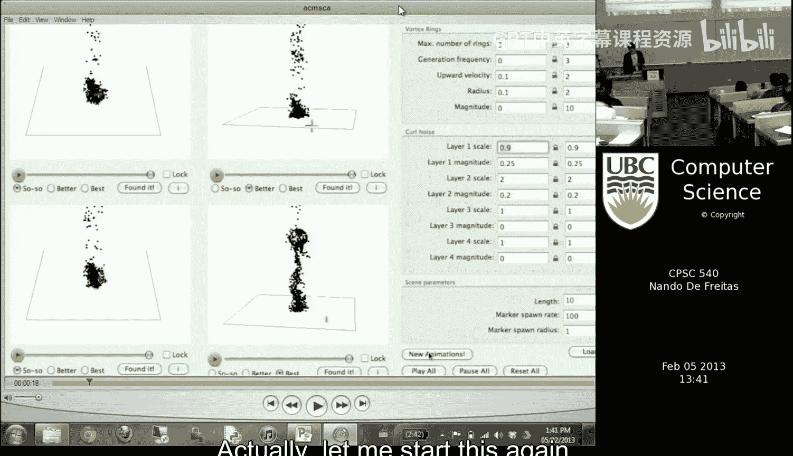
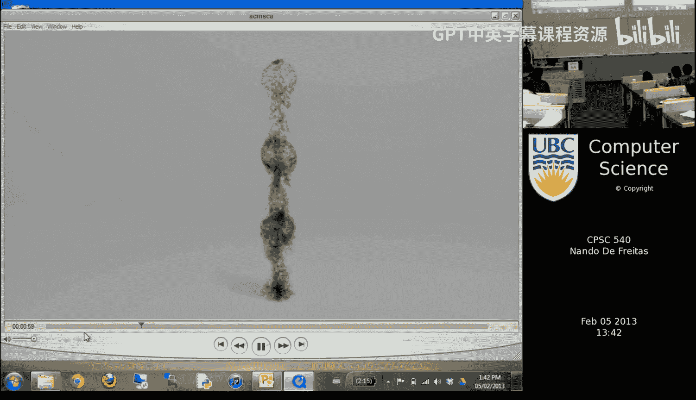
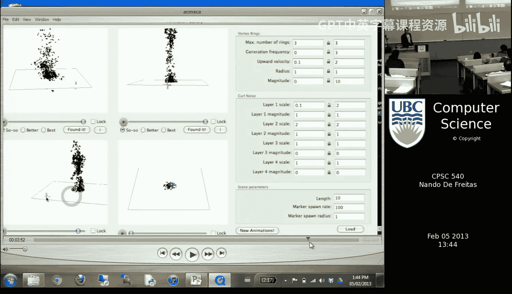
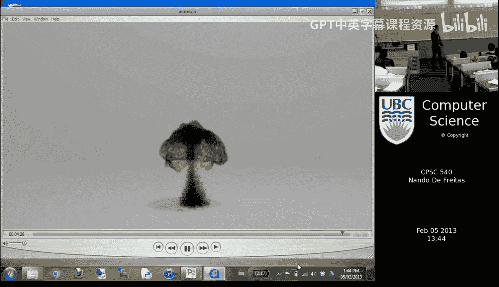
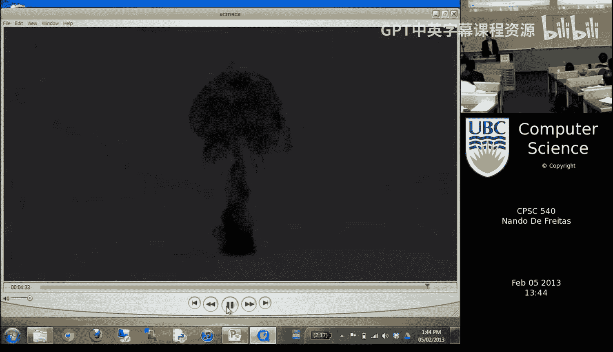

# 机器学习：09：高斯过程

在本节课中，我们将学习高斯过程（Gaussian Processes, GP），这是一种强大的非线性回归工具。高斯过程允许我们仅通过少量数据点，就能拟合出看似合理的非线性函数，并同时提供良好的置信区间。其核心思想是，现实世界中的许多函数都是平滑的，而高斯过程恰好能捕捉这种平滑性。

## 高斯过程的核心思想

上一节我们介绍了高斯过程的基本概念。本节中，我们来看看其核心操作。

高斯过程的关键在于它捕捉了我们对“现实世界中许多函数是平滑的”这一信念。如果你观察自然界的图像和声音，会发现平滑性是一个非常合理的假设。因此，如果从世界获取的数据满足这一特性，那么高斯过程将成为一种非常强大的建模工具。

我们开始回顾无噪声情况下的高斯过程。我们的数据集由点 `x` 和函数 `f(x)` 的评估值组成。这里，函数 `f` 是任意的，重要的是我们只需要评估它，而不需要其数学表达式。

**核心公式**：高斯过程假设函数值 `f` 服从一个多元高斯分布，其协方差由核函数 `k(x, x')` 定义。一个常用的核函数是平方指数核：
```
k(x, x') = exp(-||x - x'||² / (2l²))
```
其中 `l` 是控制平滑度的长度尺度参数。

## 预测与不确定性

对测试集进行预测，本质上就是计算条件分布。因此，你只需要高斯分布的基本操作就能进行非线性回归。

即使只有几个数据点（如图中所示只有五个），我们也能得到一个看似非常合理的拟合。我们不仅得到了数据的非线性拟合，还为该数据集提供了看似良好的置信区间。特别是，正如我们多次重复的：在有数据的地方你应该有信心，在没有数据的地方你不应该有信心。没有数据时，你只应相信先验知识；有数据时，你应相信数据。

高斯过程之所以有效，是因为它捕捉了函数平滑的先验。如果你查看代码片段，会发现预测的均值（蓝色曲线）和不确定性（灰色区域）是如何计算的。

## 处理带噪声的数据

到目前为止，我们假设函数 `f` 没有噪声。但当然，有时当我们询问一个问题时（例如询问她对某个国家的评分），可能会存在不确定性，因此回复中会有噪声。我们需要模型来处理这种不确定性。

如果我们假设数据只是评分，并且噪声是高斯分布的，那么我们只需在函数评估值上加一个高斯随机变量，得到一个带噪声的函数测量值 `y`。

**核心公式**：带噪声的观测值 `y` 的协方差矩阵 `Ky` 为：
```
Ky = K + σ²I
```
其中 `K` 是无噪声情况下的核矩阵，`σ²` 是噪声方差，`I` 是单位矩阵。

为了计算给定 `x` 时 `y` 的分布，我们需要对 `f` 进行积分（边缘化）。这是一个基本的概率操作：当你想消除一个变量时，需要对其积分。我们知道每个量，例如 `p(f)` 是先验（假设均值为零，数据已标准化），`K` 是我们的相似性核。

由于每个点是独立的，如果我们有 `n` 个点，只需要为观察到的每个点 `yi` 乘以 `n` 个一维高斯分布。利用卷积定理（即高斯乘积的积分），你会发现噪声函数 `y` 的分布仍然具有相同的均值，但其协方差增加了。

**结论**：在将无噪声函数 `f` 映射到带噪声函数 `y` 时，我们所做的只是修改核函数，使其现在多了一个对应于数据噪声的对角线条目 `σ²I`。

一旦我们知道了 `y` 的协方差，它仍然具有均值 0，唯一的新变化是我们用 `Ky` 替换了 `K`，其中 `Ky` 在对角线上增加了这个额外的 `σ²`。其余部分和之前一样。如果我们有一个高斯联合分布的表达式，我们只需使用定理来获得条件分布的表达式，其中包括均值和方差。

因此，处理高斯噪声只涉及对算法的微小修改，即添加一个对角项 `σ²`。其他一切都相同。然而，当你绘制结果时，会观察到即使在你拥有数据的区域，仍然存在不确定性。之前，因为我们假设没有噪声，所以在数据点处不确定性坍缩为零；现在由于数据中总是存在误差，不确定性不会在数据点处坍缩为零，我们假设至少会犯 `σ²` 的误差。

## 算法总结与实现

本质上，这就是高斯过程的全部。这张幻灯片总结了整个过程。

如果你想将高斯过程拟合到数据，只需使用相似性核构建矩阵 `K`。如果数据中有噪声，你只需要将噪声的方差 `σ²` 加到 `K` 的对角线上，这就得到了你的 `Ky` 矩阵。如果你已经将数据缩放为零均值，那么剩下要做的就是计算 `μ*` 和 `Σ*`，这给出了在任何点 `x*` 上的预测，包括均值预测和置信区间。这样，我们就有了一个拟合数据的绝佳方法。

代码非常简单。以下是如何测量噪声方差 `σ²` 的方法：你必须从数据中估计它。如何估计？就像你在作业中做的那样，使用最大似然估计。或者，你可以在 `σ` 上放置一个先验分布。在一维情况下，逆Wishart分布有一个名字，叫做逆伽马分布。

## 从其他视角理解高斯过程

接下来，我想从另一个角度推导高斯过程，希望通过不同的推导，能将高斯过程与你学过的线性模型联系起来，并与作业 I 建立连接，从而让你更深入地理解这些方法为何如此有效。

假设我们有一个单独的测试点 `x*`。那么对 `f` 的预测（这里是一维的）由高斯分布给出，其均值为 `K* Ky⁻¹ y`，协方差出现在高斯核的第二个参数中。在这种情况下，因为我们只有一个点，`K**` 只是一个标量。实际上，如果我们使用一直使用的指数核，它就是 1。

现在，我可以取这个均值的表达式，用向量矩阵向量表示法重写。`K*` 是 `1 x n`，`Ky` 是 `n x n`，`y` 是 `n x 1`，所以整个结果是 `1 x 1`，因为它只是一个点的均值。

然后，我可以将其重写为 `K*ᵀ α`，其中 `α = Ky⁻¹ y`，这是一个 `n x 1` 的向量。利用矩阵乘法的基本性质，剩下的就是 `K*ᵀ` 乘以 `α`。一个向量乘以另一个向量，就是点积。我可以按分量方式重写它。

这让你想起了我们在这门课中学过的什么吗？径向基函数（RBF）。这正是一个 RBF 的方程。RBF 是基函数的线性组合。这里就是一个基函数的线性组合，因为每个 `K` 都是一个基函数。每个这样的项可以写成 `∑ᵢ exp(-1/(2l²) ||xᵢ - x*||²)` 的和。这正是 RBF。在 RBF 中，有数据的地方我们就放置一个基函数，用 `α` 缩放基函数。所以，当我拟合一个函数时，会得到一个看起来像这样的函数：它是基函数的和，每个基函数由 `α` 缩放。每个 `α` 只是缩放基函数的实数。

因此，如果你看高斯过程的均值，你所做的只是拟合一个 RBF，你只是使用基函数的组合来拟合一个非线性函数，其中你在数据点处放置了每个基函数，即每个数据点对应一个基函数，然后把它们加起来。这是到达我们之前相同结果的完全替代方法，但至少我们现在知道，将基函数放在数据所在的位置是有原则的做法。

让我们看一个更简单的情况，其中高斯过程出现了岭回归。

回想一下岭回归。它是一个线性模型，`y = Xθ`，即一条线或一个平面的方程。我们在 `θ` 上放置了一个正则化器，因为我们更喜欢较小的 `θ`，正如你在作业中看到的，使用这个正则化器可以得到更好的答案。通过微分该目标函数并令其为零，解由这些方程给出。

这里我提醒你，`X` 是一个 `n x d` 的矩阵，`n` 是数据数量，`d` 是特征数量。`y` 是输出，这里只有 `n` 个输出 `n x 1`。所以矩阵 `X` 可以写成 `[x₁; x₂; ...; xₙ]`，其中每一行 `xᵢ` 是一个有 `d` 个项的向量。在你的作业中，你必须证明以下内容：参数 `θ` 可以等价地写成 `Xᵀ α`，其中 `α` 成为未知数。这是解的一种重新参数化。

此外，一旦我们这样写 `α`，我们可以进一步说 `α` 确实可以写成这种形式。为此，我们再次回到这个表达式，我们知道 `δ² α = y - Xθ`。但是，我们知道 `θ` 就是 `Xᵀ α`。所以现在我应用了相同的技巧，但方向相反，我可以说 `(X Xᵀ + δ² I) α = y`。换句话说，`α = (X Xᵀ + δ² I)⁻¹ y`。

所以我们有两种不同的方式来写岭回归的解。第一种方式，我们使用参数 `θ`，它是 `d x 1`。第二种方式，我们使用参数 `α`，它是 `n x 1`。你使用哪一种很大程度上取决于你的 `n` 和 `d` 哪个更大。

例如，在生物信息学中，可能你的 `n` 是 20（20个病人），但每个病人有 20,000 个特征（基因表达量）。在这种情况下，用 `α` 参数化会更有意义，因为你必须求逆的矩阵是 `n x n`（20 x 20），很容易求逆。然而，如果你使用这里的矩阵，从而使用 `θ`，你将不得不求逆一个 20,000 x 20,000 的矩阵。所以，取决于 `d` 和 `n` 哪个更大，你会使用不同的解。这是一个非常有用的计算技巧。

这个技巧也让我们将岭回归与高斯过程联系起来。让我们看看为什么。

这里我应该补充，新输入 `x*` 的预测 `y*` 就是 `x* θ`，这是通常的预测。或者使用我们已有的 `θ` 表达式，我们可以写成 `x* Xᵀ α`。所以有两种方式进行预测，取决于哪个更容易计算。

现在，如果对新点的预测是 `x* θ`，或者等价地 `x* Xᵀ α`，或者等价地 `x* Xᵀ (X Xᵀ + δ² I)⁻¹ y`。此外，如果我们回忆这些矩阵的定义，`X Xᵀ` 是一个矩阵，其中每个条目是 `xᵢ` 和 `xⱼ` 的点积。点积可以解释为相似性的度量：如果两个向量非常相似，它们的点积就高；如果向量非常不相似，点积就低。所以点积是相似性度量。换句话说，这是一个核矩阵。我现在使用的是线性核或点积核，而不是指数核。

使用这个，我可以重写整个式子。我们添加了一个 `δ² I` 项，我称之为 `K`。换句话说，岭回归的对偶形式是一个高斯过程。岭回归的对偶形式是一个高斯过程，其中至少均值是我们证明过的高斯过程的均值。我们还没有讨论方差，我不打算深入那部分，但推导是类似的。所以我们证明了高斯过程的均值实际上与你进行岭回归时得到的结果相同，其中相似性核在这种情况下只是一个点积。我们使用点积来衡量相似性，这是合理的，因为点积是第一个向量的大小乘以第二个向量的大小再乘以它们之间的余弦值。如果两个向量相似，它们的余弦值很小；如果它们非常不相似，余弦值会有很大差异。

所以，岭回归还有另一种看待方式。到达高斯过程有很多方法。我喜欢通过概率方式到达高斯过程，因为我认为只要你了解高斯分布是什么，它非常简单，只需应用一个高斯定理就能得到预测。但了解如何通过函数参数到达高斯过程也是有用的。

另一种到达高斯过程的方式是，如果你取一个单隐藏层神经网络并让神经元数量趋于无穷，你可以证明那也会导致高斯过程。你需要无限多的神经元。我可以为你提供一个参考，剑桥大学的 David MacKay 教授有一个很好的教程，他展示了这一点，虽然不是很严格，但他有非常直观的解释方式。

## 参数选择与超参数

`δ²` 项的作用是什么？在这种情况下，`δ²` 项只是在进行正则化。我们引入的 `δ²` 项是我们在岭回归中使用的，用于惩罚过大的参数。所以它只是平滑你的函数。`δ²` 和 `σ²` 做同样的事情吗？不完全是，`σ²` 是一个参数。两者是相关的，因为这里的 `Ky` 就是 `K + σ² I`。选择 `δ` 会影响我的 `Ky`，从而影响我的均值预测，也会影响我的方差预测。所以它确实控制平滑度。现在我有两个参数来控制平滑度：核宽度 `l` 和 `δ`。此外，我还有噪声方差 `σ²` 可以调整。

`δ²` 是否类似于 `σ²`？这意味着数据中的噪声起到了正则化的作用。是的，完全正确。我们稍后将以此为基础，研究一种称为 Dropout 网络的技术。所以岭回归也被称为 Tikhonov 正则化，Crisp 有一篇很好的论文，实际上叫做“Tikhonov 正则化等价于向数据添加噪声”。人们将利用这一点来构建算法。

如果我们通过交叉验证找到 `δ` 的值，它是否是 `σ` 的估计量？例如，在前列腺数据中，我们找到了 `δ`。根据对偶空间中的这种解释，`δ` 的值会是测量方差的一个良好估计吗？是的。

## 实现细节

剩下的就是如何实现。如果你查看代码，实现非常简单，课程网站上有一小段代码可用，我建议你去课程网站下载它。这些幻灯片也在那里。在代码中，为了理解它，你唯一需要知道的微妙之处是，当我们计算均值时，我们不是直接求逆 `K`，而是对 `K` 进行 Cholesky 分解，然后求解几个线性系统，这等价于求逆 `K`，只是更稳定一些。

还有很多其他方法可以做到这一点。这种方法很好，因为有很多非常好的算法来求解线性系统，共轭梯度法就是其中之一。求解线性系统是 `O(n³)`，如果使用共轭梯度法，通常只需几次迭代就能得到非常好的答案，成本只是几次迭代乘以 `n²`，因此你将成本降低了一个因子 `n`。将成本降低一个因子 `n` 决定了算法是否能在网络环境中部署。



## 总结与展望



本节课中我们一起学习了高斯过程的基本原理、推导、实现及其与岭回归的联系。高斯过程是一种强大的非参数贝叶斯方法，用于回归和建模函数不确定性。它通过核函数定义函数之间的相似性，并利用高斯分布的性质进行预测和不确定性量化。

我们尚未讨论的是如何处理分类问题，即有时标签是二元的（例如偏好比较）。在那里，我们将不得不比回归多做一点工作，数学会稍微复杂一些。但为了达到那里，我将首先教你什么是分类，并教你一些更基本的分类技术，然后如果课程时间允许，我将在课程结束时讨论使用高斯过程进行分类。然而，Kevin Murphy 的教科书在讲完这个之后立即进入了分类。所以，如果你有兴趣快速了解如何使用高斯过程进行分类，我推荐你参考那本书，如果你有问题，可以在办公时间问我。



在下一讲中，我们将使用高斯过程（主要是因为它们是方差估计的良好工具）来进行主动学习。换句话说，我们将拥有能够提问的学习机器。这些是目前部署的最常见的学习机器。如果你仔细想想，每次你在 Facebook 上收到广告时，那都是在向你提问：你喜欢那个吗？你通过点击或不点击来决定你是否喜欢它。当你在 Google 上搜索图片时，会出现一堆图片，你点击这些图片的顺序，就是在向 Google 发送你的投票，说明你认为这些图片应该按什么顺序排列。即使 Google 从一个非常糟糕的图片搜索开始，如果你输入“猫”，前两张图片不是猫，但第三张图片是猫，你可能会点击那张图片。通过这样做，你就在向 Google 传递关于“猫的图片是什么”的信息。所以，即使 Google 无法进行物体识别，Google 也能仅仅依靠你的投票来学习如何构建图片排名。





语音识别是另一个例子，你不断地向构建识别系统的人提供数据。所以主动学习是网络机器学习的重要组成部分，也是整个广告工程的重要组成部分。可悲的是，机器学习如此受欢迎的原因之一就是广告。

在下一讲中，我将介绍如何使用贝叶斯优化来构建提问的系统。在本节课的剩余时间里，我将播放一个视频，展示一个使用高斯过程构建的此类应用示例。

本质上，这个视频展示了一个使用高斯过程帮助动画师调整复杂模拟参数的系统。用户通过评分或偏好来提供反馈，系统学习用户心中的“好动画”函数，并智能地探索参数空间以找到最佳设置。这展示了高斯过程在交互式系统和自动化参数调优中的强大潜力。


高斯过程和相关的主动学习、贝叶斯优化方法是实现系统自动调参、个性化交互的关键技术，在编译器优化、广告系统、计算机视觉算法等领域有广泛应用前景。