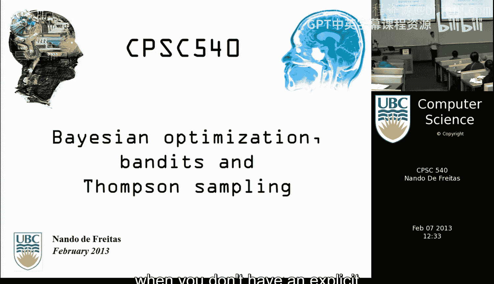
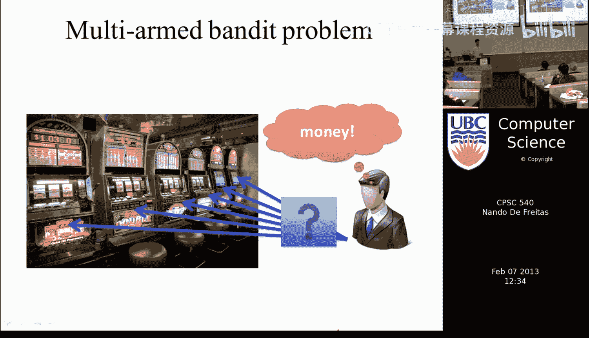
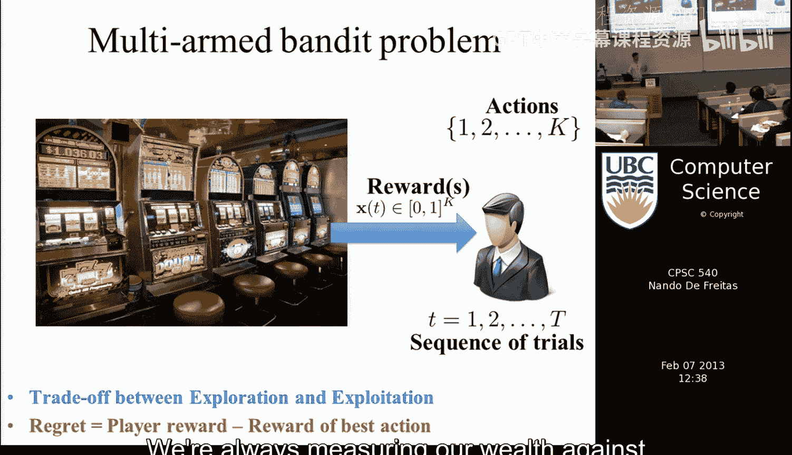
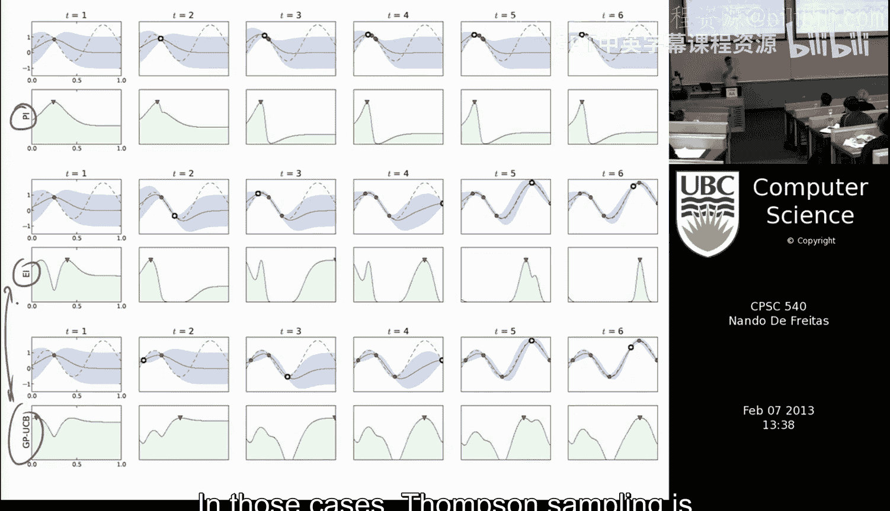
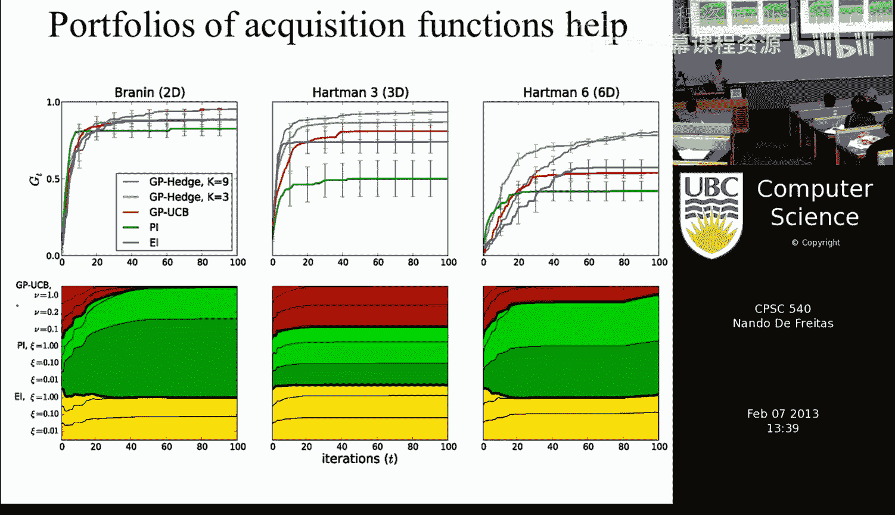
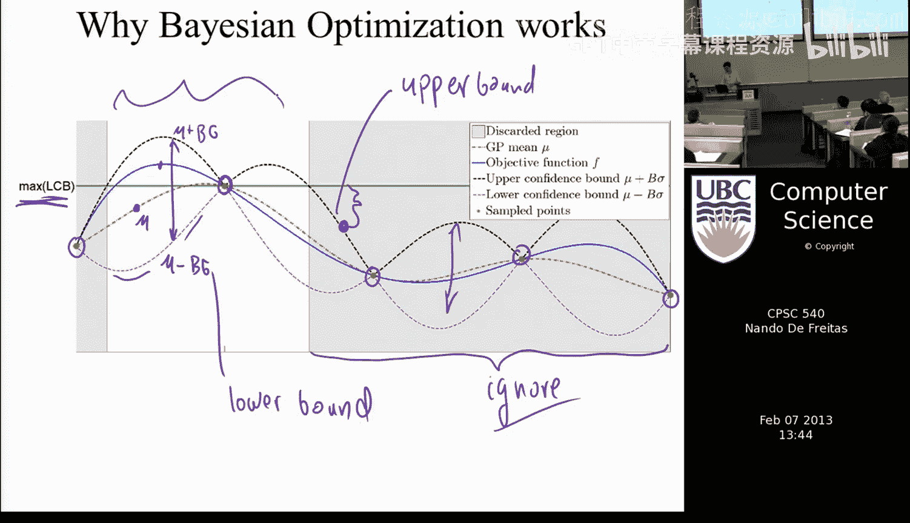
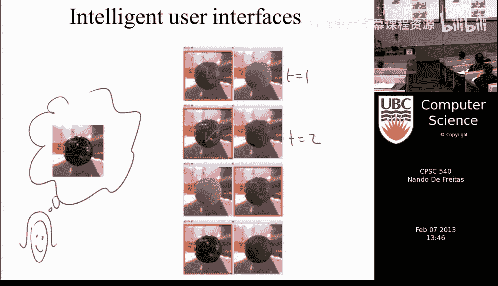
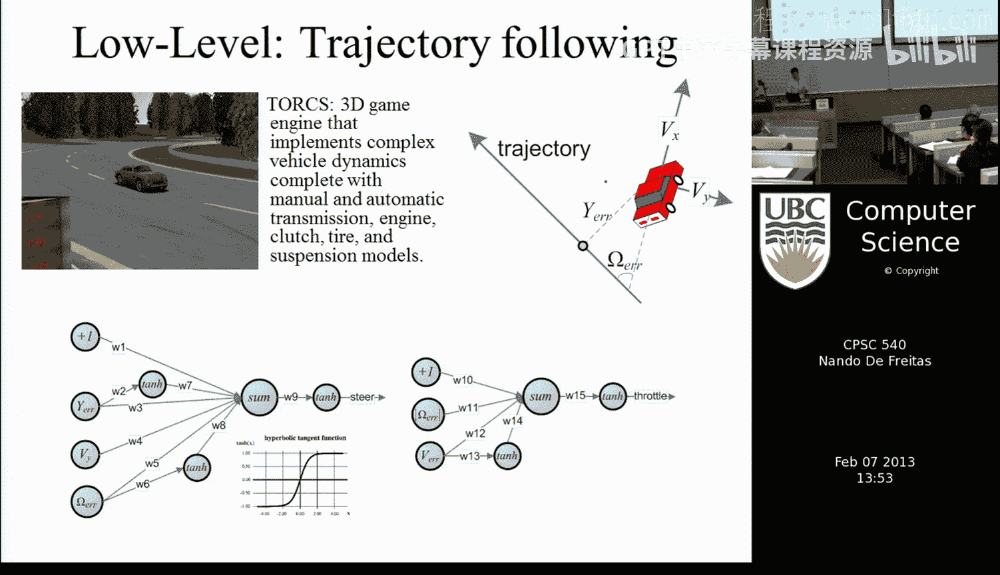
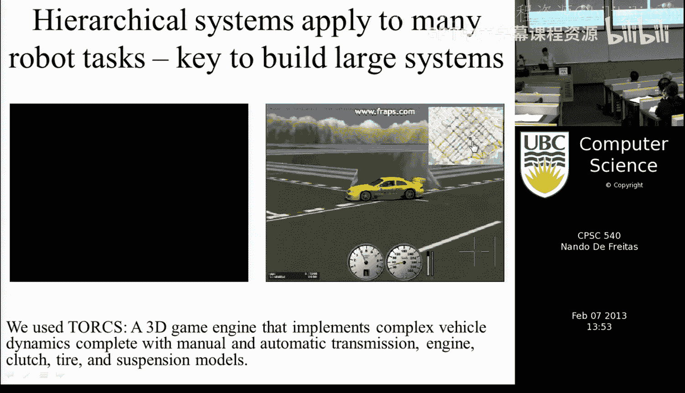

# UBC《机器学习（研究生）｜CPSC 540 Machine learning 2013》中英字幕 p10 -10-Machine learning - Bayesian optimization and multi-armed bandits.zh_en -BV19g2FBBEEq_p10-

about Gaussian processing that you can do， because today's class will use Gaussian process as one of the tools to be able to do this technique that I'm going to introduce today called Baesian optimization。

Which is a form of doing optimization when you don't have an explicit expression for the objective function。

嗯。The problem that we will deal with is known as in some areas as a multi arm bandit problem。

So bandits are these machines that you find in a casino。And when you enter a casino。

 your sort of job is to decide which of these bands will I try。

 which one is likely to give me the most money， so that's you coming into the casino。

 you want money you're trying to decide which machine to go for， and the question is which to go for。

Okay， so the elements here are this a set of actions。So up to now we've been talking about data。

 we haven't talked at all about action。But any intelligent mechanism。Whether it be a rat。

 whether it be one of us。Eventually interacts with an environment。

 so we're going to bring action into the framework of learning。

The agent chooses an action in the case of the bandits， there's a discrete set of actions。

 and then the agent will get a reward。For。And the reward could possibly be zero。

So negative in this case， because theuc loses money。And you're assumed to have a few trials。

At which you're going to try。嗯。To make money。 And those trials might be dictated by time。

Like you only have till 10 PM because that's。When you have to go back home or they'rere dictated by budget。

 like， I only have $20。So let me do the best maximize return of money with us $20。啊。

Even in this simple scenario， one encounters something called the exploration exploitation dilemma。嗯。

If you've done well in the machine。Okay， so you go in with your $20， oh。

 every dollar I put in it's giving me 100。It's awesome， Okay。

 so20 time do the calculation 20 times 100， and you're going to walk out rich with 2000 bucks。

You try another machine， though， because you don't know if that's the best machine。

 The other machine gives you。Back $1。So you go back to your machine。 You have K machines。

 but you've tried two。 one was better。 You might decide to choose with the best one because you know。

 you're going to leave with $2000， minus the few cent， the few dollars you lost in one machine。

Here's the problem。On that Ka machine down the corridor。

 someone goes and puts a dollar and gets a million dollars。

 And now you're very upset because you didn't explore other machines。

And so that's fundamentally the exploration， exploitation tradeoff。

 If you've seen a few candidates and some are doing better than others。

 it's tempting to exploit the best one out of what you've seen。But then you。

Risk not exploring machines that could potentially give you a much bigger return。

The straight off doesn't only happen in casinos。 It happens in daily lives。

 we confront it at almost every minute of our lives。 whenever we have to make choices。

 we might not be conscious of those choices， they might be just happening in our subconscious。

 but this is the sort of thing that intelligent machines have to face。

One notion that is very useful to think of in order to measure how well an agent is doing is the notion of regret。

So regret， think of the reward that you got with respect to something else。In this case。

 I mentioned the reward of the best action if you knew what the best action is。But often。

 you don't know the best action。 So for me， if I go to I've never gone to a casino and I hate casinos。

 but knowing probability， you know that you're wasting your time going to a casino。

 But let's assume in a hypothetical setting that I went to a casino。

Then my notion of regret would be how much money did I make and you know how much money did my partner make as long as I can make more money than her I probably would feel good。

That's basically regret， regret gives you a way of measuring your wealth。

With respect to someone else。Again， something we do all the time。

 we're always measuring our wealth against the wealth of our peers and so on。

嗯。This is how we're going to solve it in this class by using the tools of gapsian processes。

And I will use Gaussian processes throughout to deal with the problem of trading of exploration exploitation。

 but it's possible to use out the statistical models， I'll come to that at the。

 but for now we will just assume that we have Gaussian processes at our disposal because that's the technique we've learned so far。

So。It will be important to identify the following objects。 There is a true。

 We will assume that there is a true reward function。 Okay， There's a true。 Now， let's think of。

The problem of bandit。 And let's imagine that we have many， many， many bandits so that each interval。

In the real line。Is abandoned。Assume that you have sort of a true reward for the band。Okay。

And that true objective over here。Is the dashed line in the figure？So there is a true cost function。

There is so much reward that each band is going to return to you。

 and that's the person of works in the casino has said that for you。Right。She has experience。

 she actually does design algorithms for casinos。So。If you know that function。Of course。

 the people who design it know the function， but we that go into the casino don't know that function。

 So all we can do is we can sample。A few machines。 and by sampling a few machines。

 we in our heads try to infer what is the cost what is the function that this casino has。

 like over these rows of machines。Of course， it's not quite like this because there's no continu derivative over the machines。

 It's a slightly different setting。 but in morning。More。In more general terms。

 just imagine that you have this function。Indicated by the DxX line。That that function has a maximum。

Your objective is to find a maximum of that function。

 to find the X that gives you the maximum reward。But you actually don't have an expression for that function。

 All you can do is you try one value and you see what comes back in terms of the function evaluation。

Like for example， here。We've tried this value and this value。 we tried two values。

And based on the true values that I have and the function evaluation， so I have two data points。

I can fit the Gaussian process to those two data points。

I will assume that the function is smooth and I will fit the GP。If I fit a GP。

This is the posterior mean of the GP is the solid line， and then the。These guys the width here。

Indicates the confidence interval。 That is mu plus sigma and mu minus sigma。For example。

The other thing that so now you have a model。Now we have a model of。The function。

We don't know the true function， but we're approximating that true function in our heads。

 So think of the solid line as what's in your head。And the dash line is the real world。

Your objective is to find。This。The place where the peak of the function happens。

You want to go quickly pull the arm that gives you the maximum reward。Okay。

 so the other thing we need。 So all this the function approximation we've delt。 We know how to。

 we know how to fit the Gaussian process to data points。

 The other thing we need is a mechanism for deciding which point to try next。And such a mechanism。

 ideally， would be something that would look like this green curve here。An ideal green curve。

 which I call an acquisition function， because it dictates how you're going to acquire data。

Are you going to acquire information？Should be one that traits of exploitation and exploration。Now。

Since this point over here。Has higher reward than the other point。One should prefer that point。

 where should prefer to look。Near that point， because that point is already higher than the other one。

 So since this point is above this point。I should prefer。Things around this area， right。

 I should prefer to。Be near the point that gave me the highest return， so I had two alternatives。

 one gave me more money back， I should go with the alternative that gave me more money back。

The danger is that there is another alternative somewhere out there that I don't know anything about。

That might actually be very good。Okay， so back to the multiar bandit。

 how do we know whether we need to explore an area。That's where the confidence intervals come in。

Where my confidence interval travels are very wide。For example， here in the middle。

And over here on the sides。That's what I have a lot of uncertainty。

That's where if I were to choose a point there， I would gain the most information。

Because I would reduce the uncertainty the most。So if I wanted to learn the function。

I would just sample at the points where the variance is the largest。

 That's essentially the basic act of learning。But in this case。

 I don't want to learn the function over the whole domain， I just want to know what the maximum is。

Okay， so I want to be a bit more aggressive。I want to exploit， in other words。

And if I want to exploit it and I want to explore， there's this fundamental trade off。

And therell be something like the green curve。That will sort of balance these two desires。

 The desire to look at areas where the uncertainty is high and the areas to look at points where the mean is high。

 If I trade off these well， I will be able to find the optimum that I seek。And so for example。

 this green curve here is telling me to sample。At this location。

 if I acquire a new point at that location， a third point。

I refit the Gaussian process again because now I've acquired one more observation。

 so I refit the Gaussian process。Which is very quick， invering a three by3 matrix。

And I compute this acquisition function。 I haven't told you what an acquisition how to build an a system function that's going to be the rest of this lecture just going to be。

 in fact， about how we construct that green curve， the traits of exploration exploitation。

And when I build this function again， it tells me again where to sample next and where to sample next again is a question of。

Varance and meme。Since this point is higher than the other points。

 I would still prefer to be on the right。Moreover， since the uncertainty here was completely squashed when I observe x3。

 now that area is no longer interesting and that's reflected by this law。

Value of the acquisition function。If I sample one more point。We continue。So in summary。

This is based in optimization。嗯。It proceeds as follows。

 is and what I'm showing you there is just two iterations of it with the figures。

 but essentially if you have a certain amount of iterations or if you have an indefinite number of iterations。

 what you do is。We're going to call the green curve the。Acquisition function。Youear of eggs。

 given the data。And we're going to choose the x that maximizes that acquisition function。

And the data here would be。In this case would be x1 and y1。So。And x tony2。

 so we've observed two x's into y's。And the next。Step step three is once I've chosen a new X。

I just evaluated。In other words， I try DX and out comes back and the function evaluation with some noise。

 with some noise， say absolute。And then I simply augment a data set with more data。

With the new point X and Y， and I repeat the process。So provided I know does great function U。

All I need to do is I keep doing this sort of thing， I start with two points。

 this U function will tell me what next point to try， I try that point。

 I add that point to my set of points， and now I have three points， I fit a GP， I recompute U。

 and then I use U to select the next point and so on。

So if I just iterate the process of fitting the GP。Recomputing you， maximizing you。I'll be done。

 I will get to the optimal with some guarantees。Okay。

The rest of the lecture is just going into the individual components of this big picture。

Good place to ask questions。By the way， this lecture is about active learning。

 One thing that I can prove to you theoretical is if you ask questions， you do better。Can you know。

Yes。😊，We will come to that question， how to adjust how aggressive you want to be about exploiting or exploring。

It's like the cheap people always have。でけは？1 points。Getting out box。Ha to be strong。That。

Ation turning these。And some of function will be kind of balanced to getting points。

To minimize times。That's correct。Where you are away in the interval， that's where you would。

You will always have high variances there， but it's not just variance that matters。

 The value of the mean also matters。 So I will illustrate with you with some pictures where。

The really is not going to be- the variant won't kill us because we are also caring about exploiting。

If I get a point in the middle that is much higher than my points in the boundary。

 I'll probably not visit a boundary。But that indeed， in some cases it can cause problems。

 so you're absolutely right。です。Picking the max of the exploration function always the best plan。

 If you know， it's going take it。Yes this。Get to the result。

What I mean is kind of pretty what we're doing， right。

 we take the peak and then we take a new peak and then a new peak。

 if we know it's going to take us roughly 10 to get there。

 can we do better by planning our 10 out ahead of time。Yes。

Because you know about maximum expected utility planning ahead。

I actually had a slide on that and I decided to take that slide out because I didn't want to confuse people。

 but yes if he's talking about being myopic and decision making versus taking many steps ahead。

 so if you know how your words over time are somewhat related。

And it's not always the case that we do know that actually。

 but in some cases we do know how rewards over time are related and in such situations。

 you should plan ahead many steps， you know you should plan not just what to do now。

 but what do if I did this today， then what options would be available to me tomorrow and the day after tomorrow and so on。

So that setting is the setting of a Markov decision process。And in some simple cases。

 can be solved via dynamic programming， which is which you learn about in 340，' very much like in。

What you do when you do in person an HMM。And。But。That also comes with a cost。

Even when you can do dynamic programming， it's extremely expensive。

So often we will use these techniques to make a decision。So that you can solve a problem。Now。

 if you spend too much time thinking about that decision。

 you might never get down to solve the problem。 So sometimes it does pay off to。

Not make the best choice， but actually make steps towards solving the problem。Yes。

 one could use gradients indeed， so in this case you don't know the true objective function。

 the dashed line is unknown so you。You may if you don't know the function， likely。

 you don't know its gradient。 So that creates a difficulty。

 but you can use finite differences to approximate a gradient。 So and indeed。

 a lot of people do finite differences。 No， the problem finite differences is that they tend to be noisy and another problem with gradients is that often。

They can be extremely slow。To converge， it might take you 10，000 iterations or so。And。

Imagine that this。1D landscape here。Is a line across Alberta。And you're digging for gas。

And essentially， that reward function is the amount of gas that you find when you drill a hole。

In that case， you want to drill as few holes as possible。

Because drilling a hole costs about a million dollars or whatever。

 And so you're going to minimize the number of holes you make in order to extract gaps。

 So a gradient method that would。Take you lots of iterations would not be profitable。And this。

 in fact， actually the question is a good one because it brings back another aspect of patientian optimization。

 that it's not only dealing with the fact that sometimes you don't know the function。

 but it's also in some cases it's very expensive to evaluate the function。Like in drilling for oil。

 evaluating the function。Is a million dollars per point。嗯。Incidentally。

 these techniques were invented in mining settings。In mining， like most companies due do exploration。

 they use packages called crgging， now creagging is essentially Gaussian processes。And， in fact。

The name comes after a guy called Clher， who is South African engineer who。

 during his master's thesis invented this technique。Okay， and。Here that's looking for the minimum。

 I mean， just like you can look for the maximum， you could also look for the minimum per function。

It's the same problem for。So as you can see here， we're trading of。In this animation。

 we're trading of exploration， exploitation， and eventually we kind of locate the optimal。

The true function here is the blue function。And one of the things that this illustrates is that to find the minimum。

 you don't need to know the whole of the blue function。

You don't need to visit the entire blue function in order to find a minimum。Okay。

 so from the previous class， we know the expressions for a Gaussian process。

 we know that if you want to make a prediction， that is if we have some data set。

And we have a new test point。Our prediction。Stest。Our prediction。Its Gaussian。

 and it has two statistics， it has a mean statistic and it has a variance。

And so if you know the mean and the variance， you know everything there is to know about the prediction y。

Now， all we need in order to trade off exploration， exploitation is not this mean and this variance。

Where the mean is high。If you're doing maximization where the mean is high， you're likely to do well。

 but you're also likely to do well where the variance is large because that's where you need to those are areas that are hardly explored and likely to be profitable。

And so one way you could balance the straight off is by simply having an acquisition function。

Defined to be。The mean plus constant times the variance。Right， because such a function。

To maximize such a function， you would need to pick an X。That makes the mean large。

 but also an x that makes the variance large。 If you think the variance is more important that is。

 if you think that exploring is more important， you would choose a trade of parameter， in this case。

 Kappa as to be very large。If you think the mean is more important， you would choose a small cap。

 say 0。01。This is the simplest way to do it， it's problematic for some reasons I will mention soon。

 but this would be the easiest way to go about it。嗯。Since we're doing optimization。You may ask。

 oh hang Godando， but didn't you just replace an optimization problem for another one。

 because now we need to find Dx that maximizes。Mio X plus。Compus sigma of x。Now。

 why isn't this problematic？法庭。Exactly。I know the expressions from mu。

 I know the expression for Sigma。 So this function I actually know。 and if I know the function。

 if I have a mathematical form for the function， it's easy to just throw at at at function of the。

And I say easy because optimization is still a hard problem。

 but compared to the problem where I don't have a function。And all I can do is sample it。

 and every time I sample it， it cost me a million dollars or 10 minutes or whatever it is。

Then this problem is much easier because for this problem， I can just。

Get a fast CPU and try all the optimization algorithms that exist out there。嗯。And I can do well。

So this is a much easier problem。最と。My first get stuck at a local max。Yes， indeed。

So we need to have the right， in fact for this acquisition function。

 I don't know if we can prove anything about convergence。

 I will next talk to you about a few acquisition functions for which we can talk about convergence and the topic of convergence was open for about 50 years in this field and it's only over the last few years that we've proved the results。

That show which heuristics work。And improving those results。

 that has also led to new algorithms that actually work better。

At trading of exploitation and exploration。Okay， so before I go into the which。

I will discuss actually a few of these functions that have come from the research literature。Now。

 the acquisition function。It's also known as the infill function。

 is statistics and experimental design it's called the figure of merit or。And by the way。

 when you design experiments， you design an experiment to get data， and experiment is an action。

That returns data。Okay so this whole framework encapsulates the problem of designing experiments。嗯。

So as I said， the acquisition function tells you which point to sample next or which experiment to run or which question to ask。

It trades off exploration and exploitation。And it's easy to do compared to the original problem。

And here are some examples， so if this is my GP here。Over here I have four points for data points。

What I'm showing you below are three different acquisition functions that people use a lot in the literature。

 and I will go over these one by one and explain to you how they work。

 They do tend to pick the same points。 some are more aggressive towards whether the mean is high like this one here。

 some are more aggressive towards you know where both the mean is high。And the variance is large。

 some like points where the variance is very high。Okay so there's different and they themselves are parametermetized by a parameter。

嗯。And so we're going to study each of these now in turn。Okay。

 so the first one is called the probability of improvement。

What's the idea of the probability of improvement？We're going to assume。

That we've sampled the function in this drawing at two points， so that's one data point here。

 and here's the other data point。I then fit the GP to these two points and what I'm showing in this plot is the mean of the GP over here。

诶。The the mean plus the variance。And the mean minus the variance。Okay。

 so they're confidence intervals。Where I have data， the uncertainty is low， where I don't have data。

 the uncertainty is high。Now， just like like in linear regression， if I work to do a cut。

 vertical cut， the uncertainties over the Y。So if I do a vertical cutt。

The Y are Gaussian distributed。 The mean is the mean of that probability。 In other words。

 for this cut， the mean is the function。 And as you can see， this the the。

The confidence determines the width of the Gausse。The mean is， again here。

So any point is Gaussian distributed， that's the definition of the Gaussian processing。Now。

 I will look at the point where I've done best。Which in this case is this point here。

And for the point what I have done best， what I'm going to do is I'm going to look at what is the probability。

 so actually I will take that point， what I've done best。And I'm going to call it Mi plus。

So that's the best observed value。It's the highest observed value of the function that I have。

And then I'm going to add to it。A small value。I will explain to you what that small value does。

 and for now， imagine that that small value is so small that it's zero。

 so can erase it from your minds。嗯。In which case， F max is essentially me plus the best observed value so far。

Okay， so that's the point out of observed。And so F max would be me plus。

Then the criterion that I'm going to use for exploitation and exploration will be to look at the area under the curve。

Of the Gaussian that has with implied by sigma， and that is located at the mean。

Because if I have a Gaussian， so if I had a Gaussian here。It would have。

It would be a very broad Gaussian。The mean would be the center。And then this tail here。

 the area under this tail， that's what I would use。

 that's the value that I would use as the acquisition function。Okay， because as you can see here。

This point here， the x2 has a much higher area。Then this point， x1。

 because x1 has an area that is almost 0 in this case。 So using the cumulative。

Area under the Gaussian at any point seems to be a good heistic because essentially points that are higher up or that have high variances will be preferred。

Over the other points， in other words， x2 is preferred to x1。And in this case， x 3。

Would be preferred to x1。Now， the reason why we add a small value epsilon here。

It's because we want to deal with the case when we put the Gaussian here。In which case。

 the probability there would always be a hub。 So optimizing here at that point would be problematic。

 So that's just a minor detail to deal with what happens when you actually。呃。Reach the point。

But forgetting about the epsilon， what you're trying to do is you're maximizing the probability that。

The function evaluated at the point that you're going to try next is higher than the best one you've seen so far。

What's the probability that I will do better？Then the best thing I've seen so far。

That is the probability improvement of improvement criteria。

What is the probability that I will improve upon the best that I've seen so far？Now。

 since we have Gaussians。There is a formula for the tail probabilities。The area under the curve。

 and thats essentially just a cumulative。and all your scientific packages have expressions that if you call the a cumulative Gaussian。

 which is just that S curve， it tells you what the value of that tail is。

 so you can evaluate that easily。So now the task is to find the x that maximizes that function phi。

And that's it。If you do that， you will be trading off exploration and exploitation。

If you know something， not just the best that you've done so far， but if you had some relative point。

 you knew you were going to do at least as good as a particular threshold。

 then you could actually ask， what is the probability that I would do better than that threshold？

If you know the best that can happen， you can actually use that to your advantage。

 and even though this criterion proative improvement is the one that is the least used in practice。

In situations where you know the best reward you can get。

It turns out to be extremely powerful in comparison to the adultss。It's rare when that happens。

 but it's important to keep that in mind。Go ahead。We can also， just explore that。

Let's say we don't know what is the best we can get， but we can start exploring。Maybe what you。Sorry。

给 you。He're saying if we know what is the best value we can get， I mean， the best possible new plus。

 right。But let's say we don't know that， but we can just start exploringd assuming oh indeed， sorry。

 maybe I don't explain this clearly， so in this case we have explored， we tried two points。

So far I have drilled two holes already， and in the hole that gave me the most oil。

 that's the one that I'm calling mu plus， the amount of oil that I got out of that hole。

So me plus in this case。Is this。 Okay， if you assume that epsilon is 0， and epsilon is only there。

To deal with numerical conditioning。 So it's usually just a small value， so。

So forget about the epsilom。 imagine that F max is equal to mu plus。

 and so the idea is you drill two holes and the maximum amount of oil that you go out of a hole was 20 gallons。

Now you're saying what's the probability that if I drill a hole somewhere else？I don't know， Burnaby。

 that I will get more than 20 gallons of oil。You wantna know。

 can I do better than the best that I've done so far， Can I improve upon the best。

 So meal plus is the highest return that I've had so far。And of course。

 but each point should not just be about exploration。

 each point has to be about exploration and exploitation。In this game， the way we set it up。

There are games for which exploration is one we not do， but not in this case。How do you decide。

haveTwo points that have the same mean as me plus， but different variances。

 which one do you want to add？Okay， good question。 So what will you answer to him。

 I have two points with the same mean， but different variances。Which one do you pick。

The larger parents。Because you you're trying， and that's precisely。嗯。

I don't have a good example in this figure of that。I'm actually here。let me bring a different color。

Points of equal height， so。Let's say this point here。I speak me。More or less。

 so these two points here。Have equal height， equal mean， but this point。Has much higher variance。

And thats what。So under this criterion， when I draw the Gaussian。I have a much fatter Gaussian。

Over here。I have a narrow Gaussian。And if I look at the area under the curve after mu plus。

This one will have a much larger area than this area here because it's a factor Gaussian。

 so if it has higher variance， it will have higher probability of improvement。

Those meanings are at the same way as mu+。If both of the means were at the same height as mu plus again it depends on the question of variance。

 if two means had high variance， I would prefer those of a mu plus。With the means being equal。

 I pick the point of highest variance。 with the variances being equal， I pick the point of highest。

诶面。Because I'm trying to maximize both things， I'm trying to maximize variance。

 and I'm trying to maximize me。Does that mean that？further maximizing the。sorry me。

So it's equivalent to maximizing that。 the expression is。In this case， it is true。Yes。

Good observation。All right， so that's the simplest thing we can do。

 here is a different thing we can do， and in order to introduce it。

 I need to go into a bit of background。And。I need to talk about maximum expected utility。Now。

 the view of people as based and reasoners is as follows。 There is an environment。

From that environment， you get data。Your cus gather data。

That data goes through some sensory processing。That manages to extract features from the data and so on。

But you also have some prior knowledge in your head。Say in your frontal cortex。

And that prior knowledge and the data get combined via a base rule。

 so you get the likelihood you have a likelihood you have a prior and that determines the posterior distribution so we've seen how to do this。

 given data and give it some prior knowledge where the prior knowledge was say preference for functions to be smooth。

 we were able to derive posterior distributions。However， if we now want to act upon the environment。

We need something else， we need some desires。We need to have some objectives， goals。Or utilities。

They have know what it is， the intentions。嗯。I'm not going to model intentions。

 but I will model losses and gains。And the is you're going to act upon environment。

And if you're trying to achieve certain goal， when you act upon that environment。

 you' either get what you want or you'll get it to some degree or you won't get it。

To a different degree， so there is a cost to actions。So you observe data。

 you might be dying to know something， but you know that asking that question at that point in time comes with a cost。

嗯。This is essentially due to I mean， rewards and sunday and cost are called utilities。

And this is in essence， where people refer to as the utilitarian view of decision making。

So in order to make the right decision and the uncertainty。We need two components。

We need a probabilistic model of the environment， so we need a posterior。So for example。

 in an thetoy example， you might have learned that the probability that the patients。

 the people in Canada are healthy given the data that we've observed is 0。

9 and that the probability that people have cancer is 0。1。Okay， so if you pick any X from Vancouver。

Well NEX from Vancouver has 90% probability of being someone who will develop cancer over the next five years？

And that you can estimate from doing a census。We will also assume that we have a government that is in debt。

 which is not too hard to assume in our case。And that they trying to。Vinomize costs。

And so they now get together。And have a meeting， many discussions。

 and the P fights with the liberals， et cetera， and I come up with the following table。

This table says that if a patient is healthy and you don't treat a patient。

 so the action here is whether you treat or don't treat a patient。

If you don't treat a healthy patient， there's no cost。

But if you take a healthy patient and you treat her。There is a cost， right。

 because you're now using your hospital resources to deal with a patient that shouldn't be admitted to a hospital which is just probably being a hypochondri or whatever。

If， on the other hand。You have a patient。Who indeed？Has cancer。And you don't treat that patient。

Then you know， that's a big cost because you know。The NP is fun not to have turned away all the patients that had cancer and not offered treatment。

 and most likely they won't be reelected。At the next election。

 so they value that cost as minus100 per patient。On the other hand。

 if they have a patient that has cancer and they decide to treat the patient， that also costs the LP。

Because they're wasting from their perspective $20 on this individual。Or 20 units。

 whatever the units are。You know， you have to spend， you have to hire nurses and so on。

 and because you're hiring nurses， that means you no longer have this other money that you can show off for some other task that will allow you to win the next election。

So essentially there is a sort of。Function。That for all possible states。

 X and for all actions gives you a number that's essentially the reward。Equivalently， the cost。第。

The utilitarian view is to maximize the costs weighted by their probability。So in other words。

 if you want to choose the best action。The best action should be。Decided by the cost of each action。

 weighted by the probability。Okay， so for example。In this case。

 if you want to know what's the expected utility for a treatment， you would go， well。

 that's going to be the utility。off。In this case， the utility has two arguments。

 the state of the patient。And we're considering the action treatment。So if the patient is healthy。

And you do a treatment？You need to weight that by the probability that the patient is healthy。

Given the data。Plus， the utility that the patient is。Got cancer Sir。And I gained。You are treatinging。

Wighted by the probability of cancer。Given the date。So you plug in the numbers。

 so utility of healthy and treatment。A healthyth。And treatment is minus- 30。

You multiply that by the probability of the patient being healthy。Which is 0。9。

You add to it the utility of cancer and treatment， which is minus 20。So there's number here。

 cancer and treatment。Anyway that by the probability of cancer， which is 0。1。

That will give you a number。And I will leave it to you as an exercise to calculate that now。

And as well as an exercise for office hours to get the other utility。

So you now compute expected utility of treating and the expected utility of not treating。

And then you decide what to do based on those。If the expected value of treating is higher than the expected value of not treating。

 you treat。Otherwise， you don't treat。And that's how a decision now。

Because essentially you need to consider your costs。

 but you need to weight the cost by how likely that setting is。So likewise。

 if you're trying to decide between。Trying two things。

And one thing has high value but high uncertainty and sort of very low probability。

 and one thing has medium value， but very high probability。

 you might go for the medium value one because it has high probability。

 So what this is saying is when you make a decision， you should not。

Make that decision based on the cost， but you have to wait that decision with the probabilities of that event actually happening。

 should I ask Uothermon out for a date， maybe the reward there is very high。

 but the probability is very low， so I'm not going to bother to。

Blaza would be in serious trouble if I do。Okay， so that's essentially expected utility。

Expected utility it incidentally is not， I've described it with intuition， if you actually。

 but it's actually the conclusion of a theorem。If you have several agents and those agents have some conditions on their preferences。

 like for example， if a prefers， if you prefer A。To see。嗯。So if you prefer A to B and B to C。

 then you should prefer A to C。And if you have some very basic conditions on preferences。

 you do a little bit of math and you derive something called expected utility expected it chose a consequence of preferences so there's about five axioms if I recall well and from those five axioms you derived the principle of expected utility that is something that Fon Neumman did in the 50s what Morgan St and that was sort of the beginning of game theory。

And in game theory， maximum expect utility is what folks call best response。

 is that action that you have to take if you want to convertverge to a dash equilibrium。Okay， so。诶。

Coming back to our problem of optimization， and this will sort of answer your part of your question early on。

 what lets assume that we know the true function， the true objective。 So this is the true function。

If we know the true function。Let's assume that x star X star is the location of the max。

So if we have a function that looks like this。This is x star the location of the max。Now。

 if you're trying to approximate。The true function with a GP。Then what you would want to do。

Is you want for all the functions that you could sample。For all the functions。

 you could sample from a GP。And we've seen that from a GP。

 you actually can sample many functionss as many as you want。For all those functions。

 you could sample over GP， so integrating over those functions。

 so in this case we're doing maximum expected utility。The state is the function。

 We need to sum before the state was whether you are healthy or whether you had cancer。

 now the state is actually infinite。 It's all the possible functions that we come from a GP。

 so we need to wait by all the possible functions。And our action is to choose the point x。

So we're trying to find what is the point x that would minimize regardless of what the GP function is。

What is the point x that would minimize the difference between that function and the actual true function？

This。That's essentially what we want because once we can pick this point。

We can- so regardless so what we're saying by integrating over F is that regardless of what F is。

 we want to find a point that will bring us close to x star。

Because if the function has the same height。As if that difference is zero。

 that means that whatever function we got out of the GPp has the same height as that function。

Or if you expand this， an expectation is just an integral with respect to a distribution。

 that is essentially the posterior of the GP and we want to minimize this difference。Now， of course。

 the catch here is that we don't know the true function。If we knew the true function。

 we could just optimize this directly。But we don't know the true function。

 We don't know the location of the optimum。 So instead when we do maximum expected utility。

 we do different things like probability improvement or this new criterion that I'm introducing here that's called the。

The expected that's called。Expected improvement criteria。 So this goes back to。A guy called Mocus。

 and it goes as follows。 It's very similar to what we had with probabilityblative improvement。

 But what he wanted to do was to find the X。Such that。

F is likely evaluated that that x will do better than the max value that you have so far。

 So instead of talking about probability of improvement， he wanted to do the maximum expected。

Improvement。So in order to， because F max is the best that we have on so far， sayta mu plus。

And we typically add to the mue plus just a small number or epsilon。

And so you want to do better than that the best that you've seen。

No matter what your F is by integrating out over all your fs。

So integrating our overall function seems to be something that would be crazy to do computationally。

 but in this case， because we have a Gaussian process。

 everything is analytical so we can actually solve this integral analytically， and that gives us。

There's following expression here， which we call the expected improvement。So if you have a Gaussian。

 you can do those integrals analytically and you end up with an expression that basically involves the means and the variances。

And these functions fine。A essentially the PF and the CDF of a Gaussian，1 D Gaussian distribution。

So we can get an analytical expression for this function。In this case。

 so under this maximum expected utility。So it's very similar to the probabilitybilative improvement。

 except we're trying to maximize expected improvement。Okay， and。A third way of doing this。

Is the following， you define a notion called regret。 It's a theoretical approach。

 It's a theoretical computer science approach。 You define something called regret。

 which is the difference between the function evaluated at the optimal and the function evaluated at your x。

Then you define another notion called the cumulative regret， which is just a sum of all your regrets。

And if you do。A bit of theory， which I don't cover in this course。

 which I would cover in a graphic machine learning course。Two， if we had it。嗯。You can derive。

The trade off between the mean and the variance。But it's not a constant。It term the theory predicts。

That will be something that increases as log T。Now proving this is several pages。

 I'm not going to go over in this class， but this is we just mentioned of what the criterion is if you try this criterion in practice its actually varies the previous crition on the other hand is very easy to prove。

 so I might give this to you as a homework exercise to just do that integral and convince yourself that you arrive at a result。

This one on the other hand requires work。If the set of points is not infinite。

But you actually happen to know the horizon。 You would get a different value of beat， as well。

And that again， involves quite a bit of theory to derive it。

Bob back over there actually spends his PhD arriving these features。Okay， here is one final criteria。

 it's called the expected improvement。This one， a drawing will do。

So assuming you have two data points or three。Let's assume that we've also decided on an interval over which we can optimize。

So the next thing I do is I fit a GP to these points。I get the confidence intervals。And now。

The basic assumption that I make is that。The function。 so that's my posterior distribution。

 basically。So the assumption that I make is that all the functions that I would sample from this。

With very high probability。Would be inside the two green lines。 So if I were to sample a function。

It has it would be between the two green lines because I've said that that's where most of the probability is。

So I can say with very high confidence，95% confidence that if I draw function。

 it will be a function in those intervals。I can say this theoretically， I can say this more formally。

But now let's just use the intuition。Now what I can do is I can draw a function。At randomand。

Like we've done before。 and then the next step is I choose the location of the maximum。

 I optimize that function。If I optimize that function， I get。This is the point to try next。

Why would this work， Because if I draw functions， I will have high variability in those functions。

When there is a lot of uncertainty， so when there is a lot of uncertainty， I will。

Quite likely throw a function that goes near the top， in other words。

There is significant probability that the function that I draw。My。

Be high whether there's high uncertainty。So by drawing random samples。

 I will cover the areas that have high uncertainty and also。Whatever function I draw。

There is a bottleneck。Here， so that function will tend to be close to the best point that I've seen so far。

 so this strategy also is useful for exploitation。Okay。

 because that function will go through very close to the best point that I have so far。

So and that's essentially that thomson sampling， you draw a sample from the posterior。

And then you optimize and you pick the best。Now I'm doing it here in the context of Gaussian processes。

 but in the Google group I shared the document it is about what folks do at Google Analytics。

 and they use exactly this technique， Thompson sampling， in order to make decisions。

Can you explain why won't you pick the next point as the one that correspond to the highest uncertainty。

The highest uncertainty， uncertainty。Why I wouldn't want to do that。Oh。

 then I be learning because then I would just be wasting effort。😔，嗯。I'm learning the function。

 I would be learning。 my objective is to learn the location of say the maximum or the minimum。

But I don't need to know the entire function。So to know an entire function。

 I would have to sample it， you are correct I would have to sample it where the variances largest。

 I would just be exploring essentially。But my objective is to minimize the number of exploration steps。

 I just want to find a place that will give me the mosque oil。And so in that case。

 I don't want to just be exploring everywhere， I want to focus my resources in exploiting。

I will soon show you an example that I think will add a bit more clarity to these remarks so in summary there's about there's a bunch of improvement functions。

 there's probability of improvement， expected improvement there's this other one that I mentioned but they't drag called upper confidence bounds。

 there's ths and sampling， they all sort of do similar things When you implement code。

To the basic optimization， I actually recommend that you try more than one。

Because some tend to be more bra than others。What this figure shows here is。Three runs。

On the same function using UCB probabilityative improvement and expected improvement and as you can see。

These two tend to be very similar。Expect improvement and UCB tend to do。Similarly。

 probabilitybative improvement does worse， but again。

 I remind you that if you do know the maximum that the function can attain。

 probabilitybative improvement will do much better。And these dual alternatives。

Thompson sampling will do very similarly to expected improvement。In some cases。

 like when you don't have gas and， so you have Bernoulli variables。

 so you have independent arms when you're displaying ads。For example， in Facebook。

Then and then the reward is whether the individual clicked or didn't click on the appd in those cases。

 Tmpsson sampling is actually quite much easier to deploy。

You can also do the following which one of my grad students Matt who you will get to meet because he will teach one lecture for this course while I'm away he's actually played with having portfolios of these three opposition functions so his game was that well I don't know whether to expect improvement or proative improvement or UCB moreover I don't know how to set that epsilon so therefore what I should do is introduce a new hierarchy in the decision making process and choose among those three and when he did this he got much better results。

And if you want to play with this in a project， then Matt would be the person to talk to。

Okay， now let's go back to this question of the various。嗯。And let's look at the G here。Where again。

 I have some data points。I've collected these。Five data points。I have。The mean of the GP here， muu。

I have here mu plus some constant times the variance。

And the mean minus some constant times the variance。Now， let's assume again。

 that with high probability， any function is captured by SGP。 So any function would be between。

A these two dashed lines。For example， the red light。If that is true。

 and if our objective is to find a maximum。Of the function， which in this case。

Occurs when the function has this value。Then not one thing。

This is the highest point if let's look at the lower bound。

When the lower bound is essentially this magenta curve and its highest at this point。

Okay so this green line indicates the height， the highest height that the lower bound attains。

 the highest height that the magenta curve attains。Now。The black line。It's an upper bound。

The upper bound essentially says， is the best I can do。490 x。But。If the best I can do。

Is lower than the worst that I can do。There is no point in trying that point。So to speak。

So whenever you're below the lower bound。For something that you've already tried。

Then it's not worth trying exploring there because you will not do better than what you already have。

The consequence of this is that everywhere。Where the black curve is below the green line。

We cant just ignore。Even though there is regions coming back to your question。

 even though there's regions of high variances there。I know it's pointless to explore there。

This is essentially something that we call probilist。We call this branch and Bo。

 it's a very important heuristic in computer science。

 and it's a heuristic that a lot of mixed integer programming solvers use。

Which can be used to solve numerous scheduling problems。Like in society。

 a lot of things when you're doing bookings with as and so on。

 there is an algorithm that's being run that is solving that stling problem for you and it's essentially using branch and B。

The difference with standard branch and bound is that this is a probabilistic branch and bound。

 We only have probabilistic guarantees here。there's a probability of failure。

 there's a delta probability that your function might be outside these two intervals in which case this would fail。

 but what you can do is you can give a very high guarantee probabilistic guarantee that you can ignore this space。

And still find the option。When。When Mazurur and I we actually set to prove some theoretical results for this。

 and this was the basis of the proof， The first part was to show that indeed。

under these assumptions and the gassian processes， a lot of the space would disappear。

 We could ignore a lot of the space。 And then we just needed to focus on a small region of the space where we could study the local convergence of that process。

And Maur came up with some very interesting differential questions that described her behavior。

Of the function in that vicinity。

Okay，So for the rest， what I want to tell you in the next six minutes that we have left is just show you a bunch of applications。

 So in the last class， I already show you the application in animation。Where you。

And here is another application where let's assume that what you have in your mind。

 let's assume that this is what the animator has。In mind， so there's， I don't know。

 the animator is here。And。This is what she's thinking about， she wants to create a BRDF。

 which I don't know， your graphics people in the audience would know。

 you want to create a ball that has the right illumination that involves tuning six parameters but she never went to a graphics class。

 has no idea what a BRDF is， all she has this six numbers and it's counterintu of how to tune them。

So what's better is if we then show to her two images and we ask her which one is better。

 so at deterration one， she says I like this one better than the left better than the right at deterration2。

 she says I like this one better。And by doing that over for iterations。

 we're able to find out what it is that she's thinking about in her head and we're able to deliver that to her。

Essentially in UI design， intelligent UI designing which news to present to a user。

 which content to present to a user， which question a robot should present to you。

 when should a robot in intensive care interfere is about this Of course there's other questions to deal with there there's human concerns when a robot decide science to help an elderly person with brushing their teeth。

You also don't want to hurt the ego of that person questions have psychological costs。You know。

 you're at the party， you want to know if someone is gay and that could give you a high return because。

 you know， if he's not gay and maybe he's a great catch。

 but you wouldn't just go and ask that question。

Well， you might， but questions come with costs。Another example。

 and this is something that the folks here that do our algorithms do a lot is the algorithms that are use to solve problems like SAAT or mixed inger programming。

 in this case this results from mixed in programming。I mean。

 these are packages that are downloaded by thousands and thousands of people all the time。

 it's extremely popular packages for solving all sorts of problems。

But they often have a bunch of free parameters， so one example that Holger and Frank were working on one of these solvers had 76 parameters。

 so imagine you have to sit there and tune those parameters we've already seen these problems of tuning。

When you were doing cross validation and you had to choose the deelta。

You had to first guess which deltas to try。And then you had to try each delta。

So you are doing by hand what Baing optimization can do for you automatically。

The goal of base optimization to replace the user in that case。

The algorithm would try a value of Delta and would explore and find the best delta as opposed to you having to try a whole range of deltas because if each cross validation involved a billion data。

 this would cost you 10 minutes of your time， more of it will cost you a few hundred bucks by running it on an Amazon cluster。

 so you would want to not do too many cross validation steps。诶。

And what we see here is if you try these intelligent tuning mechanisms based on based optimization。

Some which are not based optimization like for ILs， Smack is a version of patient optimization。

 which doesn't use。嗯。Gus and processes， but it uses random force。

 which I will tell you about next week。Instead。You can do better than random。

 Random actually does That is if you're picking the parameters at random。

 Random actually often does better than you choosing the parameters by hand。And here is why。

A lot of functions have this property。That， in one direction。The function has an obvious maximum。

But in another direction。The function has no obvious maxim。

Provided you have your access aligned the right way。A lot of dimensions might be irrelevant。

So if I were to pick， for example， a random line。Into this space what we call an embedding。

Then I could just do optimization there。 And if I do optimization along this line。

I'm guaranteed to find the optim。 So even though the problem is in high dimensions。

 if I do a random selection of the dimensions。And Ill optimize that I can do just as well。

Heres another example next week we will talk about random forest。

 you will see that when we talk about random forest there's lots of free parameters。

That you have to tune。There'll be like nine choices。But again。

 you can use the techniques of basin optimization to tune those parameters for you automatically so that you don't have to do that thinking。

嗯。This is interesting， so there is this algorithm that later we will talk about Monte Carlo algorithms and some of these Monte car algorithms have parameters that you have to tune。

 and these Monte Car algorithms are useful to compute models like Bayesian neural networks which are extremely powerful。

And for there was a problem of a robot arm control。That came up in the literature back in the 90s。

 I think in 98， actually goes back to '92 to David McKay's thesis。David Mackai， by the way。

 is another guy that has a very nice machine learning book online for free。

And David Mckaaihan as much error in his technique。

 and then a few people tried to use Monte Carlo techniques to lower the error successfully。

 I spent three years in my PhD thesis to get this error。

And then when we just took Neil's algorithm and we just automated a parameters automatically。

 we were able to so the algorithm beat all of us。Tuneers by hand。This was for the competition。

Where you went to do prediction and variable selection， Niils came up with Ra for Nis a professor。

 by the way in Torontoronto University， very good research and statistics。

And he came up with this Bayian neural network that achieved as much error。

 and obviously he tuned it so that he would win the competition。But when。Z1。

 one of my students just let the tuning be automatic using vision optimization。

 he was able to get much better results， so automatic tuning does better than experts。

You can also use it to tune how the policy of a robot that is exploiting an environment so that the robot can minimize its uncertainty about the environment。

嗯。In games， the way games get coded。Whether you're in EA or unite a frontron these sort。

Large games is using policies that are essentially hierarchical at the high level。

 you might have be making decisions as to whether pick up someone。

 say suppose you try to build a taxi game that has to pick up people in some street in Vancouver and drop them in another tree at the high level。

 the taxi has to do the planning of who to pick up and who to drop and when to drive at a lower level the taxi has to do the planning of deciding which route to take。

And at the much lower level， the。Taxi has to make the decision as to stay on the road or go off the road。

You know which line to take， et cetera。 So there's sort of a nice hierarchical。诶。Way of planning。And。

Lots of free parameters。 And here is just， I'll just illustrate some of the。The type of results。

 oops， I need to bring the arrow。These are the type of results that a student of mine who' is director of one of the top AI guys at United Fron Games。

did when he did his master's here at UBC， so he was getting a car that picks here in Vancouver。

 this is not Vancouver， but that's what he could do during his masters picks a guy and then goes。

 the objective is to go and drop the person there。And。Okay， there we go。

Here is another example where this guy has to pick the red dot。 And now he has the person。

 He has to drop them at the green dot。 if you can see。 And there's a reason why it did。

