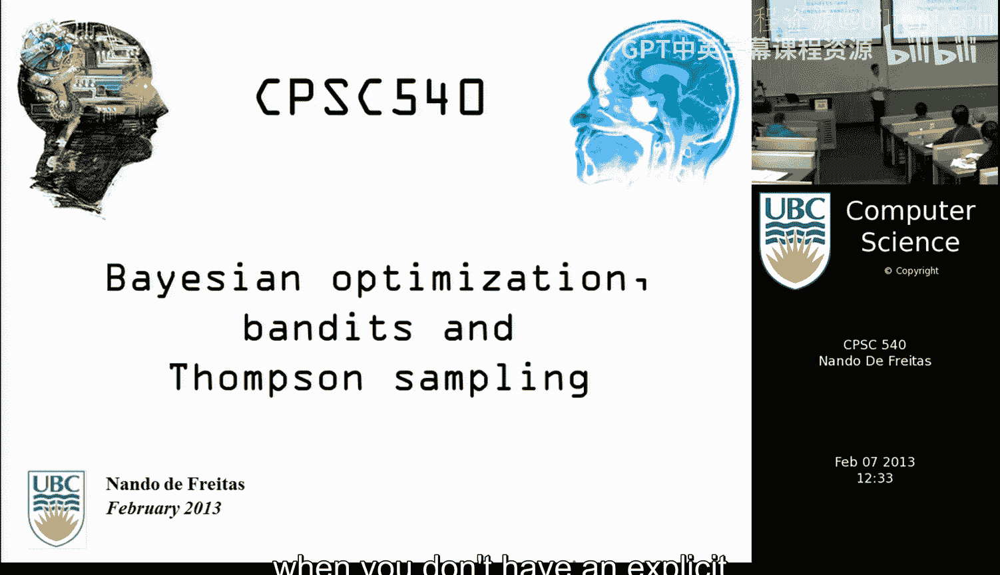
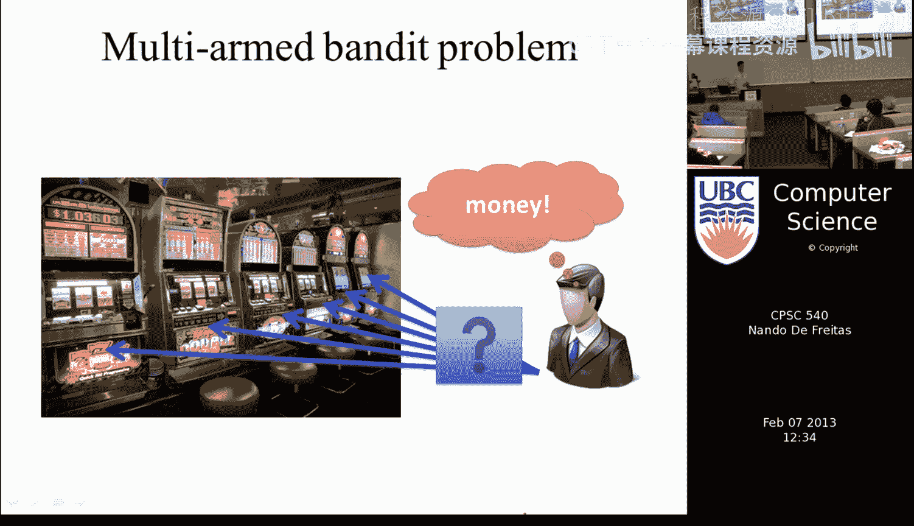
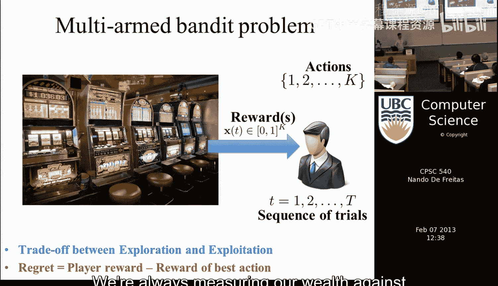
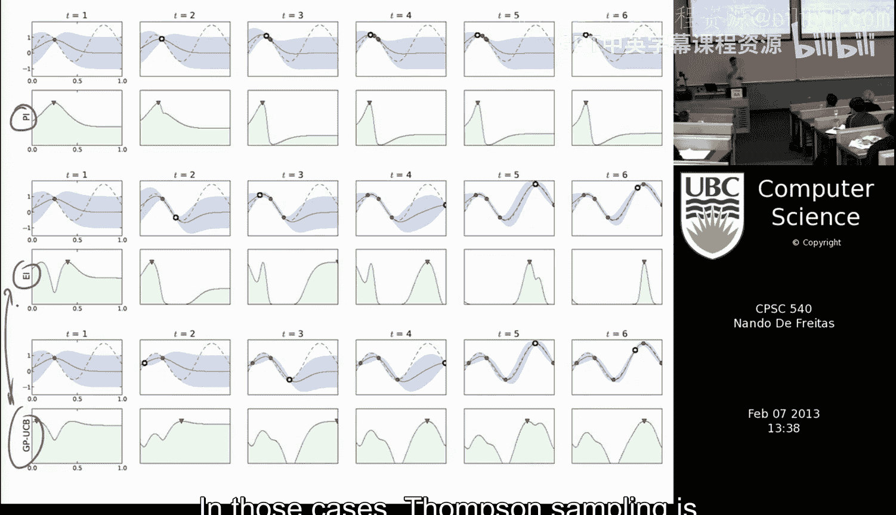
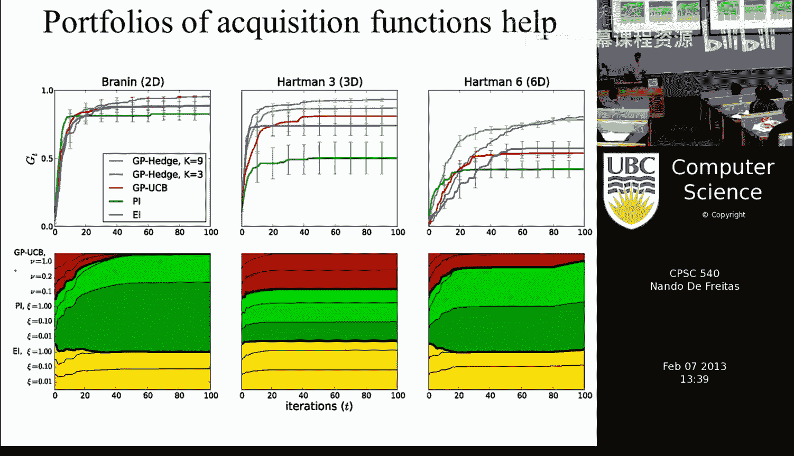
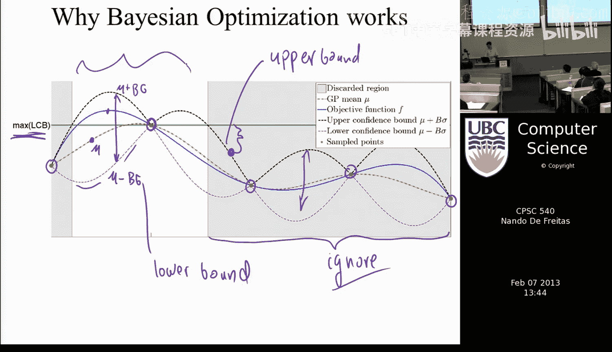
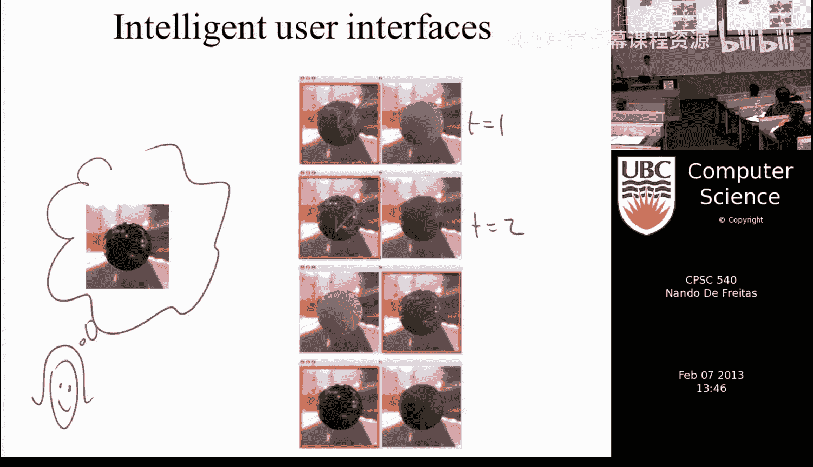
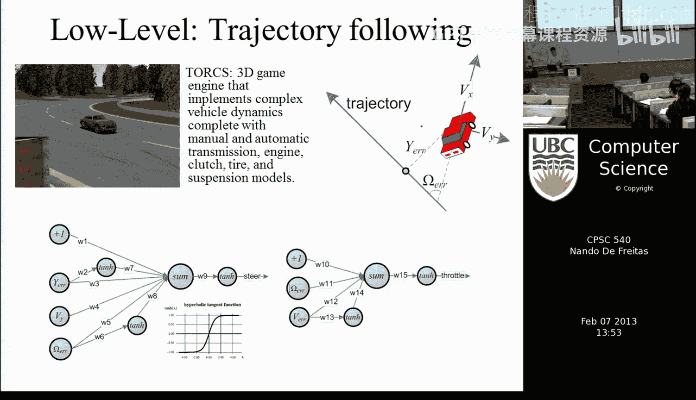
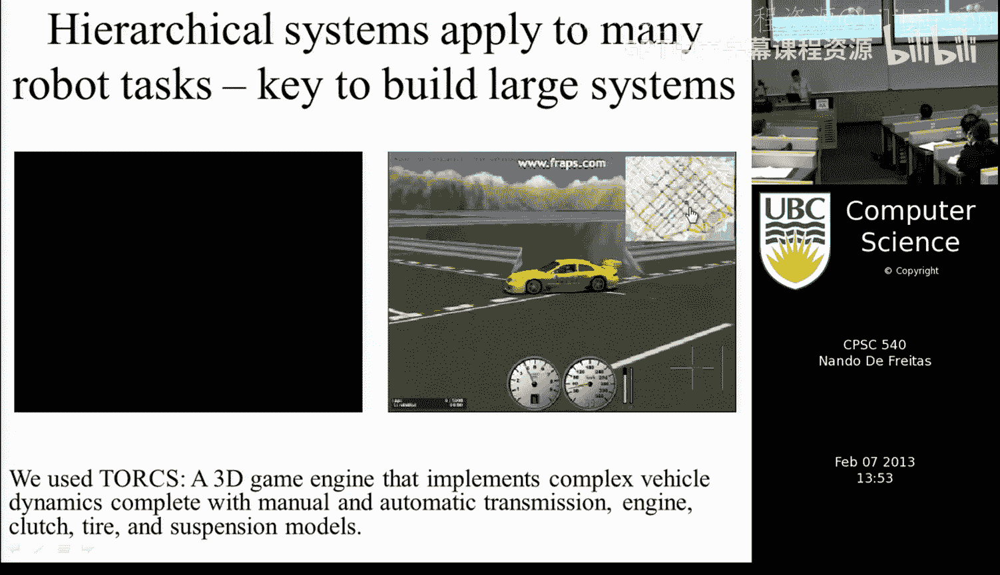

# 机器学习：10：贝叶斯优化与多臂老虎机 🎰

在本节课中，我们将学习一种名为“贝叶斯优化”的技术，用于在目标函数没有显式表达式的情况下进行优化。我们将使用高斯过程作为核心工具来实现这一技术。

## 问题引入：多臂老虎机问题

我们处理的问题在某些领域被称为“多臂老虎机”问题。老虎机是赌场中的一种机器。当你进入赌场时，你的任务就是决定尝试哪台老虎机，哪台最有可能给你最多的钱。你进入赌场想要赚钱，需要决定选择哪台机器，问题在于如何选择。

## 核心元素与探索-利用困境

这里的核心元素是一组“动作”。到目前为止，我们一直在讨论数据，完全没有涉及动作。但任何智能机制，无论是老鼠还是人类，最终都需要与环境互动。因此，我们将把“动作”引入学习框架。

在老虎机问题中，智能体从一组离散的动作中选择一个，然后获得一个“奖励”。奖励可能为零，甚至为负（因为赌场会输钱）。我们假设你只有有限的尝试机会来赚钱。这些尝试可能受时间限制（比如你必须在晚上10点前回家），也可能受预算限制（比如你只有20美元，需要最大化这20美元的回报）。

即使在这个简单的场景中，也会遇到所谓的“探索-利用困境”。假设你带着20美元进入赌场，发现第一台机器每次投入1美元都能返回100美元，这太棒了。你可能会想，投入20次就能赚2000美元。但你又尝试了另一台机器，它只返回1美元。于是你回到了第一台机器。你总共有K台机器，但只尝试了两台，其中一台更好。你可能会决定一直选择最好的那台，因为你知道这样能带着近2000美元离开（减去在另一台机器上损失的几美元）。

问题在于：在走廊那头的第K台机器上，有人投入1美元却赚了100万美元。现在你非常懊恼，因为你没有探索其他机器。这就是根本性的“探索-利用权衡”。如果你看到几个候选选项，其中一些比另一些更好，你可能会倾向于利用目前看到的最好的那个。但这样做的风险是，你可能错过了那些潜在回报大得多的选项。

这种权衡不仅发生在赌场，也发生在日常生活中。我们几乎每分钟都在面对它，无论我们是否意识到这些选择，它们可能只是发生在我们的潜意识中。但这是智能机器必须面对的问题。

## 衡量标准：遗憾

为了衡量智能体的表现，一个非常有用的概念是“遗憾”。遗憾是指你获得的奖励与某个基准（例如，如果你知道最佳动作能获得的奖励）之间的差距。通常，你并不知道最佳动作是什么。例如，如果我去了赌场（虽然我从未去过且讨厌赌场），我的遗憾感可能来自于我赚的钱是否比我的同伴多。只要我赚得比她多，我可能就会感觉良好。这基本上就是遗憾，它提供了一种相对于他人来衡量你收益的方式。我们总是在与同龄人的财富进行比较。

## 解决方案：使用高斯过程

在本课程中，我们将使用高斯过程工具来解决这个问题。我将自始至终使用高斯过程来处理探索-利用权衡问题，当然也可以使用其他统计模型，但目前我们假设可以使用高斯过程，因为这是我们迄今为止学到的技术。

重要的是要识别以下对象：我们假设存在一个真实的奖励函数。考虑老虎机问题，想象我们有很多很多台老虎机，以至于实轴上的每个区间都有一台。假设每台老虎机都有一个真实的奖励。这个真实的目标函数就是图中虚线所示。这是一个真实的成本（或奖励）函数，即每台老虎机会返还给你的奖励。当然，赌场的设计者知道这个函数，但进入赌场的我们不知道。我们所能做的就是采样几台机器，通过采样，我们在脑海中尝试推断这个赌场在这排机器上的函数是什么样的。当然，实际情况并非完全如此，因为机器之间没有连续的导数关系，但更一般地说，想象你有一个由虚线表示的函数，该函数有一个最大值。你的目标是找到该函数的最大值，即找到能给你最大奖励的X。但你实际上没有这个函数的表达式，你只能尝试一个值，然后观察函数评估的返回值。

例如，在这里我们尝试了这个值和那个值，我们尝试了两个值。基于我拥有的真实值和函数评估，即我有两个数据点，我可以将高斯过程拟合到这两个数据点。我假设函数是平滑的，并拟合高斯过程。如果我拟合了一个高斯过程，其后验均值是实线，而这里的宽度表示置信区间，即 μ + σ 和 μ - σ。

现在你有了一个模型。我们有了一个函数的模型。我们不知道真实函数，但我们在脑海中近似那个真实函数。所以把实线看作你脑海中的想法，虚线是真实世界。你的目标是找到函数峰值出现的位置。你想快速拉动能给你最大奖励的那个拉杆。

我们需要的另一件事是决定下一个尝试点的机制。这样的机制理想情况下应该像这里的绿色曲线。一个理想的绿色曲线，我称之为“采集函数”，因为它决定了你如何获取数据。你是要获取信息吗？它应该是一个权衡探索和利用的函数。

由于这里的这个点比另一个点有更高的奖励，我们应该更倾向于那个点，应该更倾向于查看该点附近的区域，因为该点已经比另一个点高了。所以我应该更倾向于选择给我更高回报的那个点。危险在于，在某个我不知道的地方可能有另一个选项，实际上可能非常好。回到多臂老虎机问题，我们如何知道是否需要探索一个区域？这就是置信区间的作用所在。在我的置信区间非常宽的地方，例如中间和两侧，我有很大的不确定性。如果我在那里选择一个点，我将获得最多的信息，因为我会最大程度地减少不确定性。所以如果我想学习整个函数，我只需在方差最大的点进行采样，这本质上是学习的基本行为。但在这种情况下，我不想学习整个定义域上的函数，我只想知道最大值是什么。所以我需要更积极一些，换句话说，我想利用。如果我想利用又想探索，就存在这种根本性的权衡。会有像绿色曲线这样的东西来平衡这两种愿望：查看不确定性高的区域的愿望，以及查看均值高的点的愿望。如果我很好地权衡了这些，我将能够找到我寻求的最优点。

例如，这里的绿色曲线告诉我在这个位置采样。如果我在那个位置采集一个新点（第三个点），我会再次重新拟合高斯过程，因为现在我多了一个观测值。重新拟合高斯过程非常快（求逆一个3x3矩阵）。然后我计算这个采集函数。我还没有告诉你如何构建采集函数，这将是本讲座剩余部分的内容，实际上就是关于我们如何构建那条权衡探索与利用的绿色曲线。当我再次构建这个函数时，它会再次告诉我下一个采样点在哪里，而下一个采样点再次成为方差和均值的问题。由于这个点比其他点高，我仍然更倾向于在右侧。此外，当我观测到x3时，这里的不确定性已经完全消除，那个区域不再有趣，这反映在采集函数的低值上。如果我再采样一个点，我们继续这个过程。

## 贝叶斯优化流程总结

总结一下，贝叶斯优化流程如下（图中展示的只是它的两次迭代）：本质上，如果你有一定数量的迭代次数，或者有无限次迭代，你需要做的是：
1.  我们将绿色曲线称为“采集函数” U(x | 数据)。
2.  我们选择使该采集函数最大化的 x。
3.  这里的“数据”在这种情况下是 x1, y1 和 x2, y2。
4.  一旦我选择了一个新的 X，我就评估它。换句话说，我尝试这个 X，然后返回带有一些噪声（比如加性噪声）的函数评估值。
5.  然后我简单地用新点 (X, Y) 扩充我的数据集，并重复这个过程。

因此，只要我知道这个采集函数 U，我需要做的就是不断重复这个过程：从两个点开始，U 函数会告诉我下一个尝试点，我尝试那个点，将其添加到我的点集中，现在我有三个点，我拟合一个高斯过程，重新计算 U，然后用 U 选择下一个点，依此类推。

所以，如果我迭代进行拟合高斯过程、重新计算 U、最大化 U 的过程，我就能完成优化，并在某些保证下达到最优。

本讲座的其余部分将深入探讨这个大框架中的各个组成部分。

## 采集函数的构建

从上一节课，我们知道了高斯过程的表达式。我们知道，如果我们想进行预测，即如果我们有一些数据集和一个新的测试点，我们的预测 y_test 是高斯分布的，它有两个统计量：均值统计量和方差统计量。

为了权衡探索与利用，我们需要的正是这个均值和方差。在进行最大化时，均值高的地方你很可能表现良好，但方差大的地方你也可能表现良好，因为那些是尚未充分探索且可能有利可图的区域。

因此，平衡这种权衡的一种方法是简单地定义一个采集函数为：**均值 + 常数 × 方差**。因为要最大化这样的函数，你需要选择一个使均值大的 X，同时也要选择一个使方差大的 X。如果你认为方差更重要（即探索更重要），你会选择一个较大的权衡参数 κ；如果你认为均值更重要，你会选择一个较小的 κ，比如 0.01。这是最简单的方法，但由于某些原因它存在问题，我稍后会提到，但这将是最简单的方法。

既然我们在做优化，你可能会问：这不就是用另一个优化问题替代了原来的优化问题吗？因为现在我们需要找到使 μ(x) + κσ(x) 最大化的 x。为什么这不构成问题呢？答案很明确：我知道 μ 的表达式，我知道 σ 的表达式。所以这个函数我实际上是知道的。如果我有一个函数的数学形式，很容易将其扔给优化器。我说“容易”是因为优化仍然是一个难题，但与我无法获得函数表达式、每次采样都要花费一百万美元或10分钟的问题相比，这个问题要容易得多。对于这个问题，我只需要一个快速的CPU，尝试所有现存的优化算法，就能做得很好。

但我的算法可能会陷入局部最大值。确实如此。对于这个采集函数，我不知道是否能证明任何收敛性。接下来，我将向你们介绍一些采集函数，对于这些函数我们可以讨论收敛性。这个领域的收敛性话题开放了大约50年，直到最近几年我们才证明了哪些启发式方法有效的成果。改进这些成果也催生了实际工作中能更好地权衡探索与利用的新算法。

在深入讨论之前，我将介绍一些来自研究文献的函数。采集函数也被称为“填充函数”，在统计学和实验设计中被称为“品质因数”。顺便说一下，当你设计实验时，你设计一个实验来获取数据，而实验就是一个返回数据的动作。所以，这个整个框架包含了设计实验的问题。

如前所述，采集函数告诉你下一个采样点、运行哪个实验或询问哪个问题。它权衡探索与利用，并且比原始问题更容易处理。

以下是一些例子。如果这是我的高斯过程，这里有四个数据点。下面展示的是文献中常用的三种不同的采集函数，我将逐一介绍并解释它们的工作原理。它们倾向于选择相同的点，有些更倾向于均值高的地方（比如这个），有些更倾向于均值和方差都高的地方，有些则喜欢方差非常高的地方。它们本身也由一个参数化。

## 具体采集函数

### 1. 改进概率

改进概率的基本思想是什么？我们假设已经在这个图中的两个点对函数进行了采样，所以这里是一个数据点，那里是另一个数据点。然后我将高斯过程拟合到这两个点，图中显示的是高斯过程的均值、均值加方差和均值减方差，即置信区间。在有数据的地方，不确定性低；在没有数据的地方，不确定性高。就像在线性回归中一样，如果我做一个垂直切割，Y上的不确定性是高斯分布的。均值是该概率的均值。换句话说，对于这个切割，均值是函数值。如你所见，置信度决定了高斯的宽度。均值在这里。

所以任何点都是高斯分布的，这是高斯过程的定义。现在，我将查看我表现最好的点，在这种情况下是这个点。对于我表现最好的点，我要做的是查看概率。实际上，我将取那个我表现最好的点，称之为 μ+。这是迄今为止观测到的最佳值，是我拥有的函数最高观测值。然后我要给它加上一个小值 ε。我会解释这个小值的作用，现在想象这个小值非常小以至于为零，所以你可以暂时把它从脑海中抹去。在这种情况下，f_max 本质上是 μ+，即迄今为止观测到的最佳值。

那么，我将用于利用和探索的准则将是查看高斯曲线下的面积，该高斯曲线的宽度由 σ 隐含，中心位于均值处。因为如果我有一个高斯分布在这里，它将是一个非常宽的高斯分布。均值将是中心。然后这里的尾部，这个尾部的面积，这就是我将使用的值，作为采集函数的值。因为如你所见，这里的 x2 点有更高的面积，而 x1 点的面积几乎为0。所以，使用任何点处高斯分布的累积面积似乎是一个很好的启发式方法，因为本质上，位置更高或方差更大的点将比其他点更受青睐。换句话说，x2 比 x1 更受青睐。在这种情况下，x3 也比 x1 更受青睐。

我们在这里添加一个小值 ε 的原因是为了处理当我们把高斯分布放在这里时的情况。在这种情况下，那里的概率将始终是一个高点，在该点优化会有问题。所以这只是一个处理当你实际到达那个点时会发生什么的细节问题。

忽略 ε，你试图做的是最大化这样一个概率：你接下来要尝试的点处评估的函数值高于你迄今为止看到的最佳值。即，我将比迄今为止看到的最佳情况做得更好的概率是多少？这就是改进概率准则。

既然我们有高斯分布，对于尾部概率（曲线下面积）有一个公式。这本质上只是一个累积分布函数，你所有的科学计算包都有表达式，如果你调用累积高斯函数（即那个S形曲线），它会告诉你那个尾部的值，所以你可以轻松地评估它。现在的任务是找到使那个函数 Φ 最大化的 x，就这样。如果你这样做，你将在权衡探索与利用。

如果你知道一些信息，不仅仅是迄今为止你做得最好的，而且如果你有一个相对的基准，你知道你至少会做得和某个特定阈值一样好，那么你实际上可以问：我比那个阈值做得更好的概率是多少？如果你知道可能发生的最佳情况，你实际上可以利用这一点。尽管改进概率准则在实践中是使用最少的，但在你知道能获得的最佳奖励的情况下，与其它方法相比，它被证明是极其强大的。这种情况很少发生，但记住这一点很重要。

### 2. 期望改进

为了介绍它，我需要先讲一点背景知识。我需要谈谈“最大期望效用”。将人类视为贝叶斯推理者的观点如下：有一个环境，你从该环境获取数据。你的感官收集数据，这些数据经过一些感官处理，设法从数据中提取特征等等。但你脑海中也有一些先验知识，比如在你的前额皮质中。这些先验知识和数据通过贝叶斯规则结合起来，所以你得到似然、先验，这决定了后验分布。我们已经看到了如何做到这一点：给定数据和一些先验知识（比如偏好平滑函数），我们能够推导出后验分布。然而，如果我们现在想对环境采取行动，我们需要别的东西，我们需要一些欲望。我们需要有一些目标、目的或效用。我们需要知道意图是什么。我不会对意图建模，但我会对损失和收益建模。其思想是，你将作用于环境，如果你试图实现某个目标，当你作用于该环境时，你要么得到你想要的，要么在某种程度上得到它，要么得不到它。所以行动是有代价的。你观察数据，你可能非常想知道某事，但你知道在那个时间点问那个问题是有代价的。奖励、惩罚和成本被称为效用。这本质上是人们所说的功利主义决策观。

为了在不确定性下做出正确的决策，我们需要两个组成部分：我们需要环境的概率模型，所以我们需要一个后验。例如，在一个玩具例子中，你可能已经了解到，根据我们观察到的数据，加拿大人健康的概率是0.9，患癌症的概率是0.1。所以，如果你从温哥华随机挑选一个人，他有90%的概率在未来五年内患上癌症？这可以通过人口普查来估计。我们还将假设我们有一个负债的政府（在我们的情况下这并不难假设），他们试图最小化成本。所以他们现在聚在一起开会，进行许多讨论，保守党与自由党争斗等等，然后提出下表：这个表说，如果病人是健康的，而你不治疗病人（这里的行动是治疗或不治疗病人），如果你不治疗一个健康的病人，没有成本。但如果你治疗一个健康的病人，是有成本的，因为你现在正在使用医院资源来处理一个本不应该入院的病人，他可能只是个疑病症患者。另一方面，如果你有一个确实患有癌症的病人，而你不治疗那个病人，那么你知道，这是一个巨大的成本，因为你知道保守党会因为拒绝了所有癌症患者且不提供治疗而无法在下次选举中连任，所以他们将该成本评估为每个病人-100。另一方面，如果他们有一个患有癌症的病人并决定治疗该病人，这对保守党来说也有成本，因为从他们的角度来看，他们在这个人身上浪费了20个单位（无论单位是什么）。你必须花钱，你必须雇佣护士等等，因为你雇佣了护士，这意味着你不再有这笔钱可以用于其他能让你赢得下次选举的任务。所以本质上，有一种函数，对于所有可能的状态X和所有行动，给你一个数字，这本质上是奖励，或者等价地，成本。

功利主义的观点是最大化按概率加权的成本。换句话说，如果你想选择最佳行动，最佳行动应该由每个行动的成本乘以该行动发生的概率来决定。例如，在这种情况下，如果你想知道治疗的期望效用，你会这样计算：这将是效用。在这种情况下，效用有两个参数：病人的状态，我们考虑的行动是治疗。所以如果病人是健康的，并且你进行治疗？你需要用病人健康的概率（给定数据）来加权。加上病人患癌症且你正在治疗的效用，乘以癌症的概率（给定数据）。所以你代入数字：健康且治疗的效用是-30，乘以病人健康的概率0.9，加上癌症且治疗的效用-20，乘以癌症的概率0.1。这将给你一个数字。我把它留作练习让你现在计算，以及在办公时间计算另一个效用。所以你现在计算治疗的期望效用和不治疗的期望效用，然后根据这些决定做什么。如果治疗的期望值高于不治疗的期望值，你就治疗；否则，你不治疗。这就是决策方式。因为本质上你需要考虑你的成本，但你需要用该情况发生的可能性来加权成本。同样地，如果你试图在两个事物之间做决定，一个事物价值高但不确定性高、概率非常低，另一个事物价值中等但概率非常高，你可能会选择价值中等的那个，因为它概率高。所以这说明，当你做决定时，你不应该仅仅基于成本做决定，还必须用该事件实际发生的概率来加权该决定。

期望效用顺便说一句，我凭直觉描述了它，但它实际上是一个定理的结论。如果你有几个智能体，这些智能体对其偏好有一些条件（例如，如果你偏好A胜过B，偏好B胜过C，那么你应该偏好A胜过C），如果你对偏好有一些非常基本的条件，做一点数学推导，你就会得出所谓的“期望效用”。期望效用是偏好的结果。如果我没记错的话，大约有五条公理，从这五条公理中你推导出期望效用原则。这是冯·诺依曼在50年代做的事情，摩根斯顿也参与了，这算是博弈论的开端。在博弈论中，最大期望效用就是人们所说的“最佳反应”，即如果你想收敛到纳什均衡就必须采取的行动。

回到我们的优化问题，这将部分回答你早些时候的问题。假设我们知道真实函数，真实目标。所以这是真实函数。如果我们知道真实函数，假设 x* 是最大值的位置。所以如果我们有一个看起来像这样的函数，这是最大值的位置 x*。现在，如果你试图用高斯过程来近似真实函数，那么你想做的是：对于所有你可以从高斯过程中采样的函数（我们已经看到