# UBC《机器学习（研究生）｜CPSC 540 Machine learning 2013》中英字幕 p11 -11-Machine learning - Decision trees.zh_en -BV19g2FBBEEq_p11-

Decision as trees which are very popular technique and machine learning decision trees used to be used a lot in I don't know two decades ago。

 three decades ago， but they sort of fell out of fashion because they don't tend to generalize very well and they have some very nice properties which will become clear as we go through this lecture。

 but because of their inability to be very good at predicting， folks stop using them。

But then what came along was an idea of essentially。

That exploits what you did for your last homework， which is the bias variance。Trade of。

Where even though trees have very high variances in their predictions。

 if you take many trees and you average them， you can get rid of the variance。So on Thursday。

 I will make this a bit more clear。And the advantage of being able to do this is that it becomes possible to take trees and build some of the most powerful classifiers that we know of。

T like random forests。Also known as decisionion forest and boosting。To give you some perspective。

 those faces in your cameras， most of you have iPhones and so on that detect faces。

That is the result of running one of these techniques。Or if you play with the Connect。

 how many of you play with the Connect？Okay， that's also one of these techniques deciding where your hand is and so on Thursday I'm going to go over these applications。

Or if you wanted to classify a billion web pages， you could use random force。

So you can do lots of things with these techniques， but in order to understand what a forest is。

 we first need to understand the tree。

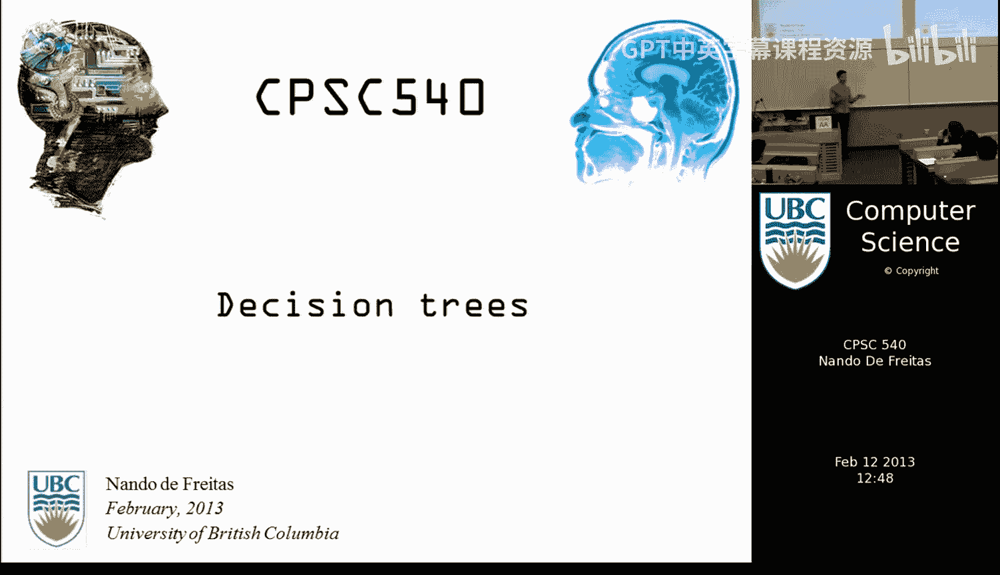

And so today I will focus on just a simple decision trace。So in particular I'll cover decision trees。

 I'll discuss how the concept of entropy used to build the trees。

 and hence's the reason why I ask you to do an entropy question for your last homework because we will use that result today。

And finally， how we use trees for classification。

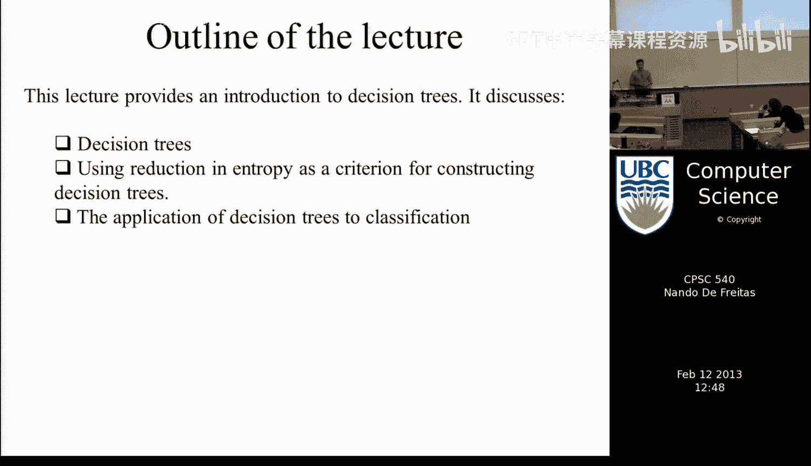

Okay， as I said， you've seen these。Let me adjust the lights。嗯。

You've seen these detections or faces with your cameras and that's basically built with the techniques that we're going to cover。

 but just like you use them to detect faces， you could use them to detect anything in this case you could use them to detect as in these pictures to detect pedestrians and that would be essential if you wanted to build automatic driving cars。

And for those of you who haven't seen the connect， that's pretty much what it is。

 So it's essentially。This device that's over here。 actually， I don't know。

 is this the connect for those of you who play with it。好啦。This guy。

 there' never no I've held one of these， I used to track grads here in the neuroscience lab once。

It didn't work very well because the sensor was designed for particular scale。

 so essentially what it is it's a sensor that projects an infrared grid on you so even if it's dark it works and so what it does it extracts a sort of a depth image。

And then where the random forests come in is a classifier that lets you predict whether something is a hand or a shoulder or an arm。

 et cea， so on Thursday I'll go over the details。嗯。

But what this enables you is to have something that's completely wireless。

 so you put the device there， the device projects a grid on these two folks here。And then。Basically。

 now they're immersed in this game。 So these characters here in the game on TV have exactly the same poses that they have。

Okay， so you can do assortmentmanship just by going like this without any wires。

 you don't need the we or anything like that。I think it the Connect holds a record if you go to the Wikipedia page for one of the highest salt consumer electronics after its release。

So even though this is just like a game， we're talking about billions of dollars。

In in this and the sort of the fate of a company， essentially。Okay， how does this work。So。

A decision tree essentially is a structure that will split data points that will categorize data points。

Into different bands。 So， let's assume。That。My data consists of this。Five cases。

So I have five data points。Two that are of the positive class and three that are out of the negative class。

Okay。So for example， I might be measuring height and weight。

 and then one class I'm saying whether you're fat in another class， whether you're thin。

Okay so I'm trying to have an automatic classifier that looks at people's height and weight and can predict whether they're fat or thin。

So we have two classes， we have five individuals in this case， and so what a decision tree does is。

 well， it's a tree as this picture shows， and we start with a root node。And。As we go down the tree。

 the first thing that happens is in the root node， you have access to five cases。

 and then you apply a decision so the decision could be something like is the height above2 meters。

So only one individual has height greater than two meters， and so that individual goes this way。

 all other individuals are less than two meters in height and they go this way。

And then I apply another decision， is the weight above 200 kilos， if the weight is above 200 kilos。

Then some individuals go this way and some individuals go the other way。

If you're short and you weigh more than 200 kilos， you' probably go in one direction and if you're told you go in the other direction。

And you keep applying these decisions until you get done。

 and we will talk today about how we construct such a tree。Just from date。

But assuming that you had a tree， this is what you would do， you would be splitting the cases。

 and then some leaks would be empty。Like these leaves。But for the leaves that have。嗯。

Cases of one class， you would know that if an individual， if you had a new point。

That you don't know whether it's green or red， so a test point。So this would be the train data。

If you now have a test data。Then you would just do these decisions and if the test data ends up here。

Then you know that it's red。And if it end up in a green leaf。

 you assign to it the class screen if and so on。So you assign to the point。

 the class of the color that contains。So here is another example where you have an image as input。

And then you can check your question might be， is the top of the image blue if it's yes？

Then you ask this next question， is the bottom part of the image blue？If it's not。

 the image goes this way and eventually it arrives at a leaf and all the images that are outdoor scenes are likely to arrive at that leaf following these decisions。

Of course， that's not going to be perfect because there's some stochasticity here。

The question being asked depends on your。That's correct， so to each node there is a question。

So a node in this case is just a question that asks that decides to split your left or right in this case it's a binary tree so every time an individual comes in that node makes a decision and then the individuals that go to the right encounter a different node as they go down and then again a new decision gets made about those individuals so essentially what we do is we take the training。

We will use the training data to construct this tree。

 but once we've constructed a tree in order to reach a decision you just follow these questions and then when you get to the end。

 the class that you get，That is green or red in this case will be what your neighbors are in that leaf。

 So if everyone in that leaf is red and you get that glass。In particular。For each。

You can think of a histogram here。Where。You would have three。Out of five red cases。

And where you would have。2 out of five cases。 So to each node， in fact。

 there is associated with such a histogram because， you know。

 you can always just count how many are green out of。

All the number of points there and how many are read。And so after that decision is made。

Once we reach this node here， the second node， we have half green and half red。So in this case。

 we have a half or two out of four。And as we proceed here， we will have one。

So if you happen to be a point。In this leaf。If you happen to be any point in this leaf and you do not know your color。

 then what I can say about you is that you are three fifth probability red。

And that if you go to the left， then you are 100% red。If you go to the right， you are 50% red。

50% green。 If you keep going to the right， then youre become 100% red。

So that's essentially what the tree is saying。还有如么只。Right。

 so let's make this more concrete So we could have。A data set that looks like this。

Where we have- so this would be our data， you would have five points， x1， x2， x3， x4 and x5。

Okay and then for each case， what you would have is really a vector that says what is the weight and what is the height？

And so for x1， it might be that you know that I don't know， these are two and。3。6。

Whatever the units are， five and 5。6 and so on。So to each x， there are sort of two coordinates。

 one that tells you say the weight of the person or the weight of the rat and the height of the rat。

And then you also have a corresponding label。

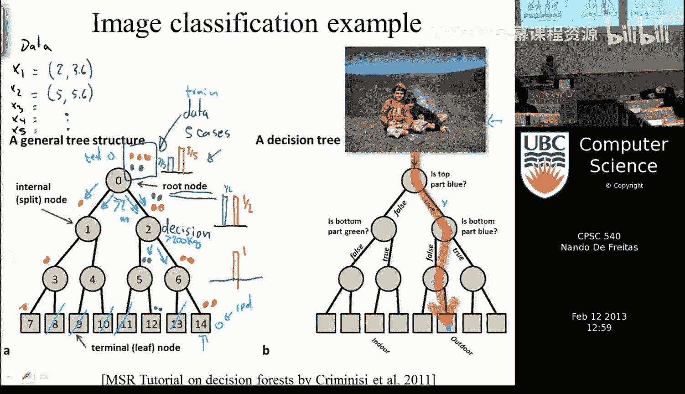

啊。And that label， I'm going to denote y1 and y2， y3， y4， y5。And that label just says。

What class you belong to， so in this case there are two guys that are green。

And two guys there are and three guys that are red。So you could think， for example。If one。One class。

Could be。Cancer。And one class could be not cancer。And this could be the level of。嗯。诶。

The level at which I don't know，2，2 genes might be manifesting themselves。

So let's assume that you build a microarray and you look at two genes and you just like check how much those genes are present in a particular individual。

 and so that's the input data and then the output data is whether that individual has cancer or not cancer。

Another example could be if those two numbers could represent， for example。

 the number of rooms in a house and the price that it was sold by the first time that it was built。

 and then that the label could be whether the house is expensive or not expensive。Does that clarify？

And so that's what we have here。 We have five data cases。

 and the diagram I'm just showing that if you had five data cases。And in your training data。

 and assuming that you have already built a tree， I have not told you how you build a tree。

 where these questions come from， that's what this lecture is going to be about。

 but let's assume that we had a tree。And let's assume that we had these five training data points。

 then essentially by。Following the tree， what the tree is doing is is bending。

All these50 individuals into different groups。Such that in some bins。

The probability that you're red is 100%， and in some bins， the probability that you're green is 100%。

 Therefore， if you now put in a new person for which you do not know，Whether they have cancer or not。

Where you do have the level of excitation of those two genes。

 then you would just follow for that person the questions in the tree。And if the person were to end。

 for example， at note 14 here。Then you would know that that person has to be read。

Because you would just based on the samples that everyone that ended up here was read。

So based on the sample statistics， you should be read based on the training date。Of course。

 with five data points， this is going to be a very noisy decision。

But you again would realize that as you get more and more and more data。

 such decisions will get a lot better。Okay， so that's basically go ahead。

I was just wondering when we're going through this tree。

The points get sorted 100% one way and 100% the other way。

 or can there be some probability of like a fraction going in one way and a fraction good question。

 So the next slide will answer that。So here here's another example of exactly the same thing in this case。

 instead of just having green and red， I have now four colors， so multiclass classification。

 you now are yellow， red， blue or green， so you could be four classes。And now， initially。

 if we look at this whole box。This whole box is basically the root of the tree。There are an equal。

 so this is important to get in this box， there is an equal number of green points and red points and blue points。

And because the numbers of each color are the same。The root node here。

Happens to have a histogram that has the same height for the four colors。

That' because there's the same number， those heights。

 they just counts relative counts of how many green points that are divided by the total number of points。

The points that have a color are the training date。The points that don't have a color。

 or in this case， they are gray， these are test data。Now， if your tree has already been built。

What we're doing essentially as we going down these leaves is we。

Getting different histograms for the points。And。In the previous case。

 it was clear that if a point it up somewhere， it was definitely green or definitely red。

 In this case， if an individual。If you take one of these gray guys。

And you propagate that gray guy and that gray guy keeps going this way when you ask the questions and the gray guy ends up here。

Then all you can say is that that gray guy is most likely a red， or in fact。

 you can say what a probability of the gray guy being red is。

 which in this case would be something like 0。8。But that gray geistyle would have a small probability at a 0。

1 of being yellow， 0。08 of being green and 0。02 of pink blue。

The height of those barsge must sum to one because it's a probability。

And it's the probability of it being of a class one， plus two class3 and class four。

 so it's the probability of the class， given the data point V。

 and in this case V is just a point in 2 d space。It was a question。So if it there some。Yeah。

 so if a point were to end there， you would not be able to assign it a。Because you just have no data。

This will work as long as there is data at the leaves and when we build the trees。

 we will build them only as far as there's still data。

 we wouldn't keep building them to the point where there wouldn't be data in practice。

So that's essentially a decision three， and the nice thing is if we had such a decision three。

 it would be very easy to look at it and see how the decisions are being made。

 so you would understand why a point ends in one lead or the other leaf because you can actually go and read the questions that are being asked。

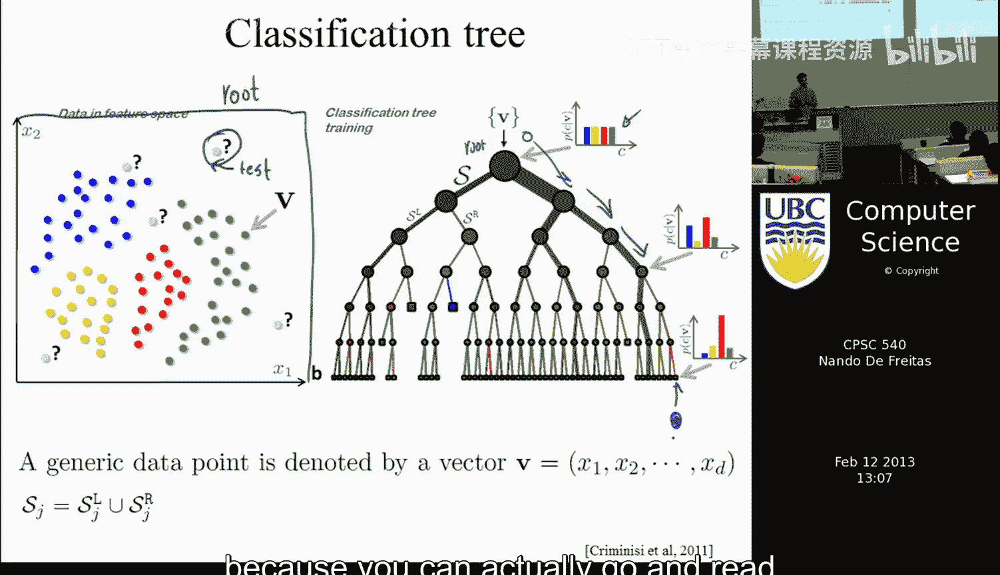

So let's look at an example of that， so here is something that was built for this company for customers。

And so this decision 3。Basically， has individuals。And then for this company。

 the first thing that they check is whether the total number of purchases of the customer is greater than $61。

000 or less than that。If this customer has spent less than $61，000。

 then most likely this customer is a known buyer。And if you know that the customer is a known buyer。

 that's fantastic because you don't need to waste your time。

addvertising to that customer or inviting that customer to your， I don't know， wine and cheese。

If however， that customer has made purchases higher than that value。

You then check how often does the customer do it， So the customer spends a lot of money and spends that money often。

And the customer often does exorbitant spending。And I have no idea what this means。

But eventually if your customers like。Spent Thrift。

 then your then you invite this targeted customer to your wine and cheese and try to sell the latest。

 I don't know， condo downtown。Okay， so。Again， here's an example of a tree that has already been learned from data。

 we still have not talked about how we learn such trees。

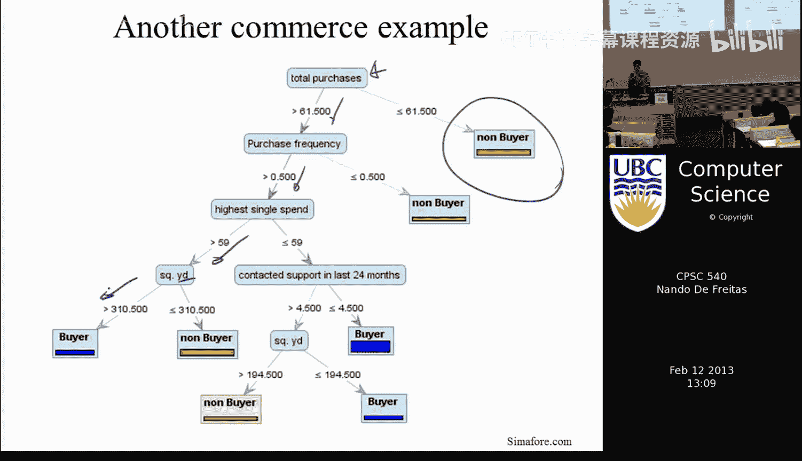

Let's now move closer to how we would learn a tree。Now we're going to build in short。

 we will learn the trees in a recursive fashion in in greedy fashion。

 so first we learn the root node and then we'll proceed to the next layer and we can do this Now it depends on different implementation。

 Some people like to go breadth first， some people don't mind going。

depth first up to a depth of say five， there's a lot of different implementation details。

 but let's assume we going breadth first， so you build the first one next you build the second level of the tree and so on。

嗯。So the first question would be how do you build the route Now let's first look at our data set and this data set comes from the artificial intelligence book of Stuart Russell and Peter Norwirick。

 These are some two of the is probably the best book in AI out there strongly recommended if you。

A interested in AI and even in machine learning， it very good has an excellent introduction to machine learning。

Okay， so in this example， there are 12 customers， 12 potential customers for a restaurant。

And a restaurant might just be trying to decide how to run its operation to maximize the number of customers that it can get in the business。

And so the restaurant is also trying to understand what makes customers spend money waiting line or not waiting in line。

they want to be able to change their operations to ensure that they get to most customers obviously they can't be super nice because they will lose money。

 but they also can't be completely awful and just turn everyone away because they will lose money that way too so they need to find the right compromises to ensure that there's a reasonable cue outside and to ensure that they don't lose people。

Okay， so。In this data set， each of these a is one custom。Okay。Each x is one custom。

 so we have 12 customs。For each customer， I record。This is a training data set。

 so these points are laid。For each customer， we will record several attributes of the customer。

And then we will observe whether the customer waited or didn't wait。

The weight didn't wait is the decision I。e。 the label。And in this particular data set。

 we have 12 customers。X1 all the way up to xx and so on。And。

The six of these customers waited and six of these customers didn't wait。

 And so each color point there。Corresponds。To one of these cases。

 so this guy waited and this one and this one。X1。Waitted。Thanks。Three x4， x6。And these are the guys。

The other guys didn't wait， so the false means that they didn't wait。

 so we am using a color to indicate false。Okay， so those are the 12 points that these points here。

 these are the 12 points that I have here。 Each point is a cast。Now。

 before I had the points being vectors in 2D。 Now they're no longer vectors in 2D。

 they' vectors in a higher dimension。 The number of dimensions is the number of attributes that we have here。

So the inputs in this case are things like， are there any restaurants nearby？

Does the restaurant have a bar where you can wait inside at the bar。Is it Friday？

Is the customermo hungry？Are there patrons inside that is are the customers sitting inside？

How expensive is the restaurant？

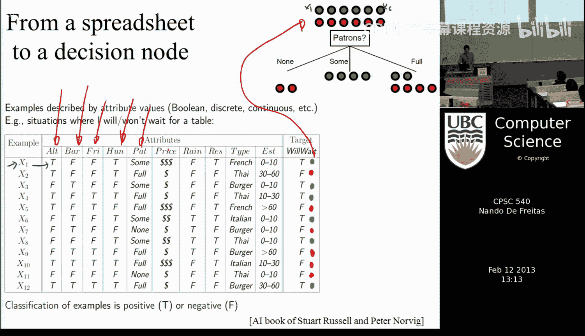

Your goal would be to build a tree that would look something like this， our end goal。

 this is where we're going， we want to have something that tells the restaurant。

 the first thing that people look at is whether there's patterns inside because when people go to a restaurant if that restaurant is empty on a Friday night。

 they just don't wait， they don't bother to go in。If that restaurant is too full and there's a lineup that goes around the block。

Then you probably also wouldn't wait。I don't know if you have ever watched- there's a beautiful Portlandland episode about the Brach place who's watched it。

He smiling。But you， some people do love to wait for one hour at the restaurant just because it's so popular it is where all the hipsters are and so on。

 and some people don't。So even when the restaurant is full， some people still wait。

 if the restaurant has people inside and the lineup is short， then everyone waits。Okay。

 and that's essentially and then once。And then once you check whether there's people inside。

 if there's people inside， but the wait is over an hour。

 then it's likely that you're not going to wait。What if there's people inside。

The restaurant is full and the waiting time is only 10 minutes， it's likely that you will wait。

 most people wait。And so you would reach this leaf。And so on。

 so this is what you would like to understand is to have a treat that completely describes the behavior of individuals when they're confronted with the decision of waiting or not waiting in line。

What can a restaurant do from their perspective？This is kind of a toy example。

 but what the restaurant could do is well they could just invite some people for free。

 they do happy hour at six o'clock to make sure that the restaurant always looks full when those seven o'clock start coming out for dinner。

So if a restaurant knows what variables are important in order to attract customers。

 they can now manipulate。

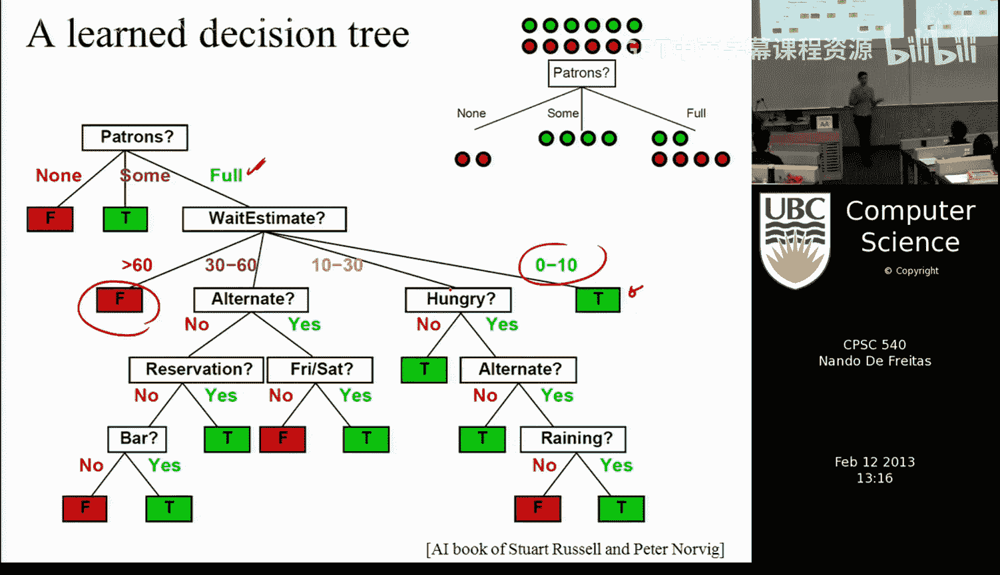

Okay， so now let's look at this variable， so the question though is how do we build a tree。

 why did I choose the variable patterns first？So let's examine the variable patterns。Okay。

 that's a variable that can take three values。And those three values correspond to。Some。

That is there are some people inside。And there are six cases of some。Oh， wait。 No， there are none。 I。

 I did want too many。Okay， those are the ones in blue。In addition， we have。In magenta。1。

 two cases of none。Now， the one thing you will notice is for the customers that in the case when there was nobody inside。

 the decision was read。And that's why。There are two red points。Com here。

Because those were the two customers who didn't wait because there was no one inside a restaurant。

And then， you have the customers。那个。Corresponding to four four of which there are exactly six of them。

And if you look at the green guys。This person didn't wait。There's a person waited。

This person didn't wait。This person also did wait， neither did this one。

 but this person did decide to wait。And in effect， two people waited and four people didn't wait。

Or when。When the variable patterns was set to full。Okay。So。When you learn a tree。

 you are given this table， that's your training data。A person can stand outside a restaurant。

And can fill in that tape。Type it into a spreadsheet on their iPhone。

And then they just check whether the person。Whether the custom waited or didn't wait。

 and so they enter green or red。So you build the restaurantroom builds that table。

 once you've built this table， then you can choose any of these attributes。

And the attributes being these columns， like patterns is an attribute。 bar is an attribute。

 Friday is an attribute。So you choose these columns and using these columns。

 you will construct a tree。Each of these attributes will be a node in the tree。

And each of these attributes has a set of options。 So for example。

 patterns breaks the data into three classes。 in this case， the three is not binary。

 like in the previous example， but there are three classes。Some variables like bar are binary。

 so you either have a bar inside or you don't have a bar inside and some variables are。

Have discrete ranges， like， for example， the estimated wait time is either 0 to 10 or 30 to 60 or 0 to 10。

So another thing that's very powerful about the decision tree is that you can have categorical data。

You can have continuous data as they input。Or you can have things where there is an order like the estimated time。

 or things where there isn't an order at all， for example， is it a French restaurant。

 is it a Thai restaurant， is it a burger joint and so on。

 so you can throw in any type of data and you will be able to build this tree。

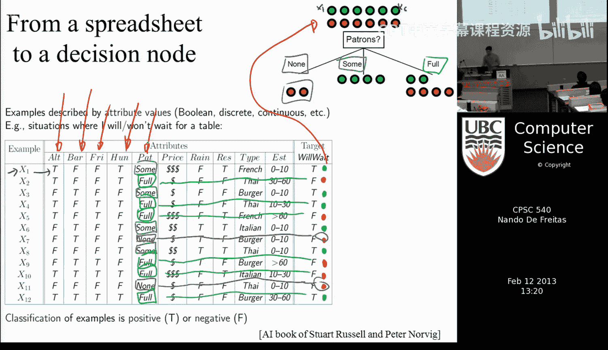

And when you build this street， the result of running one of these algorithms on building the tree essentially is this tree that I'm showing you here。

And the trees are not unique because we will build them in a greedy fashion。

Now why do we build them in a greedy fashion， we do that to avoid a combinatorial explosion。

 if you had to consider all the possible trees that you could get with all your data。

 you would not be able to do it attractively。So instead。

 what we do is we first decide what the first node should be。So in our case。

 we need to decide which of these columns， that is which of these attributes is the first one that we will use。

When when Stetuwart ran this algorithm， the machine decided that patterns was the first node that should be used。

And then it decided that the second one was the weight estimate and so on。Okay。

So in order to learn a tree， the first big question we have to decide is。

Which of the attributes to use first？If you have a data set。

 what is it best to use patterns or Friday Saturday。

 which variable will tell you the most about whether your customers will wait or not wait。

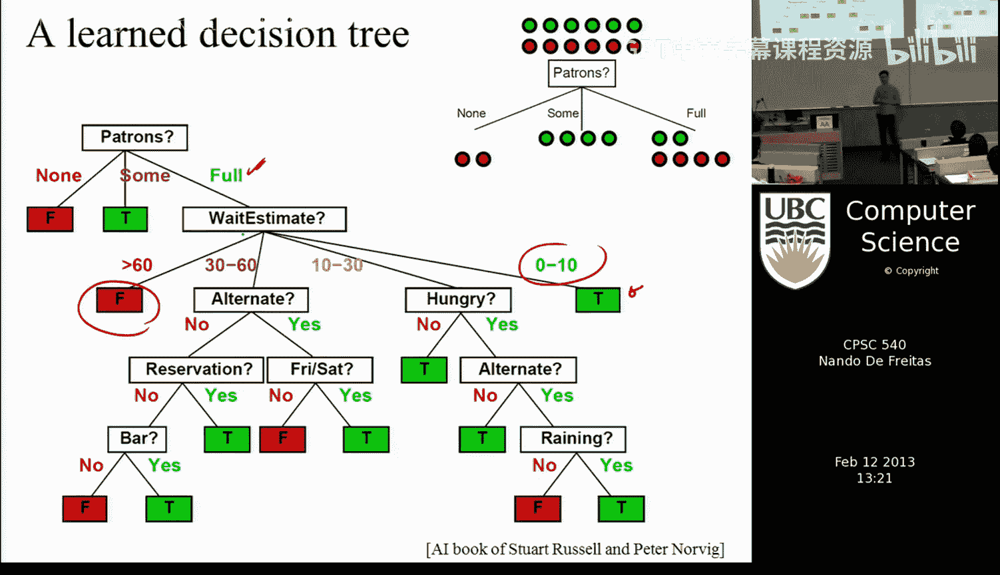

Essentially this question that we have here for two variables。I have two。Two possible questions。

 and if you look at patterns so we did the analysis in the graph and the table。

 when we looked at patterns， we had nus or four， and that was the distribution of how those customers got split by that decision。

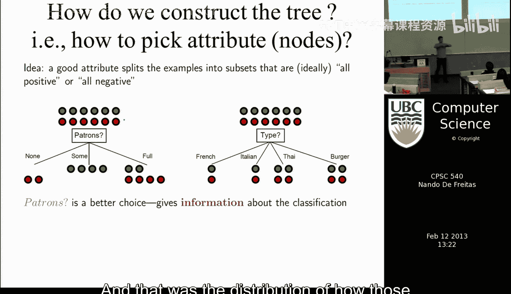

However， if we look at food type。

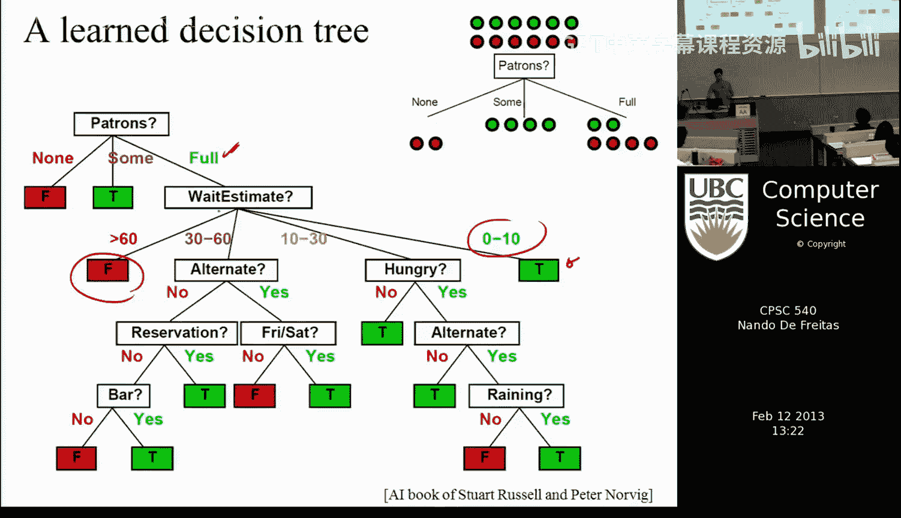

Okay， so if we look at this alternate node。Or decision variable or attribute。 for that variable。

 And there are precisely two。Of each kind， so if you are a French restaurant。

One person white and one person didn't white。If you're reti in the same situation。

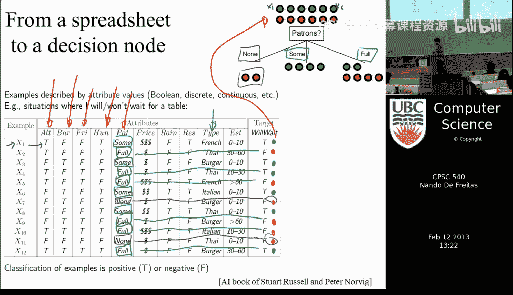

And so。So food type breaks into four categories， but the number of greens and the number of reds in each category is the same。

So one of those 12 people waited for a French restaurant and one of those 12 people didn't wait for a French restaurant。

and then same for Italian and then two for Thai and two for Burrg。So now the question is to you guys。

Oh actually I put the answer there so I can't take the question so I was going to ask you which one would you pick first if you were building a tree。

 would you use the one on the left or would you use the one on the right and unfortunately when I was doing the PowerPoint slide I included the answer at the bottom so you would pick the one on the left。

😊，Because the variable on the left is splitting。Your objective is to learn who waits and who doesn't wait。

So if you use a node like the one on the right， it's not going to help you because after you use that node。

The number of people who waiting who don't wait in the children of the node is still the same。

 so you still haven't made a decision。You've just delayed a decision。

 you wasted computation to delay the decision， but you have not split whereas on the one on the left。

 I already know that if there is no one inside。People don't wait if there are some people inside people wait。

 and if it's full， most people don't wait。did。That's correct。 So if you have。

 you don't want to build a tree that is wasteful。Because then youre wasting resources， memory。

 computation。Why do you need to decide？About the first node， Why don't you just。

And of decide on a few then views。Yeah奥。So you could just pick two nodes， like I said。

 as combinatorial。 you could start with， say， two nodes。 I mean， two it's still tractable。

 But we what I've argued is the way we want to build the trees is。

 we want to build it in a greedy fashion to make the computation tractable。 We want to choose。

 which is the best node out of all the attributes， which is the best attribute to split the data。

Once we've chosen that one， we need to choose the next one。And so we will build the tree top down。

One note at a time。And by doing that， the algorithm is going to be extremely efficient。

 going to be really fast。Now， the problem with it is that the tree will have barriers because all you need to do is change one color of these points and the tree structure change as you end up with a very different tree。

But that's where random forests will come in on Thursday。They will allow us to take all these trees。

 build a bunch of trees， and then you will average that uncertainty。

 so for now being greedy is not going to cost as much。Because there's this other trick that I。

That is going to come on Thursday that will sort out the problem。Okay。

 and so in order to make this decision， we will use the concept of entropy。

Because entropy is a measure of uncertainty。Or likewise or equivalently a measure of information。

The entropy of a binary variable。嗯。Entropy is just P log P。There's sum of a minus P log P。

 So essentially what we just need to look at， we have two classes。

Suppose the total number of points is the number of positive plus the number of negative。

And there are this many positive and there are this many negative。

 the entropy of this binary decision of you being positive or negative is just the number of the probability of positive。

Times the log of the probability of positive。Minus the probability of negative。

Which is the number of negative divided by the number of negative plus positive。

Times the log of the probability of negative。Okay， so remember that the entropy of P。

The entropy of a distribution pi。It just equal to minus pi log。H。Okay。

 just like in your homework assignment。嗯。And so for a binary variable there's only two outcomes。

 so the entropy you would have say only two terms， the term for the positive and the term for the negative。

 if your variable was not binary， but you say if it had three values。

 then you would have three terms， the number of points of one class。

 log the probability for that class， and then the second class and then the third class。

3 P log P terms。Once we have the formula for the entropy。

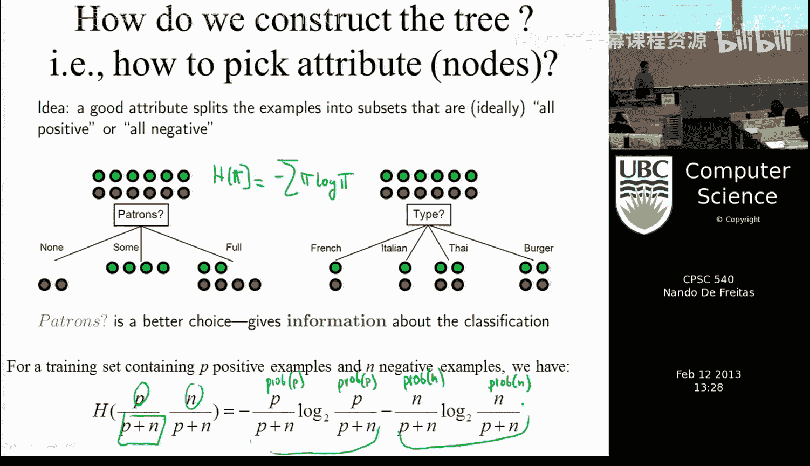

We're pretty much that， so let's a the knot an attribute， so a is one of those columns in that table。

And let's assume that that attribute can take k values。For example， patterns takes three values。

 none， sum or four。嗯。And let's say that that is dividing the training data。

The whole space of training data， which is say E into K plus， e1 to EK。Then for each class。

In order to compute， we compute this thing called the expected en。

So the game we will play here is maximum expected utility。

You don't know beforehand what's the probability that a point will end up in any of your children。

So you need to compute the expectation。When you split the data。

 there will be an certain entropy left in your children。And so what you do is you look。

 but you don't know how many points will end up in each leaf。But you can estimate it。

 you can estimate the probability， So we're going to do exactly expected utility。

 which is we're going to await the utility， which in this case is information is the utility measure。

 We're going to await the utility of each of your children node。For example， for patterns。

 there are three children。We would we would take the expectation。

Of those three utilities under the probabilities that they have。So， P。嗯。

For if the total number of points is p plus M， so the number of positives， the number of negatives。

Then， each leaf。The total number of points in A。So these will be the points。嗯。Child。I。

 the points that ended up in the child， divided by the points in the parent。

Gives the probability of that child being reached。And then。

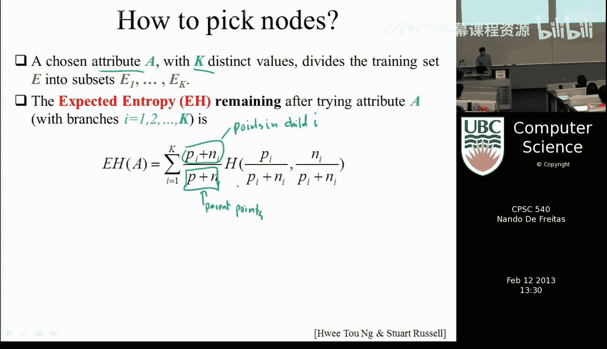

We look at the entropy of the child。So， for example。嗯。The probability。That you。

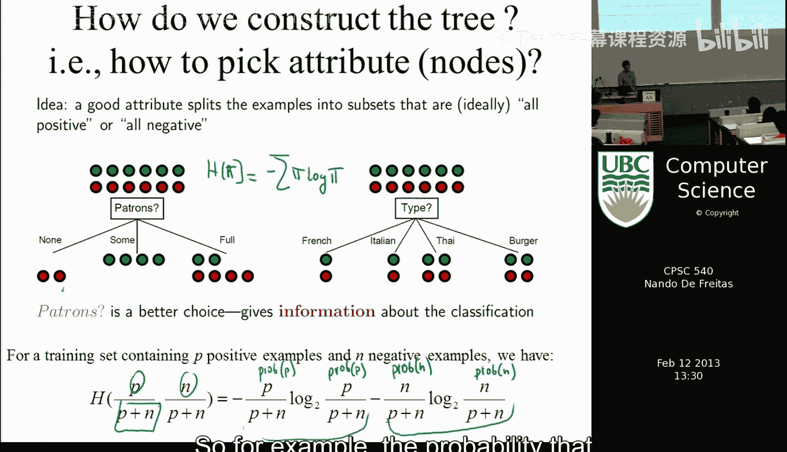

Actually， I have the example after。Okay， just bear with me and I'll give you a numerical example。

In addition， we're going to define a quantity called the information gain。

 or who I apologize that's been covered now。Also known as the reduction in entropy。

And so what we're going to look is。And is what is the entropy of a node？

And then once that node is used， what would be the remaining entropy of the children。

 and essentially you want to see how much by making this decision did you reduce the entropy？Okay。

If you've reduced the entropy a lot， you're doing well， if you haven't reduced the entropy。

 you're not doing too well。嗯。And essentially that's what we're going to use to pick which variable to use。

 we're going to apply the same calculation， which is this calculation here， sorry。

We're going to apply this calculation。Here， to each of your notes。

 that is to each of the columns in that spreadsheet。Or equivalently to each of those attributes。

 we will compute。This expected information gain。And then the one that has the highest information gain。

 that's the one we choose。If there's a tie， which just break ties random。

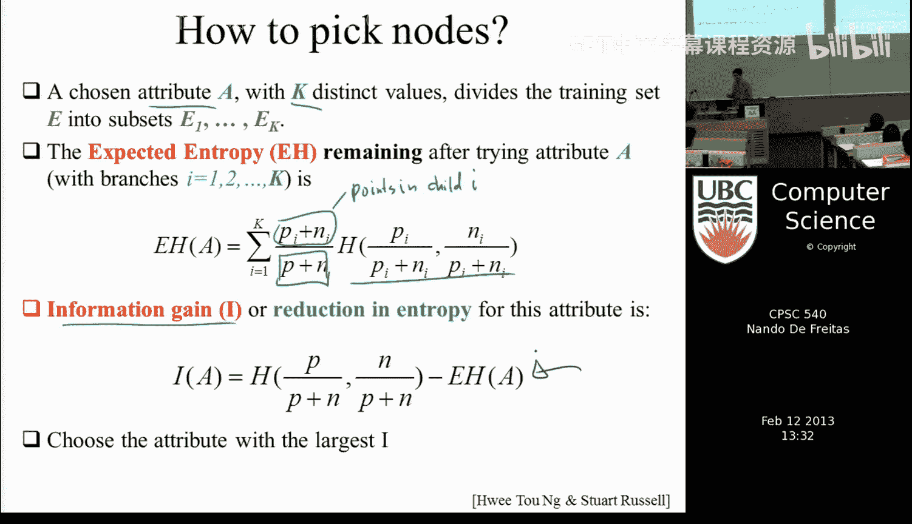

Here's a numerical exam。For the two variables， patterns and time。So what I would do， okay， so first。

 a definition， the entropy。So in that case， we have 12 customers。6 are green，6 are。Red。

 so the entropy of the root node， we have six out of 12 red and six out of 12 green。

 so we're looking at the entropy of a binary variable that has probability a half a half。And。

The entropy for a binary variable looks like this。And where P is the probability of green。

That entropy is higher at a half。And the unit that we used to measure it。Is bits。

 That's where the word bit， in fact， comes from that we use routinely in computer science。

 Shanon defined it as the entropy of a fair flip。At the point of the highest uncertainty。

So that's one bit。The measure entropy。And so。So we need now to compute。

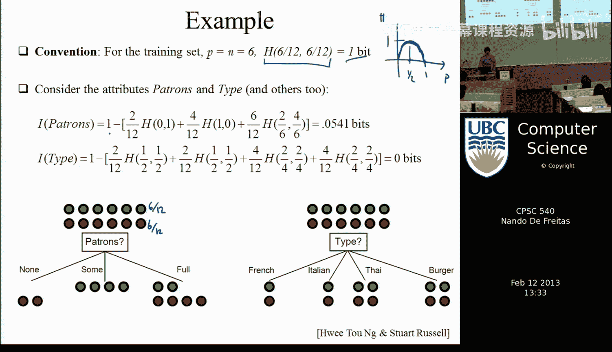

The entropy of the parent minus the expected entropy of the children。

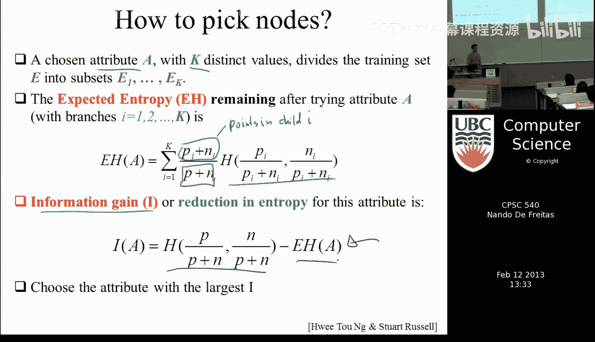

And so the entropy of the parent is always one。Because you have an exactly number of green and red。

In the patron's case and in the type of cuisine。But now for the children， in this case。

 the probability， so we'll look at the cases， there are three cases。In this case。

 two out of 12 people go this way。For our and。That's for class red。Then for class green。

Four out of 12 people go this way。And for this other class， which has。So this one was red。

 this is green。So in this case， there are two green and four red。

And so the probabilities are two out of six。Guys on this color and4。Actually， I think there's。Sorry。

What am I saying？Six out of 12。Guys ended up in this leaf。Okay， so。

That's the probability that you're going to end up in this leaf here。It's six out of 12。

This is the probability that you'll end up in this middle leaf。

And this guy here is the probability that you'll end up here。And then for each of child。

 we compute the entropy of the child。Of course。We don't know when a new point comes in which if it will end up。

 and so we we essentially but we do have estimates of the probabilities。

 and so essentially what we're doing is expected utility。Where the utility in this case is entropy。

And then we'll repeat the same procedure for here。And then we just look at these numbers。

 which one has the highest information gain？And then not surprisingly。

 patterns has the highest information gain。Because when you split the data of patterns。

 you end up with decisions。 you end up with groups that。You actually have information full。

So when you end up here in the class none， at that stage， there's no uncertainty。

 I know that if you end up there， you're read。Whereas here， if I end up in any of the children。

 the probability that youre green or red is still a half， so it the entropy is still very high。

 the entropy is still one， and that's why when you subtract the entropy of the parents minus the entropy of children。

 you get zero bits because you haven't gained anything by using that ver。

And so that's how we build a tree。 We take。Each of these guys。Individually， one by one。

 and we computetropy。And we compute information gain。

And then we just pick the one that has the information gain。We split the points at that stage。

 and then we repeat， we do this recursively。Yeahだ。Is a bit the same？嗯。It would be。how it would be。

A哈弗个哈。Plus a half， log half， so it's log half， yes。I'm just doing the atroic calculation in my head。

P log P minus。Sorry， minus P log b， minus1 minus p log of 1 minus B。I think it should be。941 is7。

 zero54。Parton。Oh I put one too many zeros。 Yeah， I think last year that someone pointed a typo。

So I think that's the type of thanks for correcting。

Okay so my advice is that this is who the guys in 340 you also this in the final exam okay this is a beautiful question to ask about trees because you can do this calculation by hand so my advice to you is go home do this calculation make sure that it's clear Thursday's lecture is how to use trees to build forest if you haven't understood today's lecture then there's no point in Thursday's lecture so what I advise you is trying to do this calculation and if you're having trouble come to the office hours so that we can help you。

Okay， but the concept is quite easy。 You pick one node at a time。You split the data。

And you pick the node at highest the highest information can， once you're done with that。

 you move to the next node and you repeat the process。

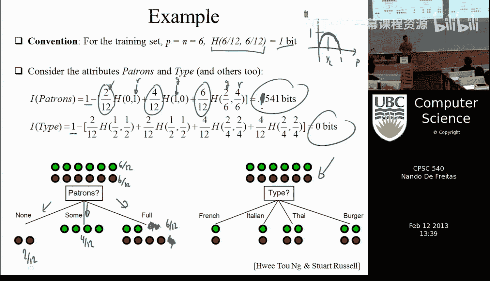

Okay， how do we do this for data that are containers like in A2？And here， by the way。

 I'm using a technical report by Antonio Criminisi。

So if you think your project will be about classification。

Then I strongly recommend you actually start reading that before Thursday so that you can fully get Thursday's lecture and have a good start into your project。

I posted this in Google group， the actual link to the paper。It it's in in your email folder。嗯。Now。

 if we have points in 2 d， so in this case， V is a point which has x and y coordinates。

 a continuous point。What we can do in this case is we can choose the points。And access the line cuts。

To make the decisions。For example。I could just pick a point here。

And choose anaxes aligned aligned decision。So that's my decision I'm going to call Theta。

So that's my attribute， in this case， I haven't been given attributes。

So I'm going to create attributes。And one possible way to create attributes is to look at the projections of the points in the x direction and in the y direction as the attribute。

So this would be one attribute。 Another attribute could be。Deis line。

 another attribute could be this and so on。And in fact。

 and the way it's described in Antonio's paper， what they do is I think they just pick a bunch of random。

Aces a line attributes， so en accesses a line because they are the vertical or horizontal。Now。

 if you do this， you can think of this as your first node in the tree。That first node splits into。

Two classes， one class that is mostly blue and a little bit of green and a class that is either yellow。

 green， or red。So we do this note one。Then as we go down。And we go to node two。For not two。

 we might choose this decision。That if it's to the right。If x1， so essentially the question here。

 if this value here is theta， the question is， is x1 greater than theta。

 if x1 is greater than theta you send us points to the right。

 if it's less than theta and theta is just a number like 0。7， if it's greater than 0。7 to the right。

 if it's less than 0。7 to the left。And if you keep following these decisions。As you can see。You know。

 you might end up now with a leaf where most of the points are red。 so in this case。

 we're not given a column of attributes， but what we can do is we can take a bunch of vertical lines。

And in fact， there are several ways you could do it。

 one way people do is for each point they place a line。Or they just pick a？

A regular interval of lines。How you choose that， it doesn't matter。

 there's different implementations， but let's just say that you have a bunch of vertical lines。

 a bunch of horizontal lines， these are essentially your attributes and then you take each of those lines and you check which one has the best information gain and then you choose that one first and then you move on to the next case。

And that's essentially how this tree was built。And then when a new point comes in。

You just apply those decisions to that point， so this point here comes in， you check first check。

 is it above。Let's say that this is 0。6， is it above 0。6 or below if it's above。

 you send it to the right， if it's below， you send it to the left， in this case it goes right。

And then then it arrives at node2， at node2 you ask is it to the left of theta or is it to the right of the。

 okay it's to the left so you send it left and you keep making these decisions with the point as you pass the point further and further until the point arrives here when the point arrives here。

Your answer is this。Histogram。Your answer is， okay， for that test point。

 this is it most probable that it will be red and the exact probability that will be red is whatever the height of that red bar is。

So we actually give you the probability of the point being of each class。

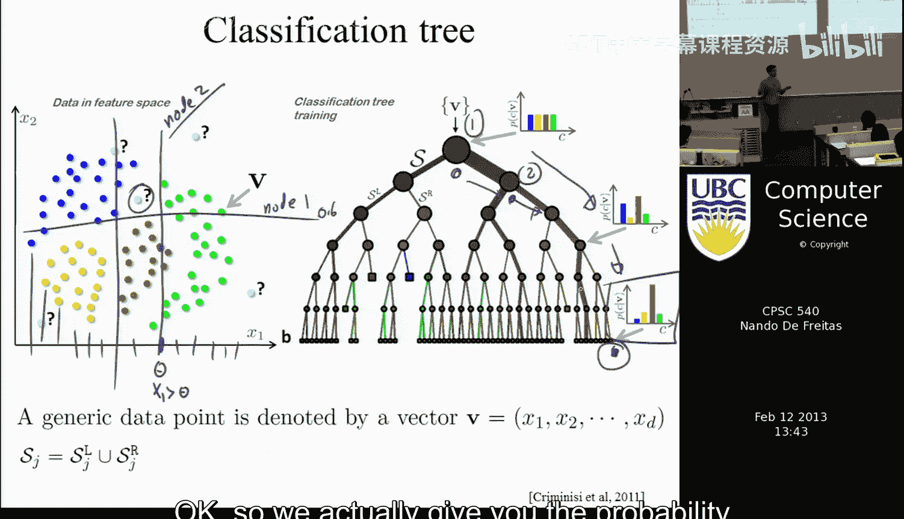

Okay， so here's an illustration where we take。Of and how entropy is used。

We assume that I have a node SJ。And that note， S J， can either go。Is binary？And so， you end up with。

The left children of SJ or the right children of SJ。

And so essentially what we do is we compute the entropy of Sj and we subtract the expected entropy of the children。

And。This term here。It's just the probability of ending on the left or the probability of ending on the right。

 the sum is off at the points of went left， the points of went right。So here is two cases。

You can either use a horizontal split。If you use this split here。

Then you'll see that you'll end up on top， you have a few red， you have some blue。

 most of the yellow are there。If you， on the other hand， use this decision here。

You'll see that you're splitting all the blues and greens to the left。

 and that's why the points on the left will have this histogram。And the yellows and red here。

 so this seems to be a nice decision and so the information gain here is 0。69。

 whereas the information here is only a 0。4 so we go with this guy。

And we don't go with this guide because we choose the guy that has the highest information game。

So but we don't just consider two splits， we consider all possible splits， a large set of splits。

 the Microsoft actually just draws these splits at random if you just pick a bunch of random splits in that range you'll actually get pretty good results。

Especially when you do random forests。You have。ジートゥ最近。Your actions。Right。

 so you could do a dimensional action， but you wouldn't even need to。

You could just pick any that you could be in。The 20000 dimensions。 but actually。

 that brings another point， which。I was planning to cover this on Thursday， right here。

 I'm just choosing splits。But if I have 20，000 dimensional vectors。

 what I can do as well is I can first choose which dimensions to use because dimensions are just attributes。

 so I will pick say 10 dimensions and then for each of those10 dimensions I will consider five splits。

And those will be my notes， that's how our construct tree。And when we do random forest。

 we will actually use this randomization。Let's say you have some constraints。 for example。

 you want exactly four clusters。 How would you integrate it。The吹。So right now。

 we're saying that we want four classes， that's integrated。Because I'm saying my labels。

This is a classification problem， so a cluster。Is a class。 And in this case。

 the colored points there are training data。 I actually know their label。So because I know the label。

 I know there are four classes。But this will assure。That in the real that， after the training phase。

 you will also have for。That's correct。So the assumption here is you classifying into four groups。

And you know those groups in advance， you can use random forest for unsupervised learning when you don't。

Where you're trying to figure out what cluster does， when you're trying to do density estimation。

That is covered in the report of Kmin E later on。 I'm not going to cover that in class。

 but you could use it that way。

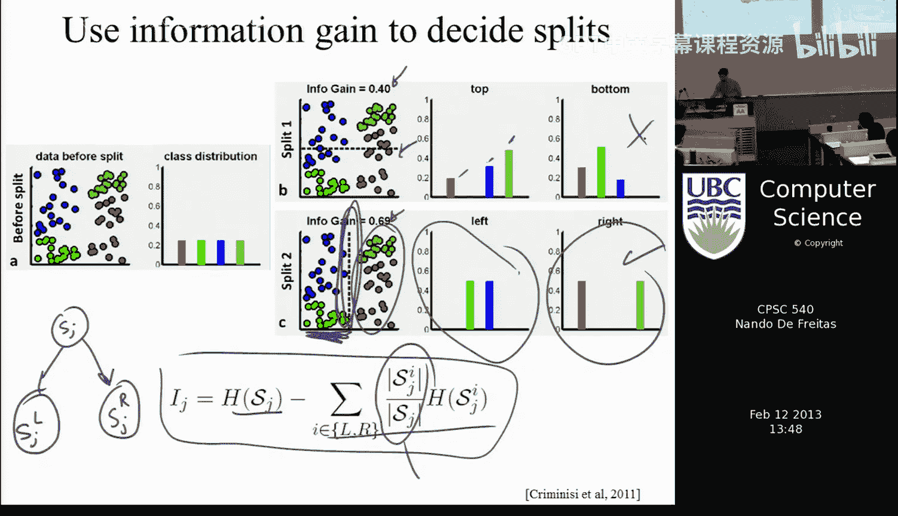

Okay， now this is why I ask you to do this calculation in the homework I've been assuming that I have discrete classes that I'm splitting the point into K classes for in the previous example。

But you could also use random forests for。Where instead of assuming discrete class probabilities。

 you actually use Gaussians to model the class probabilities。

 so you basically take the points that fall in a leaf。And if these are points in 2D。

 you could just compute the average and the variance。

 and so you fit the Gaussian to the points in the leaf。So like in this example here。

When my decision is this vertical bar。I end up with these points on the right。

 and then what I do is I just fit a Gaussian to this point。

And Ive fed another Gaussian to the points， resulting。

In this plot that I'm showing it here on the right。And。And then if I use a different split。

 these are the two Gaussians that I get and in this case the one at the bottom has higher information now how do we measure higher information when you have Gaussians。

 we use the formula that you all proved in your homework。So if you use Gaussians。

 it's exactly the same procedure， except that instead of modeling。The points as being of K classes。

 you're now modeling that there's sort of a distribution of the points。H unsupervised。

This one is still supervise because here I'm saying you。Oh， I see what you're going on about。嗯。No。

 here you still would be supervised， but it's just you're just saying the label of the point。

 the label is not going to be。Red， green blue， it's not going to be categorical。

 but the label of the point will actually be a continuous number， so in effect。

 rather sort of think of a surprise surprise， think of this as regression。

Where you now want to evaluate the height， the probability of it being。

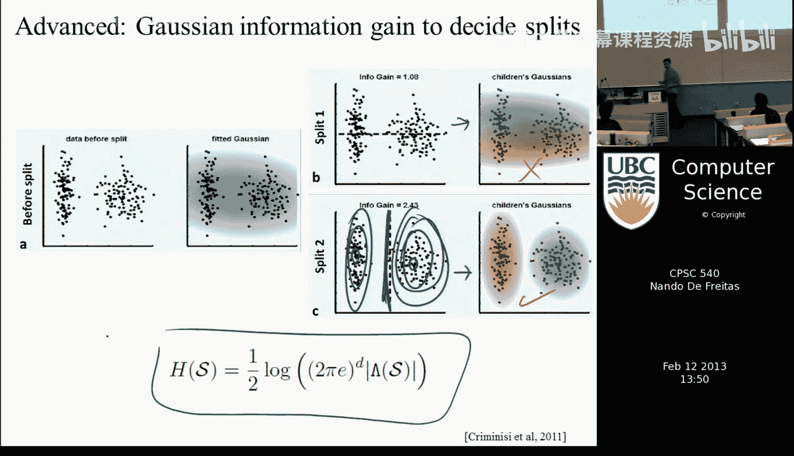

Green。And this essentially something that I've already gone over each split。Corresponds to a node。

 and each of these splititz is parametertriized， so basically the height。In this case。

 is' the parameter。When a point comes in， that's decision function。

Besides whether the point goes left or whether it goes right。

 the way we make the decision is by maximizing the information gain。

And then when you end up at a leaf node with a certain population of greens and blues and so on。

 like for example， for this leaf here， most of the points are green。

 most of few points are blue so we end up with a Instagram that looks like this。

 so that's pretty much a summary。Exactly how you do classification。

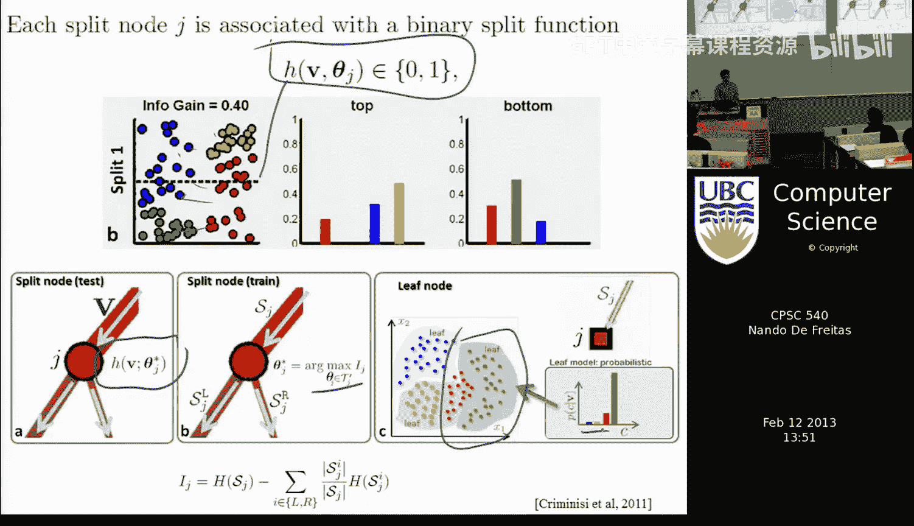

嗯。I talked about a aligned and that's all I'm going to discuss in the course。

 but if you look at the report of Criri see they discuss non actes aligned， so for example。

 this case，Where you could use a bunch of lines just drawn at random without necessarily being access as a line。

Orread instead of using lines， you could even use quadratics。Okay， so this sort of details。

Of how you go about implementing these， and when you build trees， you actually make a lot of choices。

And you could use basin optimization to automate those choices and the of my students when they run trees。

 they actually optimize the tree automatically， they choose the max depth。

Whether with the type of decision that you use， how many dimensions you sample， et cetera。

 all those upper parameters that you can tune automatic。But it。In the next lecture。

 when I talk about running For， I'm going to go over all these decisions。

And how they I'm going to basically show you plots showing how each of these decisions affects the date。

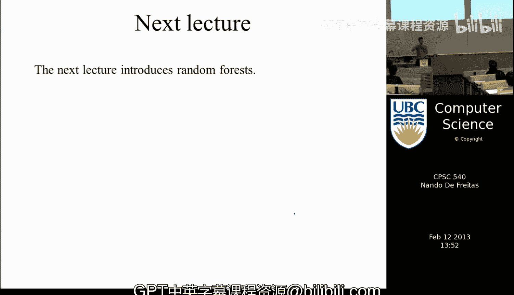