# 机器学习：11：决策树 🌳


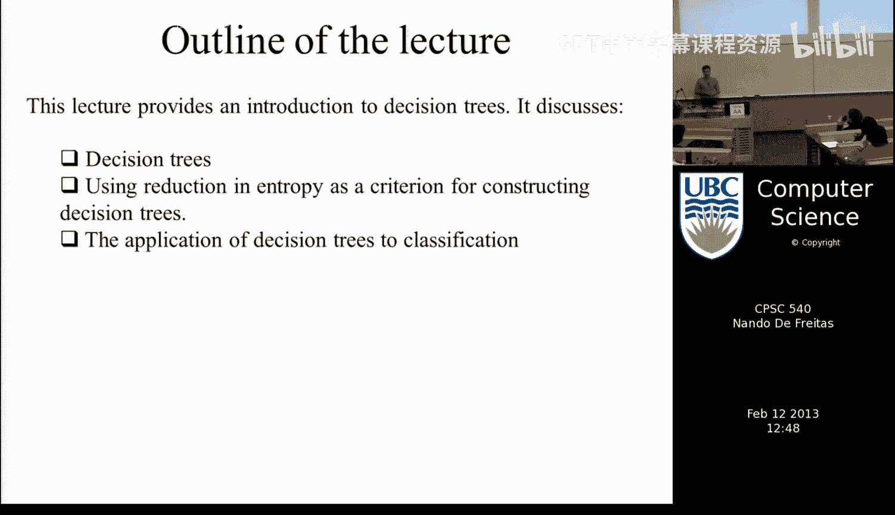

在本节课中，我们将要学习决策树。决策树是一种非常流行的机器学习技术，它通过一系列规则对数据进行分类或预测。我们将从决策树的基本概念开始，了解其结构和工作原理，然后深入探讨如何使用熵和信息增益来构建决策树，最后学习如何应用决策树进行分类。

---

## 决策树简介

决策树是一种树形结构，用于对数据点进行分类。它通过一系列决策问题将数据点分割到不同的分支中，最终到达叶节点，叶节点代表一个分类结果。

上一节我们介绍了决策树的基本概念，本节中我们来看看决策树的具体结构。

决策树包含以下组成部分：
*   **根节点**：树的起点，包含所有训练数据。
*   **内部节点**：每个节点代表一个决策问题（例如，“身高是否大于2米？”）。
*   **分支**：代表决策问题的答案（例如，“是”或“否”）。
*   **叶节点**：树的终点，代表一个最终的分类或预测结果。

以下是决策树的工作流程：
1.  从根节点开始，根据数据点的特征回答决策问题。
2.  根据答案，沿着相应的分支移动到下一个节点。
3.  重复步骤1和2，直到到达一个叶节点。
4.  将该叶节点的类别（或概率分布）分配给该数据点。

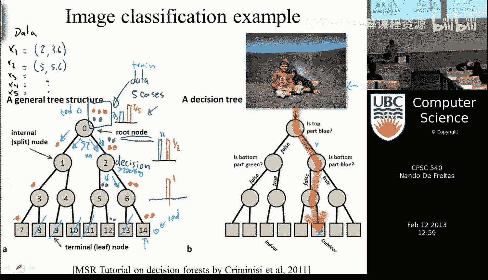

例如，在一个根据身高和体重判断“胖/瘦”的分类器中，决策树可能首先询问“身高 > 2米？”，然后根据答案继续询问“体重 > 200公斤？”等问题，最终将个体分类到“胖”或“瘦”的叶节点中。

---

## 决策树的应用实例

决策树因其可解释性，在商业分析等领域有直观的应用。例如，一个公司可能使用决策树来分析客户行为。

以下是客户分析决策树的一个例子：
*   **根节点决策**：客户总消费额 > $61,000？
    *   **否**：客户很可能是“已知买家”，无需额外营销。
    *   **是**：进入下一层决策。
*   **内部节点决策**：客户消费频率高吗？
    *   **是**：客户属于“高价值常客”，进行重点维护。
    *   **否**：进入下一层决策。
*   **叶节点决策**：客户是否进行“奢侈消费”？
    *   **是**：邀请参加高端活动（如品酒会）以推销高价商品。
    *   **否**：采取标准营销策略。

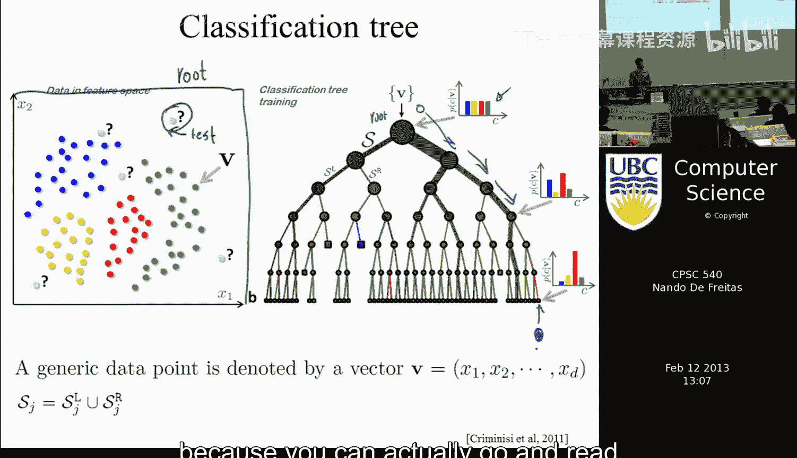

通过这样的树，企业可以清晰地理解不同决策路径对应的客户类型，并采取相应行动。

---

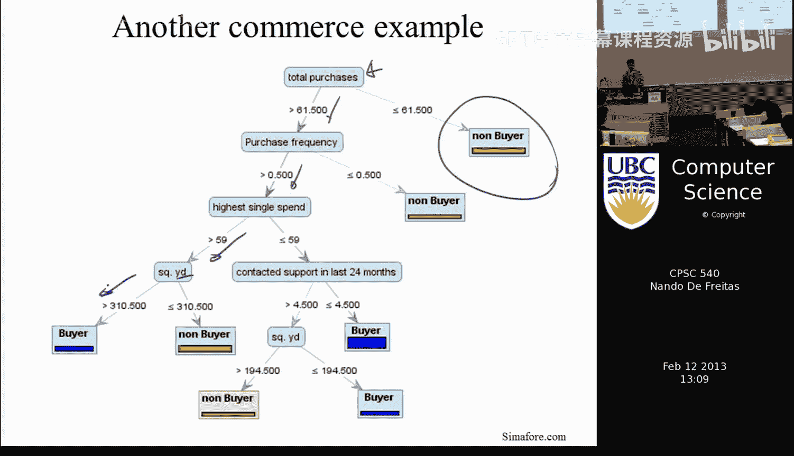

## 如何构建决策树：选择最佳属性

构建决策树的核心问题是：在每一个节点，我们应该选择哪个属性（特征）来进行分割？目标是选择那个最能“纯化”子节点的属性，即让子节点中的样本尽可能属于同一类别。

为了量化一个属性分割数据的好坏，我们引入**熵**和**信息增益**的概念。

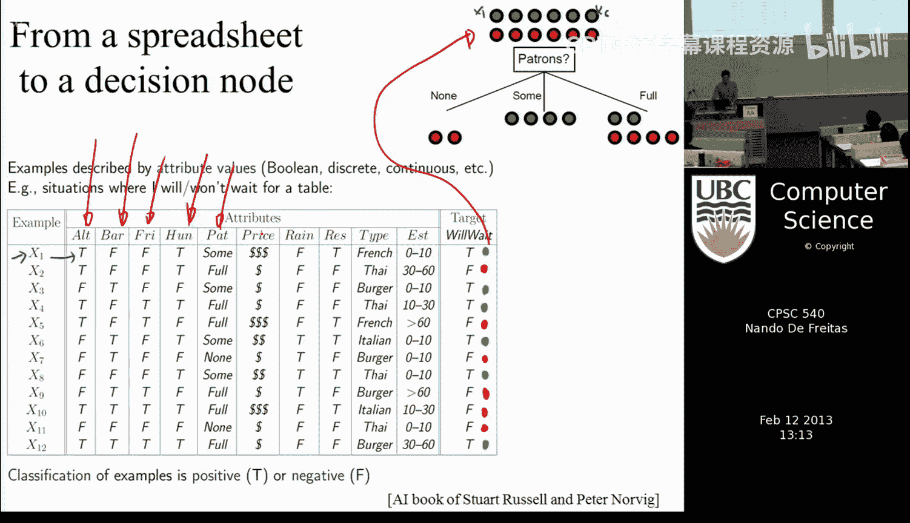

**熵**是衡量系统不确定性的指标。对于一个具有`K`个类别的数据集，其熵`H`的计算公式为：

```
H = - Σ (p_i * log₂(p_i))， 其中 i 从 1 到 K
```

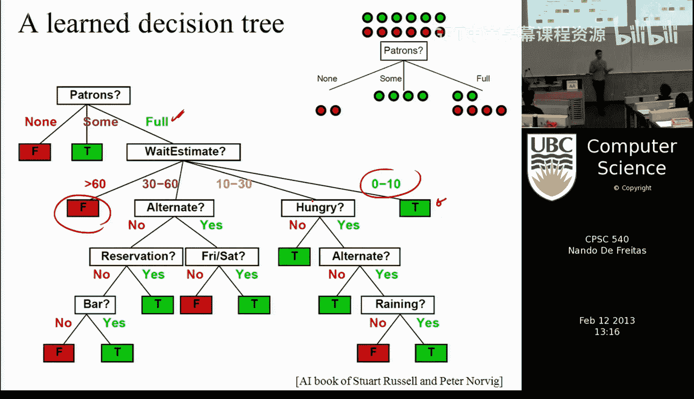

`p_i`是数据集中第`i`个类别所占的比例。熵值越高，表示数据的不确定性越大（类别分布越均匀）；熵值为0，表示数据完全确定（只包含一个类别）。

**信息增益**是指父节点的熵与子节点熵的加权平均之间的差值。计算公式为：

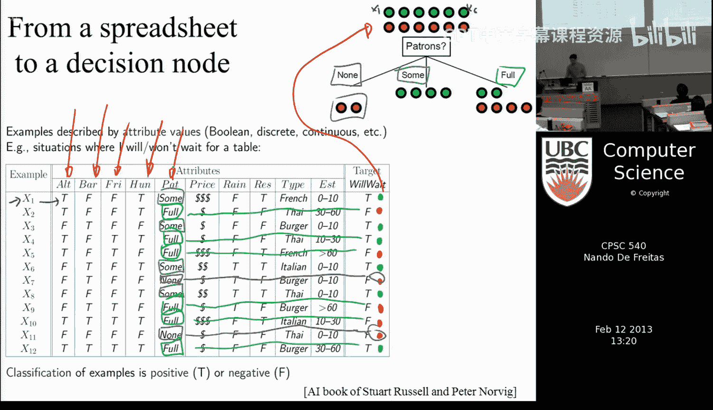

```
信息增益 = H(父节点) - Σ ( (|S_v| / |S|) * H(S_v) )
```

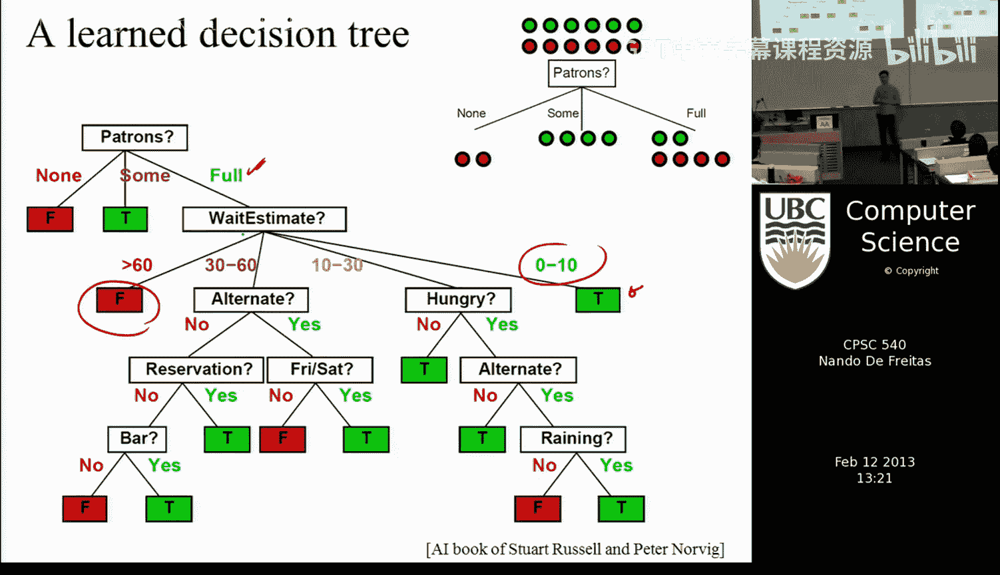

其中：
*   `H(父节点)`是分割前父节点的熵。
*   `S_v`是分割后属于第`v`个子节点的样本集合。
*   `|S_v|`是子节点`v`中的样本数量。
*   `|S|`是父节点的总样本数量。
*   `H(S_v)`是子节点`v`的熵。

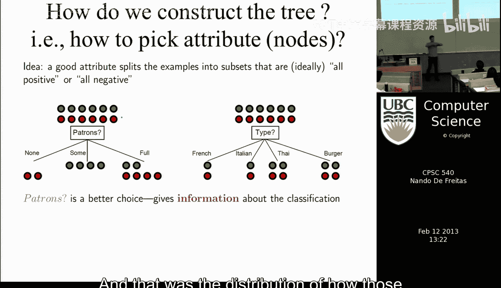

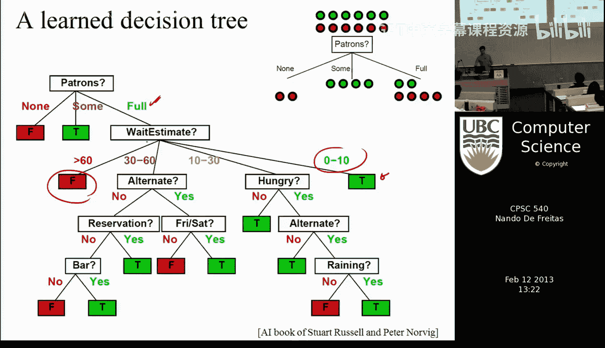

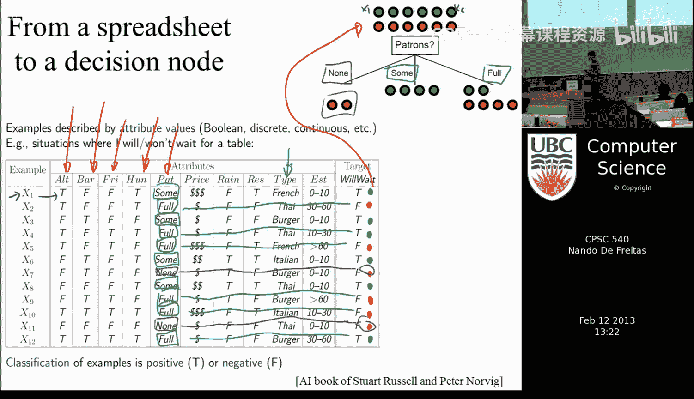

信息增益越大，说明使用该属性进行分割后，子节点的“纯度”提升得越多，不确定性降低得越多。

---

## 构建决策树：具体步骤与示例

构建决策树采用**贪心算法**，自顶向下递归进行。在每一步，我们都选择能带来最大信息增益的属性进行分割。

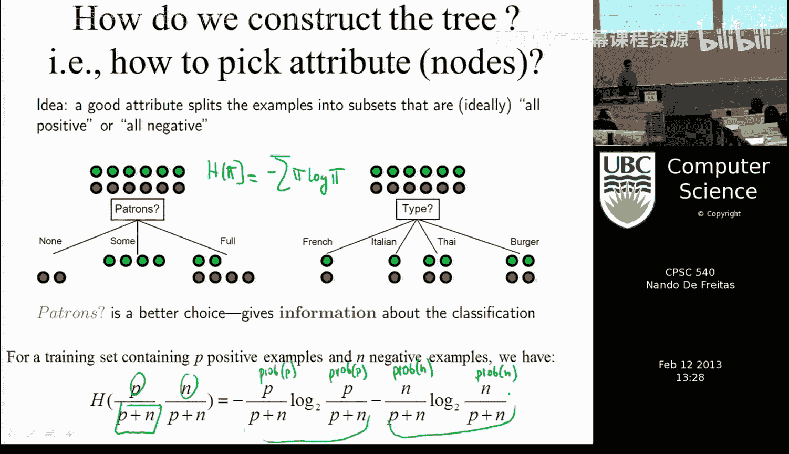

让我们通过一个餐厅顾客等待的示例来具体说明。数据包含12位顾客，特征有“店内人数”、“是否有吧台”、“是否周五”等，标签是“等待”或“不等待”。

首先，计算根节点的熵。根节点有6个“等待”（绿色）和6个“不等待”（红色）的样本，因此熵为：

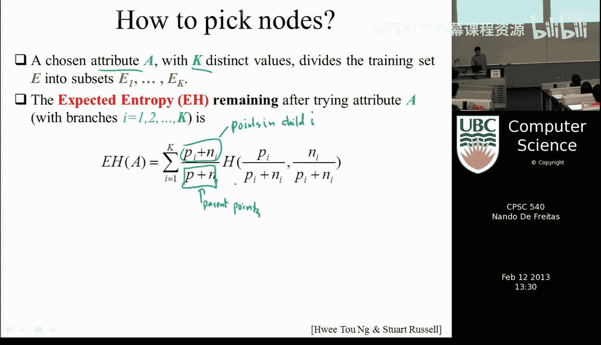

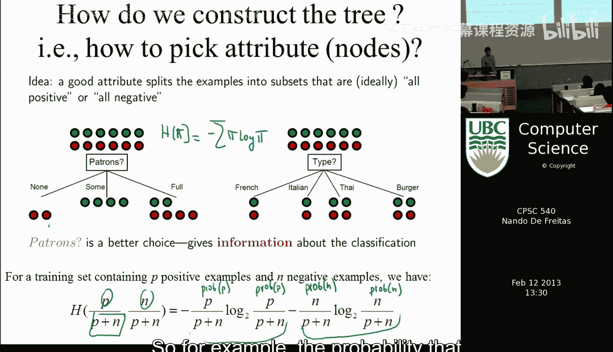

```
H(根节点) = - [ (6/12)*log₂(6/12) + (6/12)*log₂(6/12) ] = 1.0 比特
```

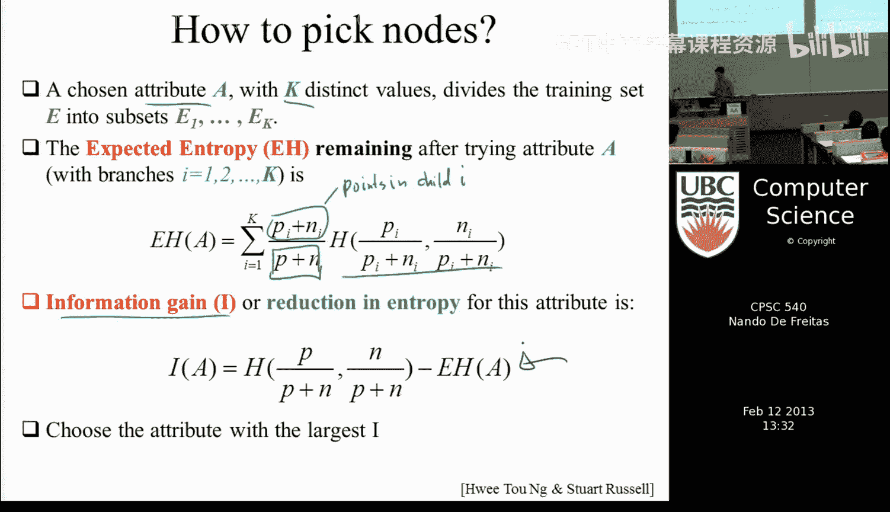

接下来，我们评估每个属性。以“店内人数”属性为例，它有3个取值：无、一些、满。

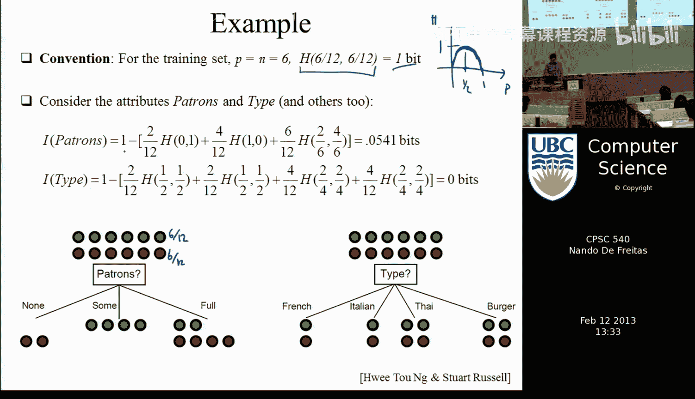

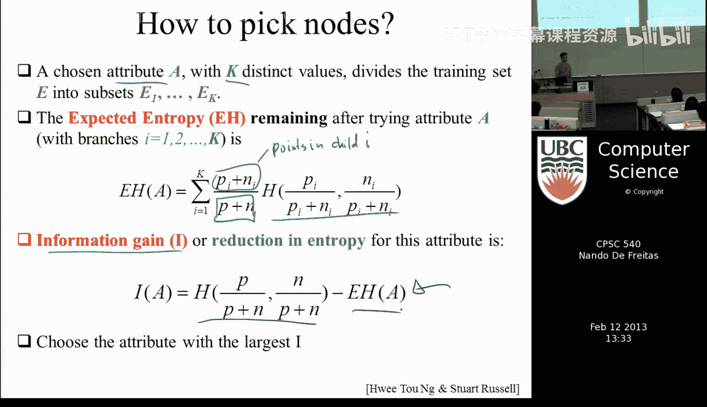

以下是“店内人数”属性分割后的子节点情况：
*   **取值“无”**：2个样本，都是“不等待”（红色）。熵 `H = 0`。
*   **取值“一些”**：6个样本，2个“等待”，4个“不等待”。熵 `H ≈ 0.918`。
*   **取值“满”**：4个样本，4个“等待”，0个“不等待”。熵 `H = 0`。

然后，计算该属性的信息增益：
```
信息增益(店内人数) = 1.0 - [ (2/12)*0 + (6/12)*0.918 + (4/12)*0 ] ≈ 0.541 比特
```

我们同样计算其他属性（如“食物类型”）的信息增益。发现“食物类型”分割后，每个子节点内“等待”和“不等待”的比例仍接近1:1，熵很高，信息增益接近0。

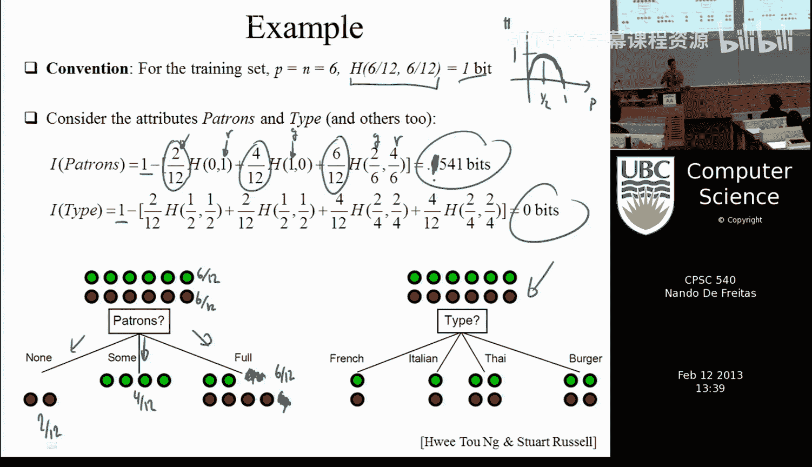

因此，我们会选择信息增益最高的“店内人数”作为根节点的分割属性。之后，对每个子节点递归地重复此过程，选择剩余属性中信息增益最大的进行分割，直到满足停止条件（如节点熵为0、达到预设深度或样本数过少）。

---

## 处理连续值与高级分割

当属性是连续值（如身高、体重）时，我们需要将其转换为二元决策。常见的方法是选择一系列**阈值**（例如，`身高 > 1.8米`）。

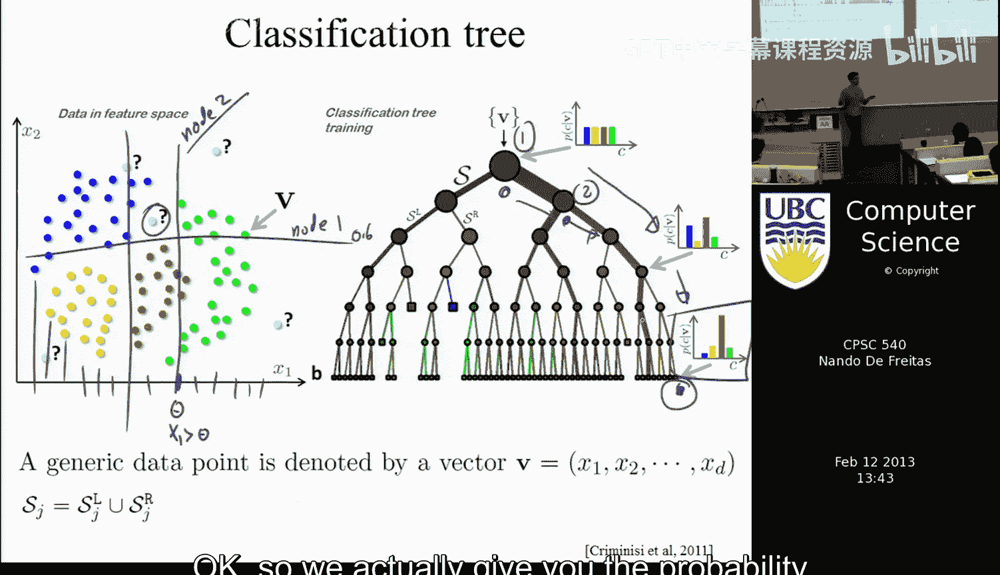

以下是处理连续值属性的方法：
1.  对连续属性进行排序。
2.  考虑每两个相邻值之间的中点作为候选阈值。
3.  对于每个候选阈值，将数据分为“大于阈值”和“小于等于阈值”两组。
4.  计算以该阈值分割所获得的信息增益。
5.  选择信息增益最大的阈值作为该属性的分割点。

此外，分割方式不限于与坐标轴平行的直线（单特征阈值分割）。在更复杂的模型中，也可以使用斜线甚至更复杂的函数进行分割，这可以更好地拟合数据，但计算复杂度会增加。

在叶节点，我们不仅可以输出单一的类别标签，还可以输出类别的**概率分布**。例如，一个叶节点包含8个红点和2个绿点，那么对于到达此节点的新数据点，我们可以预测其为红色的概率是80%，为绿色的概率是20%。

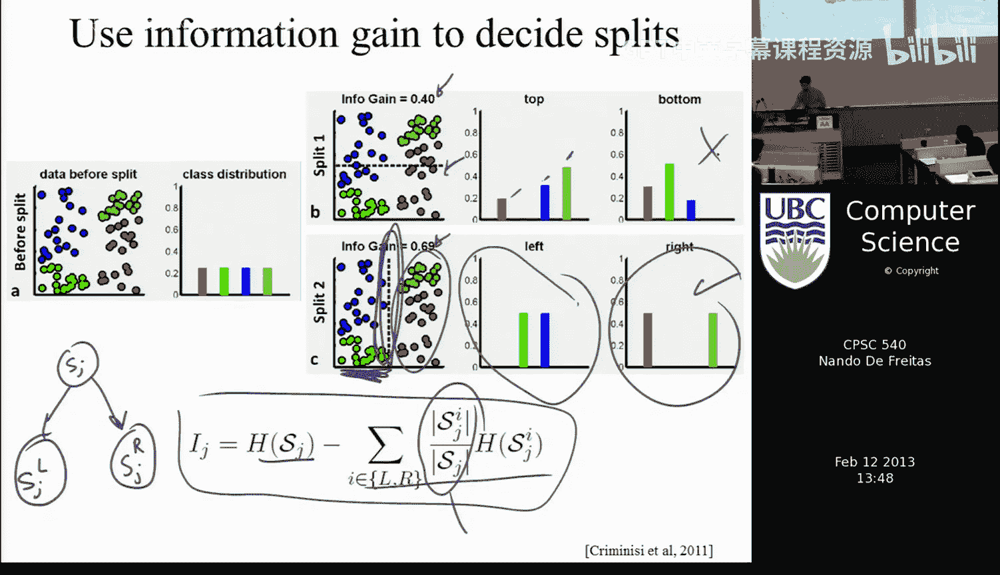

---

## 总结

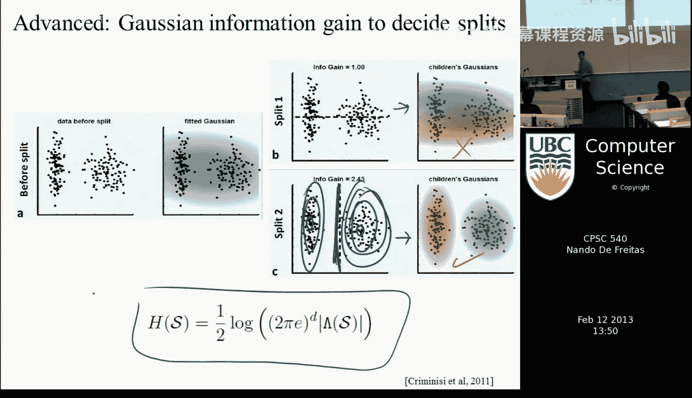

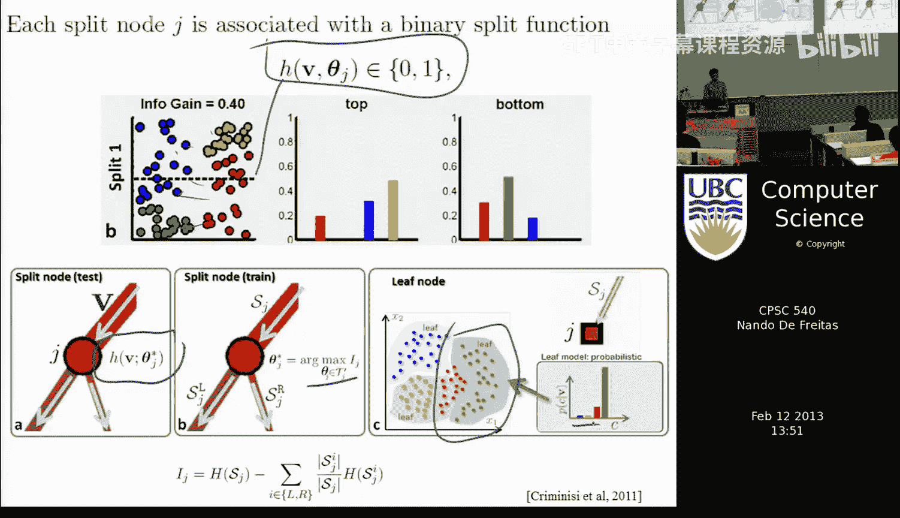

本节课中我们一起学习了决策树。
*   我们了解了决策树是一种通过一系列规则进行决策的树形模型，结构清晰且易于解释。
*   我们学习了使用**熵**来衡量数据的不确定性，并使用**信息增益**来评估属性分割数据的有效性。
*   我们掌握了构建决策树的**贪心递归算法**：在每一步选择信息增益最大的属性进行分割，直到满足停止条件。
*   我们还探讨了如何处理连续值属性，以及在叶节点输出概率分布的方法。

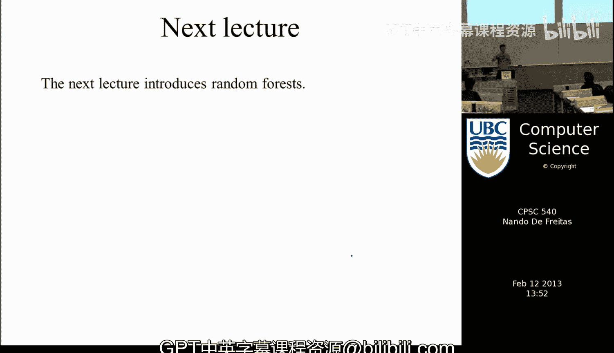

决策树是许多强大集成方法（如随机森林、梯度提升树）的基础。理解决策树是理解这些高级模型的关键。在接下来的课程中，我们将看到如何通过组合多个决策树来构建更强大、更稳定的模型。