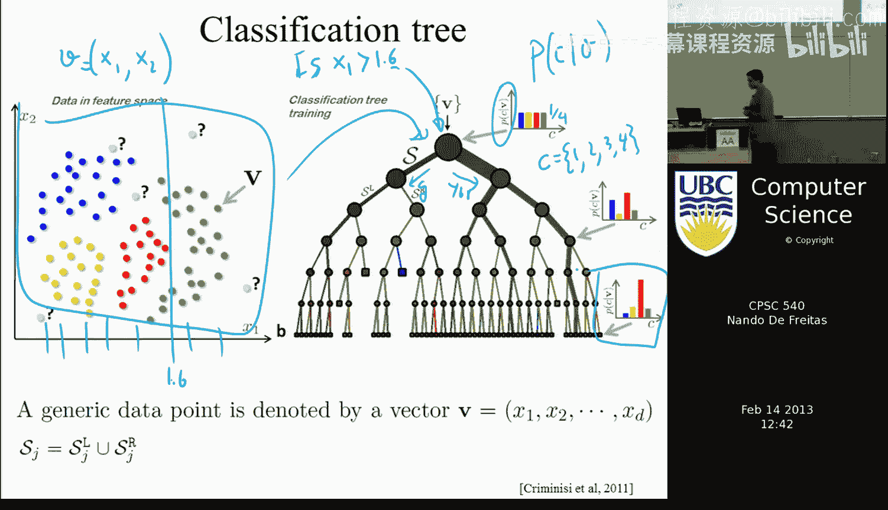
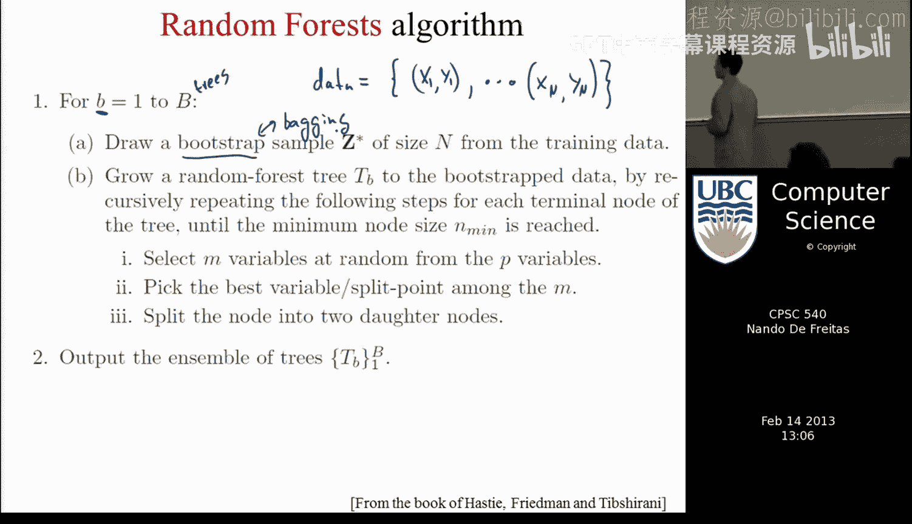
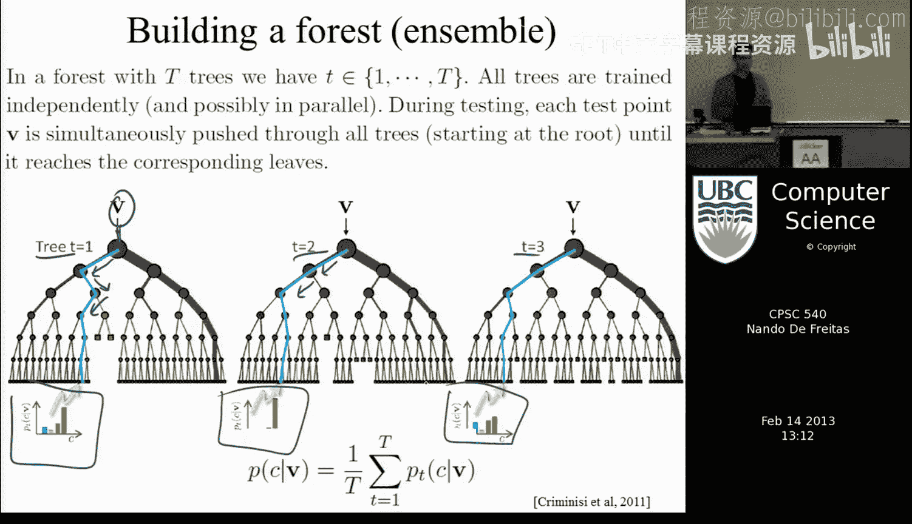
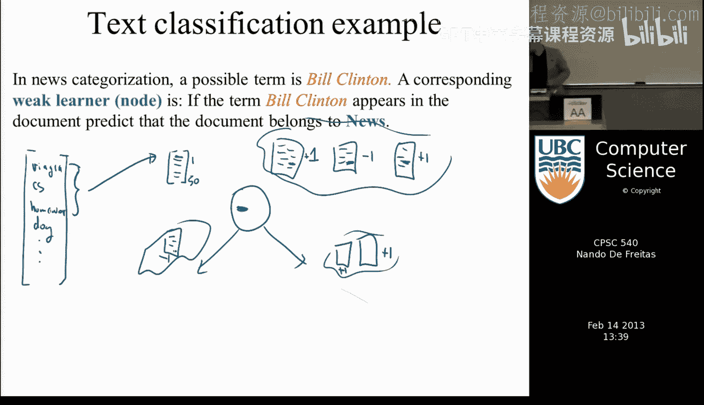
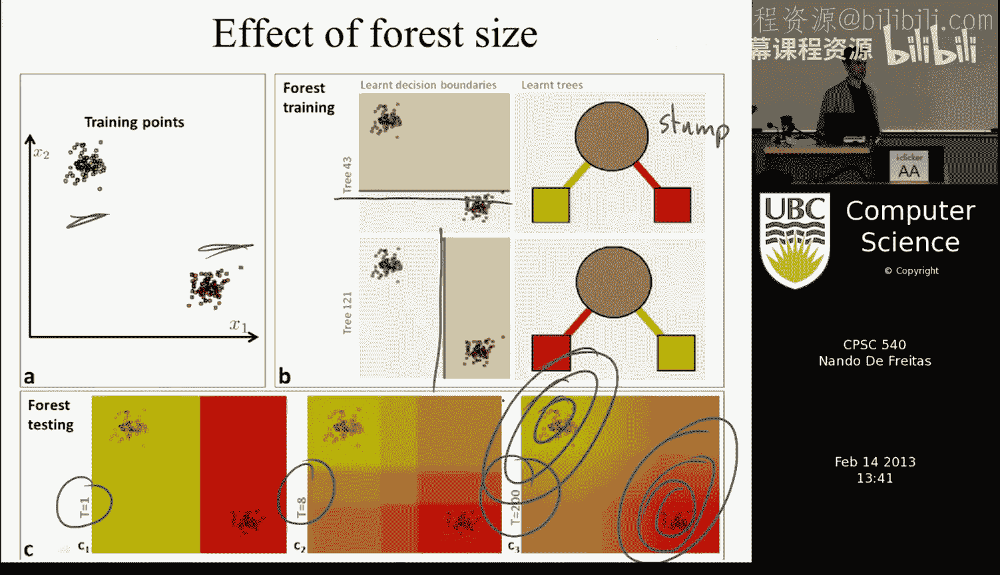
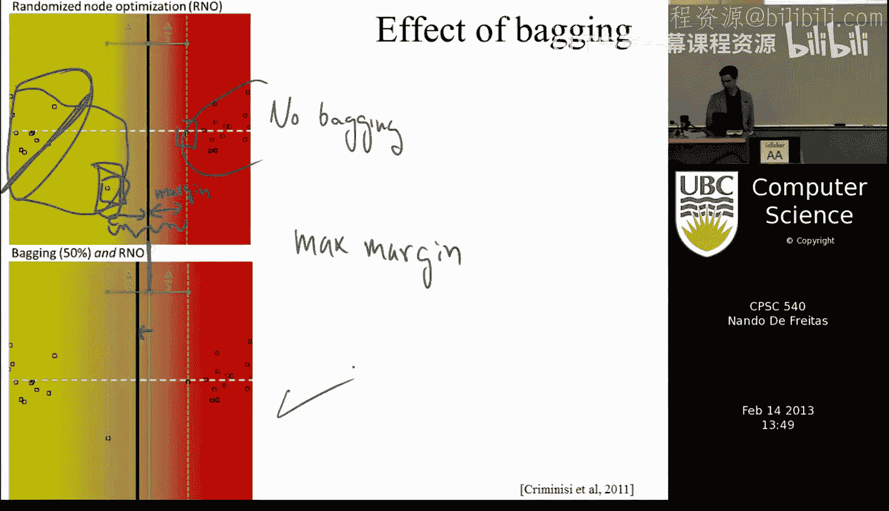
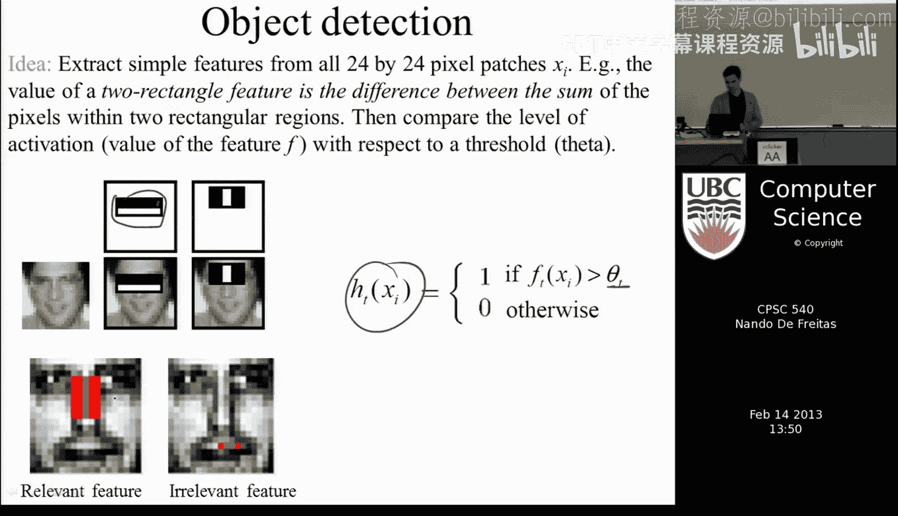
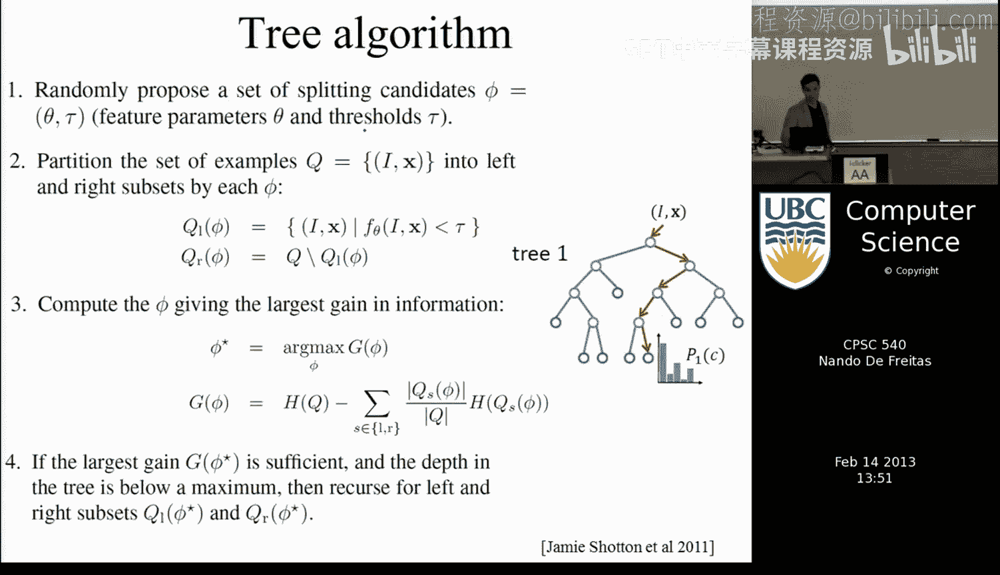
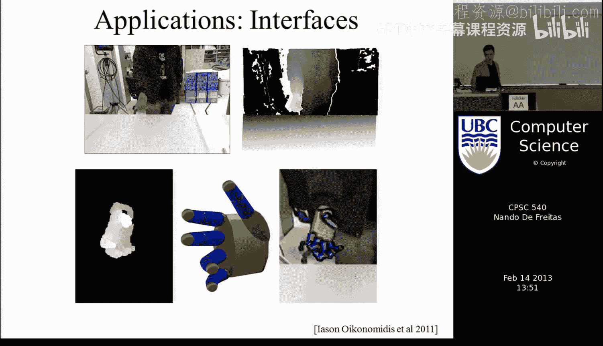
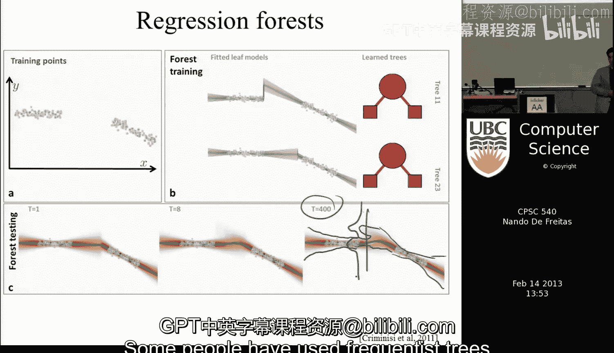

# UBC《机器学习（研究生）｜CPSC 540 Machine learning 2013》中英字幕 p12 -12-Machine learning - Random forests.zh_en -BV19g2FBBEEq_p12-

A great part of the lecture will actually be about how to choose the different parameters of the tree。

 what's the effect of the tree size， if you're averaging trees。

 how many trees should you have in the forest The forest is also known as an ensemble。

So random forests are often known as ensemble methods。

Another very popular class of ensemble methods is boosting。And。

I'm not going to cover posting in this course， but it's sort of very similar to random four。

 so if you get random fours you could very easily go in and understand the listing algorithm。

And then after looking at all these various choices that you have to make。

Then I'm going to talk about some applications， so in particular how would you build a text classifier。

 how would you build a face detector on your phone？Or how would you build。

The type of classification technology that the connect sensor of Microsoft uses。All right。

Going back to Tuesday， the idea is that if we had 2D features that we wanted to classify。

 so we have points in 2D indicated by this coordinates x1， x2。And some of those points are labeled。

 so they have a class label， in this case there are four classes， yellow， green， red and blue。

The idea is whenever a new point V。Starts at the root of the tree。So initially。

As in this picture there's equal amounts of red and yellow and green。

 so at root the root of the tree would involve that whole space where all the points are and so in that space each color has the same proportion so we have this histogram here that just says how likely。

If you are to look。If you are to look in this area。Which happens to be the root of the tree。

 How likely is the new point V to be green， blue， red or。What was that other one， The other color。

And the probability of a point in this space being of any of these four colors is just one over four。

Okay， and so that's what is distribution here， the probability over the class given V is。

And C is just one of the four classes， one， two， three， four。Or if you wish， call them red， green。

 blue， and yellow。And so as we build a tree， we come up with nodes that split the space。

 so when we do a split like this， for example， maybe the yellow，Yellow。

 blue and red will go this way， and then the green points will go this other way。 So a split。

Of the point in 2D that is just using a line and just asking yourself a question， is x1 greater than？

Let's call this value 1。6。And so the question in this node would simply be。Is。X1， greater。Then 1。6。

And of course， V has two coordinates。Every point has a coordinate x and a coordinate x。

 So essentially， you pick the first coordinate of the point。Of any point that you're given。

 a point v arbitrary point V， any check is the first coordinateor at 1。6 or less than 1。6。

If it's greater you send it to the right， if it's less， you send it to the left。

We build the trees during the training set and we went over how to do this in the last class。

 what we tried to do was to come up。And building a tree essentially involves choosing those numbers。

 the thresholds。And the way we built that was by starting with many thresholds and then picking the one that keeps us。

 So starting with a large， finite set of thresholds。And then picking out of them。1。

That is the one that maximizes information gain。So for each threshold we compute information gain。

 the one that gives us the largest information gain， that's the threshold we split。

 and that becomes the node， the node simply checks if the first coordinate is greater than。1。6。

 and then we do the same for the second chor。And if you do that， when you construct the trees。

 you will get a separation of the classes as you go down the leaves。

So when you get a new point coming in， that point just follows the simple test。

 iss the first coordinate greater than 1。6 is the second coordinate less than。Point2 and so on。

 and as it trickles down the tree， it will end up in a leaf。

 and then the class probabilities for that new point V is just the distribution at the leaf。

So if a point ended up here， for example， at that leaf。Of the tree。

 then most likely that point is red。Because all the trading points that ended up there tended to be read。

，So that's just how we construct a single tree and how we use a single tree。And。And as I said。

 you could either do splits vertically。Or horizontal splits。Here is an example with two splits。

Resulting in these two different class distributions for the children。

And then you pick the one split that has the highest information gain， so in this case。

 the information gain for the split at the bottom is higher， so we choose the split at the bottom。

And it sort of makes sense because the one at the bottom has separated。

Has allowed us to distinguish things that are yellow and red from things that are blue and green。

It separated us two， so hopefully the next node down the line will be able to separate green from blue and yellow from red。

O。So。Doing this with a very simple example。嗯。This is how we would proceed。

 Let's assume that we're trying to do classification。And let's assume we have our data， X。

 a matrix x。And let's say that matrix consists of d equal three features。And n equal。Four points。

Or actuallys speak five data。So we would have some arbitrary numbers， I don't know，1，0，2。3，6，1。0，2。

For。eight，9， zero。And I don't know， five， five。W。So these are points in 3D。Five points in3D。

And to this。And so this is for I equal1， i equal2， all the way， I to I equal n equal5。

And then I'm going to use the index J of a features J equal 1 J equal 2， J equal 3。

So this could be for a particular individual， let's assume I have five individuals。

 so let's assume that I have these three guys here and these two guys I have five individuals and for each of these five individuals I've recorded three properties of them。

Their height， their weight。The intensity of green in their eyes。And then I have another label。

 another vector。Because we're in a supervised case， so we have now classification label。

 and that might be something that says， I don't know， 01，01。0。And that would be for I equal1。

 i equal 2。All the way up to y equals5hi。Okay so the Y's are the labels。

 so I have an individual here， there's three numbers that describe him10 and2。

And then I also know that he's of class zero， whatever class zero means male， female， for example。

Now， that's the data that we are given the input output pairs。

And what we typically do when we build a random tree。So I'm trying to go down。

 I'm basically repeating how we build a tree， but using a very simple example。

So how we build a tree is。And especially if we want to inject randomness in the tree。

 and I will soon explain why we would want to do this。And。India's randomness。

 we could do something as follows。 We could say pick。2。Features。At randomand。

If I pick two features at random。嗯。Let us say。That I pick features X。When J equals3。

And x went j equals1。 So I picked the first row and the second row。

I've picked the intensity of green in their eyes and their height。By a random。

 decided not include their weight。Now in doing this， I now have points。Right， in 2D。

Because I have two features。 So it to display。And those points， basically， this would be one point。

The point one， comma 2。And I haven't been careful in how to choose these particular numbers。

 the numbers that I'm throwing in dead， they don't really matter。

 they just I just wanted to illustrate that those would be numbers。Your data usually is numeric。

And so。I can plot that point there， the point1， comma 2， say， and then I can plot the point3。

 comma 1。And I can plot the out of point。And。And I'm going to choose。Say this point。And this point。

 is the other point。Okay， so essentially what I'm using here is I'm doing a color coding that if the label is blue。

If the label is one， I'm usinging the color blue， if the label is zero， I'musing the color red。

And because there points in2 D， there would be just five dots。

 and I would have red three red dots corresponding to the class zero and two blue dots corresponding to class1。

Okay， so that gives me that's essentially how I would construct a node of the tree。

 So the first step is I pick say two dimensions。 In this case， I'm choosing two。

But I could equally well at random decide how many dimensions I will choose。

So I could choose typically D in real data is much larger than say in this example where we only have three features。

 if you're doing text classification， for example， your D could be 100，000。

And then our task is to reduce that huge dedimensional vector， 100。

000 dimensional space to a much smaller set of points in order to make decisions。Now。

The next step I'm going to do。Is somewhat different depending on implementation of a random forest。

 but nonetheless it's the one that I've chosen as a popular one What folks do is they consider the projections of these points。

On each axis。Okay so there'll be the projections on the X axis。The projections on the y axis。

 which is essentially x1。Okay。And now those are the split points。

So this opiates the need for us to come up with。Split points to a set of split points。

 because now our split points are just these five。X points and5 y points。

So there's a total of 10 split points。In other words。

 we're just using the coordinates of the points as the split points。Now。

There are a total of 10 split points in this case， so there are 10 possible lines that I could use to split this node into two children。

The way I do it is for each split point， I evaluate the information gain。

Just using the formula of entropy。I then choose the split point that has the highest information gain。

And if there is a tie， I just praize random。Okay， so for each of these green lines。

I would have to compute the information gain of what would happen if we split the data on the point。

If I do that。Most likely， I will end up with a split point it say looks like。This。

 so I suppose I picked that point， and I decide to split the knot on that point because that point seems to have high information K。

Then what that means is that in my tree is doing the following thing。Justs throw those points here。

Right， and we need the blue points as well。Let's draw them。So we have。Here。And here we with that。

Okay， so the purple line essentially creates two children， the points to the right。

Including the point on the boundary， you just need to make a choice as to whether the boundary goes left or right and be consistent。

 the points on the right become the right child， the points on the left become the left child。Okay。

 so we started。We started with a distribution here。

We started with a distribution that had two out of five blue points and three out of five。R。

And now we have a distribution here that has two out of three blues。And。One out of three red points。

 And over here， it's very nice because over here we have。Just red points with probability one。Okay。

 so that's how we go about constructing a tree。And we inject randomness。For two reasons。

 the first reason is because if you just。If D is very large。In this case，3 is not a problem。

 but suppose the D had been 100000。Then for each of those 100，000 points。10000 dimensions。

 you had 1 thousand0 points， that's how many information gains you would have had to evaluate。

 so the computation would have been very large， but by choosing a subset at random we now only need to evaluate the split points for just a few points so I'm going to take one two three。

I was wondering when choosing the split line on a particular dimension。

 is there a reason that you have to evaluate at each of these points as opposed to having it like an optimization problem where you're trying to choose the position on this access that gives you the greatest information gain？

That' in fact， evaluating at all points is the same as optimizing for that with're doing the optimization problem by enumeration。

Because the idea is that we've chosen just a few of these points， in this case there's only10 splits。

 so some enumerating ten splits are something that we can do very fast。

But if you wanted to use more splits， then you would have to use some smarter discrete optimization algorithm。

I was wondering whether it would be possible to avoid having to do evaluations at every point。

For example， if there is a closed form formulation that would give you what？

Value on access with give no no， there isn't in this case。

 What you could do is you could use more dimensions and you could just run。

one of these stochastic local search algorithms， for example， and you could do something greedy。

 that wouldn't be guaranteed to find the best split， but since we were injecting randomness。

 that might not be such a bad thing。I do not know what would happen。

 I haven't tried that or don't know of any paper yet， tried that。

 but this is something you could experiment with。How do you choose that？Features。全知して。

Say uniformly at random。For now， we will assume that we're doing uniform at random。

 maybe there's room to do something smart。So take your data that's really noisy。

a few features are actually。行。Haha that's the key question if we're building a single random tree and there were 100。

000 and we're only picking two and we repeat in this operation。

 then this is how we're learning a node and then for the children I would just repeat the same operation again。

 I would pick features at random， I would split compute information game， et cetera， et cetera。

But of course。Like if you start playing a bit with probability， you realize， well。

 I'm choosing two or 10 out of 100，000， I keep doing that per node。

 what are the chances that I'm actually going to hit on the important features？

And a single random tree by itself turns out to not be a very good classifier。But when we combine。

 when we take many trees together， we will get very powerful classifiers。

 so that's what's going to be in the next slide。一直在。Okay， and so here comes the random force。

In short， what the random forest will do is we will construct。A tree。Randomly， like we've just done。

And we could construct a tree in one machine。A tree in a different machine。And so on。

 so it's a completely distributed algorithm。Is there any。Features you gain from randomness。

 or it's just for complexity。Oh yes， I didn't get to the second point indeed the first point is you reduce computation time。

 the second one is randomness will actually turn out to be useful。

SoRandomness will turn out to be useful， and let me try to illustrate that with some example。

I will provide you with an intuition， but let me first cover the algorithm and then I will tell you why it is that the algorithm makes sense and why randomness is a good thing。

Okay， so the algorithm is essentially， you take trees and you sum them。

And divide by the number of trees。So how exactly do we do that？嗯。

The algorithm has two sources of randomness。One is randomness in the data。

And the other one is randomness in the splits and the features。Let's analyze it。Step by step。

Let be denote a single tree。Okay， so one simple tree。

And we're going to build a forest that has capital B trees。Then next， this is how we build each tree。

We have a data set of end points。Okay， so we have our data set， which is x1， y1。All the way。2 x。

 NY n。Okay， just like in a simple example before。嗯。Now， in order to create even more randomness。

 we're going to assume that each tree gets to see of a different data set。So。

What we do is we take our end data。And with replacement， we draw uniformly at random。And data。Okay。

 that means that some point might be picked twice and other points might never be picked。Now。

 I chose this version of the algorithm from the book that's on the website。

 the book of the elements of statisticalt learning。

That has a very nice section describing a very nice chapter describing random forests。

And this is the version that Leo Bman， who is the person who proposed around forest about 10 years ago。

 came up with。This step。It's called bootstping。Or it's also。Related to something called bagging。

 and I will soon explain what bagging means。But the idea of drawing at random。Data sets。

And then using different data sets to train different classifiers is something that's called bootstping。

 and it's a technique that is used often to assess how good what's the confidence that I've had estimate a good parameters。

 so it's a way of doing complexity control and statisticians often use it as an alternative to cross validation。

So the idea is you draw data points at random， you train on those and then you test on the remaining ones。

 and you repeat as many times and then you average your results and that gives you sort of an estimate of how well whether you have the right model。

 the right parameter， it gives you a confidence of how well you do it so sometimes when you estimate a parameter from data and you want to know where 10 data points good enough to estimate this parameter。

 how good is my confidence and this estimate， you would do this technical but struck。

I'm not going to go into this model evaluation technique， so I'm not going to attach on it。

If the technique is used simply for combining many estimators， and for example。

 here we're combining many trees， this process is called bagging。So backing just means。

You construct each tree on a different random subset of the date。Now。

 Leo liked the idea of because of the connection with bootstping and being able to get on biosyst matrixs。

 et cetera， big story， he liked the idea of choosing end data points。

That is choosing end data points from a data set of endpoints， however， for computational efficiency。

 we might want to choose less than end points， it would be great if we could say for example。

 just choose square root n of the points。And then each tree gets only trained on a subset of the date。

Okay that in today's world where data sets are so large， you can't just。Load the data into memory。

Okay go and work for a company， Google， you're not going to load your data to map。

That's not going to happen。So what you can do is split the date and you can load the date into different machines。

chunks of data go into different machines。Even if you're using solid state RamM and the latest。

You could have to do something smart。when you have a lot of date。

If you loaded a subset of the data in a different machine。

 now you can learn a tree on each of these machines in a cluster。

And each machine only sees say square root n of the data points。And。Without proof。

 there is a theoretical result by Luc De Roy colleagues that say that。

 if you in fact do this sort of thing。You guarantee to have an estimate that is consistent。

 just like maximum likelihood， in other words， as you number of data goes infinity。

 you have something that's provably convergent。Moreover。

There are some estimators which I haven't covered in this course。

 like the one year NAPO classifier that actually by themselves are inconsistent in the limit as the number of data goes infinity。

 they don't give you the right answer。But if you were to distribute the end data points across square root n machines。

And you do this averaging， then that estimator is actually consistent。

Which is a remarkable result because something that gives you。

The opportunity to actually be able to compute also gives you something that is statistically correct。

Free lunch theorems like these don't come often。And science， it's a very cool result。Yeah。

 ra are awesome for many reasons， this is one of the reasons。

 so the idea of averaging estimators is simply what we call backing。In this case。

 we are the terminology would be that we are bagging trees。

But you could bag other estimators and why bag trees and not bag other things That's something that I'm going to come to when we talk about randomness。

WhatWhat are you evering？あすき。Oh， so what Im marvel， let me try to give you a picture。

Suppose I have three trees in my ensemble， my forest。嗯。And let's assume that I use the same。

 so I have3，1，3，2，3，3。Now the same point。Now each tree is different。

 each tree was constructed on a different data set。Moreover， each tree， when you build the nodes。

We followed the procedure that I outlined a few minutes ago where we use at random。

 we choose the features。With that being the case， if you're doing things at random H3。

 will it be different because it has seen different data and it has seen different features。

So when you get a point。In the test data， say you get a new point V。

For which you don't know the label， you don't know whether it's a red， green， blue， or yellow point。

You just follow that that point goes into tree and follows the decisions。

 is it greater than a value or not， if it's less， it goes less。And so。For a different tree。

 the node will follow a different route。Now each tree， eventually when it gets at a leaf。

 these are the class probabilities for that。For that point， we。So under the first tree。

 that point is most likely to be green。But it could be a little bit red or a little bit blue。

Under the， the second is very confident that the point， the same point V。Is green。

And the last tree is sort of less commitittal。Averaging just means you take these four histograms。

Which is four vectors of four entries that add up to one。And you sum to three of them。

 and you divide by3。At three vectors divide by3， that's what I mean by average。

So that the histogram P of C， which is the probability of each color。 C is the color。

And there are four colors， so this is a distribution defined over four values。

 which is essentially the histogram that's being shown there in the picture。

 it's just the sum of the individual histograms。 this averaging is done at the bottom of the tree。

 That is correct。 So if it's such a powerful result， why not making it also during。branchesrenches。の？

So。Depends on， depends on how you're deploying this。 If you， I mean。

 you might want to make a decision before reaching the leaves。

And you might want to do intermediate decisions， and you could completely do that。

There is no reason stopping you to do averaging at any of the nodes。You could make trying to。

 it's an any time algorithm massage， so you could make decisions just not to root note or the next node。

 or you could make decisions after a settlement of time has elapsed。

Well each tree is randomly constructed different， so there's no notion of the same node。

The same carry her。That is correct。That is correct。

 so all you would do would be you could averaging in the sense that if you have if four or tree。

 five minutes have elapsed， you check where that point is in the decision and it's that cell that determines the histogram for that point。

And so you could do it tag again for each tree and then averaging would make sense。

So here we're using depth as the decision to2， but you could use time more some other fact。

you have 10 trees and 10 probabilities。 Is the meme always the best way to combine those？No。

So the mean is one way to do it。 Another way to do it to take。I mean， there's the arithmetic mean。

 some people like to use the geometric mean when we get into dropout nets。

 which is a form of bagging later in the course， you'll see that I will make arguments for using the geometric mean instead of the arithmetic mean。

And then。Part of trimming outliers say like。听懂了。Or I don't know do things like that。

 Yeah just't say the media or whatever， you might want to do that。

I don't know what the effect of doing that， or。I can't think of an example where people do that。

I can imagine that there's a whole other aspect to this is hard to combine， which is the average。

 and it's something definitely worth thinking about。Because mining probability in general。

 like if you have a000 probability the same probability and so this paper that I'm using for this。

 which is the one that I've made available to you guys in the Google group is by Antonio Criminisi。

 it's actually a book， it's a short booklet。He actually he talks a bit about this。

 so for example even suggests that averaging might not be the one thing what you want to do。

 what you want to do is just take the product。So in other words。

 take the conjunction as opposed to the disjunction。That's correct。

 and that might be interesting in some cases to do that。

And that often will depend on what is your problem， what is your data and what？

Or things about the date are important to you。

But by and large， I think the average is the arithmetic average is the one that if you download code will be the default。

Okay let's go back to how we construct the three， so we said each three will only see a subset of the data。

 and then the rest is essentially the next three steps which are outlined here is essentially the three steps that I described when I constructed that very simple example。

 we select M variables， so here they're using the variable P to indicate a total number of features and this is saying just choose a subset of the features。

Which is a subset of size M of the features。We then choose a split point。And then。

Whatever the best split point is， we use that split point to split the node into two。

Doaughtctor notes。就这。And then the output of the algorithm is just all the trees。

And once you have the output of algorithm， we're going to combine the trees by simply average。Now。

 one detail just for completeness is that。If all the parameters of the tree is given by theta。

That is this would be all the possible thresholds for the data。

 then each node only has access to a subset of those thresholds。

So that's clear we chose a subset of the features and so hence there's only a subset of the thresholds。

 and then the decision that's made to choose the best threshold is to just maximize the information gain。

As before。So that equation is just basically saying what I said here with this picture。

 which is consider all the lines。All the green lines and then pick the one that best splits the point。

And the way we define best split of points is by computing information gay。Okay。

 so Den leaseesis with an ensemble。And our will clay and assembles work extremely well。

 So the question is， why do they work so well。I cannot go into the theory。

But it has a lot to do with one simple way to think of it doesn。

In terms of the biased variance dilemma that I ask you to look at in your homework。

Trees by using randomness in particular， are extremely high variance classifiers。

So each tree is a very high variance called the fire because you just。

Ptuurrb the randomness in one node which features you get。

 or perturb which square root n data points you choose。

 and you would get a completely different decision。It' a very different decision。They are correct。

Each tree is correct， except that each tree is only seen a little bit of the data and a little bit of the features。

So they are correct， but they're missing a lot of information。And as a result。

 so you can think of formalizing this there。We're eliminating the bias by using very simple decision。

But we're introducing variants because each tree is very different from the other trees。

 So there's high variance among these trees。Now。Let us also assume。

That because of this discrete structure of the trees using threshold。

 that these trees are not very much correlated with each other。

So then the argument of why trees work well is sort of as follows。

And I'm only going to give this argument with。A picture without going into the details。Suppose。

You're doing regression。And you have Y， and it's easier to make the argument in the regression context。

Suppose that you have a true value of y。And let's say that the true value of y。

Its just that horizontal line。Now。I haven't told you how to use trees to do regression。

 but I will come to it soon， but let's assume that I use trees to do regression， then one tree。

 because it's only seen a little bit of the data might come up with a regression function that will look like this。

So its bias is。Very low， but it's very high variance。Okay， it's oscillating about the truth。

Now we pick another three。And that tree only sees a subset of the points。Okay。

 assuming that this thing was built。Maybe this was the data that gave rise to this。

So this is sort of a regression problem， just what mygraine points and I fit the line there。

Of course， I'm not fitting a line， but imagine I'm fitting， say some RBFs。

Now let's consider the fit of another tree， another tree might go like this。Okay以。

So a different function will。Do a different fit。Now， what happens if I average these in this case。

 where I carefully drew them so they would be sort of anti correlate。If I average them。

 I get the truth of something very close to the truth with the black line。

So if you have many estimators that have。Why do selection about the truth， they have high variance。

But they're are unbiased。And you average them and provided they are not correlated。

Because if they were correlated， there would all be similar lines， similar curves。

 And so on averaged them， I'm not going to get something like the black line。

But if they aren uncorrelated， they're very different lines， when average them。

Averaging will get rid of the variance。 so if you sum blue plus red divide by  two。

 you would get something close to the black line。That's intuition， why trees work。

We bag trees because trees tend to be very different from each other。

 so that sort of guarantees that they'll be uncorrelated。

A lot of machine learning techniques do tend to give it the same solution no matter which bit of data you look at and no matter which features you use。

 so those would not be good for bagging because those would be very correlated when you average them you wouldn't change。

 things wouldn't change much。For those of you who did 340 things like logistic regression。

 for example， wouldn't be very good。But trees， because they tend to be highly random。

 tend to be very different from each other， are excellent for this。So when you' average them。

 you get。If you look at Leobriman's paper， this is a essentially。

The argument that he gives for why randomand Forest work。

Develop a theory of why random forest are consistent is a much harder。And。

 for some types of random forest there are results， for the general random forest algorithm。

 the result is still open。All right。I'm going to look at an example now。

 and the first example that we look at is how we build text classify。Now， for a text classifier。

 you have words， supposeupp you want to build a news detector。

 something that goes on the web and detects whether an article is news。

So then it would look at terms that might indicate。

That it's a news article like Brecking Story and so on。But an even much simpler example。

 assume you want to build a spam detect。A spam message comes into your folder， it has words。

 so the words are the features。And you just basically check which words are present and you use the presence of different words to decide whether the message is spam or not spam。

 for example， if the word Viagra is in your message much more likely that it is spam than not spam。

 if you happen to not consume Viagra that is。Okay so。Essentially。We have a dictionary of words。

Which include words like Viaggra， CS， homework。嗯。I don't know。Dog。Et cea。

So we have a large vocabulary of boards。And that vocabulary is well as large as English terms。

 So Wikipedia， there's 2000 pages， so there's。Sorry，2 million， there's about2 million terms。

 of course there are way more terms than just this2 million。

So this could be something as high as 2 million。这别。So you have those two million terms in that list。

And what we're going to do is we're going to uniform at random， choose 100。

So we take a subset of these at random， not necessarily continue one after the other。And now。

Once you choose that subset at random。And we're going to assume as well that when we're constructing this random forest that we have labels。

 yet again we're still doing supervised learning， so you have a message and a label indicating whether it's spam or not spam。

So now you take a message。So you have a subset of features that you're looking at。

 say 50 features out of the two million features。There comes a new message。Okay。

 and that message also has。A plus one indicating that it's spa。 So that's your email。

 basically all these words， whatever。Now what you do then is for each of these 50 words。

You check whether the word is present or not present in that email。

And let's assume that we don't have just one email， but we actually have now a database of emails。

Which some of which are spam， some of which are not spam。You take each of these terms。

 you check their presence。In each of these emails， so for example。

 this green term might appear in this email， this might be the word Viaggri。

I wouldn't appear that that。But it would say it appeared there。

So this particular green term is splitting your documents into two sets。So if you check。

 is green present？By checking whether green is present。

Just splitting your collection of documents into。Two documents。There are negative。Oh， sorry。

Negative in the sense that they are positive， their spell。And one document。

That has labeled minus one。Now， when you choose， I chose the green one。But because you have 50。

 what you would do is for each of those 50 words。You would check present in the documents。

And for each of those 50 words， you would compute information gain。Award is a feature。

 and award is just like an attribute， just like the attributes that we had before， like patterns。

 are the patterns inside or is today Friday。A word is just a discrete binary feature。

Is the word vi in the document， yes， no that splits。The training data nicely， and so by doing that。

 we split the training data， we construct a tree。We do this many times。To build many trees。

 and then we average these trees， and that's what we use as a text classifier。If you do that。

 you can build an extremely good text classifier。You can classify the entire web， for example。

 into categoriess。It will be that computational like feasible。す。Different at each node of the tree。

 but that's also design choice。 Some people like to do randomize the set of features at each node。

 Some folks like to。Just start a completely different set。So just keep the same set。

Do we need to make sure that all of the switch award has to be within all within the subiveque？

Mike do you need to make sure that all of those feature words has to be present in the collection of subsets？

Like that each subset that we use for each tree， do you need to make sure that the collection of of the subset would make the whole collection of the。

啊。You I wasn't able to follow it。 They need to make sure that the let's be concrete。

 The subset of features are you talking about。The vector on the left， the vector of 50。Yeah。

 so if we accumulate almost 50 feature words， that would accumulate to the whole list of those million feature words。

Oh， you mean you want to use all the 2 billion， excellent questions sorry I didn't understand it。

 but it's actually an excellent question。And the beauty is that norm。

There are many words you will not need to consider。Of course。

 you could miss an important word like the word Viagra。

But the way you would do it is you would probably construct a list of words there based on the frequency of occurrence of those words in。

Emails。the frequency of currency of pluspy， so English has this property that some words are used a lot and many words are used very rarely like loquas and so on。

 so you probably would not pick lowqua。So if you do that。

 now you have some words you would pick with higher probability than others。

 so you wouldn't do things uniformly at random， but you might choose to choose some words with higher probability。

 so some features are more important than others。But in addition， when you speak。

After you've picked 50 at random， you're only going to choose one of those 50。

And you might put some flag in your code that says， you've already used that word。

 you don't want to use it again。So you would example that word again after you've used it in or know。

49 of those 50 will be rejected。 There will not be good words that you will use。

So at the end of today。The number of words that is deciding whether this message is spam or not。

Is the number of nodes in the tree？So although originally we had a very large number of features。

2 million features， now we have learned that if we want to decide whether something is spam or not spam。

 we only need say。20 features if the tree has 20 nodes。In other words。

 we not only built a classifier， but we built a system that actually tells us which 20 features are important out of the 2 million。

So we've been able to do feature selection。If you're doing DNA microre classification and you'd have 20。

000 genes， this would tell us。Which 50 genes we should be paying attention to when we're trying to predict whether a patient will react well to treatment or not react well to that tree？

Now， for a single tree。Again， this might give you a cruammy estimate because there's a lot of variance here。

 this is a lot of random。But when you average many trees。

 you will get a pretty good estimate of that。And so what you do is you。

 if each tree gives you 20 words， you just count those words in all the trees。

 you check how many times the same word appeared across all the trees。

 and then you get a chart which basically tells you the importance of each word when you separate spam versus non spam。

And there's a bit of， I don't have a slide for it， but it's in the book in the textbook that's available online on the course website。

 the book of the elementsement of Stat learninging。

 in their chapter randomand four is they actually have such a plot like that where spam classification they show you bars indicating the importance of each word。

So not surprisingly， words like offer and。Vaggri and so on， that will have a high probability。So。

Trees are great。Reandom force are great for this， that even though the feature sets are massive。

They will be able to identify a subset of those features。

In a reasonable amount of time and be able to do classification。

So I've worked with teams who've actually classified 100 million text documents into many classes。

 the numbers of features were thousands of features。

 and those teams were able to do this within a couple of days。There was one there。Yeah。

 kind back to my previous question regarding the benefit of randomness in。

We decide according to the measure of entropy， so if you do this randomness。

 does it help you in a sense？就。Instead of taking the horse instead of using the。

You do need to somehow have so some yeah， so yes， it helps。

 So some people do do this completely at random。Without thinking into consideration the class label。

 and those are called， I think the terminology is pure random forest us， as in purely random。

 they don't do as well in practice。And again， information gain is one thing people use。

 people also use variants， they use gene indices， they use many other things。

 so I'm giving you one version of the how to build a random forest。

 but depending on the implementation out there they'll be different。

 you if you change here and there， it's a very modular thing so that's probably I don't know 50 versions out there。

My question was regarding comparison of the London tree to taking the whole set of data the king。

The decision， the way we learned on Tuesday。Pdon。So comparing the random tree。

 the random forest I guess to what we learned on Tuesday。

 which is to take the entire set of data divided to a single。Oh。

 a single tree and the whole data versus just using a forest， so the forest will work better。

In practice， trees are still very high variances， even if youre to use among the large data。

 the trees could be made to be consistent， I mean， as N goes infinity could make both trees and forests be consistent。

 give you the same answer， forest tend to be a lot better than practice and again do not forget the argument I made before。

 which is if you have a one nearest neighbor classifier。

 a single nearest neighbor classifier with an infinite number of data will not give you the right answer。

But if you just give score root1。Data to several one years never was highest and the right growth rates for the number of trees and the data。

 you will get a consistent estimator， so it's possible to make a consistent estimator out of a non consistent。

Estimated just by using bagging。So that's， again， very powerful theorem。信身嘅。Of course。

 by doing this randomization and picking a subset， you sort of start fig out way。

Features are more important。中国人怎样。How does this compare to something。Laster。Good question。

 so most of the class hasn't looked at last suit。But there's this other optimization approaches that we will come to later in the course I allow you to select features to decide which features are important I mean that you can imagine is an extremely important problem in。

everything that you do with machine learning is which genes are important because once you know which genes are important。

 you know which genes you should treat， these are the genes that are responsible for the patient having cancer or not cancer。

 therefore when we do research， these are the genes that we should experiment with as supposed to be experimenting with the whole genome。

And you， many more applications。嗯。One of the nice things about using trees for feature selection is that they're very scalable。

If you are doing last Su with two million words as input， that'll be a huge coordinate。AnOim problem。

So trees construct the features adding one at a time。So to speak。

 you add one node then you add one another node and so， whereas methods that go in batch。

 they start with all the features and then they tried to prune。

 but they might be more computational expensive。嗰啲跟啲啲线啊。Not necessarily。There was another one。嗯。

Training set。 How do you choose the training set。In the beginning， you said it's uniform。

 And when you had the only one to now。Do you choose it thatan the etc？

So could you please speak up the training set you choose it at the random the training set， yes。

 the training sets assuming to be random because you're drawing it sets at random for frequencies data is the random quantity remember that。

For a frequent， the data is where the randomness is。Arises， because for a frequent。Andcertainty。

Only exists because you haven't seen an infinite number of data。

It's because of partial observability of the world that uncertainty arises。In the Bayesian setting。

 that is also true， but in addition there's uncertainty in the parameter。

So people acknowledge that there's priors of a model and so on。But yeah。

 the randomness is always in the data。In everything we've done。

 it might seem like always the assumption was that。The randomness was induced by the date。

So I'm wondering if you're doing this。All right， so I'm going to come to that example。

 any more questions。I I think it be like。That's correct， we're still assuming independent data。

 we're not dealing with a time evolving system or so。

 it's possible to use random forest for tracking and so on， but tracking distributions。

 but that's not what I'm covering here。I'm doing something basic first so that we assume that today date is dependent。

And then if you're interested in doing more complicated things， then。

Come two office hours after this lecture， I'll point in the right。

What you what we should do during the test process， if the provision， for example。

 being read is about 。9 at specific note， which is。Different from which is not the。

 which is different from the terminal node。 which is not the terminal。

You guys seem to be focusing too much on this of not reaching the terminal node。

You don't need to reach the terminal node， so if you stop at the node before。

 then just use whatever the probabilities are there。But if you。

 obviously you built more nodes because you believed that there was a reason to build more nodes。

 so if you did built more nodes and you did some complexity control where you chose height the level of the tree to maximize say gross validation performance。

 then it stands to reason to just follow the path to the leaves。

That's what you would typically do in practice。

Okay。So I won' to get to the examples today。 I think guys are asking some brilliant questions that will be。

After the spring break， I will finish this lecture。嗯。And I will be just going over the applications。

 And in fact， it won't be me。 It would be one of my。

One of my grad students will finish this lecture for me。

But let's just look at the various parameters in this construction of the tree。So first of all。

 how many trees should we average？And so here is an example from the book of Crimins and colleagues where these are the training points here。

So you have a cluster of points here and a cluster of points here。And then。Next， they show you。

Two trees， and these trees are often called stumps。Because they's just like a tree stump。

 which just a very simple shallow tree。That is a treat that just splits the data set。Into two groups。

 and there's one tree that does a horizontal split。

 and here's another tree that does a vertical split。Now， if you only used one tree， so one tree。

 this is the kind of classification you would get。If you use eight trees。

You start getting a more interesting decision boundary。

And here the intensity of red is how much you are of one class。

 say class1 and the intensity of yellow is how much you are of class2。

And then as the number of trees keeps increasing as you go to 200。

 then you get the sort of smoother separation。Okay。

 so more trees give you better decision boundaries。In this case。

 well give you a smoother decision box。Of course， we're estimating probability。

 so you could think of this， in fact， as the contours of a probability distribution。

You could even feed fit two Gaussians at these points。

 so that would give you a very nice model of the two classes。

Another thing that。It's worth keeping in mind is that in this construction。

 it doesn't matter whether the labels are binary or whether there's three labels or five labels or 10 labels。

 the number of labels doesn't matter trees。Work well independent of the number of classes。

So for example， here is an example where there's two classes。And as you can see， the trees。

Build a nice decision surface。嗯。When there is four classes， again。

 they're able to split the points in a very nice way。

And then the next figure shows you what happens as you add noise when that is when the classes tend to overlap more in this spiral in the middle。

 those points are very， the yellow ones are very nicely separated from。

The green ones and the red ones and so on， the right hand side is more like the kind of data you usually get in real life。

 where there is's noise and the classes overlap， but even there with noise trees give rainforests give you a pretty good solution。

The next parameter we examine is three depth。How。And this kind of goes back to the question where to stop in the tree。

 So if you build a tree that is very shallow。As we do here for d equal3。So the depth of three levels。

 you might have what we call underfitting， so the decision boundaries tend to be very sort of hard。

 very coarse。If you on the other hand， build the trees that are very deep。

Then you start doing overfitting because you start coming up with these decision boundaries and start going and paying attention to too much detail at the boundary。

 like for example， like here it's the decision boundary is going like this to basically grab those red points。

Is putting a little bit of right there， so it's becoming very fine。

And we know what the problem with that is， if you pay。If you're。If you have data。That looks like。

This， and if you start making a decision boundary that Luke goes and does this。

I don't know something like this。Then when you get test data。

 it's not likely that that curve is going to be a good separ of the test data。

As opposed to something of lower complexity。For example， something like this。Okay， so again。

 it's the question of complexity control， how weak should our function be going through the points？

How do we answer the question of complexity control in this case？Cross validation。

 you would do cross validation to choose the number。The depth of the tree。

 But now we start having a lot of features。 We have the depth of the tree。

 We have how many features we should sample at random， how many data points we should bag。

We're in the bootstrapping procedure。嗯。What's the maximum of points that we consider dimensions。

 should we use information gain or variance？Very quickly， we're getting all these choices。

That we have to deal with。How could you automate these choices？Beiジのic Thank you。

The technique you learned last week， you could apply it on top of the tree。

All these choices are just random parameters of your algorithm。

So what you would do is you use GPSs and base optimization。

And you define a GP over all the choices that you're making。You pick one parameter。

You evaluate how good a tree is in terms of cross validation。

 how the forest is in terms of cross validation。And that gives you the error for bas optimization。

 then you try a different set of parameters and you cross validate to。Of course。

 course validation is very expensive and building a forest is expensive。

 so you want to do this as few iterations as possible。

 and that's why you balance exploration and exploitation。

Beautiful course project for anyone who wants to do that。嗯。

This slide here shows what happens also if you， so some folks， in fact， the Microsoft guys that。

What a connect， which include， you know these guys that wrote this report。

 They tend not to do much bagging。 That is they don't subs samplele the data。

 So they skipped that with strapping。And whether you do it depends on the following。

So here we have points of one class， the yellow class or these points。So we have these points here。

 which are class yellow， and we have these points here that are class red。Here there's no backing。

When there is no bagging and you apply a forest， what you tend to find is that the forest finds the point。

There are two points that are closest to each other of different classes。Okay。

 what's the yellow point that is further to the right and what's the red point that is further to the left？

It then smack in the middle， puts the decision boundary。

So that any point to the right of that black line or decision boundary， also known as a discriminant。

 would be classified as red and any point to the left would be classified as yes。This property。Here。

Of trying to maximize。The boundary between the two is called the max margin property。

So random forest， when there is no backging is essentially max margin plus this distance here is called the margin。

There are other machine learning techniques known as support vector machines。

 which are classifiers that they are also designed to purposely maximize as margin。

When you do backging， you find that whereas this decision boundary was over here。

 now the decision boundary moved a bit to the left。

Why would it make sense to have that decision boundary moving to the left？Outliers precisely。

Because theres。This guy is a single guy who's very far from every all his friends。

 and yet that guy is having a huge impact in the decision when you don't do backgging。

If that guy happened to be just a single point that someone mis labeled。

And your data often has a lot of mislabels because the people that you pay your label。

 they're just trying to make some money on Amazon and don't really care about your data。

And if that's the case， then this might be the better choice。In fact， backging gives you。

This immunity to liars。At least as this example of shows。All right。

I'm going to cut it here， but let me just give you a gist of what I'm going to do when my student will over after the break。

 he will basically tell you how to use very simple features to do so you come up with very simple decisions。

Like you take these very simple windows and you count how many pixels are of one class。

What's the intensity of the pixels？In the black square was minus the intensity of pixels in the white square。

 and if that's just you call that M。And if F is above a number。t2。

You split a tree to the left and to the right。 If you have many very simple features， Again。

 these simple features are like words。 A word by itself has no power in deciding whether something is spam or not spam like the word offers well。

Many words have very little power and many of these simple decisions。In visionion。

 using very simple features would have very little power。

But when you combine them into trees and when the average of these trees。

 we end up with what you guys have in your consumer cameras， some very good detectors。

And so you use these very simple features， and in the end。

 your classifier is going to be a result of many of these。

And you can do all sorts of detection， not only faces， but pedestrians， cars， hockey players。

 your kitties and YouTube and so on。My student will also go over the Connect which is the sensor that gives you these grayscale images and then he will show you how the Connect can do the classification of all these I think I'm actually going to ask David to teach this David was actually an engineer at EA for six years working to a large extent on this device on the Connect。

And he came to do grad school with me because he realized。To do well in industry。

 you need machine learning， at least if you're working with this technology。

So here we will go over this， which is essentially random forest classifies what they use。

With very simple features。嗯。

And then finally， one of the things that。He will cover。

Is that just like we do forests for classification， you can use forest for regression。Again。

 there would be a split point if this is your data， you would use a split point。

This split the data into two nodes。And then in each node， you fit。Ainium mode。

Now you guys all know how to fit linear models， so this would be just a combination of what you know and searching for among all those points for the best split。

And that would allow you to build。Very nice classifiers。And of course。

 there's the frequentest and Ba ones。And。know he'll go over all this in a lot more detail than I've gone through。

 but I'm just trying to give you a gist so that you can think about projects as you go into this break One of the things you get when you do regression is if you have a data set that looks like this。

You might end up with a random forest fit as you increase the number of trees。

You will get say with 400 trees， you'll get these very nice decision boundaries and note the following property。

Where the data is， there is no uncertainty。Or there is little uncertainty， I mean to say。

 where there is no data， on the other hand， the uncertainty is large。

 so it gives you what we wanted with calcium processes。Moreover。

 there are certain parts where there's multiple hypothesises at play is would the point here be a continuation of the line that's going up or would a point be a continuation of the other line。

 so there's two possible hypothesises and that's why if you were to cut。That。

 and look at it sideways， your distribution would actually be。마天猫。No longer single Gaussian。

 but even though you're just fitting single Gaussians in each。A line。

You now end up with some very interesting confidence intervals。actually have our multi model。

Project idea。Basin optimization is done at nauseum with Gaussian processes。

 and some people have used frequent trees to build to do basins optimization。

